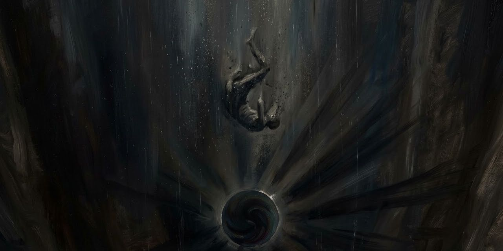

14 de octubre de 2026

# Ce que dit la bouche d’ombre

Victor Hugo

«Ce que dit la bouche d’ombre» significa «Lo que dice la boca de sombra». Es el poema de Victor Hugo que cierra el libro VI de Les Contemplations (1856, poema 26): un espectro le habla al poeta y le revela lo que hay en el abismo. Va entero: cada verso en francés lleva debajo su traducción al castellano, de Instinct.

> L’homme en songeant descend au gouffre universel.  
> *El hombre, al meditar, desciende al abismo universal.*  
> *Glosa: Habla el poeta como narrador de una visión. La escena inicial prepara una revelación sobrenatural y establece quién escuchará el discurso.*  
> J’errais près du dolmen qui domine Rozel,  
> *Yo erraba junto al dolmen que domina Rozel,*  
> *Glosa: Rozel es un lugar de Jersey, isla del exilio de Hugo. El dolmen es un monumento megalítico funerario: sitúa el encuentro junto a una huella de los muertos.*  
> À l’endroit où le cap se prolonge en presqu’île.  
> *allí donde el cabo se prolonga en península.*  
> Le spectre m’attendait ; l’être sombre et tranquille  
> *El espectro me aguardaba; el ser sombrío y sereno*  
> *Glosa: El espectro es la figura que pronunciará el discurso de la "boca de sombra". No se identifica con Dios ni recibe un nombre propio.*  
> Me prit par les cheveux dans sa main qui grandit,  
> *me asió por los cabellos con su mano que crecía,*  
> M’emporta sur le haut du rocher, et me dit :  
> *me llevó a lo alto de la roca y me dijo:*  
>
> Sache que tout connaît sa loi, son but, sa route ;  
> *Has de saber que todo conoce su ley, su fin, su senda;*  
> *Glosa: Comienza la larga enseñanza del espectro al poeta. Las preguntas que siguen pertenecen al maestro sobrenatural, no al narrador humano.*  
> Que, de l’astre au ciron, l’immensité s’écoute ;  
> *que, del astro al ácaro, la inmensidad se escucha;*  
> *Glosa: El ácaro representa aquí la vida minúscula. La comparación abarca los dos extremos de tamaño para que ninguna parte de la creación quede excluida.*  
> Que tout a conscience en la création ;  
> *que todo tiene conciencia en la creación;*  
> Et l’oreille pourrait avoir sa vision,  
> *y el oído podría tener también su visión,*  
> Car les choses et l’être ont un grand dialogue.  
> *pues las cosas y el ser sostienen un gran diálogo.*  
> Tout parle, l’air qui passe et l’alcyon qui vogue,  
> *Todo habla: el aire que pasa, el alción que navega,*  
> Le brin d’herbe, la fleur, le germe, l’élément.  
> *la brizna de hierba, la flor, el germen, el elemento.*  
> T’imaginais-tu donc l’univers autrement ?  
> *¿Te imaginabas, pues, el universo de otro modo?*  
> Crois-tu que Dieu, par qui la forme sort du nombre,  
> *¿Crees que Dios, por quien la forma nace del número,*  
> *Glosa: El número aparece como principio de orden del que procede la forma. No se está describiendo una operación aritmética ni una teoría científica.*  
> Aurait fait à jamais sonner la forêt sombre,  
> *habría hecho resonar por siempre el bosque oscuro,*  
> L’orage, le torrent roulant de noirs limons,  
> *la tormenta, el torrente que arrastra negros limos,*  
> Le rocher dans les flots, la bête dans les monts,  
> *la roca entre las olas, la fiera entre los montes,*  
> La mouche, le buisson, la ronce où croît la mûre,  
> *la mosca, el matorral, la zarza donde crece la mora,*  
> Et qu’il n’aurait rien mis dans l’éternel murmure ?  
> *sin haber puesto nada en el eterno murmullo?*  
> Crois-tu que l’eau du fleuve et les arbres des bois,  
> *¿Crees que el agua del río y los árboles del bosque,*  
> S’ils n’avaient rien à dire, élèveraient la voix ?  
> *si nada tuvieran que decir, alzarían la voz?*  
> Prends-tu le vent des mers pour un joueur de flûte ?  
> *¿Tomas al viento de los mares por un flautista?*  
> Crois-tu que l’océan, qui se gonfle et qui lutte,  
> *¿Crees que el océano, que se hincha y que combate,*  
> Serait content d’ouvrir sa gueule jour et nuit  
> *se contentaría con abrir sus fauces día y noche*  
> Pour souffler dans le vide une vapeur de bruit,  
> *para soplar al vacío un vapor de ruido,*  
>
> Et qu’il voudrait rugir, sous l’ouragan qui vole,  
> *y que querría rugir, bajo el huracán que vuela,*  
> Si son rugissement n’était une parole ?  
> *si su rugido no fuese una palabra?*  
> Crois-tu que le tombeau, d’herbe et de nuit vêtu,  
> *¿Crees que el sepulcro, de hierba y noche vestido,*  
> Ne soit rien qu’un silence ? et te figures-tu  
> *no es más que un silencio? ¿Y acaso te figuras*  
> Que la création profonde, qui compose  
> *que la honda creación, que compone*  
> Sa rumeur des frissons du lys et de la rose,  
> *su rumor con temblores del lirio y de la rosa,*  
> De la foudre, des flots, des souffles du ciel bleu,  
> *del rayo, de las olas, de los soplos del cielo azul,*  
> Ne sait ce qu’elle dit quand elle parle à Dieu ?  
> *no sabe lo que dice cuando habla con Dios?*  
> Crois-tu qu’elle ne soit qu’une langue épaissie ?  
> *¿Crees que es tan solo una lengua entorpecida?*  
> Crois-tu que la nature énorme balbutie,  
> *¿Crees que la naturaleza inmensa balbucea,*  
> Et que Dieu se serait, dans son immensité,  
> *y que Dios se habría dado, en su inmensidad,*  
> Donné pour tout plaisir, pendant l’éternité,  
> *por único placer, durante la eternidad,*  
> D’entendre bégayer une sourde-muette ?  
> *oír tartamudear a una sordomuda?*  
> Non, l’abîme est un prêtre et l’ombre est un poëte ;  
> *No, el abismo es un sacerdote y la sombra es un poeta;*  
> Non, tout est une voix et tout est un parfum ;  
> *no, todo es una voz y todo es un perfume;*  
> Tout dit dans l’infini quelque chose à quelqu’un ;  
> *todo dice en lo infinito algo a alguien;*  
> Une pensée emplit le tumulte superbe.  
> *un pensamiento colma el tumulto soberbio.*  
> Dieu n’a pas fait un bruit sans y mêler le verbe.  
> *Dios no ha hecho un ruido sin mezclar en él el verbo.*  
> *Glosa: "Verbo" significa palabra dotada de sentido y tiene resonancia religiosa. El espectro niega que los sonidos naturales sean ruido sin significado.*  
> Tout, comme toi, gémit ou chante comme moi ;  
> *Todo, como tú, gime, o canta como yo;*  
> Tout parle. Et maintenant, homme, sais-tu pourquoi  
> *todo habla. Y ahora, hombre, ¿sabes por qué*  
> Tout parle ? Écoute bien. C’est que vents, ondes, flammes  
> *todo habla? Escucha bien. Porque vientos, ondas, llamas,*  
> Arbres, roseaux, rochers, tout vit !  
> *árboles, cañas, rocas, ¡todo vive!*  
>
> Tout est plein d’âmes.  
> *Todo está lleno de almas.*  
> *Glosa: Esta afirmación establece la premisa del discurso: también animales, plantas y cosas albergan almas. De ella dependen la explicación del castigo y la petición final de piedad.*  
>
> Mais comment ? Oh ! voilà le mystère inouï.  
> *Pero ¿cómo? ¡Oh, he ahí el misterio inaudito!*  
> Puisque tu ne t’es pas en route évanoui,  
> *Ya que no te has desvanecido en el camino,*  
> Causons.  
> *conversemos.*  
>
> Dieu n’a créé que l’être impondérable.  
> *Dios solo creó el ser imponderable.*  
> *Glosa: "Imponderable" significa que no tiene peso. El espectro distingue la creación espiritual originaria de la materia que, según explicará, aparece después.*  
> Il le fit radieux, beau, candide, adorable,  
> *Lo hizo radiante, hermoso, cándido, adorable,*  
> Mais imparfait ; sans quoi, sur la même hauteur,  
> *pero imperfecto; de otro modo, a la misma altura,*  
> La créature étant égale au créateur,  
> *siendo la criatura igual al creador,*  
>
> Cette perfection, dans l’infini perdue,  
> *aquella perfección, perdida en lo infinito,*  
> Se serait avec Dieu mêlée et confondue,  
> *se habría mezclado y confundido con Dios,*  
> Et la création, à force de clarté,  
> *y la creación, a fuerza de claridad,*  
> En lui serait rentrée et n’aurait pas été.  
> *habría vuelto a él y no habría sido.*  
> La création sainte où rêve le prophète,  
> *La santa creación en que sueña el profeta,*  
> Pour être, ô profondeur ! devait être imparfaite.  
> *para ser, ¡oh hondura!, debía ser imperfecta.*  
> *Glosa: Se aborda el problema de cómo puede existir el mal si Dios crea. La respuesta propuesta depende de distinguir al creador perfecto de una criatura necesariamente limitada.*  
>
> Donc, Dieu fit l’univers, l’univers fit le mal.  
> *Así, Dios hizo el universo; el universo hizo el mal.*  
> *Glosa: Habla el espectro: atribuye el origen del mal a lo creado, no a una decisión maligna de Dios. Esta distinción sostiene la explicación de la caída que sigue.*  
>
> L’être créé, paré du rayon baptismal,  
> *El ser creado, ornado con el rayo bautismal,*  
> En des temps dont nous seuls conservons la mémoire,  
> *en tiempos cuya memoria solo nosotros guardamos,*  
> Planait dans la splendeur sur des ailes de gloire ;  
> *planeaba en el esplendor sobre alas de gloria;*  
> Tout était chant, encens, flamme, éblouissement ;  
> *todo era canto, incienso, llama, deslumbramiento;*  
> L’être errait, aile d’or, dans un rayon charmant,  
> *el ser erraba, ala de oro, en un rayo hechicero,*  
> Et de tous les parfums tour à tour était l’hôte ;  
> *y de todos los perfumes era huésped por turno;*  
> Tout nageait, tout volait.  
> *todo nadaba, todo volaba.*  
>
> Or, la première faute  
> *Ahora bien, la primera culpa*  
> Fut le premier poids.  
> *fue el primer peso.*  
> *Glosa: El espectro da al peso un sentido moral y, a la vez, material. Ese doble uso permite pasar de la culpa a la formación de cuerpos y mundos.*  
>
> Dieu sentit une douleur.  
> *Dios sintió un dolor.*  
> Le poids prit une forme, et, comme l’oiseleur  
> *El peso tomó forma y, como el pajarero*  
> Fuit emportant l’oiseau qui frissonne et qui lutte,  
> *huye llevando al ave que tiembla y se debate,*  
> Il tomba, traînant l’ange éperdu dans sa chute.  
> *cayó, arrastrando al ángel, aterrado, en su caída.*  
> Le mal était fait. Puis, tout alla s’aggravant ;  
> *El mal estaba hecho. Luego todo fue agravándose;*  
> Et l’éther devint l’air, et l’air devint le vent ;  
> *y el éter se hizo aire, y el aire se hizo viento;*  
> L’ange devint l’esprit, et l’esprit devint l’homme.  
> *el ángel se hizo espíritu, y el espíritu, hombre.*  
> L’âme tomba, des maux multipliant la somme,  
> *El alma cayó, multiplicando la suma de los males,*  
> Dans la brute, dans l’arbre, et même, au-dessous d’eux,  
> *en el bruto, en el árbol, y aun, por debajo de ellos,*  
> Dans le caillou pensif, cet aveugle hideux.  
> *en el guijarro pensativo, ese ciego espantoso.*  
> Êtres vils qu’à regret les anges énumèrent !  
> *¡Seres viles que los ángeles enumeran con pesar!*  
> Et de tous ces amas des globes se formèrent,  
> *Y de todos aquellos cúmulos se formaron los globos,*  
> Et derrière ces blocs naquit la sombre nuit.  
> *y tras aquellos bloques nació la noche oscura.*  
> Le mal, c’est la matière. Arbre noir, fatal fruit.  
> *El mal es la materia. Árbol negro, fruto fatal.*  
>
> Ne réfléchis-tu pas lorsque tu vois ton ombre ?  
> *¿No reflexionas cuando miras tu sombra?*  
> Cette forme de toi, rampante, horrible, sombre,  
> *Esa forma de ti, rastrera, horrible, oscura,*  
> Qui liée à tes pas comme un spectre vivant,  
> *que, atada a tus pasos como un espectro vivo,*  
> Va tantôt en arrière et tantôt en avant,  
> *va unas veces detrás y otras delante,*  
> Qui se mêle à la nuit, sa grande sœur funeste,  
> *que se mezcla a la noche, su gran hermana funesta,*  
> Et qui contre le jour, noire et dure, proteste,  
> *y que contra el día, negra y dura, protesta,*  
> D’où vient-elle ? De toi, de ta chair, du limon  
> *¿de dónde viene? De ti, de tu carne, del limo*  
> Dont l’esprit se revêt en devenant démon ;  
> *que reviste al espíritu al volverse demonio;*  
> De ce corps qui, créé par ta faute première,  
> *de ese cuerpo que, creado por tu primera culpa,*  
> Ayant rejeté Dieu, résiste à la lumière ;  
> *tras rechazar a Dios, resiste a la luz;*  
> De ta matière, hélas ! de ton iniquité.  
> *de tu materia, ¡ay!, de tu iniquidad.*  
> Cette ombre dit : — Je suis l’être d’infirmité ;  
> *Esa sombra dice: -Yo soy el ser de flaqueza;*  
> *Glosa: El espectro pone palabras en boca de la sombra del cuerpo. No interviene un personaje nuevo: es una voz imaginada dentro de su explicación.*  
> Je suis tombé déjà ; je puis tomber encore. —  
> *ya he caído; puedo caer aún-.*  
> L’ange laisse passer à travers lui l’aurore ;  
> *El ángel deja que la aurora pase a través de él;*  
> Nul simulacre obscur ne suit l’être aromal ;  
> *ningún oscuro simulacro sigue al ser aromal;*  
> *Glosa: "Aromal" es un término raro asociado al perfume y a una existencia sutil. Designa aquí al ser espiritual, contrapuesto al cuerpo opaco que proyecta sombra.*  
> Homme, tout ce qui fait de l’ombre a fait le mal.  
> *hombre, todo lo que da sombra ha hecho el mal.*  
>
> Maintenant, c’est ici le rocher fatidique,  
> *Ahora, esta es la roca fatídica,*  
> Et je vais t’expliquer tout ce que je t’indique ;  
> *y voy a explicarte cuanto te señalo;*  
> Je vais t’emplir les yeux de nuit et de lueurs.  
> *voy a llenarte los ojos de noche y de fulgores.*  
> Prépare-toi, front triste, aux funèbres sueurs.  
> *Prepárate, frente triste, para sudores fúnebres.*  
> Le vent d’en haut sur moi passe, et, ce qu’il m’arrache,  
> *El viento de lo alto pasa sobre mí, y lo que me arranca*  
> Je te le jette ; prends, et vois.  
> *te lo arrojo; toma y mira.*  
>
> Et, d’abord, sache  
> *Y, ante todo, has de saber*  
> Que le monde où tu vis est un monde effrayant  
> *que el mundo donde vives es un mundo espantoso*  
> Devant qui le songeur, sous l’infini ployant,  
> *ante el cual el soñador, vencido por lo infinito,*  
> Lève les bras au ciel et recule terrible.  
> *alza los brazos al cielo y retrocede, terrible.*  
> Ton soleil est lugubre et ta terre est horrible.  
> *Tu sol es lúgubre y tu tierra es horrible.*  
> Vous habitez le seuil du monde châtiment.  
> *Habitáis el umbral del mundo del castigo.*  
> *Glosa: "Mundo del castigo" nombra una condición del universo material. El espectro no está señalando un país ni un infierno separado de la creación.*  
> Mais vous n’êtes pas hors de Dieu complétement ;  
> *Pero no estáis enteramente fuera de Dios;*  
>
> Dieu, soleil dans l’azur, dans la cendre étincelle,  
> *Dios, sol en el azul, chispa entre la ceniza,*  
> N’est hors de rien, étant la fin universelle ;  
> *no está fuera de nada, pues es el fin de todo;*  
> L’éclair est son regard, autant que le rayon ;  
> *el relámpago es su mirada, tanto como el rayo de luz;*  
> Et tout, même le mal, est la création,  
> *y todo, hasta el mal, es la creación,*  
> Car le dedans du masque est encor la figure.  
> *pues el reverso de la máscara sigue siendo el rostro.*  
> *Glosa: La máscara y el rostro permiten precisar que la materia no queda fuera de Dios. El mal deforma lo creado, pero no constituye una creación independiente.*  
>
> — Ô sombre aile invisible à l’immense envergure !  
> *-¡Oh ala oscura, invisible, de inmensa envergadura!*  
> *Glosa: El poeta interrumpe por un momento al espectro. Es una de las escasas intervenciones directas del oyente durante la revelación.*  
> Esprit ! esprit ! esprit ! m’écriai-je éperdu.  
> *¡Espíritu! ¡Espíritu! ¡Espíritu! -exclamé, aterrado.*  
> Le spectre poursuivit sans m’avoir entendu :  
> *El espectro prosiguió sin haberme escuchado:*  
> *Glosa: Vuelve la voz narrativa del poeta para señalar que el espectro no responde a su exclamación. El discurso sobrenatural se reanuda en el bloque siguiente.*  
>
> Faisons un pas de plus dans ces choses profondes.  
> *Demos un paso más en estas cosas hondas.*  
>
> Homme, tu veux, tu fais, tu construis et tu fondes,  
> *Hombre, tú quieres, haces, construyes y fundas,*  
> Et tu dis : — Je suis seul, car je suis le penseur.  
> *y dices: -Estoy solo, pues soy el pensador.*  
> *Glosa: El espectro cita una postura humana que va a refutar. La declaración de soledad y superioridad no expresa su propia doctrina.*  
> L’univers n’a que moi dans sa morne épaisseur.  
> *El universo solo me tiene a mí en su espesor sombrío.*  
> En deçà, c’est la nuit ; au-delà, c’est le rêve.  
> *Más acá está la noche; más allá está el sueño.*  
> L’idéal est un œil que la science crève.  
> *El ideal es un ojo que la ciencia revienta.*  
> C’est moi qui suis la fin et qui suis le sommet. —  
> *Yo soy el fin y soy la cumbre-.*  
> Voyons ; observes-tu le bœuf qui se soumet ?  
> *Veamos: ¿observas al buey que se somete?*  
> Écoutes-tu le bruit de ton pas sur les marbres ?  
> *¿Escuchas el sonido de tu paso en los mármoles?*  
> Interroges-tu l’onde ? et, quand tu vois des arbres,  
> *¿Interrogas al agua? Y cuando miras árboles,*  
> Parles-tu quelquefois à ces religieux ?  
> *¿hablas alguna vez a esos religiosos?*  
> *Glosa: Los "religiosos" son los árboles, comparados con miembros de una comunidad contemplativa. No aparecen sacerdotes humanos en esta escena.*  
> Comme sur le versant d’un mont prodigieux,  
> *Como en la ladera de un monte prodigioso,*  
> Vaste mêlée aux bruits confus, du fond de l’ombre,  
> *vasta refriega de rumores confusos, del fondo de la sombra,*  
> Tu vois monter à toi la création sombre.  
> *ves subir hacia ti la creación oscura.*  
> Le rocher est plus loin, l’animal est plus près.  
> *La roca está más lejos; el animal, más cerca.*  
> Comme le faîte altier et vivant, tu parais !  
> *¡Pareces la cima altiva y viviente!*  
> Mais, dis, crois-tu que l’être illogique nous trompe ?  
> *Pero di: ¿crees que el ser, ilógico, nos engaña?*  
> L’échelle que tu vois, crois-tu qu’elle se rompe ?  
> *La escala que ves, ¿crees que se interrumpe?*  
> Crois-tu, toi dont les sens d’en haut sont éclairés,  
> *¿Crees, tú, cuyos sentidos reciben luz de arriba,*  
> Que la création qui, lente et par degrés,  
> *que la creación que, lenta y por grados,*  
> S’élève à la lumière, et, dans sa marche entière,  
> *se eleva hacia la luz y, en todo su camino,*  
> Fait de plus de clarté luire moins de matière  
> *con más claridad hace brillar menos materia*  
>
> Et mêle plus d’instincts au monstre décroissant,  
> *y mezcla más instintos al monstruo que mengua,*  
> Crois-tu que cette vie énorme, remplissant  
> *crees que esa vida enorme, que llena*  
> De souffles le feuillage et de lueurs la tête,  
> *de alientos el follaje y de fulgores la cabeza,*  
> Qui va du roc à l’arbre et de l’arbre à la bête,  
> *que va de la roca al árbol y del árbol a la fiera,*  
> Et de la pierre à toi monte insensiblement,  
> *y desde la piedra hasta ti sube insensiblemente,*  
> S’arrête sur l’abîme à l’homme, escarpement ?  
> *se detiene sobre el abismo en el hombre, escarpadura?*  
> Non, elle continue, invincible, admirable,  
> *No, prosigue, invencible, admirable,*  
> Entre dans l’invisible et dans l’impondérable,  
> *entra en lo invisible y en lo imponderable,*  
> Y disparaît pour toi, chair vile, emplit l’azur  
> *allí desaparece para ti, carne vil, llena el azul*  
> D’un monde éblouissant, miroir du monde obscur,  
> *de un mundo deslumbrante, espejo del mundo oscuro,*  
> D’êtres voisins de l’homme et d’autres qui s’éloignent,  
> *de seres vecinos del hombre y de otros que se alejan,*  
> D’esprits purs, de voyants dont les splendeurs témoignent,  
> *de espíritus puros, de videntes cuyas glorias dan testimonio,*  
> D’anges faits de rayons comme l’homme d’instincts ;  
> *de ángeles hechos de rayos, como el hombre de instintos;*  
> Elle plonge à travers les cieux jamais atteints,  
> *se interna a través de cielos jamás alcanzados,*  
> Sublime ascension d’échelles étoilées,  
> *sublime ascensión de escalas estrelladas,*  
> Des démons enchaînés monte aux âmes ailées,  
> *de los demonios encadenados sube a las almas aladas,*  
> Fait toucher le front sombre au radieux orteil,  
> *une la frente oscura al dedo radiante del pie,*  
> *Glosa: La frente y el dedo del pie pertenecen a seres situados en peldaños sucesivos. La imagen corporal explica que la escala no tiene cortes entre un orden de existencia y otro.*  
> Rattache l’astre esprit à l’archange soleil,  
> *enlaza el astro espíritu con el arcángel sol,*  
> Relie, en traversant des millions de lieues,  
> *une, atravesando millones de leguas,*  
> Les groupes constellés et les légions bleues,  
> *los grupos constelados y las legiones azules,*  
> Peuple le haut, le bas, les bords et le milieu,  
> *puebla lo alto, lo bajo, los bordes y el centro,*  
> Et dans les profondeurs s’évanouit en Dieu !  
> *¡y en las profundidades se desvanece en Dios!*  
>
> Cette échelle apparaît vaguement dans la vie  
> *Esa escala aparece vagamente en la vida*  
> Et dans la mort. Toujours les justes l’ont gravie :  
> *y en la muerte. Siempre la han subido los justos:*  
> Jacob en la voyant, et Caton sans la voir.  
> *Jacob al verla, y Catón sin verla.*  
> *Glosa: Jacob es el patriarca que sueña una escala entre tierra y cielo en Génesis 28. Catón de Útica representa la rectitud moral no fundada en aquella revelación bíblica.*  
> Ses échelons sont deuil, sagesse, exil, devoir.  
> *Sus peldaños son duelo, sabiduría, exilio, deber.*  
>
> Et cette échelle vient de plus loin que la terre.  
> *Y esa escala viene de más lejos que la tierra.*  
> Sache qu’elle commence aux mondes du mystère,  
> *Has de saber que empieza en los mundos del misterio,*  
> Aux mondes des terreurs et des perditions ;  
> *en los mundos de los terrores y las perdiciones;*  
> Et qu’elle vient, parmi les pâles visions,  
> *y que viene, entre pálidas visiones,*  
> Du précipice où sont les larves et les crimes,  
> *del precipicio donde están los espectros y los crímenes,*  
> *Glosa: Las "larvas" del francés tienen aquí el sentido de espectros o almas de muertos, no de insectos inmaduros. La traducción castellana emplea "espectros".*  
> Où la création, effrayant les abîmes,  
> *donde la creación, espantando a los abismos,*  
> Se prolonge dans l’ombre en spectre indéfini.  
> *se prolonga en la sombra como espectro indefinido.*  
> Car, au-dessous du globe où vit l’homme banni,  
> *Pues, bajo el globo donde vive el hombre desterrado,*  
>
> Hommes, plus bas que vous, dans le nadir livide,  
> *hombres, más abajo que vosotros, en el nadir lívido,*  
> *Glosa: El nadir es el punto opuesto al cenit, situado hacia abajo respecto del observador. En esta visión sirve para orientar el descenso moral y cósmico.*  
> Dans cette plénitude horrible qu’on croit vide,  
> *en esa plenitud horrible que se cree vacía,*  
> Le mal, qui par la chair, hélas ! vous asservit,  
> *¡el mal, que por la carne, ay, os esclaviza,*  
> Dégorge une vapeur monstrueuse qui vit !  
> *vomita un vapor monstruoso que vive!*  
> Là sombre et s’engloutit, dans des flots de désastres,  
> *Allí, sombría, se hunde en oleadas de desastres*  
> L’hydre Univers tordant son corps écaillé d’astres ;  
> *la hidra Universo, torciendo su cuerpo escamado de astros;*  
> *Glosa: La hidra es un monstruo de varias cabezas de la tradición griega. "Universo" forma parte de su nombre poético: la criatura representa al cosmos material entero.*  
> Là, tout flotte et s’en va dans un naufrage obscur ;  
> *allí todo flota y se va en un naufragio oscuro;*  
> Dans ce gouffre sans bord, sans soupirail, sans mur,  
> *en ese abismo sin borde, sin respiradero, sin muro,*  
> De tout ce qui vécut pleut sans cesse la cendre ;  
> *llueve sin cesar la ceniza de todo lo que vivió;*  
> Et l’on voit tout au fond, quand l’œil ose y descendre,  
> *y se ve en el fondo, cuando el ojo se atreve a bajar,*  
> Au delà de la vie, et du souffle et du bruit,  
> *más allá de la vida, y del aliento y del ruido,*  
> Un affreux soleil noir d’où rayonne la nuit !  
> *un espantoso sol negro del que irradia la noche.*  
> *Glosa: El sol negro es una imagen paradójica del foco del mal. No designa un astro identificado por la astronomía.*  
>
> Donc, la matière pend à l’idéal, et tire  
> *Así, la materia pende del ideal y arrastra*  
> L’esprit vers l’animal, l’ange vers le satyre,  
> *al espíritu hacia el animal, al ángel hacia el sátiro,*  
> *Glosa: El sátiro es una figura de la mitología griega ligada a los impulsos sensuales. Permite marcar el descenso desde el espíritu hacia el apetito corporal.*  
> Le sommet vers le bas, l’amour vers l’appétit.  
> *a la cumbre hacia lo bajo, al amor hacia el apetito.*  
> Avec le grand qui croule elle fait le petit.  
> *Con lo grande que se derrumba hace lo pequeño.*  
>
> Comment de tant d’azur tant de terreur s’engendre,  
> *Cómo de tanto azul se engendra tanto espanto,*  
> Comment le jour fait l’ombre et le feu pur la cendre,  
> *cómo el día hace sombra y el fuego puro, ceniza,*  
> Comment la cécité peut naître du voyant,  
> *cómo del vidente puede nacer la ceguera,*  
> Comment le ténébreux descend du flamboyant,  
> *cómo lo tenebroso desciende de lo llameante,*  
> Comment du monstre esprit naît le monstre matière,  
> *cómo del monstruo espíritu nace el monstruo materia,*  
> Un jour, dans le tombeau, sinistre vestiaire,  
> *un día, en el sepulcro, siniestro vestuario,*  
> Tu le sauras ; la tombe est faite pour savoir ;  
> *lo sabrás; la tumba está hecha para saber;*  
> Tu verras ; aujourd’hui tu ne peux qu’entrevoir ;  
> *verás; hoy solo puedes entrever;*  
> Mais, puisque Dieu permet que ma voix t’avertisse,  
> *pero, ya que Dios permite que mi voz te advierta,*  
> Je te parle.  
> *te hablo.*  
>
> Et, d’abord, qu’est-ce que la justice ?  
> *Y, ante todo, ¿qué es la justicia?*  
> *Glosa: El espectro pasa del origen del mal a la justicia. Las preguntas preparan una explicación del castigo sin tribunal exterior.*  
> Qui la rend ? qui la fait ? où ? quand ? à quel moment ?  
> *¿Quién la imparte? ¿Quién la hace? ¿Dónde? ¿Cuándo? ¿En qué momento?*  
> Qui donc pèse la faute ? et qui le châtiment ?  
> *¿Quién, pues, pesa la culpa? ¿Y quién el castigo?*  
>
> L’être créé se meut dans la lumière immense.  
> *El ser creado se mueve en la inmensa luz.*  
>
> Libre, il sait où le bien cesse, où le mal commence ;  
> *Libre, sabe dónde acaba el bien, dónde comienza el mal;*  
> Il a ses actions pour juges.  
> *tiene por jueces sus acciones.*  
>
> Il suffit  
> *Basta*  
> Qu’il soit méchant ou bon ; tout est dit. Ce qu’on fit,  
> *con que sea malo o bueno; todo está dicho. Lo que se hizo,*  
> Crime, est notre geôlier, ou, vertu, nous délivre.  
> *si crimen, es nuestro carcelero; si virtud, nos libera.*  
> L’être ouvre à son insu de lui-même le livre ;  
> *El ser abre, sin saberlo, el libro de sí mismo;*  
> Sa conscience calme y marque avec le doigt  
> *su conciencia serena señala en él con el dedo*  
> Ce que l’ombre lui garde ou ce que Dieu lui doit.  
> *lo que la sombra le reserva o lo que Dios le debe.*  
> On agit, et l’on gagne ou l’on perd à mesure ;  
> *Se obra, y se gana o se pierde a cada paso;*  
> On peut être étincelle ou bien éclaboussure ;  
> *se puede ser chispa o salpicadura;*  
> Lumière ou fange, archange au vol d’aigle ou bandit ;  
> *luz o fango, arcángel con vuelo de águila o bandido;*  
> L’échelle vaste est là. Comme je te l’ai dit,  
> *la vasta escala está ahí. Como te he dicho,*  
> Par des zones sans fin la vie universelle  
> *por zonas sin fin la vida universal*  
> Monte, et par des degrés innombrables ruisselle,  
> *sube, y por innumerables grados se derrama,*  
> Depuis l’infâme nuit jusqu’au charmant azur.  
> *desde la noche infame hasta el azul hechicero.*  
> L’être en la traversant devient mauvais ou pur.  
> *El ser, al atravesarla, se vuelve malo o puro.*  
> En haut plane la joie ; en bas l’horreur se traîne.  
> *Arriba planea la alegría; abajo se arrastra el horror.*  
> Selon que l’âme, aimante, humble, bonne, sereine,  
> *Según que el alma, amante, humilde, buena, serena,*  
> Aspire à la lumière et tend vers l’idéal,  
> *aspire a la luz y tienda hacia el ideal,*  
> Ou s’alourdit, immonde, au poids croissant du mal,  
> *o se haga pesada, inmunda, bajo el peso creciente del mal,*  
> Dans la vie infinie on monte et l’on s’élance,  
> *en la vida infinita se sube y se toma vuelo,*  
> Ou l’on tombe ; et tout être est sa propre balance.  
> *o se cae; y cada ser es su propia balanza.*  
>
> Dieu ne nous juge point. Vivant tous à la fois,  
> *Dios no nos juzga. Vivos todos a un tiempo,*  
> *Glosa: Sigue hablando el espectro, no Dios. La afirmación resume su idea de una justicia inherente a los actos y no de una sentencia pronunciada desde fuera.*  
> Nous pesons, et chacun descend selon son poids.  
> *pesamos, y cada cual desciende según su peso.*  
>
> Hommes ! nous n’approchons que les paupières closes  
> *¡Hombres! Solo con los párpados cerrados nos acercamos*  
> De ces immensités d’en bas.  
> *a esas inmensidades de abajo.*  
>
> Viens, si tu l’oses !  
> *¡Ven, si te atreves!*  
> Regarde dans ce puits morne et vertigineux,  
> *Mira en este pozo sombrío y vertiginoso,*  
> De la création compte les sombres nœuds,  
> *cuenta los oscuros nudos de la creación,*  
> Viens, vois, sonde :  
> *ven, mira, sondea:*  
>
> Au-dessous de l’homme qui contemple,  
> *Por debajo del hombre que contempla,*  
> Qui peut être un cloaque ou qui peut être un temple,  
> *que puede ser una cloaca o puede ser un templo,*  
> Être en qui l’instinct vit dans la raison dissous,  
> *ser en quien el instinto vive disuelto en la razón,*  
> Est l’animal courbé vers la terre ; au-dessous  
> *está el animal inclinado hacia la tierra; por debajo*  
> De la brute est la plante inerte, sans paupière  
> *del bruto está la planta inerte, sin párpado*  
> Et sans cris ; au-dessous de la plante est la pierre ;  
> *y sin gritos; debajo de la planta está la piedra;*  
> Au-dessous de la pierre est le chaos sans nom.  
> *debajo de la piedra está el caos sin nombre.*  
>
> Avançons dans cette ombre et sois mon compagnon.  
> *Avancemos en esta sombra y sé mi compañero.*  
>
> Toute faute qu’on fait est un cachot qu’on s’ouvre.  
> *Cada culpa que uno comete es un calabozo que se abre.*  
> Les mauvais, ignorant quel mystère les couvre,  
> *Los malvados, ignorantes del misterio que los cubre,*  
> Les êtres de fureur, de sang, de trahison,  
> *los seres de furia, de sangre, de traición,*  
> Avec leurs actions bâtissent leur prison ;  
> *con sus acciones construyen su prisión;*  
> Tout bandit, quand la mort vient lui toucher l’épaule  
> *todo bandido, cuando la muerte viene a tocarle el hombro*  
> Et l’éveille, hagard, se retrouve en la geôle  
> *y lo despierta, se encuentra, demudado, en la cárcel*  
> Que lui fit son forfait derrière lui rampant ;  
> *que le hizo su delito, reptando tras él;*  
> Tibère en un rocher, Séjan dans un serpent.  
> *Tiberio en una roca, Sejano en una serpiente.*  
> *Glosa: Tiberio fue emperador romano; Sejano, su poderoso prefecto y favorito. El espectro los incorpora a su catálogo de figuras del poder castigadas después de morir.*  
>
> L’homme marche sans voir ce qu’il fait dans l’abîme.  
> *El hombre anda sin ver lo que hace en el abismo.*  
> L’assassin pâlirait s’il voyait sa victime ;  
> *El asesino palidecería si viese a su víctima;*  
> C’est lui. L’oppresseur vil, le tyran, sombre fou,  
> *es él mismo. El vil opresor, el tirano, loco sombrío,*  
> En frappant sans pitié sur tous, forge le clou  
> *golpeando a todos sin piedad, forja el clavo*  
> Qui le clouera dans l’ombre au fond de la matière.  
> *que lo clavará en la sombra, en el fondo de la materia.*  
>
> Les tombeaux sont les trous du crible cimetière,  
> *Las tumbas son los agujeros de la criba cementerio,*  
> D’où tombe, graine obscure en un ténébreux champ,  
> *por donde cae, semilla oscura en un campo tenebroso,*  
> L’effrayant tourbillon des âmes.  
> *el espantoso torbellino de las almas.*  
>
> Tout méchant  
> *Todo malvado*  
> Fait naître en expirant le monstre de sa vie,  
> *hace nacer al expirar el monstruo de su vida,*  
> Qui le saisit. L’horreur par l’horreur est suivie.  
> *que se apodera de él. Al horror le sucede el horror.*  
> Nemrod gronde enfermé dans la montagne à pic ;  
> *Nemrod gruñe encerrado en la montaña escarpada;*  
> *Glosa: Nemrod es un rey y cazador bíblico que tradiciones posteriores asociaron con la tiranía y Babel. Su presencia pertenece a esa lectura legendaria del personaje.*  
> Quand Dalila descend dans la tombe, un aspic  
> *cuando Dalila desciende a la tumba, un áspid*  
> *Glosa: Dalila entrega a Sansón a sus enemigos después de averiguar el secreto de su fuerza, en el libro de los Jueces. Aquí funciona como figura de la traición.*  
> Sort des plis du linceul, emportant l’âme fausse ;  
> *sale de los pliegues del sudario llevándose el alma falsa;*  
> Phryné meurt, un crapaud saute hors de la fosse ;  
> *Friné muere, un sapo salta fuera de la fosa;*  
> *Glosa: Friné fue una célebre cortesana griega. El poema la incluye en un catálogo moralizante; su transformación en sapo es una invención de esta visión.*  
> Ce scorpion au fond d’une pierre dormant,  
> *ese escorpión que duerme en el fondo de una piedra*  
> C’est Clytemnestre aux bras d’Égisthe son amant ;  
> *es Clitemnestra en brazos de Egisto, su amante;*  
> *Glosa: Clitemnestra y su amante Egisto participan en la muerte de Agamenón según la tragedia griega. La pareja introduce el asesinato familiar en el catálogo de culpas.*  
> Du tombeau d’Anitus il sort une ciguë ;  
> *del sepulcro de Ánito sale una cicuta;*  
> *Glosa: Ánito fue uno de los acusadores de Sócrates. La cicuta remite al veneno con que se ejecutó al filósofo: el instrumento de la muerte se vuelve castigo del acusador.*  
> Le houx sombre et l’ortie à la piqûre aiguë  
> *el acebo oscuro y la ortiga de agudo aguijón*  
> Pleurent quand l’aquilon les fouette, et l’aquilon  
> *lloran cuando el aquilón los azota, y el aquilón*  
> Leur dit : Tais-toi, Zoïle ! et souffre, Ganelon !  
> *les dice: ¡Calla, Zoilo! ¡Y sufre, Ganelón!*  
> *Glosa: Zoilo fue un crítico griego célebre por atacar a Homero; Ganelón es el traidor del Cantar de Roldán. El viento los nombra como almas cautivas en las plantas.*  
> Dieu livre, choc affreux dont la plaine au loin gronde,  
> *Dios entrega, choque atroz que hace retumbar la llanura,*  
> Au cheval Brunehaut le pavé Frédégonde ;  
> *al caballo Brunegilda el adoquín Fredegunda;*  
> *Glosa: Brunegilda y Fredegunda fueron reinas francas rivales. Hugo utiliza su reputación tradicional de violencia; no ofrece una valoración histórica equilibrada de ambas.*  
> La pince qui rougit dans le brasier hideux  
> *la tenaza que enrojece en el brasero espantoso*  
> Est faite du duc d’Albe et de Philippe deux ;  
> *está hecha del duque de Alba y de Felipe Segundo;*  
> *Glosa: El duque de Alba y Felipe II remiten a la represión de la rebelión de los Países Bajos. El poema los asocia con los instrumentos de una justicia cruel.*  
> Farinace est le croc des noires boucheries ;  
> *Farinacio es el gancho de las negras carnicerías;*  
> *Glosa: Farinacio es Prospero Farinacci, jurista italiano especializado en derecho penal. Su aparición convierte la tradición judicial en parte del catálogo de castigos materiales.*  
> L’orfraie au fond de l’ombre a les yeux de Jeffryes ;  
> *el águila marina, al fondo de la sombra, tiene los ojos de Jeffreys;*  
> *Glosa: Jeffreys fue un juez inglés célebre por la dureza de los procesos posteriores a la rebelión de Monmouth. El nombre identifica otra figura de la represión judicial.*  
> Tristan est au secret dans le bois d’un gibet.  
> *Tristán está incomunicado en la madera de una horca.*  
> *Glosa: Tristán es el agente de Luis XI conocido como Tristan l'Hermite, no el amante de Isolda ni el escritor del siglo XVII. La horca lo vincula con el ejercicio del poder represivo.*  
> Quand tombent dans la mort tous ces brigands, Macbeth,  
> *Cuando caen en la muerte todos esos bandidos, Macbeth,*  
> *Glosa: Macbeth es el rey asesino de la tragedia de Shakespeare. El catálogo mezcla deliberadamente historia, Biblia, mito y literatura.*  
> Ezzelin, Richard trois, Carrier, Ludovic Sforce,  
> *Ezzelino, Ricardo Tercero, Carrier, Ludovico Sforza,*  
> *Glosa: Ezzelino fue un señor italiano; Ricardo III, rey inglés; Carrier, represor de Nantes durante la Revolución francesa; Ludovico Sforza, duque de Milán. Hugo los reúne bajo la figura del poder criminal.*  
> La matière leur met la chemise de force.  
> *la materia les pone la camisa de fuerza.*  
> Oh ! comme en son bonheur, qui masque un sombre arrêt,  
> *¡Oh, cómo en su dicha, que oculta una sentencia oscura,*  
> Messaline ou l’horrible Isabeau frémirait,  
> *temblaría Mesalina o la horrible Isabel,*  
> *Glosa: Mesalina fue esposa del emperador Claudio; Isabel es Isabel de Baviera, reina de Francia. El poema recoge reputaciones infamantes tradicionales, especialmente discutidas en el caso de Isabel.*  
> Si, dans ses actions du sépulcre voisines,  
> *si, en sus acciones próximas al sepulcro,*  
> Cette femme sentait qu’il lui vient des racines,  
> *sintiese esa mujer que le brotan raíces,*  
> Et qu’ayant été monstre, elle deviendra fleur !  
> *y que, habiendo sido monstruo, se convertirá en flor!*  
> À chacun son forfait ! à chacun sa douleur !  
> *¡A cada cual su crimen! ¡A cada cual su dolor!*  
> Claude est l’algue que l’eau traîne de havre en havre ;  
> *Claudio es el alga que el agua arrastra de puerto en puerto;*  
> *Glosa: Claudio es el emperador romano. La degradación del rango imperial forma parte de la lógica del catálogo, no de una biografía del personaje.*  
> Xercès est excrément, Charles neuf est cadavre ;  
> *Jerjes es excremento; Carlos Noveno es cadáver;*  
> *Glosa: Jerjes es el rey persa; Carlos IX, el rey francés asociado a la matanza de San Bartolomé. Son ejemplos de soberanía juzgada por sus violencias.*  
> Hérode, c’est l’osier des berceaux vagissants ;  
> *Herodes es el mimbre de las cunas que lloran;*  
> *Glosa: Herodes remite al rey que ordena la matanza de los niños en el relato de Mateo. Las cunas vinculan el castigo con las víctimas infantiles.*  
> L’âme du noir Judas, depuis dix-huit cents ans,  
> *el alma del negro Judas, desde hace mil ochocientos años,*  
> *Glosa: Judas es el discípulo que entrega a Jesús. Los mil ochocientos años se cuentan desde el tiempo de Hugo: no deben actualizarse al presente del lector.*  
>
> Se disperse et renaît dans les crachats des hommes ;  
> *se dispersa y renace en los escupitajos de los hombres;*  
> Et le vent qui jadis soufflait sur les Sodomes  
> *y el viento que antaño soplaba sobre las Sodomas*  
> *Glosa: El plural "Sodomas" extiende a otras ciudades el ejemplo de Sodoma, destruida en el relato del Génesis. No exige localizar varias ciudades del mismo nombre.*  
> Mêle, dans l’âtre abject et sous le vil chaudron,  
> *mezcla, en el hogar abyecto y bajo el vil caldero,*  
> La fumée Érostrate à la flamme Néron.  
> *el humo Eróstrato con la llama Nerón.*  
> *Glosa: Eróstrato incendió el templo de Artemisa para alcanzar fama. Nerón aporta la imagen tradicional del emperador incendiario: la asociación es literaria, no una prueba de su responsabilidad en el incendio de Roma.*  
>
> Et tout, bête, arbre et roche, étant vivant sur terre,  
> *Y todo, bestia, árbol y roca, estando vivo en la tierra,*  
> Tout est monstre, excepté l’homme, esprit solitaire.  
> *todo es monstruo, salvo el hombre, espíritu solitario.*  
>
> L’âme que sa noirceur chasse du firmament  
> *El alma que su negrura expulsa del firmamento*  
> Descend dans les degrés divers du châtiment  
> *desciende por los diversos grados del castigo*  
> Selon que plus ou moins d’obscurité la gagne.  
> *según la gane más o menos oscuridad.*  
> L’homme en est la prison, la bête en est le bagne,  
> *El hombre es su prisión; la bestia, su presidio;*  
> L’arbre en est le cachot, la pierre en est l’enfer.  
> *el árbol, su calabozo; la piedra, su infierno.*  
> Le ciel d’en haut, le seul qui soit splendide et clair,  
> *El cielo de lo alto, el único espléndido y claro,*  
> La suit des yeux dans l’ombre, et, lui jetant l’aurore,  
> *la sigue con los ojos en la sombra y, arrojándole la aurora,*  
> Tâche, en la regardant, de l’attirer encore.  
> *trata, al mirarla, de atraerla todavía.*  
> Ô chute ! dans la bête, à travers les barreaux  
> *¡Oh caída! En la bestia, a través de los barrotes*  
> De l’instinct obstruant de pâles soupiraux,  
> *del instinto que obstruye pálidos respiraderos,*  
> Ayant encor la voix, l’essor et la prunelle,  
> *conservando aún la voz, el vuelo y la pupila,*  
> L’âme entrevoit de loin la lueur éternelle ;  
> *el alma entrevé a lo lejos el fulgor eterno;*  
> Dans l’arbre elle frissonne, et, sans jour et sans yeux,  
> *en el árbol se estremece y, sin día y sin ojos,*  
> Sent encor dans le vent quelque chose des cieux ;  
> *siente aún en el viento algo de los cielos;*  
> Dans la pierre elle rampe, immobile, muette,  
> *en la piedra repta, inmóvil, muda,*  
> Ne voyant même plus l’obscure silhouette  
> *sin ver ya siquiera la oscura silueta*  
> Du monde qui s’éclipse et qui s’évanouit,  
> *del mundo que se eclipsa y se desvanece,*  
> Et face à face avec son crime dans la nuit.  
> *y frente a frente con su crimen en la noche.*  
> L’âme en ces trois cachots traîne sa faute noire.  
> *El alma arrastra en esos tres calabozos su culpa negra.*  
> Comme elle en a la forme, elle en a la mémoire ;  
> *Como tiene su forma, tiene también su memoria;*  
> Elle sait ce qu’elle est ; et, tombant sans appuis,  
> *sabe lo que es; y, cayendo sin asideros,*  
> Voit la clarté décroître à la paroi du puits ;  
> *ve menguar la claridad en la pared del pozo;*  
> Elle assiste à sa chute, et, dur caillou qui roule,  
> *asiste a su caída y, duro guijarro que rueda,*  
> Pense : Je suis Octave ; et, vil chardon qu’on foule,  
> *piensa: Soy Octavio; y, vil cardo pisoteado,*  
> *Glosa: Octavio es Augusto, primer emperador romano. La frase citada procede del alma que se reconoce dentro de la piedra, no de una intervención del emperador en persona.*  
> Crie au talon : Je suis Attila le géant ;  
> *grita al talón: Soy Atila el gigante;*  
> *Glosa: Atila fue el rey de los hunos convertido en emblema de conquista devastadora. Como en el verso anterior, habla el alma cautiva a la que el espectro presta voz.*  
> Et, ver de terre au fond du charnier, et rongeant  
> *y, lombriz al fondo de la fosa común, royendo*  
>
> Un crâne infect et noir, dit : Je suis Cléopâtre.  
> *un cráneo infecto y negro, dice: Soy Cleopatra.*  
> *Glosa: Cleopatra es la reina de Egipto. El "yo" pertenece al alma encerrada en la lombriz: continúa la serie de reconocimientos de vidas anteriores.*  
> Et, hibou, malgré l’aube, ours, en bravant le pâtre,  
> *Y, búho a pesar del alba, oso que desafía al pastor,*  
> Elle accomplit la loi qui l’enchaîne d’en haut ;  
> *cumple la ley que desde lo alto la encadena;*  
> Pierre, elle écrase ; épine, elle pique ; il le faut.  
> *piedra, aplasta; espina, hiere; así ha de ser.*  
> Le monstre est enfermé dans son horreur vivante.  
> *El monstruo está encerrado en su horror viviente.*  
> Il aurait beau vouloir dépouiller l’épouvante ;  
> *En vano querría despojarse del espanto;*  
> Il faut qu’il reste horrible et reste châtié ;  
> *ha de seguir siendo horrible y seguir castigado;*  
> Ô mystère ! le tigre a peut-être pitié !  
> *¡oh misterio! ¡Quizá el tigre tenga piedad!*  
> *Glosa: El espectro distingue el acto de la fiera del posible sentimiento del alma presa en ella. Esta distinción prepara el paso de la condena a la compasión.*  
> Le tigre sur son dos, qui peut-être eut une aile,  
> *El tigre, en su lomo, que acaso tuvo un ala,*  
> À l’ombre des barreaux de la cage éternelle ;  
> *lleva la sombra de los barrotes de la jaula eterna;*  
> Un invisible fil lie aux noirs échafauds  
> *un hilo invisible ata a los negros cadalsos*  
> Le noir corbeau dont l’aile est en forme de faulx ;  
> *al negro cuervo cuya ala tiene forma de guadaña;*  
> L’âme louve ne peut s’empêcher d’être louve.  
> *el alma loba no puede dejar de ser loba.*  
> Car le monstre est tenu, sous le ciel qui l’éprouve,  
> *Pues al monstruo, bajo el cielo que lo prueba,*  
> Dans l’expiation par la fatalité.  
> *la fatalidad lo mantiene en la expiación.*  
> Jadis, sans la comprendre et d’un œil hébété,  
> *Antaño, sin comprenderla y con ojos atónitos,*  
> L’Inde a presque entrevu cette métempsycose.  
> *la India casi entrevió esta metempsicosis.*  
> *Glosa: Metempsicosis significa transmigración de las almas entre cuerpos. La referencia a la India es la interpretación del espectro, no una descripción suficiente de sus distintas religiones.*  
> La ronce devient griffe, et la feuille de rose  
> *La zarza se vuelve garra, y la hoja de la rosa*  
> Devient langue de chat, et, dans l’ombre et les cris,  
> *se vuelve lengua de gato y, entre sombra y gritos,*  
> Horrible, lèche et boit le sang de la souris ;  
> *horrible, lame y bebe la sangre del ratón;*  
> Qui donc connaît le monstre appelé mandragore ?  
> *¿quién conoce al monstruo llamado mandrágora?*  
> *Glosa: La mandrágora es una planta cuya raíz de aspecto humano alimentó numerosas leyendas. Su fama permite unir lo vegetal y lo humano en un mismo ser inquietante.*  
> Qui sait ce que, le soir, éclaire le fulgore,  
> *¿Quién sabe qué ilumina, al anochecer, la fulgora,*  
> *Glosa: La fulgora es un insecto al que se atribuyó erróneamente la capacidad de emitir luz. Hugo utiliza esa creencia naturalista antigua, no un hecho biológico confirmado.*  
> Être en qui la laideur devient une clarté ?  
> *ser en quien la fealdad se vuelve claridad?*  
> Ce qui se passe en l’ombre où croît la fleur d’été  
> *Lo que sucede en la sombra donde crece la flor de estío*  
> Efface la terreur des antiques avernes.  
> *borra el terror de los antiguos avernos.*  
> *Glosa: Los avernos son los infiernos de la tradición clásica. El término amplía la comparación a todo el imaginario antiguo del mundo de los muertos.*  
> Étages effrayants ! cavernes sur cavernes.  
> *¡Estratos espantosos! Cavernas sobre cavernas.*  
> Ruche obscure du mal, du crime et du remord !  
> *¡Colmena oscura del mal, del crimen y del remordimiento!*  
>
> Donc, une bête va, vient, rugit, hurle, mord ;  
> *Así, una bestia va, viene, ruge, aúlla, muerde;*  
> Un arbre est là, dressant ses branches hérissées,  
> *un árbol está ahí, alzando sus ramas erizadas;*  
> Une dalle s’effondre au milieu des chaussées  
> *una losa se hunde en medio de las calzadas*  
> Que la charrette écrase et que l’hiver détruit,  
> *que aplasta la carreta y destruye el invierno,*  
> Et, sous ces épaisseurs de matière et de nuit,  
> *y, bajo esos espesores de materia y de noche,*  
> Arbre, bête, pavé, poids que rien ne soulève,  
> *árbol, bestia, adoquín, peso que nada levanta,*  
> Dans cette profondeur terrible, une âme rêve !  
> *en esa profundidad terrible, ¡un alma sueña!*  
>
> Que fait-elle ? Elle songe à Dieu !  
> *¿Qué hace? ¡Piensa en Dios!*  
>
> Fatalité !  
> *¡Fatalidad!*  
> Échéance ! retour ! revers ! autre côté !  
> *¡Plazo cumplido! ¡Retorno! ¡Reverso! ¡La otra cara!*  
> Ô loi ! pendant qu’assis à table, joyeux groupes,  
> *¡Oh ley! Mientras, sentados a la mesa, grupos alegres,*  
> Les pervers, les puissants, vidant toutes les coupes,  
> *los perversos, los poderosos, vaciando todas las copas,*  
> Oubliant qu’aujourd’hui par demain est guetté,  
> *olvidando que al hoy lo acecha el mañana,*  
> Étalent leur mâchoire en leur folle gaîté,  
> *exhiben la mandíbula en su loca alegría,*  
> Voilà ce qu’en sa nuit muette et colossale,  
> *esto, en su noche muda y colosal,*  
> Montrant comme eux ses dents tout au fond de la salle,  
> *mostrando como ellos los dientes al fondo de la sala,*  
> Leur réserve la mort, ce sinistre rieur !  
> *les reserva la muerte, ¡esa siniestra burlona!*  
>
> Nous avons, nous, voyants du ciel supérieur,  
> *Nosotros, videntes del cielo superior, tenemos*  
> *Glosa: El "nosotros" reúne al espectro con otros videntes del mundo superior. No incluye al poeta ni supone que Dios haya tomado la palabra.*  
> Le spectacle inouï de vos régions basses.  
> *el espectáculo inaudito de vuestras regiones bajas.*  
> Ô songeur, fallait-il qu’en ces nuits tu tombasses !  
> *¡Oh soñador, tenías que caer en esas noches!*  
> Nous écoutons le cri de l’immense malheur.  
> *Escuchamos el grito de la inmensa desdicha.*  
> Au-dessus d’un rocher, d’un loup ou d’une fleur,  
> *Por encima de una roca, de un lobo o de una flor,*  
> Parfois nous apparaît l’âme à mi-corps sortie,  
> *a veces se nos aparece el alma, medio cuerpo fuera,*  
> Pauvre ombre en pleurs qui lutte, hélas ! presque engloutie ;  
> *pobre sombra llorosa que lucha, ¡ay!, casi sumergida;*  
> Le loup la tient, le roc étreint ses pieds qu’il tord,  
> *el lobo la retiene, la roca aprieta y tuerce sus pies,*  
> Et la fleur implacable et féroce la mord.  
> *y la flor implacable y feroz la muerde.*  
> Nous entendons le bruit du rayon que Dieu lance,  
> *Oímos el sonido del rayo que Dios lanza,*  
> La voix de ce que l’homme appelle le silence,  
> *la voz de lo que el hombre llama silencio,*  
> Et vos soupirs profonds, cailloux désespérés !  
> *y vuestros hondos suspiros, ¡guijarros desesperados!*  
> Nous voyons la pâleur de tous les fronts murés.  
> *Vemos la palidez de todas las frentes emparedadas.*  
> À travers la matière, affreux caveau sans portes,  
> *A través de la materia, cripta atroz sin puertas,*  
> L’ange est pour nous visible avec ses ailes mortes.  
> *el ángel nos es visible con sus alas muertas.*  
> Nous assistons aux deuils, au blasphème, aux regrets,  
> *Asistimos a los duelos, a la blasfemia, al pesar,*  
> Aux fureurs ; et, la nuit, nous voyons les forêts,  
> *a las furias; y, de noche, vemos a los bosques,*  
> D’où cherchent à s’enfuir les larves enfermées,  
> *de donde buscan huir los espectros encerrados,*  
> *Glosa: Se alude otra vez a almas espectrales encerradas en cuerpos materiales. En francés aparece "larves", empleado aquí en su sentido de apariciones de muertos.*  
> S’écheveler dans l’ombre en lugubres fumées.  
> *desgreñarse en la sombra en lúgubras humaredas.*  
> Partout, partout, partout ! dans les flots, dans les bois,  
> *¡Por doquier, por doquier, por doquier! En las olas, en los bosques,*  
> Dans l’herbe en fleur, dans l’or qui sert de sceptre aux rois,  
> *en la hierba en flor, en el oro que sirve de cetro a los reyes,*  
> Dans le jonc dont Hermès se fait une baguette,  
> *en el junco del que Hermes se hace una vara,*  
> *Glosa: Hermes es el dios griego mensajero, asociado a una vara llamada caduceo. La mención incorpora también un objeto mítico al mundo de la materia animada.*  
> Partout, le châtiment contemple, observe ou guette,  
> *por doquier el castigo contempla, observa o acecha,*  
>
> Sourd aux questions, triste, affreux, pensif, hagard ;  
> *sordo a las preguntas, triste, atroz, pensativo, demudado;*  
> Et tout est l’œil d’où sort ce terrible regard.  
> *y todo es el ojo del que sale esa terrible mirada.*  
>
> Ô châtiment ! dédale aux spirales funèbres !  
> *¡Oh castigo! ¡Laberinto de espirales fúnebres!*  
> Construction d’en bas qui cherche les ténèbres,  
> *Construcción de abajo que busca las tinieblas,*  
> Plonge au-dessous du monde et descend dans la nuit,  
> *se hunde bajo el mundo y desciende a la noche,*  
> Et, Babel renversée, au fond de l’ombre fuit !  
> *y, Babel invertida, ¡huye al fondo de la sombra!*  
> *Glosa: Babel es la torre bíblica que pretendía alcanzar el cielo. Su inversión convierte la arquitectura ascendente del orgullo en una construcción que se hunde.*  
>
> L’homme qui plane et rampe, être crépusculaire,  
> *El hombre, que planea y repta, ser crepuscular,*  
> En est le milieu.  
> *es su centro.*  
>
> L’homme est clémence et colère ;  
> *El hombre es clemencia y cólera;*  
> Fond vil du puits, plateau radieux de la tour ;  
> *fondo vil del pozo, plataforma radiante de la torre;*  
> Degré d’en haut pour l’ombre, et d’en bas pour le jour.  
> *peldaño de arriba para la sombra, y de abajo para el día.*  
> L’ange y descend, la bête après la mort y monte ;  
> *El ángel baja a él; la bestia, tras la muerte, sube;*  
> Pour la bête, il est gloire, et, pour l’ange, il est honte ;  
> *para la bestia es gloria, y para el ángel, vergüenza;*  
> Dieu mêle en votre race, hommes infortunés,  
> *Dios mezcla en vuestra raza, hombres desventurados,*  
> Les demi-dieux punis aux monstres pardonnés.  
> *a los semidioses castigados con los monstruos perdonados.*  
> *Glosa: El espectro explica la doble procedencia de la condición humana. Según su sistema, una misma forma puede ser etapa de caída para unas almas y de recuperación para otras.*  
>
> De là vient que parfois, mystère que Dieu mène !  
> *De ahí que a veces, ¡misterio que Dios rige!,*  
> On entend d’une bouche en apparence humaine  
> *se oigan salir de una boca en apariencia humana*  
> Sortir des mots pareils à des rugissements,  
> *palabras semejantes a rugidos,*  
> Et que, dans d’autres lieux et dans d’autres moments,  
> *y que, en otros lugares y en otros momentos,*  
> On croit voir sur un front s’ouvrir des ailes d’anges.  
> *se crea ver abrirse alas de ángeles en una frente.*  
>
> Roi forçat, l’homme, esprit, pense, et, matière, mange.  
> *Rey presidiario, el hombre, espíritu, piensa y, materia, come.*  
> L’âme en lui ne se peut dresser sur son séant.  
> *El alma en él no puede incorporarse.*  
> L’homme, comme la brute abreuvé de néant,  
> *El hombre, como el bruto, saciado de la nada,*  
> Vide toutes les nuits le verre noir du somme.  
> *vacía cada noche el vaso negro del sueño.*  
> *Glosa: El sueño se presenta como suspensión cotidiana de la actividad consciente. El pasaje prepara el contraste entre las aspiraciones del espíritu y las exigencias del cuerpo.*  
> La chaîne de l’enfer, liée au pied de l’homme,  
> *La cadena del infierno, atada al pie del hombre,*  
> Ramène chaque jour vers le cloaque impur  
> *trae de vuelta cada día a la cloaca impura*  
> La beauté, le génie, envolés dans l’azur,  
> *la belleza, el genio, que volaron hacia el azul,*  
> Mêle la peste au souffle idéal des poitrines,  
> *mezcla la peste al aliento ideal de los pechos,*  
> Et traîne, avec Socrate, Aspasie aux latrines.  
> *y arrastra, con Sócrates, a Aspasia a las letrinas.*  
> *Glosa: Sócrates representa el pensamiento; Aspasia fue una mujer culta de la Atenas de Pericles. Las letrinas recuerdan que ni el prestigio intelectual ni la belleza eliminan las necesidades físicas.*  
>
> Par un côté pourtant l’homme est illimité.  
> *Por un lado, sin embargo, el hombre es ilimitado.*  
> Le monstre a le carcan, l’homme a la liberté.  
> *El monstruo tiene la argolla; el hombre, la libertad.*  
> Songeur, retiens ceci : l’homme est un équilibre.  
> *Soñador, retén esto: el hombre es un equilibrio.*  
> L’homme est une prison où l’âme reste libre.  
> *El hombre es una prisión donde el alma sigue libre.*  
> L’âme, dans l’homme, agit, fait le bien, fait le mal,  
> *El alma, en el hombre, obra, hace el bien, hace el mal,*  
> Remonte vers l’esprit, retombe à l’animal ;  
> *remonta hacia el espíritu, recae en el animal;*  
> Et pour que, dans son vol vers les cieux, rien ne lie  
> *y para que, en su vuelo hacia los cielos, nada ate*  
> Sa conscience ailée et de Dieu seul remplie,  
> *su conciencia alada, llena solo de Dios,*  
> Dieu, quand une âme éclôt dans l’homme au bien poussé,  
> *Dios, cuando un alma nace en el hombre movido al bien,*  
> Casse en son souvenir le fil du passé ;  
> *rompe en su memoria el hilo del pasado;*  
> *Glosa: El olvido de vidas anteriores tiene aquí una función moral: permite actuar sin conocimiento seguro de la recompensa o el castigo. No es una explicación médica de la memoria.*  
> De là vient que la nuit en sait plus que l’aurore.  
> *de ahí que la noche sepa más que la aurora.*  
> Le monstre se connaît lorsque l’homme s’ignore.  
> *El monstruo se conoce mientras el hombre se ignora.*  
> Le monstre est la souffrance, et l’homme est l’action.  
> *El monstruo es el sufrimiento, y el hombre, la acción.*  
> L’homme est l’unique point de la création  
> *El hombre es el único punto de la creación*  
> Où, pour demeurer libre en se faisant meilleure,  
> *donde, para seguir siendo libre al hacerse mejor,*  
> L’âme doive oublier sa vie antérieure.  
> *el alma ha de olvidar su vida anterior.*  
> Mystère ! au seuil de tout l’esprit rêve ébloui.  
> *¡Misterio! En el umbral de todo, el espíritu sueña deslumbrado.*  
>
> L’homme ne voit pas Dieu, mais peut aller à lui,  
> *El hombre no ve a Dios, pero puede ir hacia él,*  
> En suivant la clarté du bien, toujours présente ;  
> *siguiendo la claridad del bien, siempre presente;*  
> Le monstre, arbre, rocher ou bête rugissante,  
> *el monstruo, árbol, roca o bestia rugiente,*  
> Voit Dieu, c’est là sa peine, et reste enchaîné loin.  
> *ve a Dios, ese es su tormento, y sigue encadenado lejos.*  
> *Glosa: El espectro diferencia conocer a Dios de poder dirigirse libremente hacia él. Esa distinción explica la aparente ventaja del animal sobre el ser humano en los versos siguientes.*  
>
> L’homme a l’amour pour aile, et pour joug le besoin.  
> *El hombre tiene el amor por ala y la necesidad por yugo.*  
> L’ombre est sur ce qu’il voit par lui-même semée ;  
> *Él mismo siembra la sombra sobre lo que ve;*  
> La nuit sort de son œil ainsi qu’une fumée ;  
> *la noche sale de su ojo como una humareda;*  
> Homme, tu ne sais rien ; tu marches, pâlissant !  
> *hombre, nada sabes; ¡andas, palideciendo!*  
> Parfois le voile obscur qui te couvre, ô passant,  
> *A veces el velo oscuro que te cubre, oh caminante,*  
> S’envole et flotte au vent soufflant d’une autre sphère,  
> *se alza y flota al viento que sopla de otra esfera,*  
> Gonfle un moment ses plis jusque dans la lumière,  
> *hincha un instante sus pliegues hasta la luz,*  
> Puis retombe sur toi, spectre, et redevient noir.  
> *luego recae sobre ti, espectro, y vuelve a ser negro.*  
> Tes mages, tes penseurs ont essayé de voir ;  
> *Tus magos, tus pensadores han intentado ver;*  
>
> Qu’ont-ils vu ? qu’ont-ils fait ? qu’ont-ils dit, ces fils d’Ève ?  
> *¿qué han visto? ¿Qué han hecho? ¿Qué han dicho, esos hijos de Eva?*  
> Rien.  
> *Nada.*  
>
> Homme ! autour de toi la création rêve.  
> *¡Hombre! A tu alrededor sueña la creación.*  
> Mille êtres inconnus t’entourent dans ton mur.  
> *Mil seres desconocidos te rodean en tu muro.*  
> Tu vas, tu viens, tu dors sous leur regard obscur,  
> *Vas, vienes, duermes bajo su mirada oscura,*  
> Et tu ne les sens pas vivre autour de ta vie.  
> *y no sientes que viven alrededor de tu vida.*  
> Toute une légion d’âmes t’est asservie ;  
> *Toda una legión de almas te está sometida;*  
> Pendant qu’elle te plaint, tu la foules aux pieds.  
> *mientras se compadece de ti, tú la pisoteas.*  
> Tous tes pas vers le jour sont par l’ombre épiés.  
> *Todos tus pasos hacia el día los espía la sombra.*  
> Ce que tu nommes chose, objet, nature morte,  
> *Lo que llamas cosa, objeto, naturaleza muerta,*  
> Sait, pense, écoute, entend. Le verrou de ta porte  
> *sabe, piensa, escucha, entiende. El cerrojo de tu puerta*  
> Voit arriver ta faute et voudrait se fermer.  
> *ve llegar tu culpa y quisiera cerrarse.*  
> Ta vitre connaît l’aube, et dit : Voir ! croire ! aimer !  
> *Tu cristal conoce el alba y dice: ¡Ver! ¡Creer! ¡Amar!*  
> *Glosa: El espectro cita la voz imaginada del cristal. Las breves intervenciones de los objetos forman parte de su discurso; no cambia el narrador principal.*  
> Les rideaux de ton lit frissonnent de tes songes.  
> *Las cortinas de tu lecho se estremecen con tus sueños.*  
> Dans les mauvais desseins quand, rêveur, tu te plonges,  
> *Cuando en malos designios te sumerges, pensativo,*  
> La cendre dit au fond de l’âtre sépulcral :  
> *la ceniza dice al fondo del hogar sepulcral:*  
> Regarde-moi ; je suis ce qui reste du mal.  
> *Mírame; soy lo que queda del mal.*  
> *Glosa: La ceniza recibe una voz propia dentro de la exposición del espectro. Es otro ejemplo de habla atribuida a la materia, no un interlocutor independiente.*  
> Hélas ! l’homme imprudent trahit, torture, opprime.  
> *¡Ay! El hombre imprudente traiciona, tortura, oprime.*  
> La bête en son enfer voit les deux bouts du crime ;  
> *La bestia en su infierno ve los dos extremos del crimen;*  
> Un loup pourrait donner des conseils à Néron.  
> *un lobo podría dar consejos a Nerón.*  
> Homme ! homme ! aigle aveuglé, moindre qu’un moucheron !  
> *¡Hombre! ¡Hombre! ¡Águila cegada, menor que un mosquito!*  
> Pendant que dans ton Louvre ou bien dans ta chaumière  
> *Mientras en tu Louvre o en tu choza*  
> *Glosa: El Louvre designa aquí el palacio y la riqueza del poderoso, contrapuestos a la choza. No se está describiendo una visita al museo.*  
> Tu vis, sans même avoir épelé la première  
> *vives, sin haber siquiera deletreado la primera*  
> Des constellations, sombre alphabet qui luit  
> *de las constelaciones, alfabeto oscuro que brilla*  
> Et tremble sur la page immense de la nuit,  
> *y tiembla en la página inmensa de la noche,*  
> Pendant que tu maudis et pendant que tu nies,  
> *mientras maldices y mientras niegas,*  
> Pendant que tu dis : Non ! aux astres ; aux génies :  
> *mientras dices: ¡No!, a los astros; a los genios:*  
> Non ! à l’idéal : Non ! à la vertu : Pourquoi ?  
> *¡No!; al ideal: ¡No!; a la virtud: ¿Por qué?,*  
> Pendant que tu te tiens en dehors de la loi,  
> *mientras te mantienes fuera de la ley,*  
> Copiant les dédains inquiets ou robustes  
> *copiando los desdenes inquietos o seguros*  
> De ces sages qu’on voit rêver dans les vieux bustes,  
> *de esos sabios que vemos soñar en los viejos bustos,*  
> Et que tu dis : Que sais-je ? amer, froid, mécréant,  
> *y dices: ¿Qué sé yo?, amargo, frío, descreído,*  
> *Glosa: "¿Qué sé yo?" recuerda la divisa de Montaigne. El espectro polemiza aquí con el escepticismo humano antes de conceder a la duda una función positiva.*  
> Prostituant ta bouche au rire du néant,  
> *prostituyendo tu boca a la risa de la nada,*  
> À travers le taillis de la nature énorme,  
> *a través de la espesura de la naturaleza inmensa,*  
> Flairant l’éternité de son museau difforme,  
> *olfateando la eternidad con su hocico deforme,*  
>
> Là, dans l’ombre, à tes pieds, homme, ton chien voit Dieu.  
> *¡allí, en la sombra, a tus pies, hombre, tu perro ve a Dios!*  
>
> Ah ! je t’entends. Tu dis : — Quel deuil ! la bête est peu,  
> *Ah, te oigo. Dices: -¡Qué duelo! La bestia es poco,*  
> *Glosa: El espectro formula una objeción que atribuye al poeta. A diferencia de la interrupción del bloque 16, esta protesta llega citada dentro de su propia voz.*  
> L’homme n’est rien. Ô loi misérable ! ombre ! abîme ! —  
> *el hombre no es nada. ¡Oh ley miserable! ¡Sombra! ¡Abismo!-.*  
>
> Ô songeur ! cette loi misérable est sublime.  
> *¡Oh soñador! Esa ley miserable es sublime.*  
> Il faut donc tout redire à ton esprit chétif !  
> *¡Hay que volver a decirlo todo a tu espíritu endeble!*  
> À la fatalité, loi du monstre captif,  
> *A la fatalidad, ley del monstruo cautivo,*  
> Succède le devoir, fatalité de l’homme.  
> *sucede el deber, fatalidad del hombre.*  
> Ainsi de toutes parts l’épreuve se consomme,  
> *Así por todas partes se cumple la prueba,*  
> Dans le monstre passif, dans l’homme intelligent,  
> *en el monstruo pasivo, en el hombre inteligente,*  
> La nécessité morne en devoir se changeant ;  
> *trocándose en deber la necesidad sombría;*  
> Et l’âme, remontant à sa beauté première,  
> *y el alma, remontando hacia su belleza primera,*  
> Va de l’ombre fatale à la libre lumière.  
> *va de la sombra fatal a la luz libre.*  
> Or, je te le redis, pour se transfigurer,  
> *Ahora bien, te lo repito: para transfigurarse*  
> Et pour se racheter, l’homme doit ignorer.  
> *y para redimirse, el hombre debe ignorar.*  
> Il doit être aveuglé par toutes les poussières.  
> *Debe estar cegado por todas las polvaredas.*  
> Sans quoi, comme l’enfant guidé par des lisières,  
> *Si no, como el niño al que unas correas guían,*  
> *Glosa: Las correas eran bandas con las que se sostenía y guiaba a un niño al aprender a andar. El ejemplo distingue la conducta tutelada de una elección con riesgo de error.*  
> L’homme vivrait, marchant droit à la vision.  
> *el hombre viviría caminando derecho hacia la visión.*  
> Douter est sa puissance et sa punition.  
> *Dudar es su poder y su castigo.*  
> *Glosa: No se trata de un cambio de hablante, sino de un matiz de la doctrina: la duda criticada como negación también hace posible el mérito de una decisión libre.*  
> Il voit la rose, et nie ; il voit l’aurore, et doute ;  
> *Ve la rosa y niega; ve la aurora y duda;*  
> Où serait le mérite à retrouver sa route,  
> *¿dónde estaría el mérito de recobrar su senda,*  
> Si l’homme, voyant clair, roi de sa volonté,  
> *si el hombre, viendo claro, rey de su voluntad,*  
> Avait la certitude, ayant la liberté ?  
> *tuviese la certeza, teniendo la libertad?*  
> Non. Il faut qu’il hésite en la vaste nature,  
> *No. Es preciso que vacile en la vasta naturaleza,*  
> Qu’il traverse du choix l’effrayante aventure,  
> *que atraviese la espantosa aventura de elegir,*  
> Et qu’il compare au vice agitant son miroir,  
> *y que compare con el vicio que agita su espejo,*  
> Au crime, aux voluptés, l’œil en pleurs du devoir ;  
> *con el crimen, con los deleites, el ojo lloroso del deber;*  
> Il faut qu’il doute ! hier croyant, demain impie ;  
> *¡es preciso que dude! Ayer creyente, mañana impío;*  
> Il court du mal au bien ; il scrute, sonde, épie,  
> *corre del mal al bien; escruta, sondea, espía,*  
> Va, revient, et, tremblant, agenouillé, debout,  
> *va, vuelve, y, temblando, de rodillas, de pie,*  
> Les bras étendus, triste, il cherche Dieu partout ;  
> *con los brazos tendidos, triste, busca a Dios por doquier;*  
> Il tâte l’infini jusqu’à ce qu’il l’y sente ;  
> *tantea lo infinito hasta sentirlo allí;*  
> Alors, son âme ailée éclate frémissante ;  
> *entonces su alma alada estalla, estremecida;*  
>
> L’ange éblouissant luit dans l’homme transparent,  
> *el ángel deslumbrante brilla en el hombre transparente,*  
> Le doute le fait libre, et la liberté, grand.  
> *la duda lo hace libre, y la libertad, grande.*  
> La captivité sait ; la liberté suppose,  
> *El cautiverio sabe; la libertad supone,*  
> Creuse, saisit l’effet, le compare à la cause,  
> *cava, apresa el efecto, lo compara con la causa,*  
> Croit vouloir le bien-être et veut le firmament ;  
> *cree querer el bienestar y quiere el firmamento;*  
> Et, cherchant le caillou, trouve le diamant.  
> *y, buscando el guijarro, encuentra el diamante.*  
> C’est ainsi que du ciel l’âme à pas lents s’empare.  
> *Así el alma, paso a paso, se adueña del cielo.*  
>
> Dans le monstre, elle expie ; en l’homme, elle répare.  
> *En el monstruo, expía; en el hombre, repara.*  
>
> Oui, ton fauve univers est le forçat de Dieu.  
> *Sí, tu universo feroz es el presidiario de Dios.*  
> Les constellations, sombres lettres de feu,  
> *Las constelaciones, sombrías letras de fuego,*  
> Sont les marques du bagne à l’épaule du monde.  
> *son las marcas del presidio en el hombro del mundo.*  
> *Glosa: El cuerpo marcado del presidiario sirve de modelo para imaginar el cosmos. La astronomía queda incorporada a la gran comparación del universo con una cárcel.*  
> Dans votre région tant d’épouvante abonde,  
> *En vuestra región abunda tanto espanto*  
> Que, pour l’homme, marqué lui-même du fer chaud,  
> *que, para el hombre, marcado también por el hierro ardiente,*  
> Quand il lève les yeux vers les astres, là-haut,  
> *cuando alza los ojos hacia los astros, allá arriba,*  
> Le cancer resplendit, le scorpion flamboie,  
> *¡el Cangrejo resplandece, el Escorpión llamea,*  
> *Glosa: Cangrejo y Escorpión son nombres de constelaciones. El pasaje aprovecha sus figuras animales para leer amenazas en el cielo.*  
> Et dans l’immensité le chien sinistre aboie !  
> *y en la inmensidad ladra el Perro siniestro!*  
> *Glosa: El Perro pertenece también al repertorio de las constelaciones. El texto no especifica aquí si se refiere al Can Mayor o al Can Menor.*  
> Ces soleils inconnus se groupent sur son front  
> *Esos soles desconocidos se agrupan sobre su frente*  
> Comme l’effroi, le deuil, la menace et l’affront ;  
> *como el espanto, el duelo, la amenaza y la afrenta;*  
> De toutes parts s’étend l’ombre incommensurable ;  
> *por todas partes se extiende la sombra inconmensurable;*  
> En bas l’obscur, l’impur, le mauvais, l’exécrable,  
> *abajo lo oscuro, lo impuro, lo malo, lo execrable,*  
> Le pire, tas hideux, fourmillent ; tout au fond,  
> *lo peor, montón espantoso, pululan; en el fondo,*  
> Ils échangent entre eux dans l’ombre ce qu’ils font ;  
> *intercambian entre sí, en la sombra, lo que hacen;*  
> Typhon donne l’horreur, Satan donne le crime ;  
> *Tifón da el horror, Satán da el crimen;*  
> *Glosa: Tifón es un monstruo de la mitología griega vencido por Zeus; Satán pertenece a la tradición bíblica. El poema combina ambas figuras como emblemas del mal.*  
> Lugubre intimité du mal et de l’abîme !  
> *¡lúgubre intimidad del mal y del abismo!*  
> Amours de l’âme monstre et du monstre univers !  
> *¡Amores del alma monstruo y del monstruo universo!*  
> Baiser triste ! et l’informe engendré du pervers,  
> *¡Beso triste! Y lo informe engendrado por lo perverso,*  
> La matière, le bloc, la fange, la géhenne,  
> *la materia, el bloque, el fango, la gehena,*  
> L’écume, le chaos, l’hiver, nés de la haine,  
> *la espuma, el caos, el invierno, nacidos del odio,*  
> Les faces de beauté qu’habitent des démons,  
> *los rostros de belleza donde habitan demonios,*  
> Tous les êtres maudits, mêlés aux vils limons,  
> *todos los seres malditos, mezclados a los viles limos,*  
> Pris par la plante fauve et la bête féroce,  
> *apresados por la planta feroz y la bestia salvaje,*  
> Le grincement de dents, la peur, le rire atroce,  
> *el rechinar de dientes, el miedo, la risa atroz,*  
>
> L’orgueil, que l’infini courbe sous son niveau,  
> *el orgullo, que lo infinito doblega bajo su nivel,*  
> Rampent, noirs prisonniers, dans la nuit, noir caveau.  
> *reptan, negros prisioneros, en la noche, negra cripta.*  
> La porte, affreuse et faite avec de l’ombre, est lourde ;  
> *La puerta, atroz y hecha de sombra, es pesada;*  
> Par moments, on entend, dans la profondeur sourde,  
> *por momentos se oyen, en la profundidad sorda,*  
> Les efforts que les monts, les flots, les ouragans,  
> *los esfuerzos que los montes, las olas, los huracanes,*  
> Les volcans, les forêts, les animaux brigands,  
> *los volcanes, los bosques, los animales bandidos,*  
> Et tous les monstres font pour soulever le pêne.  
> *y todos los monstruos hacen por levantar el pestillo.*  
> Et sur cet amas d’ombre, et de crime, et de peine,  
> *Y sobre ese cúmulo de sombra, de crimen y de pena,*  
> Ce grand ciel formidable est le scellé de Dieu.  
> *ese gran cielo formidable es el sello de Dios.*  
>
> Voilà pourquoi, songeur dont la mort est le vœu,  
> *¡Por eso, soñador cuyo deseo es la muerte,*  
> Tant d’angoisse est empreinte au front des cénobites !  
> *tanta angustia está grabada en la frente de los cenobitas!*  
> *Glosa: Los cenobitas son religiosos que viven en comunidad. Su angustia se explica aquí por la conciencia del sufrimiento cósmico, no por un episodio particular de su historia.*  
>
> Je viens de te montrer le gouffre. Tu l’habites.  
> *Acabo de mostrarte el abismo. Tú lo habitas.*  
>
> Les mondes, dans la nuit que vous nommez l’azur,  
> *Los mundos, en la noche que vosotros llamáis azul,*  
> Par les brèches que fait la mort blême à leur mur,  
> *por las brechas que la muerte pálida abre en sus muros,*  
> Se jettent en fuyant l’un à l’autre des âmes.  
> *al huir se arrojan almas unos a otros.*  
>
> Dans votre globe où sont tant de geôles infâmes,  
> *En vuestro globo, donde hay tantas cárceles infames,*  
> Vous avez des méchants de tous les univers,  
> *tenéis malvados de todos los universos,*  
> Condamnés qui, venus des cieux les plus divers,  
> *condenados que, venidos de los cielos más diversos,*  
> Rêvent dans vos rochers ou dans vos arbres ploient ;  
> *sueñan en vuestras rocas o se doblan en vuestros árboles;*  
> Tellement stupéfaits de ce monde qu’ils voient,  
> *tan estupefactos ante este mundo que ven,*  
> Qu’eussent-ils la parole, ils ne pourraient parler.  
> *que, aunque tuvieran la palabra, no podrían hablar.*  
> On en sent quelques-uns frissonner et trembler.  
> *Se siente a algunos de ellos estremecerse y temblar.*  
> De là les songes vains du bronze et de l’augure.  
> *De ahí los vanos sueños del bronce y del augur.*  
> *Glosa: El augur es quien interpreta presagios; el bronce remite a prácticas oraculares. El espectro explica la adivinación como percepción incompleta de una naturaleza animada.*  
>
> Donc, représente-toi cette sombre figure :  
> *Así pues, represéntate esta imagen sombría:*  
> Ce gouffre, c’est l’égout du mal universel.  
> *ese abismo es la cloaca del mal universal.*  
>
> Ici vient aboutir de tous les points du ciel  
> *Aquí desemboca, desde todos los puntos del cielo,*  
> La chute des punis, ténébreuse traînée.  
> *la caída de los castigados, tenebrosa estela.*  
> Dans cette profondeur, morne, âpre, infortunée,  
> *En esta profundidad sombría, áspera, desventurada,*  
>
> De chaque globe il tombe un flot vertigineux  
> *de cada globo cae una ola vertiginosa*  
> D’âmes, d’esprits malsains et d’être vénéneux,  
> *de almas, de espíritus malsanos y de seres venenosos,*  
> Flot que l’éternité voit sans fin se répandre.  
> *ola que la eternidad ve derramarse sin fin.*  
> Chaque étoile au front d’or qui brille, laisse pendre  
> *Cada estrella que brilla, con su frente de oro, deja pender*  
> Sa chevelure d’ombre en ce puits effrayant.  
> *su cabellera de sombra en este pozo espantoso.*  
> Âme immortelle, vois, et frémis en voyant :  
> *Alma inmortal, mira, y tiembla al mirar:*  
> Voilà le précipice exécrable où tu sombres.  
> *¡he aquí el precipicio execrable donde te hundes!*  
>
> Oh ! qui que vous soyez, qui passez dans ces ombres,  
> *¡Oh vosotros, quienesquiera que seáis, que pasáis por estas sombras,*  
> Versez votre pitié sur ces douleurs sans fond !  
> *verted vuestra piedad sobre estos dolores sin fondo!*  
> Dans ce gouffre, où l’abîme en l’abîme se fond,  
> *En este abismo, donde el abismo se funde en el abismo,*  
> Se tordent les forfaits, transformés en supplices,  
> *se retuercen los crímenes, transformados en suplicios,*  
> L’effroi, le deuil, le mal, les ténèbres complices,  
> *el espanto, el duelo, el mal, las tinieblas cómplices,*  
> Les pleurs sous la toison, le soupir expiré  
> *las lágrimas bajo el pelaje, el suspiro extinguido*  
> Dans la fleur, et le cri dans la pierre muré !  
> *en la flor, ¡y el grito emparedado en la piedra!*  
> Oh ! qui que vous soyez, pleurez sur ces misères !  
> *¡Oh vosotros, quienesquiera que seáis, llorad por estas miserias!*  
> *Glosa: La enseñanza se vuelve exhortación a la piedad. El espectro pide una respuesta humana al sufrimiento sin exigir que el lector comprenda o justifique el castigo.*  
> Pour Dieu seul, qui sait tout, elles sont nécessaires ;  
> *Solo para Dios, que todo lo sabe, son necesarias;*  
> Mais vous pouvez pleurer sur l’énorme cachot  
> *¡pero podéis llorar sobre el enorme calabozo*  
> Sans déranger le sombre équilibre d’en haut !  
> *sin alterar el sombrío equilibrio de lo alto!*  
> Hélas ! hélas ! hélas ! tout est vivant ! tout pense !  
> *¡Ay! ¡Ay! ¡Ay! ¡Todo está vivo! ¡Todo piensa!*  
> La mémoire est la peine, étant la récompense.  
> *La memoria es el tormento, siendo la recompensa.*  
>
> Oh ! comme ici l’on souffre et comme on se souvient !  
> *¡Oh, cómo se sufre aquí y cómo se recuerda!*  
> Torture de l’esprit que la matière tient !  
> *¡Tortura del espíritu que la materia aprisiona!*  
> La brute et le granit, quel chevalet pour l’âme !  
> *El bruto y el granito, ¡qué potro de tormento para el alma!*  
> Ce mulet fut sultan, ce cloporte était femme.  
> *Este mulo fue sultán; esta cochinilla fue mujer.*  
> L’arbre est un exilé, la roche est un proscrit.  
> *El árbol es un exiliado; la roca, un proscrito.*  
> Est-ce que, quelque part, par hasard, quelqu’un rit  
> *¿Acaso, en alguna parte, por ventura, alguien ríe*  
> Quand ces réalités sont là, remplissant l’ombre ?  
> *cuando estas realidades están ahí, llenando la sombra?*  
> La ruine, la mort, l’ossement, le décombre,  
> *La ruina, la muerte, el hueso, el escombro,*  
> Sont vivants. Un remords songe dans un débris.  
> *están vivos. Un remordimiento sueña en un resto.*  
> Pour l’œil profond qui voit, les antres sont des cris.  
> *Para el ojo profundo que ve, los antros son gritos.*  
> Hélas ! le cygne est noir, le lys songe à ses crimes ;  
> *¡Ay! El cisne es negro, el lirio piensa en sus crímenes;*  
> La perle est nuit ; la neige est la fange des cimes ;  
> *la perla es noche; la nieve es el fango de las cumbres;*  
>
> Le même gouffre, horrible et fauve, et sans abri,  
> *el mismo abismo, horrible y feroz, sin amparo,*  
> S’ouvre dans la chouette et dans le colibri ;  
> *se abre en la lechuza y en el colibrí;*  
> La mouche, âme, s’envole et se brûle à la flamme ;  
> *la mosca, alma, levanta el vuelo y se quema en la llama;*  
> Et la flamme, esprit, brûle avec angoisse une âme ;  
> *y la llama, espíritu, quema con angustia un alma;*  
> L’horreur fait frissonner les plumes de l’oiseau ;  
> *el horror estremece las plumas del pájaro;*  
> Tout est douleur.  
> *todo es dolor.*  
>
> Les fleurs souffrent sous le ciseau,  
> *Las flores sufren bajo las tijeras,*  
> Et se ferment ainsi que des paupières closes ;  
> *y se cierran como párpados cerrados;*  
> Toutes les femmes sont teintes du sang des roses ;  
> *todas las mujeres están teñidas de sangre de rosas;*  
> La vierge au bal, qui danse, ange aux fraîches couleurs,  
> *la virgen en el baile, que danza, ángel de frescos colores,*  
> Et qui porte en sa main une touffe de fleurs,  
> *y que lleva en la mano un ramillete de flores,*  
> Respire en soupirant un bouquet d’agonies.  
> *respira, suspirando, un ramo de agonías.*  
> Pleurez sur les laideurs et les ignominies,  
> *Llorad por las fealdades y las ignominias,*  
> Pleurez sur l’araignée immonde, sur le ver,  
> *llorad por la araña inmunda, por el gusano,*  
> Sur la limace au dos mouillé comme l’hiver,  
> *por la babosa de lomo mojado como el invierno,*  
> Sur le vil puceron qu’on voit aux feuilles pendre,  
> *por el vil pulgón que se ve colgar de las hojas,*  
> Sur le crabe hideux, sur l’affreux scolopendre,  
> *por el cangrejo espantoso, por la atroz escolopendra,*  
> Sur l’effrayant crapaud, pauvre monstre aux doux yeux,  
> *por el sapo que aterra, pobre monstruo de ojos dulces,*  
> Qui regarde toujours le ciel mystérieux !  
> *¡que mira siempre el cielo misterioso!*  
> Plaignez l’oiseau de crime et la bête de proie.  
> *Compadeceos del ave de crimen y de la bestia de presa.*  
> Ce que Domitien, césar, fit avec joie,  
> *Lo que Domiciano, césar, hizo con alegría,*  
> *Glosa: Domiciano fue emperador romano y figura tradicional de la tiranía. El contraste con el tigre separa la crueldad voluntaria del gobernante de la violencia impuesta al animal.*  
> Tigre, il le continue avec horreur. Verrès,  
> *como tigre lo continúa con horror. Verres,*  
> *Glosa: Verres fue el gobernador de Sicilia acusado por Cicerón de saqueo y extorsión. Su nombre da un antecedente humano al lobo de los versos siguientes.*  
> Qui fut loup sous la pourpre, est loup dans les forêts ;  
> *que fue lobo bajo la púrpura, es lobo en los bosques;*  
> Il descend, réveillé, l’autre côté du rêve ;  
> *desciende, ya despierto, por la otra vertiente del sueño;*  
> Son rire, au fond des bois, en hurlement s’achève ;  
> *su risa, al fondo de los bosques, acaba en aullido;*  
> Pleurez sur ce qui hurle et pleurez sur Verrès.  
> *llorad por lo que aúlla y llorad por Verres.*  
> Sur ces tombeaux vivants, masqués d’obscurs arrêts,  
> *Sobre estas tumbas vivientes, veladas por oscuras sentencias,*  
> Penchez-vous attendri ! versez votre prière !  
> *¡inclinaos con ternura! ¡Verted vuestra plegaria!*  
> La pitié fait sortir des rayons de la pierre.  
> *La piedad hace salir rayos de la piedra.*  
> Plaignez le louveteau, plaignez le lionceau.  
> *Compadeceos del lobezno, compadeceos del leoncillo.*  
> La matière, affreux bloc, n’est que le lourd monceau  
> *La materia, bloque atroz, no es más que el pesado cúmulo*  
> Des effets monstrueux, sortis des sombres causes.  
> *de efectos monstruosos nacidos de oscuras causas.*  
> Ayez pitié. Voyez des âmes dans les choses.  
> *Tened piedad. Ved almas en las cosas.*  
> Hélas ! le cabanon subit aussi l’écrou ;  
> *¡Ay! También el calabozo sufre el encierro;*  
> *Glosa: El calabozo no es solo el lugar del castigo: también cuenta como materia habitada por un alma. De ahí que la compasión abarque al preso y a los instrumentos que lo retienen.*  
> Plaignez le prisonnier, mais plaignez le verrou ;  
> *compadeceos del prisionero, ¡pero también del cerrojo!*  
>
> Plaignez la chaîne au fond des bagnes insalubres ;  
> *Compadeceos de la cadena al fondo de los presidios insalubres;*  
> La hache et le billot sont deux êtres lugubres ;  
> *el hacha y el tajo son dos seres lúgubres;*  
> La hache souffre autant que le corps, le billot  
> *el hacha sufre tanto como el cuerpo, el tajo*  
> Souffre autant que la tête ; ô mystères d’en haut !  
> *sufre tanto como la cabeza; ¡oh misterios de lo alto!*  
> Ils se livrent une âpre et hideuse bataille ;  
> *Se libran una batalla áspera y espantosa;*  
> Il ébrèche la hache, et la hache l’entaille ;  
> *él mella el hacha, y el hacha lo hiende;*  
> Ils se disent tout bas l’un à l’autre : Assassin !  
> *se dicen en voz baja el uno al otro: ¡Asesino!*  
> *Glosa: El hacha y el tajo se acusan mutuamente dentro de una escena que relata el espectro. La ejecución aparece como violencia padecida también por sus instrumentos.*  
> Et la hache maudit les hommes, sombre essaim,  
> *Y el hacha maldice a los hombres, enjambre sombrío,*  
> Quand, le soir, sur le dos du bourreau, son ministre,  
> *cuando, al anochecer, a la espalda del verdugo, su ministro,*  
> Elle revient dans l’ombre, et luit, miroir sinistre,  
> *vuelve a la sombra y brilla, espejo siniestro,*  
> Ruisselante de sang et reflétant les cieux ;  
> *chorreando sangre y reflejando los cielos;*  
> Et, la nuit, dans l’étal morne et silencieux,  
> *y, de noche, en el mostrador sombrío y silencioso,*  
> Le cadavre au cou rouge, effrayant, glacé, blême,  
> *el cadáver de cuello rojo, espantoso, helado, pálido,*  
> Seul, sait ce que lui dit le billot, tronc lui-même.  
> *solo él sabe qué le dice el tajo, tronco también él.*  
> *Glosa: "Tronco" permite relacionar la madera del tajo con el cuerpo decapitado. El juego no introduce otra ejecución: enlaza a dos participantes de la misma escena.*  
> Oh ! que la terre est froide et que les rocs sont durs !  
> *¡Oh, qué fría es la tierra y qué duras las rocas!*  
> Quelle muette horreur dans les halliers obscurs !  
> *¡Qué mudo horror en las espesuras oscuras!*  
> Les pleurs noirs de la nuit sur la colombe blanche  
> *Las negras lágrimas de la noche sobre la paloma blanca*  
> Tombent ; le vent met nue et torture la branche ;  
> *caen; el viento desnuda y tortura la rama;*  
> Quel monologue affreux dans l’arbre aux rameaux verts !  
> *¡qué monólogo atroz en el árbol de verdes ramajes!*  
> Quel frisson dans l’herbe ! Oh ! quels yeux fixes ouverts  
> *¡Qué temblor en la hierba! ¡Oh, qué ojos fijos, abiertos,*  
> Dans les cailloux profonds, oubliettes des âmes !  
> *en los hondos guijarros, mazmorras de las almas!*  
> C’est une âme que l’eau scie en ses froides lames ;  
> *Es un alma lo que el agua sierra con sus frías hojas;*  
> C’est une âme que fait ruisseler le pressoir.  
> *es un alma lo que el lagar hace fluir.*  
> Ténèbres ! l’univers est hagard. Chaque soir,  
> *¡Tinieblas! El universo está demudado. Cada tarde,*  
> Le noir horizon monte et la nuit noire tombe ;  
> *el negro horizonte sube y la noche negra cae;*  
> Tous deux, à l’occident, d’un mouvement de tombe,  
> *ambos, a occidente, con movimiento de tumba,*  
> Ils vont se rapprochant, et, dans le firmament,  
> *van acercándose, y, en el firmamento,*  
> Ô terreur ! sur le joug, écrasé lentement,  
> *¡oh terror!, sobre el yugo, lentamente aplastado,*  
> La tenaille de l’ombre effroyable se ferme.  
> *se cierra la tenaza de la sombra espantosa.*  
> Oh ! les berceaux font peur. Un bagne est dans un germe.  
> *¡Oh, las cunas dan miedo! Hay un presidio en un germen.*  
> Ayez pitié, vous tous et qui que vous soyez !  
> *¡Tened piedad, todos vosotros, quienesquiera que seáis!*  
> Les hideux châtiments, l’un sur l’autre broyés,  
> *Los espantosos castigos, triturados unos contra otros,*  
> Roulent, submergeant tout, excepté les mémoires.  
> *ruedan, sumergiéndolo todo, salvo las memorias.*  
>
> Parfois on voit passer dans ces profondeurs noires,  
> *A veces se ve pasar en esas profundidades negras,*  
>
> Comme un rayon lointain de l’éternel amour ;  
> *como un rayo lejano del eterno amor;*  
> Alors, l’hyène Atrée et le chacal Timour,  
> *entonces la hiena Atreo y el chacal Timur,*  
> *Glosa: Atreo es el rey mítico que sirvió a su hermano la carne de sus hijos; Timur es Tamerlán, conquistador de Asia. La pareja une crueldad legendaria e histórica.*  
> Et l’épine Caïphe et le roseau Pilate,  
> *y la espina Caifás y la caña Pilato,*  
> *Glosa: Caifás y Pilato son autoridades implicadas en el proceso de Jesús: el sumo sacerdote y el gobernador romano. Sus nombres representan responsabilidades distintas en el mismo episodio.*  
> Le volcan Alaric à la gueule écarlate,  
> *el volcán Alarico de fauces escarlatas,*  
> *Glosa: Alarico fue el rey visigodo que saqueó Roma en 410. El poema lo incorpora al repertorio tradicional de conquistadores devastadores.*  
> L’ours Henri huit, pour qui Morus en vain pria,  
> *el oso Enrique Octavo, por quien Moro rezó en vano,*  
> *Glosa: Moro es Thomas More, ejecutado bajo Enrique VIII. La plegaria pertenece a la escena imaginada por Hugo: no se presenta como una cita documental del condenado.*  
> Le sanglier Selim et le porc Borgia,  
> *el jabalí Selim y el cerdo Borgia,*  
> *Glosa: Selim remite a los sultanes otomanos; Borgia, al nombre familiar asociado con el poder y la corrupción renacentistas. El verso no precisa un numeral para Selim ni un nombre de pila para Borgia.*  
> Poussent des cris vers l’Être adorable ; et les bêtes  
> *lanzan gritos hacia el Ser adorable; y las bestias*  
> Qui portèrent jadis des mitres sur leurs têtes,  
> *que antaño llevaron mitras sobre sus cabezas,*  
> *Glosa: La mitra es una insignia de dignidad episcopal. El catálogo incluye así a autoridades religiosas, no solo a gobernantes seculares.*  
> Les grains de sable rois, les brins d’herbe empereurs,  
> *los granos de arena reyes, las briznas de hierba emperadores,*  
> Tous les hideux orgueils et toutes les fureurs,  
> *todos los espantosos orgullos y todas las furias,*  
> Se brisent ; la douceur saisit le plus farouche ;  
> *se quiebran; la dulzura se apodera del más salvaje;*  
> Le chat lèche l’oiseau, l’oiseau baise la mouche ;  
> *el gato lame al pájaro, el pájaro besa a la mosca;*  
> Le vautour dit dans l’ombre au passereau : Pardon !  
> *el buitre dice en la sombra al gorrión: ¡Perdón!*  
> *Glosa: El "perdón" lo pronuncia el buitre, animal de presa, ante un ave vulnerable. Es una voz citada por el espectro dentro de la escena de arrepentimiento general.*  
> Une caresse sort du houx et du chardon ;  
> *Una caricia sale del acebo y del cardo;*  
> Tous les rugissements se fondent en prières ;  
> *todos los rugidos se funden en plegarias;*  
> On entend s’accuser de leurs forfaits les pierres ;  
> *se oye a las piedras acusarse de sus crímenes;*  
> Tous ces sombres cachots qu’on appelle les fleurs  
> *todos esos oscuros calabozos que llaman flores*  
> Tressaillent ; le rocher se met à fondre en pleurs ;  
> *se estremecen; la roca se deshace en llanto;*  
> Des bras se lèvent hors de la tombe dormante ;  
> *brazos se alzan fuera de la tumba dormida;*  
> Le vent gémit, la nuit se plaint, l’eau se lamente,  
> *el viento gime, la noche se queja, el agua se lamenta,*  
> Et, sous l’œil attendri qui regarde d’en haut,  
> *y, bajo el ojo enternecido que mira desde lo alto,*  
> Tout l’abîme n’est plus qu’un immense sanglot.  
> *todo el abismo no es ya sino un inmenso sollozo.*  
>
> Espérez ! espérez ! espérez, misérables !  
> *¡Tened esperanza! ¡Tened esperanza! ¡Tened esperanza, desdichados!*  
> Pas de deuil infini, pas de maux incurables,  
> *¡No hay duelo infinito, ni males incurables,*  
> Pas d’enfer éternel !  
> *ni infierno eterno!*  
> *Glosa: El espectro rechaza expresamente la condenación sin fin. Esta tesis gobierna el desenlace y no debe confundirse con una exposición de la doctrina cristiana tradicional.*  
> Les douleurs vont à Dieu comme la flèche aux cibles ;  
> *Los dolores van a Dios como la flecha al blanco;*  
> Les bonnes actions sont les gonds invisibles  
> *las buenas acciones son los goznes invisibles*  
> De la porte du ciel.  
> *de la puerta del cielo.*  
>
> Le deuil est la vertu, le remords est le pôle  
> *El duelo es la virtud, el remordimiento es el polo*  
> Des monstres garrottés dont le gouffre est la geôle ;  
> *de los monstruos agarrotados cuyo presidio es el abismo;*  
> Quand, devant Jéhovah,  
> *cuando, ante Jehová,*  
> *Glosa: Jehová es una forma del nombre bíblico de Dios. Su aparición no abre un parlamento divino: continúa hablando el espectro.*  
>
> Un vivant reste pur dans les ombres charnelles,  
> *un viviente permanece puro entre las sombras carnales,*  
> La mort, ange attendri, rapporte ses deux ailes  
> *la muerte, ángel enternecido, devuelve sus dos alas*  
> À l’homme qui s’en va.  
> *al hombre que se va.*  
>
> Les enfers se refont édens ; c’est là leur tâche.  
> *Los infiernos se vuelven edenes; esa es su tarea.*  
> Tout globe est un oiseau que le mal tient et lâche.  
> *Todo globo es un pájaro que el mal retiene y suelta.*  
> Vivants, je vous le dis,  
> *Vivientes, os lo digo:*  
> Les vertus, parmi vous, font ce labeur auguste  
> *las virtudes, entre vosotros, hacen esa labor augusta*  
> D’augmenter sur vos fronts le ciel ; quiconque est juste  
> *de acrecer el cielo sobre vuestras frentes; quien es justo*  
> Travaille au paradis.  
> *trabaja en el paraíso.*  
>
> L’heure approche. Espérez. Rallumez l’âme éteinte !  
> *La hora se acerca. Tened esperanza. ¡Reavivad el alma apagada!*  
> Aimez-vous ! aimez-vous ! car c’est la chaleur sainte,  
> *¡Amaos! ¡Amaos! Pues es el calor santo,*  
> C’est le feu du vrai jour.  
> *es el fuego del día verdadero.*  
> Le sombre univers, froid, glacé, pesant, réclame  
> *El universo oscuro, frío, helado, pesado, reclama*  
> La sublimation de l’être par la flamme,  
> *la sublimación del ser por la llama,*  
> De l’homme par l’amour.  
> *del hombre por el amor.*  
>
> Déjà, dans l’océan d’ombre que Dieu domine,  
> *Ya, en el océano de sombra que Dios domina,*  
> L’archipel ténébreux des bagnes s’illumine ;  
> *el archipiélago tenebroso de los presidios se ilumina;*  
> Dieu, c’est le grand aimant ;  
> *Dios es el gran imán;*  
> Et les globes, ouvrant leur sinistre prunelle,  
> *y los globos, abriendo su pupila siniestra,*  
> Vers les immensités de l’aurore éternelle  
> *hacia las inmensidades de la aurora eterna*  
> Se tournent lentement !  
> *¡se vuelven lentamente!*  
>
> Oh ! comme vont chanter toutes les harmonies,  
> *¡Oh, cómo cantarán todas las armonías,*  
> Comme rayonneront dans les sphères bénies  
> *cómo irradiarán en las esferas benditas*  
> Les faces de clarté,  
> *los rostros de claridad,*  
> Comme les firmaments se fondront en délires,  
> *cómo se fundirán los firmamentos en delirios,*  
> Comme tressailleront toutes les grandes lyres  
> *cómo se estremecerán todas las grandes liras*  
> De la sérénité,  
> *de la serenidad,*  
>
> Quand, du monstre matière ouvrant toutes les serres,  
> *cuando, abriendo todas las garras del monstruo materia,*  
> *Glosa: El sujeto de esta larga oración es Dios, nombrado en el bloque 87. La sucesión de acciones de los bloques 85 y 86 depende de esa construcción, aunque haya separaciones gráficas.*  
> Faisant évanouir en splendeurs les misères,  
> *haciendo que las miserias se desvanezcan en esplendores,*  
> Changeant l’absinthe en miel,  
> *trocando el ajenjo en miel,*  
>
> Inondant de beauté la nuit diminuée,  
> *inundando de belleza la noche menguada,*  
> Ainsi que le soleil tire à lui la nuée  
> *como el sol atrae hacia sí la nube*  
> Et l’emplit d’arcs-en-ciel,  
> *y la llena de arcoíris,*  
>
> Dieu, de son regard fixe attirant les ténèbres,  
> *Dios, atrayendo las tinieblas con su mirada fija,*  
> Voyant vers lui, du fond des cloaques funèbres  
> *viendo hacia él, desde el fondo de las cloacas fúnebres*  
> Où le mal le pria,  
> *donde el mal le imploró,*  
> Monter l’énormité bégayant des louanges,  
> *subir la enormidad balbuceando alabanzas,*  
> Fera rentrer, parmi les univers archanges,  
> *¡hará volver, entre los universos arcángeles,*  
> L’univers paria !  
> *al universo paria!*  
> *Glosa: "Paria" significa excluido o marginado. El universo material es tratado como un desterrado que recupera su lugar entre los mundos espirituales.*  
>
> On verra palpiter les fanges éclairées,  
> *Se verá palpitar los fangos iluminados,*  
> Et briller les laideurs les plus désespérées  
> *y brillar las fealdades más desesperadas*  
> Au faîte le plus haut,  
> *en la cima más alta,*  
> L’araignée éclatante au seuil des bleus pilastres  
> *la araña radiante en el umbral de las pilastras azules*  
> Luire, et se redresser, portant des épis d’astres,  
> *brillar, y erguirse, llevando espigas de astros,*  
> La paille du cachot !  
> *¡la paja del calabozo!*  
> *Glosa: La paja es el sujeto de "erguirse", y la araña, el de "brillar". El orden de los versos retrasa la identificación de aquello que lleva las espigas de astros.*  
>
> La clarté montera dans tout comme une sève ;  
> *La claridad subirá en todo como una savia;*  
> On verra rayonner au front du bœuf qui rêve  
> *se verá irradiar en la frente del buey que sueña*  
> Le céleste croissant ;  
> *la celestial media luna;*  
> Le charnier chantera dans l’horreur qui l’encombre,  
> *la fosa común cantará entre el horror que la colma,*  
> Et sur tous les fumiers apparaîtra dans l’ombre  
> *y sobre todos los muladares aparecerá en la sombra*  
> Un Job resplendissant !  
> *¡un Job resplandeciente!*  
> *Glosa: Job es el justo bíblico sometido a pérdidas y sufrimientos, finalmente restituido. En este desenlace aporta un ejemplo de sufrimiento que desemboca en restitución.*  
>
> Ô disparition de l’antique anathème !  
> *¡Oh desaparición del antiguo anatema!*  
> La profondeur disant à la hauteur : Je t’aime !  
> *¡La profundidad diciendo a la altura: Te amo!*  
> Ô retour du banni !  
> *¡Oh retorno del desterrado!*  
> Quel éblouissement au fond des cieux sublimes !  
> *¡Qué deslumbramiento en el fondo de los cielos sublimes!*  
> Quel surcroît de clarté que l’ombre des abîmes  
> *¡Cuánta más claridad: la sombra de los abismos*  
> S’écriant : Sois béni !  
> *clamando: Sé bendito!*  
>
> On verra le troupeau des hydres formidables  
> *Se verá a la manada de las hidras formidables*  
> Sortir, monter du fond des brumes insondables  
> *salir, subir del fondo de las brumas insondables*  
> Et se transfigurer ;  
> *y transfigurarse;*  
>
> Des étoiles éclore aux trous noirs de leurs crânes,  
> *estrellas nacer en los negros huecos de sus cráneos,*  
> Dieu juste ! et, par degrés devenant diaphanes,  
> *¡Dios justo!, y, por grados volviéndose diáfanos,*  
> *Glosa: "Dios justo" es una exclamación del espectro. Dios no empieza a hablar en este verso ni responde a los monstruos con palabras propias.*  
> Les monstres s’azurer !  
> *¡los monstruos tornarse azules!*  
>
> Ils viendront, sans pouvoir ni parler ni répondre,  
> *Vendrán, sin poder hablar ni responder,*  
> Éperdus ! on verra des auréoles fondre  
> *¡fuera de sí! Se verá a las aureolas derretir*  
> Les cornes de leur front ;  
> *los cuernos de sus frentes;*  
> Ils tiendront dans leur griffe, au milieu des cieux calmes,  
> *tendrán en sus garras, en medio de los cielos serenos,*  
> Des rayons frissonnants semblables à des palmes ;  
> *rayos estremecidos semejantes a palmas;*  
> *Glosa: Las palmas pertenecen al lenguaje de la victoria y la celebración religiosa. Su presencia indica que las antiguas fieras entran en ese repertorio de signos sagrados.*  
> Les gueules baiseront !  
> *¡las fauces besarán!*  
>
> Ils viendront ! ils viendront ! tremblants, brisés d’extase,  
> *¡Vendrán! ¡Vendrán! Temblorosos, quebrados de éxtasis,*  
> Chacun d’eux débordant de sanglots comme un vase,  
> *cada uno desbordando sollozos como un vaso,*  
> Mais pourtant sans effroi ;  
> *pero ya sin espanto;*  
> On leur tendra les bras de la haute demeure,  
> *les tenderán los brazos desde la alta morada,*  
> Et Jésus, se penchant sur Bélial qui pleure,  
> *y Jesús, inclinándose sobre Belial que llora,*  
> *Glosa: Belial es una figura demoníaca de la tradición judía y cristiana, asociada a las fuerzas del mal. Su llanto prepara el caso extremo de la reconciliación anunciada.*  
> Lui dira : C’est donc toi !  
> *le dirá: ¡Conque eres tú!*  
> *Glosa: Habla Jesús, citado por el espectro, y se dirige a Belial. La breve frase es de reconocimiento y acogida, no una acusación.*  
>
> Et vers Dieu par la main il conduira ce frère ;  
> *Y hacia Dios llevará de la mano a ese hermano;*  
> *Glosa: El pronombre se refiere a Jesús, que conduce a Belial. "Hermano" declara la nueva relación entre quienes parecían adversarios irreconciliables.*  
> Et, quand ils seront près des degrés de lumière  
> *y, cuando estén cerca de los peldaños de luz*  
> Par nous seuls aperçus,  
> *que solo nosotros vemos,*  
> *Glosa: El "nosotros" vuelve a ser el de los videntes, incluido el espectro. La escena final sigue perteneciendo a su relato anticipado del futuro.*  
> Tous deux seront si beaux, que Dieu dont l’œil flamboie  
> *ambos serán tan bellos que Dios, cuyo ojo llamea,*  
> Ne pourra distinguer, père ébloui de joie,  
> *no podrá distinguir, padre deslumbrado de alegría,*  
> Bélial de Jésus !  
> *¡a Belial de Jesús!*  
> *Glosa: La incapacidad de distinguirlos corresponde a Dios, pero Dios no habla. El poema lleva hasta Jesús y el demonio su tesis de una restauración universal.*  
>
> Tout sera dit. Le mal expirera, les larmes  
> *Todo estará dicho. El mal expirará, las lágrimas*  
> Tariront ; plus de fers, plus de deuils, plus d’alarmes ;  
> *se secarán; no más hierros, no más duelos, no más alarmas;*  
> L’affreux gouffre inclément  
> *el atroz abismo inclemente*  
> Cessera d’être sourd, et bégaiera : Qu’entends-je ?  
> *dejará de ser sordo y balbuceará: ¿Qué oigo?*  
> *Glosa: El abismo recibe una última voz citada dentro de la profecía del espectro. La pregunta muestra que el antiguo espacio de encierro empieza a escuchar.*  
> Les douleurs finiront dans toute l’ombre ; un ange  
> *Los dolores acabarán en toda la sombra; un ángel*  
> Criera : Commencement !  
> *gritará: ¡Comienzo!*  
> *Glosa: La última palabra la pronuncia un ángel anunciado por el espectro. El final se presenta como comienzo de otra condición de la creación, no como retorno del relato al dolmen.*  

---

Osmancito, con la asistencia de Instinct

[volver](index.html)
