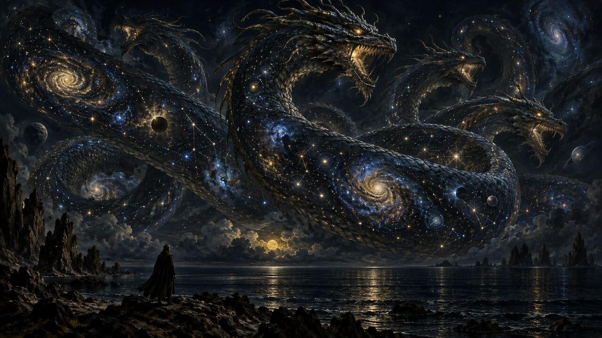

13 de octubre de 2026

# El Otro

Jorge Luis Borges

Jorge Luis Borges reunió en *El Libro de Arena* un puñado de cuentos donde lo imposible encuentra lugar. *El Otro* abre la puerta: un banco junto a un río, un viejo y un muchacho que son el mismo hombre, separados por medio siglo. El agua corre. Una vida se sienta a conversar consigo misma.

Osmancito buscó las mejores frases del cuento y, con Instinct, les dio una nueva forma. Las citas son de Borges, tal como él las escribió.

> El hecho ocurrió en el mes de febrero de 1969, al norte de Boston, en Cambridge. No lo escribí inmediatamente porque mi primer propósito fue olvidarlo, para no perder la razón. Ahora, en 1972, pienso que si lo escribo, los otros lo leerán como un cuento y, con los años, lo será tal vez para mí. Sé que fue casi atroz mientras duró y más aún durante las desveladas noches que lo siguieron.

A las diez de la mañana, Borges estaba en un banco frente al río Charles. El agua gris arrastraba hielo; al mirarla pensó en el tiempo. Alguien se sentó en el otro extremo y empezó a silbar una canción criolla que lo devolvió a un patio desaparecido. Después oyó las palabras y reconoció, con horror, su propia voz. El muchacho era argentino y vivía en Ginebra, en la misma dirección donde Borges había vivido de joven. El mayor le dijo que ambos se llamaban Jorge Luis Borges y que estaban en Cambridge, en 1969. El joven lo negó: para él, el banco estaba junto al Ródano, en Ginebra. Miró al hombre de cabeza gris y señaló el parecido.

> Lo raro es que nos parecemos, pero usted es mucho mayor, con la cabeza gris. Yo le contesté: —Puedo probarte que no miento. Voy a decirte cosas que no puede saber un desconocido. En casa hay un mate de plata con un pie de serpientes, que trajo del Perú nuestro bisabuelo. También hay una palangana de plata, que pendía del arzón. En el armario de tu cuarto hay dos filas de libros.

El mayor enumeró los libros del armario y recordó un atardecer de juventud. El muchacho corrigió el nombre de la plaza, pero no aceptó la prueba: si estaba soñando, aquel desconocido podía saber cuanto él sabía. Borges admitió la objeción. Si el encuentro era un sueño, cada uno podía creerse el soñador; ninguno sabía si llegaría a despertarse. El mayor buscó una manera de habitar juntos aquella incertidumbre.

> Nuestra evidente obligación, mientras tanto, es aceptar el sueño, como hemos aceptado el universo y haber sido engendrados y mirar con los ojos y respirar. —¿Y si el sueño durara? —dijo con ansiedad. Para tranquilizarlo y tranquilizarme, fingí un aplomo que ciertamente no sentía. Le dije: —Mi sueño ha durado ya setenta años. Al fin y al cabo, al recordarse, no hay persona que no se encuentre consigo misma. Es lo que nos está pasando ahora, salvo que somos dos.

El mayor le ofreció contarle el porvenir. Su madre seguía en Buenos Aires; su padre y su abuela habían muerto; su hermana se había casado. Le anunció libros y clases, otra guerra y un país cada vez más encerrado en sí mismo. El joven apenas escuchaba: lo vencía el miedo de encontrarse ante lo imposible. Borges sintió por él un amor más íntimo que el de un padre. Hablaron de Dostoievski, cuyo libro el muchacho llevaba entre las manos, y de los versos que preparaba para cantar la fraternidad de los oprimidos. El mayor dudó de esa multitud abstracta: sólo encontraba individuos, cambiantes como ellos mismos. Tampoco coincidían sobre las metáforas. El joven buscaba imágenes nuevas; el viejo prefería las afinidades que la imaginación ya había aceptado, como el tiempo y el agua. Entonces el muchacho vio una dificultad: si aquel hombre había sido él, ¿por qué no recordaba haberse encontrado en 1918 con un Borges anciano? El mayor sugirió, sin convicción, que había intentado olvidar algo demasiado extraño. El joven quiso saber hasta dónde podía confiar en su memoria. Con timidez le preguntó cómo andaba la memoria del mayor. Borges comprendió que, para un muchacho de menos de veinte años, un hombre de más de setenta era casi un muerto, y le contestó con humor: su memoria solía parecerse al olvido, pero todavía encontraba lo que le encargaban; estudiaba anglosajón y no era el último de la clase. Después, buscando una prueba que ningún sueño pudiera inventar, pensó en un verso.

> Nuestra conversación ya había durado demasiado para ser la de un sueño. Una brusca idea se me ocurrió. —Yo te puedo probar inmediatamente —le dije— que no estás soñando conmigo. Oí bien este verso, que no has leído nunca, que yo recuerde. Lentamente entoné la famosa línea: L'hydre — univers tordant son corps écaillé d'astres.

El verso es del poeta francés Victor Hugo y dice, más o menos: la hidra-universo, retorciendo su cuerpo escamado de astros. Es la imagen del universo como un monstruo marino inmenso, cubierto de estrellas como de escamas. La prueba era sencilla: si el muchacho lo estuviera soñando, el verso saldría de su propia cabeza y no lo sorprendería. Lo sorprendió. Lo repitió en voz baja, saboreando cada palabra, y admitió que él nunca escribiría una línea así. Hugo, dice Borges, los había unido. Entonces el mayor recordó otro poeta que el joven había recitado antes, con fervor, en esa misma conversación: Walt Whitman, el gran poeta estadounidense del siglo XIX, que cantó la vida, la amistad y los hombres comunes, y a quien el muchacho admiraba por su fe en lo que decía.

> Antes, él había repetido con fervor, ahora lo recuerdo, aquella breve pieza en que Walt Whitman rememora una compartida noche ante el mar, en que fue realmente feliz. —Si Whitman la ha cantado —observé— es porque la deseaba y no sucedió.

Borges sostuvo que un poema gana si adivinamos en él un anhelo y no el relato de un hecho: Whitman habría escrito esa noche feliz junto al mar porque deseaba vivirla, no porque la hubiera vivido. El muchacho se quedó mirándolo y le respondió que no conocía a Whitman: Whitman era incapaz de mentir. Entonces el mayor sintió, bajo la discusión sobre un poeta, la distancia entre los dos.

> Medio siglo no pasa en vano. Bajo nuestra conversación de personas de miscelánea lectura y gustos diversos, comprendí que no podíamos entendernos. Éramos demasiado distintos y demasiado parecidos. No podíamos engañarnos, lo cual hace difícil el diálogo. Cada uno de los dos era el remedo caricaturesco del otro.

Discutir no cambiaría el destino del muchacho: llegaría a ser aquel hombre. El mayor recordó una fantasía de Coleridge, la flor que alguien recibe en el paraíso soñado y conserva al despertar. Buscó una prueba semejante y le pidió una moneda; a cambio le tendió un billete americano. El joven vio en él la fecha de 1974 y gritó que era imposible. El narrador añade que meses después le dijeron que los billetes no llevan fecha. Para el muchacho, aquello era un milagro, y los milagros daban miedo. Hizo pedazos el billete y guardó la moneda. El viejo decidió arrojarla al río, pero el gesto que había imaginado no llegó a cumplirse. Intentó calmar el miedo del joven.

> Respondí que lo sobrenatural, si ocurre dos veces, deja de ser aterrador. Le propuse que nos viéramos al día siguiente, en ese mismo banco que está en dos tiempos y en dos sitios. Asintió en el acto y me dijo, sin mirar el reloj, que se le había hecho tarde. Los dos mentíamos y cada cual sabía que su interlocutor estaba mintiendo. Le dije que iban a venir a buscarme.

El muchacho se sorprendió de que fueran a buscarlo. El mayor le explicó que, al llegar a su edad, habría perdido casi toda la vista: quedarían el amarillo, las sombras y las luces. Le habló de la ceguera gradual como de un lento atardecer de verano. Se despidieron sin tocarse. Borges no volvió al banco al día siguiente; supone que el joven tampoco fue. El encuentro quedó en su memoria, a la espera de una explicación.

> He cavilado mucho sobre este encuentro, que no he contado a nadie. Creo haber descubierto la clave. El encuentro fue real, pero el otro conversó conmigo en un sueño y fue así que pudo olvidarme; yo conversé con él en la vigilia y todavía me atormenta el recuerdo. El otro me soñó, pero no me soñó rigurosamente. Soñó, ahora lo entiendo, la imposible fecha en el dólar.

Osmancito, con la asistencia de Instinct
