9 de octubre de 2026

# Macbeth

William Shakespeare

Hacia 1606, William Shakespeare escribió *Macbeth*: el mejor general del rey Duncan, oye de tres brujas que será rey de Escocia, y la profecía le prende la ambición: empujado por su esposa, asesina al rey bajo su propio techo y ocupa el trono; de ahí en adelante solo puede sostenerlo con más crímenes, entre la culpa y el miedo, hasta que la misma profecía se cumple al revés. Es la tragedia más breve de Shakespeare y una de las más oscuras. Esta lectura la sigue escena por escena: las frases de la obra van en castellano, con su original al final, y entre ellas unos textos cuentan lo que pasa y explican lo que haga falta.

## Acto I, escena 1

Tres brujas fijan su cita:

> Allí, a encontrarnos con Macbeth.
>
> <small>[Frase 17](#original-17)</small>

Tercera bruja

Se van entre niebla:

> Lo bello es feo, y lo feo es bello: volemos entre la niebla y el aire inmundo.
>
> <small>[Frase 25](#original-25)</small>

Las tres

---

## Acto I, escena 2

[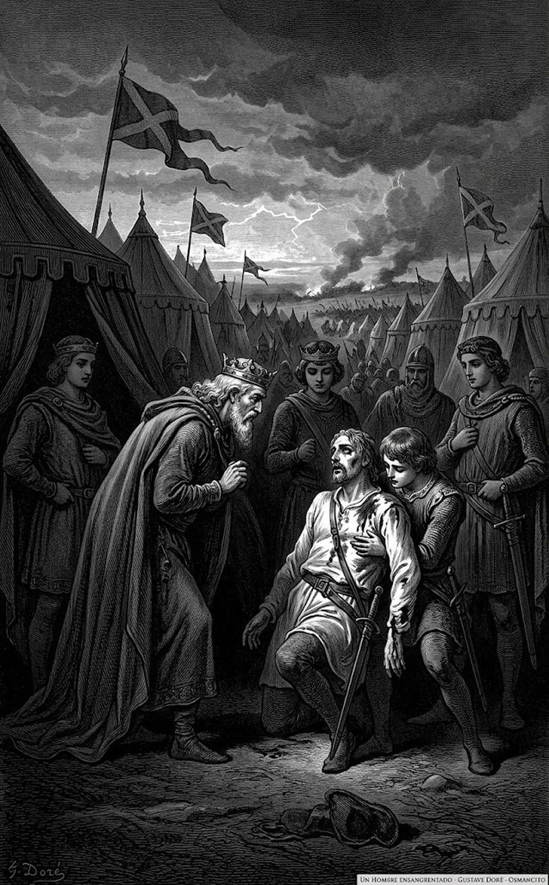](img/261009_macbeth_i-2.jpg)

El rey Duncan recibe a un capitán herido, que cuenta cómo Macbeth venció al rebelde Macdonwald. El rey lo elogia:

> Tus palabras te sientan tan bien como tus heridas: ambas saben a honor.
>
> <small>[Frase 52](#original-52)</small>

Duncan

Pero llegaron nuevos ataques de Noruega:

> Atienda, rey de Escocia, atienda. Apenas la justicia, armada de valor, obligó a esos kernos saltarines a fiar en sus talones, el señor noruego, viendo su ocasión, con armas bruñidas y nuevos refuerzos de hombres, lanzó un nuevo asalto.
>
> <small>[Frase 45](#original-45)</small>

Capitán

Macbeth y Banquo resistieron. Ross confirma la victoria, Noruega pide la paz y el rey castiga al traidor, el thane de Cawdor:

> Ese thane de Cawdor no volverá a engañar nuestra más íntima confianza.
>
> <small>[Frase 74](#original-74)</small>

Duncan

Su título pasará a Macbeth, que aún no lo sabe.

---

## Acto I, escena 3

Las tres brujas se cuentan sus travesuras: una persigue a un marinero porque su mujer le negó unas castañas, y muestra el pulgar de un piloto naufragado. Suena un tambor:

> Llega Macbeth.
>
> <small>[Frase 113](#original-113)</small>

Tercera bruja

Entran Macbeth y Banquo. Las brujas lo saludan como thane de Glamis, que ya es, y como thane de Cawdor, que aún no sabe que es. La tercera añade:

> ¡Tú que serás rey después!
>
> <small>[Frase 138](#original-138)</small>

Tercera bruja

Banquo pide que le hablen a él también, y ellas responden con acertijos:

> Menor que Macbeth, y mayor.
>
> <small>[Frase 152](#original-152)</small>

Primera bruja

Se disuelven en el aire. Llegan Ross y Angus con el agradecimiento del rey y un título nuevo:

> Y como prenda de un honor mayor, me mandó que de su parte te llame thane de Cawdor. Con ese título, salve, digno thane, pues es tuyo.
>
> <small>[Frase 192](#original-192)</small>

Ross

Banquo se asombra de que el diablo diga verdad. El thane de Cawdor aún vive, pero será ejecutado. Macbeth, a solas, siente lo que la profecía le hace por dentro:

> Soy thane de Cawdor. Si es bueno, ¿por qué cedo a esa sugestión cuya imagen horrible me eriza el cabello y hace que mi corazón sentado golpee contra mis costillas, contra el uso de la naturaleza?
>
> <small>[Frase 219](#original-219)</small>

Macbeth

Decide esperar a que el azar lo corone. Banquo advierte que lo oscuro dice verdades pequeñas para traicionar en lo grande. Macbeth lo corta y se van hacia el rey.

---

## Acto I, escena 4

[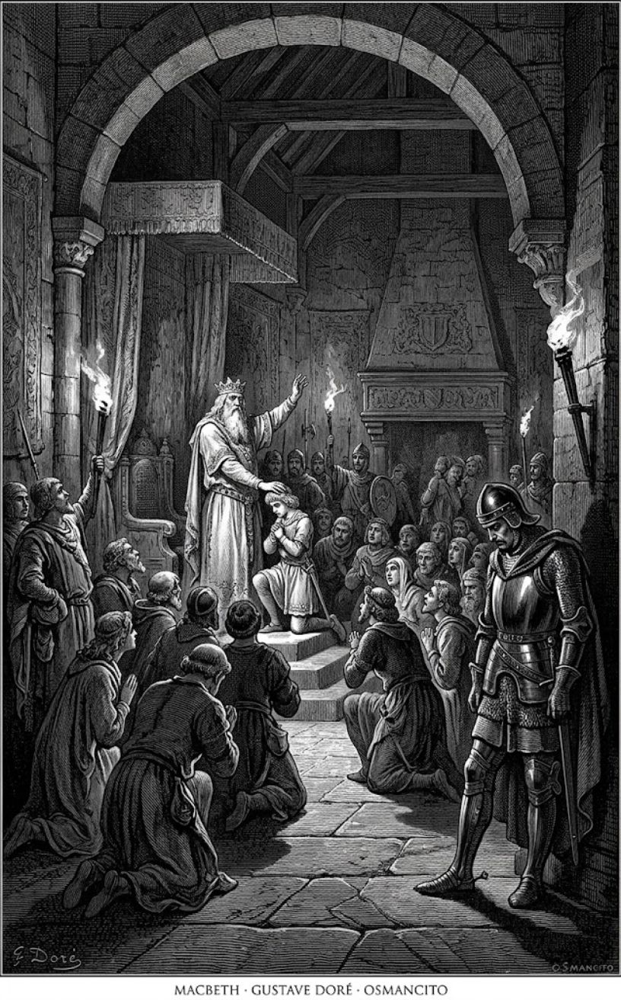](img/261009_macbeth_i-4.jpg)

En el palacio de Forres, Malcolm cuenta que el traidor Cawdor confesó y murió con entereza:

> Nada en su vida le sentó tan bien como dejarla; murió como quien hubiera estudiado su muerte, para arrojar lo más caro que poseía como una bagatela sin importancia.
>
> <small>[Frase 254](#original-254)</small>

Malcolm

Duncan se lamenta de haberse fiado de él. Entra Macbeth, el nuevo Cawdor, y el rey lo colma de gratitud y nombra heredero a su hijo Malcolm. Macbeth, a solas, ve el obstáculo:

> Ese es un escalón en el que he de caer, o bien saltar por encima, pues está en mi camino.
>
> <small>[Frase 282](#original-282)</small>

Macbeth

Pide a las estrellas que escondan su luz. El rey lo elogia sin sospechar nada y todos parten a su casa.

---

## Acto I, escena 5

[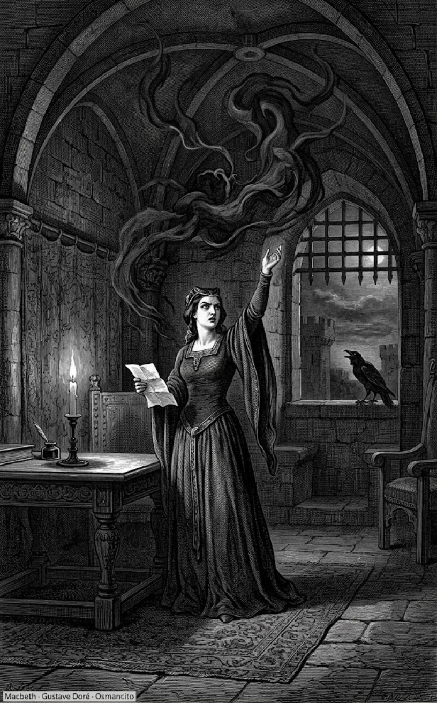](img/261009_macbeth_i-5.jpg)

En Inverness, Lady Macbeth lee la carta de su marido, que cuenta la profecía de las brujas. Teme que sea demasiado bondadoso para el camino corto, y quiere tenerlo a su lado:

> Date prisa en venir, para que vierta mis espíritus en tu oído y castigue con el valor de mi lengua todo cuanto te aparta del círculo de oro con que el destino y la ayuda sobrenatural parecen querer coronarte.
>
> <small>[Frase 306](#original-306)</small>

Lady Macbeth

Un mensajero anuncia que el rey llega esta noche. Sola, ella pide a los espíritus que la despojen de toda ternura. Llega Macbeth, y ella le da su primera lección:

> Tu rostro, mi thane, es como un libro donde los hombres pueden leer cosas extrañas.
>
> <small>[Frase 340](#original-340)</small>

Lady Macbeth

Y toma el mando de la noche:

> Al que viene hay que proveerlo; y tú pondrás el gran asunto de esta noche en mis manos, que a todas nuestras noches y días por venir dará solo soberanía y señorío.
>
> <small>[Frase 342](#original-342)</small>

Lady Macbeth

Macbeth duda; ella le pide que le deje todo a ella.

---

## Acto I, escena 6

[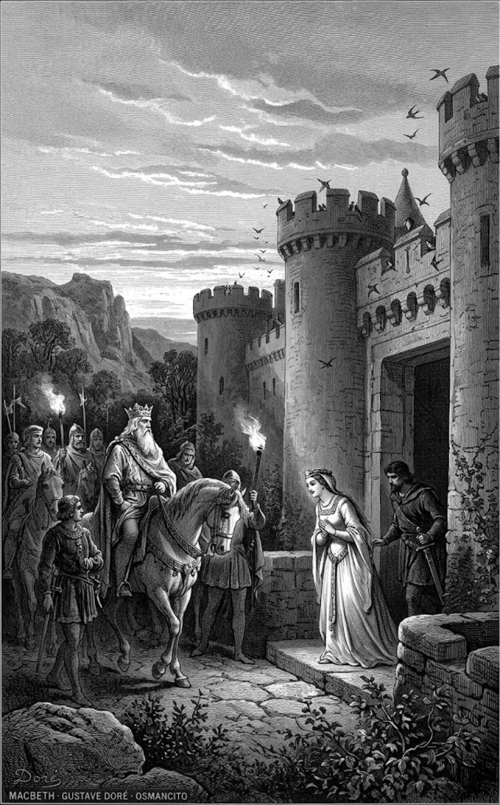](img/261009_macbeth_i-6.jpg)

Duncan llega al castillo y admira su aire sereno, mientras Banquo señala los nidos de vencejo. Sale a recibirlos la anfitriona:

> Bella y noble anfitriona, esta noche somos vuestro huésped.
>
> <small>[Frase 368](#original-368)</small>

Duncan

Ella ofrece todo al rey, que le pide que lo lleve con su marido.

---

## Acto I, escena 7

Mientras dentro se cena, Macbeth duda a solas: el crimen se vuelve contra quien lo comete, y Duncan está en su casa como pariente y como huésped. Además:

> Además, este Duncan ha llevado su poder con tanta mansedumbre, ha sido tan limpio en su alto oficio, que sus virtudes abogarán como ángeles, con lenguas de trompeta, contra la honda condenación de su muerte; y la piedad, como un niño recién nacido y desnudo, cabalgando la ráfaga, o como querubines del cielo montados en los corceles invisibles del aire, soplará el horrendo acto en todos los ojos, hasta que las lágrimas ahoguen el viento.
>
> <small>[Frase 383](#original-383)</small>

Macbeth

Solo lo empuja la ambición. Llega ella y él se echa atrás; ella lo acusa de cobarde. Él dice que se atreve a todo lo que cabe a un hombre. Ella responde:

> Cuando te atrevías a hacerlo, entonces eras un hombre; y para ser más de lo que eras, serías tanto más hombre.
>
> <small>[Frase 409](#original-409)</small>

Lady Macbeth

Si lo hubiera jurado, dice ella, le estrellaría los sesos a su propio bebé. Propone emborrachar a los guardias del rey y culparlos con sus dagas. Macbeth queda resuelto:

> Estoy decidido, y tenso cada agente de mi cuerpo para esta terrible hazaña.
>
> <small>[Frase 425](#original-425)</small>

Macbeth

Salen a cenar. Macbeth cierra la escena.

---

## Acto II, escena 1

Medianoche. Banquo y su hijo Fleance cruzan el patio; Banquo no logra dormir y ruega:

> Poderes misericordiosos, contened en mí los pensamientos malditos a los que la naturaleza cede en el reposo.
>
> <small>[Frase 444](#original-444)</small>

Banquo

Banquo ha soñado con las brujas. Llega Macbeth, que lo tienta a ponerse de su parte; Banquo responde con limpieza:

> Mientras no pierda ninguno al buscar aumentarlo, y conserve libre mi pecho y limpia mi lealtad, aceptaré consejo.
>
> <small>[Frase 465](#original-465)</small>

Banquo

Solo, Macbeth espera la campana y ve una daga en el aire, con el mango hacia su mano:

> Ven, déjame aferrarte. No te tengo, y aun así te sigo viendo.
>
> <small>[Frase 476](#original-476)</small>

Macbeth

Duda de su vista, ve sangre en la hoja y siente la noche cómplice. Suena la campana, y Macbeth se dirige al que duerme.

---

## Acto II, escena 2

Lady Macbeth espera; el vino que apagó a los guardias a ella la encendió. Solo la detuvo un temor:

> Temo que se hayan despertado y no esté hecho.
>
> <small>[Frase 503](#original-503)</small>

Lady Macbeth

Lo habría hecho, pero el rey dormido se parecía a su padre. Sale Macbeth, deshecho: ya mató. Dice que oyó una voz:

> Me pareció oír una voz que gritaba: «¡No dormiréis más!
>
> <small>[Frase 553](#original-553)</small>

Macbeth

No pudo decir amén. Ella lo manda a devolver las dagas; él no se atreve, y va ella. Llaman, y Macbeth contempla sus manos:

> ¡Ah, me arrancan los ojos!
>
> <small>[Frase 581](#original-581)</small>

Macbeth

Ni el océano las lavaría. Ella vuelve con las manos y lo lleva a acostarse. Vuelven los golpes:

> Para conocer mi acto, lo mejor sería no conocerme.
>
> <small>[Frase 597](#original-597)</small>

Macbeth

Los golpes cierran la escena.

---

## Acto II, escena 3

En la puerta del castillo, un portero medio dormido juega a ser el portero del infierno y deja pasar a sus condenados, entre ellos un equivocador:

> Pues aquí hay un equivocador, que juraría en ambos platos de la balanza contra cualquiera de ellos; que cometió traición de sobra por amor de Dios, y aun así no pudo llegar al cielo con sus equívocos. Oh, entra, equivocador.
>
> <small>[Frase 614](#original-614)</small>

Portero

Abre a Macduff y a Lennox, que vienen a buscar al rey. Lennox cuenta la noche de presagios. Macduff entra al cuarto del rey y sale gritando:

> ¡La Confusión ha hecho ahora su obra maestra!
>
> <small>[Frase 690](#original-690)</small>

Macduff

Da la alarma. Lady Macbeth finge no entender; Banquo no quiere creerlo. Llega Macbeth, de luto perfecto:

> Si yo hubiera muerto una hora antes de este suceso, habría vivido un tiempo bendito; pues desde este instante no hay nada serio en lo mortal.
>
> <small>[Frase 729](#original-729)</small>

Macbeth

Macbeth confiesa que mató a los guardias en un arrebato. Lady Macbeth se desvanece y Banquo convoca a averiguar la verdad. Los dos hermanos, solos, temen las dagas ocultas en las sonrisas y deciden huir, Malcolm a Inglaterra y Donalbain a Irlanda:

> Esta flecha asesina que se ha disparado aún no ha caído; y nuestro camino más seguro es evitar la puntería.
>
> <small>[Frase 787](#original-787)</small>

Malcolm

Parten a caballo, sin despedirse, y Malcolm cierra la escena.

---

## Acto II, escena 4

Fuera del castillo, un viejo y Ross comentan los presagios: día oscuro, un búho que mató a un halcón, caballos salvajes. El viejo concluye:

> Es antinatural, igual que el acto cometido.
>
> <small>[Frase 799](#original-799)</small>

Viejo

Macduff cuenta que se culpa a los guardias y que Malcolm y Donalbain huyeron. Macbeth va a coronarse a Scone. El viejo se despide:

> Que la bendición de Dios vaya con vos, y con los que quieran hacer bien del mal y amigos de enemigos.
>
> <small>[Frase 844](#original-844)</small>

Viejo

---

## Acto III, escena 1

[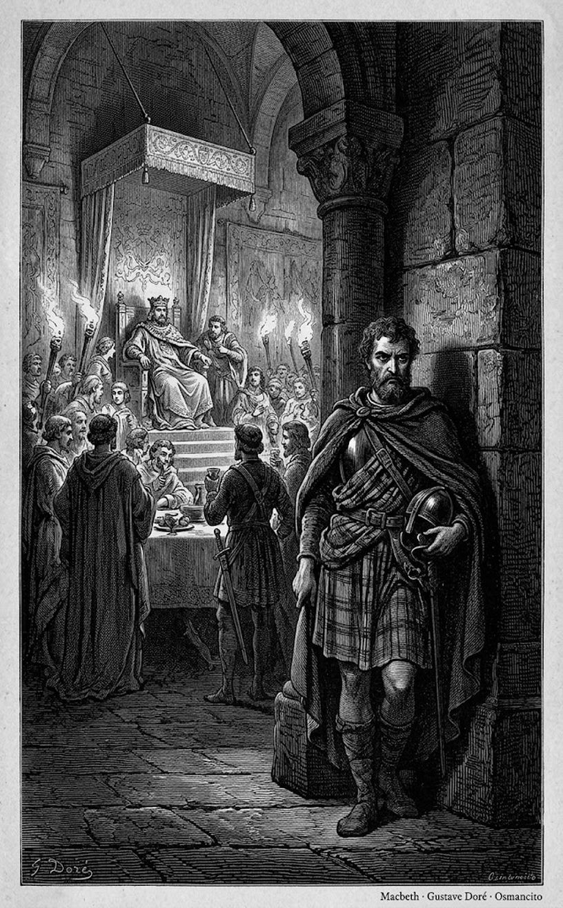](img/261009_macbeth_i-12.jpg)

Banquo, a solas, sospecha que Macbeth jugó sucio para ser rey y se pregunta si lo dicho sobre él también se cumplirá. Entran los nuevos reyes, y Macbeth lo invita a la cena de esta noche:

> Esta noche damos una cena solemne, señor, y os pediré vuestra presencia.
>
> <small>[Frase 859](#original-859)</small>

Macbeth

Se va Banquo y Macbeth se queda con su miedo: ser rey no basta si no está seguro, y las brujas le dieron una corona sin hijos que la hereden. No lo aceptará:

> Antes que eso, ven, destino, a la liza y sé mi campeón hasta el extremo. ¿Quién va?
>
> <small>[Frase 900](#original-900)</small>

Macbeth

Entran dos hombres a quienes Macbeth convenció de que Banquo les arruinó la vida. Los provoca: en la lista de los hombres hay distintos, y no todos valen igual:

> ¿Estáis tan evangelizados que rezáis por este buen hombre y su descendencia, cuya mano pesada os ha doblado hacia la tumba y ha empobrecido a los vuestros para siempre?
>
> <small>[Frase 917](#original-917)</small>

Macbeth

Les ofrece un encargo que quitaría de en medio a su enemigo:

> Ahora, si tenéis un puesto en la lista, no en la peor fila de la hombría, decidlo; y pondré en vuestros pechos ese negocio cuya ejecución elimina a vuestro enemigo y os ata al corazón y al afecto de nosotros, que llevamos nuestra salud enfermiza mientras él vive, y sería perfecta con su muerte.
>
> <small>[Frase 922](#original-922)</small>

Macbeth

Uno está harto de golpes; el otro, dispuesto a todo. Macbeth les señala a Banquo y a su hijo Fleance, para esta noche. Cierra la escena, a solas.

---

## Acto III, escena 2

[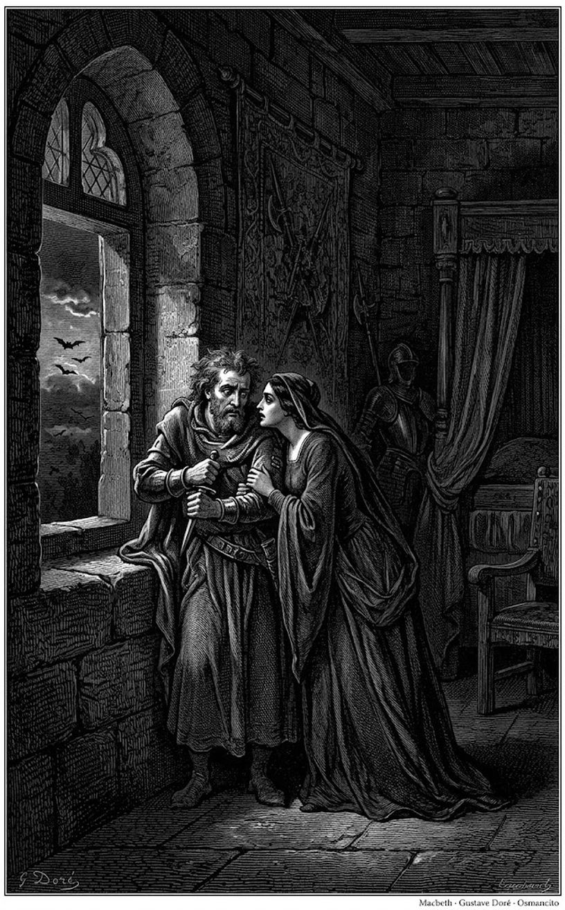](img/261009_macbeth_i-13.jpg)

Lady Macbeth está inquieta. Llega Macbeth, torturado: solo hirieron a la serpiente y envidia a los muertos:

> Duncan está en su tumba; tras la fiebre intermitente de la vida duerme bien. La traición ha hecho lo peor: ni acero, ni veneno, ni malicia doméstica, ni leva extranjera, nada puede tocarlo más.
>
> <small>[Frase 972](#original-972)</small>

Macbeth

Ella le pide alegría. Él confiesa que su mente está llena de escorpiones: Banquo y Fleance viven. Ella responde:

> Aún hay consuelo: son vulnerables.
>
> <small>[Frase 986](#original-986)</small>

Macbeth

Antes de la noche se hará algo terrible, y ella no debe saberlo hasta aplaudirlo. Invoca la noche; ella se asombra:

> Te asombras de mis palabras; pero quédate quieta: las cosas malas empezadas se afirman con mal.
>
> <small>[Frase 996](#original-996)</small>

Macbeth

La invita a ir con él.

---

## Acto III, escena 3

Dos asesinos esperan; llega otro:

> ¿Pero quién te mandó unirte a nosotros?
>
> <small>[Frase 1002](#original-1002)</small>

Primer asesino

Llega Banquo con su hijo, cae el golpe. Se apaga la luz:

> Solo uno ha caído; el hijo ha huido.
>
> <small>[Frase 1045](#original-1045)</small>

Tercer asesino

Fleance huyó: han perdido la mejor mitad del encargo.

---

## Acto III, escena 4

[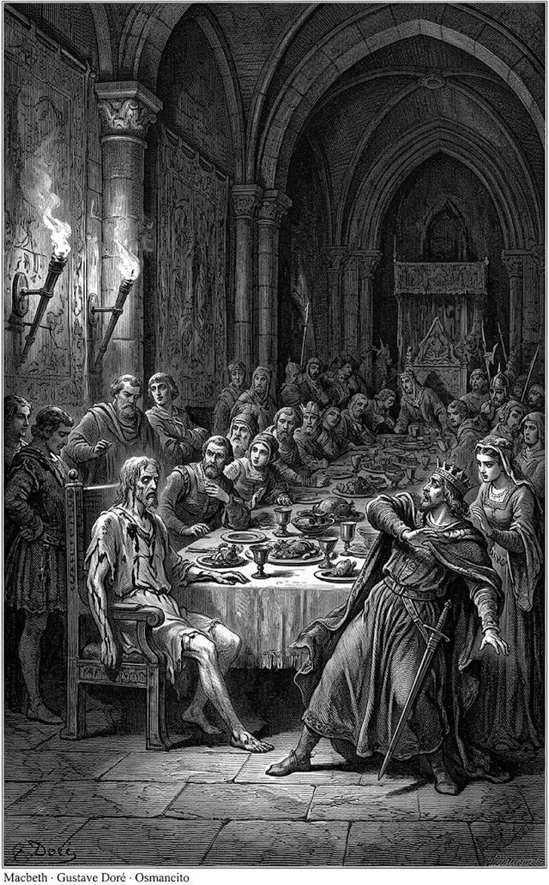](img/261009_macbeth_i-15.jpg)

El banquete empieza, pero un asesino espera a Macbeth en la puerta con sangre en la cara: Banquo está muerto, pero Fleance escapó. Macbeth reacciona:

> Entonces vuelve mi acceso: si no, habría estado perfecto, entero como el mármol, firme como la roca, tan amplio y general como el aire que nos envuelve. Pero ahora estoy encerrado, apretado, confinado, atado a dudas y miedos insolentes.
>
> <small>[Frase 1082](#original-1082)</small>

Macbeth

Se consuela: la serpiente adulta está muerta y el gusano que huyó aún no tiene dientes. Vuelve al banquete y brinda por Banquo ausente, pero su sitio está ocupado por el fantasma. Pregunta quién lo hizo:

> No puedes decir que yo lo hice.
>
> <small>[Frase 1120](#original-1120)</small>

Macbeth

Lady Macbeth disculpa a su marido ante los nobles y en privado lo acusa de miedo: solo ve un taburete. Él insiste:

> Si puedes asentir, habla también.
>
> <small>[Frase 1146](#original-1146)</small>

Macbeth

Se recompone y pide disculpas a los invitados:

> No os asombréis de mí, mis dignísimos amigos.
>
> <small>[Frase 1162](#original-1162)</small>

Macbeth

Brinda de nuevo por Banquo y el fantasma vuelve; Macbeth lo increpa y, cuando se va, vuelve a ser hombre. Lady Macbeth despide a todos. A solas, él sabe que la sangre pide sangre, que Macduff faltó y que irá a ver a las brujas:

> Mañana, y muy temprano, iré a las Hermanas Fatídicas: más deben decir; pues ahora estoy resuelto a saber, por los peores medios, lo peor.
>
> <small>[Frase 1212](#original-1212)</small>

Macbeth

Y lo que trama no le deja tiempo para pensar:

> Tengo en la cabeza cosas extrañas que pasarán a la mano, y que han de hacerse antes de poder examinarse.
>
> <small>[Frase 1214](#original-1214)</small>

Macbeth

Ella le dice que le falta dormir, y se van a la cama.

---

## Acto III, escena 5

[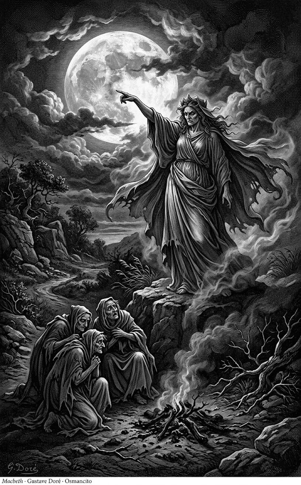](img/261009_macbeth_i-16.jpg)

Hécate llega furiosa: las brujas trataron con Macbeth sin avisarla. Y peor:

> Y lo que es peor, todo lo que habéis hecho ha sido por un hijo díscolo, rencoroso e iracundo, que, como otros, ama por sus propios fines, no por vosotras.
>
> <small>[Frase 1230](#original-1230)</small>

Hécate

Mañana él vendrá a conocer su destino, y ella prepara algo:

> Antes del mediodía debe hacerse un gran negocio.
>
> <small>[Frase 1234](#original-1234)</small>

Hécate

Hará espíritus que lo arrastren a su perdición. La llaman y se va.

---

## Acto III, escena 6

Lennox y un Lord comentan con sarcasmo la muerte de Duncan y Banquo:

> Mis palabras anteriores solo han dado en vuestros pensamientos, que pueden interpretar más lejos. Solo digo que las cosas se han llevado de modo extraño.
>
> <small>[Frase 1248](#original-1248)</small>

Lennox

Dicen que Macbeth lloró a Duncan y castigó a los guardias. Macduff, por faltar al banquete, cayó en desgracia y pide ayuda en Inglaterra. Macbeth se arma y lo manda llamar:

> Sí; y con un rotundo: «Señor, yo no», el mensajero sombrío me vuelve la espalda y murmura, como diciendo: «Os arrepentiréis del tiempo que me carga con esta respuesta».
>
> <small>[Frase 1268](#original-1268)</small>

Un lord

El Lord pide que un ángel lleve el mensaje a Inglaterra y promete sus oraciones.

---

## Acto IV, escena 1

Las brujas hierven el caldero con sapo, ojo de tritón y otros horrores, mientras cantan. Llega Macbeth y les pide respuestas. Aparece una cabeza armada:

> Seas lo que seas, gracias por tu buena advertencia; has tocado bien mi miedo.
>
> <small>[Frase 1346](#original-1346)</small>

Macbeth

Aparece un niño sangriento:

> Sé sanguinario, audaz y resuelto.
>
> <small>[Frase 1359](#original-1359)</small>

Aparición

Dice que nadie nacido de mujer lo dañará. Macbeth decide matar igual a Macduff, para dormir tranquilo. Aparece un niño coronado, con un árbol en la mano:

> Cabeza rebelde, no te alces nunca hasta que se alce el bosque de Birnam; y nuestro altamente colocado Macbeth vivirá el plazo de la naturaleza y pagará su aliento al tiempo y a la costumbre mortal.
>
> <small>[Frase 1376](#original-1376)</small>

Macbeth

Macbeth pregunta si reinará la descendencia de Banquo. Desfilan ocho reyes, el último con un espejo, y Banquo, ensangrentado, se los señala:

> Ahora veo que es verdad; pues Banquo, apelmazado de sangre, me sonríe y los señala como suyos.
>
> <small>[Frase 1407](#original-1407)</small>

Macbeth

Las brujas desaparecen y Macbeth maldice la hora. Lennox le dice que Macduff huyó a Inglaterra:

> Tiempo, tú te adelantas a mis hazañas terribles: el propósito fugaz nunca se alcanza si el acto no va con él.
>
> <small>[Frase 1441](#original-1441)</small>

Macbeth

Macbeth decide atacar el castillo de Macduff y matar a su mujer, a sus hijos y a todo su linaje, sin demora.

---

## Acto IV, escena 2

[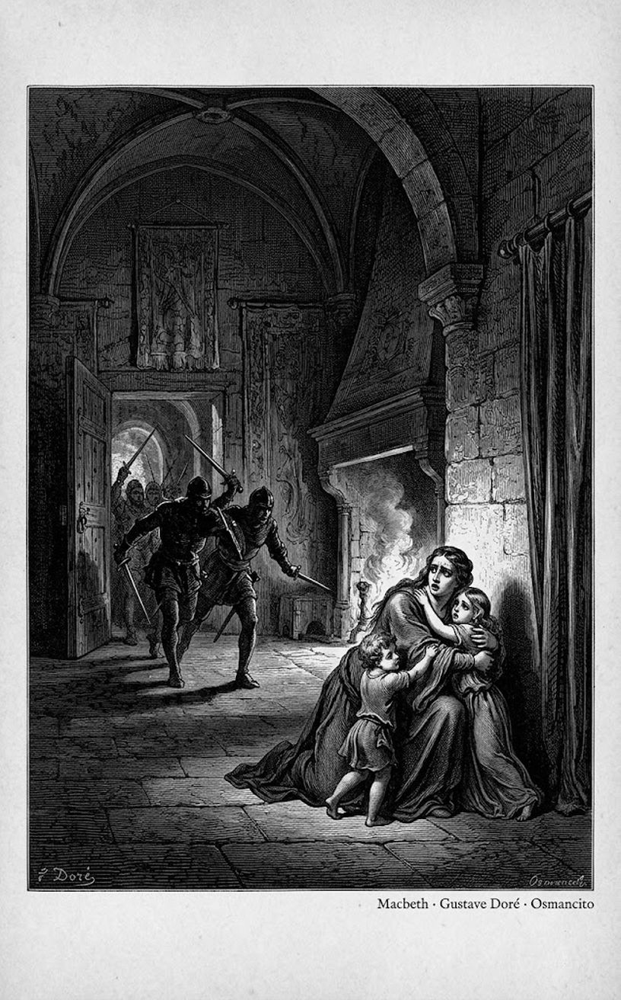](img/261009_macbeth_i-19.jpg)

La mujer de Macduff pregunta a Ross por qué su marido huyó. Ross lo disculpa y ella replica:

> ¿Dejar a su esposa, dejar a sus hijos, su mansión y sus títulos en un lugar de donde él mismo huye?
>
> <small>[Frase 1460](#original-1460)</small>

Lady Macduff

Dice que no los quiere. Ross no puede quedarse y se va. Madre e hijo quedan solos:

> Muchacho, tu padre ha muerto.
>
> <small>[Frase 1474](#original-1474)</small>

Lady Macduff

Hablan de cómo vivirá ella sin marido y de si fue traidor. Llega un mensajero, temblando:

> Temo que algún peligro se os acerca mucho. Si queréis el consejo de un hombre sencillo, no os encontréis aquí; salid con vuestros pequeños.
>
> <small>[Frase 1533](#original-1533)</small>

Mensajero

Les avisa del peligro y se va. Ella no sabe adónde huir: no hizo daño, pero en este mundo hacer daño es a menudo celebrado. Entran los asesinos, y el niño los desafía y muere gritando a su madre que huya.

---

## Acto IV, escena 3

[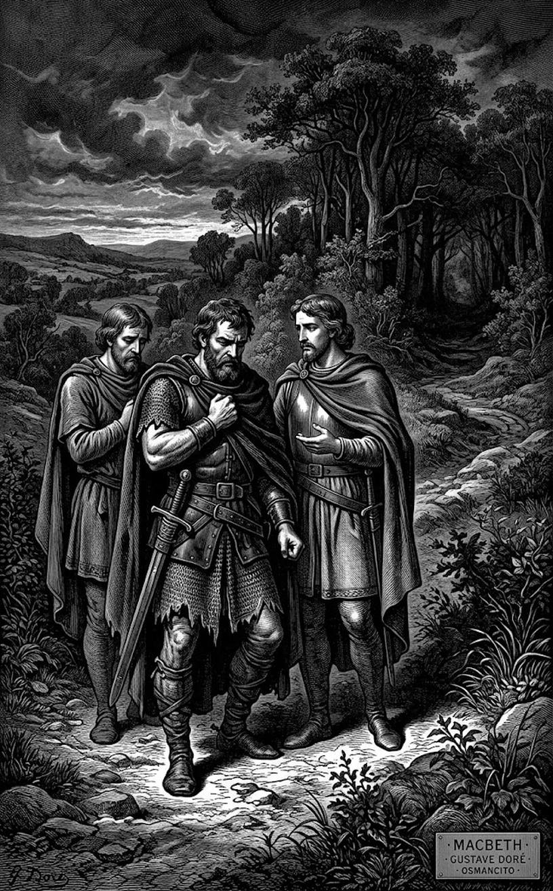](img/261009_macbeth_i-20.jpg)

En Inglaterra, Malcolm propone llorar en alguna sombra, y Macduff, defender la patria:

> Cada nueva mañana aúllan nuevas viudas, gritan nuevos huérfanos; nuevos dolores golpean al cielo en la cara, y este resuena como si sintiera con Escocia y aullara la misma sílaba de dolor.
>
> <small>[Frase 1565](#original-1565)</small>

Macduff

Malcolm desconfía: ofrecerían un cordero para aplacar a un dios airado. Para probar a Macduff, se pinta peor que Macbeth: lujurioso, avaro, sin una virtud real. Y sentencia:

> Si uno así es apto para gobernar, hablad: soy como he dicho.
>
> <small>[Frase 1618](#original-1618)</small>

Malcolm

Macduff dice que no es apto ni para vivir, y llora por su país:

> Oh nación miserable, con un tirano sin título y de cetro sangriento, ¿cuándo volverás a ver tus días sanos, si el heredero más legítimo de tu trono se declara acusado por su propia boca y blasfema contra su estirpe?
>
> <small>[Frase 1622](#original-1622)</small>

Macduff

Con eso Malcolm cierra la prueba: todo era mentira sobre sí mismo, nunca perjuró ni engañó a nadie.

> Lo que soy en verdad es tuyo y de mi pobre país para mandar; adonde, de hecho, antes de que tú llegaras, el viejo Siward, con diez mil hombres de guerra, ya a punto, se disponía a partir.
>
> <small>[Frase 1633](#original-1633)</small>

Malcolm

Entra el rey de Inglaterra, que cura con el tacto una enfermedad. Llega Ross: Escocia sufre. Macduff pregunta por su mujer y sus hijos, hasta que Ross lo suelta: su castillo fue tomado y todos, degollados.

> Contar el modo sería, sobre el montón de estos ciervos abatidos, añadir vuestra muerte.
>
> <small>[Frase 1717](#original-1717)</small>

Ross

Malcolm le pide que dé palabras al dolor y que se haga vengador. Macduff pregunta si todos sus hijos, de un solo golpe. Luego jura:

> Pero, gentiles cielos, cortad toda demora; frente a frente, traed a este demonio de Escocia y a mí; ponedlo a la distancia de mi espada; si escapa, ¡que el cielo lo perdone también!
>
> <small>[Frase 1753](#original-1753)</small>

Macduff

Malcolm dice que esa música suena viril y cierra la escena y el acto:

> Recibid el ánimo que podáis: es larga la noche que nunca encuentra el día.
>
> <small>[Frase 1759](#original-1759)</small>

Malcolm

---

## Acto V, escena 1

[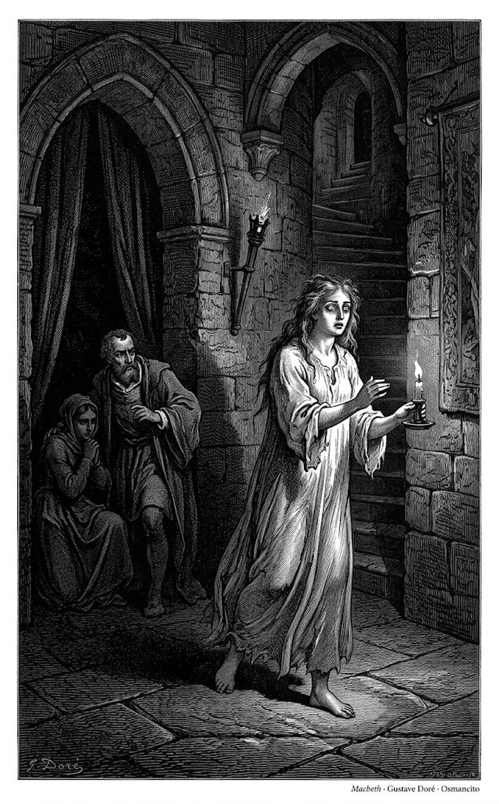](img/261009_macbeth_i-21.jpg)

Un médico y una camarera hablan de Lady Macbeth, que se levanta dormida a escribir y volver a la cama. Dice el médico:

> Una gran perturbación de la naturaleza: recibir a la vez el beneficio del sueño y hacer los efectos de la vigilia.
>
> <small>[Frase 1770](#original-1770)</small>

Médico

Aquí viene, con la vela, los ojos abiertos y las manos frotándose. Empieza a hablar en sueños:

> Pues entonces es hora de hacerlo.
>
> <small>[Frase 1805](#original-1805)</small>

Lady Macbeth

Recuerda el crimen, la sangre del viejo, la esposa de Macduff:

> ¿Cómo, estas manos nunca estarán limpias?
>
> <small>[Frase 1816](#original-1816)</small>

Lady Macbeth

Siente aún el olor de la sangre, repite que Banquo está enterrado y se va a la cama. El médico concluye:

> Los actos contra natura engendran perturbaciones contra natura: las mentes infectadas descargarán sus secretos en sus almohadas sordas.
>
> <small>[Frase 1855](#original-1855)</small>

Médico

Pide que la vigilen y que no le dejen ningún medio de dañarse.

---

## Acto V, escena 2

[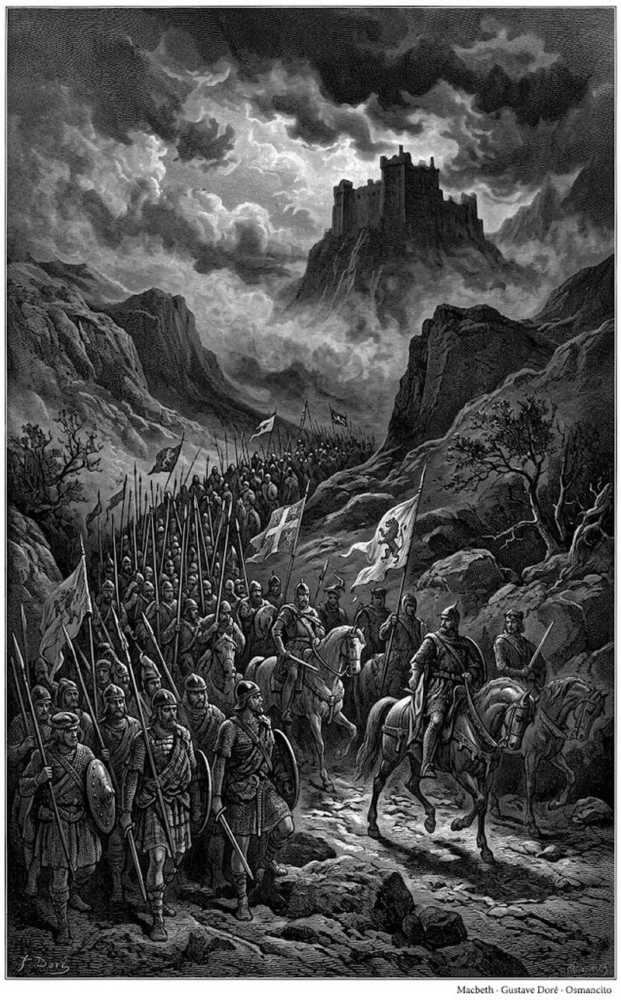](img/261009_macbeth_i-22.jpg)

Los nobles marchan a unirse al ejército de Malcolm, mientras el tirano fortifica Dunsinane. Caithness dice:

> Unos dicen que está loco; otros, que lo odian menos, lo llaman furia valiente; pero, con seguridad, no puede abrochar su causa desquiciada dentro del cinturón de la norma.
>
> <small>[Frase 1881](#original-1881)</small>

Caithness

Angus siente el título como túnica de gigante sobre un ladrón enano. Marchan a curar el país, y Lennox cierra.

---

## Acto V, escena 3

[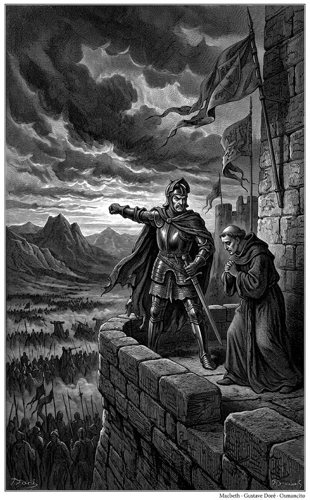](img/261009_macbeth_i-23.jpg)

Dunsinane, sitiada. Macbeth se aferra a las promesas de las apariciones:

> Entonces huid, falsos thanes, y mezclaos con los epicúreos ingleses: la mente por la que me guío y el corazón que llevo nunca se hundirán en la duda ni temblarán de miedo.
>
> <small>[Frase 1899](#original-1899)</small>

Macbeth

Insulta al sirviente que trae la noticia de diez mil ingleses y, a solas con Seyton, admite que su vida cayó en la hoja seca. Pide su armadura; el médico dice que su mujer debe curarse sola. Macbeth sube a la muralla:

> No tendré miedo de la muerte ni de la ruina hasta que el bosque de Birnam venga a Dunsinane.
>
> <small>[Frase 1960](#original-1960)</small>

Macbeth

El médico se queda y dice que no volvería a Dunsinane por ningún provecho.

---

## Acto V, escena 4

[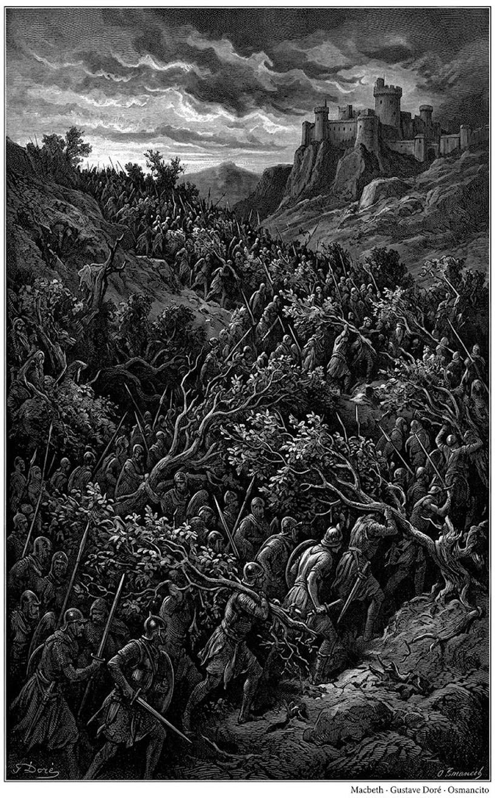](img/261009_macbeth_i-24.jpg)

Malcolm y los suyos llegan a Birnam; cada soldado cortará una rama. Siward dice:

> Se acerca el momento que, con debida decisión, nos hará saber lo que diremos que tenemos y lo que debemos.
>
> <small>[Frase 1987](#original-1987)</small>

Siward

Malcolm cierra: que decidan los golpes ciertos.

---

## Acto V, escena 5

[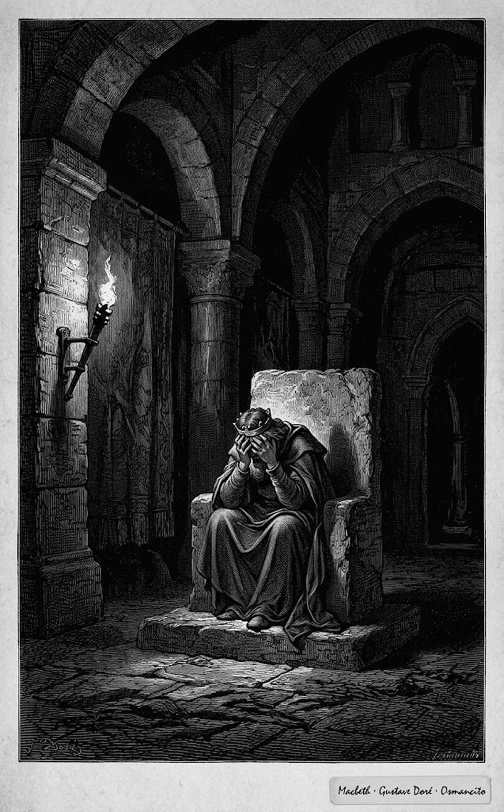](img/261009_macbeth_i-25.jpg)

En Dunsinane, Macbeth ya casi no siente miedo. Un grito de mujeres: la reina ha muerto. Llega un mensajero que vio moverse el bosque de Birnam. Macbeth lo llama mentiroso, y el mensajero responde:

> Que soporte vuestra ira si no es así.
>
> <small>[Frase 2026](#original-2026)</small>

Mensajero

Macbeth lo amenaza con colgarlo vivo si miente, y a solas empieza a dudar:

> Aflojo mi resolución y empiezo a dudar de la equivocación del demonio, que miente como si dijera verdad.
>
> <small>[Frase 2030](#original-2030)</small>

Macbeth

Comprende que el bosque sí viene, se cansa del mundo y manda a las armas.

---

## Acto V, escena 6

[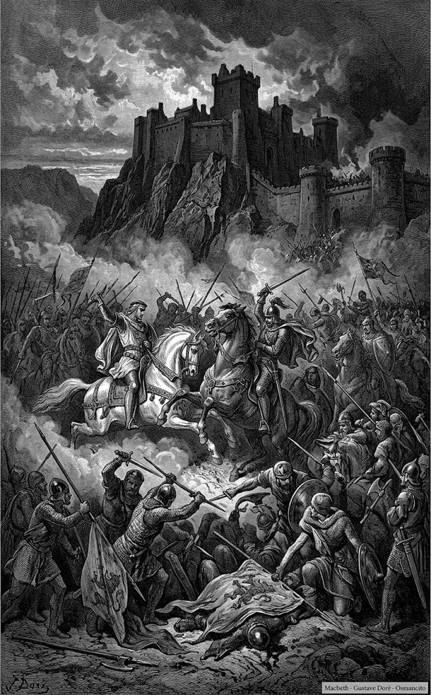](img/261009_macbeth_i-26.jpg)

Ante las murallas, Malcolm manda tirar las ramas:

> Con tal que encontremos esta noche las fuerzas del tirano, que nos derroten si no sabemos pelear.
>
> <small>[Frase 2048](#original-2048)</small>

Siward

Suenan las trompetas.

---

## Acto V, escena 7

[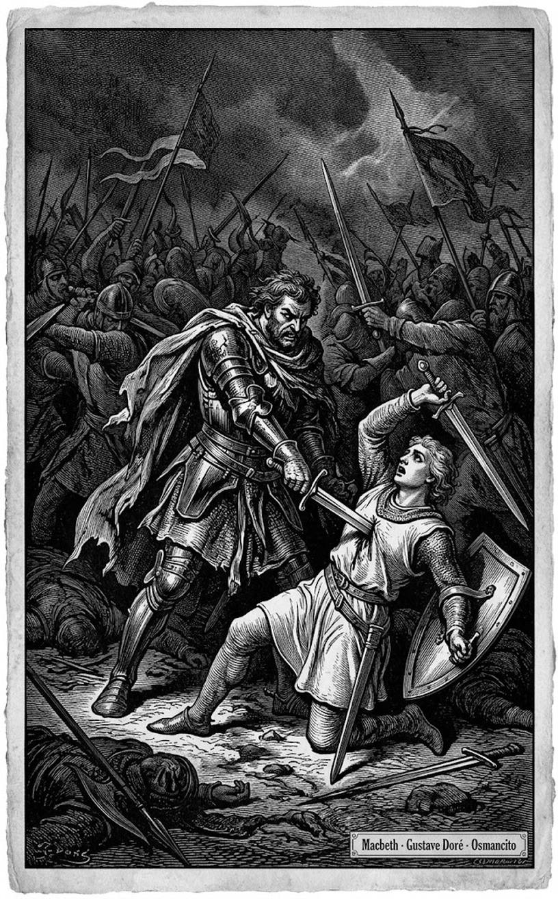](img/261009_macbeth_i-27.jpg)

Macbeth, atado a un poste, confía en su hechizo. Se cruza el joven Siward y le pregunta el nombre:

> Tendrás miedo de oírlo.
>
> <small>[Frase 2063](#original-2063)</small>

Macbeth

Macbeth mata al joven. Macduff lo busca:

> Si caes muerto sin golpe mío, los fantasmas de mi esposa y de mis hijos me perseguirán siempre.
>
> <small>[Frase 2084](#original-2084)</small>

Macduff

Siward dice que el castillo se rindió.

---

## Acto V, escena 8

[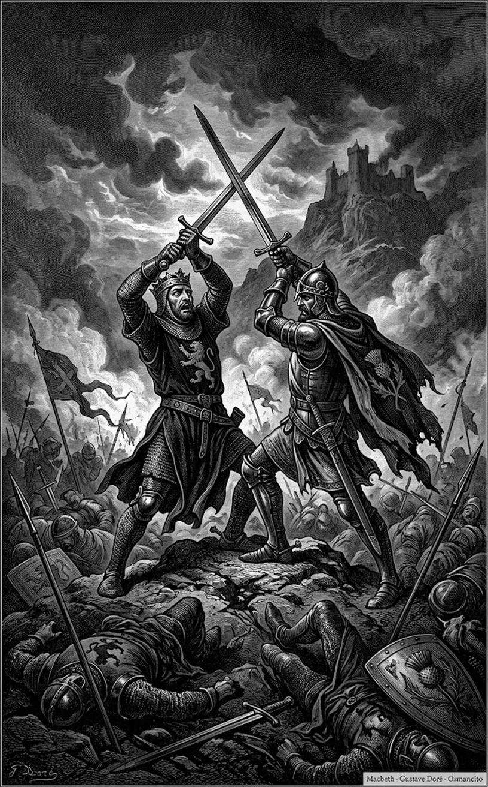](img/261009_macbeth_i-28.jpg)

Macbeth no quiere matarse y Macduff lo encuentra. Macbeth dice que su vida está hechizada; Macduff le revela que nació antes de tiempo:

> ¡Y que no se crea más a esos demonios embusteros que juegan con nosotros en doble sentido, que cumplen la palabra de promesa para nuestro oído y la rompen para nuestra esperanza!
>
> <small>[Frase 2118](#original-2118)</small>

Macbeth

Macbeth no quiere pelear; Macduff le dice que se rinda y será exhibido como monstruo. Él se niega y salen peleando. Ross cuenta la muerte del joven Siward, y su padre se alegra de que muriera como soldado. Entra Macduff con la cabeza de Macbeth:

> Te veo rodeado de la perla de tu reino, que dicen mi saludo en sus mentes, y cuyas voces deseo en alto junto a la mía: ¡Salve, rey de Escocia!
>
> <small>[Frases 2161–2163](#original-2161)</small>

Macduff

Malcolm es rey: hace condes a sus thanes, llama a los exiliados y castigará a los crueles. Invita a su coronación en Scone.

---

## Los Originales

Esta sección reúne, en el idioma del libro y por orden de aparición, las frases que arriba van en castellano. El número de cada una lleva de vuelta a su lugar en la lectura.

> <small>[Frase 17](#lugar-17)</small>
>
> There to meet with Macbeth.

> <small>[Frase 25](#lugar-25)</small>
>
> Fair is foul, and foul is fair: Hover through the fog and filthy air.

> <small>[Frase 52](#lugar-52)</small>
>
> So well thy words become thee as thy wounds: They smack of honour both.

> <small>[Frase 45](#lugar-45)</small>
>
> Mark, King of Scotland, mark: No sooner justice had, with valour arm’d, Compell’d these skipping kerns to trust their heels, But the Norweyan lord, surveying vantage, With furbish’d arms and new supplies of men, Began a fresh assault.

> <small>[Frase 74](#lugar-74)</small>
>
> No more that Thane of Cawdor shall deceive Our bosom interest.

> <small>[Frase 113](#lugar-113)</small>
>
> Macbeth doth come.

> <small>[Frase 138](#lugar-138)</small>
>
> that shalt be king hereafter!

> <small>[Frase 152](#lugar-152)</small>
>
> Lesser than Macbeth, and greater.

> <small>[Frase 192](#lugar-192)</small>
>
> And, for an earnest of a greater honour, He bade me, from him, call thee Thane of Cawdor: In which addition, hail, most worthy thane, For it is thine.

> <small>[Frase 219](#lugar-219)</small>
>
> I am Thane of Cawdor: If good, why do I yield to that suggestion Whose horrid image doth unfix my hair, And make my seated heart knock at my ribs, Against the use of nature?

> <small>[Frase 254](#lugar-254)</small>
>
> Nothing in his life Became him like the leaving it; he died As one that had been studied in his death, To throw away the dearest thing he ow’d As ’twere a careless trifle.

> <small>[Frase 282](#lugar-282)</small>
>
> —That is a step On which I must fall down, or else o’erleap, For in my way it lies.

> <small>[Frase 306](#lugar-306)</small>
>
> Hie thee hither, That I may pour my spirits in thine ear, And chastise with the valour of my tongue All that impedes thee from the golden round, Which fate and metaphysical aid doth seem To have thee crown’d withal.

> <small>[Frase 340](#lugar-340)</small>
>
> Your face, my thane, is as a book where men May read strange matters.

> <small>[Frase 342](#lugar-342)</small>
>
> He that’s coming Must be provided for; and you shall put This night’s great business into my dispatch; Which shall to all our nights and days to come Give solely sovereign sway and masterdom.

> <small>[Frase 368](#lugar-368)</small>
>
> Fair and noble hostess, We are your guest tonight.

> <small>[Frase 383](#lugar-383)</small>
>
> Besides, this Duncan Hath borne his faculties so meek, hath been So clear in his great office, that his virtues Will plead like angels, trumpet-tongued, against The deep damnation of his taking-off; And pity, like a naked new-born babe, Striding the blast, or heaven’s cherubin, hors’d Upon the sightless couriers of the air, Shall blow the horrid deed in every eye, That tears shall drown the wind.

> <small>[Frase 409](#lugar-409)</small>
>
> When you durst do it, then you were a man; And, to be more than what you were, you would Be so much more the man.

> <small>[Frase 425](#lugar-425)</small>
>
> I am settled, and bend up Each corporal agent to this terrible feat.

> <small>[Frase 444](#lugar-444)</small>
>
> Merciful powers, Restrain in me the cursed thoughts that nature Gives way to in repose!

> <small>[Frase 465](#lugar-465)</small>
>
> So I lose none In seeking to augment it, but still keep My bosom franchis’d, and allegiance clear, I shall be counsell’d.

> <small>[Frase 476](#lugar-476)</small>
>
> Come, let me clutch thee:— I have thee not, and yet I see thee still.

> <small>[Frase 503](#lugar-503)</small>
>
> I am afraid they have awak’d, And ’tis not done.

> <small>[Frase 553](#lugar-553)</small>
>
> Methought I heard a voice cry, “Sleep no more!

> <small>[Frase 581](#lugar-581)</small>
>
> Ha, they pluck out mine eyes!

> <small>[Frase 597](#lugar-597)</small>
>
> To know my deed, ’twere best not know myself.

> <small>[Frase 614](#lugar-614)</small>
>
> Faith, here’s an equivocator, that could swear in both the scales against either scale, who committed treason enough for God’s sake, yet could not equivocate to heaven: O, come in, equivocator.

> <small>[Frase 690](#lugar-690)</small>
>
> Confusion now hath made his masterpiece!

> <small>[Frase 729](#lugar-729)</small>
>
> Had I but died an hour before this chance, I had liv’d a blessed time; for, from this instant There’s nothing serious in mortality.

> <small>[Frase 787](#lugar-787)</small>
>
> This murderous shaft that’s shot Hath not yet lighted; and our safest way Is to avoid the aim.

> <small>[Frase 799](#lugar-799)</small>
>
> ’Tis unnatural, Even like the deed that’s done.

> <small>[Frase 844](#lugar-844)</small>
>
> God’s benison go with you; and with those That would make good of bad, and friends of foes!

> <small>[Frase 859](#lugar-859)</small>
>
> Tonight we hold a solemn supper, sir, And I’ll request your presence.

> <small>[Frase 900](#lugar-900)</small>
>
> Rather than so, come, fate, into the list, And champion me to th’ utterance!—Who’s there?—

> <small>[Frase 917](#lugar-917)</small>
>
> Are you so gospell’d, To pray for this good man and for his issue, Whose heavy hand hath bow’d you to the grave, And beggar’d yours forever?

> <small>[Frase 922](#lugar-922)</small>
>
> Now, if you have a station in the file, Not i’ th’ worst rank of manhood, say’t; And I will put that business in your bosoms, Whose execution takes your enemy off, Grapples you to the heart and love of us, Who wear our health but sickly in his life, Which in his death were perfect.

> <small>[Frase 972](#lugar-972)</small>
>
> Duncan is in his grave; After life’s fitful fever he sleeps well; Treason has done his worst: nor steel, nor poison, Malice domestic, foreign levy, nothing Can touch him further.

> <small>[Frase 986](#lugar-986)</small>
>
> There’s comfort yet; they are assailable.

> <small>[Frase 996](#lugar-996)</small>
>
> Thou marvell’st at my words: but hold thee still; Things bad begun make strong themselves by ill.

> <small>[Frase 1002](#lugar-1002)</small>
>
> But who did bid thee join with us?

> <small>[Frase 1045](#lugar-1045)</small>
>
> There’s but one down: the son is fled.

> <small>[Frase 1082](#lugar-1082)</small>
>
> Then comes my fit again: I had else been perfect; Whole as the marble, founded as the rock, As broad and general as the casing air: But now I am cabin’d, cribb’d, confin’d, bound in To saucy doubts and fears.

> <small>[Frase 1120](#lugar-1120)</small>
>
> Thou canst not say I did it.

> <small>[Frase 1146](#lugar-1146)</small>
>
> If thou canst nod, speak too.

> <small>[Frase 1162](#lugar-1162)</small>
>
> — Do not muse at me, my most worthy friends.

> <small>[Frase 1212](#lugar-1212)</small>
>
> I will tomorrow (And betimes I will) to the Weird Sisters: More shall they speak; for now I am bent to know, By the worst means, the worst.

> <small>[Frase 1214](#lugar-1214)</small>
>
> Strange things I have in head, that will to hand, Which must be acted ere they may be scann’d.

> <small>[Frase 1230](#lugar-1230)</small>
>
> And, which is worse, all you have done Hath been but for a wayward son, Spiteful and wrathful; who, as others do, Loves for his own ends, not for you.

> <small>[Frase 1234](#lugar-1234)</small>
>
> Great business must be wrought ere noon.

> <small>[Frase 1248](#lugar-1248)</small>
>
> My former speeches have but hit your thoughts, Which can interpret farther: only, I say, Thing’s have been strangely borne.

> <small>[Frase 1268](#lugar-1268)</small>
>
> He did: and with an absolute “Sir, not I,” The cloudy messenger turns me his back, And hums, as who should say, “You’ll rue the time That clogs me with this answer.

> <small>[Frase 1346](#lugar-1346)</small>
>
> Whate’er thou art, for thy good caution, thanks; Thou hast harp’d my fear aright.

> <small>[Frase 1359](#lugar-1359)</small>
>
> Be bloody, bold, and resolute.

> <small>[Frase 1376](#lugar-1376)</small>
>
> Rebellious head, rise never till the wood Of Birnam rise, and our high-plac’d Macbeth Shall live the lease of nature, pay his breath To time and mortal custom.

> <small>[Frase 1407](#lugar-1407)</small>
>
> —Now I see ’tis true; For the blood-bolter’d Banquo smiles upon me, And points at them for his.

> <small>[Frase 1441](#lugar-1441)</small>
>
> Time, thou anticipat’st my dread exploits: The flighty purpose never is o’ertook Unless the deed go with it.

> <small>[Frase 1460](#lugar-1460)</small>
>
> to leave his wife, to leave his babes, His mansion, and his titles, in a place From whence himself does fly?

> <small>[Frase 1474](#lugar-1474)</small>
>
> Sirrah, your father’s dead.

> <small>[Frase 1533](#lugar-1533)</small>
>
> I doubt some danger does approach you nearly: If you will take a homely man’s advice, Be not found here; hence, with your little ones.

> <small>[Frase 1565](#lugar-1565)</small>
>
> Each new morn New widows howl, new orphans cry; new sorrows Strike heaven on the face, that it resounds As if it felt with Scotland, and yell’d out Like syllable of dolour.

> <small>[Frase 1618](#lugar-1618)</small>
>
> If such a one be fit to govern, speak: I am as I have spoken.

> <small>[Frase 1622](#lugar-1622)</small>
>
> —O nation miserable, With an untitled tyrant bloody-scepter’d, When shalt thou see thy wholesome days again, Since that the truest issue of thy throne By his own interdiction stands accus’d, And does blaspheme his breed?

> <small>[Frase 1633](#lugar-1633)</small>
>
> What I am truly, Is thine and my poor country’s to command: Whither, indeed, before thy here-approach, Old Siward, with ten thousand warlike men, Already at a point, was setting forth.

> <small>[Frase 1717](#lugar-1717)</small>
>
> To relate the manner Were, on the quarry of these murder’d deer, To add the death of you.

> <small>[Frase 1753](#lugar-1753)</small>
>
> —But, gentle heavens, Cut short all intermission; front to front, Bring thou this fiend of Scotland and myself; Within my sword’s length set him; if he ’scape, Heaven forgive him too!

> <small>[Frase 1759](#lugar-1759)</small>
>
> Receive what cheer you may; The night is long that never finds the day.

> <small>[Frase 1770](#lugar-1770)</small>
>
> A great perturbation in nature, to receive at once the benefit of sleep, and do the effects of watching.

> <small>[Frase 1805](#lugar-1805)</small>
>
> Why, then ’tis time to do’t.

> <small>[Frase 1816](#lugar-1816)</small>
>
> —What, will these hands ne’er be clean?

> <small>[Frase 1855](#lugar-1855)</small>
>
> Unnatural deeds Do breed unnatural troubles: infected minds To their deaf pillows will discharge their secrets.

> <small>[Frase 1881](#lugar-1881)</small>
>
> Some say he’s mad; others, that lesser hate him, Do call it valiant fury: but, for certain, He cannot buckle his distemper’d cause Within the belt of rule.

> <small>[Frase 1899](#lugar-1899)</small>
>
> ”—Then fly, false thanes, And mingle with the English epicures: The mind I sway by, and the heart I bear, Shall never sag with doubt nor shake with fear.

> <small>[Frase 1960](#lugar-1960)</small>
>
> — I will not be afraid of death and bane, Till Birnam forest come to Dunsinane.

> <small>[Frase 1987](#lugar-1987)</small>
>
> The time approaches, That will with due decision make us know What we shall say we have, and what we owe.

> <small>[Frase 2026](#lugar-2026)</small>
>
> Let me endure your wrath, if’t be not so.

> <small>[Frase 2030](#lugar-2030)</small>
>
> — I pull in resolution; and begin To doubt th’ equivocation of the fiend, That lies like truth.

> <small>[Frase 2048](#lugar-2048)</small>
>
> — Do we but find the tyrant’s power tonight, Let us be beaten, if we cannot fight.

> <small>[Frase 2063](#lugar-2063)</small>
>
> Thou’lt be afraid to hear it.

> <small>[Frase 2084](#lugar-2084)</small>
>
> If thou be’st slain and with no stroke of mine, My wife and children’s ghosts will haunt me still.

> <small>[Frase 2118](#lugar-2118)</small>
>
> And be these juggling fiends no more believ’d, That palter with us in a double sense; That keep the word of promise to our ear, And break it to our hope!

> <small>[Frases 2161–2163](#lugar-2161)</small>
>
> I see thee compass’d with thy kingdom’s pearl, That speak my salutation in their minds; Whose voices I desire aloud with mine,— Hail, King of Scotland!

© 2026 Osmancito
