12 de octubre de 2026

# El Libro de Arena: trece cuentos

[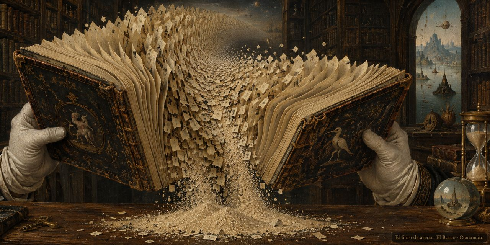](img/261012_borges_arena_og.jpg)

Jorge Luis Borges

En 1975, Jorge Luis Borges publicó *El Libro de Arena*, trece cuentos que el autor prefiere presentar con un epílogo en lugar de un prólogo, porque prologar cuentos todavía no leídos es tarea casi imposible. Un viejo y un muchacho que son el mismo hombre conversan en un banco junto a un río, un congreso crece hasta confundirse con el cosmos y la suma de los días, una utopía cansa al hombre que la imagina y un libro de páginas infinitas se vuelve un objeto de pesadilla para quien lo posee. Esta lectura sigue los cuentos uno por uno: pasajes de Borges, con el número de su frase, y entre ellos unos textos cuentan lo que pasa y explican lo que haga falta.

## 1. El Otro

[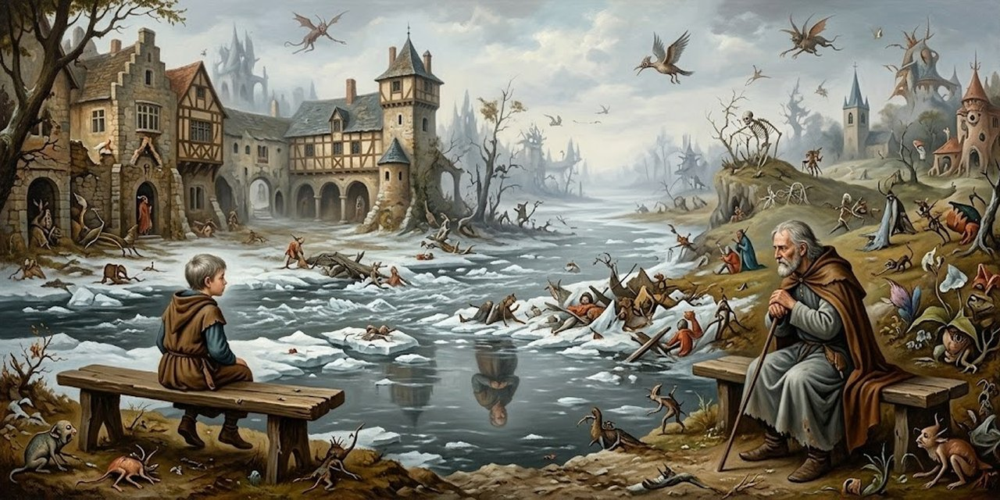](img/261012_borges_arena_i-1.jpg)

> El hecho ocurrió en el mes de febrero de 1969, al norte de Boston, en Cambridge. No lo escribí inmediatamente porque mi primer propósito fue olvidarlo, para no perder la razón. Ahora, en 1972, pienso que si lo escribo, los otros lo leerán como un cuento y, con los años, lo será tal vez para mí. Sé que fue casi atroz mientras duró y más aún durante las desveladas noches que lo siguieron.
>
> <small>Frases 5–8</small>

Atroz quiere decir espantoso; desvelada, la noche sin dormir. Borges avisa que lo cuenta como cuento para no perder la razón.

A las diez de la mañana, Borges está en un banco frente al río Charles, que arrastra hielo. Alguien se sienta en la otra punta, silba una milonga criolla y empieza a decir los versos en voz alta:

> La voz no era la de Álvaro, pero quería parecerse a la de Álvaro. La reconocí con horror. Me le acerqué y le dije: —Señor, ¿usted es oriental o argentino? —Argentino, pero desde el catorce vivo en Ginebra —fue la contestación. Hubo un silencio largo. Le pregunté: —¿En el número diecisiete de Malagnou, frente a la iglesia rusa? Me contestó que sí.
>
> <small>Frases 27–33</small>

Álvaro Melián Lafinur fue un amigo de la juventud de Borges. Oriental quiere decir uruguayo; el catorce es 1914. Ginebra y la calle Malagnou son donde Borges vivió de muchacho.

El mayor le dice quién es: los dos se llaman Jorge Luis Borges y están en Cambridge, en 1969. El muchacho cree estar en Ginebra y solo concede el parecido. El mayor ofrece una prueba:

> Yo le contesté: —Puedo probarte que no miento. Voy a decirte cosas que no puede saber un desconocido. En casa hay un mate de plata con un pie de serpientes, que trajo del Perú nuestro bisabuelo. También hay una palangana de plata, que pendía del arzón. En el armario de tu cuarto hay dos filas de libros.
>
> <small>Frases 40–44</small>

El arzón es la parte delantera de la silla de montar. Un mate de plata y una palangana eran objetos de la casa de los Borges que ningún extraño conocería.

No basta: en un sueño, el otro podría saber todo lo que él sabe. Si es un sueño, cada uno debe creerse el soñador. El muchacho pregunta con ansiedad qué pasa si dura:

> —¿Y si el sueño durara? —dijo con ansiedad. Para tranquilizarlo y tranquilizarme, fingí un aplomo que ciertamente no sentía. Le dije: —Mi sueño ha durado ya setenta años. Al fin y al cabo, al recordarse, no hay persona que no se encuentre consigo misma. Es lo que nos está pasando ahora, salvo que somos dos.
>
> <small>Frases 59–64</small>

Aplomo es serenidad. Borges tiene setenta años y calma al muchacho con una broma seria.

El mayor le ofrece contarle el porvenir, que para él es pasado:

> ¿No querés saber algo de mi pasado, que es el porvenir que te espera? Asintió sin una palabra.
>
> <small>Frases 65–66</small>

Para el viejo es recuerdo y para el joven futuro: es la misma vida vista desde dos orillas.

Le cuenta que su madre sigue bien, que su padre y su abuela murieron y que su hermana se casó. Anuncia otra guerra. El muchacho apenas lo escucha, y pregunta por él:

> Vaciló y me dijo: —¿Y usted? —No sé la cifra de los libros que escribirás, pero sé que son demasiados. Escribirás poesías que te darán un agrado no compartido y cuentos de índole fantástica. Darás clases como tu padre y como tantos otros de nuestra sangre.
>
> <small>Frases 79–82</small>

Un agrado no compartido es un gusto que no se puede repartir con nadie. La respuesta es la propia biografía de Borges: poemas, cuentos fantásticos y clases.

Hablan de literatura y no coinciden: el joven quiere imágenes nuevas, el viejo prefiere las de siempre. Al muchacho se le ocurre una dificultad:

> De pronto dijo: —Si usted ha sido yo, ¿cómo explicar que haya olvidado su encuentro con un señor de edad que en 1918 le dijo que él también era Borges? No había pensado en esa dificultad. Le respondí sin convicción: —Tal vez el hecho fue tan extraño que traté de olvidarlo. Aventuró una tímida pregunta: —¿Cómo anda su memoria? Comprendí que para un muchacho que no había cumplido veinte años, un hombre de más de setenta era casi un muerto. Le contesté: —Suele parecerse al olvido, pero todavía encuentra lo que le encargan. Estudio anglosajón y no soy el último de la clase.
>
> <small>Frases 132–138</small>

Si el viejo ya fue ese muchacho, tendría que recordar esta conversación. El anglosajón es el idioma que se hablaba en Inglaterra hace mil años.

La conversación dura demasiado para un sueño. Borges propone una prueba que ningún sueño fabrica: un verso.

> Nuestra conversación ya había durado demasiado para ser la de un sueño. Una brusca idea se me ocurrió. —Yo te puedo probar inmediatamente —le dije— que no estás soñando conmigo. Oí bien este verso, que no has leído nunca, que yo recuerde. Lentamente entoné la famosa línea: L'hydre — univers tordant son corps écaillé d'astres.
>
> <small>Frases 139–143</small>

El verso es francés, del poeta Victor Hugo, y dice, más o menos: la hidra-universo, retorciendo su cuerpo escamado de astros. Una hidra es un monstruo de muchas cabezas; Hugo ve el universo como un animal inmenso con escamas de estrellas. La prueba es fina: si el muchacho lo estuviera soñando, el verso saldría de su propia cabeza y no podría sorprenderlo.

> Sentí su casi temeroso estupor. Lo repitió en voz baja, saboreando cada resplandeciente palabra. —Es verdad —balbuceó—. Yo no podré nunca escribir una línea como ésa. Hugo nos había unido.
>
> <small>Frases 144–148</small>

El verso lo sorprende. Victor Hugo, el gran poeta francés, los une: los dos lo admiran.

El muchacho había recitado a Whitman, el gran poeta estadounidense del siglo XIX. El viejo recuerda una pieza suya y la lee al revés:

> Antes, él había repetido con fervor, ahora lo recuerdo, aquella breve pieza en que Walt Whitman rememora una compartida noche ante el mar, en que fue realmente feliz. —Si Whitman la ha cantado —observé— es porque la deseaba y no sucedió. El poema gana si adivinamos que es la manifestación de un anhelo, no la historia de un hecho. Se quedó mirándome. —Usted no lo conoce —exclamó—. Whitman es incapaz de mentir.
>
> <small>Frases 149–154</small>

Borges lee a Whitman como anhelo, no como hecho. Los dos aman al mismo poeta y no se entienden sobre él.

Bajo la charla, el viejo ve que no pueden entenderse, y que el destino del muchacho es llegar a ser él. Recuerda entonces una fantasía de Coleridge:

> De pronto recordé una fantasía de Coleridge. Alguien sueña que cruza el paraíso y le dan como prueba una flor. Al despertarse, ahí está la flor. Se me ocurrió un artificio análogo. —Oí —le dije—, ¿tenés algún dinero?
>
> <small>Frases 162–166</small>

Coleridge es un poeta inglés del siglo XIX. En su fantasía, una flor traída del paraíso prueba que el sueño fue real.

Intercambian una moneda y un billete americano, que lleva la fecha 1974. El muchacho grita que es imposible, rompe el billete y guarda la moneda. El viejo piensa tirarla al río, pero la suerte no lo quiere:

> Respondí que lo sobrenatural, si ocurre dos veces, deja de ser aterrador. Le propuse que nos viéramos al día siguiente, en ese mismo banco que está en dos tiempos y en dos sitios. Asintió en el acto y me dijo, sin mirar el reloj, que se le había hecho tarde. Los dos mentíamos y cada cual sabía que su interlocutor estaba mintiendo. Le dije que iban a venir a buscarme.
>
> <small>Frases 186–190</small>

La despedida es una mentira cortés de los dos lados. Para uno es Cambridge en 1969; para el otro, Ginebra en 1918.

Quedan en verse al día siguiente; el viejo le dice que, cuando tenga su edad, habrá perdido casi toda la vista. Se despiden sin tocarse y ninguno va. Durante años, Borges le da vueltas al encuentro:

> He cavilado mucho sobre este encuentro, que no he contado a nadie. Creo haber descubierto la clave. El encuentro fue real, pero el otro conversó conmigo en un sueño y fue así que pudo olvidarme; yo conversé con él en la vigilia y todavía me atormenta el recuerdo. El otro me soñó, pero no me soñó rigurosamente. Soñó, ahora lo entiendo, la imposible fecha en el dólar.
>
> <small>Frases 202–206</small>

Cavilar es pensar mucho. El muchacho lo soñó y por eso pudo olvidarlo; Borges lo vivió despierto y por eso aún lo atormenta.

## 2. Ulrica

[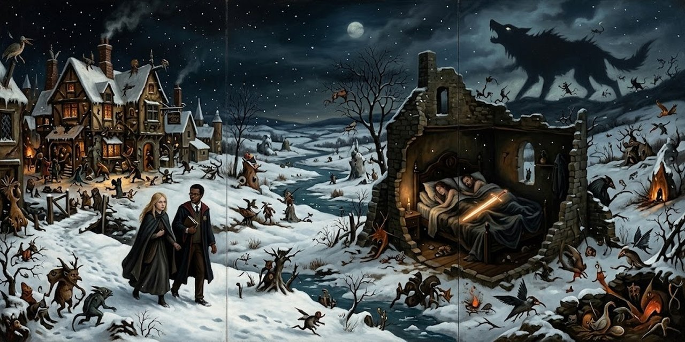](img/261012_borges_arena_i-2.jpg)

Javier Otárola, profesor colombiano, conoce a Ulrica una noche en York; ella dice que es feminista. A la mañana siguiente lo invita a su mesa y dice que le gusta caminar sola.

> Recordé una broma de Schopenhauer y contesté: —A mí también. Podemos salir juntos los dos.
>
> <small>Frases 246–247</small>

Arthur Schopenhauer fue un filósofo alemán del siglo XIX que escribió que la soledad es la suerte de los espíritus grandes.

Caminan sobre la nieve, él ya enamorado, hasta que se oye un aullido lejano.

> Oí de pronto el lejano aullido de un lobo. No he oído nunca aullar a un lobo, pero sé que era un lobo. Ulrica no se inmutó.
>
> <small>Frases 252–254</small>

Hace siglos que no quedan lobos en Inglaterra: el aullido es una señal del tiempo antiguo de las sagas del Norte.

Esa tarde sus caminos se separan: ella irá a Londres, a repetir los pasos de De Quincey, que buscaba a su Anna perdida.

> —De Quincey —respondí— dejó de buscarla. Yo, a lo largo del tiempo, sigo buscándola. —Tal vez —dijo en voz baja— la has encontrado. Comprendí que una cosa inesperada no me estaba prohibida y le besé la boca y los ojos. Me apartó con suave firmeza y luego declaró: —Seré tuya en la posada de Thorgate. Te pido mientras tanto, que no me toques. Es mejor que así sea.
>
> <small>Frases 259–265</small>

Thomas De Quincey, escritor inglés del siglo XIX, perdió a una muchacha, Anna, en Londres y la buscó años entre la multitud. Ulrica promete su amor a Javier en la posada de Thorgate, con una condición.

Siguen de la mano. Él quisiera que la mañana no terminara.

> —Yo querría que este momento durara siempre —murmuré. —Siempre es una palabra que no está permitida a los hombres —afirmó Ulrica y, para aminorar el énfasis, me pidió que le repitiera mi nombre, que no había oído bien.
>
> <small>Frases 285–286</small>

Ulrica niega la palabra siempre: a los hombres solo les toca el instante. Ella le pide su nombre; no logran pronunciar el del otro, y se rebautizan Sigurd y Brynhild. Él pregunta si conoce la saga.

> —Por supuesto —me dijo—. La trágica historia que los alemanes echaron a perder con sus tardíos Nibelungos. No quise discutir y le respondí: —Brynhild, caminas como si quisieras que entre los dos hubiera una espada en el lecho.
>
> <small>Frases 295–297</small>

La saga de los Völsungas, islandesa, cuenta el amor trágico de Sigurd y Brynhild, que durmieron con la espada Gram desenvainada entre los dos. El Cantar de los Nibelungos es la versión alemana.

Llegan a la posada, que se llama como la otra. Arriba, en el cuarto oscuro, ella lo llama por su verdadero nombre. Él posee, por primera y última vez, la imagen de Ulrica.

---

## 3. El Congreso

[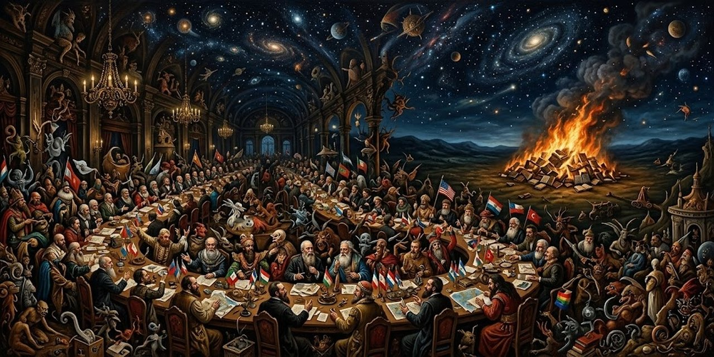](img/261012_borges_arena_i-3.jpg)

Alejandro Ferri escribe ya viejo, solo en un hotel de Buenos Aires: llegó de Santa Fe en 1899, fue periodista y nunca se casó. Días atrás supo que Fermín Eguren, su antiguo rival, murió en Punta del Este.

> La muerte de aquel hombre, que ciertamente no fue nunca mi amigo, se ha obstinado en entristecerme. Sé que estoy solo; soy en la tierra el único guardián de aquel acontecimiento, el Congreso, cuya memoria no podré compartir. Soy ahora el último congresal. Es verdad que todos los hombres lo son, que no hay un ser en el planeta que no lo sea, pero yo lo soy de otro modo. Sé que lo soy; eso me hace diverso de mis innumerables colegas, actuales y futuros.
>
> <small>Frases 331–335</small>

Fermín Eguren no fue nunca su amigo, pero su muerte lo deja solo con la historia que va a contar. Todos los hombres son congresales sin saberlo, dice Ferri; él es el último que lo sabe.

Los sábados, en la Confitería del Gas, unas quince o veinte personas rodeaban una mesa larga, presididas por don Alejandro Glencoe, un estanciero oriental de barba rojiza que había resuelto fundar un Congreso del Mundo, con representantes de todos los hombres de todas las naciones. Ferri entró de la mano de su amigo, el poeta Fernández Irala. El rojizo Twirl, adulador sutil, iba ensanchando el proyecto sin fin: una biblioteca, una sede, un idioma universal. Eguren, sobrino de don Alejandro, despreciaba a Ferri desde el primer día. Una noche, a la salida de una casa de la calle Junín, Eguren, algo bebido, empujó a un hombre grandote, que les cerró el paso con un cuchillo. Eguren se echó atrás, aterrado.

> Yo no las tenía todas conmigo, pero mi odio pudo más que mi susto. Me llevé la mano a la sisa, como para sacar un arma, y dije con voz firme: —Esto lo vamos a arreglar en la calle. El desconocido me respondió, ya con otra voz: —Así me gustan los hombres. Yo quería probarlos, amigo. Ahora reía afablemente. —Lo de amigo corre por cuenta suya —le repliqué y salimos.
>
> <small>Frases 431–436</small>

El cuchillero solo quería probarlos, y Ferri, que se tenía por cobarde, respondió firme. Irala lo palmearía después: entre los tres había un mosquetero. Eguren nunca le perdonó haber sido testigo de su aflojada.

Don Alejandro convidó a Ferri y a Irala a pasar unos días en La Caledonia, su estancia junto al Brasil, donde los peones albañiles levantaban un anfiteatro para el acto de apertura. En Buenos Aires, Glencoe era un señor afable y medido; en La Caledonia, el severo jefe de un clan, que los domingos leía la Sagrada Escritura a los gauchos. Una noche, un agregado y un peón se trabaron a puñaladas.

> Llegó a la rueda, se quitó el arma que solía cargar, se la dio al capataz, que me pareció acobardado, y se abrió camino entre los aceros. Oí en seguida la orden: —Suelten el cuchillo, muchachos. Con la misma voz tranquila agregó: —Ahora se dan la mano y se portan bien. No quiero barullos aquí. Los dos obedecieron.
>
> <small>Frases 492–496</small>

Sin su arma y sin apuro, don Alejandro se abre camino entre los aceros y manda soltar el cuchillo y darse la mano. Al otro día despide al capataz, que se había acobardado. Ferri siente que la soledad lo cerca y teme no volver nunca a Buenos Aires.

El Congreso necesitaba un idioma, y dos delegados irían a documentarse a Londres y a París: Eguren y Ferri. En Londres, Ferri estudia las lenguas universales en la biblioteca del Museo Británico, y bajo su alta cúpula conoce a Beatriz Frost, una muchacha alta, de cabellera bermeja, devota de la fe predicada por Ibsen: no quiere atarse a nadie.

> De su boca nació la palabra que yo no me atrevía a decir. Oh noches, oh compartida y tibia tiniebla, oh el amor que fluye en la sombra como un río secreto, oh aquel momento de la dicha en que cada uno es los dos, oh la inocencia y el candor de la dicha, oh la unión en la que nos perdíamos para perdernos luego en el sueño, oh las primeras claridades del día y yo contemplándola.
>
> <small>Frases 538–539</small>

La palabra que él no se atrevía a decir es amor. Lo que sigue es un solo aliento: las noches con Beatriz, que Ferri recordará toda la vida. Al cabo del año vuelve a Buenos Aires; por cobardía no le deja su dirección, para eludir la angustia de esperar cartas.

Mientras tanto, Twirl ha propuesto comprar sin orden colecciones enteras de diarios: todo es un testimonio, dice, y los paquetes se apilan ya sin catálogo en el caserón de don Alejandro. La obra del anfiteatro está detenida. El viernes, Ferri va a entregar su informe a la casa de la calle Alsina. Ahí están Nora Erfjord, la secretaria, Nierenstein, Cruz, Wren. Bruscamente oyen los pasos: don Alejandro llega con otra voz.

> Sin mirar a nadie, mandó: —Vayan sacando todo lo amontonado ahí abajo. Que no quede un libro en el sótano.
>
> <small>Frases 576–577</small>

Sacan los libros al patio y amontonan una pila más alta que los más altos. Después viene la orden de prenderles fuego. Nierenstein murmura que el Congreso del Mundo no puede prescindir de esos auxiliares preciosos que seleccionó con tanto amor.

> —¿El Congreso del Mundo? —dijo don Alejandro. Se rió con sorna y yo nunca lo había oído reír.
>
> <small>Frases 584–586</small>

Es la primera vez que lo oyen reír. Entonces llega la revelación: cuatro años tardó don Alejandro en comprender que la empresa es tan vasta que abarca el mundo entero; el Congreso no es unos cuantos charlatanes en una estancia perdida: comenzó con el primer instante del mundo y proseguirá cuando sean polvo. Es los libros que han quemado, es Job en el muladar y Cristo en la cruz, es sus toros.

> No pude contenerme y lo interrumpí: —Don Alejandro, yo también soy culpable. Yo tenía concluido el informe, que aquí le traigo, y seguía demorándome en Inglaterra y tirando su plata, por el amor de una mujer. Don Alejandro continuó: —Ya me lo suponía, Ferri. El Congreso es mis toros. El Congreso es los toros que he vendido y las leguas de campo que no son mías. Una voz consternada se elevó; era la de Twirl. —¿No va a decirnos que ha vendido La Caledonia? Don Alejandro contestó sin apuro: —Sí, la he vendido.
>
> <small>Frases 601–608</small>

Ferri se confiesa culpable: tenía el informe listo y seguía en Inglaterra, tirando la plata de don Alejandro por el amor de una mujer. Twirl, consternado, pregunta por La Caledonia: vendida. Ya no le queda un palmo de tierra a don Alejandro, pero su ruina no le duele, porque ahora entiende.

Esa última noche salen todos a mirar el Congreso: en la plaza toman un coche abierto y recorren la ciudad, cansados y felices, hasta los linderos de la aurora. Cerca de un agua oscura y humilde, tal vez el Maldonado o tal vez el Riachuelo, la alta voz de Nora Erfjord entona la balada de Patrick Spens.

> Algo de lo que entrevimos perdura —el rojizo paredón de la Recoleta, el amarillo paredón de la cárcel, una pareja de hombres bailando en una esquina sin ochava, un atrio ajedrezado con una verja, las barreras del tren, mi casa, un mercado, la insondable y húmeda noche— pero ninguna de esas cosas fugaces, que acaso fueron otras, importa. Importa haber sentido que nuestro plan, del cual más de una vez nos burlamos, existía realmente y secretamente y era el universo y nosotros. Sin mayor esperanza, he buscado a lo largo de los años el sabor de esa noche; alguna vez creí recuperarla en la música, en el amor, en la incierta memoria, pero no ha vuelto, salvo una sola madrugada, en un sueño.
>
> <small>Frases 627–629</small>

No importan las imágenes sueltas de la noche: importa haber sentido que el plan, del que más de una vez se burlaron, existía realmente y secretamente y era el universo y ellos. Al amanecer juran no decir nada a nadie. Ferri no vuelve a verlos, salvo a Irala, y nunca comentan lo ocurrido: cualquier palabra hubiera sido una profanación. Don Alejandro muere en 1914. Una vez, ya viejo, Ferri se cruza con Nierenstein en la calle Lima, y los dos fingen no haberse visto.

---

## 4. There Are More Things

[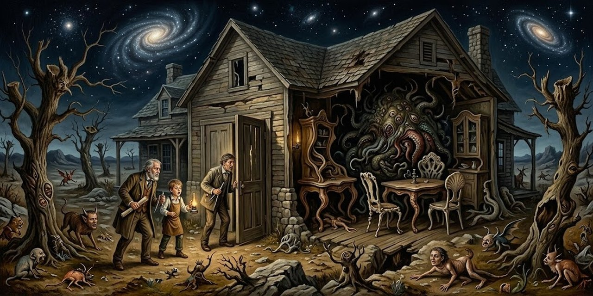](img/261012_borges_arena_i-4.jpg)

Antes del último examen de filosofía en Texas, el narrador sabe que murió su tío Edwin Arnett, ingeniero jubilado, que lo había iniciado en la filosofía en la Casa Colorada, cerca de Lomas.

> Sentí lo que sentimos cuando alguien muere: la congoja, ya inútil, de que nada nos hubiera costado haber sido más buenos. El hombre olvida que es un muerto que conversa con muertos.
>
> <small>Frases 639–640</small>

La congoja de que nada nos hubiera costado ser más buenos: eso sentimos cuando alguien muere. Y sin embargo lo olvidamos: cada hombre es un muerto que conversa con muertos.

De vuelta en 1921, averigua que la casa fue rematada. La compró un forastero, Max Preetorius, que tiró todos los muebles y libros, se instaló de noche y no volvió a abrir las ventanas. Nadie volvió a verlo. El sobrino, curioso, visita a Alexander Muir, el arquitecto de la casa, que rechazó refacciones del comprador. Muir le cuenta que, antes de morir Edwin, el intendente y el cura le propusieron trazar una capilla católica, y que se negó:

> —¿Eso es todo? —me atreví a preguntar. —No. El judezno ese de Preetorius quería que yo destruyera mi obra y que en su lugar pergeñara una cosa monstruosa. La abominación tiene muchas formas.
>
> <small>Frases 690–694</small>

Muir es escocés y calvinista: la abominación de los ídolos tiene para él muchas formas, y la última es el judío Preetorius, que quería que destruyera su obra y pergeñara en su lugar una cosa monstruosa.

Al doblar la esquina lo alcanza Daniel Iberra, un malevo, que se desvía al ver la Casa Colorada en lo alto. Le cuenta por qué:

> Noches pasadas, yo venía de una farra. A unas cien varas de la quinta, vi algo. El tubiano se me espantó y si no me le afirmo y lo hago tomar por el callejón, tal vez no cuento el cuento. Lo que vi no era para menos. Muy enojado, agregó una mala palabra. Aquella noche no dormí.
>
> <small>Frases 708–713</small>

El tubiano es el caballo, en el habla de los malevos. Iberra no dice lo que vio a cien varas de la quinta; solo que esa noche no durmió y que hacia el alba soñó con un laberinto como los grabados de Piranesi, el artista italiano de las cárceles imaginarias: un anfiteatro de piedra sin puertas ni ventanas, y adentro, tendido en la tierra, el minotauro: el monstruo de un monstruo.

Queda el carpintero Mariani, que amuebló la casa de noche y a puertas cerradas. Hizo el trabajo al pie de la letra, pero por todo el oro del mundo no volvería a Turdera, y dice que Preetorius estaba loco. No saca más.

> Repetidas veces me dije que no hay otro enigma que el tiempo, esa infinita urdimbre del ayer, del hoy, del porvenir, del siempre y del nunca.
>
> <small>Frase 740</small>

Ni Schopenhauer ni Royce le sirven: el único enigma no está en la casa sino en el tiempo, esa urdimbre infinita de lo que fue, de lo que es y de lo que será. Aun así, noche tras noche, sigue rondando los caminos de tierra que cercan la Casa Colorada; a veces divisa arriba una luz muy blanca, a veces cree oír un gemido.

El diecinueve de enero se desploma la tormenta. En un relámpago, el sobrino ve que el portón cede y la puerta de la casa está medio abierta. Adentro, el comedor y la biblioteca son una sola pieza desmantelada, con muebles de formas incomprensibles. Descubre una escalera vertical y sube:

> Esa escalera, que postulaba manos y pies, era comprensible y de algún modo me alivió. Apagué la luz y aguardé un tiempo en la oscuridad. No oí el menor sonido, pero la presencia de las cosas incomprensibles me perturbaba.
>
> <small>Frases 772–774</small>

La escalera, que postula manos y pies, es lo único comprensible de la casa y de algún modo lo alivia. Arriba, la pesadilla se agita y florece: una larga mesa operatoria en forma de U, con hoyos circulares en los extremos, que podría ser el lecho del habitante, cuya anatomía se revela así, oblicuamente, como la de un animal o un dios; y una V de espejos que se pierde en la tiniebla superior.

> ¿Cómo sería el habitante? ¿Qué podía buscar en este planeta, no menos atroz para él que él para nosotros? ¿Desde qué secretas regiones de la astronomía o del tiempo, desde qué antiguo y ahora incalculable crepúsculo, habría alcanzado este arrabal sudamericano y esta precisa noche? Me sentí un intruso en el caos.
>
> <small>Frases 783–786</small>

El habitante no es de aquí: el planeta es tan atroz para él como él para nosotros. El intruso en el caos es el sobrino, que entró donde no lo llamaban.

Afuera cesó la lluvia y son casi las dos. Baja cautelosamente, y a mitad de la escalera siente que algo asciende, opresivo, lento y plural. No cierra los ojos.

---

## 5. La Secta de los Treinta

[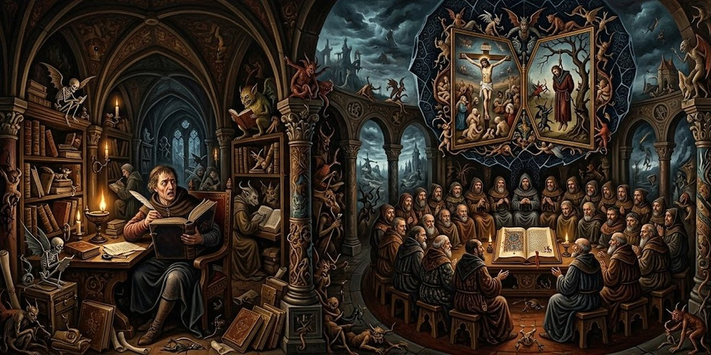](img/261012_borges_arena_i-5.jpg)

Un manuscrito anónimo del siglo cuarto, guardado en la Biblioteca de Leiden, cuenta la discusión de un cristiano con los maestros de una secta que vive sin nada, desnuda y sin casa:

> Repiten con fervor las palabras: Considerad los cuervos, que ni siembran ni siegan, que ni tienen cillero, ni alfolí; y Dios los alimenta. ¿Cuánto de más estima sois vosotros que las aves? El texto proscribe el ahorro: Si así viste Dios a la hierba, que hoy está en el campo, y mañana es echada en el horno, ¿cuánto más vosotros, hombres de poca fe? Vosotros, pues, no procuréis qué hayáis de comer, o qué hayáis de beber; ni estéis en ansiosa perplejidad.
>
> <small>Frases 809–812</small>

Las palabras que repiten son de Jesús, en el Evangelio: Dios alimenta a los cuervos y viste a la hierba del campo. Los sectarios extraen la consecuencia extrema: el texto proscribe el ahorro, y por eso viven sin nada.

El nombre de la Secta ha dado muchas conjeturas, todas falsas, dice el cronista. Él expondrá la herejía, aunque confiesa su límite:

> Sé la Verdad pero no puedo razonar la Verdad. El inapreciable don de comunicarla no me ha sido otorgado. Que otros, más felices que yo, salven a los sectarios por la palabra. Por la palabra o por el fuego. Más vale ser ejecutado que darse muerte. Me limitaré pues a la exposición de la abominable herejía.
>
> <small>Frases 823–827</small>

Por la palabra o por el fuego: al cronista no le temblaría la mano con el fuego. Y esa frase, "más vale ser ejecutado que darse muerte", pesará distinto cuando sepamos cómo mueren los iniciados.

Para llegar al secreto, el manuscrito vuelve a la Pasión: el Verbo se hizo carne para sufrir el martirio.

> Era preciso que las cosas fueran inolvidables. No bastaba la muerte de un ser humano por el hierro o por la cicuta para herir la imaginación de los hombres hasta el fin de los días. El Señor dispuso los hechos de manera patética. Tal es la explicación de la última cena, de las palabras de Jesús que presagian la entrega, de la repetida señal a uno de los discípulos, de la bendición del pan y del vino, de los juramentos de Pedro, de la solitaria vigilia en Gethsemaní, del sueño de los doce, de la plegaria humana del Hijo, del sudor como sangre, de las espadas, del beso que traiciona, de Pilato que se lava las manos, de la flagelación, del escarnio, de las espinas, de la púrpura y del cetro de caña, del vinagre con hiel, de la Cruz en lo alto de una colina, de la promesa al buen ladrón, de la tierra que tiembla y de las tinieblas.
>
> <small>Frases 831–833</small>

La muerte del Señor fue dispuesta "de manera patética", es decir con el arte de una tragedia, para herir la imaginación de los hombres hasta el fin de los días: de ahí la última cena, los juramentos de Pedro, la vigilia en Getsemaní.

El nombre viene de Kerioth, donde nació Judas, y de un conventículo llamado los Treinta Dineros. En la tragedia de la Cruz hubo actores involuntarios y dos voluntarios, el Redentor y Judas, que murió a los treinta y tres años como el Hijo del Hombre. La Secta los venera por igual:

> Mi mano se resiste a escribir otra abominación. Los iniciados, al cumplir la edad señalada, se hacen escarnecer y crucificar en lo alto de un monte, para seguir el ejemplo de sus maestros. Esta violación criminal del quinto mandamiento debe ser reprimida con el rigor que las leyes humanas y divinas han exigido siempre.
>
> <small>Frases 846–847</small>

La edad señalada son los treinta y tres años: los iniciados se hacen crucificar para seguir el ejemplo de sus dos maestros. El quinto mandamiento es "no matarás", y ellos se hacen matar: por eso la frase de antes, "más vale ser ejecutado que darse muerte".

El cronista invoca maldiciones y la frase se corta: no se encontró el fin del manuscrito.

---

## 6. La Noche de los Dones

[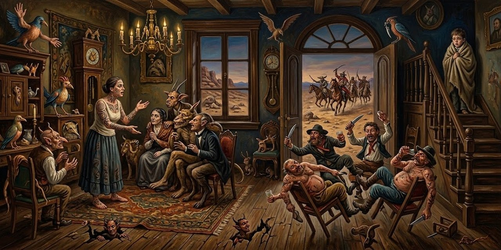](img/261012_borges_arena_i-6.jpg)

En la Confitería del Águila se debate el problema del conocimiento, y un señor de edad ofrece contar lo que le dejó la noche del treinta de abril del 74. Era un muchacho de casi trece años, de veraneo cerca de Lobos, y el peón Rufino lo lleva a divertirse al pueblo. En la casa de La Estrella le llama la atención una mujer, la Cautiva, de ojos tristes y trenza hasta la cintura.

> La muchacha habló como si estuviera sola y de algún modo yo sentí que no podía pensar en otra cosa y que esa cosa era lo único que le había pasado en la vida.
>
> <small>Frase 892</small>

El malón era la invasión de los indios a las estancias de la frontera. La Cautiva habla como quien reza: esa historia es lo único que le ha pasado. De chica la trajeron de Catamarca; en la estancia ni mentaban los malones, de miedo.

> Hice lo que pude para no creer. Lucas mi hermano, que después lo lancearon, me perjuraba que eran todas mentiras, pero cuando una cosa es verdad basta que alguien la diga una sola vez para que uno sepa que es cierto. El gobierno les reparte vicios y yerba para tenerlos quietos, pero ellos tienen brujos muy precavidos que les dan su consejo. A una orden del cacique no les cuesta nada atropellar entre los fortines, que están desparramados. De puro cavilar, yo casi tenía ganas que se vinieran y sabía mirar para el rumbo que el sol se pone.
>
> <small>Frases 898–902</small>

Su hermano Lucas le perjuraba que eran mentiras, pero basta que alguien diga una cosa verdadera una sola vez. Una madrugada ocurrió: los animales lo supieron antes que los cristianos.

Mientras ella habla, el muchacho oye gritos en la calle. Unos orilleros borrachos entran a la sala como a caballo. El primero le da un codazo a Rufino, que se hace a un lado. La señora de la casa se levanta y les dice quién es.

> Éste se demudó y se hizo a un lado. La señora, que no se había movido de su lugar, se levantó y nos dijo: »—Es Juan Moreira. »Pasado el tiempo, ya no sé si me acuerdo del hombre de esa noche o del que vería tantas veces después en el picadero. Pienso en la melena y en la barba negra de Podestá, pero también en una cara rubiona, picada de viruela.
>
> <small>Frases 924–927</small>

Juan Moreira fue un gaucho famoso y temido, perseguido por la policía. El perrito sale a hacerle fiestas y Moreira lo mata de un talerazo. Ahí, dice el viejo, empieza de veras la historia.

El muchacho sube a una pieza oscura y se esconde, temblando. Oye pasos de mujer y una voz que lo llama.

> —Yo estoy aquí para servir, pero a gente de paz. Acercate que no te voy a hacer ningún mal. »Ya se había quitado el batón. Me tendí a su lado y le busqué la cara con las manos. No sé cuánto tiempo pasó. No hubo una palabra ni un beso. Le deshice la trenza y jugué con el pelo, que era muy lacio, y después con ella. No volveríamos a vernos y no supe nunca su nombre.
>
> <small>Frases 940–946</small>

Sin una palabra ni un beso: el amor sin nombre, el primero de los dones de esa noche.

Un balazo los aturde. La Cautiva le indica otra escalera y él sale a la calle, donde un sargento vigila la tapia.

> Se rió y me dijo: »—A lo que veo, sos de los que madrugan temprano. »Algo debí de contestar, pero no me hizo caso. Por la tapia un hombre se descolgaba. De un brinco, el sargento le clavó el acero en la carne. El hombre se fue al suelo, donde quedó tendido de espaldas, gimiendo y desangrándose. Yo me acordé del perro. El sargento, para acabarlo de una buena vez, le volvió a hundir la bayoneta. Con una suerte de alegría le dijo: »—Moreira, lo que es hoy de nada te valió disparar.
>
> <small>Frases 952–959</small>

El hombre que se descuelga por la tapia es Moreira: el balazo fue suyo. Es el segundo don de la noche: mirar la muerte, la misma que sufrió el perro. Todos quieren estrechar la mano al sargento.

> En el término escaso de unas horas yo había conocido el amor y yo había mirado la muerte. A todos los hombres le son reveladas todas las cosas o, por lo menos, todas aquellas cosas que a un hombre le es dado conocer, pero a mí, de la noche a la mañana, esas dos cosas esenciales me fueron reveladas. Los años pasan y son tantas las veces que he contado la historia que ya no sé si la recuerdo de veras o si sólo recuerdo las palabras con que la cuento. Tal vez lo mismo le pasó a la Cautiva con su malón.
>
> <small>Frases 972–975</small>

Los dos dones, el amor y la muerte, se revelaron en unas horas. Tantas veces ha contado la historia que ya no sabe si la recuerda o solo recuerda las palabras. Tal vez lo mismo le pasó a la Cautiva con su malón.

---

## 7. El Espejo y la Máscara

[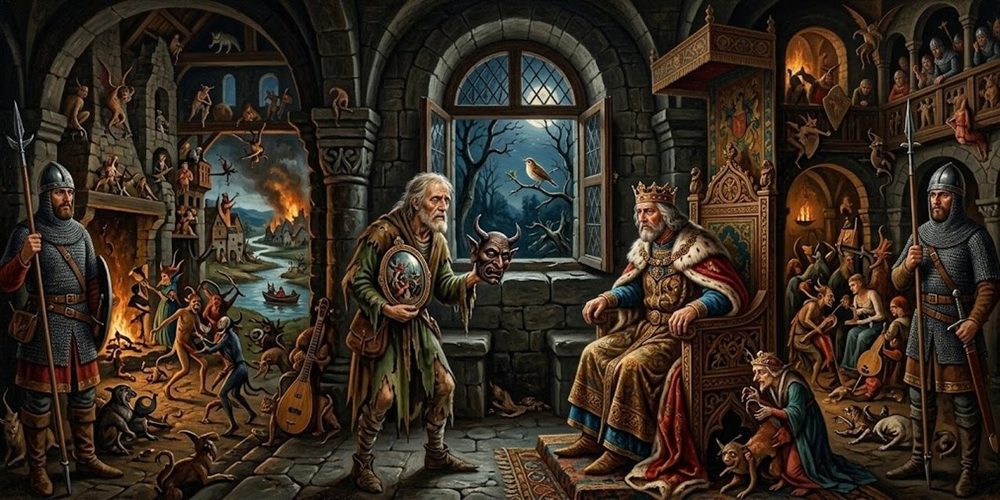](img/261012_borges_arena_i-7.jpg)

Tras la batalla de Clontarf, el Alto Rey de Irlanda pide al poeta una loa que amonede su victoria, y que los haga inmortales a los dos. El poeta es el Ollan, sabe de memoria trescientas sesenta fábulas y pide un año para limar cada palabra. Declama la loa y el Rey la aprueba: no hay una imagen que no hayan usado los clásicos. Ordena que treinta escribas la copien dos veces. Hay un silencio, y prosigue:

> —Todo está bien y sin embargo nada ha pasado. En los pulsos no corre más a prisa la sangre. Las manos no han buscado los arcos. Nadie ha palidecido. Nadie profirió un grito de batalla, nadie opuso el pecho a los vikings.
>
> <small>Frases 1019–1023</small>

La primera oda es perfecta y no pasa nada: nadie palidece ni grita. La recompensa es un espejo de plata: un arte que refleja lo ya dicho.

Otra vez cantó el ruiseñor, y el poeta volvió con un códice menos largo.

> Otra vez cantó el ruiseñor en las selvas sajonas y el poeta retornó con su códice, menos largo que el anterior. No lo repitió de memoria; lo leyó con visible inseguridad, omitiendo ciertos pasajes, como si él mismo no los entendiera del todo o no quisiera profanarlos. La página era extraña. No era una descripción de la batalla, era la batalla.
>
> <small>Frases 1028–1031</small>

La segunda loa rompe las normas de la lengua y mezcla al Dios que es Tres y es Uno con los númenes paganos de Irlanda. El Rey juzga que supera todo lo anterior y también lo aniquila: no la merecerán los ignaros, sino los doctos. La recompensa es una máscara de oro.

Vuelve el aniversario y el poeta no trae manuscrito. El Rey lo ve casi otro, con los ojos puestos muy lejos. A solas, le pregunta si hizo la oda:

> —Sí —dijo tristemente el poeta—. Ojalá Cristo Nuestro Señor me lo hubiera prohibido. —¿Puedes repetirla? —No me atrevo. —Yo te doy el valor que te hace falta —declaró el Rey. El poeta dijo el poema. Era una sola línea. Sin animarse a pronunciarla en voz alta, el poeta y su Rey la paladearon, como si fuera una plegaria secreta o una blasfemia.
>
> <small>Frases 1057–1064</small>

El poema final es una sola línea. Los dos la paladean sin animarse a decirla en voz alta, como una plegaria secreta o una blasfemia, y se miran pálidos. El Rey le pregunta qué hechicería se lo dio.

> —En el alba —dijo el poeta— me recordé diciendo unas palabras que al principio no comprendí. Esas palabras son un poema. Sentí que había cometido un pecado, quizá el que no perdona el Espíritu. —El que ahora compartimos los dos —el Rey musitó—. El de haber conocido la Belleza, que es un don vedado a los hombres. Ahora nos toca expiarlo. Te di un espejo y una máscara de oro; he aquí el tercer regalo que será el último. Le puso en la diestra una daga.
>
> <small>Frases 1074–1081</small>

El pecado que comparten es haber conocido la Belleza, un don vedado a los hombres. El tercer y último regalo es una daga.

El poeta se dio muerte al salir del palacio. El Rey es hoy un mendigo que recorre los caminos de Irlanda y no ha repetido nunca el poema.

---

## 8. Undr

[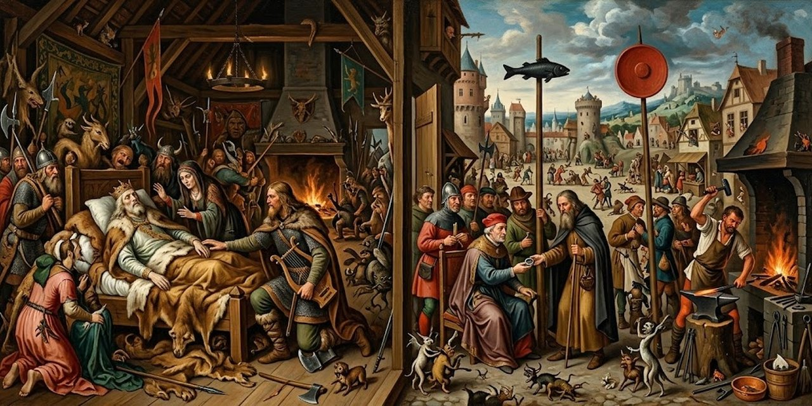](img/261012_borges_arena_i-8.jpg)

El relato se presenta como páginas atribuidas a Adán de Bremen, cronista del siglo once, sobre los urnos, un pueblo de pastores y hechiceros de las tierras bajas del Vístula. Adán cuenta su diálogo con el islandés Ulf Sigurdarson:

> El hombre dijo: »—Soy de estirpe de skalds; me bastó saber que la poesía de los urnos consta de una sola palabra para emprender su busca y el derrotero que me conduciría a su tierra. No sin fatigas y trabajos llegué al cabo de un año. Era de noche; advertí que los hombres que se cruzaban en mi camino me miraban curiosamente y una que otra pedrada me alcanzó.
>
> <small>Frases 1105–1107</small>

Un skald es un poeta de corte escandinavo. A Ulf le basta saber que toda la poesía de los urnos es una sola palabra para emprender la busca: un año de viaje, y una pedrada en la noche.

Un herrero llamado Orm le da albergue y le avisa que el rey Gunnlaug crucifica a los forasteros. Para escapar, Ulf escribe una drápa, una composición laudatoria, y la canta ante el rey, que le da un anillo de plata. La guardia lo empuja hacia el fondo.

> La guardia me empujó hacia el fondo. Un hombre tomó mi lugar, y lo hizo de pie. Pulsó las cuerdas como templándolas y repitió en voz baja la palabra que yo hubiera querido penetrar y no penetré. Alguien dijo con reverencia: Ahora no quiere decir nada.
>
> <small>Frases 1143–1145</small>

Otro cantor repite en voz baja la Palabra, y alguien dice con reverencia que ahora no quiere decir nada: no significa nada para quien no la ha ganado. Al salir, Bjarni Thorkelsson, también skald, le dice que morirá porque ha oído la Palabra, y que él lo salvará. Ulf le pide que se la diga.

> Vaciló unos instantes y contestó: »—He jurado no revelarla. Además, nadie puede enseñar nada. Debes buscarla solo. Apresurémonos, que tu vida corre peligro. Te esconderé en mi casa, donde no se atreverán a buscarte. Si el viento es favorable, navegarás mañana hacia el Sur.
>
> <small>Frases 1165–1170</small>

Nadie puede enseñarla: cada quien debe buscarla solo.

Así empieza una aventura de muchos inviernos: Ulf es remero, mercader de esclavos, esclavo, leñador, cantor, y soldado en Constantinopla. Ha sido muchos hombres.

> Lo esencial era la Palabra. Alguna vez descreí de ella. Me repetí que renunciar al hermoso juego de combinar palabras hermosas era insensato y que no hay por qué indagar una sola, acaso ilusoria. Ese razonamiento fue vano. Un misionero me propuso la palabra Dios, que rechacé.
>
> <small>Frases 1187–1191</small>

No es ningún juego de palabras hermosas ni la palabra Dios que le propone un misionero: la Palabra no está en ningún catálogo.

Vuelve a la tierra de los urnos y da con la casa del cantor, ya muy viejo. Le cuenta sus viajes. Antes del fin, el viejo le pregunta si cantó muchas veces.

> —Al principio —le dije— canté para ganarme la vida. Luego, un temor que no comprendo me alejó del canto y del arpa. »—Está bien —asintió—. Ya puedes proseguir con tu historia.
>
> <small>Frases 1205–1208</small>

Luego hay un largo silencio y otra pregunta.

> —¿Qué te dio la primera mujer que tuviste? —me preguntó. »—Todo —le contesté. »—A mí también la vida me dio todo. A todos la vida les da todo, pero los más lo ignoran. Mi voz está cansada y mis dedos débiles, pero escúchame. »Dijo la palabra Undr, que quiere decir maravilla.
>
> <small>Frases 1212–1217</small>

Undr significa maravilla. A todos la vida les da todo, pero los más lo ignoran; la Palabra es la maravilla de haber vivido. El hombre está muriendo.

> Me sentí arrebatado por el canto del hombre que moría, pero en su canto y en su acorde vi mis propios trabajos, la esclava que me dio el primer amor, los hombres que maté, las albas de frío, la aurora sobre el agua, los remos. Tomé el arpa y canté con una palabra distinta. »—Está bien —dijo el otro y tuve que acercarme para oírlo—. Me has entendido.
>
> <small>Frases 1218–1220</small>

En el canto del otro, Ulf ve su propia vida. Entonces toma el arpa y canta con su propia palabra, porque nadie puede cantar la de otro. «Me has entendido», dice el que muere.

---

## 9. Utopía de un Hombre que Está Cansado

[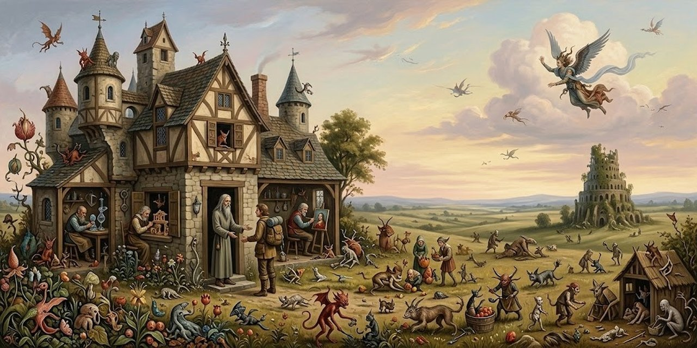](img/261012_borges_arena_i-9.jpg)

Quevedo explicó el nombre de Utopía: voz griega que significa «no hay tal lugar». Un caminante cruza la llanura y, sorprendido por la lluvia, pide refugio en una casa baja. Le abre un hombre altísimo, vestido de gris. No se entienden en ningún idioma hasta que el anfitrión habla en latín:

> —Por la ropa —me dijo—, veo que llegas de otro siglo. La diversidad de las lenguas favorecía la diversidad de los pueblos y aun de las guerras; la tierra ha regresado al latín. Hay quienes temen que vuelva a degenerar en francés, en lemosín o en papiamento, pero el riesgo no es inmediato. Por lo demás, ni lo que ha sido ni lo que será me interesan.
>
> <small>Frases 1246–1249</small>

El visitante es Eudoro Acevedo, nacido en 1897 en Buenos Aires, profesor de letras y escritor de cuentos fantásticos. El anfitrión es un hombre del porvenir, donde la tierra ha vuelto al latín. Acevedo se presenta:

> —Recuerdo haber leído sin desagrado —me contestó— dos cuentos fantásticos. Los Viajes del Capitán Lemuel Gulliver, que muchos consideran verídicos, y la Suma Teológica. Pero no hablemos de hechos. Ya a nadie le importan los hechos. Son meros puntos de partida para la invención y el razonamiento.
>
> <small>Frases 1266–1270</small>

En el porvenir, los cuentos fantásticos que se leen sin desagrado son los Viajes del Capitán Gulliver y la Suma Teológica. A nadie le importan los hechos: se enseña la duda y el arte del olvido. El hombre no dice su nombre, porque le dicen «alguien». Acevedo halla un libro escrito a mano:

> Éste me dijo: —Ahora vas a ver algo que nunca has visto. Me tendió con cuidado un ejemplar de la Utopía de More, impreso en Basilea en el año 1518 y en el que faltaban hojas y láminas.
>
> <small>Frases 1286–1287</small>

El hombre nunca ha visto un libro impreso. Acevedo dice que en su casa hay más de dos mil, y el otro se ríe: no importa leer, sino releer. La imprenta, abolida, fue uno de los peores males, porque multiplicó textos innecesarios.

> —En mi curioso ayer —contesté—, prevalecía la superstición de que entre cada tarde y cada mañana ocurren hechos que es una vergüenza ignorar. El planeta estaba poblado de espectros colectivos, el Canadá, el Brasil, el Congo Suizo y el Mercado Común. Casi nadie sabía la historia previa de esos entes platónicos, pero sí los más ínfimos pormenores del último congreso de pedagogos, la inminente ruptura de relaciones y los mensajes que los presidentes mandaban, elaborados por el secretario del secretario con la prudente imprecisión que era propia del género. »Todo esto se leía para el olvido, porque a las pocas horas lo borrarían otras trivialidades.
>
> <small>Frases 1296–1299</small>

El «curioso ayer» de Acevedo es nuestro presente: países como espectros colectivos, mensajes de presidentes redactados por el secretario del secretario, gente que creía que una mercadería era buena porque su fabricante lo afirmaba. Todo se leía para el olvido.

El anfitrión describe su mundo: ya no hay dinero, ni ciudades, ni museos, ni bibliotecas. Los gobiernos cayeron en desuso porque nadie los acataba. Cada cual ejerce un oficio y produce las ciencias y las artes que necesita. A los cien años el hombre queda listo para enfrentarse a su soledad; tiene un solo hijo y, cuando quiere, se mata. El anfitrión muestra a Acevedo su obra, un arpa y unas telas amarillas:

> —Ésta es mi obra —declaró. Examiné las telas y me detuve ante la más pequeña, que figuraba o sugería una puesta de sol y que encerraba algo infinito. —Si te gusta puedes llevártela, como recuerdo de un amigo futuro —dijo con palabra tranquila.
>
> <small>Frases 1371–1373</small>

La más pequeña de las telas sugiere una puesta de sol y encierra algo infinito: es el regalo, «recuerdo de un amigo futuro».

Entran una alta mujer y tres o cuatro hombres, se llevan todo lo de la casa y salen sin cerrar la puerta. A los quince minutos Acevedo ve una torre con una cúpula:

> —Es el crematorio —dijo alguien—. Adentro está la cámara letal. Dicen que la inventó un filántropo cuyo nombre, creo, era Adolfo Hitler. El cuidador, cuya estatura no me asombró, nos abrió la verja. Mi huésped susurró unas palabras. Antes de entrar en el recinto se despidió con un ademán.
>
> <small>Frases 1394–1399</small>

El anfitrión ha elegido su muerte, como todos en su tiempo. De la cámara letal dicen que la inventó «un filántropo» cuyo nombre, creen, era Adolfo Hitler.

De regreso en su escritorio de la calle México, Acevedo guarda la tela que alguien pintará dentro de miles de años.

---

## 10. El Soborno

[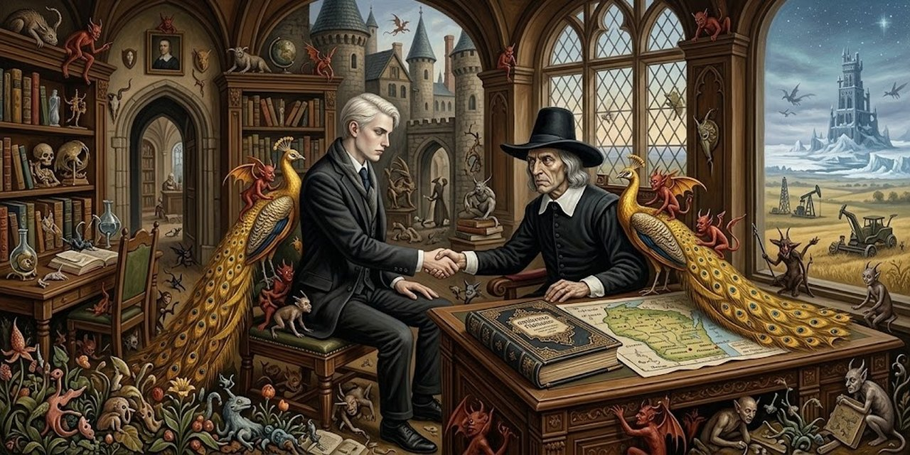](img/261012_borges_arena_i-10.jpg)

La historia de un episodio en el que intervinieron dos hombres: ambos pecaron por vanidad, pero de un modo harto distinto. En la Universidad de Texas, el doctor Ezra Winthrop, profesor de inglés antiguo, de vieja raíz puritana y oriundo de Boston, debe aconsejar a su jefe quién representará a la universidad en el próximo congreso de germanistas en Wisconsin: el tímido Herbert Locke, amigo suyo, o el islandés Eric Einarsson, joven, impetuoso y frío, cuya petulancia le granjea la aversión general. En esas cavilaciones está Winthrop cuando aparece en Yale un extenso artículo sobre la enseñanza del anglosajón, firmado con las transparentes iniciales E. E. y, como para alejar cualquier duda, el nombre de Texas: propone invertir el orden cronológico y dejar la Gesta de Beowulf, base del método de Winthrop, reducida a algún fragmento del tedioso conjunto de tres mil líneas.

> No se mencionaba una sola vez el nombre de Winthrop, pero éste se sintió persistentemente agredido. Tal circunstancia le importaba menos que el hecho de que impugnaran su método pedagógico. Faltaban pocos días. Winthrop quería ser justo y no podía permitir que el escrito de Einarsson, ya releído y comentado por muchos, influyera en su decisión. Ésta le dio no poco trabajo.
>
> <small>Frases 1452–1456</small>

La agresión es personal y pública, y faltan pocos días para la decisión. Winthrop, que quiere ser justo, no deja que el escrito influya. Esa tarde Einarsson recibe el encargo de viajar a Wisconsin, y la víspera va al despacho de Winthrop a agradecerle y a darle una explicación:

> Yo le debo a usted, doctor Winthrop, una explicación personal. Dejé mi patria a fines de 1967. Cuando alguien se resuelve a emigrar a un país lejano, se impone fatalmente la obligación de adelantar en ese país. Mis dos opúsculos iniciales, de índole estrictamente filológica, no respondían a otro fin que probar mi capacidad. Ello, evidentemente, no bastaba.
>
> <small>Frases 1471–1475</small>

Quien emigra a un país lejano debe adelantar en él: sus opúsculos no bastaban y su carrera necesitaba algo de asombro. Ir a Wisconsin era su propósito: los congresos son tonterías, pero convienen a un curriculum. Vuelve al primer diálogo que tuvieron, un domingo en el Nighthawk:

> Einarsson prosiguió: —Usted recordará tal vez nuestro primer diálogo. Yo había llegado de New York. Era un día domingo; el comedor de la Universidad estaba cerrado y fuimos a almorzar al Nighthawk. Fue entonces cuando aprendí muchas cosas. Como buen europeo, yo siempre había presupuesto que la Guerra Civil fue una cruzada contra los esclavistas; usted argumentó que el Sur estaba en su derecho al querer separarse de la Unión y mantener sus instituciones. Para dar mayor fuerza a lo que afirmaba, me dijo que usted era del Norte y que uno de sus mayores había militado en las filas de Henry Halleck. Ponderó asimismo el coraje de los confederados. A diferencia de los demás, yo sé casi inmediatamente quién es el otro. Esta mañana me bastó.
>
> <small>Frases 1486–1494</small>

Einarsson creía que la Guerra Civil fue una cruzada contra los esclavistas; Winthrop, hombre del Norte, defendió el derecho del Sur. Así entendió Einarsson que a Winthrop lo rige la pasión americana de la imparcialidad. En cuanto supo que su viaje dependía de Winthrop, impugnó su método para obligarlo a demostrar que no era vengativo, y firmó de modo que no quedara duda.

> —Ahora comprendo —dijo—. Yo soy viejo amigo de Herbert, cuya labor estimo; usted, directa o indirectamente, me atacó. Negarle mi voto hubiera sido una suerte de represalia. Confronté los méritos de los dos y el resultado fue el que usted sabe. Agregó, como si pensara en voz alta: —He cedido tal vez a la vanidad de no ser vengativo. Como usted ve, su estratagema no le falló.
>
> <small>Frases 1505–1510</small>

Winthrop reconoce la trampa: negarle el voto habría sido una represalia, y cedió quizá a la vanidad de no ser vengativo. Lo mira como a su primer Viking; Einarsson aclara que en su familia no hubo gente de mar.

> —En la mía hubo muchos —contestó Winthrop—. Sin embargo, no somos tan distintos. Un pecado nos une: la vanidad. Usted me ha visitado para jactarse de su ingeniosa estratagema; yo lo apoyé para jactarme de ser un hombre recto.
>
> <small>Frases 1519–1522</small>

Las dos vanidades, frente a frente: el uno vino a jactarse de su estratagema; el otro lo apoyó para jactarse de ser recto.

> —Otra cosa nos une —respondió Einarsson—. La nacionalidad. Soy ciudadano americano. Mi destino está aquí, no en la Última Thule. Usted dirá que un pasaporte no modifica la índole de un hombre. Se estrecharon la mano y se despidieron.
>
> <small>Frases 1523–1528</small>

Einarsson, el islandés, es ya ciudadano americano: su destino está ahí y no en la Última Thule, el confín del mundo antiguo. Se estrechan la mano.

---

## 11. Avelino Arredondo

[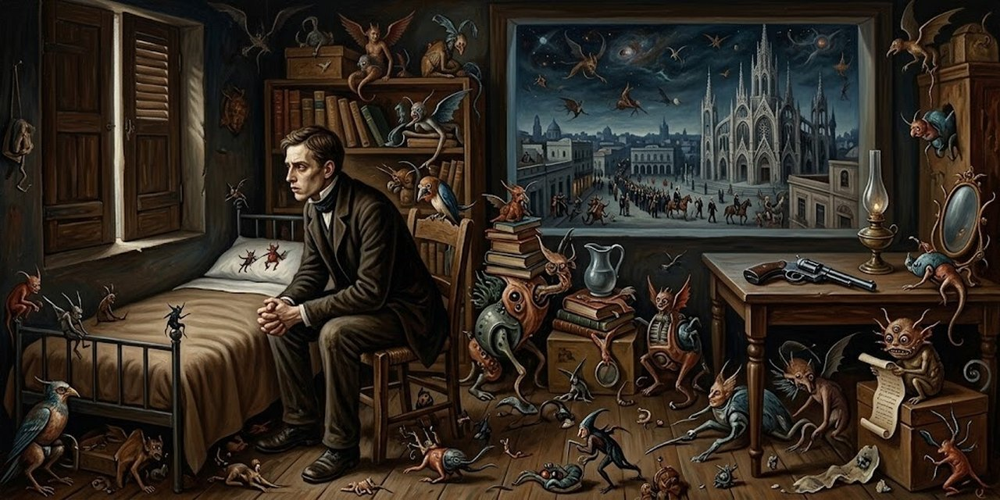](img/261012_borges_arena_i-11.jpg)

El hecho aconteció en Montevideo, en 1897. Cada sábado, los amigos ocupan la misma mesa lateral en el Café del Globo. Entre ellos está Arredondo, hombre de tierra adentro, que no se permite confidencias ni hace preguntas.

> Cada sábado los amigos ocupaban la misma mesa lateral en el Café del Globo, a la manera de los pobres decentes que saben que no pueden mostrar su casa o que rehúyen su ámbito. Eran todos montevideanos; al principio les había costado amistarse con Arredondo, hombre de tierra adentro, que no se permitía confidencias ni hacía preguntas. Contaba poco más de veinte años; era flaco y moreno, más bien bajo y tal vez algo torpe. La cara habría sido casi anónima, si no la hubieran rescatado los ojos, a la vez dormidos y enérgicos.
>
> <small>Frases 1531–1534</small>

Arredondo era dependiente de una mercería y estudiaba Derecho. Callaba cuando los otros condenaban la guerra. Tras la batalla de Cerros Blancos anunció que se iba a Mercedes.

> Más le costó decirle adiós a Clara, su novia. Lo hizo casi con las mismas palabras. Le previno que no esperara cartas, porque estaría muy atareado. Clara, que no tenía costumbre de escribir, aceptó el agregado sin protestar. Los dos se querían mucho.
>
> <small>Frases 1542–1546</small>

No se va a Mercedes: se encierra. Hace decir que está en el campo y se muda a una pieza del fondo. Así empieza una reclusión que su voluntad le impone.

> Había vendido todos sus libros, incluso los de introducción al Derecho. No le quedaba más que una Biblia, que nunca había leído y que no concluyó. La cursó página por página, a veces con interés y a veces con tedio, y se impuso el deber de aprender de memoria algún capítulo del Éxodo y el final del Ecclesiastés. No trataba de entender lo que iba leyendo. Era librepensador, pero no dejaba pasar una sola noche sin repetir el padrenuestro que le había prometido a su madre al venir a Montevideo.
>
> <small>Frases 1554–1558</small>

Vende sus libros de Derecho. Le queda una Biblia que nunca había leído, y cada noche reza el padrenuestro prometido a su madre.

> Sabía que su meta era la mañana del día veinticinco de agosto. Sabía el número preciso de días que tenía que trasponer. Una vez lograda la meta, el tiempo cesaría o, mejor dicho, nada importaba lo que aconteciera después. Esperaba la fecha como quien espera una dicha y una liberación. Había parado su reloj para no estar siempre mirándolo, pero todas las noches, al oír las doce campanadas oscuras, arrancaba una hoja del almanaque y pensaba un día menos. Al principio quiso construir una rutina. Matear, fumar los cigarrillos negros que armaba, leer y repasar una determinada cuota de páginas, tratar de conversar con Clementina cuando ésta le traía la comida en una bandeja, repetir y adornar cierto discurso antes de apagar la candela.
>
> <small>Frases 1560–1566</small>

La meta es la mañana del veinticinco de agosto. Cada noche arranca una hoja del almanaque y piensa: un día menos.

> Ávido lector de periódicos, le costó renunciar a esos museos de minucias efímeras. No era hombre de pensar ni de cavilar.
>
> <small>Frases 1576–1577</small>

Esos museos son los diarios: renuncia a ellos para que nadie diga que lo incitaron. Una noche sale y entra en un almacén, donde unos soldados conversan.

> Acodados contra el mostrador de madera conversaban unos soldados. Dijo uno de ellos: —Ustedes saben que está formalmente prohibido que se den noticias de las batallas. Ayer tarde nos ocurrió una cosa que los va a divertir. Yo y unos compañeros de cuartel pasamos frente a La Razón. Oímos desde afuera una voz que contravenía la orden. Sin perder tiempo entramos. La redacción estaba como boca de lobo, pero lo quemamos a balazos al que seguía hablando. Cuando se calló, lo buscamos para sacarlo por las patas, pero vimos que era una máquina que le dicen fonógrafo y que habla sola. Todos se rieron.
>
> <small>Frases 1597–1605</small>

El gobierno prohibió dar noticias de las batallas. Los soldados balearon una voz que las contaba: era un fonógrafo, una máquina nueva que habla sola. Todos se ríen.

> El soldado le dijo: —¿Qué le parece el chasco, aparcero? Arredondo guardó silencio. El del uniforme le acercó la cara y le dijo: —Gritá en seguida: ¡Viva el Presidente de la Nación, Juan Idiarte Borda! Arredondo no desobedeció. Entre aplausos burlones ganó la puerta. Ya en la calle lo golpeó una última injuria. —El miedo no es sonso ni junta rabia. Se había portado como un cobarde, pero sabía que no lo era.
>
> <small>Frases 1607–1614</small>

El soldado lo obliga a gritar viva al Presidente, Juan Idiarte Borda, y Arredondo obedece. Se portó como un cobarde, pero sabe que no lo es: su día está cerca.

> El día veinticinco de agosto, Avelino Arredondo se recordó a las nueve pasadas. Pensó primero en Clara y sólo después en la fecha. Se dijo con alivio: Adiós a la tarea de esperar. Ya estoy en el día. Se afeitó sin apuro y en el espejo lo enfrentó la cara de siempre. Eligió una corbata colorada y sus mejores prendas.
>
> <small>Frases 1616–1621</small>

Ya está en el día. Se afeita, elige una corbata colorada, el color de su partido, y va a la Plaza Matriz, donde baja del templo un grupo de caballeros y prelados.

> Preguntó cuál era el presidente. Le contestaron: -Ése que va al lado del arzobispo con la mitra y el báculo. Sacó el revólver e hizo fuego. Idiarte Borda dio unos pasos, cayó de bruces y dijo claramente: Estoy muerto. Arredondo se entregó a las autoridades. Después declararía: —Soy colorado y lo digo con todo orgullo. He dado muerte al Presidente, que traicionaba y mancillaba a nuestro partido. Rompí con los amigos y con la novia, para no complicarlos; no miré diarios para que nadie pueda decir que me han incitado.
>
> <small>Frases 1633–1640</small>

Arredondo dispara y el presidente cae. Se entrega y pronuncia el discurso que repitió dos meses: todo estaba pensado para que el acto fuera suyo.

Así habrán ocurrido los hechos, aunque de un modo más complejo; así puedo soñar que ocurrieron.

---

## 12. El Disco

[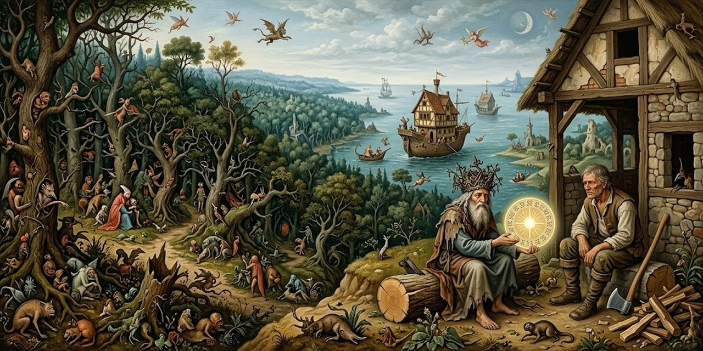](img/261012_borges_arena_i-12.jpg)

Habla un leñador viejo, al final de su vida, en una choza al borde del bosque.

> Soy leñador. El nombre no importa. La choza en que nací y en la que pronto habré de morir queda al borde del bosque. Del bosque dicen que se alarga hasta el mar que rodea toda la tierra y por el que andan casas de madera iguales a la mía. No sé; nunca lo he visto. Tampoco he visto el otro lado del bosque. Mi hermano mayor, cuando éramos chicos, me hizo jurar que entre los dos talaríamos todo el bosque hasta que no quedara un solo árbol. Mi hermano ha muerto y ahora es otra cosa la que busco y seguiré buscando. Hacia el poniente corre un riacho en el que sé pescar con la mano. En el bosque hay lobos, pero los lobos no me arredran y mi hacha nunca me fue infiel. No he llevado la cuenta de mis años.
>
> <small>Frases 1645–1655</small>

Las casas de madera que andan por el mar son los barcos. Un anciano con una cicatriz pide posada y a la mañana dice quién es:

> Al fin dijo: —No tengo hogar y duermo donde puedo. He recorrido toda Sajonia. Esas palabras convenían a su vejez. Mi padre siempre hablaba de Sajonia; ahora la gente dice Inglaterra.
>
> <small>Frases 1666–1669</small>

Sajonia es Inglaterra. Isern, rey de los Secgens, de la estirpe de Odín, perdió su reino, pero aún es rey, dice, porque tiene el disco.

> Como si no me oyera continuó: —Ando por los caminos del destierro pero aún soy el rey porque tengo el disco. ¿Quieres verlo? Abrió la palma de la mano que era huesuda. No había nada en la mano. Estaba vacía. Fue sólo entonces que advertí que siempre la había tenido cerrada. Dijo, mirándome con fijeza: —Puedes tocarlo.
>
> <small>Frases 1689–1695</small>

La palma estaba vacía. El rey le dice que puede tocarlo.

> Ya con algún recelo puse la punta de los dedos sobre la palma. Sentí una cosa fría y vi un brillo. La mano se cerró bruscamente. No dije nada. El otro continuó con paciencia como si hablara con un niño: —Es el disco de Odín. Tiene un solo lado. En la tierra no hay otra cosa que tenga un solo lado. Mientras esté en mi mano seré el rey.
>
> <small>Frases 1696–1703</small>

El disco de Odín tiene un solo lado: un prodigio imposible.

> Entonces yo sentí la codicia de poseer el disco. Si fuera mío, lo podría vender por una barra de oro y sería un rey. Le dije al vagabundo que aún odio: —En la choza tengo escondido un cofre de monedas. Son de oro y brillan como el hacha. Si me das el disco de Odín, yo te doy el cofre.
>
> <small>Frases 1708–1712</small>

El cofre de monedas es una mentira para atrapar el disco.

> Dijo tercamente. —No quiero. —Entonces —dije— puedes proseguir tu camino. Me dio la espalda. Un hachazo en la nuca bastó y sobró para que vacilara y cayera, pero al caer abrió la mano y en el aire vi el brillo. Marqué bien el lugar con el hacha y arrastré el muerto hasta el arroyo que estaba muy crecido. Ahí lo tiré. Al volver a mi casa busqué el disco. No lo encontré. Hace años que sigo buscando.
>
> <small>Frases 1713–1722</small>

El crimen es de una línea: un hachazo en la nuca. Busca el disco y no lo encuentra.

---

## 13. El Libro de Arena

[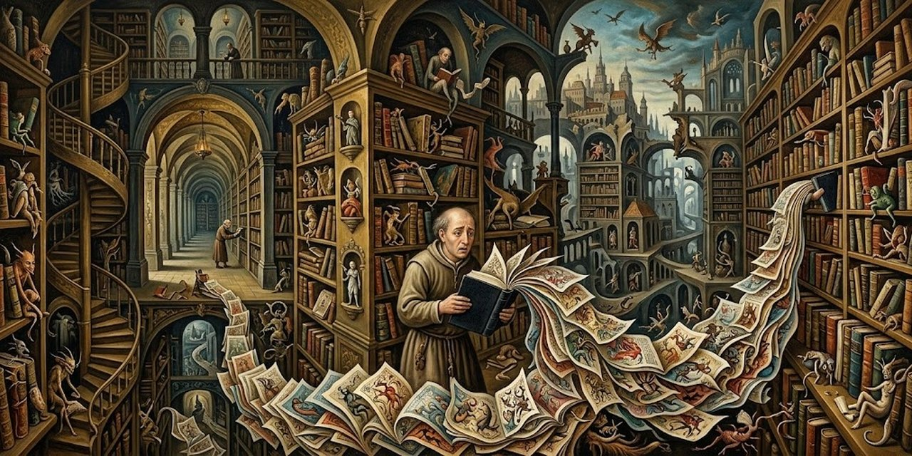](img/261012_borges_arena_i-13.jpg)

El narrador vive solo, en un cuarto piso de la calle Belgrano. Hará unos meses, al atardecer, oye un golpe en la puerta: entra un desconocido alto, de rasgos desdibujados - acaso su miopía los vio así -, de aspecto de pobreza decente, gris, con una valija gris. Vende biblias. El dueño de casa, no sin pedantería, le enumera las suyas: la primera inglesa, la de John Wiclif, la de Cipriano de Valera, la de Lutero, un ejemplar latino de la Vulgata. No son precisamente biblias lo que le falta.

> Al cabo de un silencio me contestó. —No sólo vendo biblias. Puedo mostrarle un libro sagrado que tal vez le interese. Lo adquirí en los confines de Bikanir.
>
> <small>Frases 1745–1748</small>

Bikanir está en la India. El hombre abre la valija: un volumen con «Holy Writ» y «Bombay» en el lomo, de páginas numeradas de modo insensato. El narrador lo abre al azar:

> Llevaba una pequeña ilustración, como es de uso en los diccionarios: un ancla dibujada a la pluma, como por la torpe mano de un niño. Fue entonces que el desconocido me dijo: —Mírela bien. Ya no la verá nunca más. Había una amenaza en la afirmación, pero no en la voz.
>
> <small>Frases 1765–1768</small>

La ilustración es un ancla dibujada a pluma. «Mírela bien. Ya no la verá nunca más.» El vendedor lo compró a un hombre que no sabía leer y lo llamaba el Libro de Arena, porque ni el libro ni la arena tienen principio ni fin.

> —Ahora busque el final. También fracasé; apenas logré balbucear con una voz que no era la mía: —Esto no puede ser. Siempre en voz baja el vendedor de biblias me dijo: —No puede ser, pero es. El número de páginas de este libro es exactamente infinito. Ninguna es la primera; ninguna, la última. No sé por qué están numeradas de ese modo arbitrario. Acaso para dar a entender que los términos de una serie infinita admiten cualquier número.
>
> <small>Frases 1783–1789</small>

No puede ser, pero es: el número de páginas es infinito. El narrador sigue explorando el libro y urde su plan.

> Al cabo de unos pocos minutos había urdido mi plan. —Le propongo un canje —le dije—. Usted obtuvo este volumen por unas rupias y por la Escritura Sagrada; yo le ofrezco el monto de mi jubilación, que acabo de cobrar, y la Biblia de Wiclif en letra gótica. La heredé de mis padres. —A black letter Wiclif! —murmuró. Fui a mi dormitorio y le traje el dinero y el libro. Volvió las hojas y estudió la carátula con fervor de bibliófilo. —Trato hecho —me dijo. Me asombró que no regateara. Sólo después comprendería que había entrado en mi casa con la decisión de vender el libro.
>
> <small>Frases 1807–1817</small>

El canje: su jubilación recién cobrada y una Biblia de Wiclif en letra gótica, heredada. El escocés, de las islas Orcadas, acepta sin regatear.

> Pensé guardar el Libro de Arena en el hueco que había dejado el Wiclif, pero opté al fin por esconderlo detrás de unos volúmenes descabalados de Las mil y una noches. Me acosté y no dormí. A las tres o cuatro de la mañana prendí la luz. Busqué el libro imposible, y volví las hojas. En una de ellas vi grabada una máscara. El ángulo llevaba una cifra, ya no sé cuál, elevada a la novena potencia.
>
> <small>Frases 1822–1827</small>

Esconde el libro detrás de Las mil y una noches y no duerme. Busca el libro imposible; en una página ve una máscara.

> No mostré a nadie mi tesoro. A la dicha de poseerlo se agregó el temor de que lo robaran, y después el recelo de que no fuera verdaderamente infinito. Esas dos inquietudes agravaron mi ya vieja misantropía. Me quedaban unos amigos; dejé de verlos. Prisionero del Libro, casi no me asomaba a la calle.
>
> <small>Frases 1828–1832</small>

Prisionero del Libro, deja de ver a sus amigos. Comprueba que las ilustraciones distan dos mil páginas y nunca se repiten.

> Declinaba el verano, y comprendí que el libro era monstruoso. De nada me sirvió considerar que no menos monstruoso era yo, que lo percibía con ojos y lo palpaba con diez dedos con uñas. Sentí que era un objeto de pesadilla, una cosa obscena que infamaba y corrompía la realidad. Pensé en el fuego, pero temí que la combustión de un libro infinito fuera parejamente infinita y sofocara de humo al planeta. Recordé haber leído que el mejor lugar para ocultar una hoja es un bosque. Antes de jubilarme trabajaba en la Biblioteca Nacional, que guarda novecientos mil libros; sé que a mano derecha del vestíbulo una escalera curva se hunde en el sótano, donde están los periódicos y los mapas. Aproveché un descuido de los empleados para perder el Libro de Arena en uno de los húmedos anaqueles. Traté de no fijarme a qué altura ni a qué distancia de la puerta. Siento un poco de alivio, pero no quiero ni pasar por la calle México.
>
> <small>Frases 1838–1846</small>

El libro es monstruoso: una cosa obscena que corrompe la realidad. Quemarlo sería peor, porque un libro infinito ardería sin fin. Recuerda que el mejor lugar para ocultar una hoja es un bosque, y que la Biblioteca Nacional guarda novecientos mil libros.

---

© 2026 Osmancito
