17 de octubre de 2026

# Autobiografía de un yogui

Paramhansa Yogananda

*Autobiografía de un yogui*, de Paramhansa Yogananda, apareció en inglés en 1946. El autor, nacido como Mukunda Lal Ghosh en la India, cuenta su infancia, la búsqueda de un maestro, su formación con Sri Yukteswar y su viaje a Estados Unidos para enseñar yoga. Sus cuarenta y ocho capítulos combinan recuerdos personales, retratos de maestros y una exposición de sus creencias sobre la meditación y la vida espiritual. Los milagros y las experiencias extraordinarias forman parte del testimonio religioso que el libro propone.

## Capítulo 1: Mis padres y mi primera infancia

<a href="img/261017_autobiografia-de-un-yogui_i-1.jpg">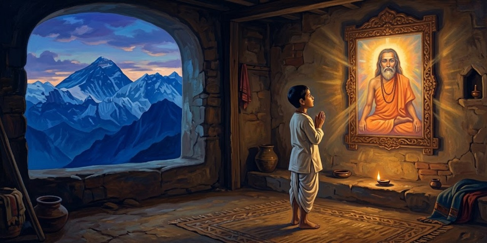</a>

El libro se abre con una convicción: la cultura india es, para el autor, una búsqueda de verdades últimas sostenida por la relación discípulo-gurú; sus primeros recuerdos le llegan, dice, de una vida anterior como yogui en el Himalaya.

> Las humillaciones desvalidas de la infancia no se borran de mi mente. Me pesaba con resentimiento no poder caminar ni expresarme libremente. Surgían en mí oleadas de plegaria al comprender mi impotencia corporal. Mi intensa vida emocional tomó forma silenciosa en palabras de muchos idiomas. En medio de esa confusión interior de lenguas, mi oído se fue acostumbrando a las sílabas bengalíes que me rodeaban, las de mi pueblo. ¡Qué alcance tan seductor tiene la mente de un bebé!, que los adultos creen limitada a juguetes y deditos de los pies.
>
> [Párrafo 3](#original-c1-p3)

El recuerdo de una vida anterior responde a la creencia hindú en la reencarnación; el autor lo presenta como experiencia propia, no como dato demostrable. El propio capítulo sitúa Gorakhpur en las Provincias Unidas del noreste de la India, y el bengalí es la lengua de Bengala, la región de origen de la familia.

Mukunda nació en Gorakhpur, cuarto de ocho hermanos. El padre, alto funcionario del ferrocarril Bengal-Nagpur, era un matemático grave y reservado; la madre enseñaba por amor y daba a los pobres sin medida. La única disputa conyugal que recuerda acabó con un coche de alquiler despedido; en otra, por diez rupias para una necesitada, el padre abrió la cartera, vencido.

> Padre tendía a decir primero "No" ante cualquier propuesta nueva. Su actitud ante la mujer desconocida que con tanta facilidad había conquistado la simpatía de Madre era un ejemplo de su cautela habitual. La aversión a la aceptación inmediata, típica de la mentalidad francesa en Occidente, no es en realidad más que honrar el principio de la "debida reflexión". Siempre encontré a Padre razonable y equilibrado en sus juicios. Si lograba respaldar mis numerosas peticiones con uno o dos buenos argumentos, él ponía invariablemente la meta codiciada a mi alcance, fuera un viaje de vacaciones o una motocicleta nueva.
>
> [Párrafo 20](#original-c1-p20)

El elogio de la cautela francesa es un tópico de la época del autor y sirve aquí para retratar la prudencia del padre. La casta *Kshatriya*, mencionada párrafos antes, es el orden tradicional de guerreros y gobernantes. La motocicleta figura entre los deseos de juventud que el autor recuerda.

> Padre fue un disciplinario estricto con sus hijos durante sus primeros años, pero su actitud hacia sí mismo era de verdad espartana. Nunca iba al teatro, por ejemplo, sino que buscaba su recreo en diversas prácticas espirituales y en la lectura del Bhagavad *Guita*. Rehuyendo todo lujo, se aferraba a un viejo par de zapatos hasta que quedaban inservibles. Sus hijos compraron automóviles cuando se pusieron de moda, pero Padre siempre se conformó con el tranvía para su trayecto diario a la oficina. Acumular dinero por poder le era ajeno. Una vez, tras organizar el Calcutta Urban Bank, se negó a beneficiarse conservando alguna de sus acciones. Solo había querido cumplir un deber cívico en sus ratos libres.
>
> [Párrafo 21](#original-c1-p21)

El Bhagavad *Guita* es una escritura hindú muy leída: un diálogo entre el príncipe Arjuna y el dios Krishna sobre el deber y la entrega. La austeridad del padre, que el capítulo corona con la anécdota de las primas nunca cobradas al ferrocarril, anticipa el ideal de renuncia que recorre toda la autobiografía.

Ya retirado, el padre cobró sin inmutarse 125.000 rupias en primas nunca reclamadas. Los padres eran discípulos de Lahiri Mahasaya, y el capítulo cuenta cómo: un empleado, Abinash, pidió permiso para visitar a su gurú y el padre se burló; esa tarde, narra Abinash, el maestro se les apareció en un campo para reprocharle su dureza, y el padre llevó a su esposa a Benares a recibir la iniciación. El maestro murió poco después de nacer Mukunda; su retrato presidió el altar familiar, ante el que madre e hijo meditaban a diario.

> Ese retrato tuvo una influencia decisiva sobre mi vida. Al ir creciendo, el pensamiento del maestro crecía conmigo. En meditación veía a menudo su imagen fotográfica salir de su pequeño marco y, tomando forma viviente, sentarse ante mí. Cuando intentaba tocar los pies de su cuerpo luminoso, volvía a transformarse en fotografía. Al pasar de la infancia a la adolescencia, descubrí que Lahiri Mahasaya se transformaba en mi mente: de una pequeña imagen encerrada en un marco a una presencia viva e iluminadora. Le rezaba con frecuencia en momentos de prueba o confusión, y hallaba en mí su dirección consoladora. Al principio me afligía que ya no viviera físicamente. Cuando empecé a descubrir su secreta omnipresencia, dejé de lamentarme. Solía escribir a los discípulos demasiado ansiosos por verlo: "¿Para qué venir a ver mis huesos y mi carne, si estoy siempre al alcance de su *kutastha* (visión espiritual)?"
>
> [Párrafo 40](#original-c1-p40)

Lahiri Mahasaya (1828-1895), yogui de Benares (la actual Varanasi), es una figura histórica: divulgó el *Kriya Yoga*, una técnica de meditación, entre discípulos laicos; Yogananda lo presenta como el gurú de su propio linaje. Las visiones del retrato son relato devocional del autor. El *kutastha* es, en la terminología del libro, el centro de visión espiritual entre las cejas.

> Hacia los ocho años fui bendecido con una curación maravillosa obrada a través de la fotografía de Lahiri Mahasaya. Esta experiencia intensificó mi amor. Mientras estábamos en nuestra finca familiar de Ichapur, en Bengala, caí enfermo de cólera asiático. Mi vida se daba por perdida; los médicos no podían hacer nada. A mi cabecera, Madre me hizo señas frenéticas para que mirara el retrato de Lahiri Mahasaya colgado en la pared, sobre mi cabeza.
>
> [Párrafo 41](#original-c1-p41)

El cólera asiático era entonces una enfermedad de muy alta mortalidad en la India. La curación atribuida al retrato es una experiencia religiosa narrada por el autor, no un hecho verificable; el capítulo continúa con la luz que, según cuenta, envolvió la habitación y lo sanó al instante.

La curación, cuenta, fue instantánea, y la madre también vio la luz que la obró. La fotografía, regalo del maestro, tenía un origen prodigioso según la tradición de los discípulos: en una placa de grupo su figura salió en blanco, y un fotógrafo experto, Ganga Dhar Babu, expuso doce placas en vano. Con el orgullo herido acudió al gurú, que accedió a posar una sola vez; esa placa salió nítida y nunca posó de nuevo.

> La fotografía está reproducida en este libro. Los rasgos claros de Lahiri Mahasaya, de molde universal, apenas sugieren a qué raza pertenecía. Su intensa alegría de comunión con Dios se revela levemente en una sonrisa algo enigmática. Sus ojos, medio abiertos para denotar una dirección nominal hacia el mundo exterior, están también medio cerrados. Completamente ajeno a los pobres señuelos de la tierra, permanecía plenamente despierto en todo momento a los problemas espirituales de los buscadores que se acercaban por su generosidad.
>
> [Párrafo 54](#original-c1-p54)

La edición de 1946 incluye en efecto esa fotografía como lámina. La descripción de los ojos entreabiertos sintetiza el ideal que el libro atribuye al maestro: atención dividida a la vez entre el mundo exterior y la comunión interior.

Poco después, una ensoñación le mostró, dice, una luz inmensa con yoguis himalayos y una voz que se presentó como Iswara, la Luz; le quedó una inspiración permanente para buscar a Dios. El recuerdo siguiente es casero: su hermana Uma, un neem y un frasco de ungüento.

> Otro recuerdo temprano es sobresaliente, y en sentido literal, pues aún hoy llevo la cicatriz. Mi hermana mayor Uma y yo estábamos sentados de madrugada bajo un árbol de *neem* en el terreno de nuestra casa de Gorakhpur. Ella me ayudaba con un abecedario bengalí, en el tiempo en que yo podía apartar la mirada de los loros cercanos que comían fruta madura de margosa. Uma se quejó de un forúnculo en la pierna y fue a buscar un tarro de ungüento. Yo me unté un poco de la pomada en el antebrazo.
>
> [Párrafo 64](#original-c1-p64)

El *neem* (margosa) es un árbol muy común en la India, apreciado en la medicina tradicional. La anécdota continúa con el forúnculo anunciado que aparece al día siguiente; el autor la narra como un prodigio infantil de la voluntad, y la madre la corrige con una regla moral: no usar la palabra para hacer daño.

Uma se burló de que usara ungüento en un brazo sano; ofendido, Mukunda anunció que tendría un forúnculo allí y que el de ella duplicaría su tamaño. Según cuenta, a la mañana siguiente ocurrió así; la madre le prohibió usar jamás la palabra para hacer daño, consejo que dice haber seguido siempre. El forúnculo fue operado y la incisión le dejó una cicatriz visible aún hoy.

> Esas frases sencillas y aparentemente inofensivas dirigidas a Uma, pronunciadas con profunda concentración, habían poseído suficiente fuerza oculta para estallar como bombas y producir efectos definidos, aunque dañinos. Más tarde comprendí que el poder vibratorio explosivo de la palabra podía dirigirse con sabiduría para liberar la vida de uno de dificultades, y obrar así sin cicatriz ni reproche.
>
> [Párrafo 73](#original-c1-p73)

La idea de que la palabra concentrada produce efectos pertenece a la tradición india del *mantra*, el sonido investido de poder. En la lectura del libro es una creencia religiosa del autor, no un hecho verificable; la moraleja práctica es el cuidado con lo que se dice.

En Lahore, el niño reza ante el altar casero de la Madre Divina: según cuenta, dos cometas cortadas en duelo llegan una tras otra a sus manos, y Uma huye asustada.

---

## Capítulo 2: La muerte de mi madre y el amuleto místico

<a href="img/261017_autobiografia-de-un-yogui_i-2.jpg">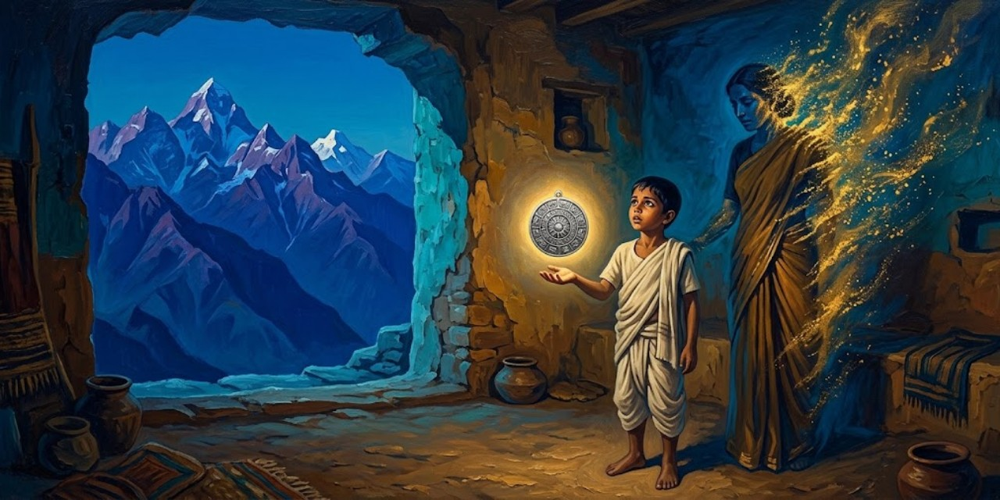</a>

El mayor deseo de la madre era ver casado a Ananta; con los preparativos en marcha en Calcutta, el padre y Mukunda, de unos once años, esperaban en Bareilly la fecha de la boda.

> Ya había presenciado el esplendor de los ritos nupciales de mis dos hermanas mayores, Roma y Uma; pero para Ananta, por ser el hijo primogénito, los planes eran de verdad fastuosos. Madre estaba dando la bienvenida a numerosos parientes que llegaban a diario a Calcutta desde hogares lejanos. Los alojó cómodamente en una casa grande, recién adquirida, en el número 50 de Amherst Street. Todo estaba a punto: los manjares del banquete, el alegre trono en que el Hermano sería llevado a casa de la prometida, las hileras de luces de colores, los enormes elefantes y camellos de cartón, las orquestas inglesa, escocesa e india, los animadores profesionales, los sacerdotes para los rituales antiguos.
>
> [Párrafo 3](#original-c2-p3)

En la tradición india, la boda del hijo mayor era el acontecimiento que aseguraba la continuidad familiar, y el capítulo insiste en que era el mayor deseo de la madre. El despliegue descrito mezcla elementos hindúes y británicos, propios de la Calcutta de la época.

Días antes, el niño vio de madrugada, según el relato, a su madre pidiéndole tomar el primer tren a Calcutta; el padre lo desestimó, y al amanecer llegó el telegrama: estaba grave. Solo lo detuvo de las vías la pregunta de si aún vivía. Llegaron a una muerte ya consumada, y el muchacho quedó postrado años, hasta que, cuenta, la Madre Divina le habló y cerró su duelo.

> Padre y yo regresamos a Bareilly poco después de los ritos crematorios de la muy amada. Cada madrugada hacía una peregrinación conmemorativa y patética a un gran árbol *sheoli* que daba sombra al liso césped verde dorado frente a nuestro bungalow. En momentos poéticos pensaba que las flores blancas del *sheoli* se esparcían con devoción voluntaria sobre el altar de hierba. Mezclando lágrimas con el rocío, observaba a menudo una extraña luz de otro mundo que surgía del alba. Intensas punzadas de anhelo de Dios me asaltaban. Me sentía poderosamente atraído hacia el Himalaya.
>
> [Párrafo 16](#original-c2-p16)

El *sheoli* (jazmín de noche) es un árbol de flores blancas y aromáticas que caen al amanecer; de ahí la imagen del altar. El duelo se convierte aquí en el motor del resto del libro: el anhelo de Dios y la llamada del Himalaya, la cadena montañosa que los textos hindúes asocian con los yoguis.

Un primo llegado de las montañas reavivó su fantasía de yogui; huyó hacia Naini Tal y Ananta lo obligó a volver. El padre, viudo para siempre, se volvió más tierno. Catorce meses después de la muerte, Ananta, a punto de casarse, cumplió una promesa postergada: llamó a Mukunda con una caja y un mensaje.

> "Mientras te acariciaba, rezaba para que el gran gurú se fijara en ti y te diera una bendición. A medida que mi silenciosa demanda devocional crecía en intensidad, él abrió los ojos y me hizo señas de que me acercara. Los demás me abrieron paso; me incliné ante los pies sagrados. Mi maestro te sentó en su regazo, poniendo su mano sobre tu frente a modo de bautismo espiritual.
>
> [Párrafo 28](#original-c2-p28)

La escena está en boca de la madre, dentro del mensaje que Ananta transcribe. Continúa, en párrafos no citados, con la profecía atribuida a Lahiri Mahasaya: "tu hijo será un yogui". La expresión "bautismo espiritual" describe aquí una bendición del gurú, no un rito cristiano.

El mensaje cuenta que de bebé lo llevó a Benares, donde Lahiri Mahasaya anunció que sería yogui, y que en Lahore un sadhu le predijo a la madre su muerte próxima y le confió un amuleto de plata: se materializaría en sus manos, lo guardaría Ananta un año y pasaría a Mukunda hasta cumplir su propósito y desaparecer. La madre se despide sin pena.

> Una llamarada de iluminación me envolvió al tomar posesión del amuleto; muchos recuerdos dormidos despertaron. El talismán, redondo y de anticuado encanto, estaba cubierto de caracteres sánscritos. Comprendí que venía de maestros de vidas pasadas, que guiaban mis pasos en lo invisible. Había en verdad un significado ulterior; pero no se revela por completo el corazón de un amuleto.
>
> [Párrafo 39](#original-c2-p39)

El sánscrito es la lengua clásica de las escrituras de la India. El autor presenta el amuleto como vínculo con maestros de encarnaciones anteriores: una creencia devocional que el capítulo deja deliberadamente en misterio, anunciando su desaparición futura sin contarla aún.

El autor reserva para más adelante cómo desapareció el amuleto y qué anunció esa pérdida; el niño, impedido de huir al Himalaya, viaja a diario en las alas de su talismán.

---

## Capítulo 3: El santo de los dos cuerpos

<a href="img/261017_autobiografia-de-un-yogui_i-3.jpg">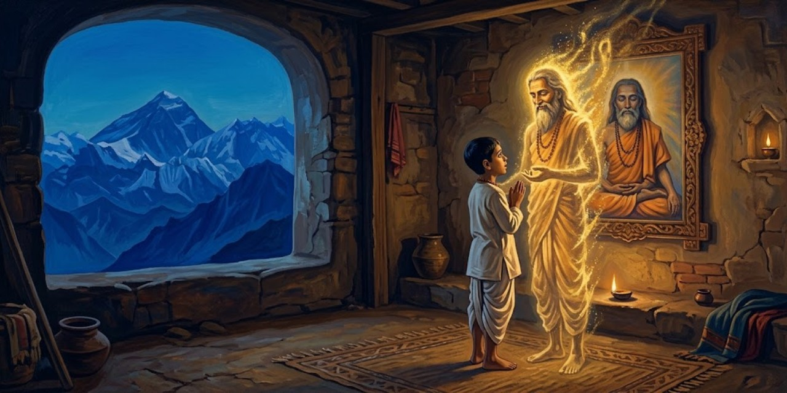</a>

Con pase de tren y dos cartas de su padre, el muchacho viaja a Benares: una es de negocios para Kedar Nath Babu, cuya dirección se perdió; la otra lo presenta al swami Pranabananda, condiscípulo del padre.

> Partí con el entusiasmo de mis doce años (aunque el tiempo nunca ha apagado mi deleite por los paisajes nuevos y los rostros extraños). Al llegar a Benares, me dirigí de inmediato a la residencia del swami. La puerta principal estaba abierta; subí hasta una sala larga, parecida a un vestíbulo, en el segundo piso. Un hombre más bien corpulento, vestido solo con un taparrabos, estaba sentado en postura de loto sobre una plataforma ligeramente elevada. Tenía la cabeza y el rostro sin arrugas bien afeitados; una sonrisa beatífica jugaba en sus labios. Para disipar mi idea de que había irrumpido sin permiso, me saludó como a un viejo amigo.
>
> [Párrafo 6](#original-c3-p6)

Un swami es un monje de la orden renunciante hindú; Pranabananda era, como el padre del autor, discípulo de Lahiri Mahasaya. Benares (hoy Varanasi), a orillas del Ganges, es la ciudad sagrada del hinduismo. El saludo que sigue en el texto, *baba anand* ("dicha a mi ser querido"), marca el tono paternal del encuentro.

El santo lo recibe con alegría infantil y lo reconoce sin la carta; promete localizar a Kedar Nath y dice disfrutar de dos pensiones: una del ferrocarril, por recomendación de su padre, y otra del Padre Celestial, que el niño no acaba de entender.

> Poniendo fin abrupto a nuestra conversación, el santo quedó gravemente inmóvil. Un aire de esfinge lo envolvió. Al principio sus ojos chispeaban, como si observaran algo de interés, y luego se apagaron. Me sentí cohibido ante su escasez de palabras; aún no me había dicho cómo podía encontrar al amigo de Padre. Un poco inquieto, miré alrededor en la habitación desnuda, vacía salvo por nosotros dos. Mi mirada ociosa cayó en sus sandalias de madera, bajo el asiento de la plataforma.
>
> [Párrafo 14](#original-c3-p14)

La inmovilidad súbita describe el trance meditativo que el texto llama superconsciencia. Las sandalias de madera, anotadas de pasada, serán la prueba material del prodigio que el capítulo está a punto de contar.

El swami lo tranquiliza: el hombre que busca estará allí en media hora. Tras uno de sus silencios inescrutables, anuncia que ya se acerca a la puerta.

> Oí a alguien subir las escaleras. Una asombrada incomprensión surgió de pronto; mis pensamientos corrían confusos: "¿Cómo es posible que el amigo de Padre haya sido convocado a este lugar sin ayuda de un mensajero? ¡El swami no ha hablado con nadie más que conmigo desde que llegué!"
>
> [Párrafo 18](#original-c3-p18)

El capítulo construye aquí su efecto probatorio: el visitante confirmará haber visto al swami a orillas del Ganges mientras, según el autor, este no se había movido de la sala. Es la bilocación, el prodigio del "santo de los dos cuerpos" del título, narrado como experiencia propia del autor adolescente.

En la escalera se cruza con Kedar Nath, desconcertado: jura que el swami lo abordó en el Ganges, aunque el muchacho asegura que no se ha movido de la sala en una hora. El santo habla de la unidad sutil del mundo, abierta a los verdaderos yoguis; el muchacho, asustado, no piensa aceptarlo como maestro.

> "Te diré cuánto vale la ayuda de un gurú. Yo solía meditar con otro discípulo durante ocho horas cada noche. De día teníamos que trabajar en la oficina del ferrocarril. Al encontrar dificultades para cumplir mis tareas de empleado, deseé dedicar todo mi tiempo a Dios. Durante ocho años perseveré, meditando media noche. Obtuve resultados maravillosos; tremendas percepciones espirituales iluminaron mi mente. Pero siempre quedaba un pequeño velo entre el Infinito y yo. Ni siquiera con un empeño sobrehumano logré que se me concediera la unión final e irrevocable. Una noche visité a Lahiri Mahasaya y supliqué su intercesión divina. Mis importunidades continuaron durante toda la noche.
>
> [Párrafo 42](#original-c3-p42)

La cita abre el relato en primera persona del propio swami: la "segunda pensión" de paz que mencionaba al principio del capítulo. La enseñanza central, propia de la tradición del gurú, es que el esfuerzo personal no basta; la gracia del maestro franquea el último velo.

El swami cuenta su historia: suplicó a Lahiri Mahasaya ver al Amado cara a cara; el maestro lo devolvió a meditar, intercedió, dice, ante Brahma, y esa noche alcanzó su meta. Meses después pidió la pensión alegando una sensación en la columna que le impedía trabajar.

> "Sin más preguntas, el médico me recomendó calurosamente para una pensión, que pronto recibí. Sé que la voluntad divina de Lahiri Mahasaya obró a través del doctor y de los funcionarios del ferrocarril, incluido tu padre. Automáticamente obedecieron la dirección espiritual del gran gurú y me liberaron para una vida de comunión ininterrumpida con el Amado."
>
> [Párrafo 56](#original-c3-p56)

El cierre ata las dos pensiones de la conversación inicial: la terrenal, gestionada por el padre del autor, y la "pensión de paz insondable" atribuida a la gracia del maestro. Que los funcionarios "obedecieran automáticamente" es la interpretación devocional del swami, no una afirmación del narrador sobre hechos comprobables.

Tras la revelación, el swami enmudece; al despedirse bendice al muchacho con dos predicciones que, según el autor, los años cumplieron: vida de renuncia y yoga, y un reencuentro junto a su padre. Ya oscurece cuando sale con Kedar Nath.

> Kedar Nath Babu caminó a mi lado en la oscuridad creciente. Le entregué la carta de Padre, que mi compañero leyó bajo una farola.
>
> [Párrafo 59](#original-c3-p59)

La broma final devuelve el prodigio de la bilocación a la escala de lo cotidiano: para cualquier otro, dos cuerpos siguen siendo imposibles.

Al leer la carta, Kedar Nath Babu declina la oferta de empleo en Calcutta: no puede dejar Benares, y bromea con que a él aún no le salen dos cuerpos.

---

## Capítulo 4: Mi fuga frustrada hacia el Himalaya

<a href="img/261017_autobiografia-de-un-yogui_i-4.jpg">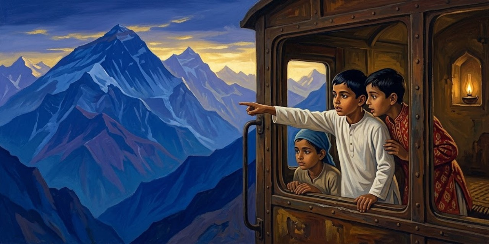</a>

La familia vive ya en Calcutta; Mukunda medita en su desván y planea con su amigo Amar la fuga al Himalaya, bajo la vigilancia de Ananta, con instrucciones de novela de espías: coche de alquiler y callejón sin testigos.

> La memorable mañana llegó con lluvia de mal augurio. Al oír las ruedas del carruaje de Amar en el camino, até apresuradamente una manta, un par de sandalias, el retrato de Lahiri Mahasaya, un ejemplar del Bhagavad *Guita*, una sarta de cuentas de oración y dos taparrabos. Ese bulto lo lancé desde la ventana de mi tercer piso. Bajé corriendo las escaleras y pasé junto a mi tío, que compraba pescado en la puerta.
>
> [Párrafo 4](#original-c4-p4)

El bulto resume el equipaje del renunciante hindú: escritura, cuentas de oración (*japa mala*) y la imagen del gurú. Que el niño de doce años lo lance por la ventana marca el tono de aventura cómica que domina el capítulo.

Compran ropa europea con sus ahorros para despistar a Ananta, recogen al primo Jatinda y se desprenden del cuero, indigno del viaje santo. En Burdwan, Jatinda propone dividir el dinero y comprar cada uno su billete, y desaparece en la noche; Mukunda, en llanto, quiere volverse, y Amar lo increpa por no resistir una pequeña prueba.

> Gracias a la sugerencia de Amar de una prueba divina, mi corazón recobró la firmeza. Nos reconfortamos con los famosos dulces de Burdwan, *sitabhog* (alimento de la diosa) y *motichur* (pepitas de dulce perla). En unas horas, tomamos el tren hacia Hardwar, vía Bareilly. Al cambiar de tren en Moghul Serai, discutimos un asunto vital mientras esperábamos en el andén.
>
> [Párrafo 17](#original-c4-p17)

El *sitabhog* y el *motichur* son dulces típicos de Bengala. Hardwar, a los pies del Himalaya, es una de las siete ciudades santas del hinduismo y puerta tradicional de los peregrinajes a las montañas. La "prueba divina" convierte la traición del primo en parte del designio.

Un agente europeo los aborda con un telegrama. Mukunda se niega a mentir, y Amar convierte el interrogatorio en un duelo de ingenio: él es "Thomas", hijo de madre inglesa; su amigo, "Thompson".

> Para entonces mi regocijo interior había llegado a su cúspide; sin ceremonia alguna me encaminé al tren, silbando para la partida. Amar vino detrás con el funcionario, quien, crédulo y complaciente, tuvo a bien colocarnos en un compartimento europeo. Evidentemente le dolía pensar en dos muchachos medio ingleses viajando en la sección destinada a los nativos. Tras su cortés despedida, me recosté en el asiento y reí sin poder contenerme. Mi amigo lucía una expresión de alegre satisfacción por haber burlado a un veterano funcionario europeo.
>
> [Párrafo 31](#original-c4-p31)

La escena retrata la segregación de los ferrocarriles de la India colonial, con vagones separados para europeos y "nativos"; el engaño de Amar funciona porque explota ese prejuicio. El telegrama de Ananta, que el autor alcanza a leer, ofrecía recompensa por detenerlos.

El telegrama ofrece recompensa por tres bengalíes en ropa inglesa. Esquivan a Dwarka en Bareilly, otro agente cae ante "Thomas" y "Thompson", y al alba entran en Hardwar, se visten a la india y compran billetes a Rishikesh. Allí un policía los detiene y les retiene el dinero hasta que llegue el hermano; al saber que huían al Himalaya, les cuenta una historia extraña.

> "¡Veo que están locos por los santos! Nunca conocerán a un hombre de Dios más grande que el que yo vi apenas ayer. Mi compañero y yo lo encontramos por primera vez hace cinco días. Patrullábamos junto al Ganges, muy atentos a un asesino. Nuestras instrucciones eran capturarlo, vivo o muerto. Se sabía que se disfrazaba de *sadhu* para robar a los peregrinos. A poca distancia delante de nosotros, divisamos una figura que se ajustaba a la descripción del criminal. Ignoró nuestra orden de detenerse; corrimos a dominarlo. Al llegar a su espalda, blandí mi hacha con fuerza tremenda; el brazo derecho del hombre quedó cercenado casi por completo.
>
> [Párrafo 38](#original-c4-p38)

Un *sadhu* es un asceta errante del hinduismo, reconocible por sus ropajes y su vida de mendicidad; el disfraz de *sadhu* del criminal buscado da verosimilitud al error policial. El relato es del oficial, citado por el autor.

El policía cuenta que, tras la pista de un asesino, hirió con su hacha a un desconocido que siguió caminando sin quejarse; avergonzado ante aquel sabio de aspecto divino, se postró a sus pies implorando perdón.

> "Hijo, fue solo un error comprensible de tu parte." El santo me miró con bondad. "Vete, y no te reproches nada. La Madre Amada está cuidando de mí." Se acomodó el brazo colgante contra el muñón y, ¡mirad!, se adhería; la sangre dejó de correr inexplicablemente.
>
> [Párrafo 42](#original-c4-p42)

La curación instantánea se narra como prodigio atribuido al santo anónimo; el texto lo presenta a través del testimonio del policía, no como verificación del autor. La "Madre Amada" es la Diosa, la forma maternal de lo divino que recorre el libro.

El sadhu lo citó a los tres días para que lo hallara curado y sin remordimientos; el policía acudió y examinó, dice, un brazo sin cicatriz, antes de verlo partir bendiciéndolo hacia el Himalaya.

> El oficial concluyó con una piadosa exclamación; su experiencia lo había conmovido evidentemente más allá de su hondura habitual. Con un gesto solemne, me entregó un recorte impreso sobre el milagro. Con el estilo confuso habitual de la prensa sensacionalista (¡que no falta, ay!, ni siquiera en la India), la versión del reportero estaba ligeramente exagerada: ¡daba a entender que el *sadhu* había estado a punto de ser decapitado!
>
> [Párrafo 46](#original-c4-p46)

El matiz importa: el propio libro se distancia de la prensa sensacionalista y corrige la exageración, aunque mantiene el núcleo milagroso. Es un ejemplo de cómo el autor calibra sus fuentes sin renunciar al prodigio.

Amar, sin dinero, se vuelve pesimista. A los tres días llega Ananta y lo aplaca con una oferta: conocer a un santo en Benares y visitar al padre afligido en Calcutta antes de retomar la búsqueda. Mukunda no sabe que Ananta ha preparado una celada: un erudito y su hijo han prometido disuadirlo de hacerse sannyasi.

> Ananta me llevó a su casa. El hijo, un joven de modales efusivos, me recibió en el patio. Me enredó en un largo discurso filosófico. Profesando conocer clarividentemente mi futuro, desaprobó mi idea de hacerme monje.
>
> [Párrafo 58](#original-c4-p58)

El *pundit* es un erudito en las escrituras; Ananta lo había sobornado, por decirlo así, para alejar al hermano del camino del *sannyasi*, el renunciante que abandona la vida familiar. La escena prepara el contraargumento de la cita siguiente.

El hijo del erudito, que se da por clarividente, le advierte que desertar de sus responsabilidades le traerá desgracia continua y le impedirá hallar a Dios: el karma pasado no se liquida sin experiencias mundanas.

> Las palabras inmortales de Krishna acudieron a mis labios en respuesta: "Incluso aquel con el peor *karma* que medita en Mí sin cesar pierde pronto los efectos de sus malas acciones pasadas. Volviéndose un ser de alma elevada, alcanza enseguida la paz perenne. ¡Arjuna, ten esto por cierto: el devoto que pone su confianza en Mí jamás perece!"
>
> [Párrafo 60](#original-c4-p60)

La respuesta cita el Bhagavad *Guita*, donde el dios Krishna instruye al guerrero Arjuna. El *karma* es la ley de causa y efecto de los actos a través de las vidas. Poco después, un *sadhu* desconocido confirma al muchacho que su único camino es el de la renuncia; el autor lo narra como respuesta directa a su oración.

Sacudido, reza pidiendo una señal inmediata, y un sadhu de noble rostro que ha oído la conversación lo llama aparte: el Señor le asegura que su único camino es el del renunciante. Ya en el tren, Ananta revela sus pesquisas: el horario marcado, el cochero, los trajes, y cómo llevó a Jatinda de una cena a una comisaría, donde lo confesó todo.

> "Partí hacia el Himalaya en un radiante estado de ánimo espiritual", explicó. "Me llenaba la inspiración ante la perspectiva de conocer a los maestros. Pero en cuanto Mukunda dijo: 'Durante nuestros éxtasis en las cuevas del Himalaya, los tigres quedarán hechizados y se sentarán a nuestro alrededor como gatitos mansos', se me heló el ánimo; gotas de sudor se formaron en mi frente. '¿Y entonces?', pensé. 'Si la naturaleza feroz de los tigres no cambia por el poder de nuestro trance espiritual, ¿nos tratarán con la amabilidad de los gatos domésticos?' En mi mente ya me veía como inquilino forzoso del estómago de algún tigre: ¡entrando allí no de una vez con el cuerpo entero, sino por entregas de sus varias partes!"
>
> [Párrafo 76](#original-c4-p76)

La confesión de Jatinda resuelve con humor la deserción de Burdwan: la misma frase entusiasta que abría el viaje se vuelve, en la imaginación del primo, una sentencia de muerte. El humor equilibra la carga devocional del capítulo.

En Calcutta, el padre le pide terminar el bachillerato y le busca un tutor de sánscrito, Swami Kebalananda, para calmar sus ansias religiosas; sale al revés: el tutor, exaltado discípulo de Lahiri Mahasaya, aviva su búsqueda de Dios y le cuenta su vida junto al gurú.

> "Afortunado entre pocos, pude permanecer cerca de Lahiri Mahasaya durante diez años. Su casa de Benares era mi meta de peregrinación nocturna. El gurú estaba siempre presente en una pequeña sala delantera de la planta baja. Mientras se sentaba en postura de loto sobre un asiento de madera sin respaldo, sus discípulos lo rodeaban en semicírculo como una guirnalda. Sus ojos chispeaban y danzaban con la alegría de lo Divino. Estaban siempre medio cerrados, atisbando a través del orbe telescópico interior hacia una esfera de dicha eterna. Rara vez hablaba extensamente. Ocasionalmente su mirada se fijaba en un estudiante necesitado de ayuda; entonces palabras sanadoras se vertían como una avalancha de luz.
>
> [Párrafo 84](#original-c4-p84)

El retrato lo hace el tutor Kebalananda, testigo directo. La mirada "medio cerrada" repite la descripción de la fotografía del capítulo 1: para el linaje del libro, la atención interior es la marca del maestro realizado.

Kebalananda describe al maestro: paz indescriptible a su mirada, la "biblioteca divina" sin libros, la negativa a la fe servil, el Kriya como llave imperecedera. Y cuenta el milagro que presenció: Ramu, ciego de nacimiento, se atreve a pedirle luz para sus ojos; el maestro alega no tener poder de curación, y Ramu responde que el Infinito en él sí puede.

> "Eso sí es distinto, Ramu. ¡Dios no tiene límite en ninguna parte! Aquel que enciende las estrellas y las células de la carne con su misteriosa efulgencia vital puede ciertamente traer el lustre de la visión a tus ojos."
>
> [Párrafo 102](#original-c4-p102)

La precisión teológica es deliberada: el maestro niega tener poder propio ("no tengo poder de curar", dice párrafos antes) y atribuye toda curación a Dios. El gesto de tocar el punto entre las cejas remite al centro de visión espiritual ya mencionado con el *kutastha*.

El maestro le toca la frente, en el punto entre las cejas, y le ordena concentrar allí la mente e invocar el nombre del profeta Rama durante siete días: el esplendor del sol tendrá para él un amanecer especial.

> "¡Mirad! En una semana así fue. Por primera vez, Ramu contempló el bello rostro de la naturaleza. El Omnisciente había dirigido infaliblemente a su discípulo a repetir el nombre de Rama, adorado por él por encima de todos los demás santos. La fe de Ramu fue el suelo arado devocionalmente en el que brotó la poderosa semilla de curación permanente del gurú." Kebalananda guardó silencio un momento, y luego rindió un tributo más a su gurú.
>
> [Párrafo 105](#original-c4-p105)

Rama es el héroe divino del *Ramayana*, una de las grandes epopeyas de la India. La curación queda atribuida a la fe de Ramu como suelo arado devocionalmente: el poder es del maestro, la condición es del devoto.

Kebalananda remata con un tributo: los cuerpos curados acaban en la pira, pero los despertares espirituales son los milagros imperecederos del maestro. El autor confiesa que nunca llegó a ser erudito en sánscrito: su tutor le enseñó una sintaxis más divina.

---

## Capítulo 5: Un «santo de los perfumes» exhibe sus maravillas

Dos años separan la fuga con Amar de la llegada del gurú. Ante una imagen de Kali, un sadhu errante parece leer sus pensamientos: Dios es simple; pocos resuelven el enigma de la diosa y arrancan de la dualidad la verdad de la unidad.

> "El hombre no puede comprender ninguna verdad eterna hasta que no se haya liberado de sus pretensiones. La mente humana, desnudada ante un cieno de siglos, está repleta de la repulsiva vida de incontables engaños mundanos. ¡Las luchas de los campos de batalla palidecen aquí hasta la insignificancia, cuando el hombre contiende por primera vez con enemigos interiores! No son enemigos mortales que puedan vencerse con una desgarradora exhibición de fuerza. Omnipresentes, incansables, persiguiendo al hombre incluso en sueños, sutilmente equipados con un arma miasmática, esos soldados de las codicias ignorantes buscan matarnos a todos. Irreflexivo es el hombre que entierra sus ideales, rindiéndose al destino común. ¿Puede parecer otra cosa que impotente, de madera, ignominioso?"
>
> [Párrafo 12](#original-c5-p12)

El templo de Kalighat, en Calcutta, es el gran santuario de la diosa Kali, que representa a la vez la destrucción y la protección maternal. La *maya* de la que habla el *sadhu* es la ilusión de la dualidad; su dureza contra el ego es el tono clásico de la sabiduría ascética india.

El muchacho le pregunta si no siente simpatía por las masas desconcertadas; el sabio calla un momento y responde de modo oblicuo.

> "Amar a la vez al Dios invisible, Depósito de Todas las Virtudes, y al hombre visible, aparentemente desprovisto de todas ellas, ¡es a menudo desconcertante! Pero el ingenio está a la altura del laberinto. La investigación interior pronto expone una unidad en todas las mentes humanas: la robusta parentela del motivo egoísta. En un sentido al menos, la hermandad del hombre queda revelada. Una horrorizada humildad sigue a este descubrimiento nivelador. Madura hasta volverse compasión por los semejantes, ciegos ante las potencias sanadoras del alma que aguardan ser exploradas."
>
> [Párrafo 15](#original-c5-p15)

La respuesta es oblicua a propósito: la compasión no nace de idealizar al prójimo sino de reconocer en uno mismo el mismo egoísmo. Es el giro psicológico más fino del discurso del *sadhu*.

El muchacho asiente: los santos de todas las épocas, dice, han sentido como él por las penas del mundo. El rostro austero del sadhu se ablanda al continuar.

> "Solo el hombre superficial pierde la capacidad de responder a las desgracias de las vidas ajenas, al hundirse en su propio sufrimiento estrecho." El rostro austero del *sadhu* se ablandó visiblemente. "Quien practica una autodisección con bisturí conocerá una expansión de piedad universal. Se le concede liberación de las demandas ensordecedoras de su ego. El amor de Dios florece en tal suelo. La criatura finalmente se vuelve a su Creador, aunque no sea más que para preguntar con angustia: "¿Por qué, Señor, por qué?" Azotado por innobles látigos de dolor, el hombre es conducido por fin a la Presencia Infinita, cuya belleza por sí sola debería atraerlo."
>
> [Párrafo 17](#original-c5-p17)

El matiz del rostro que "se ablanda" corrige la severidad de las citas anteriores: la austeridad del *sadhu* no es desprecio. La idea del dolor como maestro, secundario ante la belleza, anticipa una constante del libro.

Están en el templo de Kalighat; el sadhu desestima su magnificencia con un gesto - ladrillo y argamasa no cantan; el corazón solo se abre al canto humano del ser - y pasean hacia la entrada, entre devotos.

> "Eres joven." El sabio me examinó pensativo. "La India también es joven. Los antiguos *rishis* establecieron patrones inextirpables de vida espiritual. Sus canosos dictados bastan para este día y esta tierra. No anticuados, no ingenuos frente a las argucias del materialismo, los preceptos disciplinarios aún moldean a la India. Por milenios, ¡más de lo que a los eruditos avergonzados les gusta computar!, el escéptico Tiempo ha validado el valor védico. Tómalo como tu herencia."
>
> [Párrafo 21](#original-c5-p21)

Los *rishis* son los videntes antiquísimos a quienes la tradición atribuye los *Vedas*, los textos más antiguos de la India. Hay ironía retrospectiva en la escena: el muchacho que recibe la herencia védica será quien, según su propio libro, la lleve a Occidente.

Al despedirse, el sadhu le anuncia una experiencia inusual para ese día. Un conocido locuaz lo retiene y, al irse, repite la fórmula: en esa casa está Gandha Baba, el "santo de los perfumes"; allí podría tener una experiencia inusual.

> Miré directamente al santo; su mirada rápida se posó en la mía. Era regordete y barbudo, de piel oscura y ojos grandes y brillantes.
>
> [Párrafo 32](#original-c5-p32)

Gandha Baba es el apodo: *gandha* significa "perfume" en sánscrito. Dos extraños, el *sadhu* y el conocido charlatán, le anuncian al autor una "experiencia inusual" casi con las mismas palabras; el capítulo subraya esa coincidencia como designio.

Gandha Baba le ofrece un perfume; el muchacho objeta que doce años para olores astrales desperdicia lo que cuesta unas rupias y muere con el cuerpo. Complacido, el santo le pide extender la mano sin tocarla: de su palma surge fragancia de rosa, narra, y una flor sin olor empieza a oler a jazmín.

> Una fragancia de jazmín brotó instantáneamente de los pétalos. Di las gracias al hacedor de maravillas y me senté junto a uno de sus estudiantes. Este me informó que Gandha Baba, cuyo nombre propio era Vishudhananda, había aprendido muchos secretos asombrosos del yoga con un maestro en el Tíbet. El yogui tibetano, se me aseguró, había alcanzado la edad de más de mil años.
>
> [Párrafo 57](#original-c5-p57)

El autor registra la maravilla pero marca su distancia: los datos del maestro milenario llegan de un discípulo ("se me aseguró"), no de verificación propia. El libro distinguirá luego estos prodigios espectaculares de la vida espiritual seria.

> "Su discípulo Gandha Baba no siempre realiza sus proezas de perfumes de la manera verbal simple que acaba de presenciar." El estudiante hablaba con orgullo evidente de su maestro. "Su procedimiento varía ampliamente, para ajustarse a la diversidad de temperamentos. ¡Es maravilloso! Muchos miembros de la intelectualidad de Calcutta están entre sus seguidores."
>
> [Párrafo 58](#original-c5-p58)

El juicio del autor llega en el párrafo siguiente, fuera de la cita: decide no unirse a esos seguidores, porque un gurú literalmente "maravilloso" no era lo que buscaba. El criterio, que el libro repetirá, es que los poderes no prueban santidad.

Se despide decidido a no ser un seguidor más; su hermana Uma huele perpleja la rosa y el jazmín, lo que disipa su sospecha de autosugestión. Años después cree entender el mecanismo: vibraciones de "lifetrons"; tales maravillas, concluye, distraen de la búsqueda de Dios.

> El hipnotismo ha sido usado por médicos en operaciones menores como una suerte de cloroformo psíquico para personas que podrían verse en peligro con un anestésico. Pero el estado hipnótico es dañino para quienes se someten a él con frecuencia; sobreviene un efecto psicológico negativo que con el tiempo trastorna las células cerebrales. El hipnotismo es una intrusión en el territorio de la consciencia ajena. Sus fenómenos temporales no tienen nada en común con los milagros realizados por hombres de realización divina. Despiertos en Dios, los verdaderos santos efectúan cambios en este mundo-sueño mediante una voluntad armónicamente en sintonía con el Soñador Cósmico Creador.
>
> [Párrafo 72](#original-c5-p72)

La distinción que propone el autor, entre hipnotismo (intrusión) y milagro (sintonía con lo divino), es doctrina suya, no ciencia; sirve para salvar los prodigios que el libro sí acepta.

El capítulo cierra con la parábola del místico persa Abu Said: un sapo también está en casa en el agua y el cuervo vuela sin mérito; el verdadero hombre compra y vende sin olvidar a Dios ni un instante. Ni el sabio de Kalighat ni Gandha Baba colmaron la búsqueda de un gurú.

---

## Capítulo 6: El Swami Tigre

Su amigo Chandi le consigue la dirección del Swami Tigre, famoso por luchar con tigres a manos desnudas antes de hacerse monje, y van a visitarlo.

> Al día siguiente amaneció con frío invernal, pero Chandi y yo salimos alegres. Tras mucha búsqueda en vano por Bhowanipur, a las afueras de Calcutta, llegamos a la casa correcta. La puerta tenía dos argollas de hierro, que hice sonar estridentemente. A pesar del clamor, un sirviente se acercó con paso pausado. Su sonrisa irónica daba a entender que los visitantes, pese a su ruido, eran incapaces de perturbar la calma del hogar de un santo.
>
> [Párrafo 3](#original-c6-p3)

Bhowanipur es un barrio histórico del sur de Calcutta. La escena inicial enseña una regla no escrita que el texto formula poco después: al buscador de la India se le examina con esperas; la impaciencia del ruido delata al novato.

Tras una larga espera, son admitidos ante Sohong Swami: un cuerpo colosal con piel de tigre a la cintura. Él ve gatitos donde otros ven tigres, aunque hacen falta manos poderosas, y lo demuestra desprendiendo un ladrillo de un manotazo: el tigre convierte al hombre, en su propia mente, en gatito.

> "La mente es la que blande los músculos. La fuerza de un martillazo depende de la energía aplicada; el poder expresado por el instrumento corporal de un hombre depende de su voluntad agresiva y de su coraje. El cuerpo está literalmente fabricado y sostenido por la mente. Por la presión de instintos de vidas pasadas, fuerzas o debilidades se filtran gradualmente a la consciencia humana. Se expresan como hábitos, que a su vez se osifican en un cuerpo deseable o indeseable. La fragilidad externa tiene origen mental; en un círculo vicioso, el cuerpo atado al hábito frustra a la mente. Si el amo se deja mandar por un sirviente, este se vuelve autócrata; la mente queda igualmente esclavizada al someterse al dictado corporal."
>
> [Párrafo 15](#original-c6-p15)

El Sohong Swami sostiene aquí la tesis central del capítulo: la fuerza es una forma de pensamiento. Es doctrina del personaje dentro del relato; el libro la ilustra, no la demuestra. El cuerpo del swami, descrito párrafos antes (bíceps como balones, piel de tigre a la cintura), es la prueba visual que el texto ofrece.

El swami accede a contar su vida: de niño frágil a domador famoso, a fuerza, dice, de pensamientos de salud. Cuando el autor pregunta si él también podría, el swami sonríe: los tigres que valen la pena merodean las selvas del deseo.

> "Cuando mi fama llegó a su cúspide, trajo consigo la intoxicación del orgullo. Decidí no solo luchar con tigres sino exhibirlos en varios trucos. Mi ambición era forzar a las bestias salvajes a comportarse como animales domesticados. Comencé a realizar mis proezas en público, con gratificante éxito.
>
> [Párrafo 24](#original-c6-p24)

El relato autobiográfico del swami tiene estructura de parábola: el orgullo convoca la advertencia. Su padre le transmitirá la predicción de un santo: heridas graves, seis meses de enfermedad mortal y, al final, la vida monástica.

Una noche su padre le advierte: no es fatalista, pero cree en la ley de retribución de las escrituras, y hay resentimiento contra él en la familia de la jungla; algún día puede volverse en su contra.

> "¡Padre, me asombras! ¡Bien sabes lo que son los tigres: hermosos pero despiadados! Incluso justo después de una enorme comida de alguna criatura desdichada, un tigre se enciende con nueva codicia a la vista de una nueva presa. Puede ser una gazela dichosa, que retoza sobre la hierba de la jungla. Capturándola y mordiendo una abertura en la garganta blanda, la bestia malévola prueba solo un poco de la sangre que calladamente clama, y sigue su camino caprichoso.
>
> [Párrafo 29](#original-c6-p29)

La defensa del hijo es deliberadamente excesiva: se presenta como "director de una escuela de modales en la selva". El lector ya sabe, por la predicción, que esa arrogancia será corregida por la experiencia, no por la razón.

El hijo se defiende: es domador, no matador, y sus buenas acciones no pueden traerle mal. El padre revela entonces la predicción narrada de un santo: su próximo tigre lo dejará gravemente herido, seguirán seis meses de enfermedad mortal y acabará monje. El hijo no se inmuta: cree a su padre víctima crédula de un fanático.

> "No mucho después de la advertencia de Padre, visité la ciudad capital de Cooch Behar. El pintoresco territorio era nuevo para mí, y esperaba un cambio descansado. Como siempre en todas partes, una multitud curiosa me seguía por las calles. Captaba fragmentos de comentarios susurrados:
>
> [Párrafo 38](#original-c6-p38)

Cooch Behar era un Estado principesco de la India británica, al norte de Bengala, con su propio maharajá. Los susurros que siguen ("¿tiene piernas o troncos de árbol?") muestran la fama como personaje popular: el domador ya es un espectáculo antes del combate.

En Cooch Behar la fama lo precede: los chicos gritan que tiene troncos por piernas y la ciudad se alborota. Por la noche llegan policías con turbante: no vienen a arrestarlo, sino a invitarlo a palacio en nombre del príncipe.

> "Me desconcertó al día siguiente ser escoltado obsequiosamente desde mi puerta hasta un magnífico coche tirado por cuatro caballos. Un sirviente sostenía una sombrilla ornamentada para protegerme del sol abrasador. Disfruté del agradable paseo por la ciudad y sus afueras boscosas. El propio vástago real estaba en la puerta del palacio para darme la bienvenida. Me ofreció su propio asiento de brocado de oro, colocándose sonriente en una silla de diseño más sencillo.
>
> [Párrafo 47](#original-c6-p47)

Los honores desmedidos son la trampa cortés: tras ellos vendrá el desafío público. El narrador lo registra con suspicacia ("toda esta cortesía me va a costar algo"), y compara al príncipe con los emperadores romanos que divertían a las fieras con cristianos.

Tras las cortesías, el príncipe pasa al sarcasmo y lo desafía a luchar con su tigre Raja Begum: si lo encadena y sale consciente, se queda con la fiera y miles de rupias; si se niega, lo proclamará impostor. Acepta furioso; el combate será en una semana.

> "La semana siguiente preparé metódicamente mi mente y mi cuerpo para la prueba venidera. Por mi sirviente supe de relatos fantásticos. La siniestra predicción del santo a mi padre había corrido de algún modo, agrandándose al correr. Muchos aldeanos sencillos creían que un espíritu maligno, maldito por los dioses, se había reencarnado en un tigre que tomaba diversas formas demoníacas por la noche, pero permanecía como animal rayado durante el día. Se suponía que ese demonio-tigre era el enviado para humillarme.
>
> [Párrafo 58](#original-c6-p58)

El folclor de la aldea crece sobre la predicción narrada del santo: la noticia se degrada en demonología. El texto disfruta esa mecánica del rumor, ya vista con el recorte de prensa del capítulo 4.

> "Otra versión imaginativa era que oraciones animales al Cielo de los Tigres habían obtenido respuesta en la figura de Raja Begum. Él sería el instrumento para castigarme a mí, ¡el bípedo audaz, tan insultante para toda la especie tigre! ¡Un hombre sin pelaje ni colmillos que se atrevía a desafiar a un tigre de zarpas armadas y miembros robustos! El veneno concentrado de todos los tigres humillados, declaraban los aldeanos, había reunido impulso suficiente para accionar leyes ocultas y provocar la caída del orgulloso domador de tigres.
>
> [Párrafo 59](#original-c6-p59)

La cosmología cómica del "Cielo de los Tigres" invierte la perspectiva humana: los tigres también tienen sus plegarias y su honor ofendido. El humor no anula el riesgo; prepara la catarsis del combate.

El príncipe llena un pabellón para miles y mantiene al tigre a media ración. El domador cierra el cerrojo a su espalda; el primer asalto le desgarra la mano derecha, y con la izquierda castiga a la fiera hasta conmocionarla. Le abre las fauces, mete la cabeza entre ellas y la encadena, pero Raja Begum rompe la cadena y se le echa encima; al fin lo deja semiconsciente y lo asegura.

> "Me encontré en un nuevo alboroto, esta vez de regocijo. El vítoreo de la multitud estalló como de una sola garganta gigantesca. Desastrosamente magullado, había cumplido sin embargo las tres condiciones del combate: aturdir al tigre, atarlo con una cadena y salir sin requerir ayuda para mí. Además, ¡había herido y asustado tan drásticamente a la bestia agresiva que ella se había conformado con desaprovechar el premio oportuno de mi cabeza en su boca!
>
> [Párrafo 72](#original-c6-p72)

El título del capítulo se resignifica en el desenlace: el verdadero tigre es interior. Las tres condiciones del reto se cumplen sin júbilo: lo que se cierra es la ambición mundana del domador.

Según su relato, agasajado pero sin alegría, el domador pasa seis meses al borde de la muerte, como predijo el santo; al sanar, ese mismo santo acude a buscarlo, lo inicia en el camino espiritual y lo lleva a entrenarse al Himalaya: las fieras que domará en adelante son las de la mente.

---

## Capítulo 7: El santo levitante

<a href="img/261017_autobiografia-de-un-yogui_i-7.jpg">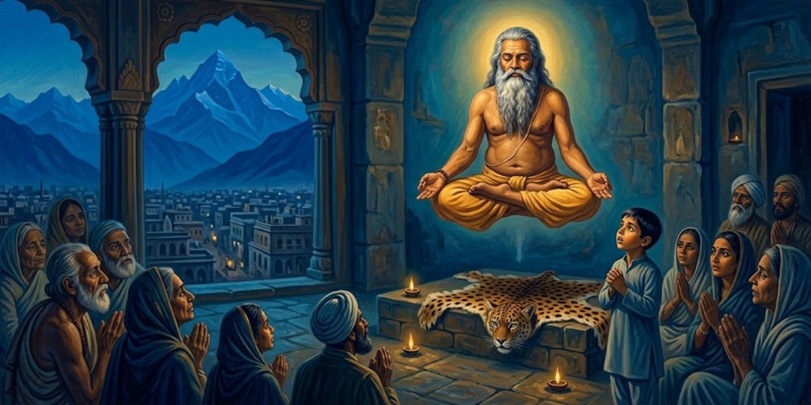</a>

Un amigo le habla de un yogui que levita: Bhaduri Mahasaya, vecino de su casa.

> "Lo he visto en proezas extraordinarias. Ha dominado con pericia los diversos *pranayamas* del antiguo yoga óctuple delineado por Patanjali. Una vez, Bhaduri Mahasaya ejecutó ante mí el *Bhastrika Pranayama* con fuerza tan asombrosa que ¡pareció que una tormenta verdadera se había levantado en la habitación! Luego extinguió el aliento atronador y permaneció inmóvil en un alto estado de superconsciencia. El aura de paz después de la tormenta era vívida más allá de todo olvido."
>
> [Párrafo 5](#original-c7-p5)

El *pranayama* es la disciplina del aliento, uno de los ocho escalones del yoga clásico codificado en los *Yoga Sutras* de Patanjali; el *Bhastrika* es su variante de "fuelle", de respiración intensa. El título del capítulo promete levitación, pero conviene notar la precisión del autor: la levitación se la cuenta un amigo; lo que él presenció son proezas de aliento y trance.

El santo lleva veinte años sin salir. ¿Cómo levita? Según el autor, ciertos pranayamas aligeran el cuerpo. El muchacho frecuenta sus reuniones, donde su risa rompe la solemnidad y provoca miradas asesinas de los discípulos.

> Esa tarde, de regreso de la escuela a casa, pasé frente al claustro de Bhaduri Mahasaya y decidí hacerle una visita. El yogui era inaccesible al público general. Un discípulo solitario, que ocupaba la planta baja, guardaba la privacidad de su maestro. El estudiante era un hombre exigente y rígido con la disciplina; en ese momento me preguntó formalmente si tenía una "cita". Su gurú hizo su aparición justo a tiempo para salvarme de una expulsión sumaria.
>
> [Párrafo 12](#original-c7-p12)

El discípulo portero que exige "cita" es el contrapunto cómico: la burocracia terrenal guardando la puerta de lo trascendente. El santo justifica su reclusión con una frase que el autor atesora: los santos "no son solo raros, sino desconcertantes".

El santo lo recibe cuando quiere: su reclusión es por comodidad de los demás, porque la franqueza de los santos destroza ilusiones. Dios planta a sus santos en tierras inesperadas para que nadie lo reduzca a una regla.

> El sabio enclavó su cuerpo vibrante en la postura de loto. En sus setenta años, no exhibía señales desagradables de edad ni de vida sedentaria. Fornido y erguido, era ideal en todo sentido. Su rostro era el de un *rishi*, tal como se describen en los textos antiguos. De cabeza noble y barba abundante, se sentaba siempre firmemente derecho, con sus ojos quietos fijos en la Omnipresencia.
>
> [Párrafo 17](#original-c7-p17)

El retrato físico codifica la enseñanza: veinte años enclaustrado sin deterioro corporal, como argumento silencioso a favor del yoga. Tras la meditación, el santo le hará la advertencia central del capítulo: no confundir la técnica con la Meta; amar a Dios más que a la meditación.

Meditan juntos una hora; al sacarlo del silencio le pregunta si ha desarrollado anubhava: que no confunda la técnica con la Meta. Luego le ofrece mangos y bromea con el Jala Yoga, la unión con la comida.

> "Esas cartas vienen de la lejana América." El sabio indicó varios sobres gruesos sobre una mesa. "Mantengo correspondencia con unas pocas sociedades de allí cuyos miembros se interesan en el yoga. Están descubriendo la India de nuevo, ¡con mejor sentido de orientación que Colón! Me alegra ayudarlos. El conocimiento del yoga es libre para todos los que quieran recibirlo, como la luz del día, que nadie puede embargar.
>
> [Párrafo 23](#original-c7-p23)

El chiste de Colón lleva una profecía que el autor solo entendió al escribir el libro, ya en Estados Unidos: esas cartas anticipaban su propia misión de llevar el yoga a Occidente. La imagen de la luz del día que "nadie puede embargar" condensa la doctrina del saber que no se vende.

El santo sostiene que ni Occidente ni Oriente florecerán sin yoga disciplinario; años después el autor verá en ello una guía profética velada hacia América. Cuando le pide un libro, responde que forma discípulos: volúmenes vivientes. Esa noche expone a Mirabai, la princesa que abandonó la corte y respondió al sannyasi que la rechazó por mujer que no conocía otro Varón que Dios. El autor traduce uno de sus cantos.

> "Si bañándose a diario se pudiera realizar a Dios,
> más pronto sería yo una ballena en lo profundo;
> si comiendo raíces y frutas se pudiera conocerlo,
> elegiría gustosa la forma de una cabra;
> si el contar rosarios lo descubriera,
> rezaría mis plegarias en cuentas gigantescas;
> si inclinarse ante imágenes de piedra lo revelara,
> adoraría humildemente una montaña de pedernal;
> si bebiendo leche se pudiera sorber al Señor,
> muchos terneros y niños lo conocerían;
> si abandonar a la esposa convocara a Dios,
> ¿no serían miles los eunucos?
> Mirabai sabe que para hallar al Divino
> lo único indispensable es el Amor."
>
> [Párrafo 34](#original-c7-p34)

Mirabai, princesa rajput del siglo XVI, es una de las poetas santas más queridas de la India; abandonó la corte por su devoción a Krishna. La traducción del canto es del propio Yogananda. Su argumento se enlaza con la advertencia del santo: ninguna técnica o ritual sustituye al amor.

Tras el canto, el santo deshace la idea de la renuncia como sacrificio ("¿qué he perdido, si gané un imperio de dicha?") y, años después, al bendecir al autor antes de su viaje a Occidente, le dice: "Ve a América; la victoria está escrita en tu frente".

---

## Capítulo 8: El gran científico de la India, J. C. Bose

<a href="img/261017_autobiografia-de-un-yogui_i-8.jpg">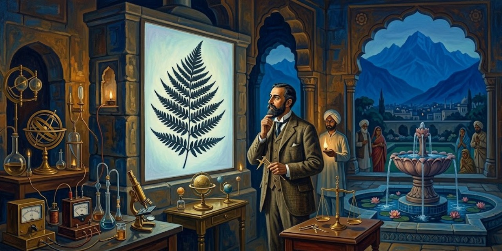</a>

Un grupo de profesores comenta en la acera que las invenciones inalámbricas de Jagadis Chandra Bose precedieron a las de Marconi; el autor, por un orgullo racial que confiesa, se acerca a preguntar y al día siguiente visita al botánico. Bose, recién vuelto de Occidente, le habla de su crescógrafo, capaz de diez millones de aumentos.

> "Me eduqué en Cambridge. ¡Cuán admirable es el método occidental de someter toda teoría a escrupulosa verificación experimental! Ese procedimiento empírico ha ido de la mano del don de introspección que es mi herencia oriental. Juntos me han permitido rasgar los silencios de reinos naturales largamente incomunicativos. Las gráficas delatoras de mi crescógrafo son evidencia para el más escéptico de que las plantas tienen un sistema nervioso sensitivo y una vida emocional variada. Amor, odio, alegría, miedo, placer, dolor, excitabilidad, estupor e incontables respuestas apropiadas a los estímulos son tan universales en las plantas como en los animales."
>
> [Párrafo 9](#original-c8-p9)

Jagadis Chandra Bose (1858-1937) fue físico y luego fisiólogo de plantas; el crescógrafo, instrumento de su invención, amplifica diez millones de veces el movimiento del crecimiento vegetal. Las conclusiones sobre la "vida emocional" de las plantas son la interpretación del propio Bose, recibida con reservas por parte de la ciencia de su época y lejos de ser consenso; el libro las presenta con simpatía. La fórmula que propone, método experimental occidental más introspección oriental, es la tesis de fondo del capítulo y una de las del libro entero.

El muchacho recuerda que un santo se negaba a arrancar flores por no ofender su dignidad, palabras que interpreta como verificadas por esos descubrimientos; Bose lo invita a su laboratorio. Tiempo después fundará en Calcutta el centro de investigación que lleva su nombre.

> Cuando se inauguró el Instituto Bose, asistí a los servicios de dedicación. Cientos de entusiastas paseaban por los terrenos. Me encantó la artística simbología espiritual del nuevo hogar de la ciencia. Su puerta principal, noté, era una reliquia secular traída de un santuario lejano. Detrás de la fuente del loto, una figura femenina esculpida con una antorcha transmitía el respeto indio por la mujer como inmortal portadora de luz. El jardín albergaba un pequeño templo consagrado al Noúmeno más allá de los fenómenos. El pensamiento de la incorporeidad divina se sugería por la ausencia de toda imagen de altar.
>
> [Párrafo 13](#original-c8-p13)

El Instituto Bose se fundó en Calcutta en 1917 y fue el primer centro de investigación interdisciplinario de Asia; sigue activo. El "Noúmeno" es el término de Kant para la realidad en sí, más allá de lo percibido: un templo sin imagen para una ciencia que se piensa a sí misma como búsqueda de lo invisible.

En la inauguración, Bose dedica el instituto como un templo y cuenta su camino: halló que metal, planta y animal exhiben una misma ley de fatiga y recuperación; la Royal Society le aconsejó no invadir terrenos ajenos, una suerte de sistema de castas de especialistas, pero con los años las grandes sociedades aceptaron sus resultados. Su moraleja: solo quien ha luchado y vencido puede renunciar a algo.

> "Pero el alto éxito no se obtiene sin rígida exactitud. De ahí la larga batería de instrumentos y aparatos supersensibles de mi diseño, que hoy se alzan ante ustedes en sus vitrinas del vestíbulo de entrada. Les hablan de los prolongados esfuerzos por llegar detrás del parecer engañoso hasta la realidad que permanece invisible, del continuo trabajo, persistencia e ingenio desplegados para superar las limitaciones humanas. Todos los científicos creativos saben que el verdadero laboratorio es la mente, donde, detrás de las ilusiones, descubren las leyes de la verdad.
>
> [Párrafo 20](#original-c8-p20)

El discurso de dedicación, que el capítulo cita extensamente, contiene las dos decisiones que hicieron famoso a Bose: no patentar jamás ("el conocimiento no se usa solo para provecho personal") y abrir el instituto a investigadores de todo país, en la tradición de las antiguas universidades de Nalanda y Taxila, que recibían estudiantes de todo el mundo. "El verdadero laboratorio es la mente" es la frase puente entre ciencia y yoga.

Bose promete un instituto sin patentes, abierto a investigadores de todos los países, en la tradición de Nalanda y Taxila. Días después, en el laboratorio, acopla el crescógrafo a un helecho: la sombra magnificada crece a la vista; una varilla detiene la pantomima, el cloroformo suspende el crecimiento y el antídoto lo reanuda; al rajar el tallo, la sombra se agita y luego se aquieta en la muerte.

> "Cloroformizando primero un árbol enorme, logré un trasplante exitoso. Usualmente, esos monarcas del bosque mueren muy pronto después de ser mudados." Jagadis sonrió feliz al relatar la maniobra salvadora. "Gráficos de mi delicado aparato han probado que los árboles poseen un sistema circulatorio; los movimientos de su savia corresponden a la presión sanguínea de los cuerpos animales. El ascenso de la savia no es explicable por los fundamentos mecánicos comúnmente aducidos, como la atracción capilar. El fenómeno ha sido resuelto mediante el crescógrafo como actividad de células vivas. ¡Ondas peristálticas parten de un tubo cilíndrico que recorre el árbol hacia abajo y sirve como un corazón verdadero! Cuanto más hondo percibimos, más llamativa se vuelve la evidencia de que un plan uniforme enlaza toda forma en la naturaleza múltiple."
>
> [Párrafo 30](#original-c8-p30)

Las tesis de Bose sobre sensibilidad vegetal fueron audaces para su época; el propio libro registra su recepción mixta y las da por respaldadas con un trabajo de 1938 en la Universidad de Columbia, que cita vía *The New York Times*. El autor no oculta su simpatía: para él, Bose es la prueba de que la India puede liderar "en física, y no solo en metafísica".

Bose le muestra también experimentos con un trozo de estaño, cuyas vibraciones ceden al cloroformo y mueren con un veneno. Los años no merman su inventiva: con su "cardiógrafo resonante" explora la farmacopea de las plantas indias. En 1938, un trabajo de la Universidad de Columbia, recogido por The New York Times, halla en la planta nitella fibras casi idénticas a las nerviosas; y Rabindranath Tagore, amigo firme del científico, le dedica estos versos.

> Oh Ermitaño, llama tú con las palabras auténticas
> de aquel viejo himno llamado *Sama*: "¡Alzarse! ¡Despertar!"
> Llama al hombre que presume de su saber *shástrico*
> desde vanas e inútiles disputas pedantes,
> llama a ese bravucón insensato a salir
> a la cara de la naturaleza, a esta ancha tierra;
> envía este llamado a tu banda de sabios:
> que alrededor de tu sacrificio de fuego
> todos se reúnan. Así nuestra India,
> nuestra tierra antigua, a sí misma vuelva,
> ¡oh, vuelva una vez más al trabajo constante,
> al deber y a la devoción, a su trance
> de seria meditación; que se siente
> una vez más serena, sin codicia, sin discordia, pura,
> oh, una vez más sobre su elevado asiento
> y su estrado, maestra de todas las tierras!
>
> [Párrafo 46](#original-c8-p46)

Rabindranath Tagore (1861-1941), poeta bengalí, fue en 1913 el primer premio Nobel no europeo, por *Gitanjali*. El "Sama" remite al *Sama Veda*, y el llamado "¡Alzarse! ¡Despertar!" a la *Katha Upanishad* (1.3.14), uno de los textos filosóficos fundacionales de la India. El poema convierte a Bose en figura nacional: el sabio cuyo trabajo devuelve a la India "su elevado asiento".

---

## Capítulo 9: El devoto dichoso y su romance cósmico

<a href="img/261017_autobiografia-de-un-yogui_i-9.jpg">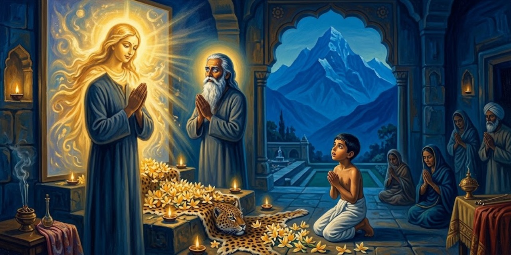</a>

Mukunda visita a Mahasaya, un maestro devoto que dice estar conversando con la Madre Divina. La aparente cercanía de aquel hombre a Dios despierta en el joven una angustia de separación; cae a sus pies y le ruega interceder. Mahasaya acaba prometiéndolo, y Mukunda se marcha esperando una respuesta.

> Al bajar la larga escalera, los recuerdos me abrumaron. Aquella casa del número 50 de Amherst Street, ahora residencia del Maestro Mahasaya, había sido el hogar de mi familia y el escenario de la muerte de mi madre. Allí mi corazón humano se había roto por la madre desaparecida; y allí, ese mismo día, mi espíritu había quedado como crucificado por la ausencia de la Madre Divina. ¡Muros santificados, testigos silenciosos de mis profundas heridas y de mi curación final!
>
> [Párrafo 12](#original-c9-p12)

La misma casa reúne dos pérdidas de naturaleza distinta. La madre biográfica ha muerto; la Madre Divina, nombre que recibe aquí la presencia maternal de Dios, parece inaccesible. La coincidencia del lugar permite a Yogananda enlazar duelo y búsqueda religiosa sin confundir sus objetos. Mahasaya entra en ese espacio como mediador, no como sustituto de la madre.

En el desván de su casa, Mukunda medita hasta la noche. Yogananda cuenta que entonces ve a la Madre Divina y escucha Su promesa de amor permanente. Al amanecer corre a visitar de nuevo a Mahasaya, sin contarle todavía lo sucedido.

> Apenas había alcanzado el sol de la mañana siguiente una altura decorosa cuando hice mi segunda visita al Maestro Mahasaya. Subí la escalera de la casa de los recuerdos dolorosos y llegué a su habitación del cuarto piso. El picaporte de la puerta cerrada estaba envuelto en una tela; una indicación, me pareció, de que el santo deseaba intimidad. Mientras permanecía indeciso en el rellano, la mano acogedora del maestro abrió la puerta. Me arrodillé a sus santos pies. En un ánimo juguetón, puse sobre mi rostro una máscara solemne que ocultaba el júbilo divino.
>
> [Párrafo 17](#original-c9-p17)

El sol todavía no ha alcanzado una hora socialmente aceptable para las visitas: la frase conserva la sonrisa del narrador ante su propia impaciencia. La escena contiene una pequeña prueba. Mukunda sabe lo que cree haber recibido durante la noche, pero oculta su alegría para comprobar si Mahasaya también lo sabe. El detalle doméstico del picaporte hace más cercana esa mezcla de fervor y travesura.

Mukunda pregunta por el mensaje prometido. Según relata, Mahasaya alude espontáneamente a la visión de las diez de la noche anterior; el joven recibe esa coincidencia como confirmación y vuelve a llorar, ahora de alegría. La pregunta por quién es su interlocutor interrumpe la escena para presentar su vida cotidiana.

> ¿Quién era aquel santo sencillo, cuya menor petición al Espíritu Universal encontraba una dulce aquiescencia? Su papel en el mundo era humilde, como correspondía al hombre más humilde que he conocido. En aquella casa de Amherst Street, el Maestro Mahasaya dirigía una pequeña escuela secundaria para muchachos. Ninguna palabra de castigo salía de sus labios; ni el reglamento ni la férula sostenían su disciplina. En aquellas aulas modestas se enseñaban, ciertamente, matemáticas superiores, y una química del amor ausente de los libros de texto. Propagaba su sabiduría por contagio espiritual, más que por preceptos impenetrables. Consumido por una pasión sin artificios por la Madre Divina, el santo no exigía muestras externas de respeto más de lo que las exige un niño.
>
> [Párrafo 25](#original-c9-p25)

La férula es la vara con que se castigaba a los escolares. Su ausencia importa porque esta semblanza propone una autoridad que no se apoya en el miedo. La "química del amor" no nombra una disciplina científica: prolonga la comparación escolar para explicar una enseñanza transmitida por el trato. El pasaje prepara un contraste con la severidad del futuro maestro de Mukunda, sin declarar incompatibles ambos modos de educar.

Mahasaya le advierte que no será su gurú: otro llegará después. Mukunda sigue visitándolo y le ofrece una guirnalda, que aquel acepta como ofrenda a Dios. Juntos van en barca al templo de Dakshineswar, ligado al maestro de Mahasaya, Ramakrishna; allí el joven profundiza su devoción a Dios como Madre.

> "¡Podría servir de modelo terrenal para los mismísimos ángeles del cielo!", pensé con cariño mientras lo observaba un día durante sus oraciones. Sin un soplo de censura ni de crítica, contemplaba el mundo con ojos familiarizados desde hacía mucho con la Pureza Primordial. Su cuerpo, su mente, su habla y sus actos se armonizaban sin esfuerzo con la sencillez de su alma.
>
> [Párrafo 34](#original-c9-p34)

La comparación con los ángeles pertenece a la mirada agradecida del discípulo. No ofrece una clasificación sobrenatural del personaje. Lo que esa mirada admira es la falta de fricción entre gesto, palabra y conducta: una coherencia que no necesita exhibirse como virtud. El cariño del observador es parte de la semblanza, no un obstáculo que el libro intente esconder.

Yogananda atribuye después a Mahasaya intervenciones pequeñas y humorísticas: un hablador inoportuno se marcha, y el maestro conoce su juicio despectivo sobre unos cantores. Otro día unas luces se apagan durante una conferencia tediosa. Al salir, Mahasaya le toca suavemente el pecho; el narrador describe lo que sigue como un prodigio.

> Sobrevino un silencio transformador. Así como las modernas películas "sonoras" se convierten en películas mudas cuando falla el equipo de sonido, la Mano Divina, por algún extraño milagro, acalló el bullicio terrestre. Los peatones, al igual que los tranvías, automóviles, carros de bueyes y coches de alquiler de ruedas de hierro que pasaban, se desplazaban todos sin ruido. Como si poseyera un ojo omnipresente, contemplé las escenas que estaban detrás de mí y a cada lado con la misma facilidad que las de delante. Todo el espectáculo de actividad de aquel pequeño sector de Calcuta transcurrió ante mí sin un sonido. Como el resplandor de un fuego apenas visible bajo una delgada capa de cenizas, una suave luminosidad impregnaba la vista panorámica.
>
> [Párrafo 49](#original-c9-p49)

El cine proporciona un lenguaje para una experiencia que el narrador presenta como milagrosa. Primero se separan sonido e imagen; después se altera la posición del espectador, capaz, según cuenta, de ver sin la orientación habitual de los ojos. La comparación permite imaginar lo narrado, pero no constituye una explicación ni una comprobación de que ocurriera. Su fuerza literaria está en volver extraña una calle reconocible.

Según Yogananda, el segundo toque de Mahasaya devuelve el ruido ordinario. La experiencia acaba, pero permanece la gratitud. El narrador vuelve desde la memoria a la escritura: al intentar hacer justicia a la bondad de aquellos maestros, se pregunta si ellos sabían que un día contaría sus vidas en Occidente. Su respuesta final deja abierta, desde la fe, esa posibilidad de conocimiento anticipado.

---

## Capítulo 10: Encuentro a mi maestro, Sri Yukteswar

Mukunda promete terminar la secundaria, pero falta a clase y medita junto a los lugares de cremación de Calcuta. Lee con desconfianza que la fe no permite aprobar sin estudiar. Ahora los exámenes ponen a prueba su postura.

> La semana de exámenes finales de la Hindu High School se aproximaba rápidamente. Ese período de interrogatorios, como los parajes sepulcrales, inspira un terror bien conocido. Mi mente, sin embargo, estaba en paz. Desafiando a los espectros, estaba desenterrando un conocimiento que no se encuentra en las aulas. Pero carecía del arte de Swami Pranabananda, que aparecía sin dificultad en dos lugares a la vez. Mi dilema educativo era, claramente, asunto para el Ingenio Infinito. Tal era mi razonamiento, aunque a muchos les parezca ilógico. La irracionalidad del devoto nace de mil demostraciones inexplicables de la prontitud de Dios ante las dificultades.
>
> [Párrafo 4](#original-c10-p4)

Yogananda no oculta la fragilidad práctica de su razonamiento. El juego entre desenterrar conocimientos y frecuentar lugares de cremación permite que la ironía conviva con la fe. Pranabananda es el monje a quien el libro atribuyó anteriormente una bilocación, es decir, la presencia simultánea en dos sitios. Esa referencia extraordinaria pertenece al universo testimonial de la autobiografía, no a una capacidad comprobada por esta edición.

Nantu lo prepara con preguntas que aparecerán en los exámenes. Para el sánscrito olvidado encuentra unas hojas y busca ayuda para entenderlas; también le sirven para aprobar. Yogananda interpreta ambas ayudas como providenciales. Después acuerda reunirse con Jitendra en una ermita de Benarés.

> Una mañana me invadió la desolación al pensar en separarme de mi familia. Desde la muerte de mi madre, mi afecto se había vuelto especialmente tierno hacia mis dos hermanos menores, Sananda y Bishnu. Corrí a mi refugio, el pequeño desván que había presenciado tantas escenas de mi turbulenta *sadhana*.
> Después de un torrente de lágrimas de dos horas, me sentí singularmente transformado, como por un purificador alquímico. Todo apego desapareció; mi resolución de buscar a Dios como el Amigo de los amigos quedó asentada dentro de mí como el granito. Terminé rápidamente los preparativos del viaje.
>
> [Párrafo 19](#original-c10-p19)

*Sadhana* designa aquí la práctica o disciplina espiritual del joven. El desapego no aparece como ausencia inicial de afecto, sino como resultado de atravesar una pena intensa. La autobiografía concede a las lágrimas un papel activo: antes de la decisión firme existe una resistencia que se expresa físicamente. El vocabulario de la alquimia presenta la transformación interior, no una operación literal sobre el cuerpo.

Durante la adaptación al nuevo horario, Mukunda intenta dominar el apetito y ayuna veinticuatro horas. Espera con redoblada impaciencia la comida del día siguiente.

> "El tren de Dyanandaji lleva retraso; no vamos a comer hasta que llegue." Jitendra me trajo aquella noticia devastadora. Como gesto de bienvenida al swami, que llevaba dos semanas ausente, había muchos manjares preparados. Un aroma apetitoso llenaba el aire. Como no se ofrecía otra cosa, ¿qué podía tragarse sino el orgullo por la hazaña del ayuno de ayer?
>
> [Párrafo 31](#original-c10-p31)

La espera desmonta la satisfacción de haber vencido al hambre. El verbo "tragarse" desplaza la comida desde la mesa hacia el orgullo, y permite al narrador reírse de su antigua seguridad. La obediencia a un horario común no se parecía a decidir por cuenta propia cuándo empezar y terminar un ayuno.

La cena espera todavía el baño y la meditación de Dyananda. Mukunda come por fin a las nueve y se entera de que el responsable llevaba varios días sin alimento. Entonces pregunta qué ocurriría si nadie le diera comida y él obedeciera la prohibición de pedirla.

> "¡Muere, entonces!" Aquel consejo alarmante rasgó el aire. "¡Muere si es necesario, Mukunda! ¡Nunca admitas que vives por el poder de los alimentos y no por el poder de Dios! ¡Aquel que ha creado toda forma de alimento, Aquel que ha concedido el apetito, se encargará sin duda de que su devoto tenga sustento! ¡No imagines que el arroz te mantiene, o que el dinero o los hombres te sostienen! ¿Podrían ayudarte si el Señor retirara tu aliento vital? No son más que Sus instrumentos indirectos. ¿Es por alguna habilidad tuya por lo que la comida se digiere en tu estómago? ¡Usa la espada de tu discernimiento, Mukunda! ¡Corta las cadenas de los intermediarios y percibe la Causa Única!"
>
> [Párrafo 42](#original-c10-p42)

Habla Dyananda, mediante una provocación que el narrador recibe como enseñanza religiosa. La "Causa Única" es Dios en ese razonamiento: los alimentos y quienes los ofrecen serían medios, no la fuente última de la vida. El pasaje no debe convertirse en una indicación para prescindir de comida ni en consejo de salud. Su asunto es la dependencia espiritual tal como la concibe el personaje, expresada con una dureza que el propio texto llama alarmante.

Yogananda dice recibir la respuesta como una lección sobre la suficiencia de Dios, que recordará después durante sus viajes. La narración vuelve entonces al único objeto valioso que había traído de casa.

> El único tesoro que me había acompañado desde Calcuta era el amuleto de plata del *sadhu* que mi madre me había legado. Lo había custodiado durante años y ahora lo tenía cuidadosamente escondido en mi habitación del ashram. Para renovar mi alegría ante aquel testimonio talismánico, una mañana abrí la caja cerrada con llave. La envoltura sellada estaba intacta y, ¡he aquí que el amuleto había desaparecido! Con tristeza rasgué el sobre y me aseguré sin lugar a dudas. Había desaparecido, de acuerdo con la predicción del *sadhu*, en el éter del que este lo había convocado.
>
> [Párrafo 44](#original-c10-p44)

La caja y la envoltura intacta sostienen el carácter extraordinario que Yogananda atribuye a la desaparición. El *sadhu* es el asceta relacionado con el amuleto que su madre le había dejado. El episodio cierra una protección material de su historia y precede al encuentro con un maestro vivo. Que el objeto procediera del éter y volviera a él es la interpretación religiosa del narrador, no una explicación física verificada.

Las críticas a su dedicación meditativa agravan el descontento de Mukunda. Ora para recibir enseñanza directa o un gurú; cuenta que una voz le anuncia la llegada del maestro ese día. Habu interrumpe la oración y lo llama para un encargo.

> Otro día quizá habría respondido con impaciencia; ahora me enjugué el rostro hinchado por las lágrimas y obedecí dócilmente la llamada. Habu y yo nos dirigimos juntos a un mercado lejano de la zona bengalí de Benarés. El implacable sol de la India aún no había llegado al cenit cuando hicimos nuestras compras en los bazares. Nos abrimos paso entre la colorida mezcla de amas de casa, guías, sacerdotes, viudas vestidas con sencillez, dignos brahmanes y los omnipresentes toros sagrados. Al pasar por una callejuela que no llamaba la atención, volví la cabeza y recorrí con la vista su estrecha extensión.
>
> [Párrafo 52](#original-c10-p52)

La salida no nace de una búsqueda deliberada por las calles: es un encargo ordinario. Ese cambio de escala, desde la oración íntima hasta un mercado concurrido, sostiene la idea narrativa de una respuesta que llega fuera del escenario esperado. Habu es un joven sacerdote de la ermita. Los brahmanes son presentados entre las distintas figuras que el muchacho encuentra en su recorrido; el pasaje los distingue de los sacerdotes ya mencionados.

En una callejuela ve a un monje que le parece familiar, pero sigue andando. Según cuenta, una pesadez en los pies lo obliga a volver. Reconoce en el rostro al de sus visiones y cae a sus pies. El maestro celebra su llegada; Mukunda interpreta el silencio compartido como vínculo anterior a esta vida.

> Con mi mano en la suya, mi gurú me condujo a su residencia temporal en el sector de Rana Mahal de la ciudad. Su figura atlética avanzaba con paso firme. Alto, erguido, de unos cincuenta y cinco años por entonces, se mostraba activo y vigoroso como un joven. Sus ojos oscuros eran grandes, hermosos por una sabiduría insondable. El cabello ligeramente rizado suavizaba un rostro de impresionante fuerza. La fortaleza se mezclaba sutilmente con la dulzura.
>
> [Párrafo 63](#original-c10-p63)

El retrato físico prepara los dos rasgos que la relación desarrollará: firmeza y ternura. La mano enlazada precede al futuro régimen de obediencia, de modo que la autoridad queda introducida por un gesto de acogida. Rana Mahal es el sector de Benarés donde se encuentra la residencia temporal; el propio relato proporciona esa ubicación y no exige imaginar todavía una ermita permanente.

El maestro ofrece sus ermitas y posesiones; Mukunda solo pide sabiduría y contacto con Dios. Al anochecer recibe una promesa de amor incondicional y se compromete a corresponder.

> "El amor ordinario es egoísta, oscuramente arraigado en deseos y satisfacciones. El amor divino no tiene condiciones, ni límites, ni cambios. El vaivén del corazón humano desaparece para siempre ante el contacto penetrante del amor puro." Añadió con humildad: "Si alguna vez me encuentras apartado del estado de realización de Dios, prométeme, por favor, que pondrás mi cabeza en tu regazo y me ayudarás a volver al Amado Cósmico que ambos adoramos".
>
> [Párrafo 72](#original-c10-p72)

El maestro formula una exigencia que también lo incluye. Al pedir ayuda si llegara a desviarse, impide que la promesa sea únicamente unilateral. "Realización de Dios" nombra en el libro una experiencia espiritual directa, distinta de la adhesión a una creencia. La escena funda la obediencia que vendrá en una relación de cuidado, aunque el resto del capítulo mostrará que ambos no entienden aún de la misma manera sus consecuencias.

Durante una comida, Mukunda cree reconocer que su nuevo maestro conoce su vida sin que se la cuente: le habla del amuleto perdido y de su descontento en la ermita. Pero la recomendación siguiente lo contraría: regresar a Calcuta y no excluir a sus familiares del amor a la humanidad.

> Su sugerencia me consternó. Mi familia predecía mi regreso, aunque yo no había atendido muchas súplicas por carta. "Dejemos que el pajarillo vuele por los cielos metafísicos", había comentado Ananta. "Sus alas se cansarán en esa atmósfera pesada. Ya lo veremos lanzarse hacia casa, plegar las plumas y descansar humildemente en nuestro nido familiar." Con aquel símil desalentador aún fresco en la memoria, estaba decidido a no "lanzarme" en dirección a Calcuta.
>
> [Párrafo 79](#original-c10-p79)

Ananta es el hermano mayor de Mukunda. La dificultad no es ahora doctrinal: volver podría parecer una derrota ante quienes habían dudado de la partida. El discípulo que busca liberarse del apego descubre un apego menos visible, el de su imagen de independencia. La metáfora del pájaro hace perceptible esa contradicción sin que el narrador adulto necesite explicarla de forma solemne.

Sri Yukteswar da su nombre y dirección en Serampore. Predice el regreso de Mukunda dentro de cuatro semanas y exige obediencia. El joven, temiendo las burlas familiares, se niega. Se despide con reverencia, pero la tensión del desacuerdo le amarga el encuentro; después vuelve a su alojamiento.

> A la mañana siguiente advertí una hostilidad creciente en la actitud de los miembros de la ermita. Mis días quedaron erizados de invariable descortesía. A las tres semanas, Dyananda dejó el ashram para asistir a una conferencia en Bombay; el caos se abatió sobre mi desdichada cabeza.
>
> [Párrafo 89](#original-c10-p89)

La dificultad cotidiana empuja al joven hacia el regreso que había rechazado. El narrador no especifica en este párrafo cada incidente: el lenguaje concentra el sentimiento de verse perseguido por el trato de los otros. La salida de Dyananda retira además la presencia del responsable que lo había recibido cordialmente.

Mukunda lamenta haber devuelto el dinero de su padre y decide marcharse. Jitendra, que tampoco puede meditar en paz, lo acompaña. El joven propone visitar al maestro encontrado en Benarés. La imagen familiar del pájaro cierra con ironía el episodio: prepara un vuelo que lo acerca de nuevo a Calcuta.

---

## Capítulo 11: Dos muchachos sin un céntimo en Brindaban

Antes de ir a Serampore, Mukunda y Jitendra visitan a Ananta en Agra para conocer el Taj Mahal. El hermano reprocha a Mukunda que desprecie la herencia familiar. El joven replica que busca primero a Dios; el narrador adulto interrumpe la disputa para recordar la muerte posterior de Ananta.

> Mi réplica había nacido de las exigencias del momento y no contenía ningún presentimiento. Sin embargo, las hojas del tiempo se desplegaron hasta un final temprano para Ananta; pocos años después entró en la tierra donde los billetes de banco no sirven ni al principio ni al final.
>
> [Párrafo 6](#original-c11-p6)

La muerte del hermano interrumpe por un instante el tono de comedia. El narrador adulto sabe algo que el joven de la escena ignora y se adelanta para señalarlo, pero niega expresamente haberlo presentido. Ese límite merece conservarse: no toda coincidencia del relato es presentada como profecía. El dinero queda situado frente a una frontera que no puede franquear.

Mukunda explica que ya ha encontrado al maestro que buscaba. Ananta los hospeda, pero al desayuno vuelve a cuestionar su independencia: sin dinero familiar, sostiene, tendrían que mendigar. Mukunda responde que Dios puede ayudar sin recurrir a la limosna y acepta poner esa confianza a prueba.

> "Propongo enviaros esta mañana a ti y a tu condiscípulo Jitendra a la cercana ciudad de Brindaban. No debéis llevar ni una sola rupia; no debéis mendigar ni comida ni dinero; no debéis revelar vuestra situación a nadie; no debéis quedaros sin comer; y no debéis quedaros varados en Brindaban. Si regresáis a mi bungalow antes de las doce de esta noche sin haber quebrantado ninguna regla de la prueba, ¡seré el hombre más asombrado de Agra!"
>
> [Párrafo 22](#original-c11-p22)

Jitendra es el amigo que acompaña a Mukunda desde Benarés. Las reglas excluyen tanto el dinero propio como la ayuda solicitada: solo una asistencia espontánea podrá contar como solución. No es un experimento controlado sobre la existencia de Dios, sino un desafío familiar cuya interpretación religiosa estará en disputa. Brindaban es la ciudad elegida para la prueba; Agra, el lugar al que deben regresar.

> "Acepto el desafío." No hubo vacilación en mis palabras ni en mi corazón. Destellaron recuerdos agradecidos de la Beneficencia Inmediata: mi curación del cólera mortal al recurrir a la imagen de Lahiri Mahasaya; el regalo juguetón de las dos cometas en la azotea de Lahore con Uma; el amuleto oportuno en medio de mi desaliento; el mensaje decisivo transmitido por el desconocido *sadhu* de Benarés fuera del recinto de la casa del erudito; la visión de la Madre Divina y Sus majestuosas palabras de amor; Su rápida atención, por medio del Maestro Mahasaya, a mis pequeños apuros; la guía de última hora que hizo realidad mi diploma de secundaria; y el don supremo, mi Maestro vivo, surgido de la niebla de los sueños de toda una vida. ¡Jamás podría admitir que mi "filosofía" no estuviera a la altura de cualquier combate en el áspero terreno de pruebas del mundo!
>
> [Párrafo 23](#original-c11-p23)

La enumeración convierte los capítulos anteriores en antecedentes de confianza. Lahiri Mahasaya es el maestro venerado por la familia; Uma, la hermana que compartió el episodio de las cometas; un *sadhu* es un asceta o renunciante, aquí el mensajero de Benarés. Cada suceso está reunido bajo la lectura providencial de Yogananda. La acumulación explica su certeza personal, sin transformar esa certeza en demostración independiente de los prodigios recordados.

Ananta acepta actuar como organizador de la prueba y exige que Jitendra acompañe a Mukunda como testigo, aunque pueda terminar compartiendo sus dificultades. Los conduce de inmediato a la estación.

> Media hora después, Jitendra y yo teníamos en nuestro poder billetes de ida para aquel viaje improvisado. En un rincón apartado de la estación nos sometimos a un registro. Ananta quedó pronto satisfecho de que no llevábamos ningún tesoro escondido; nuestros sencillos *dhotis*
> no ocultaban más de lo necesario.
>
> [Párrafo 25](#original-c11-p25)

Los *dhotis* son prendas de tela que envuelven la cintura y las piernas; el registro vuelve literal su falta de recursos. La broma final preserva la ligereza de una escena que, desde la perspectiva de Jitendra, resulta inquietante. Que los billetes sean solo de ida importa: el regreso también deberá resolverse dentro de las condiciones del desafío, no está pagado de antemano.

Jitendra pide unas rupias para emergencias, pero Mukunda se niega a partir con esa reserva. Ananta promete iniciarse como discípulo si superan la prueba. En el tren, dos desconocidos insisten en ayudarlos y los llevan a una ermita: dos benefactores habían cancelado una visita, y Gauri Ma dispone para ellos la comida preparada.

> Se anunció el almuerzo; Gauri Ma nos condujo a un patio comedor, perfumado de aromas sabrosos. Desapareció en una cocina contigua.
>
> [Párrafo 47](#original-c11-p47)

Gauri Ma es la anfitriona de la ermita. Había preparado comida para dos benefactores que cancelaron la visita; los recién llegados ocupan esos lugares vacantes. Ese dato del episodio evita que la mesa parezca surgir sin causa humana. La interpretación providencial del narrador opera a través de una cadena de hospitalidad y cambios de planes, no mediante la aparición inexplicada de alimentos.

Mientras Gauri Ma entra en la cocina, Mukunda devuelve a Jitendra el pellizco del tren y se burla de su desconfianza.

> La anfitriona regresó con un *punkha*. Nos abanicó sin descanso a la manera oriental mientras estábamos sentados en cuclillas sobre mantas ornamentadas. Los discípulos de la ermita iban y venían con unos treinta platos. Más que "comida", aquello solo podía describirse como un "banquete suntuoso". Desde nuestra llegada a este planeta, Jitendra y yo jamás habíamos probado semejantes manjares.
>
> [Párrafo 50](#original-c11-p50)

El *punkha* es el abanico que utiliza la anfitriona. La abundancia convierte la amenaza de hambre en exceso festivo y permite que el relato se ría de los temores previos. La fórmula "desde nuestra llegada a este planeta" engrandece de forma deliberadamente cómica el recuerdo. El bienestar no elimina aún las dudas de Jitendra: faltan el recorrido de la ciudad y los medios del regreso.

Después del banquete agradecen la hospitalidad sin revelar el desafío. Al salir, Jitendra vuelve a inquietarse por el recorrido y el regreso. Un joven se acerca y ofrece guiarlos; ante el rechazo inicial de Mukunda, afirma que Krishna le ha mostrado en una visión a su maestro bajo aquel árbol.

> Acepté de buen grado. El joven, que dijo llamarse Pratap Chatterji, llamó a un coche de caballos. Visitamos el templo de Madanamohana y otros santuarios de Krishna. Cayó la noche mientras cumplíamos nuestras devociones en los templos.
>
> [Párrafo 68](#original-c11-p68)

Krishna es la figura divina a la que se dirige la devoción de Pratap y de esos santuarios. Según cuenta Yogananda, el joven asegura haber reconocido a Mukunda por una visión durante su oración. Esa es la explicación que el personaje ofrece para su iniciativa, no un hecho verificado fuera del relato. Madanamohana queda identificado aquí como uno de los templos visitados, sin añadir una historia del edificio que la escena no necesita.

Junto a la estación, Pratap compra dulces y les entrega dinero y billetes a Agra. Mukunda acepta la ayuda como don providencial. Antes de despedirse lo lleva a un sitio apartado y le enseña la práctica de Kriya transmitida por Lahiri Mahasaya.

> La iniciación concluyó en media hora. "*Kriya* es tu *chintamani*",
> le dije al nuevo estudiante. "La técnica, que como ves es sencilla, encarna el arte de acelerar la evolución espiritual del ser humano. Las escrituras hindúes enseñan que el ego que se encarna necesita un millón de años para obtener la liberación de *maya*. Ese período natural se acorta enormemente mediante el *Kriya* Yoga. Así como Jagadis Chandra Bose ha demostrado que el crecimiento de las plantas puede acelerarse mucho más allá de su ritmo normal, también el desarrollo psicológico humano puede acelerarse mediante una ciencia interior. Sé fiel a tu práctica; te acercarás al Gurú de todos los gurús."
>
> [Párrafo 74](#original-c11-p74)

*Kriya Yoga* es la disciplina espiritual que Mukunda transmite y atribuye al linaje de Lahiri Mahasaya; *maya* nombra la ilusión de la que pretende liberar. *Chintamani*, en el léxico sánscrito, es una joya fabulosa que satisface deseos. La comparación convierte la práctica en un tesoro que debe ejercitarse, no solo poseerse. Bose aparece como investigador de las plantas invocado por el narrador: su mención funciona como analogía, no como prueba de la equivalencia entre crecimiento vegetal y liberación espiritual. El millón de años pertenece a la enseñanza religiosa citada.

En el tren, Jitendra lamenta su desconfianza. Regresan antes de medianoche y ponen las rupias ante Ananta, que escucha la historia y pide recibir la iniciación prometida. A la mañana siguiente, reconciliados, Mukunda propone cumplir por fin la visita al monumento que había atraído a Jitendra a Agra.

> Tras despedirnos de Ananta, mi amigo y yo nos encontramos pronto ante la gloria de Agra, el Taj Mahal. Con su mármol blanco deslumbrante al sol, se alza como una visión de simetría pura. El marco perfecto lo forman los cipreses oscuros, el césped lustroso y el estanque tranquilo. El interior es exquisito, con tallas semejantes a encajes e incrustaciones de piedras semipreciosas. Delicadas guirnaldas y volutas emergen intrincadas de mármoles pardos y violetas. La luz de la cúpula cae sobre los cenotafios del emperador Shah-Jahan y de Mumtaz Mahall, reina de su imperio y de su corazón.
>
> [Párrafo 85](#original-c11-p85)

El Taj Mahal es el monumento que motiva la parada turística de los jóvenes en Agra. Un cenotafio es un monumento funerario conmemorativo de alguien cuyos restos están en otro lugar. El párrafo desplaza por un momento la atención desde la prueba religiosa hacia el placer de mirar. La simetría arquitectónica ofrece un descanso después de las vacilaciones y encuentros de la jornada anterior.

Después de la visita, ambos parten hacia Bengala. Jitendra cambia de plan y se queda en Calcuta para ver a su familia; Mukunda continúa solo en un tren local hasta Serampore. Allí vuelve a recordar el plazo que Sri Yukteswar había fijado.

> Un estremecimiento de asombro me recorrió al comprender que habían transcurrido veintiocho días desde el encuentro de Benarés con mi gurú. "¡Vendrás a mí dentro de cuatro semanas!" Allí estaba yo, con el corazón palpitante, de pie en su patio de la tranquila Rai Ghat Lane. Entré por primera vez en la ermita donde habría de pasar la mayor parte de los diez años siguientes con el *Jyanavatar* de la India, "encarnación de la sabiduría".
>
> [Párrafo 89](#original-c11-p89)

El cálculo de los veintiocho días cierra la promesa del capítulo anterior: el regreso que Mukunda negaba ha sucedido, aunque a través de un rodeo. *Jyanavatar* es el título reverencial que el narrador aplica a Sri Yukteswar y que traduce inmediatamente. El anuncio de los diez años cambia la escala del libro: la búsqueda por episodios cede espacio a una formación sostenida.

---

## Capítulo 12: Años en la ermita de mi maestro

En Serampore, Sri Yukteswar recuerda a Mukunda su desobediencia. El joven acepta seguir sus indicaciones; la primera es regresar a casa y matricularse en la universidad. El maestro vincula esos estudios con una futura enseñanza en Occidente. Mukunda accede, pero exige a cambio que le revele a Dios.

> Siguió una discusión de una hora. La palabra de un maestro no puede resultar falsa; no se da a la ligera. Las implicaciones de la promesa abren vastos panoramas metafísicos. ¡Un gurú debe mantener una relación verdaderamente íntima con el Creador antes de poder comprometerlo a aparecer! Yo percibía la unión divina de Sri Yukteswar y estaba decidido, como discípulo suyo, a aprovechar mi ventaja.
>
> [Párrafo 15](#original-c12-p15)

La petición de Mukunda es que su maestro le revele a Dios. Yogananda describe el compromiso desde la confianza devocional en la palabra del gurú, no desde un contrato que el lector deba aceptar como garantía objetiva. El tono de negociación conserva la personalidad impetuosa del joven: incluso la entrega quiere una seguridad. Sri Yukteswar terminará haciendo suyo ese deseo.

Sri Yukteswar termina por aceptar el deseo de su discípulo. Durante la visita a la casa, Mukunda reconoce en la pared el retrato de Lahiri Mahasaya y descubre que fue también el maestro de su nuevo gurú.

> Guiado por mi gurú, recorrí la casa y sus terrenos. Grande, antigua y bien construida, la ermita estaba rodeada por un patio de columnas macizas. El musgo cubría los muros exteriores; las palomas revoloteaban sobre la azotea gris y compartían sin ceremonias las dependencias del ashram. Un jardín trasero resultaba agradable con sus árboles de yaca, mango y plátano. Los balcones con balaustradas de las habitaciones superiores del edificio de dos plantas daban al patio por tres lados. Un espacioso salón de la planta baja, de techo alto sostenido por columnatas, se utilizaba, dijo el Maestro, principalmente durante las festividades anuales de *Durgapuja*. Una escalera estrecha conducía a la sala de Sri Yukteswar, cuyo pequeño balcón miraba a la calle. El ashram estaba amueblado con sencillez; todo era simple, limpio y útil. Se veían varias sillas, bancos y mesas de estilo occidental.
>
> [Párrafo 23](#original-c12-p23)

*Ashram* es la comunidad o residencia de aprendizaje espiritual que el texto llama también ermita. *Durgapuja* designa la celebración dedicada a la diosa Durga. El inventario combina recogimiento y uso colectivo: hay jardín, dormitorios y un espacio para recibir multitudes. Las sillas occidentales no desentonan en una casa cuya sencillez se mide por la utilidad y no por una pureza decorativa.

Dos jóvenes discípulos sirven la cena y Mukunda se queda a dormir. Sentado junto a Sri Yukteswar, aprovecha la intimidad de la noche para preguntarle por su historia.

> "Mi nombre de familia era Priya Nath Karar. Nací aquí, en Serampore, donde mi padre era un rico hombre de negocios. Me dejó esta mansión ancestral, ahora mi ermita. Mi educación formal fue escasa; me parecía lenta y superficial. En los primeros años de mi edad adulta asumí las responsabilidades de un padre de familia, y tengo una hija, actualmente casada. Mi madurez fue bendecida con la guía de Lahiri Mahasaya. Después de morir mi esposa, ingresé en la Orden de los Swamis y recibí el nuevo nombre de Sri Yukteswar Giri. Tales son mis sencillos anales."
>
> [Párrafo 26](#original-c12-p26)

La biografía deshace la imagen de un maestro apartado desde siempre de la vida doméstica. Ha sido esposo, padre y propietario antes de ser monje. Lahiri Mahasaya, su guía espiritual, enlaza esta historia con la devoción de la familia de Mukunda. El cambio de nombre señala el ingreso en la vida monástica; no supone que la casa deje de funcionar como base material de su enseñanza.

El maestro añade tres recuerdos infantiles sobre miedo, apego y sugestión. A la mañana siguiente inicia a Mukunda en Kriya; Yogananda describe una intensa experiencia luminosa. El joven vuelve a casa, encuentra a su padre satisfecho y se matricula en la universidad, aunque pasa mucho tiempo en la ermita. Allí conoce una rutina de meditación al amanecer, paseo, baño y comida.

> El Maestro comía poco; a menudo arroz, teñido con cúrcuma o jugo de remolacha o espinaca y ligeramente rociado con ghee de búfala o mantequilla derretida. Otro día podía tomar *dhal* de lentejas o curry de *channa*
> con verduras. De postre, mangos o naranjas con arroz con leche, o jugo de yaca.
>
> [Párrafo 42](#original-c12-p42)

El inventario devuelve el aprendizaje al cuerpo y a la cocina. El ghee es mantequilla clarificada; *dhal* es aquí la preparación de lentejas. En este punto no se prescribe una dieta universal. El contexto inmediato dice que el maestro aconsejaba una alimentación sencilla adecuada a la constitución de cada estudiante: la regularidad importa más que la imitación exacta del menú.

Por las tardes llegan visitantes. Yogananda describe una cortesía que no depende de riqueza o instrucción: Sri Yukteswar escucha al niño que dice algo verdadero y desatiende al erudito presumido. La misma acogida continúa cuando se acerca la cena.

> Las ocho eran la hora de cenar, y a veces todavía había invitados. Mi gurú no se excusaba para comer a solas; nadie salía de su ashram hambriento o descontento. Sri Yukteswar nunca se quedaba sin recursos ni se inquietaba ante los visitantes inesperados; bajo su ingeniosa dirección, la comida escasa se convertía en banquete. Sin embargo, era económico; sus modestos fondos rendían mucho. "Vivid cómodamente dentro de lo que permite vuestra bolsa", decía a menudo. "La extravagancia os comprará incomodidad." Ya fuera en los detalles de la hospitalidad de la ermita, en sus obras de construcción y reparación o en otros asuntos prácticos, el Maestro manifestaba la originalidad de un espíritu creador.
>
> [Párrafo 45](#original-c12-p45)

La abundancia de esta escena procede de la organización y el ingenio, no necesita leerse como multiplicación milagrosa de alimentos. La frase sobre la bolsa enlaza economía y serenidad: gastar por encima de los medios introduce dependencia y preocupación. El retrato insiste en una espiritualidad capaz de resolver problemas domésticos, no dispensada de atenderlos.

Entre conversaciones y paseos, Mukunda sufre las picaduras nocturnas y consigue mosquiteras. Una noche sin ellas, teme que el maestro haya muerto al no percibir su respiración; Sri Yukteswar despierta riendo y le pide cambiar su preocupación por los insectos. Yogananda interpreta después la ausencia de picaduras como una enseñanza de concentración.

> Los instructivos mosquitos sirvieron para otra lección temprana en el ashram. Era la apacible hora del crepúsculo. Mi gurú interpretaba incomparablemente los textos antiguos. A sus pies, yo estaba en perfecta paz. Un mosquito grosero entró en el idilio y compitió por mi atención. Cuando clavó una aguja hipodérmica venenosa en mi muslo, levanté automáticamente una mano vengadora. ¡Indulto de la ejecución inminente! Me vino un recuerdo oportuno de uno de los aforismos de yoga de Patanjali: el de ahimsa (no causar daño).
>
> [Párrafo 59](#original-c12-p59)

La paz de la escena se interrumpe primero en el cuerpo y después en la intención. Patanjali es el autor de los aforismos de yoga invocados por Mukunda; *ahimsa* recibe aquí su definición de no causar daño. Recordar la norma detiene la mano, pero no ha eliminado todavía la hostilidad: esa diferencia será el punto de la conversación siguiente.

Sri Yukteswar señala que contener la mano no elimina el deseo de matar. Explica la no hostilidad sin negar la defensa de la vida humana; Mukunda se tranquiliza. El narrador añade entonces el testimonio de Prafulla sobre una cobra que se acercó al maestro en Puri.

> "Estábamos sentados al aire libre cerca del ashram", me contó Prafulla. "Apareció una cobra cerca de nosotros, cuatro pies de puro terror. Su capucha estaba expandida con furia mientras se precipitaba hacia nosotros. Mi gurú soltó una risita de bienvenida, como ante un niño. Yo estaba fuera de mí de consternación al ver que el Maestro se ponía a aplaudir rítmicamente. ¡Estaba entreteniendo a la temible visitante! Permanecí absolutamente quieto, exclamando por dentro cuantas oraciones fervientes pude reunir. La serpiente, ya muy cerca de mi gurú, estaba inmóvil, como magnetizada por su actitud afectuosa. La espantosa capucha se contrajo poco a poco; la serpiente se deslizó entre los pies del Maestro y desapareció entre los arbustos.
>
> [Párrafo 69](#original-c12-p69)

Prafulla es el discípulo que cuenta a Yogananda este encuentro ocurrido en Puri, donde el maestro tiene otra ermita. La cadena testimonial es doble: el lector recibe lo que el autor dice haber oído, no una observación directa suya. "Como magnetizada" expresa la impresión del testigo. La escena presenta un ideal de ausencia de hostilidad; no proporciona una técnica segura para acercarse a una serpiente.

Sri Yukteswar nota la delgadez de Mukunda, que desde niño sufre molestias digestivas y ha probado tónicos sin éxito. Le pide confiar en la fuerza vital y le promete salud. Yogananda cuenta que esas palabras le inspiran una convicción distinta de las que había recibido de otros curadores.

> Día tras día, ¡he aquí que engordaba! Dos semanas después de la bendición oculta del Maestro, había acumulado el peso revitalizador que antes se me había escapado. Mis persistentes dolencias de estómago desaparecieron para toda la vida. En ocasiones posteriores presencié las curaciones divinas instantáneas que mi gurú realizaba en personas que padecían enfermedades amenazadoras: tuberculosis, diabetes, epilepsia o parálisis. Ninguna pudo haber estado más agradecida por su curación de lo que yo lo estaba por verme de pronto libre de mi aspecto cadavérico.
>
> [Párrafo 76](#original-c12-p76)

Se conserva íntegro el testimonio de Yogananda y su atribución religiosa de la recuperación. La autobiografía no aporta en este párrafo historiales clínicos que permitan comprobar las curaciones enumeradas. La gratitud explica cómo interpreta el autor su experiencia; no autoriza a prometer esos resultados ni a reemplazar tratamientos médicos por una bendición. La lista amplía su caso personal hacia una convicción general sobre el maestro.

Sri Yukteswar cuenta que, después de una enfermedad, acudió a Lahiri Mahasaya. Un día mejoró al recibir palabras de ánimo; al siguiente volvió a sentirse débil después de escuchar una observación inquietante. Cuando protesta por lo que considera burlas, recibe una explicación sobre sus expectativas.

> "'En realidad, han sido tus pensamientos los que te han hecho sentir alternativamente débil y fuerte.' Mi maestro me miró con afecto. 'Has visto cómo tu salud ha seguido exactamente tus expectativas. El pensamiento es una fuerza, igual que la electricidad o la gravitación. La mente humana es una chispa de la conciencia todopoderosa de Dios. Podría mostrarte que cualquier cosa en la que tu mente poderosa crea con mucha intensidad se realizaría al instante.'
>
> [Párrafo 90](#original-c12-p90)

Habla Lahiri Mahasaya dentro del recuerdo que Sri Yukteswar transmite a Mukunda. La comparación con la electricidad y la gravedad presta un lenguaje de fuerza a una enseñanza metafísica; no demuestra que la expectativa pueda producir cualquier cambio corporal. Tampoco convierte la enfermedad en culpa del enfermo. El pasaje describe la interpretación de estos personajes sobre el poder mental, no una ley clínica establecida.

Según el recuerdo de Sri Yukteswar, la enseñanza termina en un aumento extraordinario de peso que asombra a su familia; él lo atribuye a las leyes espirituales que cree conocer su gurú. La narración vuelve después a Mukunda: durante una explicación, el maestro advierte su distracción y enumera tres edificios que el joven imaginaba. Le pide concentrarse ahora en el estudio.

> Así, incidentalmente, mi gurú reveló con su manera sencilla la llegada de tres grandes acontecimientos de mi vida. Desde la primera juventud había tenido vislumbres enigmáticos de tres edificios, cada uno en un entorno distinto. En la secuencia exacta que Sri Yukteswar había indicado, aquellas visiones terminaron por tomar forma. Primero fundé una escuela de yoga para muchachos en una llanura de Ranchi; después, mi sede estadounidense en una colina de Los Ángeles; finalmente, una ermita en el sur de California, junto al vasto Pacífico.
>
> [Párrafo 107](#original-c12-p107)

Ranchi, Los Ángeles y la costa californiana son los tres escenarios que el narrador vincula retrospectivamente con sus visiones. El orden convierte una distracción durante la enseñanza en anticipo de una misión futura. La correspondencia profética pertenece a la lectura autobiográfica de Yogananda; el párrafo no ofrece una predicción escrita y fechada que permita comprobarla por separado.

Yogananda destaca que el maestro evita formular profecías de manera solemne y que admira la eficacia práctica. Según su explicación, no realiza prodigios para exhibirse ni invade la libertad ajena. Su reserva y sencillez hacen que muchos no adviertan la grandeza espiritual que el discípulo le atribuye.

> Debido al aspecto nada espectacular de mi gurú, solo unos pocos contemporáneos lo reconocieron como un superhombre. El dicho popular "Es un necio quien no sabe ocultar su sabiduría" nunca podía aplicarse a Sri Yukteswar. Aunque había nacido mortal como todos los demás, el Maestro había alcanzado la identidad con el Señor del tiempo y del espacio. En su vida percibía yo una unidad semejante a la divina. No había encontrado ningún obstáculo insuperable para la fusión de lo humano con lo Divino. Llegué a comprender que no existe tal barrera, salvo la falta de audacia espiritual del ser humano.
>
> [Párrafo 113](#original-c12-p113)

La grandeza descrita no se reconoce por un espectáculo visible. Yogananda toma la modestia externa como signo compatible con una realización interior absoluta. "Superhombre" recibe aquí su sentido del marco devocional del pasaje, no de una clasificación biológica ni de una teoría política. La última frase desplaza el obstáculo desde una distancia entre naturalezas hacia una limitación de la búsqueda humana.

El contacto con el maestro produce, según Yogananda, calma y alegría. Sri Yukteswar anima a los alumnos a no quedar atrapados en la vergüenza del pasado y a practicar Kriya. Acepta niños y jóvenes para una formación espiritual e intelectual; todos atienden a la llamada de sus manos y respetan también su silencio.

> El Maestro rara vez pedía a otros que le prestaran un servicio personal, ni aceptaba ayuda de un estudiante a menos que su disposición fuera sincera. Mi gurú lavaba tranquilamente su ropa si los discípulos descuidaban aquella tarea privilegiada. Sri Yukteswar vestía la túnica tradicional de color ocre de los swamis; sus zapatos sin cordones, según la costumbre de los yoguis, eran de piel de tigre o de ciervo.
>
> [Párrafo 120](#original-c12-p120)

El servicio pierde su sentido si solo nace de la presión de una jerarquía. El detalle de lavar su propia ropa permite distinguir una formación exigente de la dependencia del maestro respecto del trabajo ajeno. La sencillez del vestido no implica que el narrador oculte sus materiales: la descripción conserva tanto el ocre de la renuncia como las pieles de sus zapatos.

El maestro enseña lenguas y cuida el cuerpo sin extremos; permite consultar médicos. Recomienda combinar virtudes prácticas de Occidente e ideales religiosos de Oriente. Su disciplina examina también la conducta cotidiana, con una precisión que sorprende a Mukunda.

> "Los buenos modales sin sinceridad son como una hermosa mujer muerta", observó en una ocasión apropiada. "La franqueza sin cortesía es como el cuchillo de un cirujano: eficaz, pero desagradable. La sinceridad con cortesía es útil y admirable."
>
> [Párrafo 128](#original-c12-p128)

Las dos imágenes rechazan dos falsas alternativas: una forma vacía y una verdad usada sin cuidado. La comparación del bisturí concede eficacia a la franqueza, pero no la convierte por ello en trato deseable. La cortesía que defiende el maestro no exige esconder lo que se piensa; exige que la intención de ayudar alcance también la manera de decirlo.

Mukunda recibe reproches por distracción, tristeza cultivada y descuido de tareas. El maestro le exige servir mientras viva en el mundo y no usar la espiritualidad como exención. El joven acepta correcciones públicas y privadas, aunque le duelen; Sri Yukteswar le recuerda que puede marcharse si no encuentra beneficio.

> Por cada golpe humillante que asestó a mi vanidad, por cada diente de mi mandíbula metafórica que aflojó con puntería fulminante, siento una gratitud que supera toda capacidad de expresión. El núcleo duro del egotismo humano difícilmente se desaloja sin rudeza. Con su partida, lo Divino encuentra por fin un cauce sin obstrucciones. En vano intenta filtrarse a través de los corazones pedregosos del egoísmo.
>
> [Párrafo 135](#original-c12-p135)

La mandíbula es expresamente metafórica: el autor está hablando de reprensiones, no describiendo golpes físicos. Su gratitud retrospectiva no establece que la humillación sea un método universalmente beneficioso. El contexto conserva un límite: Sri Yukteswar le había dicho que podía marcharse y quedarse solo si encontraba provecho. Leer esa condición evita separar la severidad de la relación concreta en que el narrador dice haberla consentido.

Yogananda admite que la franqueza alejaba a muchos alumnos. Sri Yukteswar reconoce su severidad y predice que Mukunda enseñará con mayor dulzura. Cuando el joven protesta por unos reproches ante su padre, el maestro se disculpa. Otros discípulos imitan la crítica pero rehúyen recibirla. El narrador precisa que el maestro corregía a quienes lo habían pedido y callaba si protestaban.

> Cuando abandoné el resentimiento subyacente, descubrí una marcada disminución de mis reprimendas. De una manera muy sutil, el Maestro se ablandó hasta una clemencia relativa. Con el tiempo derribé todos los muros de racionalización y reserva subconsciente tras los cuales suele protegerse la personalidad humana. La recompensa fue una armonía sin esfuerzo con mi gurú. Entonces lo descubrí confiado, considerado y silenciosamente amoroso. Poco demostrativo, sin embargo, no me concedía ninguna palabra de afecto.
>
> [Párrafo 153](#original-c12-p153)

El narrador sitúa el cambio en su propia disposición, pero registra también una variación del maestro. Esa reciprocidad hace más compleja la escena que una simple victoria del instructor sobre el alumno. El episodio anterior incluye una ocasión en que Sri Yukteswar reconoce una falta y promete no repetirla: la capacidad de rectificar pertenece también al retrato de su autoridad.

Durante unas vacaciones, Mukunda asume la organización de la ermita. Sri Yukteswar se la confía después al nuevo discípulo Kumar, que intenta imponerse; los compañeros siguen consultando a Mukunda. El maestro devuelve a Kumar a tareas de cocina para enseñarle que dirigir es servir, aunque conserva por él un cariño especial. Un conflicto posterior deja entrever su posible partida.

> Un año después, Kumar partió de visita a la casa de su infancia. Ignoró la desaprobación silenciosa de Sri Yukteswar, que nunca controlaba de manera autoritaria los movimientos de sus discípulos. Cuando el muchacho regresó a Serampore unos meses más tarde, el cambio era desagradablemente evidente. Había desaparecido el digno Kumar de rostro serenamente luminoso. Ante nosotros solo había un campesino sin distinción, alguien que había adquirido recientemente varios malos hábitos.
>
> [Párrafo 168](#original-c12-p168)

Kumar había recibido responsabilidades en la ermita y una indulgencia que sorprendía a los demás. El lenguaje con que el narrador describe su regreso es valorativo: la pérdida espiritual se hace visible para él como pérdida de porte y luminosidad. "Campesino sin distinción" expresa ese juicio y sus jerarquías, no una medida objetiva del valor de alguien por su origen social. La libertad de marcharse no evita, en el relato, las consecuencias de la elección.

El regreso de Kumar preocupa al maestro, que juzga incompatibles sus nuevos hábitos con la vida monástica. Con lágrimas en los ojos, encarga a Mukunda comunicarle que debe irse: no puede hacerlo él mismo. El discípulo no vive la expulsión como triunfo sobre su antiguo rival.

> La partida de Kumar no me produjo alegría; me pregunté con tristeza cómo alguien capaz de conquistar el amor de un maestro podía responder a seducciones más baratas. El disfrute del vino y del sexo está arraigado en el hombre natural y no requiere finuras de percepción para apreciarlo. Las astucias de los sentidos son comparables a la adelfa de hoja perenne, fragante con sus flores multicolores: todas las partes de la planta son venenosas. La tierra de la curación se encuentra dentro, radiante con esa felicidad que se busca a ciegas en mil direcciones equivocadas.
>
> [Párrafo 171](#original-c12-p171)

El episodio se interpreta desde un ideal monástico de dominio de los sentidos. La adelfa vuelve visible la diferencia entre atractivo y beneficio dentro de ese argumento. El pasaje no es una descripción neutral de toda sexualidad, sino la valoración ascética de Yogananda sobre el camino que cree perdido por Kumar. Tampoco ofrece satisfacción vengativa: la primera frase obliga a leer la partida como fracaso doloroso.

Sri Yukteswar advierte que la inteligencia puede servir para construir o destruir. Trata por igual a hombres y mujeres, y atribuye la tentación al dominio incompleto de sí, no al otro sexo. Mantiene respeto por su madre incluso cuando ella rechaza su consejo; al morir, organiza sus funerales pese a la norma monástica. Yogananda interpreta esa conducta como fidelidad al principio por encima de la forma.

> Fuera de las escrituras, rara vez honraba Sri Yukteswar un libro con su lectura. Sin embargo, estaba invariablemente al corriente de los últimos descubrimientos científicos y de otros avances del conocimiento. Conversador brillante, disfrutaba intercambiando opiniones sobre innumerables asuntos con sus invitados. El ingenio rápido de mi gurú y su risa jovial animaban cada discusión. A menudo serio, el Maestro nunca estaba sombrío. "Para buscar al Señor no hace falta desfigurarse el rostro", comentaba. "Recordad que encontrar a Dios significará el funeral de todas las penas."
>
> [Párrafo 188](#original-c12-p188)

La seriedad y el abatimiento quedan separados. El retrato no exige que la vida religiosa adopte una apariencia de sufrimiento para resultar auténtica. La risa tiene aquí una función de conocimiento y de trato: permite discutir, corregir y convivir. La afirmación sobre su información científica es la admiración del discípulo; el párrafo no identifica qué descubrimientos discutieron ni permite evaluar por sí solo su dominio de cada materia.

Entre visitantes que esperan lugares comunes piadosos, Yogananda describe a varios sorprendidos por la precisión del maestro. Un químico le niega la existencia de Dios porque la ciencia no ha encontrado un medio de detectarlo. Sri Yukteswar le devuelve la objeción en forma de experimento interior.

> "¡Así que inexplicablemente no ha logrado aislar el Poder Supremo en sus tubos de ensayo!" La mirada del Maestro era severa. "Le recomiendo un experimento inaudito. Examine sus pensamientos sin interrupción durante veinticuatro horas. Después no se asombre más de la ausencia de Dios."
>
> [Párrafo 192](#original-c12-p192)

La réplica cambia el lugar de la observación: del laboratorio a la propia conciencia. Puede leerse como una invitación a examinar la atención y sus obstáculos; no demuestra por sí sola la existencia de Dios ni invalida el método experimental. La ironía del maestro señala que los interlocutores no están usando el mismo criterio para reconocer lo que buscan.

Un erudito recita escrituras, pero admite no haberlas realizado interiormente cuando se le pide hablar desde su vida. Sri Yukteswar critica ese saber separado de la conducta. Recuerda cómo Dabru Ballav hacía meditar durante horas sobre un pasaje; él mismo había reconocido ante ese instructor que leer no equivalía a comprender. Aplica después la misma exigencia a sus alumnos.

> "Los *rishis* escribieron en una frase profundidades sobre las que los comentaristas eruditos se afanan durante generaciones", observó. "La controversia literaria interminable es para mentes perezosas. ¿Qué pensamiento más liberador que 'Dios es'; más aún, 'Dios'?"
>
> [Párrafo 210](#original-c12-p210)

Los *rishis* son los sabios a quienes el pasaje atribuye las enseñanzas antiguas. La reducción de una oración a una sola palabra representa el movimiento hacia la simplicidad que el maestro pide: menos explicación acumulada, mayor intensidad de atención. No es una refutación argumentada del comentario erudito. Es una provocación dirigida a quien usa la discusión para aplazar la práctica.

Un erudito magistrado acaba pidiendo formación después de que el maestro cuestione su orgullo académico. Sri Yukteswar defiende además su patrimonio mediante pleitos para no depender de sus alumnos. Cuando un funcionario insolente entrega una citación, lo protege de los discípulos irritados: solo cumple su deber. Escucha incluso las críticas para buscar lo verdadero en ellas y conserva la calma.

> A menudo pensaba que mi majestuoso Maestro podría haber sido fácilmente un emperador o un guerrero capaz de sacudir el mundo si su mente se hubiera centrado en la fama o en las realizaciones mundanas. En lugar de eso había elegido asaltar aquellas ciudadelas interiores de ira y egotismo cuya caída constituye la grandeza de un hombre.
>
> [Párrafo 229](#original-c12-p229)

El vocabulario bélico cierra el retrato cambiando el objeto de la conquista. No se niegan energía ni capacidad de mando: se admira que no se gasten en dominio externo. La imagen reúne los dos rasgos que los episodios anteriores mantenían juntos, firmeza para defender principios y control de la reacción ante una ofensa.

---

## Capítulo 13: El santo que no dormía

<a href="img/261017_autobiografia-de-un-yogui_i-13.jpg">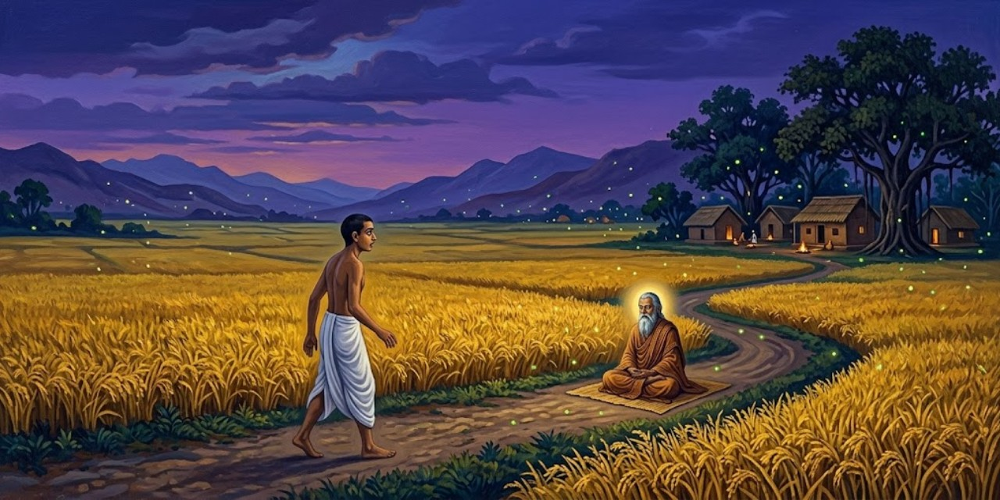</a>

A los seis meses, Mukunda se impacienta con estudios y tareas. Pide ir al Himalaya a buscar a Dios sin interrupciones. Sri Yukteswar responde que una montaña no sustituye a un maestro. Ante la insistencia calla; el joven interpreta ese silencio como permiso.

> Aquella noche, en mi casa de Calcuta, me ocupé de los preparativos del viaje. Mientras ataba unos pocos objetos dentro de una manta, recordé un bulto parecido que años antes había dejado caer a escondidas desde la ventana de mi desván. Me pregunté si aquella sería otra huida malhadada hacia los Himalayas. La primera vez mi exaltación espiritual había sido grande; esa noche la conciencia me golpeaba con fuerza al pensar en abandonar a mi gurú.
>
> [Párrafo 5](#original-c13-p5)

El viaje repite una forma exterior, pero ya no la misma inocencia. El joven conoce ahora al maestro que buscaba y debe preguntarse de qué está huyendo. El contexto hace explícita una distinción importante: no recibió un sí, sino que convirtió una falta de respuesta en autorización. Su deseo organiza la lectura de ese silencio.

El profesor Behari le da la dirección de Ram Gopal, discípulo de Lahiri Mahasaya. Mukunda viaja a Tarakeswar, entra en el templo pero se niega a postrarse ante su piedra simbólica. Luego toma un camino equivocado al buscar Ranbajpur; ya de noche, un aldeano desconfiado termina por darle alojamiento e indicarle el error.

> Mi informante anterior, pensé con tristeza, era una amenaza manifiesta para los viajeros. Después de una sabrosa comida de arroz basto, dhal de lentejas y curry de patatas con plátanos verdes, me retiré a una pequeña choza contigua al patio. A lo lejos, los aldeanos cantaban con el sonoro acompañamiento de *mridangas*
> y címbalos. Dormí muy poco aquella noche; oré profundamente para que me guiaran hasta el yogui oculto, Ram Gopal.
>
> [Párrafo 22](#original-c13-p22)

Ram Gopal es un discípulo de Lahiri Mahasaya al que el profesor de Mukunda llama "el santo que no dormía". El sobrenombre recoge la afirmación religiosa que el capítulo desarrollará, no una comprobación del patrón de sueño del personaje. Las *mridangas* son tambores. La comida y el sonido de la aldea recuerdan que la búsqueda de soledad depende también del amparo de desconocidos.

Al día siguiente camina durante horas bajo el sol sin llegar a Ranbajpur. Ram Gopal aparece, conoce su propósito y le reprocha, según cuenta Yogananda, haber despreciado el símbolo del templo. Le dice que quien busca a Dios dentro puede reconocerlo también fuera, y que debe regresar a Sri Yukteswar en vez de huir hacia las montañas.

> "Los maestros no están sujetos a ninguna obligación cósmica de limitar su residencia." Mi compañero me miró con aire interrogativo. "Los Himalayas de la India y del Tíbet no tienen el monopolio de los santos. Lo que uno no se toma el trabajo de encontrar dentro no lo descubrirá transportando el cuerpo de aquí para allá. En cuanto el devoto está *dispuesto* a ir incluso hasta los confines de la tierra por la iluminación espiritual, su gurú aparece cerca."
>
> [Párrafo 35](#original-c13-p35)

La disposición a viajar y el viaje mismo dejan de ser equivalentes. La primera expresa la intensidad de la búsqueda; el segundo puede servir para evitar el trabajo que ya espera cerca. La enseñanza no declara inútil todo desplazamiento: en esta escena impugna que una geografía prestigiosa garantice una transformación interior. Es además una defensa del maestro concreto que Mukunda acaba de dejar.

Ram Gopal pregunta si dispone de una habitación para estar solo. La llama su cueva y montaña sagrada. Mukunda siente disiparse su obsesión por el Himalaya; el yogui lo invita a casa.

> "Joven señor, tu sed divina es digna de elogio. Siento un gran amor por ti." Ram Gopal me tomó de la mano y me condujo a una pintoresca aldea. Las casas de adobe estaban cubiertas de hojas de cocotero y adornadas con entradas rústicas.
>
> [Párrafo 41](#original-c13-p41)

Después de corregirlo, Ram Gopal reconoce la legitimidad de su deseo. La escena separa el impulso de buscar de la decisión equivocada sobre dónde hacerlo. El gesto de tomar la mano repite el de Sri Yukteswar al primer encuentro: ambos maestros combinan orientación y acogida, aunque el joven había esperado encontrar en este segundo una justificación para abandonar al primero.

Ram Gopal le ofrece bebida y dulce y se sienta a meditar. Cuatro horas después, Mukunda abre los ojos y lo encuentra todavía inmóvil. El anfitrión advierte su hambre y anuncia que pronto comerán.

> Se encendió un fuego bajo un horno de barro en el patio; pronto se sirvieron arroz y dhal sobre grandes hojas de plátano. Mi anfitrión rechazó cortésmente mi ayuda en todas las tareas de cocina. "El huésped es Dios", proverbio hindú, ha recibido devota observancia desde tiempo inmemorial. En mis posteriores viajes por el mundo me encantó comprobar que un respeto semejante por los visitantes se manifiesta en las zonas rurales de muchos países. El habitante de la ciudad encuentra el filo de la hospitalidad embotado por la sobreabundancia de rostros extraños.
>
> [Párrafo 44](#original-c13-p44)

La comparación entre campo y ciudad es la generalización viajera del narrador, no una regla sin excepciones. La escena que la sostiene es específica: un anfitrión trabaja para que el visitante descanse. La frase religiosa sobre el huésped traduce la acogida en obligación sagrada, y la autobiografía encuentra después expresiones semejantes fuera de su propia tradición.

Mukunda pide recibir samadhi, pero Ram Gopal responde que esa experiencia corresponde a su maestro y que aún necesita preparación. Cuenta sus largos años de meditación y atribuye a ella no necesitar sueño. Yogananda narra después una noche de luminosidad interior. Al amanecer, Ram Gopal lo despide con dulces; ante su llanto, promete no dejarlo marchar sin un don.

> Sonrió y me miró fijamente. Me quedé clavado en el suelo, mientras la paz irrumpía como una poderosa inundación por las puertas de mis ojos. Quedé curado al instante de un dolor de espalda que me había molestado de forma intermitente durante años. Renovado, bañado en un mar de alegría luminosa, ya no lloraba. Después de tocar los pies del santo, me interné sin prisa en la selva, abriéndome paso entre su maraña tropical hasta llegar a Tarakeswar.
>
> [Párrafo 60](#original-c13-p60)

La curación está expresada como vivencia y convicción de Yogananda; no se añade una corroboración médica que el pasaje no aporta. Tarakeswar es el lugar del templo por el que pasó en la ida. La salida del encuentro no lo convierte en discípulo de otro maestro: renueva la disposición con la que puede regresar al suyo. La excursión acaba cambiando la relación con lo cercano, no proporcionando una nueva vida en el Himalaya.

En Tarakeswar, Mukunda vuelve al templo y esta vez se postra ante el altar. Narra que la piedra circular se expande en su visión interior hasta abarcar esferas cósmicas. Una hora después toma el tren a Calcuta. La conclusión invierte el destino de la excursión: no ha alcanzado las montañas, sino aprendido a reconocer en su propio maestro la altura espiritual que buscaba lejos.

---

## Capítulo 14: Una experiencia de conciencia cósmica

Sri Yukteswar lo recibe y propone comer. Mukunda se disculpa por abandonar las tareas. El maestro explica que no busca satisfacer deseos propios, sino su verdadero bienestar. El joven se sorprende ante la ausencia de resentimiento.

> "Señor, se oye hablar del amor divino de un modo vago, ¡pero por primera vez tengo un ejemplo concreto en vuestra persona angelical! En el mundo, ni siquiera un padre perdona fácilmente a su hijo si abandona sin aviso el negocio familiar. Pero vos no mostráis la menor irritación, aunque debéis de haber sufrido muchas molestias por las numerosas tareas sin terminar que dejé atrás."
>
> [Párrafo 5](#original-c14-p5)

La sorpresa de Mukunda procede del contraste con una relación de utilidad. Ha dejado trabajo pendiente, pero no encuentra un acreedor del afecto. En el diálogo anterior, el maestro explica que no quiere utilizarlo para fines propios. Esa declaración da un contenido concreto al amor incondicional prometido cuando se conocieron, más allá de la exaltación del primer encuentro.

Ambos se emocionan. Días después Mukunda intenta meditar en la sala del maestro, pero sus pensamientos se dispersan. Ignora dos llamadas; a la tercera protesta que está meditando. Sri Yukteswar le señala su distracción, lo hace acercarse, promete cumplir su anhelo y le toca suavemente el pecho.

> Mi cuerpo quedó inmóvil, enraizado; el aliento fue extraído de mis pulmones como por un enorme imán. El alma y la mente perdieron instantáneamente sus ataduras físicas y fluyeron hacia fuera como una luz líquida y penetrante por cada uno de mis poros. La carne estaba como muerta; sin embargo, en mi intensa conciencia supe que nunca antes había estado plenamente vivo. Mi sentido de identidad ya no estaba estrechamente confinado a un cuerpo, sino que abarcaba los átomos circundantes. Las personas de las calles lejanas parecían moverse suavemente sobre mi propia periferia remota. Las raíces de plantas y árboles se mostraban a través de una tenue transparencia del suelo; distinguía el flujo interior de su savia.
>
> [Párrafo 16](#original-c14-p16)

Yogananda relata una alteración radical del límite entre el yo y el entorno. La comparación con un imán y la mención de los átomos son recursos de descripción; no son mediciones físicas. La paradoja "como muerto" y "plenamente vivo" impide confundir el episodio, tal como él lo entiende, con una pérdida de conciencia. El libro lo presentará como acceso a una realidad espiritual, no como observación replicada aquí.

Yogananda cuenta que su visión abarca simultáneamente todo el entorno, incluso tras paredes. Ve vibrar los cuerpos, el patio y los árboles hasta disolverse en luminosidad; las formas reaparecen. Esa alternancia precede a la expansión que describe a continuación.

> Una alegría oceánica rompió sobre las costas tranquilas e interminables de mi alma. Comprendí que el Espíritu de Dios es Dicha inagotable; Su cuerpo son innumerables tejidos de luz. Una gloria creciente dentro de mí empezó a envolver ciudades, continentes, la Tierra, sistemas solares y estelares, nebulosas tenues y universos flotantes. El cosmos entero, suavemente luminoso como una ciudad vista de lejos por la noche, centelleaba dentro de la infinitud de mi ser. Los contornos nítidamente trazados de las esferas se desvanecían un poco en los bordes más lejanos; allí podía ver un resplandor suave, que jamás menguaba. Era de una sutileza indescriptible; las imágenes planetarias estaban formadas por una luz más densa.
>
> [Párrafo 19](#original-c14-p19)

La expansión se cuenta mediante círculos de escala creciente: ciudad, planeta y universo. El lenguaje visual acaba, sin embargo, declarando su insuficiencia ante lo "indescriptible". Esa tensión es propia del testimonio místico: necesita imágenes para transmitir una experiencia que considera superior a ellas. La cosmología del párrafo es la forma de su vivencia narrada, no un mapa astronómico que se proponga comprobar.

En su relato, las galaxias nacen de rayos y vuelven a disolverse; escucha Aum y siente en sí el centro de esa visión. Al regresar la respiración se siente confinado al cuerpo. El maestro le pide no embriagarse de éxtasis: barren el balcón y pasean. Después Yogananda explica cómo intentó recuperar mediante meditación esa experiencia.

> Un maestro concede la experiencia divina de la conciencia cósmica cuando su discípulo, mediante la meditación, ha fortalecido su mente hasta un grado en que las vastas perspectivas no lo abrumen. La experiencia nunca puede darse por la mera disposición intelectual o apertura mental. Solo una expansión adecuada mediante la práctica del yoga y la *bhakti* devocional puede preparar la mente para absorber la conmoción liberadora de la omnipresencia. Llega con una inevitabilidad natural al devoto sincero. Su intenso anhelo empieza a atraer a Dios con una fuerza irresistible. El Señor, como Visión Cósmica, es atraído por el ardor magnético del buscador hasta el campo de su conciencia.
>
> [Párrafo 28](#original-c14-p28)

*Bhakti* es la devoción amorosa, el componente afectivo que el pasaje añade al ejercicio de concentración. Aquí Yogananda pasa de narrar su caso a exponer la doctrina con que lo interpreta. La promesa de una llegada inevitable pertenece a esa enseñanza religiosa y no debe trasladarse como resultado garantizado de una práctica. Barrer el balcón, en el episodio anterior, impide que la expansión interior suprima las tareas comunes.

Años después escribe el poema "Samadhi" para comunicar el estado que considera cósmico.

> Desaparecieron los velos de luz y sombra,
> se levantó todo vapor de tristeza,
> se alejaron navegando todas las auroras de alegría fugaz,
> se fue el tenue espejismo de los sentidos.
> Amor, odio, salud, enfermedad, vida, muerte:
> perecieron esas sombras falsas en la pantalla de la dualidad.
> Olas de risa, escilas de sarcasmo, remolinos melancólicos,
> fundiéndose en el vasto mar de la dicha.
> La tormenta de *maya* aquietada
> por la varita mágica de la intuición profunda.
> El universo, sueño olvidado, acecha en el subconsciente,
> listo para invadir mi memoria divina recién despierta.
> Vivo sin la sombra cósmica,
> pero ella no existe privada de mí;
> como el mar existe sin las olas,
> pero ellas no respiran sin el mar.
> Sueños, vigilias, estados de profundo sueño de *turia*,
> presente, pasado, futuro, ya no existen para mí,
> sino un yo siempre presente, que todo lo recorre, yo, en todas partes.
> Planetas, estrellas, polvo de estrellas, tierra,
> estallidos volcánicos de cataclismos del juicio final,
> el horno que moldea la creación,
> glaciares de rayos X silenciosos, torrentes de electrones ardientes,
> pensamientos de todos los hombres, pasados, presentes, por venir,
> cada brizna de hierba, yo mismo, la humanidad,
> cada partícula del polvo universal,
> ira, codicia, bien, mal, salvación, lujuria:
> ¡todo lo tragué, todo lo transmuté
> en un vasto océano de sangre de mi único Ser!
> La alegría que ardía bajo las brasas, avivada a menudo por la meditación,
> cegando mis ojos llorosos,
> estalló en llamas inmortales de dicha,
> consumió mis lágrimas, mi cuerpo, mi todo.
> Tú eres yo, yo soy Tú,
> ¡conocer, Conocedor, Conocido, como Uno!
> ¡Emoción aquietada, ininterrumpida, paz eternamente viva, siempre nueva!
> ¡Dicha del *samadhi*, gozosa más allá de cuanto imagina la expectativa!
> No un estado inconsciente
> ni un cloroformo mental sin regreso voluntario:
> el *samadhi* no hace sino extender mi reino consciente
> más allá de los límites del cuerpo mortal
> hasta la frontera más lejana de la eternidad,
> donde yo, el Mar Cósmico,
> observo al pequeño ego flotando en Mí.
> El gorrión, cada grano de arena, no caen fuera de Mi vista.
> Todo el espacio flota como un iceberg en Mi mar mental.
> Yo, Colosal Receptáculo de todas las cosas creadas.
> Por la meditación más profunda, más larga, sedienta, concedida por el gurú,
> llega este *samadhi* celestial.
> Se oyen los murmullos móviles de los átomos,
> la tierra oscura, montañas, valles, ¡he aquí que son líquido fundido!
> ¡Los mares fluyentes se convierten en vapores de nebulosas!
> Aum sopla sobre los vapores, abriendo maravillosamente sus velos;
> quedan revelados océanos, electrones brillantes,
> hasta que, al último sonido del tambor cósmico,
> las luces más densas desaparecen en rayos eternos
> de dicha que todo lo penetra.
> De la alegría vine, por la alegría vivo, en alegría sagrada me fundo.
> Océano de mente, bebo todas las olas de la creación.
> Cuatro velos de sólido, líquido, vapor y luz
> se levantan como es debido.
> Mi yo, en todas las cosas, entra en el Gran Yo.
> Se fueron para siempre las sombras inconstantes y parpadeantes de la memoria mortal.
> Inmaculado es mi cielo mental, abajo, delante y en lo alto.
> La eternidad y yo, un solo rayo unido.
> Una pequeña burbuja de risa, yo,
> me he convertido en el Mar mismo del Júbilo.
>
> [Párrafo 30](#original-c14-p30)

*Samadhi* nombra un estado de absorción contemplativa que, en la tradición aquí expuesta, no equivale a la inconsciencia. La imagen del mar permite que el yo individual permanezca como una burbuja sin ser ya el todo de la identidad. *Turia* o *turiya*, el "cuarto", designa en la filosofía vedanta lo que trasciende vigilia, sueño y sueño profundo; el verso conserva la formulación particular del original, no una definición técnica inequívoca. *Aum* es el sonido primordial en el vocabulario religioso del libro. Las "escilas" forman, con las olas y los remolinos, una imagen de obstáculos que el poema disuelve. Los electrones y los rayos X entran como imágenes poéticas de disolución, no como resultados de un experimento. El poema afirma una continuidad consciente allí donde desaparecen los contrastes que ordenaban la experiencia ordinaria.

Según Yogananda, Sri Yukteswar le enseña a recuperar la experiencia y a transmitirla a personas preparadas. Sin embargo, Mukunda pregunta cuándo encontrará a Dios. El maestro responde que ya lo ha encontrado; ante la negativa del joven, aclara qué está confundiendo.

> Mi gurú sonreía. "¡Estoy seguro de que no estás esperando a un venerable Personaje que adorne un trono en algún rincón antiséptico del cosmos! Veo, sin embargo, que imaginas que poseer poderes milagrosos es conocer a Dios. ¡Se podría poseer el universo entero y que el Señor siguiera siendo esquivo! El progreso espiritual no se mide por los poderes exteriores, sino solo por la profundidad de la dicha en la meditación.
>
> [Párrafo 35](#original-c14-p35)

La corrección cambia el criterio de avance: el prodigio observable no sustituye a la experiencia interior. La imagen del trono en un rincón del cosmos ridiculiza la expectativa de localizar a Dios como a otro objeto. La alegría de meditar es el signo religioso propuesto por el maestro; el pasaje no la convierte en una medición científica de la divinidad.

Sri Yukteswar identifica a Dios con una alegría que se renueva sin agotarse, frente al deseo de placeres sucesivos. Mukunda comprende que esa infinitud no exige lejanía: reconoce alegría y orientación en su meditación y sus decisiones. El maestro cierra distinguiendo la voluntad divina de una inteligencia centrada en el ego: según su enseñanza, solo Dios ofrece consejo que no yerra.

---

## Capítulo 15: El robo de la coliflor

En la ermita costera de Puri, Mukunda entrega seis coliflores que ha cultivado. Durante un paseo, Sri Yukteswar le pregunta por la puerta trasera. El joven cree haberla cerrado, pero el maestro anuncia que olvidó hacerlo y perderá una coliflor. Los hace regresar y señala a un campesino: según Yogananda, anticipa que se volverá hacia la casa.

> El campesino cambió inmediatamente de dirección y se encaminó hacia la parte trasera del ashram. Tras cruzar una extensión de arena, entró en el edificio por la puerta de atrás. Yo la había dejado sin cerrar con llave, tal como había dicho mi gurú. El hombre salió poco después, llevando una de mis preciadas coliflores. Ahora caminaba respetablemente, investido de la dignidad de la posesión.
>
> [Párrafo 14](#original-c15-p14)

Mukunda había cultivado las coliflores y las había llevado como regalo a la ermita costera de Puri. Su valor afectivo explica la indignación ante una pérdida que al maestro le resulta cómica. Según Yogananda, Sri Yukteswar conoce por adelantado lo que ocurrirá e interviene para enseñarle a no descuidar las tareas prácticas. La última frase concede al ladrón una solemnidad que vuelve aún más absurda la escena.

Mukunda intenta perseguir al ladrón; el maestro lo detiene riendo y dice que aquel hombre deseaba una coliflor. En la habitación, el joven comprueba que no faltan dinero ni joyas. Al pedir una explicación, Sri Yukteswar responde que algún día comprenderá y vincula el episodio con leyes que la ciencia descubrirá.

> Cuando, años más tarde, las maravillas de la radio irrumpieron ante un mundo asombrado, recordé la predicción del Maestro. Los antiguos conceptos de tiempo y espacio quedaron aniquilados; ¡ninguna casa de campesino era tan estrecha que no pudieran entrar en ella Londres o Calcuta! Hasta la inteligencia más torpe se ensanchó ante la prueba indiscutible de un aspecto de la omnipresencia humana.
>
> [Párrafo 20](#original-c15-p20)

La radio ofrece al autor un modelo para pensar la recepción y emisión de pensamientos que atribuye a su maestro. La comparación vuelve imaginable una comunicación a distancia, pero no prueba que la mente funcione como un transmisor de radio. "Omnipresencia" es la ampliación filosófica que hace Yogananda a partir del alcance técnico de la emisión. El salto entre ambos planos debe permanecer visible.

Yogananda desarrolla la comparación: atribuye a su maestro la capacidad de captar el deseo del hombre y dirigirlo mentalmente hasta la coliflor. Extiende esa interpretación a pensamientos transmitidos y recibidos, usando radio y televisión como imágenes. Para defender una actitud abierta a fenómenos todavía desconocidos, incorpora las palabras de Richet.

> "Todavía pueden aparecer fenómenos muy extraños, muy maravillosos, aparentemente muy improbables, que, una vez establecidos, no nos asombrarán más de lo que ahora nos asombra todo cuanto la ciencia nos ha enseñado durante el último siglo", ha declarado Charles Robert Richet, premio Nobel de Fisiología. "Se supone que los fenómenos que hoy aceptamos sin sorpresa no suscitan nuestro asombro porque se comprenden. Pero no es así. Si no nos sorprenden no es porque se comprendan, sino porque son familiares; pues si lo que no se comprende debiera sorprendernos, tendríamos que sorprendernos de todo: la caída de una piedra lanzada al aire, la bellota que se convierte en roble, el mercurio que se dilata al calentarse, el hierro atraído por un imán, el fósforo que arde al frotarlo... La ciencia de hoy es poca cosa; las revoluciones y evoluciones que experimentará dentro de cien mil años superarán con mucho las anticipaciones más audaces. Las verdades, esas verdades sorprendentes, asombrosas, imprevistas, que descubrirán nuestros descendientes, están ya a nuestro alrededor, mirándonos a los ojos, por así decirlo, y, sin embargo, no las vemos. Pero no basta con decir que no las vemos; no queremos verlas; pues, en cuanto aparece un hecho inesperado y desconocido, intentamos encajarlo en el marco de los lugares comunes del conocimiento adquirido, y nos indignamos de que alguien se atreva a seguir experimentando."
>
> [Párrafo 27](#original-c15-p27)

Richet fue un fisiólogo francés premiado en 1913 por su trabajo sobre la anafilaxia. Ese reconocimiento identifica al científico citado; no acredita por extensión los poderes que el libro atribuye a Sri Yukteswar. El argumento del pasaje distingue familiaridad de comprensión y pide no cerrar una investigación por extrañeza. Su primera condición sigue siendo importante: los fenómenos deberán quedar "establecidos". Admitir lo desconocido no equivale a dar por verdadero cada testimonio.

La pérdida de una lámpara lleva a otra broma: Sri Yukteswar no la encuentra ni acepta actuar como adivino. Más tarde organiza una procesión en Puri y, según Yogananda, obtiene lluvia para aliviar el calor. El relato pasa después a una celebración distinta: el solsticio de invierno en Serampore, uno de los cuatro festivales anuales del maestro.

> Las festividades comenzaron por la mañana con una procesión descalza por las calles. Las voces de un centenar de estudiantes resonaban con dulces cantos religiosos; unos músicos tocaban la flauta y *khol kartal* (tambores y címbalos). Los vecinos entusiasmados cubrían de flores el camino, contentos de que nuestras sonoras alabanzas del bendito nombre del Señor los llamaran a dejar sus tareas prosaicas. El largo recorrido terminó en el patio de la ermita. Allí rodeamos a nuestro gurú, mientras los estudiantes de los balcones superiores nos cubrían con una lluvia de flores de caléndula.
>
> [Párrafo 41](#original-c15-p41)

La celebración descrita ahora se sitúa en Serampore, durante el solsticio de invierno; no debe confundirse con la procesión anterior de Puri y la lluvia que el narrador considera una respuesta divina. La comunidad cambia el tamaño de la escena: la formación del discípulo se vuelve trabajo y celebración compartidos. Los nombres de los instrumentos ya quedan explicados dentro de la cita.

En Serampore, los discípulos cocinan para la multitud mientras otros cantan. Sri Yukteswar supervisa la comida y corrige una desafinación. La escena da paso a una explicación de Yogananda sobre música divina, ragas y sus asociaciones con horas, estaciones y estados de ánimo. A partir de ellas atribuye al sonido efectos sobre la naturaleza.

> Los antiguos rishis descubrieron estas leyes de alianza sonora entre la naturaleza y el ser humano. Como la naturaleza es una objetivación de *Aum*, el Sonido Primordial o Verbo Vibratorio, el ser humano puede obtener dominio sobre todas las manifestaciones naturales mediante el uso de ciertos *mantras* o cantos. Documentos históricos hablan de los notables poderes que poseía Miyan Tan Sen, músico de la corte de Akbar el Grande en el siglo XVI. El emperador le ordenó cantar un *raga* nocturno mientras el sol estaba en lo alto; Tan Sen entonó un *mantra* que hizo que todo el recinto del palacio quedara instantáneamente envuelto en oscuridad.
>
> [Párrafo 49](#original-c15-p49)

Los rishis son los sabios antiguos del marco religioso de Yogananda; *Aum* es el sonido primordial y los *mantras*, fórmulas sonoras de práctica espiritual. Un *raga* es un marco melódico para componer e improvisar, con asociaciones tradicionales de hora y estado de ánimo. Tan Sen aparece aquí como músico de la corte del emperador Akbar. La oscuridad que el autor le atribuye pertenece al relato de poderes extraordinarios: mencionar "documentos históricos" sin identificarlos no basta para comprobarla. El argumento convierte el canto en acceso a un orden cósmico, no solo en entretenimiento.

> La música india divide la octava en *22 srutis* o medios semitonos. Estos intervalos microtonales permiten finos matices de expresión musical inalcanzables para la escala cromática occidental de doce semitonos. Cada una de las siete notas básicas de la octava se asocia en la mitología hindú con un color y con el grito natural de un ave o una bestia: *Do* con el verde y el pavo real; *Re* con el rojo y la alondra; *Mi* con el dorado y la cabra; *Fa* con el blanco amarillento y la garza; *Sol* con el negro y el ruiseñor; *La* con el amarillo y el caballo; *Si* con una combinación de todos los colores y el elefante.
>
> [Párrafo 50](#original-c15-p50)

Conviene precisar la equivalencia que propone el original. La teoría de los veintidós *srutis* no supone una división de la octava en veintidós partes iguales: no son literalmente veintidós cuartos de tono idénticos. La escala cromática de doce semitonos es el término de comparación elegido por el autor, no un límite universal de toda música occidental. Colores y animales pertenecen, como indica el propio pasaje, al registro de las asociaciones míticas.

Yogananda compara después improvisación, ritmo y melodía, y presenta el canto como disciplina de concentración y recuerdo del origen divino. La narración vuelve por fin al festival: los cocineros acompañan con palmas y estribillos lo que se canta en la planta superior.

> Al ponerse el sol habíamos servido a nuestros cientos de visitantes *khichuri* (arroz y lentejas), curry de verduras y arroz con leche. Extendimos mantas de algodón por el patio; pronto la concurrencia estaba en cuclillas bajo la bóveda estrellada, escuchando en silencio la sabiduría que brotaba de los labios de Sri Yukteswar. Sus discursos públicos destacaban el valor del Kriya Yoga y de una vida de respeto propio, serenidad, determinación, dieta sencilla y ejercicio regular.
>
> [Párrafo 55](#original-c15-p55)

El *khichuri* queda definido en la misma cita; Kriya Yoga es la disciplina espiritual del linaje del maestro. La lista de consejos coloca la práctica contemplativa junto a hábitos corrientes. La escena reúne alimentación, escucha y descanso en el mismo patio: la enseñanza no se ofrece a costa de desatender las necesidades de los asistentes. Los discípulos participan como anfitriones antes de volver a ser oyentes.

> Un grupo de discípulos muy jóvenes entonó después unos himnos sagrados; la reunión concluyó con sankirtan. Desde las diez hasta medianoche, los residentes del ashram lavaron ollas y sartenes y despejaron el patio. Mi gurú me llamó a su lado.
>
> [Párrafo 56](#original-c15-p56)

*Sankirtan* es el canto religioso en grupo, definido antes en el propio capítulo. La limpieza evita que el servicio se reduzca al momento visible de la fiesta. La continuidad entre cantar y lavar ollas corresponde a la formación que el capítulo describe: ninguna exaltación elimina el trabajo necesario. La atención a lo material, cuya falta había costado una coliflor al discípulo, vuelve ahora como una tarea compartida y cumplida.

El maestro agradece el trabajo de Mukunda y lo invita a compartir su cama. Poco después se levanta: anuncia visitantes retrasados y quiere prepararles comida. Mukunda duda de que llegue alguien tan tarde, pero lo ayuda a cocinar. Según cuenta, unos alumnos aparecen tras perder sus conexiones ferroviarias; Sri Yukteswar bromea sobre la comprobación de sus explicaciones. Al volver juntos al dormitorio, el joven interpreta esa atención y ese conocimiento anticipado como señales de la condición divina de su gurú.

---

## Capítulo 16: Cómo burlar a los astros

Sri Yukteswar aconseja a Mukunda un brazalete astrológico. El discípulo objeta que no cree en la astrología; el maestro responde que la cuestión es si resulta verdadera, no si recibe asentimiento. Culpa a los intérpretes ignorantes de su descrédito.

> "Todas las partes de la creación están unidas y se influyen mutuamente. El ritmo equilibrado del universo tiene su raíz en la reciprocidad", continuó mi gurú. "El hombre, en su aspecto humano, debe combatir dos conjuntos de fuerzas: primero, las turbulencias dentro de su ser, causadas por la mezcla de los elementos tierra, agua, fuego, aire y éter; segundo, los poderes disgregadores externos de la naturaleza. Mientras el hombre lucha con su mortalidad, lo afectan las innumerables mutaciones del cielo y de la tierra.
>
> [Párrafo 5](#original-c16-p5)

Mukunda es el nombre del autor antes de hacerse monje; gurú significa aquí su maestro espiritual. La exposición propone un universo de correspondencias entre el cuerpo y el cosmos. Conviene reconocer el salto que contiene: la interdependencia de las cosas no demuestra por sí sola una influencia astrológica. La voz del maestro, conservada por su discípulo, presenta una doctrina, no los resultados de una prueba.

Sri Yukteswar presenta el horóscopo como imagen del pasado y estímulo para superar sus consecuencias, no como condena. Mukunda pregunta entonces para qué necesita un brazalete. El maestro sostiene que, mientras no se alcance la libertad espiritual, también pueden emplearse protecciones materiales contra los efectos del karma.

> "Nuestros rishis prestaron atención a este problema; encontraron útil no solo una combinación de metales, sino también de plantas y, lo más eficaz de todo, joyas sin defecto de no menos de dos quilates. Los usos preventivos de la astrología rara vez se han estudiado seriamente fuera de la India. Un hecho poco conocido es que las joyas, los metales o los preparados vegetales apropiados carecen de valor a menos que alcancen el peso requerido y que estos agentes curativos se lleven en contacto con la piel".
>
> [Párrafo 16](#original-c16-p16)

Los rishis son los sabios a quienes el relato atribuye este conocimiento. El detalle de los pesos y del contacto con la piel da a la enseñanza una forma técnica. Esa precisión pertenece a lo que Sri Yukteswar afirma; no acredita la eficacia médica de las joyas ni convierte el pasaje en una indicación de tratamiento. La comparación previa con el pararrayos facilita entender su argumento, pero una analogía no verifica el mecanismo propuesto.

El maestro prescribe un brazalete de plata y plomo. Dice que dentro de un mes Mukunda sufrirá del hígado y que esa protección reducirá a veinticuatro días una enfermedad prevista para seis meses.

> Al día siguiente busqué un joyero y pronto llevaba puesto el brazalete. Mi salud era excelente; la predicción del Maestro se me borró de la mente. Él dejó Serampore para visitar Benarés. Treinta días después de nuestra conversación, sentí un dolor repentino en la región del hígado. Las semanas siguientes fueron una pesadilla de dolores atroces. Reacio a molestar a mi gurú, pensé que soportaría valientemente mi prueba a solas.
>
> [Párrafo 21](#original-c16-p21)

Serampore es el lugar del retiro del maestro; Benarés, el destino de su visita. La narración fija dos relojes: el plazo anunciado antes de la enfermedad y los días de sufrimiento que el discípulo cuenta después. Según Yogananda, el dolor desaparece al acudir finalmente a Sri Yukteswar. La experiencia se ofrece como confirmación retrospectiva de su confianza. El episodio no permite separar la acción del brazalete, el curso de la enfermedad y la intervención espiritual que el autor sostiene.

Tras veintitrés días de dolor, Mukunda busca a Sri Yukteswar en Benarés. Según cuenta, al día siguiente las palabras del maestro le quitan el sufrimiento; este evita recibir su agradecimiento y lo dirige hacia Dios. El brazalete le queda como recuerdo. Mukunda evoca entonces un horóscopo familiar que anunciaba tres matrimonios, predicción que Ananta consideraba inevitable.

> Una noche tuve la clara intuición de que la profecía era enteramente falsa. Prendí fuego al rollo del horóscopo y puse las cenizas en una bolsa de papel en la que escribí: "Las semillas del karma pasado no pueden germinar si se tuestan en los fuegos divinos de la sabiduría". Dejé la bolsa en un lugar visible; Ananta leyó de inmediato mi comentario desafiante.
>
> [Párrafo 34](#original-c16-p34)

Ananta es el hermano mayor del narrador, que había defendido la exactitud del horóscopo familiar. Karma designa aquí las consecuencias de actos anteriores. Quemar el papel no equivale, dentro del argumento del libro, a destruir esas consecuencias: escenifica la decisión de no quedar sometido a ellas. La doctrina astrológica que el capítulo defiende encuentra así su límite en la libertad espiritual. La imagen de la semilla tostada transforma una discusión familiar en una declaración de voluntad.

Mukunda rechaza tres proyectos de boda y cuenta que afronta tareas aun en períodos astrológicos desfavorables. Expone después los ciclos de edades calculados por Sri Yukteswar. Al recordar cómo su maestro interpretaba las escrituras, introduce una traducción que este criticaba.

> "Fijar la vista en la punta de la nariz". Esta interpretación inexacta de una estrofa de la *Bhagavad Gita*, ampliamente aceptada por eruditos orientales y traductores occidentales, solía provocar las bromas críticas del Maestro.
>
> [Párrafo 45](#original-c16-p45)

La *Bhagavad Gita* es el texto religioso cuya instrucción se discute. El desacuerdo recae aquí sobre una parte muy concreta del cuerpo, pero afecta a la práctica que una traducción puede inducir. Sri Yukteswar propone a continuación dirigir la atención al punto entre las cejas. El episodio muestra que el maestro no pide obediencia literal a cualquier versión de una escritura: interpreta y distingue entre el texto y lo que sus lectores han hecho de él.

Sri Yukteswar sitúa la atención entre las cejas, no en la punta de la nariz. Discute también la lectura atea del Sankhya y sostiene que Dios puede conocerse por meditación. Mukunda recuerda su ayuda para leer la Biblia, pero protesta ante el castigo de Adán y Eva y de generaciones aún no nacidas.

> Al Maestro le divertía más mi vehemencia que mi ignorancia. "El Génesis es profundamente simbólico y no puede comprenderse mediante una interpretación literal", explicó. "Su 'árbol de la vida' es el cuerpo humano. La médula espinal es como un árbol invertido, con el cabello del hombre como raíces y los nervios aferentes y eferentes como ramas. El árbol del sistema nervioso da muchos frutos agradables, o sensaciones de la vista, el oído, el olfato, el gusto y el tacto. El hombre puede disfrutarlos legítimamente; pero se le prohibió la experiencia sexual, la 'manzana' en el centro del jardín corporal".
>
> [Párrafo 52](#original-c16-p52)

El Génesis es el libro bíblico que contiene el relato de Adán y Eva. Los nervios aferentes y eferentes aparecen como ramas en la comparación que propone el maestro. No se trata de una descripción literal del relato bíblico, sino de su apropiación mediante un mapa del cuerpo. La explicación posterior identifica la serpiente con la energía sexual, Adán con la razón y Eva con el sentimiento. La lectura expresa una disciplina de renuncia, no una conclusión anatómica sobre el origen de la humanidad.

La explicación continúa con Adán como razón y Eva como sentimiento: Sri Yukteswar interpreta la caída como pérdida de armonía interior y el retorno al Edén como su restauración. Mukunda recibe esa lectura como una nueva relación con el relato bíblico. Su protesta inicial termina en una broma filial: por primera vez se siente obligado hacia aquellos padres simbólicos.

---

## Capítulo 17: Sasi y los tres zafiros

<a href="img/261017_autobiografia-de-un-yogui_i-17.jpg">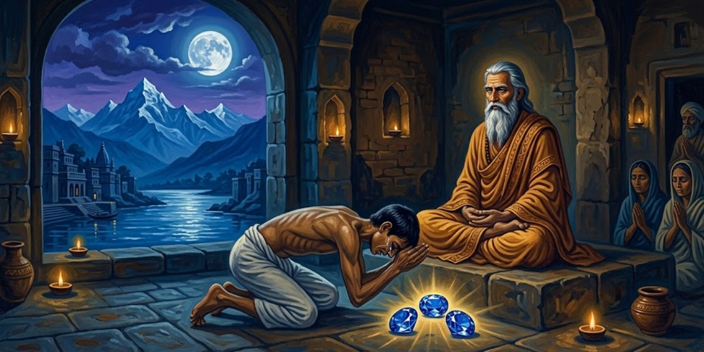</a>

Roy acepta conocer al maestro por insistencia de Santosh y Mukunda.

> "Como usted y mi hijo tienen tan alta opinión de Swami Sri Yukteswar, iré a echarle un vistazo". El tono de voz del doctor Narayan Chunder Roy daba a entender que estaba complaciendo el capricho de unos deficientes mentales. Oculté mi indignación, siguiendo las mejores tradiciones del proselitista.
>
> [Párrafo 1](#original-c17-p1)

Swami es el título monástico del maestro. Santosh, hijo del veterinario, había pedido al narrador que se interesara por su padre. La primera frase introduce el problema de la conversión: ambos visitantes llegan al mismo encuentro, pero con expectativas opuestas. El humor contra el propio celo del narrador impide que el escepticismo sea el único blanco de la escena.

Tras la visita, Sri Yukteswar anuncia una diabetes ignorada por Roy. Accede a ayudarlo por súplica de Mukunda: predice recuperación y seis meses más de vida, pero exige un brazalete. Santosh lo encarga; su padre se niega a llevarlo.

> Recordé divertido que el Maestro había comparado con razón a aquel hombre con un caballo reacio. Pasaron otros siete días; el doctor, enfermo de repente, consintió dócilmente en llevar el brazalete. Dos semanas después, el médico que lo atendía me dijo que el caso de su paciente no tenía esperanza. Me dio detalles desgarradores de los estragos causados por la diabetes.
>
> [Párrafo 13](#original-c17-p13)

La comparación con el caballo devuelve al veterinario al campo de sus propios pacientes. Según el relato, Sri Yukteswar había anunciado tanto la enfermedad como una recuperación y seis meses adicionales de vida. La aceptación del brazalete llega después de enfermar: no constituye una prueba independiente de su eficacia. El cambio de actitud de Roy, en cambio, es el verdadero movimiento dramático de este párrafo.

Mukunda defiende la promesa del maestro. El médico confirma después la recuperación. Roy desoye el consejo de no comer carne; seis meses después presume de salud y, al día siguiente, Santosh anuncia su muerte.

> Este caso fue una de mis experiencias más extrañas con el Maestro. Curó al rebelde cirujano veterinario a pesar de su incredulidad y prolongó en seis meses el plazo natural de aquel hombre en la tierra, solo por mi ferviente súplica. La bondad de Sri Yukteswar no tenía límites ante la oración apremiante de un devoto.
>
> [Párrafo 20](#original-c17-p20)

La atribución de la curación y del plazo de vida pertenece a Yogananda. La frase no ofrece una medición de cuánto habría vivido Roy sin esa intervención: expresa la interpretación religiosa de lo sucedido. Su función en el capítulo es separar la gracia de la creencia del beneficiario. El discípulo sostiene que su propia intercesión pudo favorecer incluso a quien desconfiaba del maestro.

Sri Yukteswar advierte a Sasi que su vida desordenada lo llevará a enfermar en un año y recomienda un zafiro azul. Sasi no puede pagarlo y confía en su protección. El maestro predice que traerá tres piedras demasiado tarde.

> Un año después estaba visitando a mi gurú en la casa de Calcuta de su discípulo Naren Babu. Hacia las diez de la mañana, mientras Sri Yukteswar y yo permanecíamos sentados tranquilamente en el salón del segundo piso, oí abrirse la puerta de entrada. El Maestro se irguió con rigidez.
>
> [Párrafo 29](#original-c17-p29)

Sasi es un amigo de Mukunda; Naren Babu, el discípulo que los aloja. El maestro había aconsejado a Sasi cambiar de vida y llevar un zafiro azul. Según el relato, el joven llega ahora con tres zafiros y un diagnóstico de tuberculosis. El contraste entre la recomendación ignorada y las piedras traídas tarde convierte los objetos en signos del aplazamiento. Tras una recepción severa, Sri Yukteswar le promete que sanará.

Sasi llega con los zafiros y tuberculosis. Sri Yukteswar primero lo rechaza y luego le ordena devolver las piedras y usar un brazalete. Tras una hora angustiosa, promete que sanará en pocas semanas.

> La sonrisa de Sasi iluminó su rostro surcado de lágrimas como el sol repentino sobre un paisaje empapado. "Amado gurú, ¿debo tomar las medicinas recetadas por los médicos?"
>
> [Párrafo 39](#original-c17-p39)

La pregunta vuelve práctica una promesa espiritual: Sasi necesita saber qué hacer con el tratamiento que ya tiene. La respuesta del maestro, en el párrafo siguiente, deja esa decisión a su voluntad mientras insiste en la seguridad de su recuperación. Esa posición pertenece a la historia que Yogananda cuenta y no constituye una indicación médica para quien la lee. La alegría del enfermo tampoco equivale todavía al restablecimiento que espera.

El maestro deja a Sasi decidir sobre las medicinas y reafirma que no morirá de tuberculosis. Durante las semanas siguientes, Mukunda lo visita y lo encuentra cada vez peor.

> "Sasi no sobrevivirá a esta noche". Estas palabras de su médico y el espectáculo de mi amigo, reducido ya casi a un esqueleto, me hicieron partir a toda prisa hacia Serampore. Mi gurú escuchó fríamente mi informe entre lágrimas.
>
> [Párrafo 42](#original-c17-p42)

El relato opone la urgencia del observador a la seguridad del maestro. Su frialdad no se explica como indiferencia: el narrador la lee desde la promesa de recuperación ya formulada. La tensión depende de que el lector recuerde esa promesa mientras comparte el miedo de Mukunda. No se deduce de esta escena que el pronóstico o la atención médica deban desatenderse.

Sri Yukteswar recuerda su promesa y se recoge en silencio. Mukunda vuelve y encuentra a Sasi incorporado: el amigo atribuye su mejoría a una presencia del maestro sentida horas antes. Luego recupera fuerzas, pero evita al gurú por vergüenza. Ante unos exámenes sin preparar, Mukunda busca permiso para faltar; Sri Yukteswar lo manda estudiar una semana.

> Regresé a Calcuta reprimiendo con firmeza todas las dudas razonables que a veces surgían con una burla desconcertante. Al contemplar la montaña de libros sobre mi mesa, me sentí como un viajero perdido en un territorio salvaje. Un largo período de meditación me trajo una inspiración que ahorraba trabajo. Abría cada libro al azar y estudiaba solo las páginas que quedaban así expuestas. Después de seguir este procedimiento dieciocho horas diarias durante una semana, me consideré autorizado a aconsejar a todas las generaciones venideras sobre el arte de estudiar a última hora.
>
> [Párrafo 53](#original-c17-p53)

La ironía corrige la impresión de facilidad: el supuesto ahorro exige dieciocho horas diarias. Mukunda aprueba por poco, según cuenta, y podrá continuar los estudios en Serampore, cerca de su maestro. Los episodios de enfermedad y el examen comparten una forma narrativa: una advertencia, una confianza difícil y una salida atribuida a la ayuda espiritual. La broma escolar aligera esa forma sin convertirla en un método de estudio generalizable.

Según Yogananda, el estudio apresurado basta para aprobar por poco. Después, Serampore College anuncia los fondos necesarios para ampliar su programa y Mukunda puede continuar allí, cerca del maestro. El discípulo agradece una ayuda invisible; Sri Yukteswar devuelve la conversación al tiempo que ahora tendrá para estudiar. La ironía final deja en duda que vaya a abandonar sus hábitos de última hora.

---

## Capítulo 18: Un hacedor de milagros mahometano

<a href="img/261017_autobiografia-de-un-yogui_i-18.jpg">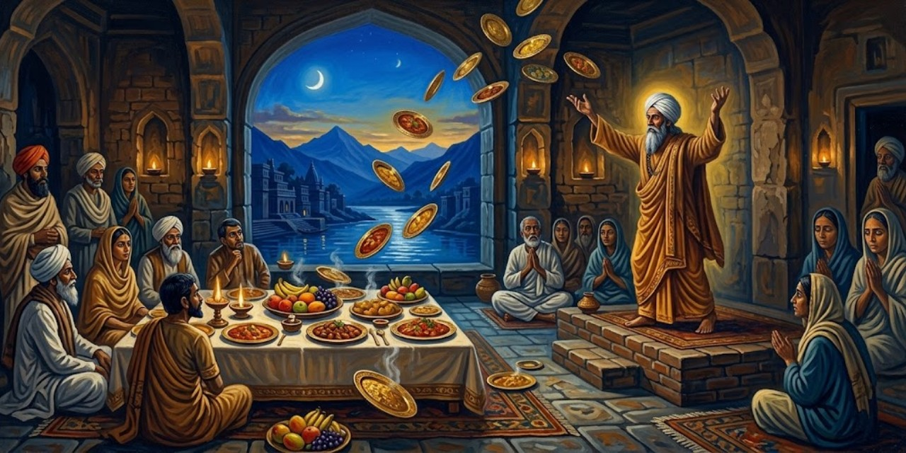</a>

En la habitación de Mukunda, Sri Yukteswar recuerda prodigios de Afzal Khan. Cuenta que, de niño, Afzal ofreció agua a un yogui hindú pese a temer su rechazo por ser musulmán. El yogui rechaza esa exclusión y decide instruirlo.

> "'Posees buen karma de vidas anteriores', observó solemnemente. 'Voy a enseñarte cierto método de yoga que te dará dominio sobre uno de los reinos invisibles. Los grandes poderes que tendrás deben ejercerse con fines dignos; ¡nunca los emplees egoístamente! Percibo, por desgracia, que has traído del pasado algunas semillas de tendencias destructivas. No permitas que broten regándolas con nuevas malas acciones. La complejidad de tu karma anterior es tal que debes emplear esta vida para conciliar tus logros yóguicos con los más elevados fines humanitarios'.
>
> [Párrafo 9](#original-c18-p9)

La voz citada es la del yogui que, en la historia de Sri Yukteswar, instruye al joven Afzal. El episodio cruza una frontera religiosa: el maestro hindú acepta agua de un muchacho musulmán y rechaza la exclusión sectaria. El conflicto moral posterior no se apoya en la religión de Afzal, sino en el uso de las capacidades que el relato le atribuye. Poder y madurez quedan separados desde la advertencia inicial.

Según la historia de Sri Yukteswar, Afzal practica durante veinte años y adquiere la ayuda de una entidad invisible llamada Hazrat. Ignora la advertencia de su maestro: hace desaparecer joyas que ha tocado y obtiene billetes de tren después de devolverlos al vendedor sin comprarlos.

> "¡Estas hazañas provocaron un clamor de indignación; los joyeros y vendedores de billetes bengalíes estaban sufriendo crisis nerviosas! Los policías que intentaban detener a Afzal se encontraban impotentes; el *faquir* podía hacer desaparecer las pruebas incriminatorias con solo decir: 'Hazrat, llévate esto'".
>
> [Párrafo 15](#original-c18-p15)

Faquir designa aquí al asceta Afzal; Hazrat es el nombre de la entidad invisible que, según la historia, cumple sus órdenes. La facultad de hacer desaparecer objetos se convierte en una forma extrema de impunidad: no solo permite apropiarse de ellos, sino borrar las pruebas. El capítulo no confunde lo extraordinario con lo bueno. Precisamente imagina un don espectacular al servicio de un propósito mezquino.

Sri Yukteswar se acerca al balcón del Ganges; Mukunda lo sigue para escuchar su encuentro con Afzal.

> "Esta casa, *Panthi*, perteneció antes a un amigo mío. Conoció a Afzal y lo invitó a venir. Mi amigo invitó también a unos veinte vecinos, entre ellos a mí. Yo era entonces solo un joven y sentía viva curiosidad por el célebre *faquir*". El Maestro se rio. "¡Tomé la precaución de no llevar nada de valor! Afzal me examinó con curiosidad y luego comentó:
>
> [Párrafo 17](#original-c18-p17)

*Panthi* es ahora la pensión donde vive Mukunda: la habitación presente abre una historia del pasado. La cita termina antes de las palabras de Afzal porque ahí acaba el párrafo seleccionado. En la continuación le pide al joven que marque una piedra y la arroje al Ganges; según Sri Yukteswar, luego la hace aparecer en una vasija. Después exige dinero a otro invitado para recuperar su reloj. La fascinación de la audiencia convive así con el abuso.

En la demostración narrada por Sri Yukteswar, una piedra marcada y arrojada al río reaparece en una vasija. Afzal retiene luego el reloj de un invitado y cobra por devolverlo. Para aplacar el resentimiento, ofrece bebidas y un almuerzo; el dueño del reloj exige platos costosos y vajilla de oro para resarcirse.

> "En cuanto cada hombre expresó sus preferencias, el *faquir* se dirigió al inagotable Hazrat. Siguió un gran estrépito; fuentes de oro llenas de curris de complicada preparación, *luchis* calientes y muchas frutas fuera de temporada aterrizaron de la nada a nuestros pies. Toda la comida estaba deliciosa. Después de comer durante una hora, empezamos a salir de la habitación. Un ruido tremendo, como si se apilaran platos, nos hizo volvernos. ¡Y he aquí que no quedaba rastro de los relucientes platos ni de los restos de la comida!"
>
> [Párrafo 35](#original-c18-p35)

Los *luchis* son los panes fritos que acompañan los curris de la comida descrita. La abundancia que aparece y desaparece pertenece al testimonio atribuido a Sri Yukteswar. Su explicación posterior distingue los objetos fugaces de ese ámbito invisible de los bienes duraderos que Afzal codicia. El contraste importa moralmente: alguien capaz de servir un banquete sigue atrapado en el deseo de poseer. La satisfacción instantánea no equivale al desprendimiento.

Sri Yukteswar distingue esos objetos fugaces de los bienes duraderos que Afzal codicia. Añade una confesión que recuerda haber leído en un periódico: Afzal intenta robar una bola de oro a un anciano y descubre que es su antiguo maestro. Este le retira los poderes; Afzal reconoce su abuso y promete retirarse a meditar.

> "Mi maestro me miró con silenciosa compasión. 'Siento tu sinceridad', dijo por fin. 'Por tus primeros años de estricta obediencia y por tu arrepentimiento actual, te concederé una gracia. Tus demás poderes han desaparecido, pero siempre que necesites comida y ropa podrás seguir invocando con éxito a Hazrat para que te las proporcione. Conságrate de todo corazón a la comprensión divina en las soledades de las montañas'.
>
> [Párrafo 53](#original-c18-p53)

Ahora habla Afzal en la confesión pública que Sri Yukteswar dice recordar de un periódico. La cadena de transmisión importa: el lector recibe una confesión recordada por el maestro y narrada después por Yogananda. La última concesión limita el poder a la subsistencia. Al despojarlo de sus posibilidades de dominio, el cierre define la renuncia como un cambio de fines, no como una competencia por conseguir prodigios mayores.

La confesión recordada por Sri Yukteswar termina con la desaparición del maestro de Afzal. El antiguo prodigista queda a solas con sus lágrimas y su reflexión. Su despedida del mundo no anuncia otra demostración: se retira a buscar el perdón del Amado Cósmico. El relato cierra así con una orientación nueva del deseo, después de quitarle su instrumento de dominio.

---

## Capítulo 19: Mi maestro, estando en Calcuta, aparece en Serampore

<a href="img/261017_autobiografia-de-un-yogui_i-19.jpg">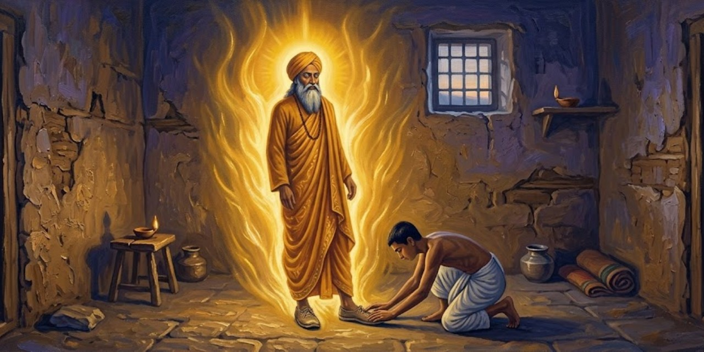</a>

Dijen, compañero de pensión de Mukunda, expresa dudas ateas y temor de ignorar sus posibilidades espirituales. Mukunda le ofrece conocer al maestro y el Kriya Yoga.

> Aquella tarde Dijen me acompañó al retiro. En presencia del Maestro, mi amigo recibió tal paz espiritual que pronto se convirtió en un visitante asiduo. Las preocupaciones triviales de la vida diaria no bastan al hombre; la sabiduría es también un hambre natural. En las palabras de Sri Yukteswar, Dijen encontró un estímulo para aquellos intentos, dolorosos al principio y luego liberadores sin esfuerzo, de encontrar en su pecho un yo más real que el humillante ego de un nacimiento transitorio, rara vez lo bastante amplio para el Espíritu.
>
> [Párrafo 4](#original-c19-p4)

Dijen había expresado dudas ateas, pero también la inquietud de dejar sin explorar posibilidades de su vida interior. Su acercamiento no empieza con una aceptación doctrinal, sino con la paz que el relato dice que experimenta. El "yo más real" introduce una jerarquía propia del libro: la identidad biográfica no agota a la persona. Es el marco espiritual desde el cual se contará la aparición, no una demostración anticipada de ella.

Visitan juntos al maestro. Durante una ausencia, este les pide por escrito recibirlo a las nueve. Mukunda dice captar otro aviso telepático; Dijen no lo cree y sale. A solas, Mukunda cuenta que una luz sustituye la ventana y Sri Yukteswar aparece.

> Desconcertado hasta la conmoción, me levanté de la silla y me arrodillé ante él. Con mi gesto habitual de respetuoso saludo a los pies de mi gurú, toqué sus zapatos. Eran un par que me resultaba familiar, de lona teñida de naranja y suelas de cuerda. Su vestidura ocre de swami me rozó; sentí claramente no solo la textura de la túnica, sino también la superficie áspera de los zapatos y la presión de sus dedos dentro de ellos. Demasiado asombrado para pronunciar una palabra, me puse de pie y lo miré interrogativamente.
>
> [Párrafo 14](#original-c19-p14)

Dijen ha salido a la estación siguiendo la postal; Mukunda permanece en la pensión y cuenta que allí ve aparecer al maestro. El relato insiste en el tacto, no solo en la visión: lona, cuerda, tejido y presión. Esos detalles buscan sostener la diferencia entre una imagen y un cuerpo. Son indicios dentro de su testimonio personal; su viveza narrativa no aporta por sí misma una corroboración independiente de la bilocación.

Sri Yukteswar confirma el aviso, según el relato, y anuncia su llegada en el tren de las diez.

> Mientras yo seguía mirándolo en silencio, Sri Yukteswar continuó: "Esto no es una aparición, sino mi forma de carne y hueso. Se me ha ordenado divinamente darte esta experiencia, rara de alcanzar en la tierra. Recíbeme en la estación; tú y Dijen me veréis acercarme, vestido como estoy ahora. Me precederá un compañero de viaje: un niño que lleva una jarra de plata".
>
> [Párrafo 16](#original-c19-p16)

La jarra introduce un detalle comprobable en el encuentro posterior narrado por el autor. Su función no es decorativa: conecta la experiencia solitaria de la habitación con la escena compartida en la estación. El texto construye así su propia secuencia de confirmación. Mantener esa arquitectura no obliga a presentar como hecho verificado la explicación sobrenatural que Sri Yukteswar da en el relato.

> Mi gurú puso ambas manos sobre mi cabeza, murmurando una bendición. Cuando concluyó con las palabras *"Taba asi"*,
> oí un extraño ruido sordo. Su cuerpo empezó a disolverse gradualmente dentro de la penetrante luz. Primero desaparecieron los pies y las piernas, luego el torso y la cabeza, como un rollo que se enrollara. Hasta el último instante pude sentir sus dedos apoyados suavemente en mi cabello. El resplandor se desvaneció; ante mí no quedó nada salvo la ventana enrejada y un pálido haz de luz solar.
>
> [Párrafo 17](#original-c19-p17)

*Taba asi* es la fórmula con que el maestro cierra la bendición en esta escena; el capítulo no la traduce. Después, Mukunda dice encontrarlo en el tren de las diez, precedido por el niño anunciado. Dijen participa en ese encuentro, pero conoce la aparición a través del relato de su compañero. Distinguir esos dos niveles preserva el alcance de cada testigo: presenciar una llegada no es presenciar lo que antes sucedió en otra habitación.

Dijen vuelve sin haber encontrado al maestro en los primeros trenes. En la estación, Mukunda dice reconocer la llegada anunciada, incluido el niño de la jarra. Sri Yukteswar afirma haber enviado también a Dijen un mensaje que este no captó. Tras oír la experiencia de su compañero, el escéptico compara las universidades del mundo con un jardín de infancia.

---

## Capítulo 20: No visitamos Cachemira

El padre recuerda dos viajes frustrados por la negativa del maestro, pero entrega los pases y el dinero que Mukunda pide para Cachemira.

> Aquella tarde mostré mi botín a Sri Yukteswar. Aunque sonrió ante mi entusiasmo, sus palabras no lo comprometían: "Me gustaría ir; ya veremos". No hizo ningún comentario cuando pedí a Kanai, su pequeño discípulo del retiro, que nos acompañara. Invité también a otros tres amigos: Rajendra Nath Mitra, Jotin Auddy y otro muchacho. Fijamos la salida para el lunes siguiente.
>
> [Párrafo 6](#original-c20-p6)

Cachemira es el destino de montaña que Mukunda desea visitar. "Botín" convierte los permisos paternos en una victoria preliminar, pero la aprobación del maestro sigue faltando. Esa diferencia organiza el capítulo: el discípulo toma sus preparativos como un avance hacia la partida, mientras la respuesta "ya veremos" mantiene abierta la posibilidad de detenerla. Kanai vive con el maestro; Rajendra y Jotin Auddy son los amigos invitados.

El maestro no viajará; Mukunda decide partir sin él. Busca al antiguo criado Behari porque Kanai tampoco irá. Sri Yukteswar predice su negativa, pero el discípulo insiste.

> Mi gurú reanudó su paseo en silencio; pronto llegué a casa del maestro de escuela. Behari, en el patio, me recibió con una cordialidad que se desvaneció bruscamente en cuanto mencioné Cachemira. Murmurando una disculpa, el criado me dejó y entró en la casa de su patrón. Esperé media hora, asegurándome nerviosamente que la demora de Behari se debía a los preparativos del viaje. Por fin llamé a la puerta principal.
>
> [Párrafo 15](#original-c20-p15)

Behari trabaja ahora para un maestro de escuela de Serampore. La espera muestra cómo Mukunda convierte su deseo en una explicación de la conducta ajena: supone preparativos donde no tiene confirmación. La continuación revela que el criado ha salido por atrás. El episodio puede leerse en su nivel inmediato, como una invitación no aceptada, antes de la intervención espiritual con la que el narrador interpretará después toda la jornada.

Le informan que Behari huyó por atrás. Mukunda decide pedir a su tío Sarada el criado Lal Dhari, pese a la advertencia del maestro de que la visita no será grata. Entra al tribunal y hace la petición.

> Mi sencilla petición tuvo el efecto de un terremoto. Mi tío dio un salto tan violento que volcó la silla, los papeles del escritorio volaron en todas direcciones y su pipa, una larga pipa de agua con caña de coco, cayó al suelo con gran estrépito.
>
> [Párrafo 25](#original-c20-p25)

El tío es Sarada Ghosh, abogado del gobierno, a quien Mukunda pide que le preste a Lal Dhari. La pipa de agua vuelve visible el sobresalto y rompe la cordialidad inicial de la visita. Desde la perspectiva inmediata del sobrino, la reacción es incomprensible. Solo más tarde la integrará en una explicación común con la negativa de Behari. La distancia entre vivir un contratiempo y atribuirle un sentido es el espacio del capítulo.

Sarada se indigna. Mukunda vuelve arrepentido al retiro y dice que no quiere partir sin el maestro. Sus amigos se llevan el equipaje; él y Kanai permanecen con el gurú. Media hora después, Sri Yukteswar pide servirle comida antes del tren.

> Al levantarme del asiento de manta, me tambaleé de pronto con náuseas y una espantosa sensación de agitación en el estómago. El dolor punzante era tan intenso que sentí que me habían arrojado de golpe a algún infierno violento. Avanzando a tientas hacia mi gurú, me desplomé ante él, atacado por todos los síntomas del temido cólera asiático. Sri Yukteswar y Kanai me llevaron a la sala de estar.
>
> [Párrafo 33](#original-c20-p33)

El diagnóstico se afirma aquí desde la memoria del autor; más adelante el capítulo lo respalda con la visita y los análisis que atribuye a un médico. El malestar transforma los obstáculos de la mañana en una protección, según su lectura retrospectiva. El dato importante para la acción es que permanece cerca de personas que lo atienden. La explicación espiritual de esa cercanía pertenece a un plano distinto del cuidado concreto recibido.

El maestro sostiene su cabeza y explica, según cuenta Mukunda, que habría enfermado en la estación: las negativas fueron su manera de protegerlo.

> Por fin comprendí. Como los grandes maestros rara vez consideran oportuno mostrar sus poderes abiertamente, un observador casual de los acontecimientos del día habría imaginado que su sucesión era enteramente natural. La intervención de mi gurú había sido demasiado sutil para despertar sospechas. Había hecho actuar su voluntad a través de Behari, de mi tío Sarada, de Rajendra y de los demás de una manera tan discreta que probablemente todos, salvo yo, creyeron que las situaciones habían sido lógicamente normales.
>
> [Párrafo 37](#original-c20-p37)

Esta es la conclusión de Yogananda, no una causa establecida fuera de su relato. Su razonamiento vuelve significativo incluso el carácter corriente de los incidentes: lo que parece natural podría ser, para él, una acción espiritual encubierta. Esa forma de interpretación explica su gratitud, aunque no ofrece al observador un medio independiente para distinguir intervención y coincidencia. La continuación añade que Sri Yukteswar manda llamar a un especialista; el relato de curación no suprime esa atención.

Sri Yukteswar manda llamar al médico. Mukunda dice mejorar con sus palabras. El doctor toma muestras y vuelve al día siguiente.

> "Vaya, vaya, aquí estás, sonriendo y charlando como si no hubieras estado al borde de la muerte". Me dio unas suaves palmadas en la mano. "Apenas esperaba encontrarte con vida, después de descubrir por las muestras que tu enfermedad era cólera asiático. ¡Eres afortunado, joven, por tener un gurú con poderes divinos de curación! ¡Estoy convencido de ello!"
>
> [Párrafo 44](#original-c20-p44)

El médico aparece como una voz que reconoce la gravedad del episodio y comparte la interpretación religiosa del paciente. Pero todo su discurso llega a través de Yogananda: no es un informe clínico independiente adjunto al relato. La escena sostiene la gratitud del discípulo y reúne cuidado médico y cuidado espiritual, sin permitir deducir que cualquier cuadro semejante se resolverá por el mismo camino.

Los amigos vuelven con el equipaje y cambian el enojo por simpatía al verlo. El viaje termina donde empezó. Convaleciente, Mukunda reconoce que no llega al Himalaya sin bendición del gurú y evoca a Parvati como anfitriona divina de las montañas.

---

## Capítulo 21: Visitamos Cachemira

Dos días después de la recuperación que Mukunda atribuye al maestro, el grupo parte hacia Cachemira. En Simla prueba fresas y las rechaza por ácidas. Sri Yukteswar predice que en Estados Unidos las disfrutará con nata y azúcar; el relato salta a esa cena futura.

> El pronóstico de Sri Yukteswar se me borró de la mente, pero volvió a ella muchos años después, poco después de mi llegada a Estados Unidos. Era invitado a cenar en casa de la señora Alice T. Hasey, hermana Yogmata, en West Somerville, Massachusetts. Cuando pusieron sobre la mesa un postre de fresas, mi anfitriona tomó el tenedor y aplastó mis fresas, añadiendo nata y azúcar. "La fruta es algo ácida; creo que le gustará preparada así", comentó.
>
> [Párrafo 7](#original-c21-p7)

Simla es la primera parada del viaje; allí, según el narrador, Sri Yukteswar había predicho que en Estados Unidos le gustarían las fresas con nata y azúcar. Alice Hasey es la anfitriona que la cita identifica también por su nombre religioso, hermana Yogmata. La anticipación aparece en un detalle doméstico, no en un gran acontecimiento. El recuerdo confiere valor espiritual a una cena corriente; esa lectura de la coincidencia es la del autor.

Al probar las fresas de su anfitriona, Mukunda cuenta que recuerda la predicción de Simla y la interpreta como conocimiento anticipado del maestro. Después vuelve al viaje de juventud.

> Nuestro grupo dejó pronto Simla y tomó el tren a Rawalpindi. Allí alquilamos un gran landó tirado por dos caballos, en el que emprendimos un viaje de siete días a Srinagar, capital de Cachemira. El segundo día de nuestro trayecto hacia el norte nos dejó ver la auténtica inmensidad del Himalaya. Mientras las ruedas de hierro del coche chirriaban por los caminos calientes y pedregosos, nos extasiaban las cambiantes vistas de la grandeza montañosa.
>
> [Párrafo 9](#original-c21-p9)

El landó es el carruaje que permite continuar el viaje tras el tren. Rawalpindi señala el punto de ese cambio de transporte; Srinagar es el destino. La lentitud deja de ser solo una dificultad y pasa a organizar la percepción del paisaje. El capítulo alterna estas vistas amplias con bromas del maestro sobre Auddy, uno de los amigos, que busca la ocasión de fumar. La vida del grupo impide que la excursión se convierta en una contemplación sin cuerpos ni molestias.

En una parada, Auddy pide sentarse junto al cochero para tomar aire. Sri Yukteswar había dicho a Mukunda que el amigo buscaba fumar; este lo ve hacerlo y admite su error. El grupo sigue entre posadas y caminos incómodos. El maestro cuida la alimentación del convaleciente, que mejora durante el trayecto.

> Alegres expectativas llenaban nuestros corazones mientras nos acercábamos al centro de Cachemira, tierra paradisíaca de lagos de lotos, jardines flotantes, casas flotantes con vistosos toldos, el río Jhelum con sus numerosos puentes y praderas cubiertas de flores, todo rodeado por la majestad del Himalaya. Nuestra entrada en Srinagar fue por una avenida de árboles altos y acogedores. Alquilamos habitaciones en una posada de dos pisos con vistas a las nobles colinas. No había agua corriente; sacábamos nuestra provisión de un pozo cercano. El tiempo veraniego era ideal, con días cálidos y noches ligeramente frías.
>
> [Párrafo 21](#original-c21-p21)

El Jhelum es el río que forma parte del paisaje descrito. La enumeración del paraíso desemboca en una necesidad práctica: sacar agua del pozo. Esa cercanía entre exaltación y alojamiento mantiene la voz del viajero. Los jardines flotantes reaparecen después como parcelas móviles de troncos y tierra sobre el lago; no son aquí una imagen espiritual desligada de cómo vive la gente.

En un templo de Srinagar, Mukunda dice ver anticipadamente el edificio que luego reconocerá como su sede en Los Ángeles. El grupo va después a Gulmarg y Khilanmarg: él y Rajendra compiten a caballo por senderos difíciles, contemplan las montañas nevadas y juegan en las laderas antes de bajar.

> Nuestras siguientes excursiones fueron a los famosos "jardines de recreo" reales del emperador Jehangir, en Shalimar y Nishat Bagh. El antiguo palacio de Nishat Bagh está construido directamente sobre una cascada natural. El torrente, que desciende de las montañas, ha sido regulado mediante ingeniosos dispositivos para que fluya por terrazas de colores y brote en fuentes entre los deslumbrantes macizos de flores. El arroyo entra también en varias habitaciones del palacio y termina cayendo, como en un cuento de hadas, al lago de abajo. Los inmensos jardines son una explosión de color: rosas de una docena de tonos, bocas de dragón, lavanda, pensamientos y amapolas. Hileras simétricas de *chinars*, cipreses y cerezos trazan un contorno envolvente de esmeralda; más allá se alzan las blancas austeridades del Himalaya.
>
> [Párrafo 26](#original-c21-p26)

Jehangir es el emperador al que el autor vincula estos jardines; Shalimar y Nishat Bagh son los lugares visitados. *Chinars* es el nombre de los plátanos orientales, árboles que componen el cerco verde. La descripción muestra una naturaleza dirigida por el trabajo humano: el agua no solo cae, también se reparte, atraviesa terrazas y entra en las habitaciones. La continuidad visual con las montañas no borra esa intervención. Las atribuciones históricas y arquitectónicas se conservan como parte de lo que Yogananda escribe.

Una expectativa frustrada de Rajendra sobre las uvas provoca bromas; el grupo se consuela con helado y recorre los canales del lago Dal entre jardines flotantes. La memoria compara Cachemira con paisajes de otros países y se detiene en Yellowstone, el Gran Cañón y Alaska, conocidos por el autor años después.

> Las antiguas y majestuosas secuoyas de Yosemite, que alzan sus enormes columnas hasta el cielo insondable, son verdes catedrales naturales diseñadas con destreza divina. Aunque hay cascadas maravillosas en Oriente, ninguna iguala la belleza torrencial del Niágara, cerca de la frontera canadiense. Las cuevas Mammoth de Kentucky y las cavernas de Carlsbad, en Nuevo México, con sus coloridas formaciones semejantes a carámbanos, son deslumbrantes mundos de cuento. Sus largas agujas de torres de estalactitas, que cuelgan de los techos de las cuevas y se reflejan en las aguas subterráneas, permiten entrever otros mundos tal como los imagina el hombre.
>
> [Párrafo 33](#original-c21-p33)

Yosemite, el Niágara, Mammoth y Carlsbad pertenecen aquí al recorrido comparativo por lugares de Norteamérica que el autor conoció después. No son etapas del viaje a Cachemira. La memoria rompe la cronología para reunir una galería de grandezas naturales. "Catedrales" y "mundos de cuento" revelan el doble vocabulario de esa mirada: la naturaleza inspira devoción y también imaginación. Las valoraciones de belleza no se presentan como una clasificación objetiva.

Mukunda regresa a estudiar mientras Sri Yukteswar permanece en Srinagar. El maestro había insinuado que enfermaría y quizá moriría; el discípulo le ruega que no lo deje. Un telegrama anuncia después una enfermedad grave. Mukunda vuelve a suplicarle que conserve el cuerpo y recibe una respuesta favorable. El maestro regresa muy adelgazado; Yogananda atribuye su sufrimiento a las cargas asumidas por los discípulos.

> El devoto que ha alcanzado la salvación final en el Señor descubre que su cuerpo ha cumplido enteramente su propósito; entonces puede usarlo de cualquier manera que considere conveniente. Su trabajo en el mundo consiste en aliviar los sufrimientos de la humanidad, sea por medios espirituales, por consejo intelectual, por la fuerza de voluntad o por la transferencia física de la enfermedad. Al retirarse a la superconciencia cuando lo desea, un maestro puede permanecer ajeno al sufrimiento físico; a veces elige soportar estoicamente el dolor corporal, como ejemplo para sus discípulos. Al asumir las dolencias de otros, un yogui puede satisfacer por ellos la ley kármica de causa y efecto. Esta ley opera mecánica o matemáticamente; los hombres de sabiduría divina pueden manipular científicamente su funcionamiento.
>
> [Párrafo 46](#original-c21-p46)

Esta transferencia de enfermedad es una afirmación doctrinal de Yogananda, no un procedimiento médico demostrado por el episodio. Karma nombra la trama de consecuencias de los actos; la "superconciencia" es el estado espiritual al que el autor atribuye una independencia del dolor. La doctrina le permite explicar por qué un maestro al que considera realizado puede enfermar gravemente. Su compasión se representa como la disposición a compartir la carga del discípulo, incluso a costa del propio cuerpo.

El autor aclara que, en su doctrina, no toda curación exige enfermar en lugar de otro y que ese supuesto procedimiento no está al alcance de cualquier persona. Evoca santos enfermos y una historia del emperador Baber, quien habría pedido sufrir en lugar de su hijo. Concluye que ni la salud ni la debilidad corporal bastan para reconocer la realización espiritual.

> Numerosos buscadores desconcertados de Occidente creen erróneamente que un orador o escritor elocuente sobre metafísica tiene que ser un maestro. Los rishis, sin embargo, han señalado que la prueba decisiva de un maestro es su capacidad para entrar a voluntad en el estado sin respiración y mantener el *samadhi* ininterrumpido de *nirbikalpa*. Solo mediante estos logros puede un ser humano demostrar que ha "dominado" *maya*, o la Ilusión Cósmica dualista. Solo él puede decir desde las profundidades de la realización: "*Ekam sat*", "Solo Uno existe".
>
> [Párrafo 55](#original-c21-p55)

En el uso del capítulo, *samadhi* designa la absorción espiritual; *nirbikalpa*, su forma ininterrumpida, y *maya*, la apariencia de separación que se pretende superar. Los rishis son los sabios citados como autoridad. Yogananda distingue hablar sobre una experiencia de alcanzarla: la elocuencia no es la medida de realización que propone. Pero esa medida pertenece a su tradición y no equivale a una prueba pública del conjunto de poderes descritos. El pasaje tampoco debe convertirse en una invitación a interrumpir la respiración.

Yogananda atribuye la enfermedad del maestro al karma asumido por sus discípulos. Cuando le expresa pena por su adelgazamiento, Sri Yukteswar responde que ahora puede ponerse camisetas que llevaba años sin usar. La risa devuelve un cuerpo concreto a la explicación espiritual. El cierre recuerda una frase atribuida a san Francisco de Sales que enlaza la santidad con la alegría, no con una gravedad permanente.

---

## Capítulo 22: El corazón de una imagen de piedra

Roma pide a Mukunda que ayude a su marido a abandonar las burlas contra sus prácticas religiosas. Ambos buscan orientación en la oración. Mukunda propone visitar el templo de Dakshineswar, confiando en una intervención de la Madre Divina, pero pide a su hermana que no revele ese propósito a Satish.

> Mi hermana aceptó esperanzada. Muy temprano a la mañana siguiente me alegró encontrar a Roma y a su esposo listos para el viaje. Mientras nuestro coche de alquiler traqueteaba por Upper Circular Road hacia Dakshineswar, mi cuñado, Satish Chandra Bose, se divertía ridiculizando a los gurús espirituales del pasado, del presente y del futuro. Noté que Roma lloraba en silencio.
>
> [Párrafo 6](#original-c22-p6)

Dakshineswar es el recinto religioso al que Mukunda los ha invitado sin revelar a Satish el propósito de la salida. Roma, que había ayudado a llenar el vacío dejado por la muerte de la madre, pide ahora al hermano una intervención en su vida doméstica. Su llanto sitúa el costo de la burla: no es una discusión abstracta sobre creencias, sino un modo de herir una práctica importante para ella.

Durante el trayecto Satish se burla; al llegar, exige que Mukunda asegure el almuerzo. Este se sienta a meditar ante Kali y recuerda la devoción de Ramakrishna, a quien el relato atribuye visiones de la diosa. Tras cinco horas sin respuesta, encuentra el templo cerrado. Sale al patio, se quema los pies y vuelve a pedir ayuda para su cuñado.

> Mi petición interior recibió respuesta de inmediato. Primero, una deliciosa ola de frío descendió por mi espalda y bajo mis pies, disipando toda incomodidad. Luego, para mi asombro, el templo se agrandó enormemente. Su gran puerta se abrió despacio, dejando ver la figura de piedra de la diosa Kali. Poco a poco se convirtió en una forma viviente, que sonreía y asentía en señal de saludo, llenándome de una alegría indescriptible. Como por una jeringa mística, el aliento fue retirado de mis pulmones; mi cuerpo quedó muy quieto, aunque no inerte.
>
> [Párrafo 20](#original-c22-p20)

Kali es la diosa a la que el narrador se dirige como Madre Divina. Según cuenta, tras varias horas de meditación sale al patio, donde el suelo le quema los pies, y allí comienza esta experiencia. El alivio corporal precede a la transformación visual: la respuesta no llega como un razonamiento, sino como una modificación de su percepción. El pasaje conserva el testimonio de Yogananda; no acredita que una estatua se animara materialmente.

Mukunda cuenta que su conciencia se amplía: ve a través de los edificios y alcanza con la mirada lugares distantes. Prueba a abrir y cerrar los ojos y a mover manos y pies; dice que la visión continúa en ambos casos. Interpreta esa experiencia como recuperación de una condición espiritual olvidada.

> En mi sagrada experiencia de Dakshineswar, los únicos objetos extraordinariamente agrandados eran el templo y la forma de la Diosa. Todo lo demás aparecía con sus dimensiones normales, aunque cada cosa estaba envuelta en un halo de luz suave: blanca, azul y tonos pastel del arcoíris. Mi cuerpo parecía de una sustancia etérea, dispuesto a levitar. Plenamente consciente de mi entorno material, miraba a mi alrededor y daba algunos pasos sin interrumpir la continuidad de la dichosa visión.
>
> [Párrafo 24](#original-c22-p24)

La distinción entre el tamaño alterado del templo y las medidas normales del resto busca describir una experiencia ordenada, no una pérdida completa de orientación. También importa el verbo "parecía": el párrafo no dice que Mukunda levitara. Después atribuye a la Diosa la promesa de transformar a Satish. El almuerzo que un sacerdote había reservado para ellos funciona, dentro del relato, como la respuesta cotidiana que alcanza al cuñado, ajeno a esa visión.

Según Mukunda, Kali promete transformar a Satish. La visión termina cuando el cuñado lo increpa por el almuerzo. Aparece entonces un sacerdote que había apartado comida para el grupo; Satish come y vuelve en silencio. Al día siguiente Roma cuenta al hermano que su marido lloró ante ella y le anunció un cambio de vida.

> "'Amada *devi*',
> dijo, 'me siento feliz más allá de toda expresión de que este plan reformador de tu hermano haya producido una transformación. Voy a reparar todos los daños que te he hecho. Desde esta noche usaremos nuestro dormitorio grande solo como lugar de culto; tu pequeña habitación de meditación se convertirá en nuestro dormitorio. Lamento sinceramente haber ridiculizado a tu hermano. Por la vergonzosa manera en que me he comportado, me castigaré no hablando con Mukunda hasta que haya progresado en el camino espiritual. De ahora en adelante buscaré profundamente a la Madre Divina; ¡algún día tendré sin duda que encontrarla!'".
>
> [Párrafo 38](#original-c22-p38)

*Devi* es el tratamiento afectuoso y reverente con el que Satish se dirige aquí a Roma. La transformación se expresa mediante una redistribución de la casa y una promesa de reparar el daño, no solo con una nueva opinión religiosa. Su silencio posterior, explica el relato, será una penitencia, no continuidad del desprecio. El capítulo prolonga la historia hasta la muerte de ambos esposos, que Yogananda presenta desde la devoción y la fidelidad mutua.

Años después, el autor encuentra a Satish dedicado a la meditación. Roma anuncia que morirá antes que su esposo enfermo; Yogananda cuenta que así sucede. Su hermano Bishnu le refiere la muerte de ella, la soledad posterior de Satish y su pronta muerte después de hablar ante una fotografía de Roma. El capítulo los despide juntos y presenta al antiguo burlador como un santo silencioso.

---

## Capítulo 23: Recibo mi título universitario

El profesor Ghoshal amenaza a Mukunda con impedirle llegar a los exámenes de grado si no mejora su trabajo en filosofía. El estudiante depende primero de aprobar esa prueba interna.

> Mis profesores de Serampore College solían tratarme con amabilidad, no exenta de una tolerancia divertida. "Mukunda está un poco demasiado embriagado de religión". Resumiéndome así, me ahorraban con tacto la vergüenza de responder preguntas en clase; confiaban en que las pruebas escritas finales me eliminaran de la lista de candidatos al título de letras. El juicio de mis compañeros se expresaba en el apodo que me habían puesto: "Monje Loco".
>
> [Párrafo 3](#original-c23-p3)

Serampore College es la institución donde Mukunda cursa la etapa final de sus estudios; los exámenes del título dependen de la Universidad de Calcuta. El apodo resume una anomalía social: está matriculado como estudiante, pero dedica su energía a otra formación. El humor del narrador no oculta la fragilidad de su situación académica. La escena prepara una pregunta práctica: cómo cumplir una obligación que no ha sido su prioridad.

Mukunda evita poner su nombre en el examen y descubre que Ghoshal ha calificado bien su respuesta sin reconocerlo. Con ayuda de su primo Prabhas, supera también las otras pruebas internas por el mínimo. Ya puede presentarse al grado, pero sigue creyéndose incapaz de afrontar esos exámenes.

> Mi rutina habitual era salir en bicicleta hacia las nueve y media de la mañana. En una mano llevaba una ofrenda para mi gurú: unas flores del jardín de mi pensión, *Panthi*. Después de saludarme afablemente, el Maestro me invitaba a almorzar. Yo aceptaba invariablemente con prontitud, feliz de desterrar por aquel día el pensamiento de la universidad. Tras horas con Sri Yukteswar, escuchando su incomparable caudal de sabiduría o ayudando en las tareas del ashram, me marchaba a regañadientes hacia medianoche, de vuelta a *Panthi*. A veces pasaba toda la noche con mi gurú, tan felizmente absorto en su conversación que apenas advertía cuándo la oscuridad se convertía en amanecer.
>
> [Párrafo 13](#original-c23-p13)

*Panthi* es la pensión del estudiante; el ashram, el retiro de Sri Yukteswar. La rutina concreta explica el problema sin necesidad de presentar a Mukunda como incapaz: el tiempo que ofrece a una enseñanza se lo resta a la otra. Cuando el maestro le exige presentarse a los exámenes, devuelve a su discípulo una responsabilidad que este esperaba eludir. La cercanía espiritual no se plantea como una autorización para abandonar todas las obligaciones.

A cinco días del comienzo, Sri Yukteswar le pregunta por los exámenes y le exige acudir para no dar motivos de crítica a su familia. Mukunda promete presentarse entre lágrimas. Al día siguiente el maestro le recuerda las ocasiones en que ha recibido ayuda; el discípulo recupera la confianza.

> "No ha sido la pereza, sino un ardiente celo por Dios lo que te ha impedido buscar honores universitarios", dijo amablemente mi gurú. Tras un silencio, citó: "'Buscad primero el reino de Dios y su justicia, y todas estas cosas os serán añadidas'".
>
> [Párrafo 25](#original-c23-p25)

La cita religiosa dentro de la cita es el argumento con que Sri Yukteswar consuela al discípulo. No borra la orden de presentarse: la confianza y el deber permanecen unidos. El auxilio que llega después tiene un rostro concreto, Romesh Chandra Dutt, compañero de pensión y estudiante destacado. La narración atribuye su ayuda a la providencia, pero describe también horas de preparación compartida.

Sri Yukteswar manda a Mukunda buscar ayuda de Romesh, compañero y alumno destacado. Este lo prepara y prevé preguntas sobre Childe Harold, el viajero de Byron. Con un atlas prestado por el tío Sarada estudian su recorrido. Otros alumnos objetan que descuida las biografías de autores; según Mukunda, el examen confirma las previsiones de Romesh, como las pruebas siguientes.

> Por toda la universidad circuló la noticia de que estaba ocurriendo algo parecido a un milagro y de que parecía probable el éxito del distraído "Monje Loco". No intenté ocultar los hechos del caso. Los profesores locales no podían alterar las preguntas, que habían sido preparadas por la Universidad de Calcuta.
>
> [Párrafo 40](#original-c23-p40)

La expresión "algo parecido" conserva una cautela que conviene no borrar. El relato distingue además a los profesores que lo conocen de quienes fijan los exámenes: esa separación refuerza su lectura providencial de las coincidencias. Luego un error del propio Mukunda lo deja por debajo de la nota necesaria; según cuenta, la reducción del mínimo a treinta y tres puntos le permite aprobar. El suspense combina ayuda recibida y equivocación personal.

Mukunda descubre que respondió mal la distribución de preguntas y teme no alcanzar la nota mínima. Sri Yukteswar le asegura el título; después conoce una reducción del mínimo que le permite aprobar. Camino del examen de bengalí, Romesh lo llama y le resume dos acciones benéficas de Vidyasagar que acaba de considerar importantes.

> Di las gracias a Romesh y fui rápidamente en bicicleta al salón de la universidad. La hoja del examen de bengalí resultó contener dos partes. La primera instrucción era: "Escriba dos ejemplos de las obras de caridad de Vidyasagar". Mientras trasladaba al papel lo que acababa de aprender, murmuré unas palabras de agradecimiento por haber atendido la llamada de última hora de Romesh. De haber ignorado las obras benéficas de Vidyasagar hacia la humanidad, incluido finalmente yo mismo, no habría podido aprobar el examen de bengalí. Suspender una asignatura me habría obligado a examinarme de nuevo de todas al año siguiente. Tal perspectiva era, comprensiblemente, aborrecible.
>
> [Párrafo 53](#original-c23-p53)

Bengalí es la lengua de esta prueba; Vidyasagar, el filántropo cuyas acciones Romesh acaba de resumirle. El paréntesis humorístico extiende la caridad hasta el estudiante que se beneficia de conocerla. El desenlace honra también al compañero: Yogananda cuenta que Romesh obtiene su propio título con distinción. La gratitud al maestro no borra el trabajo ni la generosidad de quien dedicó tiempo a prepararlo.

Mukunda elige a su gurú para el ensayo final y obtiene en filosofía su mejor nota; en las otras materias apenas aprueba. Romesh se gradúa con distinción y el padre celebra el resultado del hijo. Al agradecer al maestro, recibe una última broma: al Señor le resultó más cómodo hacerlo graduado que cambiar de lugar el sol y la luna.

---

## Capítulo 24: Me hago monje de la Orden de los Swamis

<a href="img/261017_autobiografia-de-un-yogui_i-24.jpg">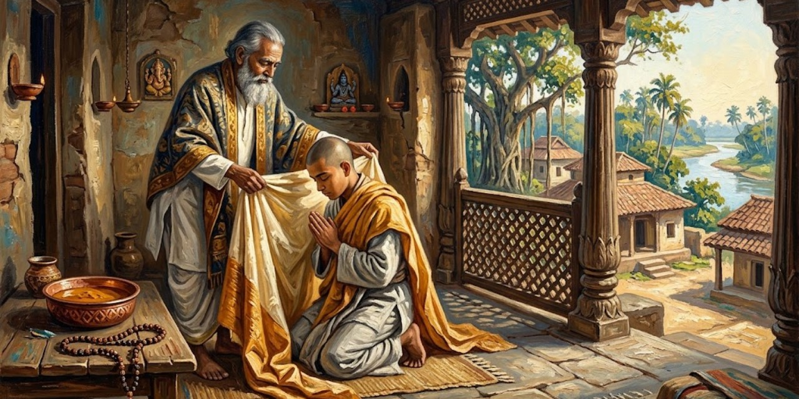</a>

Mukunda rechaza el empleo que su padre desea para él y vuelve a pedir hacerse monje. Esta vez Sri Yukteswar acepta iniciarlo al día siguiente. El discípulo reafirma su decisión de reservar a Dios el primer lugar en su vida.

> El día siguiente fue uno de los más memorables de mi vida. Recuerdo que era un jueves soleado de julio de 1914, pocas semanas después de mi graduación universitaria. En el balcón interior de su retiro de Serampore, el Maestro sumergió una pieza nueva de seda blanca en un tinte ocre, el color tradicional de la Orden de los Swamis. Cuando la tela se secó, mi gurú me la puso alrededor del cuerpo como túnica de renunciante.
>
> [Párrafo 6](#original-c24-p6)

La Orden de los Swamis es la comunidad monástica a la que el narrador pide incorporarse. El cambio de vida se concentra en una operación sencilla y visible: teñir una tela y vestirla. Sri Yukteswar elige la seda y evita una ceremonia elaborada, según el capítulo. La fecha de 1914 se conserva tal como figura en esta fuente; no debe modernizarse ni armonizarse sin cotejo. El rito no le quita al discípulo su historia, pero señala una nueva pertenencia.

Sri Yukteswar explica que la seda anticipa el futuro viaje a Occidente. Evita un rito elaborado y permite elegir nombre: Mukunda escoge Yogananda. El maestro lo incorpora a la rama Giri. El nuevo monje expresa gratitud y canta versos de Shankara; el relato aclara después que el título de swami debe recibirse de otro miembro de la orden.

> Además de su nuevo nombre, que suele terminar en *ananda*, el swami adopta un título que indica su vinculación formal con una de las diez subdivisiones de la Orden de los Swamis. Estos *dasanamis* o diez sobrenombres incluyen Giri, montaña, al que pertenecemos Sri Yukteswar y, por tanto, yo. Entre las otras ramas están *Sagar*, mar; *Bharati*, tierra; *Aranya*, bosque; *Puri*, territorio; *Tirtha*, lugar de peregrinación, y Saraswati, sabiduría de la naturaleza.
>
> [Párrafo 17](#original-c24-p17)

El capítulo explica Yogananda como "bienaventuranza mediante la unión divina": *ananda* y *yoga*. Shankara es el maestro al que atribuye la organización de la orden. El nuevo nombre expresa una aspiración; Giri señala una pertenencia transmitida por otro monje. No son intercambiables: uno formula el sentido que el renunciante da a su vida, el otro lo inscribe en un linaje. La incorporación se presenta así como una decisión personal que también necesita reconocimiento y continuidad.

El capítulo explica que el nuevo nombre reúne la aspiración a la bienaventuranza con una cualidad espiritual y una relación con la naturaleza.

> El ideal de servicio desinteresado a toda la humanidad y de renuncia a los lazos y ambiciones personales lleva a la mayoría de los swamis a trabajar activamente en tareas humanitarias y educativas en la India o, a veces, en tierras extranjeras. Dejando de lado todos los prejuicios de casta, credo, clase, color, sexo o raza, un swami sigue los preceptos de la fraternidad humana. Su meta es la unidad absoluta con el Espíritu. Impregnando su conciencia de vigilia y de sueño con el pensamiento "Yo soy Él", recorre el mundo satisfecho, en él pero sin pertenecerle. Solo así puede justificar su título de swami: alguien que busca alcanzar la unión con el *Swa* o Ser. Huelga añadir que no todos los swamis formalmente titulados tienen el mismo éxito en alcanzar su elevada meta.
>
> [Párrafo 19](#original-c24-p19)

La última frase distingue el título recibido de la meta alcanzada. Esa distinción protege el ideal del automatismo: vestir la túnica no basta para justificarla. La renuncia que el autor defiende tampoco exige inactividad; puede llevar a enseñar o a servir fuera de la propia comunidad. La universalidad funciona aquí como una exigencia ética dirigida al monje, no como una descripción comprobada de la conducta de todos los miembros de la orden.

Yogananda distingue al swami, miembro de una orden, del yogui, que sigue una disciplina y puede estar casado. Defiende que esa práctica no está limitada por el origen geográfico; evoca a Shiva como figura de renuncia y presenta los Yoga Sutras de Patanjali entre los seis sistemas de filosofía hindú.

> El hilo común que enlaza los seis sistemas es la afirmación de que no hay verdadera libertad para el hombre sin conocimiento de la Realidad última. Los *Upanishads* posteriores respaldan a los *Yoga Sutras*, entre los seis sistemas, como los que contienen los métodos más eficaces para alcanzar la percepción directa de la verdad. Mediante las técnicas prácticas del yoga, el hombre abandona para siempre los estériles dominios de la especulación y conoce por experiencia la verdadera Esencia.
>
> [Párrafo 24](#original-c24-p24)

Los seis sistemas son las filosofías hindúes mencionadas en el capítulo. Los *Upanishads* son los textos invocados como respaldo; los *Yoga Sutras*, la exposición de la disciplina que el autor asocia a Patanjali. En el argumento, ser swami depende de una incorporación monástica; ser yogui depende de una práctica y no exige esa incorporación. La eficacia superior que aquí se atribuye al yoga es una valoración de Yogananda, no una conclusión comparativa establecida en este párrafo.

Describe las exigencias morales y los ocho pasos del yoga, desde la conducta y la postura hasta la absorción espiritual. Sostiene que la vida de responsabilidades también permite practicar y que personas ajenas a esos nombres pueden encarnar sus ideales. Frente a las críticas occidentales, introduce el testimonio del psicólogo suizo C. G. Jung.

> "Cuando un método religioso se recomienda como 'científico', puede estar seguro de encontrar público en Occidente. El yoga cumple esta expectativa", escribe el doctor Jung. "Al margen del encanto de lo nuevo y de la fascinación de lo comprendido a medias, hay buenas razones para que el yoga tenga muchos adeptos. Ofrece la posibilidad de una experiencia controlable y satisface así la necesidad científica de 'hechos'; además, por su amplitud y profundidad, su venerable antigüedad, su doctrina y su método, que incluyen todas las fases de la vida, promete posibilidades nunca soñadas.
>
> [Párrafo 32](#original-c24-p32)

Jung aparece como una voz externa que Yogananda incorpora a su defensa del yoga. La primera oración tiene un filo crítico: reconoce también el atractivo comercial o cultural de la etiqueta "científico". La cita seleccionada termina antes de que siga la exposición de Jung; no debe cerrarse como si concluyera todo su argumento. El capítulo usa su testimonio para sostener una práctica que reúna cuerpo y vida interior. Invocar a un psicólogo no verifica por sí solo las afirmaciones sobrenaturales de otros episodios.

La cita de Jung continúa defendiendo la unión de la disciplina corporal con sus ideas espirituales. Yogananda cierra mirando hacia la era atómica: contrapone la conquista exterior de la naturaleza al dominio interior de la mente. Su advertencia final no celebra sin reservas el poder recién liberado; pide una madurez capaz de impedir que ese gigante material destruya el mundo.

---

## Capítulo 25: El hermano Ananta y la hermana Nalini

<a href="img/261017_autobiografia-de-un-yogui_i-25.jpg">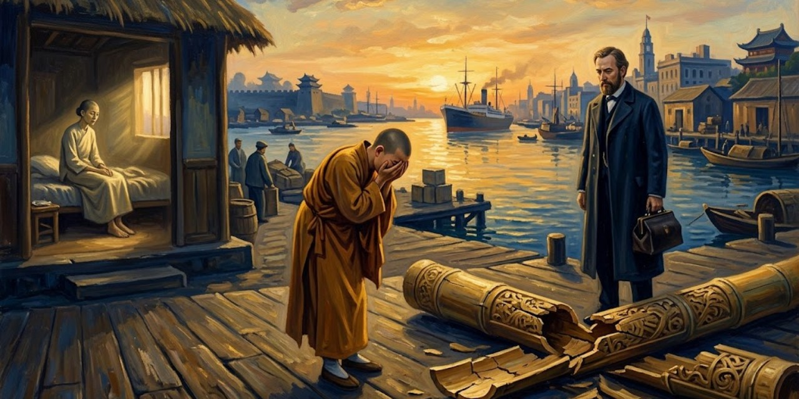</a>

Cuidando a Ananta, Mukunda dice presentir su muerte. Incapaz de quedarse, viaja a Japón. En Shanghái deja caer un recuerdo al sentir que su hermano acaba de morir. De regreso, Bishnu confirma la fecha.

> Mi padre me abrazó cálidamente cuando entré en nuestra casa de Gurpar Road. "Has venido", dijo con ternura. Dos grandes lágrimas cayeron de sus ojos. Habitualmente poco expresivo, nunca me había mostrado antes tales señales de afecto. Exteriormente un padre grave, poseía por dentro el corazón enternecido de una madre. En todo su trato con la familia se manifestaba claramente su doble función parental.
>
> [Párrafo 12](#original-c25-p12)

Ananta es el hermano mayor del autor. Mukunda cuenta que había abandonado Gorakhpur, donde lo cuidaba, por no soportar presenciar su muerte, y que la intuyó durante el regreso de Japón. El abrazo se sitúa después de esas experiencias extraordinarias narradas. Su fuerza procede de algo menos espectacular: una expresión de cariño hasta entonces retenida. La comparación entre padre y madre nombra cómo el hijo recibe ese consuelo, no una regla sobre lo que corresponde sentir a cada sexo.

Para contar la enfermedad de Nalini, el autor retrocede a sus burlas infantiles sobre la delgadez. Después la hermana queda prometida al médico Panchanon Bose, que recibe una dote paterna.

> A su debido tiempo se celebraron elaborados ritos matrimoniales. La noche de bodas me uní al grupo numeroso y jovial de parientes en la sala de nuestra casa de Calcuta. El novio estaba recostado en un inmenso cojín de brocado de oro, con Nalini a su lado. Un espléndido *sari* de seda púrpura
> no podía, por desgracia, ocultar por completo su angulosidad. Me resguardé detrás del cojín de mi nuevo cuñado y le sonreí amistosamente. Nunca había visto a Nalini hasta el día de la ceremonia nupcial, cuando por fin supo lo que le había tocado en la lotería matrimonial.
>
> [Párrafo 16](#original-c25-p16)

El novio es Panchanon Bose, médico de Calcuta; el *sari* es la prenda con que se viste Nalini en la escena. El narrador recuerda sus burlas hacia la extrema delgadez de la hermana y la complicidad que establece con el marido. La gracia de su voz no elimina la crueldad de esa alianza. Más adelante, la petición de Nalini obligará a escuchar el sufrimiento que la broma mantenía fuera de campo.

Mukunda y el marido bromean sobre Nalini: los tónicos no la hacen engordar. En otra visita, el hermano intenta irse sin verla. Ella lo llama; al subir, la encuentra llorando.

> "Querido hermano", dijo, "enterremos la vieja hacha de guerra. Veo que tus pies están ahora firmemente asentados en el camino espiritual. Quiero ser como tú en todos los sentidos". Añadió esperanzada: "Ahora tienes un aspecto robusto; ¿puedes ayudarme? ¡Mi marido no se acerca a mí, y yo lo quiero tanto! Pero deseo todavía más progresar en la realización de Dios, aunque tenga que seguir delgada y poco atractiva".
>
> [Párrafo 25](#original-c25-p25)

La súplica reúne necesidades que no son intercambiables: afecto, aceptación del cuerpo y búsqueda espiritual. El deseo de acercarse a Dios no hace menos real la herida del rechazo conyugal. A partir de aquí Mukunda dice que nace una amistad y que Nalini se convierte en su discípula. El cambio decisivo en la relación fraterna comienza antes de la transformación corporal que él narrará: empieza cuando deja de tratarla únicamente como blanco de sus chistes.

Nalini se hace discípula, abandona los tónicos y sigue las reglas de Mukunda. Él afirma que engorda tras su promesa y mejora su matrimonio. A su regreso de Japón, la encuentra con tifoidea, disentería y sin conocimiento. Con una enfermera, reza y aplica técnicas yóguicas; promete que la fiebre cesará en siete días.

> Una semana después me emocionó ver a Nalini abrir los ojos y mirarme con afectuoso reconocimiento. Desde aquel día su recuperación fue rápida. Aunque recobró su peso habitual, le quedó una triste secuela de su enfermedad casi mortal: tenía las piernas paralizadas. Especialistas indios e ingleses la declararon una inválida sin esperanza de curación.
>
> [Párrafo 39](#original-c25-p39)

El narrador ha descrito plegarias, una enfermera y las técnicas de curación yóguica que afirma haber aplicado. La mejoría y la secuela conviven: sobrevivir no significa todavía recuperarlo todo. Después acude a Sri Yukteswar, que predice una recuperación de las piernas y aconseja una perla. El capítulo atribuye la curación posterior a la ayuda espiritual; no aporta una demostración de que las perlas traten la parálisis ni una pauta clínica que deba trasladarse a otro caso.

Agotado, Mukunda pide ayuda al maestro, que anuncia la recuperación en un mes y prescribe una perla. Según el autor, describe además a Nalini sin conocerla. Mukunda pregunta cómo puede analizarla sin fecha ni hora de nacimiento.

> Sri Yukteswar sonrió. "Hay una astrología más profunda, que no depende del testimonio de calendarios y relojes. Cada hombre es parte del Creador, u Hombre Cósmico; tiene un cuerpo celeste además de uno terrestre. El ojo humano ve la forma física, pero el ojo interior penetra más hondamente, hasta el patrón universal del que cada hombre es una parte integral e individual".
>
> [Párrafo 46](#original-c25-p46)

Mukunda había preguntado cómo podía el maestro analizar a Nalini sin saber su fecha y hora de nacimiento. La respuesta desplaza el saber desde el cálculo del horóscopo hacia la intuición espiritual. "Hombre Cósmico" y "ojo interior" son los términos de esa explicación doctrinal, no instrumentos identificados por el pasaje. El capítulo concluye con la gratitud de Nalini y con el nacimiento de dos hijas, que el autor presenta como cumplimiento de otra predicción de Sri Yukteswar.

Según el autor, Nalini recupera la movilidad un mes después y Sri Yukteswar anuncia también dos hijas, que nacen más adelante. La última voz es la de ella: agradece la bendición recibida por su hogar y pide al hermano que transmita su deseo de contarse entre los discípulos del maestro en Kriya Yoga, la práctica espiritual a la que el libro vincula ese linaje.

---

## Capítulo 26: La ciencia del Kriya Yoga

Yogananda atribuye a Lahiri Mahasaya la difusión moderna del Kriya Yoga, una práctica que exige aprender de un iniciado y cuya técnica no revela aquí. Según su tradición, Babaji la restituyó y la enlazó con Krishna y el Bhagavad Gita. El control de la respiración queda presentado como acceso al dominio espiritual de la vida.

> Krishna cuenta también que fue él, en una encarnación anterior, quien comunicó el yoga indestructible a un antiguo iluminado, Vivasvat, que se lo dio a Manu, el gran legislador. Este, a su vez, instruyó a Ikshwaku, padre de la dinastía guerrera solar de la India. Transmitido así de uno a otro, el yoga real fue custodiado por los rishis hasta la llegada de las edades materialistas. Entonces, debido al secreto sacerdotal y a la indiferencia humana, el conocimiento sagrado se volvió gradualmente inaccesible.
>
> [Párrafo 7](#original-c26-p7)

El capítulo explica *Kriya Yoga* como unión con lo infinito mediante una acción o práctica determinada; los rishis son los sabios a quienes el relato atribuye su custodia. Krishna es aquí la figura divina que enseña en el *Bhagavad Gita*, texto religioso citado por Yogananda. Vivasvat, Manu e Ikshwaku forman la genealogía sagrada de esa enseñanza, no una cadena documental que el libro demuestre. El relato plantea una paradoja de la transmisión: proteger un conocimiento puede terminar impidiendo que llegue a quienes lo necesitan. Lahiri Mahasaya, maestro del maestro del narrador, aparece como quien vuelve a abrir esa circulación.

Yogananda encuentra en Patanjali una unión de disciplina, concentración y meditación en Aum, el sonido sagrado. Interpreta también el morir cotidiano de san Pablo como retirada de los sentidos. Distingue una absorción que inmoviliza el cuerpo de otra compatible con las tareas ordinarias; Sri Yukteswar vincula ese avance al dominio de la respiración.

> El *Kriya Yogi* dirige mentalmente su energía vital para que gire, hacia arriba y hacia abajo, alrededor de los seis centros espinales (los plexos bulbar, cervical, dorsal, lumbar, sacro y coccígeo), que corresponden a los doce signos astrales del zodíaco, el Hombre Cósmico simbólico. Medio minuto de circulación de energía alrededor de la sensible médula espinal del ser humano produce un progreso sutil en su evolución; ese medio minuto de *Kriya* equivale a un año de desenvolvimiento espiritual natural.
>
> [Párrafo 13](#original-c26-p13)

*Kriya Yogi* designa al practicante de esta disciplina. Patanjali, presentado antes de la cita como un antiguo expositor del yoga, permite a Yogananda enlazar la técnica con una tradición escrita. Los centros espinales y su correspondencia zodiacal pertenecen al modelo espiritual que el autor expone. La equivalencia entre treinta segundos y un año es una afirmación de ese modelo, no una medida experimental de envejecimiento, aprendizaje o evolución biológica. El lenguaje cuantitativo intenta expresar una promesa de aceleración espiritual; no proporciona por sí mismo una prueba de ella.

El autor relaciona su mapa astral con ciclos del zodíaco y atribuye a la práctica intensa una aceleración extraordinaria de la evolución espiritual. Reserva esa intensidad para discípulos preparados por un maestro: compara el cuerpo no entrenado con una lámpara incapaz de soportar una potencia excesiva y rechaza forzar la retención del aire.

> Podrían darse muchas ilustraciones de la relación matemática entre el ritmo respiratorio humano y las variaciones de sus estados de conciencia. Una persona cuya atención está por completo absorta, como cuando sigue un razonamiento intelectual estrechamente trabado o intenta una proeza física delicada o difícil, respira automáticamente muy despacio. La fijeza de la atención depende de una respiración lenta; las respiraciones rápidas o irregulares acompañan inevitablemente a estados emocionales nocivos: miedo, lujuria, ira. El inquieto mono respira a un ritmo de 32 veces por minuto, frente al promedio humano de 18. El elefante, la tortuga, la serpiente y otros animales conocidos por su longevidad tienen un ritmo respiratorio inferior al del ser humano. La tortuga, por ejemplo, que puede alcanzar los 300 años, respira solo 4 veces por minuto.
>
> [Párrafo 20](#original-c26-p20)

La comparación transforma animales muy distintos en ejemplos de un mismo argumento: vivir con menos agitación sería vivir de otra manera. Las cifras y las generalizaciones son las de Yogananda. El pasaje no identifica especies, condiciones de observación ni un estudio que permita comprobar la supuesta relación matemática; tampoco basta para deducir que reducir voluntariamente la respiración prolongue la vida. En el capítulo, el sueño sirve después como otra analogía de retirada de la atención corporal. Son modos de hacer imaginable una doctrina, no instrucciones médicas para contener el aliento.

El sueño sirve a Yogananda como comparación de una retirada inconsciente de los sentidos. El practicante buscaría efectuarla despierto y dirigir la energía hacia los centros espinales. El autor le atribuye así una liberación de la dependencia corporal y contrapone la eficacia del Kriya al esfuerzo de separar mente y sentidos mediante la sola introspección.

> La ciencia yóguica se basa en una consideración empírica de todas las formas de concentración y de los ejercicios de meditación. El yoga permite al devoto desconectar o conectar, a voluntad, la corriente vital de los cinco teléfonos sensoriales de la vista, el oído, el olfato, el gusto y el tacto. Al alcanzar este poder de desconexión sensorial, al yogui le resulta sencillo unir su mente a voluntad con los reinos divinos o con el mundo de la materia. La fuerza vital ya no lo devuelve contra su voluntad a la esfera mundana de sensaciones alborotadas y pensamientos inquietos. Dueño de su cuerpo y de su mente, el *Kriya Yogi* logra finalmente la victoria sobre el "último enemigo", la muerte.
>
> [Párrafo 26](#original-c26-p26)

Los "teléfonos" convierten cada sentido en una línea que puede atenderse o desconectarse. La imagen distingue no percibir algo por incapacidad de retirar voluntariamente la atención: la segunda posibilidad es el dominio que Yogananda atribuye a la práctica. La victoria sobre la muerte pertenece a su promesa religiosa, no a un resultado médico demostrado en el pasaje. El uso de "empírica" expresa cómo presenta su escuela; no valida por sí mismo todas sus explicaciones fisiológicas.

Unos versos presentan la victoria sobre la muerte. Yogananda contrapone después la vida guiada por el alma a otra arrastrada por hábitos y efectos de acciones pasadas. Los inmensos plazos de evolución que invoca expresan la urgencia con que defiende una vía abreviada.

> El hombre apegado a lo material rara vez, o nunca, comprende que su cuerpo es un reino, gobernado por el Alma Emperadora en el trono del cráneo, con regentes subordinados en los seis centros espinales o esferas de conciencia. Esta teocracia se extiende sobre una multitud de súbditos obedientes: veintisiete billones de células, dotadas de una inteligencia segura, aunque automática, mediante la cual cumplen todas las tareas de crecimiento, transformación y disolución corporales, y cincuenta millones de pensamientos subyacentes, emociones y variaciones de fases alternas de la conciencia humana en una vida media de sesenta años. Cualquier aparente insurrección de las células corporales o cerebrales contra el Alma Emperadora, manifestada como enfermedad o depresión, no se debe a deslealtad entre los humildes ciudadanos, sino al mal uso pasado o presente que el ser humano hace de su individualidad o libre albedrío, que le fue dado al mismo tiempo que el alma y que nunca puede revocarse.
>
> [Párrafo 31](#original-c26-p31)

La teocracia es, dentro de esta imagen, un gobierno cuya autoridad procede de lo divino. El reparto entre soberano, regentes y súbditos vuelve visible la diferencia que el autor establece entre alma y ego: el problema estaría en quién ocupa de hecho el mando. La cifra inglesa de células se traduce aquí con la escala numérica castellana, sin modificar su valor. La atribución de enfermedad y depresión al mal uso de la voluntad forma parte de la doctrina del autor; no es una conclusión clínica ni permite culpar a una persona enferma de su sufrimiento. El karma, que el capítulo entiende como efectos de acciones pasadas, sostiene esa explicación religiosa.

Yogananda contrapone al alma el ego que se atribuye todas las operaciones de la vida. La indagación sobre quién es realmente quien vive conduce a un sacrificio interior: el fuego valioso consumiría los deseos, no las ofrendas externas. El capítulo cierra con una exhortación de Krishna a Arjuna: practicar yoga por encima de considerar aisladamente la austeridad, el conocimiento o la acción.

---

## Capítulo 27: Fundación de una escuela de yoga en Ranchi

<a href="img/261017_autobiografia-de-un-yogui_i-27.jpg">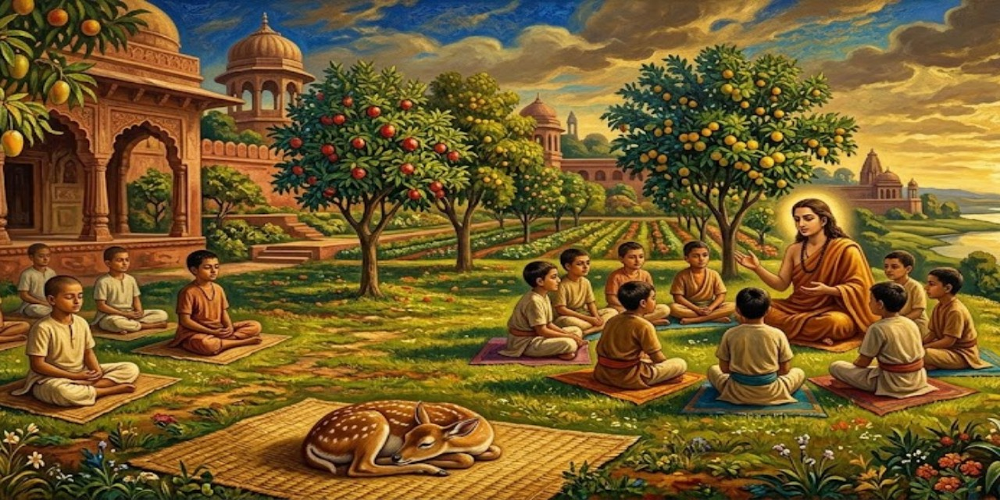</a>

Sri Yukteswar rebate el rechazo de Yogananda a las organizaciones: recibir enseñanza obliga también a transmitirla. Cuando el discípulo insiste en no casarse, el maestro le recuerda que renunciar a una familia exige asumir responsabilidades hacia otra mayor. Yogananda decide dar esa forma de servicio a su vocación.

> El ideal de una educación integral para los jóvenes siempre había estado muy cerca de mi corazón. Veía claramente los áridos resultados de la enseñanza ordinaria, dirigida solo al desarrollo del cuerpo y del intelecto. Los valores morales y espirituales, sin cuya apreciación ningún hombre puede acercarse a la felicidad, seguían ausentes del programa formal. Decidí fundar una escuela donde los muchachos pudieran alcanzar la plena madurez humana. Mi primer paso en esa dirección lo di con siete niños en Dihika, un pequeño paraje rural de Bengala.
>
> [Párrafo 11](#original-c27-p11)

Sri Yukteswar es el maestro espiritual de Yogananda. Su argumento anterior cambia el sentido de abandonar una familia: solo se justificaría si se asumen deberes hacia una familia mayor. Dihika es el lugar bengalí de ese primer ensayo escolar; Ranchi será su siguiente sede. Según el capítulo, el traslado se produjo en 1918 gracias al apoyo del maharajá de Kasimbazar, un gobernante que cedió su palacio para la escuela. La educación integral no se formula aquí como ausencia de materias académicas, sino como rechazo a que estas agoten la formación.

En 1918, el apoyo del maharajá de Kasimbazar permite trasladar la escuela a Ranchi. Yogananda reúne materias académicas, oficios, agricultura y meditación. Añade los ejercicios Yogoda, que presenta como un modo de renovar la energía corporal mediante la voluntad, dentro de un programa destinado a formar personas y no solo intelectos.

> Los muchachos respondieron maravillosamente a esta formación, desarrollando una capacidad extraordinaria para trasladar la energía vital de una parte del cuerpo a otra y para mantenerse en perfecto equilibrio en posturas corporales difíciles. Realizaban proezas de fuerza y resistencia que muchos adultos vigorosos no podían igualar. Mi hermano menor, Bishnu Charan Ghosh, ingresó en la escuela de Ranchi; más tarde se convirtió en un destacado cultivador de la cultura física en Bengala. Él y uno de sus alumnos viajaron a Europa y América, dando exhibiciones de fuerza y destreza que asombraron a los sabios universitarios, incluidos los de la Universidad de Columbia, en Nueva York.
>
> [Párrafo 15](#original-c27-p15)

Yogoda es el nombre que Yogananda da a sus ejercicios de desarrollo corporal, basados, según explica, en dirigir la voluntad hacia la energía vital. Esa explicación energética pertenece a su enseñanza; no queda demostrada por la admiración que susciten las destrezas físicas. Bishnu Charan Ghosh aparece como la prolongación pública de esa vertiente del proyecto. El relato combina dos criterios de éxito que no son equivalentes: la capacidad de realizar una proeza y la interpretación espiritual de cómo se consigue.

La demanda supera las plazas y se admite también alumnado externo; el padre de Yogananda acaba bendiciendo su elección. La convivencia incluye un cervatillo que muere tras enfermar por exceso de alimento. El autor cuenta que soñó su petición de dejarlo partir y entendió su apego como posesivo. La escuela entretanto crece y abre otras sedes.

> La sede de Ranchi mantiene un Departamento Médico donde se suministran gratuitamente medicinas y servicios de médicos a los pobres de la localidad. El número de personas atendidas ha promediado más de 18.000 al año. El *Vidyalaya* también se ha distinguido en las competiciones deportivas de la India y en el ámbito académico, donde muchos antiguos alumnos de Ranchi han sobresalido posteriormente en la vida universitaria.
>
> [Párrafo 31](#original-c27-p31)

*Vidyalaya* designa la escuela. Las cifras corresponden al balance que hace el autor al escribir el libro, no a la actividad actual de la institución. Antes de este balance, Yogananda narra la muerte de un cervatillo criado en la escuela y un sueño en el que el animal le pide que lo deje ir. Interpreta esa experiencia como una corrección de su apego: cuidar no sería poseer. La asistencia médica y la vida universitaria permiten que la escuela no quede reducida, en su presentación, a producir experiencias espirituales o exhibiciones corporales.

Pranabananda visita Ranchi y elogia la continuidad de la enseñanza de Lahiri. Más tarde Yogananda y su padre lo encuentran en Calcuta. El anciano exhorta a Bhagabati a perseverar en Kriya; al advertir su desgaste físico, Yogananda le pregunta si su experiencia de Dios también ha disminuido.

> Sonrió angelicalmente. "El Amado está conmigo más que nunca". Su completa convicción sobrecogió mi mente y mi alma. Continuó: "Sigo disfrutando de las dos pensiones: una de Bhagabati, aquí presente, y otra de arriba". Señalando con el dedo hacia el cielo, el santo entró en éxtasis, con el rostro iluminado por un resplandor divino: amplia respuesta a mi pregunta.
>
> [Párrafo 43](#original-c27-p43)

Pranabananda es un discípulo de Lahiri Mahasaya; Bhagabati es el padre de Yogananda, presente en la visita. La broma de las dos pensiones enlaza el sustento material con la compañía del "Amado", nombre devocional de Dios. El éxtasis es la experiencia que el narrador atribuye al anciano. La escena no niega el desgaste corporal que Yogananda acaba de advertir; opone a ese desgaste una convicción que, a juicio del observador, no ha perdido fuerza.

Yogananda ve plantas y paquetes de semillas en la habitación de Pranabananda y pregunta para qué los guarda.

> "He dejado Benarés definitivamente", dijo, "y ahora voy camino del Himalaya. Allí abriré un ashram para mis discípulos. Estas semillas producirán espinacas y algunas otras verduras. Mis seres queridos vivirán con sencillez, pasando el tiempo en dichosa unión con Dios. Nada más hace falta".
>
> [Párrafo 45](#original-c27-p45)

Benarés es la ciudad donde Pranabananda había vivido; un ashram es la comunidad o retiro espiritual que proyecta establecer en las montañas. Las semillas rebajan la escala del discurso sin empobrecerlo: incluso un retiro dedicado a lo absoluto debe prever qué se comerá. La sencillez aparece como organización concreta del cuidado, no como desaparición de toda tarea. Según Yogananda, el maestro anuncia también que no regresará: el nuevo lugar será el de su muerte.

Pranabananda anuncia que morirá en el Himalaya. Meses después, Sanandan cuenta que fundó un retiro cerca de Rishikesh y organizó un banquete para miles de personas. Al terminar su enseñanza, pidió al discípulo que no lo retuviera, anunció una futura encarnación y declaró que iba a abandonar el cuerpo mediante Kriya.

> "Miró el mar de rostros que teníamos delante y dio una bendición. Dirigiendo interiormente la mirada hacia el ojo espiritual, quedó inmóvil. Mientras la multitud desconcertada creía que meditaba en un estado de éxtasis, ya había abandonado el tabernáculo de carne y sumergido su alma en la vastedad cósmica. Los discípulos tocaron su cuerpo, sentado en la postura del loto, pero ya no era carne tibia. Solo quedaba una armazón rígida; el inquilino había huido a la orilla inmortal".
>
> [Párrafo 57](#original-c27-p57)

El ojo espiritual es el punto interior de concentración que el libro sitúa entre las cejas. Sanandan interpreta la inmovilidad como una partida consciente del alma; Yogananda transmite su testimonio, no un registro médico de lo ocurrido. "Tabernáculo" e "inquilino" hacen del cuerpo un alojamiento. La metáfora distingue la forma visible de la identidad que los discípulos creen capaz de continuar más allá de ella. Babaji, mencionado en la continuación, es el maestro de Lahiri Mahasaya.

La despedida deja abierta una pregunta: dónde habría vuelto a nacer Pranabananda. Sanandan se niega a revelar lo que considera un encargo sagrado. Años después, cuenta Yogananda, otro maestro, Swami Keshabananda, le dijo que el renacido Pranabananda había llegado todavía niño a Badrinarayan, en el Himalaya, y se había unido al círculo de Babaji. Esa continuidad tras la muerte es la creencia que cierra el relato.

---

## Capítulo 28: Kashi, renacido y reencontrado

Yogananda pide a los alumnos que se bañen con cubos sin entrar al estanque.

> Me dirigía a los jóvenes alumnos de Ranchi que me acompañaban en una caminata de ocho millas hacia una colina cercana. El estanque que teníamos delante resultaba tentador, pero en mi mente había surgido una aversión hacia él. El grupo que me rodeaba siguió mi ejemplo de sacar agua con cubos, pero algunos muchachos cedieron a la tentación de las aguas frescas. Apenas se habían zambullido cuando grandes serpientes acuáticas comenzaron a retorcerse a su alrededor. Los chicos salieron del estanque con una presteza cómica.
>
> [Párrafo 2](#original-c28-p2)

La escena ligera establece el papel que tendrá la intuición en un episodio mucho más doloroso. Ranchi es la sede de la escuela del narrador. Durante el descanso, un alumno llamado Kashi le pregunta por su destino; Yogananda cuenta que respondió, sin proponérselo, que moriría pronto. Después accede, ante la insistencia del muchacho, a intentar encontrarlo tras su renacimiento. La promesa nace de la angustia de ambos, no de una búsqueda inicialmente concebida como demostración pública.

Durante el descanso, Yogananda predice involuntariamente la muerte de Kashi. El muchacho insiste hasta obtener la promesa de que intentará encontrarlo después de renacer.

> Durante las vacaciones de verano emprendí un viaje corto. Lamentando no poder llevar a Kashi conmigo, lo llamé a mi habitación antes de partir y le indiqué cuidadosamente que permaneciera, resistiendo toda persuasión, en las vibraciones espirituales de la escuela. De algún modo sentía que, si no iba a su casa, quizá pudiera evitar la calamidad inminente.
>
> [Párrafo 15](#original-c28-p15)

El relato cuenta que su padre lo llevó finalmente a Calcuta, donde el niño contrajo cólera tras ingerir comida contaminada y murió. Yogananda reconoce como poco razonable su propia acusación al padre, a quien llamó asesino. Esa admisión importa: permite distinguir el dolor de un adulto de una atribución de culpa que el lector deba aceptar. Desde ese duelo empieza la búsqueda que el autor explica mediante su concepción del alma y de la reencarnación.

El padre lleva a Kashi a Calcuta, donde muere de cólera. Yogananda busca al alumno mediante una práctica que describe como emisión y recepción espiritual.

> Con celo inalterado practiqué constantemente el método yóguico durante unos seis meses después de la muerte de Kashi. Una mañana, mientras caminaba con algunos amigos por el concurrido barrio de Bowbazar, en Calcuta, levanté las manos del modo habitual. Por primera vez hubo respuesta. Me estremecí al detectar impulsos eléctricos que descendían por mis dedos y palmas. Estas corrientes se tradujeron en un pensamiento avasallador procedente de un profundo rincón de mi conciencia: "¡Soy Kashi; soy Kashi; ven a mí!"
>
> [Párrafo 24](#original-c28-p24)

Yogananda había descrito sus manos como antenas y su corazón como una radio sintonizada mediante la concentración. La comparación hace comunicable una vivencia íntima con objetos familiares, pero no la convierte en una transmisión eléctrica comprobada. Bowbazar es el sector de Calcuta donde sitúa la experiencia. Los amigos están presentes en el paseo; la identificación del impulso como voz de Kashi es la interpretación del narrador. Conservar esa diferencia permite leer el testimonio sin atribuir a todos los presentes lo que solo uno dice haber percibido.

Según Yogananda, la llamada adquiere la voz de Kashi. Girando ante sus compañeros, siente la señal únicamente al orientarse hacia Serpentine Lane.

> Mis compañeros y yo nos acercamos más a Serpentine Lane; las vibraciones de mis manos alzadas se hicieron más fuertes, más marcadas. Como atraído por un imán, fui llevado hacia el lado derecho de la calle. Al llegar a la entrada de cierta casa, me asombró encontrarme inmovilizado. Llamé a la puerta en un estado de intensa excitación, conteniendo la respiración. ¡Sentía que mi larga, ardua y ciertamente insólita búsqueda había llegado a un final feliz!
>
> [Párrafo 29](#original-c28-p29)

El reconocimiento que da sentido al título se construye mediante semejanza, afecto y vocación. Esos son los criterios espirituales que adopta Yogananda, no una verificación independiente de identidad entre dos vidas. La intensa certeza expresada en esta cita precede a la conversación con los habitantes de la casa; importa distinguir lo que el narrador siente en el umbral de lo que cuenta después como confirmación.

En la casa, un hombre confirma que su esposa lleva unos seis meses de embarazo y escucha la historia de Kashi. Yogananda anuncia un niño con rasgos y disposición semejantes a los del alumno muerto; cuenta después que lo visitó, que los padres le habían dado el mismo nombre y que reconoció en él un afecto inmediato. Años más tarde, desde América, recibió una carta del adolescente, deseoso de vivir como renunciante, y lo orientó hacia un maestro del Himalaya. El autor concluye afirmando que ese maestro seguía guiando al Kashi que él consideraba renacido.

---

## Capítulo 29: Rabindranath Tagore y yo comparamos escuelas

Bhola Nath, antiguo alumno de Tagore, canta con Yogananda en Ranchi. El canto evoca al poeta y su respuesta a los críticos tras el Nobel.

> "Los eruditos vapulearon severamente a Tagore por introducir un nuevo estilo en la poesía bengalí", empecé. "Mezclaba expresiones coloquiales y clásicas, ignorando todas las limitaciones prescritas tan caras al corazón de los pandits. Sus canciones encarnan profundas verdades filosóficas en términos emocionalmente atractivos, sin preocuparse mucho por las formas literarias aceptadas.
>
> [Párrafo 7](#original-c29-p7)

Rabindranath Tagore fue un escritor bengalí y recibió el Nobel de Literatura de 1913; fundó una escuela experimental en Santiniketan en 1901. Los pandits son aquí los eruditos defensores de las reglas literarias que el poeta desafía. Yogananda admira en él una autoridad que no depende del beneplácito de esos críticos: cuenta después cómo Tagore les reprochó que lo elogiaran solo tras el reconocimiento extranjero. La cita conserva el párrafo abierto del original, sin añadir el siguiente para cerrar artificialmente el discurso.

Yogananda cuenta que Tagore reprochó a sus detractores elogiarlo solo tras el reconocimiento extranjero. Recuerda su primer encuentro cordial con el poeta, que mencionó la tradición literaria entre sus inspiraciones.

> Unos dos años después de fundar la escuela de Ranchi, recibí una invitación de Rabindranath para visitarlo en Santiniketan y conversar sobre nuestros ideales educativos. Fui con gusto. El poeta estaba sentado en su estudio cuando entré; pensé entonces, como en nuestro primer encuentro, que era un modelo de espléndida humanidad tan impresionante como cualquier pintor pudiera desear. Su rostro bellamente cincelado, de noble aire patricio, estaba enmarcado por una larga cabellera y una barba fluida. Grandes ojos tiernos; una sonrisa angelical; y una voz de calidad semejante a una flauta, literalmente encantadora. Robusto, alto y grave, combinaba una ternura casi femenina con la deliciosa espontaneidad de un niño. Ninguna concepción idealizada de un poeta podría encontrar una encarnación más adecuada que la de este dulce cantor.
>
> [Párrafo 14](#original-c29-p14)

El retrato convierte a Tagore en una realización corporal de su poesía: antes de comparar métodos, Yogananda presenta una manera de estar con otros. En la conversación posterior coinciden en las clases al aire libre, la sencillez y la libertad creadora infantil. Difieren en el centro del programa: Tagore destaca literatura, música y canto; Ranchi añade la formación yóguica específica. Santiniketan, nombre que el capítulo traduce como "Refugio de paz", es el lugar de la escuela del poeta. La afinidad no borra la diferencia entre los dos proyectos.

Ambas escuelas favorecen el aire libre y la creatividad, pero Tagore centra su programa en las artes y no imparte yoga específico. Recuerda su propia huida de la escuela convencional y explica que destinó el dinero del Nobel a su proyecto. Después atribuye a su padre el lugar donde pudo iniciarlo.

> El mayor de los Tagore, Devendranath, conocido por doquier como "Maharishi", fue un hombre muy notable, como puede descubrirse en su *Autobiografía*. Pasó dos años de su vida adulta meditando en el Himalaya. A su vez, su padre, Dwarkanath Tagore, había sido celebrado en toda Bengala por sus generosas obras de beneficencia pública. De este ilustre árbol ha brotado una familia de genios. No solo Rabindranath; todos sus familiares se han distinguido en la expresión creadora. Sus hermanos, Gogonendra y Abanindra, figuran entre los principales artistas de la India; otro hermano, Dwijendra, es un filósofo de penetrante visión, a cuya suave llamada responden las aves y los animales del bosque.
>
> [Párrafo 22](#original-c29-p22)

Devendranath es el padre de Rabindranath y Dwarkanath, su abuelo; "Maharishi" es el título de gran sabio con que el pasaje distingue al primero. Hay una inexactitud de parentesco en el original: los pintores Gaganendranath y Abanindranath, llamados aquí Gogonendra y Abanindra, eran sobrinos de Rabindranath, no sus hermanos. La National Gallery of Modern Art identifica expresamente esa relación. Se conserva la cita y se señala el error en vez de corregirlo a escondidas. La evocación familiar sitúa la creación dentro de una herencia de prácticas compartidas, sin que esa admiración vuelva infalible cada dato del retrato.

Tagore invita a Yogananda a pasar la noche. La reunión con sus alumnos y la lectura de poemas muestran la escuela como una convivencia creadora, no solo como un programa. Al despedirse al día siguiente, el narrador celebra que aquel ensayo haya crecido hasta convertirse en la universidad internacional Viswa-Bharati. El capítulo termina con un poema de Tagore: su deseo de una mente sin miedo y de una razón no extraviada por la costumbre culmina en la petición de que su país despierte a la libertad.

---

## Capítulo 30: La ley de los milagros

El cuento de Tolstói sobre tres ermitaños que caminan sobre el agua lleva a Yogananda a preguntar por los milagros. El autor propone maya, ilusión de separación y dualidad, como su explicación general. Lee incluso la igualdad entre acción y reacción de Newton como manifestación de ese principio religioso.

> Todas las actividades naturales fundamentales delatan su origen máyico. La electricidad, por ejemplo, es un fenómeno de repulsión y atracción; sus electrones y protones son opuestos eléctricos. Otro ejemplo: el átomo o partícula última de la materia es, como la propia Tierra, un imán con polos positivo y negativo. Todo el mundo fenoménico se encuentra bajo el dominio inexorable de la polaridad; jamás se encuentra una ley de la física, de la química o de cualquier otra ciencia que esté libre de principios opuestos o contrastantes inherentes.
>
> [Párrafo 12](#original-c30-p12)

*Maya* es el nombre que el autor da a la ilusión cósmica de separación y dualidad; "máyico" significa relativo a ella. El cuento inicial, "Los tres ermitaños", del escritor ruso Lev Tolstói, presenta una oración humilde cuya eficacia desborda la corrección ritual. Yogananda pasa de esa fábula a una explicación universal. Conviene distinguir los planos: protones y electrones tienen cargas eléctricas opuestas, pero carga eléctrica y polo magnético no son lo mismo; además, los efectos magnéticos de un átomo pueden cancelarse. La comparación del pasaje no establece que toda ley científica responda al esquema religioso de *maya*.

Para Yogananda, la ciencia estudia una naturaleza inseparable de maya y por eso no alcanza a su creador. La sucesión de placer y dolor, nacimiento y muerte, empujaría a buscar otra identidad. Solo quien supera esa oposición conocería, según el autor, una unidad divina no confundida con las apariencias.

> La ilusión del mundo, *maya*, recibe individualmente el nombre de *avidya*, literalmente "no conocimiento", ignorancia, engaño. *Maya* o *avidya* nunca pueden destruirse mediante la convicción intelectual o el análisis, sino únicamente alcanzando el estado interior de *nirbikalpa samadhi*. Los profetas del Antiguo Testamento y los videntes de todas las tierras y épocas hablaron desde ese estado de conciencia. Ezequiel dice (43:1-2): "Después me llevó a la puerta, a la puerta que mira hacia el oriente; y he aquí que la gloria del Dios de Israel venía del oriente: su voz era como el estruendo de muchas aguas, y la tierra resplandecía con su gloria". A través del ojo divino en la frente (oriente), el yogui hace navegar su conciencia hacia la omnipresencia, oyendo el Verbo o *Aum*, sonido divino de muchas aguas o vibraciones que constituye la única realidad de la creación.
>
> [Párrafo 16](#original-c30-p16)

*Nirbikalpa samadhi* nombra, en la exposición de Yogananda, una unión consciente con lo divino que no depende de la inmovilidad corporal. *Aum* es el sonido sagrado que interpreta como vibración creadora. Ezequiel es el profeta bíblico citado como testigo de una experiencia equivalente. Esa equivalencia procede de una lectura yóguica de la Biblia: identificar el oriente con la frente y las aguas con *Aum* es una interpretación del autor, no el significado literal que los versos bíblicos declaren. El gesto permite unir tradiciones sin convertirlas en idénticas por decreto.

La posibilidad de que la luz atraviese el vacío le permite distinguirla del sonido. Yogananda la considera la manifestación natural menos dependiente de la materia y encuentra en la física de Einstein un vocabulario con que desarrollar esa preferencia.

> En las gigantescas concepciones de Einstein, la velocidad de la luz, 186.000 millas por segundo, domina toda la Teoría de la Relatividad. Él demuestra matemáticamente que la velocidad de la luz es, en lo que concierne a la mente finita del hombre, la única constante en un universo de flujo incontenible. Del único absoluto de la velocidad de la luz dependen todos los patrones humanos de tiempo y espacio. El tiempo y el espacio, que ya no son abstractamente eternos como antes se consideraba, son factores relativos y finitos cuya validez de medición deriva únicamente de su referencia a la vara de medir de la velocidad de la luz. Al unirse al espacio como relatividad dimensional, el tiempo ha renunciado a sus antiguas pretensiones de un valor inmutable. ¡El tiempo ha quedado ahora reducido a su verdadera naturaleza: una simple esencia de ambigüedad! Con unos pocos trazos de ecuaciones de su pluma, Einstein ha desterrado del cosmos toda realidad fija salvo la de la luz.
>
> [Párrafo 18](#original-c30-p18)

Albert Einstein es el físico cuya teoría presta aquí vocabulario a la argumentación espiritual. La relatividad especial sostiene que los observadores inerciales miden la misma velocidad de la luz en el vacío. De ahí no se sigue que toda realidad sea luz, ni que solo exista una constante física. Yogananda amplía una propiedad precisa de la teoría hasta convertirla en imagen de lo absoluto. Reconocer la ampliación permite conservar la fuerza literaria del pasaje sin presentar como conclusión científica lo que es una interpretación metafísica.

Yogananda aproxima los intentos unificadores de Einstein a los sabios de la India y cita a Eddington para presentar la materia como apariencia dependiente de la mente. Añade una noticia sobre estructuras cristalinas vistas en una pantalla y sobre la difracción de electrones, interpretando su comportamiento ondulatorio como otro apoyo a su doctrina.

> "Por su descubrimiento de la cualidad de Jekyll y Hyde del electrón, que corroboraba la predicción hecha en 1924 por De Broglie, físico francés ganador del Premio Nobel, y mostraba que todo el ámbito de la naturaleza física tenía una personalidad dual, el doctor Davisson recibió también el Premio Nobel de Física".
>
> [Párrafo 25](#original-c30-p25)

Jekyll y Hyde, los dos nombres de una personalidad escindida en la comparación de la noticia, vuelven reconocible la dualidad de onda y partícula. Louis de Broglie es el físico a quien esta atribuye la predicción; Clinton Davisson es el investigador distinguido por el hallazgo experimental. El Nobel de Física de 1937 reconoció el descubrimiento de la difracción de electrones por cristales. Ese resultado no demuestra que la materia sea pensamiento, ni una capacidad humana para materializar objetos: esas son las interpretaciones religiosas que Yogananda superpone a la noticia.

El autor añade la imagen de un universo semejante a un pensamiento y pasa de la equivalencia entre masa y energía a su propia explicación del milagro. Según ella, el maestro identificado con el espíritu universal puede materializarse, vencer la gravedad y atravesar agua o tierra porque reconoce ambas como luz.

> "Las imágenes ópticas", nos dice el doctor L. T. Troland, de Harvard, "se construyen según el mismo principio que los grabados ordinarios de 'medios tonos'; es decir, están compuestas de diminutos puntos o rayitas demasiado pequeños para que el ojo pueda detectarlos.... La sensibilidad de la retina es tan grande que una sensación visual puede producirse mediante relativamente pocos cuantos de la clase adecuada de luz". Mediante el conocimiento divino de los fenómenos luminosos que posee un maestro, este puede proyectar instantáneamente los ubicuos átomos de luz en una manifestación perceptible. La forma concreta de la proyección, ya sea un árbol, una medicina o un cuerpo humano, se ajusta a los poderes de voluntad y visualización del yogui.
>
> [Párrafo 35](#original-c30-p35)

Troland es el investigador de Harvard a quien el libro atribuye la explicación óptica. "Cuantos" designa las cantidades discretas de luz mencionadas en esa explicación; "medios tonos" alude a una imagen hecha de pequeños puntos. Hay un salto entre describir cómo se forma una sensación visual y afirmar que la voluntad produce un objeto. Yogananda sostiene ese salto por su doctrina del maestro realizado. La equivalencia entre masa y energía tampoco implica que una persona pueda crear cuerpos mediante visualización: la relatividad fija límites físicos, no una autorización espiritual para suspenderlos.

La imagen del sueño sostiene la afirmación de que un yogui puede reorganizar la creación. Yogananda la enlaza con una visión de 1915: se sintió capitán de un buque bombardeado, escapó a la costa y recibió un disparo. Al creer que moría, volvió a percibirse sentado en su habitación.

> Brotaron lágrimas histéricas mientras acariciaba y pellizcaba con alegría la posesión recuperada: un cuerpo sin ningún agujero de bala en el pecho. Me balanceaba de un lado a otro, inhalando y exhalando para asegurarme de que estaba vivo. En medio de estas felicitaciones a mí mismo, encontré de nuevo mi conciencia trasladada al cadáver del capitán en la ensangrentada orilla. Una completa confusión se apoderó de mi mente.
>
> [Párrafo 42](#original-c30-p42)

El cuerpo "recuperado" es el de Yogananda, sentado en su habitación; el otro pertenece a la visión que relata. El vaivén no debe leerse como noticia comprobada de un traslado entre dos personas, sino como la experiencia que el autor describe e interpreta. Después cuenta que una voz divina le recordó una identidad ajena a la oposición entre vida y muerte. La abstracción anterior adquiere aquí un costo afectivo: no basta con decir que el mundo es ilusión cuando el miedo a perder el cuerpo sigue siendo real para quien lo padece.

Según Yogananda, una voz le dice que su identidad de luz excede vida y muerte. El cine le ofrece después la comparación del universo con imágenes proyectadas. Pero un noticiario de guerra lo deja angustiado; cuenta que otra visión le mostró la violencia aún más crudamente y la llamó película cósmica, sin consolarlo.

> Mi corazón seguía sin consuelo. La voz divina continuó: "La creación es luz y sombra a la vez; de otro modo, ninguna imagen sería posible. El bien y el mal de *maya* deben alternarse siempre en el predominio. Si la alegría fuera incesante aquí en este mundo, ¿buscaría el hombre alguna vez otro? Sin sufrimiento, apenas se preocupa de recordar que ha abandonado su hogar eterno. ¡El dolor es un acicate para el recuerdo! ¡El camino de salida pasa por la sabiduría! La tragedia de la muerte es irreal; quienes se estremecen ante ella son como un actor ignorante que muere de miedo en el escenario cuando no se le dispara más que un cartucho de fogueo. Mis hijos son los hijos de la luz; no dormirán para siempre en el engaño".
>
> [Párrafo 54](#original-c30-p54)

Yogananda atribuye estas palabras a una voz divina percibida tras contemplar imágenes de guerra. El cine le sirve como comparación: escenas que conmueven pueden proceder de luz y sombra. El consuelo depende de su creencia en una realidad del alma que excede la muerte, no de negar que las personas sufran. Llamar al dolor un despertar es la respuesta teológica que el autor recibe y acepta; no establece que una víctima necesite padecer, ni que deba renunciar al auxilio. La frase inicial mantiene presente una resistencia humana que la explicación anterior no había vencido.

Yogananda afirma que aquellas visiones cambiaron sus valores más que la lectura: empezó a situar su realidad fuera del mundo que percibía como una proyección.

> Al terminar de escribir este capítulo, me senté en la cama en la postura del loto. Mi habitación estaba débilmente iluminada por dos lámparas con pantalla. Al levantar la mirada, advertí que el techo estaba salpicado de pequeñas luces de color mostaza que centelleaban y temblaban con un brillo semejante al del radio. Miríadas de finos rayos, como cortinas de lluvia, se reunieron en una columna transparente y se derramaron silenciosamente sobre mí.
>
> [Párrafo 56](#original-c30-p56)

El radio proporciona aquí un símil de luminosidad; la escena no informa de una fuente radiactiva en la habitación. La lluvia y la columna ordenan visualmente una percepción que Yogananda presenta como extraordinaria. La precisión de los colores y movimientos da forma a su testimonio, pero no reemplaza una medición de la luz o del peso del cuerpo. La relación entre ambos será la interpretación que el narrador desarrolle al continuar el episodio.

Yogananda cuenta que, bajo aquella luz, sintió su cuerpo ingrávido y oyó una voz que lo comparaba con una imagen proyectada. La habitación seguía reconocible, pero él interpretó la experiencia como disolución de la solidez corporal. Pidió entonces a la luz que lo absorbiera, recordando al profeta bíblico Elías llevado al cielo. Según narra, el haz desapareció, el peso volvió y las luces se apagaron. Entendió que aún no había llegado su hora de partir y cerró con una broma: quizá Elías tampoco aprobara tanta presunción.

---

## Capítulo 31: Una entrevista con la Madre Sagrada

En Benarés, Yogananda pide a la esposa de Lahiri Mahasaya recuerdos de la vida de quien fue maestro de sus padres y de Sri Yukteswar.

> Me dirigía a Srimati Kashi Moni, la compañera de vida de Lahiri Mahasaya. Encontrándome en Benarés por un breve período, cumplía un deseo largamente sentido de visitar a la venerable señora. Me recibió amablemente en la antigua casa de los Lahiri, en el barrio de Garudeswar Mohulla de Benarés. Aunque anciana, florecía como un loto, emanando silenciosamente una fragancia espiritual. Era de complexión mediana, con cuello esbelto y piel clara. Unos ojos grandes y luminosos suavizaban su rostro maternal.
>
> [Párrafo 2](#original-c31-p2)

Kashi Moni es llamada "Madre Sagrada" por el lugar que ocupa dentro de la comunidad de discípulos, no porque sea la madre biológica del narrador. Lahiri Mahasaya fue maestro de sus padres y de Sri Yukteswar, el maestro de Yogananda. La casa de Benarés se vuelve así un archivo doméstico: los recuerdos se ligan a habitaciones y relaciones familiares. La "fragancia espiritual" pertenece al retrato devocional que hace quien la visita; no es una cualidad verificable separada de esa mirada.

Kashi Moni cuenta que vio a Lahiri elevado entre ángeles y que pasó de reconocerlo como esposo a pedirle que la aceptara como discípula. Según su testimonio, él consintió y tocó su frente: apareció una luz con una estrella central y la invitó a dirigir su conciencia a través de ella.

> "Visión tras visión rompían como oleaje oceánico en las orillas de mi alma. Las esferas panorámicas acabaron fundiéndose en un mar de dicha. Me perdí en una bienaventuranza que crecía sin cesar. Cuando, horas después, recobré la conciencia de este mundo, el maestro me dio la técnica de *Kriya Yoga*.
>
> [Párrafo 17](#original-c31-p17)

La voz es la de Kashi Moni, recogida por Yogananda. La sucesión de visiones se expresa mediante el oleaje, mientras que la instrucción práctica llega después del retorno a la conciencia ordinaria. La distinción evita fundir iniciación, experiencia e instrucción en un único instante. El pasaje ofrece el testimonio de una vivencia religiosa; no describe una observación independiente de los fenómenos luminosos mencionados antes.

Kashi Moni cuenta que Lahiri dejó de dormir y pasó a acompañar a sus discípulos día y noche. Sintiéndose desatendida, ella le reclamó dinero para la familia. Según su testimonio, él desapareció, reapareció y le pidió buscar riqueza interior; finalmente otro discípulo aportó una suma para el hogar.

> Agradecí a Kashi Moni que compartiera conmigo sus maravillosas experiencias. Al día siguiente volví a su casa y disfruté de varias horas de conversación filosófica con Tincouri y Ducouri Lahiri. Estos dos santos hijos del gran yogui de la India seguían de cerca sus pasos ideales. Ambos eran de piel clara, altos, robustos y de espesas barbas, con voces suaves y un encanto de maneras antiguo.
>
> [Párrafo 28](#original-c31-p28)

Tincouri y Ducouri son los hijos de Kashi Moni y Lahiri Mahasaya. Antes de presentarlos, el libro recoge el relato de ella sobre una levitación, una iniciación espiritual y una aparición del esposo tras una queja por las necesidades económicas familiares. Son experiencias atribuidas a su testimonio y transmitidas por Yogananda. La escena permite ver dos posiciones simultáneas: el hogar reconoce al maestro, pero también necesita sustento y atención. La consideración sagrada del vínculo no elimina del relato esa tensión material.

Yogananda recoge el relato de dos discípulas protegidas de un rayo ante una fotografía de Lahiri. Después presenta a Abhoya, que pierde la salida de su tren hacia Benarés. Mientras las ruedas empiezan a girar, ella pide interiormente al maestro que detenga la marcha para poder subir.

> Las ruedas del resoplante tren seguían girando y girando, pero no había avance. El maquinista y los pasajeros bajaron al andén para observar el fenómeno. Un guarda ferroviario inglés se acercó a Abhoya y a su esposo. Contra todo precedente, ofreció sus servicios.
>
> [Párrafo 36](#original-c31-p36)

Abhoya y su marido habían llegado tarde a la estación de Howrah, de camino a Benarés; según Yogananda, ella pidió interiormente ayuda a Lahiri Mahasaya. El guarda les compró los billetes y el tren reanudó la marcha cuando ya estaban a bordo. El autor interpreta esa secuencia como intervención del maestro. El orden de los hechos narrados establece el sentido devocional del episodio, pero no ofrece por sí solo una explicación mecánica comprobada de la detención.

El tren parte cuando Abhoya y su marido están dentro. Más tarde, tras perder ocho bebés, ella pide ayuda para otro embarazo. Según el relato, Lahiri le encarga mantener una lámpara encendida; aparece para despertar a las cuidadoras cuando casi se apaga y la niña sobrevive. Después, Kali Kumar Roy recuerda al empleador que amenazaba con desenmascarar al maestro.

> "Esta alarmante amenaza no interrumpió mi programa habitual; pasaba casi todas las noches en presencia de mi gurú. Una noche mi empleador me siguió e irrumpió groseramente en la sala. Sin duda estaba completamente decidido a pronunciar las demoledoras palabras que había prometido. Apenas se había sentado el hombre cuando Lahiri Mahasaya se dirigió al pequeño grupo de unos doce discípulos.
>
> [Párrafo 52](#original-c31-p52)

La amenaza anterior consistía en desenmascarar al maestro como charlatán. Según el testimonio de Roy, el grupo vio luego una mujer que el empleador reconoció como su amante, y el hombre pidió ser aceptado como discípulo. La exigencia de seis meses de vida moral no llegó a cumplirse antes de su muerte. Yogananda recoge la lectura profética que Roy hizo de ese desenlace. La cita conserva solo el párrafo elegido: la explicación de lo posterior pertenece a la glosa, no se introduce como si fuera parte de él.

Roy cuenta que Lahiri hizo ver al grupo una mujer que su empleador reconoció como amante. El hombre pidió iniciación, pero no mantuvo el cambio de conducta exigido y murió después. Yogananda presenta luego a Trailanga, amigo de Lahiri, cuya fama religiosa compara con la conmoción que produciría una visita de Cristo.

> En muchas ocasiones se vio al swami beber, sin ningún efecto perjudicial, los venenos más mortíferos. Miles de personas, incluidas algunas que aún viven, han visto a Trailanga flotando en el Ganges. Durante días enteros se sentaba sobre el agua o permanecía oculto durante períodos muy largos bajo las olas. Un espectáculo habitual en los ghats de baño de Benarés era el cuerpo inmóvil del swami sobre las abrasadoras losas de piedra, completamente expuesto al implacable sol de la India. Mediante estas proezas, Trailanga procuraba enseñar a los hombres que la vida de un yogui no depende del oxígeno ni de las condiciones y precauciones ordinarias. Tanto si estaba sobre el agua como debajo de ella, y tanto si su cuerpo quedaba expuesto a los feroces rayos solares como si no, el maestro demostraba que vivía por la conciencia divina: la muerte no podía tocarlo.
>
> [Párrafo 61](#original-c31-p61)

Estos prodigios son afirmaciones de Yogananda sobre Trailanga. La mención de multitudes y testigos vivos expresa la autoridad que el escritor reclama para el relato, pero no aporta aquí sus declaraciones individuales ni una comprobación médica. Los ghats son los lugares escalonados de acceso al río. La conclusión espiritual del autor no ofrece una excepción utilizable a la toxicidad de los venenos, a la necesidad de respirar o al riesgo de la exposición extrema al sol.

El autor atribuye a Trailanga extrema longevidad y dominio de la materia; cuenta que escapó de una celda cerrada. Otro hombre intentó envenenarlo con cal presentada como leche: según el relato, sufrió él mismo el dolor hasta pedir perdón. Yogananda interpreta esa inversión como justicia divina inmediata, no como venganza del yogui.

> Los ajustes automáticos de la justicia, pagados a menudo con una moneda inesperada, como en el caso de Trailanga y quien pretendía asesinarlo, aplacan nuestra precipitada indignación ante la injusticia humana. "Mía es la venganza; yo pagaré, dice el Señor". ¿Qué necesidad hay de los breves recursos del hombre? El universo conspira debidamente para la retribución. Las mentes embotadas desacreditan la posibilidad de la justicia divina, del amor, de la omnisciencia, de la inmortalidad. "¡Etéreas conjeturas de las Escrituras!" Este punto de vista insensible, sin asombro ante el espectáculo cósmico, desencadena una serie de acontecimientos que trae su propio despertar.
>
> [Párrafo 72](#original-c31-p72)

La retribución automática es la interpretación teológica de Yogananda: el mundo contendría un orden moral que excede la capacidad individual de castigar. La cita bíblica desplaza la venganza fuera de las manos humanas. De ahí puede desprenderse una crítica al desquite, pero no la conclusión de que toda víctima terminará reparada sin ayuda, ni de que todo sufrimiento revela una culpa. El relato de un agresor concreto no proporciona una regla para juzgar a cualquier persona dañada por una injusticia.

Yogananda enlaza esa justicia con la respuesta de Jesús a quienes querían silenciar a sus seguidores: hasta las piedras darían testimonio. Después atribuye a un tío materno la curación instantánea de una enfermedad al tocar los pies de Trailanga y pasa a la continuadora de su enseñanza.

> La única discípula viva conocida del gran yogui es una mujer, Shankari Mai Jiew. Hija de uno de los discípulos de Trailanga, recibió la formación del swami desde su primera infancia. Vivió durante cuarenta años en una serie de solitarias cuevas del Himalaya, cerca de Badrinath, Kedarnath, Amarnath y Pasupatinath. La *brahmacharini* (mujer asceta), nacida en 1826, supera ahora ampliamente el siglo de edad. Sin embargo, sin parecer anciana, ha conservado el cabello negro, los dientes relucientes y una energía asombrosa. Sale de su retiro cada pocos años para asistir a las periódicas *melas* o ferias religiosas.
>
> [Párrafo 78](#original-c31-p78)

El "ahora" de la cita es el momento de escritura de esta edición, no el presente del lector. Badrinath, Kedarnath, Amarnath y Pasupatinath son los lugares junto a los cuales el autor sitúa los retiros de Shankari; la edad y el retrato son los datos que él transmite. *Swami* es el título religioso con que designa a Trailanga; *brahmacharini* queda definido dentro de la propia cita. La variedad de figuras reunidas en el capítulo impide reducir su ideal espiritual a una sola forma exterior de vida.

Shankari cuenta también un encuentro con Babaji mientras acompañaba a Lahiri. La última escena desplaza el énfasis del prodigio a la posición social del maestro: un discípulo pregunta a Trailanga por qué un renunciante honra a un hombre con familia. Según recoge Yogananda, Trailanga responde que Lahiri permanece donde lo ha colocado la Madre Cósmica y ha alcanzado, cumpliendo sus deberes, la realización que él buscó renunciando incluso a su ropa. La vida doméstica queda reconocida como otro camino espiritual.

---

## Capítulo 32: Rama es resucitado de entre los muertos

<a href="img/261017_autobiografia-de-un-yogui_i-32.jpg">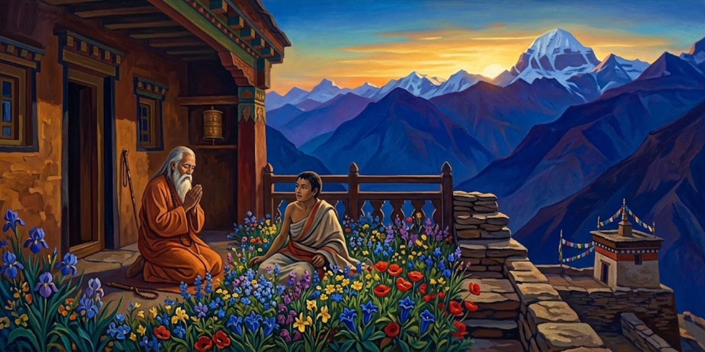</a>

Sri Yukteswar lee a Yogananda y a sus alumnos el relato bíblico de Lázaro. Después afirma que Lahiri resucitó también a Rama, un amigo suyo con quien compartía la búsqueda espiritual.

> "Rama fue sometido de pronto a una dura prueba", continuó Sri Yukteswar. "Contrajo la enfermedad del cólera asiático. Como nuestro maestro nunca se oponía a los servicios de los médicos en casos de enfermedad grave, se llamó a dos especialistas. En medio del frenético trajín de atender al hombre enfermo, yo rezaba profundamente a Lahiri Mahasaya en busca de ayuda. Corrí a su casa y conté la historia entre sollozos.
>
> [Párrafo 8](#original-c32-p8)

Rama es el amigo de Sri Yukteswar cuyo destino da título al capítulo; no es aquí la figura divina homónima de la tradición hindú. Sri Yukteswar es quien cuenta el episodio a Yogananda y a sus alumnos después de leer el relato bíblico de la resurrección de Lázaro. Hay, por tanto, dos niveles testimoniales: el libro transmite la narración de un maestro sobre su propio maestro. El texto deja expresamente asentado que se recurrió a médicos; la historia religiosa no debe convertirse en una recomendación de sustituir la atención sanitaria por la espera de un milagro.

Lahiri promete que Rama sanará, pero Sri Yukteswar encuentra a su amigo agonizante. Los médicos se retiran sin esperanza y Rama muere, según el relato. Tras llorarlo, el discípulo vuelve a Lahiri y anuncia entre sollozos la inminente cremación.

> "'Yukteswar, domínate. Siéntate con calma y medita'. Mi gurú se recogió en *samadhi*. La tarde y la noche transcurrieron en un silencio ininterrumpido; luché sin éxito por recuperar la serenidad interior.
>
> [Párrafo 19](#original-c32-p19)

*Samadhi* es el estado de absorción meditativa que el libro asocia con la unión divina. Al amanecer, continúa Sri Yukteswar, Lahiri le indicó que pusiera siete gotas de aceite de ricino en la boca de Rama, y este volvió a moverse. La explicación que el propio relato ofrece descarta que el aceite sea el poder curativo: sería un soporte material para la confianza del discípulo. No se trata de evidencia clínica de resurrección ni de una propiedad médica demostrada del aceite. El contraste central es el de dos tiempos afectivos: la impaciencia del duelo y la serenidad que el discípulo atribuye al maestro.

> "Al amanecer, Lahiri Mahasaya me miró con ánimo consolador. 'Veo que todavía estás alterado. ¿Por qué no explicaste ayer que esperabas que diera a Rama una ayuda tangible en forma de alguna medicina?'. El maestro señaló una lámpara en forma de copa que contenía aceite de ricino sin refinar. 'Llena un frasquito con el aceite de la lámpara; pon siete gotas en la boca de Rama'.
>
> [Párrafo 20](#original-c32-p20)

La instrucción es la que Sri Yukteswar atribuye a Lahiri en su relato. El objeto cotidiano introduce el apoyo material que el discípulo esperaba recibir. La historia precisará después que, según su interpretación religiosa, el aceite no fue el poder que produjo la recuperación. No se está estableciendo una propiedad del aceite de ricino para reanimar a una persona ni una práctica sanitaria que pueda reproducirse.

Según Sri Yukteswar, Rama revive al recibir el aceite. Lahiri insiste en que este solo sostenía la confianza del discípulo. Después pide a Yogananda escribir sobre su maestro y transmite una predicción de interés occidental por el yoga. Al terminar el libro en 1945, el autor vincula esa tarea con la necesidad de paz ante la amenaza atómica.

> La Sociedad de Naciones eficaz será una liga natural, sin nombre, de corazones humanos. Las amplias simpatías y la visión discernidora necesarias para curar los males de la tierra no pueden brotar de una mera consideración intelectual de las diversidades humanas, sino del conocimiento de la única unidad del hombre: su parentesco con Dios. Para realizar el ideal más elevado del mundo, la paz mediante la fraternidad, ojalá el yoga, la ciencia del contacto personal con lo Divino, se extienda a su debido tiempo a todos los hombres de todas las tierras.
>
> [Párrafo 41](#original-c32-p41)

La liga de corazones es una propuesta religiosa de fraternidad, no el diseño de una nueva institución diplomática. Yogananda contrapone clasificar diferencias desde fuera a experimentar un parentesco común. El párrafo formula una esperanza: que la práctica transforme el vínculo entre las personas. Llamar "ciencia" al contacto con lo divino pertenece a su presentación del yoga, no a una certificación independiente de ese contacto.

Yogananda atribuye la continuidad histórica de la India a su dedicación espiritual. Relee la súplica bíblica de Abraham por Sodoma: la presencia de unos pocos justos bastaría para preservar una comunidad. De esa lectura extrae un criterio religioso de supervivencia nacional.

> Que las palabras divinas se escuchen de nuevo en este siglo veinte, teñido dos veces de sangre antes de llegar a su mitad: ninguna nación que pueda producir diez hombres grandes a los ojos del Juez Insobornable conocerá la extinción. Atendiendo a tales persuasiones, la India ha demostrado que no carece de inteligencia frente a las mil astucias del tiempo. Maestros realizados en el Ser han santificado su suelo en cada siglo; sabios modernos semejantes a Cristo, como Lahiri Mahasaya y su discípulo Sri Yukteswar, se alzan para proclamar que la ciencia del yoga es más vital que cualquier avance material para la felicidad humana y la longevidad de una nación.
>
> [Párrafo 44](#original-c32-p44)

El Juez Insobornable es Dios en la imagen del autor. Los diez justos proceden del episodio bíblico mencionado antes; Yogananda convierte ese relato en argumento sobre la India. No es una explicación histórica comprobada de por qué unas sociedades perduran y otras cambian. La comparación entre maestros indios y Cristo expresa su ideal de santidad compartida, con el que quiere dar a la vida espiritual una responsabilidad pública y no solo individual.

Para reunir una vida de Lahiri poco conocida en Occidente, Yogananda incorpora pasajes de una biografía de su discípulo Satyananda. Cuenta la infancia en Nadia, la muerte temprana de la madre y una crecida que destruyó la casa. El padre, Gaur Mohan, instala a la familia en Benarés y combina observancia religiosa con apertura a ideas modernas.

> El niño Lahiri tomó lecciones de hindi y urdu en grupos de estudio de Benarés. Asistió a una escuela dirigida por Joy Narayan Ghosal, donde recibió enseñanza de sánscrito, bengalí, francés e inglés. Aplicándose a un estudio detenido de los Vedas, el joven yogui escuchaba con avidez las discusiones sobre las Escrituras de brahmanes eruditos, entre ellos un pandit maratha llamado Nag-Bhatta.
>
> [Párrafo 51](#original-c32-p51)

Los Vedas son las escrituras religiosas a cuyo estudio el autor vincula la formación de Lahiri. Joy Narayan Ghosal aparece como responsable de la escuela; Nag-Bhatta, como uno de los interlocutores religiosos que el joven escuchaba. La enumeración de lenguas muestra una educación que no queda encerrada en un solo ámbito. La escucha de discusiones complementa el aprendizaje escolar: antes de ser maestro, el personaje está presentado como alguien dispuesto a aprender de fuentes distintas.

Yogananda describe a Lahiri como un joven apreciado por sus compañeros. Se casa con Kashi Moni, tiene dos hijos y trabaja como contable del gobierno británico; tras morir su padre, asume el sostén familiar. Según el relato, su encuentro con Babaji cerca de Ranikhet y la iniciación en Kriya dan cumplimiento a su vocación. El capítulo presenta esa enseñanza como un caudal que baja de la soledad del Himalaya para alcanzar a hombres y mujeres en su vida ordinaria.

---

## Capítulo 33: Babaji, el yogui-Cristo de la India moderna

Yogananda sitúa a Babaji cerca de Badrinarayan y le atribuye siglos de permanencia corporal. Lo presenta como avatar, encarnación divina libre del ciclo de renacimientos.

> Un avatar no está sujeto a la economía universal; su cuerpo puro, visible como una imagen luminosa, está libre de toda deuda con la naturaleza. Una mirada casual quizá no vea nada extraordinario en la forma de un avatar, pero esta no proyecta sombra ni deja huella en el suelo. Son pruebas simbólicas exteriores de una ausencia interior de oscuridad y de ataduras materiales. Solo un hombre-Dios semejante conoce la Verdad que está detrás de las relatividades de la vida y la muerte. Omar Khayyam, tan groseramente incomprendido, cantó a este hombre liberado en su escritura inmortal, el *Rubaiyat*:
>
> [Párrafo 4](#original-c33-p4)

El avatar es una categoría religiosa; las propiedades de su cuerpo que enumera Yogananda son afirmaciones de esa concepción, no pruebas físicas aportadas por el capítulo. Omar Khayyam es el autor a quien se atribuyen las cuartetas del *Rubaiyat*. Yogananda las lee como expresión de una liberación espiritual: la "Luna del Deleite" sería Dios y la otra luna, el mundo sujeto a repetición. Esa es la interpretación que el libro propone, no una traducción obligatoria de toda la poesía de Khayyam. La cuarteta aparece en el párrafo siguiente del original y no pertenece a esta cita seleccionada.

Después de invocar a Khayyam, Yogananda interpreta la liberación como salida de los ciclos del cosmos. Enlaza a Cristo con figuras sagradas de la India y atribuye a Babaji la tarea de ayudar a otros maestros. Su discípulo Lahiri habría devuelto al mundo el Kriya perdido.

> El *Mahavatar* está en comunión constante con Cristo; juntos envían vibraciones de redención y han planeado la técnica espiritual de salvación para esta era. La labor de estos dos maestros plenamente iluminados, uno con cuerpo y otro sin él, consiste en inspirar a las naciones para que abandonen las guerras suicidas, los odios raciales, el sectarismo religioso y los males del materialismo que vuelven como un bumerán. Babaji conoce bien la tendencia de los tiempos modernos, en especial la influencia y las complejidades de la civilización occidental, y comprende la necesidad de difundir por igual en Occidente y Oriente las liberaciones interiores del yoga.
>
> [Párrafo 11](#original-c33-p11)

El "uno con cuerpo" es Babaji; Cristo es presentado como el colaborador sin cuerpo. La colaboración es una creencia que Yogananda expone, no un encuentro histórico que documente. El vocabulario cristiano permite formular el yoga como una vía destinada también a lectores occidentales. A la vez, el criterio moral de esa misión es concreto: abandonar guerras, racismo y rivalidades religiosas. La supuesta permanencia del maestro no queda al servicio de acumular poder privado, sino de la ayuda que el autor considera necesaria para el mundo.

Yogananda reconoce que no aporta una historia familiar de Babaji y explica su desconocimiento público por una voluntad de permanecer oculto. Describe un joven sin señales de vejez, semejante a Lahiri, y atribuye a pronunciar su nombre una bendición. Kebalananda, su tutor de sánscrito, afirma haber convivido con él.

> "El maestro sin igual se desplaza con su grupo de un lugar a otro de las montañas", me dijo Kebalananda. "Su pequeña comunidad contiene dos discípulos estadounidenses muy avanzados. Después de que Babaji ha permanecido un tiempo en una localidad, dice: *'Dera danda uthao'*. ('Levantemos nuestro campamento y nuestro bastón'). Lleva un *danda* simbólico (bastón de bambú). Sus palabras son la señal para trasladarse con su grupo instantáneamente a otro lugar. No siempre emplea este método de viaje astral; a veces va a pie de cumbre en cumbre.
>
> [Párrafo 18](#original-c33-p18)

El bastón funciona como una señal de partida que la propia cita explica. "Viaje astral" designa aquí el traslado extraordinario que Kebalananda afirma haber conocido; su presencia en un testimonio no lo convierte en un medio de transporte establecido. La coexistencia del traslado instantáneo con la caminata a pie da al personaje una libertad narrativa peculiar: lo extraordinario no sería una obligación permanente de exhibirse. Después se relatan una quemadura y una caída mortal revertidas por Babaji, dentro de la misma lógica de dominio del karma que propone el libro, no como actos que deban imitarse.

Kebalananda cuenta que Babaji curó una quemadura para evitar una muerte kármica y devolvió la vida a un aspirante que saltó de un precipicio. Yogananda interpreta su permanencia como ejemplo de inmortalidad. Otro discípulo, Ram Gopal, recuerda que Lahiri lo envió de noche al lugar de baño de Dasasamedh, junto al Ganges.

> "Pronto llegué al lugar apartado. La noche brillaba con la luz de la luna y las estrellas centelleantes. Después de haber permanecido un rato sentado en paciente silencio, llamó mi atención una enorme losa de piedra cerca de mis pies. Se alzó gradualmente, dejando al descubierto una cueva subterránea. Mientras la piedra permanecía equilibrada de algún modo desconocido, la figura envuelta en ropajes de una mujer joven y de belleza incomparable se elevó desde la cueva hasta gran altura en el aire. Rodeada de un suave halo, descendió lentamente ante mí y quedó inmóvil, sumida en un estado interior de éxtasis. Por fin se movió y habló con dulzura.
>
> [Párrafo 37](#original-c33-p37)

Ram Gopal es el asceta llamado antes en el libro "el santo que no duerme". Lahiri lo había enviado al ghat de Dasasamedh, un lugar de acceso al río para el baño. Según su relato, la mujer se presentó como Mataji, hermana de Babaji, y dijo haber convocado una reunión. La elevación de la losa y la levitación son elementos del testimonio recogido por Yogananda; no se dispone aquí de una comprobación externa. El cambio de narrador conserva también la distancia entre quien afirma haberlo presenciado y quien lo pone por escrito.

La mujer se presenta, según Ram Gopal, como Mataji, hermana de Babaji. Dice haber convocado a su hermano y a Lahiri; una luz sobre el río se condensa después en la figura de Lahiri, que la saluda.

> "Antes de recobrarme de mi desconcierto, quedé aún más maravillado al contemplar una masa giratoria de luz mística que viajaba por el cielo. Descendiendo velozmente, el remolino llameante se acercó a nuestro grupo y se materializó en el cuerpo de un hermoso joven que, comprendí al instante, era Babaji. Se parecía a Lahiri Mahasaya; la única diferencia era que Babaji parecía mucho más joven y tenía el cabello largo y brillante.
>
> [Párrafo 40](#original-c33-p40)

La identificación de la luz con Babaji pertenece a Ram Gopal. La semejanza con Lahiri ya había aparecido en el retrato del maestro: el libro hace visible una continuidad entre ambos sin confundir sus papeles. En la conversación siguiente, Mataji pide a Babaji que no abandone su cuerpo; él promete permanecer visible al menos para un pequeño número de personas. El episodio convierte la inmortalidad corporal en una responsabilidad de presencia, según la interpretación religiosa del narrador.

Mataji pide a Babaji que no abandone su cuerpo y él promete seguir visible para algunos. Tras bendecir a Ram Gopal, los maestros parten, según su relato. De regreso, encuentra a Lahiri en casa; los discípulos aseguran que nunca salió y que estuvo hablando de inmortalidad. Ram Gopal interpreta lo ocurrido como bilocación.

> "Más tarde Lahiri Mahasaya me explicó muchos puntos metafísicos relativos al plan divino oculto para esta tierra", concluyó Ram Gopal. "Dios ha elegido a Babaji para que permanezca en su cuerpo durante todo este ciclo particular del mundo. Las edades vendrán y se irán; aun así, el maestro inmortal, contemplando el drama de los siglos, estará presente en este escenario terrestre".
>
> [Párrafo 54](#original-c33-p54)

Un "ciclo del mundo" es el horizonte temporal religioso que el testimonio invoca; no se ofrece una duración histórica comprobable. Antes de esta conclusión, Ram Gopal cuenta que encontró a Lahiri de vuelta en su casa y que los otros discípulos afirmaron que nunca había salido. Interpreta esa coincidencia como bilocación, presencia en más de un lugar. Yogananda reúne esas voces para construir una tradición de testigos; la multiplicidad de voces debe distinguirse de una verificación independiente de los fenómenos que cuentan.

---

## Capítulo 34: Materialización de un palacio en el Himalaya

Kebalananda anuncia que el primer encuentro entre Lahiri y Babaji permitirá conocer mejor al maestro oculto.

> Estas palabras fueron el preámbulo de Swami Kebalananda a un relato maravilloso. La primera vez que lo contó quedé literalmente hechizado. En muchas otras ocasiones persuadí a mi amable tutor de sánscrito para que repitiera la historia, que más tarde Sri Yukteswar me contó sustancialmente con las mismas palabras. Ambos discípulos de Lahiri Mahasaya habían oído el sobrecogedor relato directamente de labios de su gurú.
>
> [Párrafo 2](#original-c34-p2)

La primera frase remite al anuncio de Kebalananda: el encuentro daría una visión detallada de Babaji. Kebalananda y Sri Yukteswar son los dos transmisores que Yogananda nombra; Lahiri, el protagonista, es la fuente que ambos invocan. La coincidencia entre versiones refuerza la confianza del escritor en esa memoria compartida. No transforma, sin embargo, dos transmisiones de un mismo relato en dos observaciones independientes del suceso. El capítulo hace explícita su cadena de procedencia y permite conservarla al leer.

Lahiri cuenta que, mientras trabajaba en Danapur en 1861, recibió orden de trasladarse a Ranikhet. El viaje al Himalaya, con un criado y un coche de caballos, duró treinta días.

> "Mis obligaciones de oficina no eran pesadas; podía pasar muchas horas recorriendo las magníficas colinas. Me llegó el rumor de que grandes santos bendecían la región con su presencia; sentí un intenso deseo de verlos. Durante una caminata, a primera hora de la tarde, me asombró oír una voz distante que llamaba mi nombre. Continué mi vigoroso ascenso por la montaña Drongiri. Me invadió una ligera inquietud al pensar que quizá no pudiera desandar el camino antes de que la oscuridad descendiera sobre la selva.
>
> [Párrafo 6](#original-c34-p6)

Lahiri trabajaba como contable del Departamento de Ingeniería Militar del gobierno británico; el relato sitúa el traslado en 1861. Ranikhet es el destino de ese empleo y Drongiri la montaña donde ubica la llamada. La oficina no desaparece ante la vocación espiritual: proporciona la circunstancia del encuentro. Más adelante Babaji afirmará haber provocado mentalmente el traslado. Esa explicación es parte del relato de Lahiri, mientras que la incertidumbre del camino deja al personaje, por ahora, en la situación ordinaria de alguien que teme perderse.

Un joven parecido a él lo recibe en una cueva. Según Lahiri, afirma haber provocado el traslado laboral para reunirlos. Un toque en la frente despierta recuerdos de una vida anterior: reconoce en el desconocido a Babaji, su maestro, y en la cueva un antiguo lugar de meditación.

> "'¡Durante más de tres décadas te he esperado aquí, he esperado que regresaras a mí!'. La voz de Babaji resonó con amor celestial. '¡Te escabulliste y desapareciste entre las tumultuosas olas de la vida más allá de la muerte! ¡La varita mágica de tu karma te tocó y te fuiste! ¡Aunque tú me perdiste de vista, yo nunca te perdí de vista! Te perseguí por el mar astral luminoso donde navegan los gloriosos ángeles. Entre oscuridad, tormenta, conmoción y luz te seguí, como una madre pájaro que guarda a sus crías. Mientras cumplías tu período humano de vida en el vientre y surgías como un bebé, mis ojos estuvieron siempre sobre ti. ¡Cuando, en tu infancia, cubrías tu pequeña figura en postura de loto bajo las arenas de Nadia, yo estaba invisiblemente presente! Pacientemente, mes tras mes, año tras año, he velado por ti esperando este día perfecto. ¡Ahora estás conmigo! ¡Mira, aquí está tu cueva, amada desde antaño! Siempre la he mantenido limpia y preparada para ti. ¡Aquí está tu sagrada manta de *asana*, donde te sentabas cada día para llenar de Dios tu corazón en expansión! ¡Mira allí tu cuenco, del que bebías a menudo el néctar que yo preparaba! ¡Mira cómo he mantenido bien pulida la copa de latón para que pudieras volver a beber de ella! ¡Hijo mío, comprendes ahora?'".
>
> [Párrafo 18](#original-c34-p18)

*Asana* designa aquí el asiento de práctica, conservado en la manta; Nadia es el lugar de la infancia de Lahiri ya mencionado en su biografía. El karma explica, en las palabras atribuidas a Babaji, la separación entre dos encarnaciones. Todo el recuerdo depende de esa concepción religiosa. Los objetos cuidados dan al amor una forma doméstica: esperar consiste en mantener limpio un espacio, preparar un cuenco, pulir una copa. La escala cósmica del reencuentro obtiene su intensidad de tareas pequeñas que se dicen repetidas durante décadas.

Babaji le ordena beber un aceite y tenderse junto al río. Lahiri cuenta que sintió calor y protección pese al frío nocturno. Más tarde un guía lo recoge y explica una luminosidad distante: Babaji habría creado un palacio para satisfacer un viejo deseo suyo y liberarlo de ese apego antes de iniciarlo.

> "Un vasto palacio de oro deslumbrante se alzaba ante nosotros. Engastado de incontables joyas y situado entre jardines diseñados, ofrecía un espectáculo de grandeza sin igual. Santos de semblante angelical estaban apostados junto a puertas resplandecientes, medio enrojecidas por el fulgor de los rubíes. Diamantes, perlas, zafiros y esmeraldas de gran tamaño y brillo estaban incrustados en los arcos decorativos.
>
> [Párrafo 28](#original-c34-p28)

El guía explica a Lahiri que el palacio satisface un deseo antiguo para liberarlo de ese vínculo. El lujo no sería el premio definitivo de la práctica, sino algo que debe ser visto, colmado y dejado atrás. La materialización es la explicación extraordinaria que ofrece el relato transmitido por Yogananda; la precisión visual del edificio no constituye una prueba de su aparición física. Dentro de la narración, su abundancia prepara el contraste con la tierra desnuda a la que volverán después.

Dentro del palacio, Lahiri encuentra cantos, incienso y discípulos en meditación. Al preguntar cómo surgió el edificio, su guía compara la creación con el sueño: la voluntad divina mantendría unido el mundo, y Babaji sostendría del mismo modo aquel palacio hasta que terminara su función.

> "Mientras yo permanecía silencioso de asombro, mi guía hizo un amplio gesto. 'Este palacio centelleante, espléndidamente adornado de joyas, no ha sido construido por esfuerzo humano ni con oro y gemas extraídos laboriosamente de minas. Se alza sólido, como un desafío monumental al hombre. Quien se reconoce como hijo de Dios, tal como Babaji lo ha hecho, puede alcanzar cualquier meta mediante los poderes infinitos ocultos en su interior. Una piedra común encierra en sí el secreto de una energía atómica prodigiosa; del mismo modo, un mortal es todavía una central de divinidad'.
>
> [Párrafo 36](#original-c34-p36)

La comparación con la energía atómica prolonga la estrategia del capítulo sobre los milagros: hacer imaginable una potencia invisible con el vocabulario de la física. Que la materia posea energía no demuestra que la voluntad pueda organizarla en un palacio. "Central de divinidad" es la imagen religiosa que el guía propone para el potencial humano. Lahiri cuenta que tocó objetos y paredes, y que su deseo quedó satisfecho; la interpretación de esos contactos procede de la misma narración, no de un examen independiente del edificio.

Lahiri toca los objetos y siente satisfecho su antiguo deseo. Cuenta que Babaji lo inicia ante un fuego y que, al día siguiente, el palacio desaparece. Un cuenco proporciona comida y agua; el maestro le explica que lo divino puede satisfacer necesidades terrenales, aunque no se reduzca a ellas.

> "Aquella tarde me senté sobre mi manta, santificada por sus asociaciones con realizaciones de vidas pasadas. Mi divino gurú se acercó y pasó la mano sobre mi cabeza. Entré en el estado de *nirbikalpa samadhi* y permanecí ininterrumpidamente en su dicha durante siete días. Atravesando los sucesivos estratos del conocimiento de mí mismo, penetré en los reinos inmortales de la realidad. Todas las limitaciones ilusorias desaparecieron; mi alma quedó plenamente establecida en el altar eterno del Espíritu Cósmico. Al octavo día caí a los pies de mi gurú y le imploré que me mantuviera siempre cerca de él en esta sagrada soledad.
>
> [Párrafo 50](#original-c34-p50)

*Nirbikalpa samadhi* es el estado de unión divina sin limitaciones que Lahiri afirma haber experimentado. Los siete días dan forma narrativa a una ruptura con el tiempo de oficina y familia que había organizado su vida. Babaji rechaza después la petición de quedarse: el discípulo debe regresar como ejemplo de yogui que cumple deberes domésticos, profesionales y cívicos. La renuncia decisiva sería interior. El palacio se ha retirado, pero tampoco la cueva puede convertirse en una nueva posesión que lo separe de los demás.

Babaji rechaza que Lahiri se quede: debe volver con su familia y mostrar que la realización no exige abandonar deberes domésticos, laborales o cívicos. Lahiri acepta, pero las estrictas condiciones de iniciación le preocupan por quienes aún no pueden renunciar interiormente a todo.

> "'Gurú angelical, puesto que ya has favorecido a la humanidad al resucitar el arte perdido del Kriya, ¿no aumentarás ese beneficio relajando los estrictos requisitos del discipulado?'. Miré suplicante a Babaji. 'Te ruego que me permitas comunicar *Kriya* a todos los buscadores, aunque al principio no puedan prometer una completa renuncia interior. Los atormentados hombres y mujeres del mundo, perseguidos por el triple sufrimiento, necesitan un estímulo especial. Quizá nunca intenten el camino hacia la libertad si se les niega la iniciación en *Kriya*'.
>
> [Párrafo 57](#original-c34-p57)

El "triple sufrimiento" aparece como una fórmula religiosa de la aflicción humana; este párrafo no enumera sus partes. La petición es comprensible sin convertirla en una clasificación añadida: exige que el acceso no dependa de haber alcanzado ya aquello que la práctica promete ayudar a alcanzar. Babaji consiente, según el relato. La relación maestro-discípulo admite aquí una negociación: la compasión del discípulo modifica la regla de entrada, sin que la relajación de esa regla elimine el trabajo posterior.

Babaji acepta abrir Kriya a quienes pidan ayuda y promete acudir cuando Lahiri lo llame. De regreso, el discípulo visita en Moradabad a unos amigos incrédulos. Para convencerlos promete mostrar al maestro, prepara una habitación y lo invoca. Según cuenta, la figura de Babaji aparece.

> "'Lahiri, ¿me llamas por una bagatela?'. La mirada del maestro era severa. 'La Verdad es para los buscadores sinceros, no para los de curiosidad ociosa. Es fácil creer cuando se ve; entonces no hay nada que negar. La verdad suprasensorial la merecen y la descubren quienes superan su natural escepticismo materialista'. Añadió gravemente: '¡Déjame ir!'".
>
> [Párrafo 74](#original-c34-p74)

Moradabad es la localidad donde Lahiri se aloja antes de volver a su trabajo. La aparición de Babaji ocurre según su testimonio, transmitido por los dos maestros de Yogananda. La reprimenda introduce un límite al uso del prodigio: la ayuda no debería volverse espectáculo a disposición de quien quiere ganar una discusión. "Suprasensorial" significa aquí lo que excede los sentidos ordinarios. La exigencia religiosa de sinceridad no sustituye los criterios de comprobación cuando se desea afirmar un hecho físico.

> "Caí suplicante a sus pies. 'Santo gurú, reconozco mi grave error; pido humildemente perdón. Fue para crear fe en estas mentes espiritualmente ciegas por lo que me atreví a llamarte. Puesto que has aparecido bondadosamente ante mi oración, por favor, no te marches sin conceder una bendición a mis amigos. Aunque sean incrédulos, al menos estaban dispuestos a investigar la verdad de mis extrañas afirmaciones'.
>
> [Párrafo 75](#original-c34-p75)

La defensa cambia el énfasis: los amigos dejan de ser solo una audiencia que necesita convencerse y pasan a ser personas dispuestas a investigar. Babaji accede a quedarse, pero modifica su promesa: acudirá cuando Lahiri lo necesite, no siempre que lo llame. El vínculo pierde así la forma de un servicio automático. Las dos citas consecutivas se mantienen como párrafos distintos, con sus respectivas glosas; no se funden en un diálogo nuevo que altere los límites de la selección.

Babaji accede a quedarse, pero limita su promesa: acudirá por necesidad, no a cualquier llamada. Los amigos entran; uno sospecha una ilusión colectiva. Según Lahiri, el maestro permite que todos toquen su cuerpo y el grupo se inclina convencido.

> "'Que se prepare *halua*
> '. Babaji hizo esta petición, yo lo sabía, para asegurar aún más al grupo de su realidad física. Mientras hervía la papilla, el divino gurú charló afablemente. Grande fue la metamorfosis de estos Tomases incrédulos en devotos san Pablos. Después de comer, Babaji nos bendijo a cada uno por turno. Hubo un destello repentino; presenciamos la desquimización instantánea de los elementos electrónicos del cuerpo de Babaji en una luz vaporosa que se extendía. El poder de voluntad del maestro, sintonizado con Dios, había aflojado su presa sobre los átomos de éter que se mantenían unidos como su cuerpo; de inmediato los billones de diminutas chispas lifetrónicas se desvanecieron en la reserva infinita.
>
> [Párrafo 80](#original-c34-p80)

*Halua* es la preparación alimenticia que el propio pasaje describe como una papilla. Tomás y Pablo son las referencias cristianas con que el narrador representa el tránsito de la incredulidad a la fe. "Desquimicalización", "átomos de éter" y "chispas lifetrónicas" reproducen el vocabulario con que explica la desaparición, no una descripción física verificada. La comida compartida ofrece un contraste deliberado con ese vocabulario grandioso: la presencia se reconoce primero mediante el contacto, la conversación y el alimento.

Maitra, uno de los invitados, declara que ha visto a un vencedor de la muerte; Lahiri vuelve a Danapur y retoma sus deberes familiares y laborales. Otro recuerdo pone a prueba lo aprendido: en una feria religiosa en Allahabad juzga hipócrita a un asceta por su apariencia. Entonces, cuenta, descubre a Babaji lavando los pies de otro renunciante y disponiéndose a limpiar sus utensilios. Lahiri entiende la lección: no despreciar a nadie y reconocer lo divino también en quien no parece digno. Las últimas palabras atribuidas a Babaji nombran la humildad, aprendida al servir a sabios e ignorantes, como virtud especialmente grata a Dios.

---

## Capítulo 35: La vida de Lahiri Mahasaya, semejante a la de Cristo

<a href="img/261017_autobiografia-de-un-yogui_i-35.jpg">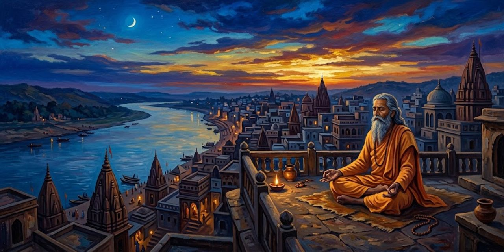</a>

Al pedir a Juan el Bautista que lo bautice, Jesús reconoce, en la lectura de Yogananda, la autoridad espiritual de su maestro.

> Por un estudio reverente de la Biblia desde un punto de vista oriental, y por percepción intuitiva, estoy convencido de que Juan el Bautista fue, en vidas pasadas, el gurú de Cristo. Hay numerosos pasajes en la Biblia que dan a entender que Juan y Jesús, en sus últimas encarnaciones, fueron respectivamente Elijah y su discípulo Elisha. (Esas son las grafías del Antiguo Testamento. Los traductores griegos escribieron los nombres como Elias y Eliseus; reaparecen en el Nuevo Testamento con esas formas cambiadas.)
>
> [Párrafo 2](#original-c35-p2)

"Gurú" es el maestro espiritual que guía a un discípulo. Juan es el predicador que bautiza a Jesús en el relato bíblico; Elijah y Elisha son las formas inglesas de los nombres que en castellano se conocen como Elías y Eliseo. Yogananda propone leerlos mediante la reencarnación: debe distinguirse su convicción declarada de una conclusión demostrada por el texto. La comparación prepara el vínculo entre Babaji y Lahiri Mahasaya, los maestros de su propia tradición.

Yogananda enlaza profecías y escenas bíblicas para sostener que Juan y Jesús habían sido Elías y Eliseo, con los papeles de maestro y discípulo después invertidos. Extiende ese vínculo entre vidas a Babaji y Lahiri: cuenta que el primero lo guio hasta reencontrarlo en las montañas y devolverlo al mundo. Ya en Benarés, Lahiri consuela a su jefe, cuya esposa enferma en Inglaterra: anuncia su mejoría y anticipa frases de una carta. Según el relato, la carta confirma ambas cosas; al viajar a la India, la mujer reconoce en Lahiri a quien había visto junto a su lecho al sanar.

> Día tras día, uno o dos devotos suplicaban al sublime gurú la iniciación en el *Kriya*. Además de estos deberes espirituales y de los de su vida laboral y familiar, el gran maestro se interesaba con entusiasmo por la educación. Organizó numerosos grupos de estudio y participó activamente en el crecimiento de una gran escuela secundaria del barrio de Bengalitola de Benarés. Sus habituales discursos sobre las escrituras llegaron a llamarse su "Asamblea del *Gita*", a la que acudían con afán muchos buscadores de la verdad.
>
> [Párrafo 20](#original-c35-p20)

Lahiri Mahasaya es el discípulo de Babaji y maestro de Sri Yukteswar cuya vida se presenta en este capítulo; Benarés es la ciudad donde el libro sitúa su trabajo y su casa. El *Kriya* es la disciplina de yoga que transmite, y la iniciación, su enseñanza formal al discípulo. El *Gita* abrevia *Bhagavad Gita*, texto religioso que comentaba. La suma de ocupaciones responde a una objeción práctica: la dedicación espiritual no se reserva aquí a quien ha dejado la vida familiar.

Lahiri responde con su propia vida a la objeción de que las obligaciones impiden meditar: mantiene empleo y familia, vive modestamente y recibe a quienes lo buscan. Devuelve las reverencias y toca los pies ajenos, aunque rara vez permite ese homenaje hacia sí.

> Un rasgo notable de la vida de Lahiri Mahasaya fue su don de la iniciación en el *Kriya* a personas de todas las creencias. No solo hindúes: entre sus discípulos más destacados hubo musulmanes y cristianos. Monistas y dualistas, personas de todas las confesiones o de ninguna confesión establecida, eran recibidos e instruidos con imparcialidad por el gurú universal. Uno de sus chelas más avanzados fue Abdul Gufoor Khan, un mahometano. Muestra gran valentía por parte de Lahiri Mahasaya que, aunque era un brahmán de casta alta, hiciera todo lo posible por disolver el rígido fanatismo de castas de su época. Personas de todos los ámbitos de la vida encontraban refugio bajo las alas omnipresentes del maestro. Como todos los profetas inspirados por Dios, Lahiri Mahasaya dio nueva esperanza a los marginados y desposeídos de la sociedad.
>
> [Párrafo 23](#original-c35-p23)

El *Kriya* es la práctica de yoga transmitida en el linaje del libro. Un chela es un discípulo; Abdul Gufoor Khan es el discípulo musulmán que el autor pone como ejemplo. Los monistas sostienen una unidad fundamental de la realidad; los dualistas distinguen principios irreductibles, aquí en el ámbito religioso. Los brahmanes son la clase sacerdotal situada en la cima del esquema tradicional de varnas. La apertura descrita no pide que todos adopten una nueva confesión: los párrafos siguientes desarrollan la continuidad con la práctica propia de cada estudiante.

Lahiri pide prepararse para la muerte mediante la meditación, sin reducir la identidad al cuerpo. No exige abandonar la religión propia: recomienda oración o meditación diaria y orienta a cada discípulo hacia devoción, acción, conocimiento o yoga integral, según su inclinación. A quien desea hacerse monje le pide considerar antes sus austeridades.

> El gran gurú enseñaba a sus discípulos a evitar la discusión teórica de las escrituras. "Solo es sabio quien se dedica a realizar, y no solo a leer, las antiguas revelaciones", decía. "Resolved todos vuestros problemas por medio de la meditación. Cambiad las especulaciones religiosas improductivas por un contacto real con Dios. Despejad la mente de los escombros teológicos dogmáticos; dejad entrar las aguas frescas y sanadoras de la percepción directa. Sintonizaos con la Guía interior activa; la Voz Divina tiene la respuesta a cada dilema de la vida. Aunque el ingenio del hombre para meterse en problemas parezca no tener fin, el Socorro Infinito no es menos ingenioso."
>
> [Párrafo 28](#original-c35-p28)

"Realizar" tiene aquí el sentido de experimentar o alcanzar una verdad espiritual, no solo entender una idea. La oposición no es entre leer y no leer, sino entre conocimiento indirecto y experiencia reclamada como propia. La promesa de una respuesta a "cada dilema" pertenece a la confianza religiosa del maestro tal como Yogananda la transmite. No convierte la meditación en sustituto automático de las decisiones y responsabilidades cotidianas que el mismo capítulo exige.

Yogananda cuenta que Lahiri sintió un naufragio japonés antes de que apareciera en el periódico, y recoge una iniciación recibida en sueños por un discípulo distante. Pero esa presencia espiritual no exime de obligaciones: el maestro corrige a quienes las descuidan. Ante otro que exige una iniciación superior, el cartero Brinda confiesa que la primera ya lo desborda; el impaciente reconoce su error. La enseñanza se extiende por Bengala y llega a ascetas y maharajás, mientras Lahiri prohíbe publicitar su persona. Jubilado en 1886, recibe cada vez más visitantes en su casa de Benarés.

> Para asombro de todos los que lo contemplaban, el estado fisiológico habitual de Lahiri Mahasaya exhibía los rasgos sobrehumanos de ausencia de respiración y sueño, cese del pulso y del latido cardíaco, ojos serenos que no parpadeaban durante horas y una profunda aura de paz. Ningún visitante partía sin una elevación del espíritu; todos sabían que habían recibido la bendición silenciosa de un verdadero hombre de Dios.
>
> [Párrafo 50](#original-c35-p50)

El párrafo pasa de afirmaciones fisiológicas extraordinarias a la experiencia afectiva de los visitantes. No son pruebas equivalentes: sentirse reconfortado no verifica la ausencia de latido o respiración. Yogananda presenta esos rasgos como signos de santidad, sin ofrecer en el párrafo registros o protocolos médicos. La quietud corporal funciona, en su retrato, como manifestación visible de una realización interior.

Lahiri permite a Panchanon Bhattacharya abrir en Calcuta la Arya Mission Institution, donde se difunde el Kriya y se preparan remedios herbales. Yogananda atribuye a la bendición del maestro el éxito de destilar un aceite de neem. La institución publica también sus comentarios: no libros redactados por Lahiri, sino enseñanzas que sus discípulos recogieron con desigual precisión.

> Sri Ananda Mohan Lahiri, un nieto del maestro, ha escrito un interesante folleto sobre el *Kriya*. "El texto del *Bhagavad Gita* es parte de la gran epopeya, el *Mahabharata*, que posee varios puntos de nudo *(vyas-kutas)*", escribió Sri Ananda. "Dejad esos puntos de nudo sin cuestionar, y no encontraremos sino relatos míticos de un tipo peculiar y fácil de malinterpretar. Dejad esos puntos de nudo sin explicar, y habremos perdido una ciencia que Oriente ha conservado con una paciencia sobrehumana tras una búsqueda de miles de años de experimentos. Fueron los comentarios de Lahiri Mahasaya los que sacaron a la luz, libre de alegorías, la misma ciencia de la religión que había sido tan hábilmente ocultada en el enigma de la letra y las imágenes de las escrituras. Ya no un mero malabarismo ininteligible de palabras, las fórmulas védicas de culto, de otro modo sin sentido, han sido demostradas por el maestro como llenas de significado científico....
>
> [Párrafo 54](#original-c35-p54)

El *Mahabharata* es una epopeya india; el *Bhagavad Gita*, un diálogo religioso que forma parte de ella. Los Vedas son textos sagrados del hinduismo. Ananda Mohan Lahiri, nieto y expositor de la tradición familiar, llama "puntos de nudo" a pasajes que requieren interpretación. Sus expresiones "ciencia" y "demostrado" reclaman una autoridad propia de esa escuela: no aportan por sí mismas una prueba experimental. El párrafo termina abierto porque la exposición continúa en los párrafos siguientes de la fuente.

El nieto sostiene que la dicha del Kriya desplaza las pasiones y transforma una relación utilitaria con la naturaleza en reverencia; atribuye a esa comunión los llamados milagros. Presenta sus leyes como verdades que podrían redescubrirse aun sin libros. Yogananda llama entonces a Lahiri encarnación del yoga: considera su mayor logro volver practicable para todos una disciplina antes compleja.

> Refiriéndose a los milagros, Lahiri Mahasaya decía a menudo: "El funcionamiento de leyes sutiles desconocidas para la gente en general no debería discutirse públicamente ni publicarse sin el debido discernimiento". Si en estas páginas he parecido desobedecer sus palabras de cautela, es porque él me ha dado una confirmación interior. Además, al registrar las vidas de Babaji, Lahiri Mahasaya y Sri Yukteswar, he considerado aconsejable omitir muchos relatos milagrosos verdaderos, que difícilmente habrían podido incluirse sin escribir también un volumen explicativo de abstrusa filosofía.
>
> [Párrafo 61](#original-c35-p61)

La reserva plantea una dificultad de lectura: el autor presenta como verdaderos relatos cuya autorización para publicarlos procede de una confirmación interior. Ese fundamento pertenece a su experiencia religiosa, no a una comprobación que pueda repetir el lector. Se entiende así el pacto del libro: es un testimonio de fe que solicita confianza personal. La cautela del maestro tampoco equivale a una negación de los milagros; en la versión de Yogananda, regula a quién y cómo contarlos.

El cierre devuelve la atención al esfuerzo del practicante: Yogananda atribuye a Lahiri una unión divina que no dependería del credo ni de un favor arbitrario. Incluso quien no acepte la divinidad de un maestro podría, según esta enseñanza, descubrirla en sí mismo mediante el Kriya.

---

## Capítulo 36: El interés de Babaji por Occidente

Una noche en el balcón de Serampore, Yogananda pregunta si su maestro conoció a Babaji. Sri Yukteswar afirma haberlo visto tres veces; el primer encuentro ocurrió en una Kumbha Mela de Allahabad.

> Las ferias religiosas celebradas en la India desde tiempo inmemorial se conocen como *Kumbha Melas*; han mantenido las metas espirituales constantemente a la vista de la multitud. Millones de hindúes devotos se reúnen cada seis años para encontrarse con miles de sadhus, yoguis, swamis y ascetas de toda clase. Muchos son ermitaños que nunca abandonan sus retiros apartados salvo para asistir a las *melas* y otorgar sus bendiciones a hombres y mujeres del mundo.
>
> [Párrafo 4](#original-c36-p4)

La feria permite que coincidan dos formas de vida que suelen mantenerse separadas: la renuncia y las obligaciones familiares. "Mela" significa aquí reunión o feria; los sadhus son ascetas y los swamis, miembros de órdenes religiosas. El capítulo no presenta el encuentro con Babaji como algo procurado por Sri Yukteswar: lo sitúa dentro de ese espacio abierto, multitudinario, donde tampoco resulta fácil distinguir a un maestro de un mendigo.

> "Yo no era swami cuando conocí a Babaji", prosiguió Sri Yukteswar. "Pero ya había recibido de Lahiri Mahasaya la iniciación en el *Kriya*. Él me animó a asistir a la *mela* que se celebraba en enero de 1894 en Allahabad. Era mi primera experiencia de una *kumbha*; el clamor y el oleaje de la multitud me tenían algo aturdido. Al escudriñar a mi alrededor no veía ningún rostro iluminado de maestro. Al pasar por un puente en la orilla del Ganges, advertí a un conocido que estaba cerca, con su cuenco de mendigar extendido.
>
> [Párrafo 5](#original-c36-p5)

El cuenco concentra la decepción inicial: Sri Yukteswar ha ido buscando santidad y encuentra necesidad material. La narración prepara una corrección de esa primera mirada. Su futura condición de maestro no elimina del retrato el desconcierto ni el juicio precipitado. Allahabad es la ciudad donde el capítulo sitúa la reunión; el Ganges es el río junto al que se desarrolla este encuentro.

Decepcionado por el ruido y los mendigos, Sri Yukteswar piensa en la utilidad de los científicos. Un asceta lo conduce ante Babaji, a quien no reconoce. Este lo abraza e inviste como swami. Ante sus reproches a la feria, le pide distinguir a los verdaderos maestros, sin juzgar al conjunto. Sri Yukteswar acepta y plantea su inquietud por Occidente.

> ""Señor", comenté, "he estado pensando en los hombres de ciencia de Occidente, muy superiores en inteligencia a la mayoría de los aquí reunidos, que viven en las lejanas Europa y América, profesan distintas creencias e ignoran el verdadero valor de ferias como esta. Son ellos quienes podrían beneficiarse enormemente de encuentros con los maestros de la India. Pero, aunque elevados en logros intelectuales, muchos occidentales están unidos a un materialismo craso. Otros, célebres en la ciencia y la filosofía, no reconocen la unidad esencial de la religión. Sus credos actúan como barreras infranqueables que amenazan con separarlos de nosotros para siempre."
>
> [Párrafo 20](#original-c36-p20)

La oposición entre ciencia occidental y espiritualidad india es el esquema de este diálogo, no una descripción suficiente de ambas sociedades. El argumento pide un intercambio: el saber intelectual no asegura, para el hablante, la comprensión religiosa. También aparece una tensión interna: critica a quienes establecen barreras entre credos mientras clasifica a las personas por su supuesta inteligencia. El propósito reconciliador convive con los juicios del narrador.

Babaji propone unir actividad occidental y espiritualidad india. Promete enviarle un discípulo, que Sri Yukteswar identifica ahora con Yogananda. Le encarga comparar escrituras hindúes y cristianas, y promete visitarlo al terminar. En Benarés, Lahiri le revela a quién había conocido. Sri Yukteswar transmite entonces su mensaje: la energía para la vida de Lahiri se agota.

> "Al pronunciar yo esas palabras enigmáticas, la figura de Lahiri Mahasaya tembló como tocada por una corriente de relámpago. En un instante todo en él quedó en silencio; su semblante sonriente adquirió una severidad increíble. Como una estatua de madera, sombría e inmóvil en su asiento, su cuerpo perdió el color. Yo estaba alarmado y perplejo. Nunca en mi vida había visto a aquella alma jubilosa mostrar tan sobrecogedora gravedad. Los demás discípulos presentes miraban con aprensión.
>
> [Párrafo 39](#original-c36-p39)

"Esas palabras" son el aviso atribuido a Babaji: la energía acumulada para esa vida se estaba agotando. Sin ese antecedente, la reacción quedaría sin causa. Sri Yukteswar la interpreta después como preparación para morir; lo observable dentro de su relato es la inmovilidad, mientras que la explicación espiritual procede de su lectura de ella. El cambio de la sonrisa a la gravedad interrumpe el tono confiado de la conversación.

Tras tres horas inmóvil, Lahiri recupera su alegría. Sri Yukteswar interpreta el silencio como desprendimiento ante la muerte y los mensajes como medios de fortalecer la fe. En Serampore compone un poema para Babaji y termina rápidamente la comparación de escrituras, publicada primero por entregas y luego como libro.

> "La mañana siguiente a haber concluido mis trabajos literarios", continuó el Maestro, "fui al Rai Ghat de aquí para bañarme en el Ganges. El ghat estaba desierto; me quedé quieto un rato, disfrutando de la paz soleada. Tras una inmersión en las aguas centelleantes, emprendí el regreso a casa. El único sonido en el silencio era el de mi paño empapado en el Ganges, que chapoteaba a cada paso. Cuando dejé atrás el lugar del gran baniano próximo a la orilla, un fuerte impulso me instó a mirar hacia atrás. ¡Allí, a la sombra del baniano y rodeado de unos pocos discípulos, estaba sentado el gran Babaji!
>
> [Párrafo 45](#original-c36-p45)

Un ghat es un acceso escalonado al río; el baniano es el árbol bajo el cual se sitúa la reunión. Los detalles sensoriales, sobre todo el paño mojado, fijan una aparición extraordinaria en una caminata corriente. Según Sri Yukteswar, Babaji había prometido visitarlo al concluir el libro: por eso reconocerlo no es solo una sorpresa, sino la confirmación de lo anunciado. La escena sigue siendo un relato transmitido por Yogananda.

Babaji agradece el libro, pero rechaza entrar en casa. Sri Yukteswar busca dulces; al volver lo encuentra ausente y se disgusta. Meses después, según cuenta, Lahiri le toca la frente y le permite verlo otra vez. Babaji aclara que prometió verlo, no quedarse, y le pide meditar más. Sri Yukteswar se reconcilia; Babaji desaparece.

> "Aquella fue una de mis últimas visitas a Benarés para ver a mi gurú", concluyó Sri Yukteswar. "Tal como Babaji había predicho en la *Kumbha Mela*, la encarnación como padre de familia de Lahiri Mahasaya se acercaba a su fin. Durante el verano de 1895, en su cuerpo robusto apareció un pequeño forúnculo en la espalda. Se opuso a que lo abrieran; estaba expiando en su propia carne el mal karma de algunos de sus discípulos. Al final, unos cuantos chelas insistieron mucho; el maestro respondió enigmáticamente:
>
> [Párrafo 62](#original-c36-p62)

La frase queda abierta porque la respuesta pertenece al siguiente párrafo, no seleccionado: el cuerpo debía encontrar una causa para partir. "Karma" nombra aquí las consecuencias de acciones anteriores. La afirmación de que el maestro asume las consecuencias de sus discípulos es una interpretación devocional de su dolencia, no una explicación médica. "Padre de familia" distingue su vida doméstica de la renuncia monástica.

Lahiri acepta atender el forúnculo y muere poco después. Keshabananda cuenta que una aparición suya lo llamó desde Hardwar a Benarés. Allí lo oyó comentar el Gita, anunciar su partida y prometer su retorno. Según el discípulo, giró tres veces, se sentó mirando al norte y murió en maha-samadhi.

> "El hermoso cuerpo de Lahiri Mahasaya, tan querido por los devotos, fue incinerado con solemnes ritos de padre de familia en Manikarnika Ghat, junto al sagrado Ganges", continuó Keshabananda. "Al día siguiente, a las diez de la mañana, mientras yo seguía en Benarés, mi habitación se inundó de una gran luz. ¡Y he aquí que ante mí estaba la forma de carne y hueso de Lahiri Mahasaya! Se parecía exactamente a su antiguo cuerpo, salvo que tenía un aspecto más joven y radiante. Mi divino gurú me habló.
>
> [Párrafo 72](#original-c36-p72)

Manikarnika Ghat es el lugar de cremación que identifica el testigo. El énfasis en "carne y hueso" procura distinguir lo contado de un recuerdo o una visión interior. Pero la distinción que hace Keshabananda no convierte su testimonio en verificación de una resurrección: el lector recibe la versión que Yogananda recogió de él. Esa cadena de voces debe mantenerse visible.

Keshabananda afirma que el aparecido explicó haber reconstruido un cuerpo a partir de las cenizas y que, concluida su misión familiar, permanecería junto a Babaji. Después lo bendijo y desapareció. El discípulo compara su alegría con la de quienes vuelven a ver vivo a un maestro después de morir.

> "Cuando regresé a mi aislada ermita de Hardwar", prosiguió Keshabananda, "llevé conmigo las cenizas sagradas de mi gurú. Sé que ha escapado de la jaula del espacio y el tiempo; el ave de la omnipresencia está libre. Aun así, consagrar sus restos sagrados confortaba mi corazón."
>
> [Párrafo 75](#original-c36-p75)

Las cenizas y el ave libre no se excluyen en la experiencia del hablante. La convicción religiosa asegura que el maestro permanece; el duelo necesita todavía un objeto cercano. El "aun así" admite esa diferencia sin resolverla con teoría. Hardwar es el lugar donde Keshabananda sitúa su ermita. El capítulo termina reuniendo otros testimonios de apariciones, no abandonando la perspectiva de los discípulos.

Yogananda añade las voces de Panchanon Bhattacharya, fundador de una institución del linaje en Calcuta, y de Swami Pranabananda, otro discípulo. Ambos afirman haber visto a Lahiri a la misma hora que Keshabananda, en lugares distintos, después de la cremación. Pranabananda cuenta que el maestro lo invitó a tocar su cuerpo para disipar el duelo. El autor reúne esos testimonios como confirmación de una resurrección y concluye con una invocación bíblica: la muerte perdería su victoria ante la inmortalidad. La certeza es la de quienes cuentan la experiencia.

---

## Capítulo 37: Parto hacia América

<a href="img/261017_autobiografia-de-un-yogui_i-37.jpg">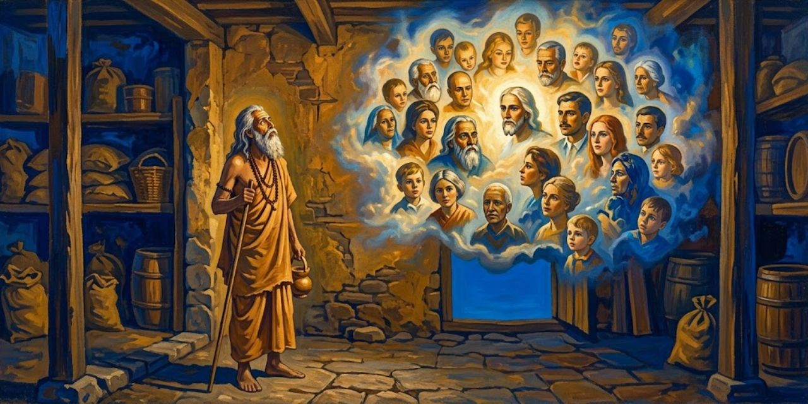</a>

Meditando entre cajas de Ranchi, Yogananda dice ver rostros occidentales. Anuncia a Bimal que Dios lo llama a América; el muchacho difunde la noticia. Confía la escuela a los profesores y promete escribir y volver.

> Tenía lágrimas en los ojos al dirigir una última mirada a los niños y a los soleados terrenos de Ranchi. Sabía que acababa de cerrarse una época definida de mi vida; en adelante viviría en tierras lejanas. Tomé el tren hacia Calcuta pocas horas después de mi visión. Al día siguiente recibí una invitación para ser el delegado de la India en un Congreso Internacional de Liberales Religiosos en América. Se reuniría aquel año en Boston, bajo los auspicios de la Asociación Unitaria Americana.
>
> [Párrafo 10](#original-c37-p10)

La sucesión temporal construye el sentido providencial del episodio: primero la visión, luego la invitación. El libro hace que una decisión íntima encuentre una ocasión pública. Ranchi es la localidad india donde Yogananda dirigía la escuela; Calcuta, el punto de regreso familiar; Boston, el destino del congreso. "Liberales religiosos" designa aquí a los participantes de esa reunión, no a un partido político.

Sri Yukteswar le aconseja aceptar la invitación: es el momento de partir. Ante su temor a hablar públicamente en inglés, le asegura que sus enseñanzas serán oídas. El padre, en cambio, teme perderlo por la distancia y pregunta quién financiará el viaje.

> "El Señor seguramente me financiará." Al responder así, pensé en la contestación semejante que había dado mucho tiempo atrás a mi hermano Ananta en Agra. Sin demasiada malicia, añadí: "Padre, quizá Dios te ponga en la mente ayudarme".
>
> [Párrafo 19](#original-c37-p19)

La confianza religiosa no suprime el cálculo familiar: la frase dirige al padre una petición que aparenta dejarlo todo en manos de Dios. Ananta es el hermano a quien el narrador ya había respondido de manera parecida; Agra, el lugar de aquel episodio. El humor abre paso a una separación difícil: financiar el viaje significa también aceptar la distancia.

El padre se niega, pero al día siguiente entrega un cheque como discípulo de Lahiri. Teme no volver a verlo; Yogananda confía en otro encuentro. Resuelto el dinero, teme desviarse espiritualmente en Occidente y decide orar hasta recibir autorización divina.

> Recé y recé, ahogando mis sollozos. No llegó respuesta. Mi petición silenciosa creció en un crescendo de dolor insoportable hasta que, al mediodía, alcancé un punto culminante; mi cerebro ya no podía soportar la presión de mis angustias. Sentía que, si volvía a clamar con mayor hondura de pasión interior, mi cerebro se partiría. En aquel momento llamaron fuera del vestíbulo contiguo a la habitación de Gurpar Road donde yo estaba sentado. Al abrir la puerta vi a un joven con la escasa vestimenta de un renunciante. Entró, cerró la puerta detrás de sí y, rechazando mi invitación a sentarse, indicó con un gesto que quería hablarme de pie.
>
> [Párrafo 28](#original-c37-p28)

La llegada está narrada desde el agotamiento de quien espera una señal. Gurpar Road identifica la casa familiar donde sucede el encuentro. "Renunciante" es quien abandona las obligaciones y posesiones de la vida ordinaria por una dedicación religiosa. El párrafo todavía no da nombre al visitante: conserva el instante previo al reconocimiento, en vez de anticipar lo que el siguiente diálogo revelará.

Según Yogananda, el visitante se identifica como Babaji, confirma la misión y recuerda su promesa a Sri Yukteswar. Le da instrucciones y anuncia que el Kriya favorecerá la armonía entre naciones. Al partir, le impide seguirlo: sus pies quedan inmóviles. Recuperado el movimiento, Yogananda medita agradecido.

> Hasta ahora nunca he contado a nadie esta historia de mi encuentro con Babaji. Considerándola la más sagrada de mis experiencias humanas, la he guardado oculta en el corazón. Pero se me ocurrió que los lectores de esta autobiografía quizá estén más inclinados a creer en la realidad del apartado Babaji y en su interés por el mundo si relato que lo vi con mis propios ojos. He ayudado a un artista a dibujar una imagen fiel del gran Yogui-Cristo de la India moderna; aparece en este libro.
>
> [Párrafo 40](#original-c37-p40)

Yogananda explica por qué revela lo que antes reservaba: ofrece su condición de testigo como motivo para creer. La ilustración también participa de ese propósito, aunque ni el retrato ni la sinceridad declarada constituyen una comprobación independiente. "Yogui-Cristo" es la comparación devocional del autor, que aproxima su tradición a la figura de Jesús. La cita informa del origen que él atribuye al retrato, sin exigir tomarlo como documento fotográfico.

En la despedida, Sri Yukteswar le pide tomar lo mejor de cada pueblo sin encerrarse en una identidad nacional. Promete ayuda espiritual para quienes acudan a él y amistad incluso en lugares desconocidos. Yogananda interpreta la acogida que encontrará en América como cumplimiento de esas bendiciones.

> Salí de la India en agosto de 1920, a bordo del *The City of Sparta*, el primer barco de pasajeros que zarpaba hacia América después del final de la Primera Guerra Mundial. Solo había podido reservar pasaje después de que se eliminaran, de maneras bastante milagrosas, muchas dificultades de "papeleo" relacionadas con la concesión de mi pasaporte.
>
> [Párrafo 46](#original-c37-p46)

El nombre del barco y la fecha convierten la misión anunciada en un viaje concreto, dependiente de un pasaporte y una reserva. El calificativo "milagrosas" pertenece al narrador: atribuye a la ayuda divina el desenlace de las gestiones. La afirmación sobre el primer barco se conserva como dato de esta edición, sin ampliarla a una historia general de la navegación de posguerra.

Durante la travesía, un pasajero descubre que es delegado al congreso de Boston y le pide hablar el jueves sobre la batalla de la vida y cómo librarla.

> ¡Ay! El miércoles descubrí que tenía que librar la batalla de mi propia vida. Intentando desesperadamente organizar mis ideas para una conferencia en inglés, acabé abandonando todos los preparativos; mis pensamientos, como un potro salvaje que mira una silla de montar, se negaban a cooperar con las leyes de la gramática inglesa. Sin embargo, confiando plenamente en las anteriores garantías del Maestro, comparecí ante mi público del jueves en el salón del vapor. Ninguna elocuencia acudió a mis labios; permanecí mudo ante la concurrencia. Tras una prueba de resistencia que duró diez minutos, el público comprendió mi apuro y empezó a reír.
>
> [Párrafo 49](#original-c37-p49)

La "batalla" retoma el tema de la charla que le habían pedido: "La batalla de la vida y cómo librarla". La comparación con el potro presenta la lengua como algo que aún no admite riendas. El narrador no se retrata triunfalmente desde el inicio: hace de la vergüenza pública el umbral del auxilio que después atribuye a su maestro. Así prepara el paso de la incapacidad personal a la misión cumplida.

Una voz interior de su maestro lo anima; logra hablar, aunque después no recuerda qué dijo. También triunfa en Boston. El dinero paterno le permite enseñar allí cuatro años y escribir poemas. Luego emprende giras y establece una sede en Los Ángeles. Envía fotografías a Sri Yukteswar, cuya respuesta expresa alegría y aprobación. Dedica a sus alumnos un libro de oraciones de 1929 con este canto, compuesto durante una conferencia.

> Desde las profundidades del sueño,
> al subir por la escalera de caracol de la vigilia,
> susurro:
> ¡Dios! ¡Dios! ¡Dios!
> Tú eres el alimento, y cuando rompo mi ayuno
> de separación nocturna de Ti,
> te saboreo y digo mentalmente:
> ¡Dios! ¡Dios! ¡Dios!
> Adondequiera que vaya, el reflector de mi mente
> sigue volviéndose hacia Ti;
> y en el fragor de la batalla de la actividad
> mi grito silencioso de guerra es siempre:
> ¡Dios! ¡Dios! ¡Dios!
> Cuando aúllan las tormentas ruidosas de las pruebas,
> y cuando las preocupaciones me gritan,
> ahogo su clamor cantando en voz alta:
> ¡Dios! ¡Dios! ¡Dios!
> Cuando mi mente teje sueños
> con hilos de recuerdos,
> entonces encuentro bordado en esa tela mágica:
> ¡Dios! ¡Dios! ¡Dios!
> Cada noche, en el sueño más profundo,
> mi paz sueña y llama: ¡Alegría! ¡Alegría! ¡Alegría!
> Y mi alegría viene cantando sin cesar:
> ¡Dios! ¡Dios! ¡Dios!
> Al despertar, comer, trabajar, soñar, dormir,
> servir, meditar, cantar, amar divinamente,
> mi alma tararea sin cesar, sin que nadie lo oiga:
> ¡Dios! ¡Dios! ¡Dios!
>
> [Párrafo 68](#original-c37-p68)

La repetición busca trasladar la oración fuera de un horario aislado: el poema atraviesa las actividades y los estados de conciencia. El juego entre ayuno y desayuno transforma una acción doméstica en reencuentro con lo divino. El poema cambia el registro del balance público a la práctica interior que el narrador quiere situar detrás de ese trabajo.

A veces las facturas de los centros le hacen añorar la sencillez india; el acercamiento que cree ver entre Oriente y Occidente compensa ese peso. Para cerrar, reconoce el corazón de América en los versos de Emma Lazarus que el libro sitúa al pie de la Estatua de la Libertad. Esa estatua se presenta como madre de exiliados, acogiendo a pobres, cansados y desplazados. La puerta iluminada del poema ofrece una imagen de bienvenida para la tierra a la que él había llegado solo.

---

## Capítulo 38: Luther Burbank, un santo entre las rosas

Burbank atribuye al amor, además del conocimiento, la mejora vegetal. Cuenta que hablaba a los cactus al buscar variedades sin espinas. Recoge tres hojas para Yogananda, quien después las planta y ve crecer.

> El gran horticultor me contó que su primer triunfo notable había sido la patata grande que ahora lleva su nombre. Con la infatigabilidad del genio, siguió ofreciendo al mundo cientos de mejoras de la naturaleza obtenidas por cruzamiento: sus nuevas variedades Burbank de tomate, maíz, calabaza, cerezas, ciruelas, nectarinas, bayas, amapolas, lirios y rosas.
>
> [Párrafo 6](#original-c38-p6)

Un horticultor cultiva y mejora plantas. El cruzamiento combina variedades buscando características deseadas; no equivale a crear una especie desde cero. El inventario permite que la admiración religiosa del narrador se apoye en un trabajo material reconocible. Burbank aparece como alguien cuya relación con la naturaleza pasa por observar, ensayar y seleccionar, antes de convertirse en ejemplo espiritual.

Burbank muestra un nogal que, según explica, produjo en la mitad del tiempo habitual. Entra su hija adoptiva con un perro.

> "Ella es mi planta humana." Luther la saludó afectuosamente con la mano. "Ahora veo a la humanidad como una inmensa planta, que para alcanzar sus realizaciones más altas solo necesita amor, las bendiciones naturales de la vida al aire libre y un cruzamiento y una selección inteligentes. En el transcurso de mi propia vida he observado un progreso tan maravilloso en la evolución de las plantas que espero con optimismo un mundo sano y feliz en cuanto a sus niños se les enseñen los principios de una vida sencilla y racional. Debemos volver a la naturaleza y al Dios de la naturaleza."
>
> [Párrafo 10](#original-c38-p10)

La analogía merece cuidado: una planta se selecciona por los rasgos que desea quien la cultiva; una persona no puede reducirse a esos criterios. Aplicadas a la humanidad, "cruzamiento" y "selección" abren un problema ético que el entusiasmo del diálogo no examina. La defensa del aire libre y del afecto puede leerse sin aceptar como equivalentes la mejora vegetal y la educación humana.

La escuela de Ranchi entusiasma a Burbank, contrario a una enseñanza separada de la naturaleza. Regala su libro y defiende experimentar también en educación.

> Aquella noche leí su pequeño libro con intenso interés. Con la mirada puesta en un futuro glorioso para la humanidad, escribió: "El ser vivo más obstinado de este mundo, el más difícil de desviar, es una planta una vez fijados ciertos hábitos.... Recuérdese que esa planta ha conservado su individualidad a través de todas las edades; quizá sea una que pueda rastrearse hacia atrás, durante eones, en las propias rocas, sin haber variado mucho en todos esos vastos períodos. ¿Acaso se supone que, después de tantas edades de repetición, la planta no llega a poseer una voluntad, si se quiere llamarla así, de tenacidad incomparable? En efecto, hay plantas, como ciertas palmeras, tan persistentes que ningún poder humano ha podido cambiarlas todavía. La voluntad humana es débil junto a la voluntad de una planta. Pero obsérvese cómo toda la obstinación de la vida de esa planta se quiebra simplemente al mezclar con ella una vida nueva, produciendo mediante el cruzamiento un cambio completo y poderoso en su vida. Luego, cuando llega la ruptura, fíjese por esas generaciones de paciente supervisión y selección, y la nueva planta emprende su nuevo camino para no volver jamás al antiguo, con su tenaz voluntad finalmente quebrada y cambiada.
>
> [Párrafo 16](#original-c38-p16)

"Voluntad" funciona como personificación: Burbank describe la persistencia de los rasgos hereditarios como si la planta se resistiera deliberadamente. No hace falta atribuirle intención para comprender el trabajo de cruzar y seleccionar a lo largo de generaciones. El lenguaje de quebrar una resistencia resulta más problemático al trasladarse a los niños, que son el asunto del libro citado: la metáfora no resuelve qué debe conservarse de su individualidad.

Burbank considera más moldeable al niño. Durante otras visitas, muestra los folletos que suplen viajes imposibles entre plantas y cartas. Afirma creer en reencarnación, practicar Kriya y haber experimentado curaciones y visiones maternas. Eligen East-West para la revista; aporta un artículo al primer número.

> A medida que nuestra amistad se hacía más profunda, llamé a Burbank mi "santo americano". "¡He aquí un hombre", cité, "en quien no hay engaño!" Su corazón era de una hondura insondable, familiarizado desde hacía mucho con la humildad, la paciencia y el sacrificio. Su casita entre las rosas era de una austeridad sencilla; conocía la inutilidad del lujo y la alegría de poseer pocas cosas. La modestia con que llevaba su fama científica me recordaba repetidamente los árboles que se inclinan bajo el peso de los frutos maduros; es el árbol estéril el que alza la cabeza en una jactancia vacía.
>
> [Párrafo 32](#original-c38-p32)

El título de "santo" es el juicio afectuoso de Yogananda, no una declaración institucional. El árbol cargado de fruto le permite unir el oficio de Burbank con su carácter: la obra abundante inclina, en lugar de envanecer. El retrato prepara el duelo que cierra el capítulo. Yogananda cuenta que, al morir su amigo, celebró un rito con sus alumnos y pasó a encontrar su recuerdo en las flores.

La muerte de Burbank, en 1926, lo encuentra en Nueva York. Yogananda se aparta un día y luego celebra con sus alumnos un rito de memoria, con cantos y ofrendas de flores, agua y fuego. El amigo queda asociado al jardín donde fue enterrado y a las flores que el narrador encuentra. Un diccionario ofrece el último consuelo: su apellido figura como verbo para mejorar mediante cruces o selección. Yogananda recibe esa extensión del nombre como una continuidad de su bondad.

---

## Capítulo 39: Therese Neumann, la estigmatizada católica

Meditando en Mount Washington en 1935, Yogananda cree oír a Sri Yukteswar llamarlo a la India y anunciarle su próxima muerte. Han pasado quince años. Esa tarde cuenta la experiencia a un discípulo cuyo progreso espiritual asocia con la promesa de que también América produciría practicantes realizados.

> Este discípulo y varios más insistieron generosamente en hacer una donación para mis viajes. Resuelto así el problema económico, dispuse lo necesario para zarpar hacia la India pasando por Europa. ¡Semanas atareadas de preparativos en Mount Washington! En marzo de 1935 constituí legalmente la Self-Realization Fellowship, conforme a las leyes del estado de California, como una corporación sin fines de lucro. A esta institución educativa se destinan todas las donaciones públicas, así como los ingresos por la venta de mis libros, revista y cursos escritos, las matrículas de las clases y cualquier otra fuente de ingresos.
>
> [Párrafo 5](#original-c39-p5)

La Self-Realization Fellowship es la organización mediante la cual Yogananda difunde sus enseñanzas; Mount Washington es su sede en Los Ángeles. El párrafo separa el patrimonio institucional de la imagen de un maestro que viaja con ayuda personal. "Sin fines de lucro" describe la forma jurídica que el autor declara haber adoptado, no una certificación hecha aquí de sus cuentas. El viaje también necesita esa base administrativa.

Tras despedirse de sus alumnos, zarpa con Wright y Bletch. Recorren Londres, donde habla públicamente, y Escocia; cruzan a Baviera buscando a Therese. Un artículo le atribuía curaciones, ayuno, estigmas, lenguas antiguas durante trances y observación científica; un periodista inicialmente incrédulo habría acabado escribiendo su biografía.

> Como siempre, tanto en Oriente como en Occidente, deseaba conocer a un santo. Me alegré cuando nuestro pequeño grupo entró, el 16 de julio, en la pintoresca aldea de Konnersreuth. Los campesinos bávaros mostraron vivo interés por nuestro automóvil Ford (traído con nosotros desde América) y por su variado grupo: un joven estadounidense, una anciana y un oriental de tez aceitunada con el pelo largo metido bajo el cuello del abrigo.
>
> [Párrafo 17](#original-c39-p17)

La escena invierte la mirada del viajero: quienes llegan buscando a una figura extraordinaria se convierten también en objeto de curiosidad. El joven es Richard Wright, secretario de Yogananda; la mujer, Ettie Bletch, otra acompañante del viaje. Konnersreuth es la aldea bávara donde buscan a Therese. El narrador subraya lo heterogéneo de su propio grupo antes del encuentro que espera.

Esperan bajo la lluvia ante la casa cerrada. Un hombre los dirige a Eichstatt, donde Wurz transmite su petición. Therese acepta recibir al visitante indio sin el habitual permiso del obispo.

> Profundamente conmovido por esas palabras, seguí al doctor Wurz escaleras arriba hasta la sala. Therese entró inmediatamente, irradiando un aura de paz y alegría. Llevaba un vestido negro y un tocado blanco inmaculado. Aunque entonces tenía treinta y siete años, parecía mucho más joven, con una frescura y un encanto verdaderamente infantiles. Sana, bien formada, de mejillas sonrosadas y alegre: ¡esta es la santa que no come!
>
> [Párrafo 25](#original-c39-p25)

"Esas palabras" son la aceptación excepcional de la visita: Therese había respondido que recibiría al hombre de Dios de la India. Wurz es el profesor que los hospeda e interpreta la conversación. El aspecto saludable se usa como contraste con el ayuno que se le atribuye, pero una impresión visual no demuestra que alguien pueda vivir sin alimento ni bebida. El relato religioso no debe leerse como práctica para imitar: la falta de líquidos puede causar deshidratación grave, como advierte el servicio público de salud británico (NHS).

Mediante Wurz, Therese afirma vivir de luz divina y una hostia diaria. Yogananda lo vincula con su enseñanza y con Jesús; ella rechaza enseñar ese ayuno. Muestra heridas cerradas que él compara con marcas de clavos.

> La santa me habló un poco de sus trances semanales. "Como una espectadora impotente, observo toda la Pasión de Cristo." Cada semana, desde la medianoche del jueves hasta la una de la tarde del viernes, sus heridas se abren y sangran; pierde diez libras de su peso habitual de 121 libras. Aunque sufre intensamente en su amor compasivo, Therese espera con alegría esas visiones semanales de su Señor.
>
> [Párrafo 41](#original-c39-p41)

La Pasión es el sufrimiento final de Jesús; los estigmas son heridas interpretadas como correspondencias con las de su crucifixión. El párrafo transmite lo que Yogananda dice haber oído y el peso que atribuye al episodio, no una medición comprobada aquí. La paradoja entre dolor y espera gozosa tiene una clave devocional: la unión con Cristo importa a Therese más que evitar el padecimiento, según este retrato.

Yogananda interpreta la vida de Therese como confirmación religiosa de los relatos evangélicos y del vínculo entre Cristo y sus devotos. Wurz aporta recuerdos de viajes compartidos.

> "Varios de nosotros, incluida Therese, viajamos a menudo durante días haciendo turismo por Alemania", me dijo. "Es un contraste llamativo: mientras nosotros hacemos tres comidas al día, Therese no come nada. Permanece fresca como una rosa, sin que la afecte el cansancio que los viajes nos causan. Cuando nos entra hambre y buscamos posadas junto al camino, ella ríe alegremente."
>
> [Párrafo 44](#original-c39-p44)

Wurz aporta una comparación cotidiana que pretende volver perceptible lo extraordinario: comparte los desplazamientos, pero no las comidas. Su cercanía lo convierte en testigo del comportamiento que describe; no establece por sí sola una vigilancia continua de todo lo que Therese ingería. El relato suma confianza personal, no un experimento reproducible.

Wurz atribuye efectos físicos al ayuno. Therese los invita al trance del viernes y se interesa por la radio del coche. Sus hermanos describen actividad, poco sueño y curaciones; Ferdinand vincula el ayuno con asumir una enfermedad ajena. Con permiso gratuito del obispo, regresan. Yogananda dice entrar en trance para compartir la visión.

> De los párpados inferiores de Therese fluía sangre de manera tenue y continua, en un reguero de una pulgada de ancho. Su mirada estaba concentrada hacia arriba, en el ojo espiritual del centro de la frente. El paño que envolvía su cabeza estaba empapado de sangre de las heridas de los estigmas de la corona de espinas. La vestidura blanca tenía manchas rojas sobre el corazón, procedentes de la herida del costado, en el lugar donde el cuerpo de Cristo, muchos siglos atrás, había sufrido la última afrenta de la lanzada del soldado.
>
> [Párrafo 55](#original-c39-p55)

El narrador combina una descripción corporal con su interpretación: el "ojo espiritual" pertenece al vocabulario del yoga, aplicado aquí a una experiencia católica. La corona y la lanzada enlazan las heridas con la Pasión. La precisión visual no resuelve su causa. Poco después Wright, el secretario que acompaña a Yogananda, se desmaya ante la escena; el contraste muestra dos respuestas muy distintas al mismo espectáculo.

Yogananda dice compartir la visión de Jesús cargando la cruz y cayendo; Therese queda exhausta. Wright se desmaya ante la sangre y regresa con la mejilla herida. Yogananda reconoce su valor; dejan paso a los peregrinos y se despiden.

> Al día siguiente, nuestro pequeño grupo viajó en automóvil hacia el sur, agradecido de no depender de los trenes, sino de poder detener el Ford donde quisiera por el campo. Disfrutamos cada minuto de un recorrido por Alemania, Holanda, Francia y los Alpes suizos. En Italia hicimos un viaje especial a Asís para honrar al apóstol de la humildad, san Francisco. La gira europea terminó en Grecia, donde contemplamos los templos atenienses y vimos la prisión en la que el bondadoso Sócrates había bebido su poción de muerte. La maestría con que los griegos plasmaron por todas partes sus propias fantasías en alabastro llena de admiración.
>
> [Párrafo 63](#original-c39-p63)

La ruta reúne turismo y peregrinación: Yogananda busca lugares que hagan cercana una vida ejemplar. San Francisco es el santo asociado aquí con Asís y la humildad; Sócrates, el filósofo griego cuyo final evoca al visitar Atenas. La identificación de una prisión forma parte del recorrido contado por el autor, no de una verificación arqueológica de ese edificio. Después viajará por Palestina y Egipto antes de llegar a la India.

El recorrido sigue por el Mediterráneo hasta Palestina. Yogananda visita lugares vinculados en la tradición a Jesús, desde Belén y el Jordán hasta los escenarios de la Pasión, y cuenta que la peregrinación vuelve presente para él la historia sagrada. Después pasa por El Cairo y las pirámides egipcias. La travesía por el mar Rojo y el mar Arábigo lo lleva finalmente a la India.

---

## Capítulo 40: Regreso a la India

<a href="img/261017_autobiografia-de-un-yogui_i-40.jpg">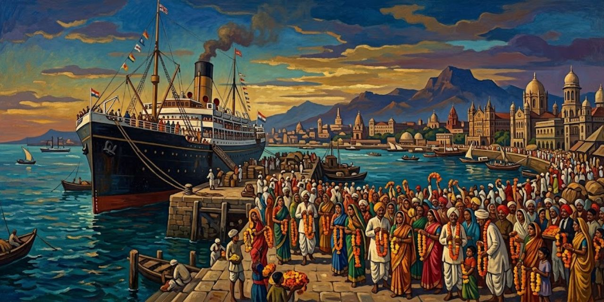</a>

El Rajputana atraca en Bombay el 22 de agosto de 1935. Amigos reciben a Yogananda con guirnaldas; periodistas y fotógrafos acuden después al hotel. El desembarco anticipa un año sin descanso.

> Bombay era una ciudad nueva para mí; la encontré enérgicamente moderna, con muchas innovaciones de Occidente. Las palmeras bordean las amplias avenidas; magníficos edificios del Estado rivalizan en interés con los templos antiguos. Sin embargo, dedicamos muy poco tiempo al turismo; yo estaba impaciente, deseoso de ver a mi amado gurú y a otros seres queridos. Tras consignar el Ford a un vagón de equipajes, nuestro grupo no tardó en viajar velozmente hacia el este, en tren rumbo a Calcuta.
>
> [Párrafo 2](#original-c40-p2)

El coche que había dado libertad al recorrido europeo se convierte en equipaje del tren. La ciudad moderna, lejos de resumir el regreso, apenas puede retener al viajero: la urgencia es afectiva. Bombay y Calcuta son las dos ciudades que articulan el trayecto de este párrafo; el contraste entre edificios nuevos y templos antiguos prolonga el tema de la convivencia entre Oriente y Occidente.

La multitud los acompaña desde Howrah hasta el abrazo familiar. Yogananda cede luego la voz al diario de Wright: viajan a Serampore y se arrodilla antes del abrazo de Sri Yukteswar. Wright recibe su bendición. Sentados a sus pies, intenta comprender el bengalí y lee en sus gestos alegría y firmeza.

> "Al estudiarlo reverentemente de vez en cuando, observé que es de estatura grande y atlética, endurecido por las pruebas y sacrificios de la renuncia. Su porte es majestuoso. Una frente marcadamente inclinada, como buscando los cielos, domina su semblante divino. Tiene una nariz bastante grande y poco agraciada, con la que se entretiene en los momentos de ocio, golpeándola y moviéndola con los dedos, como un niño. Sus poderosos ojos oscuros están rodeados de un anillo de azul etéreo. Su cabello, con raya en medio, comienza plateado y pasa a mechones de oro plateado y negro plateado, terminando en rizos sobre los hombros. Su barba y su bigote son escasos o ralos, pero parecen realzar sus rasgos y, como su carácter, son hondos y ligeros a la vez.
>
> [Párrafo 13](#original-c40-p13)

Wright es el secretario estadounidense de Yogananda y autor del diario citado. La mirada reverente admite un detalle poco solemne: el maestro juega con su nariz. Esa observación impide que el retrato sea solamente una figura abstracta de santidad. La asociación entre aspecto y carácter sigue siendo una impresión del visitante, no una lectura objetiva de la condición espiritual de Sri Yukteswar.

Wright describe la risa, ropa descolorida y habitación gastada del maestro: fotografías devotas, calendario moderno y lámpara en desuso. Observa a sus jóvenes ayudantes, entre ellos Prafulla. Yogananda entrega regalos; comen arroz y verduras. El anfitrión aprecia que Wright coma con los dedos.

> "Tras varias horas de frases bengalíes que volaban y del intercambio de cálidas sonrisas y miradas alegres, nos inclinamos a sus pies, nos despedimos con un *pronam*
> y partimos hacia Calcuta con un recuerdo imperecedero de un encuentro y un saludo sagrados. Aunque escribo sobre todo acerca de mis impresiones externas de él, siempre fui consciente de la verdadera base del santo: su gloria espiritual. Sentí su poder y llevaré conmigo ese sentimiento como mi bendición divina."
>
> [Párrafo 21](#original-c40-p21)

El *pronam* es el saludo reverente descrito en el encuentro: inclinarse ante el maestro. Wright distingue entre lo que puede narrar y lo que siente haber recibido. No comprende el bengalí que los otros hablan, pero interpreta gestos y miradas. La admisión de ese límite hace visible que su convicción no depende del contenido de la conversación.

Entre los regalos, Sri Yukteswar destaca un bastón; ante la propuesta de cambiar la alfombra rota, resta valor a las comodidades. Yogananda revive así las correcciones de sus años de discípulo. En Ranchi lo reciben los profesores que mantuvieron la escuela, pero la muerte de su gran benefactor ha dejado en riesgo los servicios gratuitos. Busca apoyo entre dirigentes, el nuevo maharajá y su padre; llegan también donaciones americanas. La escuela se constituye legalmente y amplía luego su labor humanitaria.

> La escuela, o Yogoda Sat-Sanga Brahmacharya Vidyalaya, ofrece clases al aire libre de materias de enseñanza primaria y secundaria. Los alumnos internos y externos reciben también algún tipo de formación profesional. Los propios muchachos regulan la mayoría de sus actividades mediante comités autónomos. Muy temprano en mi carrera de educador descubrí que los chicos que disfrutan traviesamente burlando a un profesor aceptarán con gusto las reglas disciplinarias que establezcan sus compañeros. Como yo nunca había sido un alumno modelo, sentía una inmediata simpatía por todas las travesuras y problemas de los muchachos.
>
> [Párrafo 32](#original-c40-p32)

La propuesta no se reduce a meditar: combina enseñanza general, oficio y participación estudiantil. La autoridad cambia de origen cuando las reglas son asumidas por compañeros, aunque el texto no explica cómo se eligen los comités ni qué límites tienen. El recuerdo del alumno travieso permite al educador reclamar comprensión de aquello que administra.

El programa combina deportes, posturas, artes de combate y ejercicios que Yogananda describe como dirección mental de energía. La enseñanza alcanza también a comunidades de la región y a niñas de aldeas próximas. En Ranchi, el Kriya, el canto del Gita y una ética de sencillez acompañan a la formación general. El autor atribuye a la concentración la quietud prolongada de alumnos muy jóvenes.

> Ranchi se encuentra a 2000 pies sobre el nivel del mar; el clima es suave y uniforme. El terreno de veinticinco acres, junto a un gran estanque para bañarse, incluye uno de los mejores huertos de la India: quinientos árboles frutales, de mango, guayaba, lichi, yaca y dátil. Los muchachos cultivan sus propias verduras e hilan en sus charkas.
>
> [Párrafo 37](#original-c40-p37)

Las charkas son ruecas de hilar. El paisaje que se enumera es también infraestructura educativa: los alimentos y el hilado conectan la formación con tareas concretas. Las dimensiones y el juicio sobre la calidad del huerto son los que ofrece el autor para el momento que describe, no información vigente sobre la institución. El capítulo amplía después esa imagen con servicios médicos y otras escuelas.

La escuela se amplía en el relato con biblioteca, museo, alojamiento de visitantes, atención médica y formación en primeros auxilios; los estudiantes también sirven durante inundaciones y hambrunas. Se celebran oraciones y clases bajo los árboles, y se abren otras escuelas y una nueva comunidad junto al Ganges. Yogananda reconoce la entrega de quienes sostienen esa obra. Wright se queda un tiempo entre los alumnos y sigue llenando su diario. Preguntado por su impresión de la India, responde con una palabra: paz.

---

## Capítulo 41: Un idilio en el sur de la India

Yogananda dice a Wright que ha sido el primer occidental admitido en el santuario de Chamundi, deidad protectora de la familia gobernante de Mysore; Wright guarda pétalos como recuerdo. Invitados por el heredero en noviembre de 1935, recorren un estado cuyo gobierno y representación pública Yogananda elogia. En Mysore y Bangalore da conferencias y propone el intercambio entre Oriente y Occidente. Descansan después entre arrozales y colinas: el diario de Wright recoge el cambio de luz al atardecer.

> "Muchos momentos de arrobamiento se han pasado contemplando, casi distraídamente, el lienzo siempre cambiante de Dios extendido por el firmamento, pues solo Su toque puede producir colores que vibren con la frescura de la vida. Esa juventud de los colores se pierde cuando el hombre intenta imitarla con simples pigmentos, pues el Señor recurre a un medio más sencillo y eficaz: óleos que no son óleos ni pigmentos, sino meros rayos de luz. Lanza una salpicadura de luz aquí y refleja rojo; vuelve a agitar el pincel y se mezcla gradualmente en naranja y oro; luego, con una penetrante estocada, hiere las nubes con una raya púrpura que deja brotar de la herida de las nubes un rizo o fleco rojo; y así, una y otra vez, juega, de noche como de mañana, siempre cambiante, siempre nuevo, siempre fresco; sin patrones, sin duplicados, sin colores exactamente iguales. La belleza del tránsito indio del día a la noche no tiene comparación en ningún otro lugar; a menudo el cielo parece como si Dios hubiera tomado todos los colores de Su estuche y los hubiera arrojado de una sola y poderosa sacudida caleidoscópica a los cielos.
>
> [Párrafo 8](#original-c41-p8)

Wright, el secretario que lleva el diario de viaje, convierte el cielo en una pintura imposible de fijar. La imagen del pincel vuelve inteligible la luz y, al mismo tiempo, declara inferior cualquier imitación. No es una explicación física del atardecer: el artista divino expresa el asombro del viajero. La comparación absoluta con "ningún otro lugar" tiene el peso del entusiasmo, no el de una medición.

Wright recuerda otra visita al anochecer: ambos toman un pequeño autobús hacia la presa Krishnaraja Sagar, próxima a Mysore, mientras el sol desaparece en el horizonte.

> "Nuestro viaje pasó junto a los omnipresentes arrozales cuadrados, a través de una hilera de reconfortantes banianos, entre un bosquecillo de altísimas palmeras cocoteras, con una vegetación casi tan espesa como la de una selva, y finalmente, al acercarnos a la cresta de una colina, nos encontramos frente a un inmenso lago artificial que reflejaba las estrellas y la franja de palmeras y otros árboles, rodeado de hermosos jardines en terrazas y de una hilera de luces eléctricas en el borde de la presa; y debajo de ella nuestros ojos encontraron un espectáculo deslumbrante de haces de colores jugando sobre fuentes semejantes a géiseres, como otros tantos chorros de tinta brillante que brotaran: cascadas de un azul magnífico, cataratas de un rojo llamativo, surtidores verdes y amarillos, elefantes que arrojaban agua, una miniatura de la Exposición Universal de Chicago y, sin embargo, sobresaliente por su modernidad en esta antigua tierra de arrozales y gente sencilla, que nos ha dado una bienvenida tan afectuosa que temo que hará falta más que mi fuerza para llevar de nuevo a Yoganandaji a América.
>
> [Párrafo 10](#original-c41-p10)

Se trata de la visita a la presa Krishnaraja Sagar, cercana a Mysore, anunciada justo antes de la cita. El paisaje no es aquí un refugio ajeno a la técnica: el lago artificial y la iluminación producen parte de su atractivo. La referencia a Chicago le da a Wright una escala familiar para describirlo. "Yoganandaji" es la forma respetuosa con que nombra a Yogananda; la broma final recuerda que el viaje sigue teniendo un destino de regreso.

Invitado al palacio, Wright monta por primera vez en elefante. Yogananda recorre luego el sur: ríos, ciudades, bosques, mezquitas y templos; admira Ellora, Ajanta y Belur. Los pilares de Asoka lo llevan a una inscripción contra la conquista militar. Su abuelo Chandragupta enlaza esa historia con Alejandro y los contactos griegos.

> Historias de intenso interés han sido registradas minuciosamente por historiadores griegos y otros que acompañaron a Alejandro o fueron tras él en su expedición a la India. Los relatos de Arriano, Diodoro, Plutarco y el geógrafo Estrabón han sido traducidos por el doctor J. W. M'Crindle para arrojar un haz de luz sobre la India antigua. El rasgo más admirable de la infructuosa invasión de Alejandro fue el profundo interés que mostró por la filosofía hindú y por los yoguis y santos que encontraba de vez en cuando y cuya compañía buscaba con afán. Poco después de que el guerrero griego llegara a Taxila, en el norte de la India, envió a un mensajero, Onesícrito, discípulo de la escuela helénica de Diógenes, para traer a un maestro indio, Dandamis, un gran sannyasi de Taxila.
>
> [Párrafo 20](#original-c41-p20)

Alejandro es el conquistador macedonio; Taxila, el lugar donde esta narración sitúa su contacto con los ascetas. Un sannyasi es un renunciante. M'Crindle es el traductor citado por Yogananda, no un testigo antiguo; los autores enumerados tampoco pertenecen todos a la expedición. La cadena de transmisión importa: lo que sigue se lee como un encuentro conservado y reelaborado por relatos, no como una transcripción de palabras oídas directamente.

Onesícrito ofrece regalos a Dandamis si acude ante Alejandro y lo amenaza de muerte si se niega. El asceta no se levanta: declara estar satisfecho, frente al conquistador siempre errante. Niega que Alejandro sea dios o señor de todo, pues también morirá, y contrapone a su violencia un creador que no promueve guerras. Con ironía le sugiere cruzar el Ganges si sus dominios aún le parecen pequeños.

> "Sépase, sin embargo, que lo que Alejandro ofrece y los regalos que promete son para mí cosas enteramente inútiles; las cosas que aprecio y encuentro de verdadera utilidad y valor son estas hojas que son mi casa, estas plantas floridas que me suministran alimento diario y el agua que es mi bebida; mientras que todas las demás posesiones que se acumulan con cuidado ansioso suelen resultar ruinosas para quienes las reúnen y solo causan pena y aflicción, de las que todo pobre mortal está ya plenamente cargado. En cuanto a mí, me tiendo sobre las hojas del bosque y, como nada tengo que requiera vigilancia, cierro los ojos en tranquilo sueño; mientras que, si tuviera algo que guardar, eso desterraría el sueño. La tierra me proporciona todo, como una madre la leche a su hijo. Voy adonde me place y no hay preocupaciones con las que me vea obligado a cargar.
>
> [Párrafo 27](#original-c41-p27)

La negativa cambia la medida de la riqueza. El conquistador ofrece bienes cuyo precio sería perder la independencia; el asceta valora lo que no exige custodia. Su sueño tranquilo responde al movimiento incesante que antes reprocha a Alejandro. La escena sostiene una tesis mediante dos personajes extremos: poder acumular no equivale a poder descansar.

> "Si Alejandro me corta la cabeza, no puede destruir también mi alma. Solo mi cabeza, entonces silenciosa, permanecerá, dejando el cuerpo como una vestidura desgarrada sobre la tierra, de donde también fue tomado. Yo entonces, convertido en Espíritu, ascenderé a mi Dios, que nos encerró a todos en carne y nos dejó sobre la tierra para probar si, aquí abajo, viviremos obedientes a Sus mandatos y que también nos exigirá a todos, cuando partamos de aquí a Su presencia, una cuenta de nuestra vida, pues Él es Juez de toda arrogante maldad; porque los gemidos de los oprimidos se convierten en el castigo del opresor.
>
> [Párrafo 28](#original-c41-p28)

El argumento ya no depende de carecer de posesiones, sino de una creencia: el alma sobreviviría al daño del cuerpo y respondería ante Dios. En esa lógica, la amenaza pierde su alcance último y la responsabilidad recae sobre quien mata. Es la posición religiosa del discurso atribuido a Dandamis. El lector puede reconocer su fuerza como rechazo de la coacción sin convertir sus afirmaciones sobre el más allá en hechos comprobados.

Dandamis rehúsa ir: si Alejandro necesita algo, deberá buscarlo. El mensaje aumenta el deseo del conquistador de conocerlo. Yogananda recoge luego un intercambio con ascetas en Taxila: responden con paradojas sobre vivos y muertos, día y noche, poder y temor; ante preguntas imposibles, oponen respuestas imposibles. Entre los maestros que Alejandro logra llevar consigo está Swami Sphines, llamado Kalanos por los griegos, a quien el autor presenta como devoto de la diosa Kali.

> Kalanos acompañó a Alejandro a Persia. En un día señalado, en Susa, en Persia, Kalanos abandonó su cuerpo envejecido entrando en una pira funeraria a la vista de todo el ejército macedonio. Los historiadores registran el asombro de los soldados al observar que el yogui no temía ni el dolor ni la muerte y que no se movió una sola vez de su posición mientras las llamas lo consumían. Antes de partir hacia su cremación, Kalanos había abrazado a todos sus compañeros íntimos, pero evitó despedirse de Alejandro, a quien el sabio hindú se había limitado a decir:
>
> [Párrafo 47](#original-c41-p47)

El párrafo termina antes de las palabras que el libro atribuye a Kalanos: que volverían a verse en Babilonia. Yogananda las enlaza después con la muerte de Alejandro. La pira aparece en su relato como dominio de sí y anticipación profética; esa valoración no debe confundirse con una invitación a imitar una muerte violenta. La presencia de soldados explica el efecto público que la narración quiere destacar.

Kalanos había anunciado que volvería a ver a Alejandro en Babilonia. Yogananda enlaza esas palabras con la muerte posterior del conquistador allí y las interpreta como promesa de compañía más allá de la vida. Pasa luego a la imagen de la India en los autores griegos: según Arriano, sus leyes preservarían la libertad y rechazarían la esclavitud.

> "Los indios", dice otro texto, "ni prestan dinero a usura ni saben pedir prestado. Es contrario a los usos establecidos que un indio cometa o sufra una injusticia y, por eso, ni hacen contratos ni exigen garantías". Se nos dice que la curación se hacía por medios sencillos y naturales. "Las curaciones se efectúan más regulando la dieta que usando medicinas. Los remedios más estimados son los ungüentos y los emplastos. Todos los demás se consideran en gran medida perniciosos." La participación en la guerra estaba restringida a los kshatriyas, o casta guerrera. "Tampoco un enemigo que encontrara a un labrador trabajando en su tierra le haría daño alguno, pues los hombres de esta clase, considerados benefactores públicos, están protegidos de toda lesión. La tierra, al quedar así sin devastar y producir abundantes cosechas, proporciona a los habitantes lo necesario para hacer agradable la vida."
>
> [Párrafo 51](#original-c41-p51)

La cita compone una sociedad ejemplar: sin fraude económico, con curación sencilla y con agricultores a salvo de la guerra. Esa amplitud exige conservar la distancia entre la descripción idealizada de una fuente y la conducta de una sociedad entera. Tampoco la opinión antigua sobre las medicinas orienta tratamientos actuales. El papel argumentativo es claro: ofrecer una imagen de la India que no quede reducida a la conquista militar.

Yogananda cuenta que Chandragupta dejó el gobierno a su hijo y terminó como asceta en el sur; cerca de su retiro describe una gran estatua jaina. Un poema del santo Thayumanavar coloca el dominio mental por encima de los prodigios. En Travancore, relata ritos del maharajá para expiar antiguas guerras. Las reglas atribuidas a Manu exigen justicia, moderación al recaudar y límites a la violencia. Finalmente, la descripción de Madras y Conjeeveram conduce a las reformas de Gandhi en los templos y contra las barreras de casta.

> El origen del sistema de castas, formulado por el gran legislador Manu, fue admirable. Vio claramente que los hombres se distinguen por evolución natural en cuatro grandes clases: quienes pueden prestar servicio a la sociedad mediante su trabajo corporal (sudras); quienes sirven mediante la inteligencia, la habilidad, la agricultura, el comercio, el intercambio y la vida de negocios en general (vaisyas); quienes tienen talentos administrativos, ejecutivos y protectores, gobernantes y guerreros *(kshatriyas)*; quienes son de naturaleza contemplativa, espiritualmente inspirados e inspiradores (brahmanes). "Ni el nacimiento, ni los sacramentos, ni el estudio, ni la ascendencia pueden decidir si una persona es dos veces nacida (es decir, un brahmán)", declara el Mahabharata; "solo el carácter y la conducta pueden decidirlo". Manu instruyó a la sociedad a mostrar respeto a sus miembros en la medida en que poseyeran sabiduría, virtud, edad, parentesco o, en último lugar, riqueza. Las riquezas en la India védica siempre fueron despreciadas si se acumulaban o no estaban disponibles para fines caritativos. A los hombres poco generosos de gran fortuna se les asignaba un rango bajo en la sociedad.
>
> [Párrafo 59](#original-c41-p59)

Esta es una defensa de un origen ideal, no una explicación histórica neutral. Las cuatro clases descritas son los *varnas*, el esquema religioso de clasificación social; las castas vividas, o *jatis*, son grupos mucho más numerosos. La condición de "dos veces nacido" tampoco se limita en el uso tradicional a los brahmanes: se aplica a los varones iniciados de los tres varnas superiores. El pasaje busca reemplazar herencia por conducta como criterio de valor, pero llamar "natural" a una jerarquía ya supone una elección ideológica. Manu es la autoridad legislativa tradicional invocada por el autor; el *Mahabharata*, la epopeya que cita en apoyo de su lectura. En el párrafo siguiente Yogananda reconoce los graves males de la herencia de casta.

Yogananda reconoce los daños de las castas hereditarias y confía en reformarlas según cualidades, no nacimiento. Debe volver a Calcuta para un congreso; antes conversa con el físico Raman. De camino al norte visita un santuario de Sadasiva Brahman. Entre las historias locales que recoge, el asceta habría sobrevivido enterrado tras una inundación del Kaveri: al encontrarlo, los aldeanos lo vieron levantarse y marcharse.

> Sadasiva nunca pronunciaba palabra ni llevaba ropa. Una mañana, el yogui desnudo entró sin ceremonia en la tienda de un jefe musulmán. Sus mujeres gritaron alarmadas; el guerrero asestó a Sadasiva un feroz golpe de espada que le cortó el brazo. El maestro se marchó sin preocuparse. Abrumado por el remordimiento, el musulmán recogió el brazo del suelo y siguió a Sadasiva. El yogui insertó tranquilamente el brazo en el muñón sangrante. Cuando el guerrero pidió humildemente alguna instrucción espiritual, Sadasiva escribió con el dedo en la arena:
>
> [Párrafo 64](#original-c41-p64)

Yogananda presenta esto entre las historias que circulan sobre Sadasiva, no como algo que él haya presenciado. La restitución del brazo pertenece al milagro narrado. El final queda abierto porque el consejo escrito está en otro párrafo: dominar el deseo para alcanzar libertad. La transformación decisiva del relato es la del agresor, que pasa de imponer violencia a pedir enseñanza; esa estructura moral no demuestra la posibilidad física del episodio.

El consejo que Sadasiva escribe propone dominar el deseo como camino de libertad. Yogananda añade otra historia local: el yogui habría transportado instantáneamente a varios niños hasta una fiesta en Madura y los habría devuelto después. Un joven se burla y pide la misma experiencia. Según el relato, Sadasiva lo lleva, pero no se queda para traerlo. El cierre convierte el prodigio en una broma correctiva: el incrédulo debe regresar caminando.

---

## Capítulo 42: Los últimos días con mi gurú

Yogananda pide oír el cariño que su maestro calla. Sri Yukteswar le asegura amor permanente y dice haber encontrado en él al hijo deseado; se disipa su duda. Después lo acompaña en Calcuta. Otra conferencia reúne a Yogananda con antiguos compañeros y el profesor Ghoshal, ya reconciliados.

> A finales de diciembre se celebró una Fiesta del Solsticio de Invierno en la ermita de Serampore. Como siempre, los discípulos de Sri Yukteswar se reunieron desde cerca y desde lejos. Sankirtans devocionales, solos en la voz de Kristo-da, dulce como el néctar, un banquete servido por jóvenes discípulos, el discurso profundamente conmovedor del Maestro bajo las estrellas en el patio atestado del ashram: ¡recuerdos, recuerdos! ¡Alegres fiestas de años lejanos! Aquella noche, sin embargo, habría una novedad.
>
> [Párrafo 10](#original-c42-p10)

Los sankirtans son cantos devocionales colectivos; el ashram es la comunidad y residencia del maestro. Kristo-da es el cantante que el narrador recuerda aquí. La novedad será que Sri Yukteswar le pide hablar en inglés, la lengua de su misión americana, ante los discípulos reunidos en la India. La repetición de "recuerdos" hace que la alegría de esa noche se lea ya desde la pérdida posterior.

Sri Yukteswar le pide hablar en inglés durante la fiesta. Yogananda recuerda el barco y agradece quince años de guía. Al día siguiente recibe el título de Paramhansa y el encargo de continuar la obra. El maestro anuncia su partida y le confía Puri y la organización. Se despiden abrazados.

> Al día siguiente hice venir de Ranchi a un discípulo, Swami Sebananda, y lo envié a Puri para asumir las tareas de la ermita. Más tarde mi gurú habló conmigo sobre los detalles legales de la disposición de sus bienes; deseaba evitar que, después de su muerte, los parientes pudieran entablar litigios por la posesión de sus dos ermitas y otras propiedades, que quería ceder exclusivamente para fines benéficos.
>
> [Párrafo 20](#original-c42-p20)

Paramhansa es el título monástico superior que acaba de recibir Yogananda. La sucesión espiritual incluye aquí trabajo jurídico: las propiedades no quedan protegidas por la sola intención del maestro. Puri es la localidad de la segunda ermita; Sebananda, el discípulo enviado a atenderla. El pasaje muestra que el desapego personal no elimina la necesidad de decidir quién administrará los bienes.

Amulaya Babu, otro discípulo, cuenta que el maestro no cumplió una visita prevista a Kidderpore. Interrogado, Sri Yukteswar dice que no volverá allí y tiembla un instante; Yogananda siente una premonición.

> ("El apego a la residencia corporal, que surge por su propia naturaleza [es decir, que nace de raíces inmemoriales, de experiencias pasadas de muerte]", escribió Patanjali, "está presente en leve grado incluso en los grandes santos". En algunos de sus discursos sobre la muerte, mi gurú solía añadir: "Como un pájaro enjaulado durante mucho tiempo que vacila en abandonar su hogar acostumbrado cuando se abre la puerta").
>
> [Párrafo 22](#original-c42-p22)

Patanjali es la autoridad clásica del yoga a quien se atribuye el aforismo. La comparación no acusa al santo de incoherencia: admite que conocer una doctrina sobre la muerte y dejar una forma habitual de vida no son lo mismo. El corchete explicativo pertenece al texto de Yogananda. La imagen del ave reaparece en estos capítulos para pensar tanto la liberación como la dificultad de despedirse.

Yogananda aparta los indicios de muerte. Busca a Babaji en Allahabad, aunque Sri Yukteswar no cree que lo encuentre. Parte bendecido; interpreta después esa separación como protección divina. Llegan el 23 de enero de 1936 y contemplan bañistas, ofrendas, procesiones, animales y ascetas con distintas vestimentas y prácticas.

> Aquí y allá, bajo los árboles, alrededor de enormes montones de leños encendidos, había pintorescos sadhus, con el cabello trenzado y recogido en espirales sobre la cabeza. Algunos llevaban barbas de varios pies de largo, enrolladas y anudadas. Meditaban en silencio o extendían las manos en bendición hacia la multitud que pasaba: mendigos, maharajás sobre elefantes, mujeres con *saris* multicolores, con sus brazaletes y ajorcas tintineando, *faquires* con los delgados brazos grotescamente levantados, *brahmacharis* que llevaban apoyos para los codos al meditar, sabios humildes cuya solemnidad ocultaba una dicha interior. Muy por encima del estruendo oíamos la llamada incesante de las campanas de los templos.
>
> [Párrafo 35](#original-c42-p35)

La enumeración reúne riqueza, pobreza y diferentes formas de ascetismo en un mismo paso de gente. Los saris son prendas de tela envolvente; "faquires" designa aquí ascetas; los brahmacharis siguen una disciplina de estudio y continencia. El catálogo vuelve visible la diversidad de la feria, mientras que la "dicha interior" sigue siendo la interpretación del narrador sobre rostros solemnes. Las campanas dan unidad sonora a la multitud.

Visitan comunidades, reciben la bendición de un dirigente Giri y conocen a un asceta ciego erudito. Tras hablar sobre Vedanta, Yogananda visita a Krishnananda y atribuye a su influencia una leona que come arroz y leche y ruge Aum. Wright cuenta la siguiente visita, a Kara Patri.

> "Cruzamos en el Ford el Ganges, muy bajo, por un crujiente puente de pontones, avanzando como una serpiente entre la multitud y por callejuelas estrechas y sinuosas, pasando por el lugar de la orilla que Yoganandaji me señaló como el punto de encuentro de Babaji y Sri Yukteswarji. Poco después bajamos del coche y caminamos cierto trecho entre el humo cada vez más denso de las hogueras de los sadhus y sobre las arenas resbaladizas hasta llegar a un grupo de chozas diminutas, muy modestas, de barro y paja. Nos detuvimos ante una de esas insignificantes viviendas temporales, con una entrada minúscula sin puerta, el refugio de Kara Patri, un joven sadhu errante conocido por su inteligencia excepcional. Allí estaba sentado, con las piernas cruzadas sobre un montón de paja, con una tela ocre echada sobre los hombros como única cobertura y, de paso, única posesión.
>
> [Párrafo 39](#original-c42-p39)

El relato vincula el presente del viaje con un lugar de la memoria del maestro. Wright necesita ser guiado hasta ambos: el sitio del encuentro anterior y la choza de Kara Patri. La descripción de una única posesión prepara su admiración por una vida sin acumulación. Esa simplicidad también hará pensar a Yogananda en el peso de las responsabilidades que ha asumido en América.

Entran a gatas en la choza y saludan al asceta. Aunque no entiende el hindi, Wright interpreta su expresión como cordialidad y grandeza espiritual. Describe luego su renuncia: no maneja dinero, no almacena objetos, no pide comida, camina en vez de usar vehículos y cambia de lugar cada semana para evitar el apego.

> "¡Qué alma tan modesta! Extraordinariamente versado en los Vedas y poseedor de un grado de maestría y del título de *Shastri* (maestro de las escrituras) por la Universidad de Benarés. Un sentimiento sublime me invadió mientras me sentaba a sus pies; todo parecía responder a mi deseo de ver la India verdadera, la antigua, pues él es un auténtico representante de esta tierra de gigantes espirituales."
>
> [Párrafo 42](#original-c42-p42)

Los Vedas son textos sagrados del hinduismo. El grado académico y el título de Shastri muestran que, para Wright, la vida austera no supone falta de formación. Su "India verdadera" es una selección afectiva: encuentra en un individuo lo que buscaba de un país. El retrato permite comprender su entusiasmo sin hacer de Kara Patri el representante único de una sociedad diversa.

Kara Patri enseña de memoria, sin libros ni ropa extra, y vaga junto al Ganges. Yogananda lo envidia, pero recuerda América. El asceta atribuye sus conocimientos a partes iguales a libros y experiencia. Comparten silencio, cenan y permanecen dos días más en la feria. En Agra, el Taj Mahal evoca a Jitendra. Siguen hacia Brindaban.

> Mi propósito al buscar a Keshabananda estaba relacionado con este libro. Nunca había olvidado la petición de Sri Yukteswar de que escribiera la vida de Lahiri Mahasaya. Durante mi estancia en la India aprovechaba toda oportunidad de entrar en contacto con discípulos directos y familiares del Yogavatar. Registrando sus conversaciones en notas voluminosas, comprobé hechos y fechas y reuní fotografías, cartas antiguas y documentos. Mi carpeta de Lahiri Mahasaya empezó a engrosar; comprendí con consternación que me esperaban arduas labores de autor. Recé para estar a la altura de mi papel como biógrafo del colosal gurú. Varios de sus discípulos temían que un relato escrito empequeñeciera o malinterpretara a su maestro.
>
> [Párrafo 57](#original-c42-p57)

Yogavatar es el título devocional que Yogananda aplica a Lahiri Mahasaya: encarnación del yoga. La carpeta indica un esfuerzo documental, mientras que el temor de los discípulos recuerda que la biografía tendrá que traducir una relación vivida a palabras públicas. "Comprobé" describe el trabajo que el autor afirma haber hecho; no elimina la diferencia entre documentos sobre fechas y testimonios sobre milagros.

Panchanon y otros discípulos temen que las palabras empequeñezcan a Lahiri; preferirían guardarlo en su memoria. Yogananda persiste, recordando que el maestro había anunciado una biografía, y procura documentar al menos los hechos de su vida exterior.

> Swami Keshabananda recibió cordialmente a nuestro grupo en Brindaban, en su Katayani Peith Ashram, un imponente edificio de ladrillo con macizas columnas negras, situado en un hermoso jardín. Nos condujo enseguida a una sala adornada con una ampliación del retrato de Lahiri Mahasaya. El swami se acercaba a los noventa años, pero su cuerpo musculoso irradiaba fuerza y salud. Con cabello largo y barba blanca como la nieve, con los ojos chispeantes de alegría, era una auténtica encarnación patriarcal. Le informé de que quería mencionar su nombre en mi libro sobre los maestros de la India.
>
> [Párrafo 60](#original-c42-p60)

Keshabananda es discípulo de Lahiri Mahasaya y una de las voces que Yogananda consulta. La fotografía ampliada identifica el vínculo antes de que comience la entrevista. La edad y el vigor preparan el retrato de una vida de recorridos por el Himalaya que viene después. "Patriarcal" es aquí una comparación de apariencia y autoridad, no un parentesco.

Keshabananda recuerda cuevas himalayas, la inundación de su ermita y la construcción de Brindaban. Afirma haber detenido a un tigre y recibido apariciones de Lahiri. Tras comer, transmite un mensaje: Babaji lo habría guiado a una cueva y anunciado la visita de Yogananda. No lo vería esta vez, pero sí en otra ocasión. Consolado, Yogananda pasa la noche y parte hacia Calcuta, cruzando el Jumna al atardecer.

> La ribera del Jumna está santificada por los recuerdos del niño Sri Krishna. Allí participó con inocente dulzura en sus *lilas* (juegos) con las *gopis* (doncellas), ejemplificando el amor celestial que siempre existe entre una encarnación divina y sus devotos. La vida del Señor Krishna ha sido malinterpretada por muchos comentaristas occidentales. La alegoría de las escrituras desconcierta a las mentes literales. Un gracioso error de un traductor ilustrará este punto. La historia trata de un santo medieval inspirado, el zapatero Ravidas, que cantó, en los términos sencillos de su propio oficio, la gloria espiritual oculta en toda la humanidad:
>
> [Párrafo 78](#original-c42-p78)

Krishna es la figura divina que la tradición sitúa en los juegos de Brindaban; el Jumna es el río de ese paisaje. Ravidas, presentado como santo y zapatero, permite explicar una alegoría desde el oficio: "piel" puede ser material de trabajo y cuerpo humano. Yogananda cuenta luego que un traductor tomó la imagen por la descripción de un ídolo de cuero. La discusión distingue lo literal y lo simbólico sin demostrar que toda lectura del autor sea la única posible.

La piel del poema alude a la divinidad humana, no al ídolo de cuero que traduce otro escritor. Según la historia, unos brahmanes rehúsan comer con Ravidas y lo ven multiplicado junto a ellos. En Calcuta, un telegrama de Puri alarma a Yogananda. Reza, pero dice oír que no se salvará al maestro y debe esperar. Viaja después: una visión y un desconocido le anuncian la muerte. Llega casi derrumbado a la ermita.

> Entré en la habitación del ashram donde el cuerpo del Maestro, inimaginablemente parecido al de un vivo, estaba sentado en la postura del loto: una imagen de salud y belleza. Poco antes de morir, mi gurú había estado ligeramente enfermo de fiebre, pero antes del día de su ascensión al Infinito su cuerpo había recuperado por completo la salud. Por más que miraba su querida figura, no podía comprender que la vida la hubiera abandonado. Su piel era lisa y suave; en su rostro había una expresión beatífica de tranquilidad. Había abandonado conscientemente su cuerpo a la hora de la llamada mística.
>
> [Párrafo 93](#original-c42-p93)

La postura del loto es la posición sentada de meditación con las piernas cruzadas. El pasaje une la incredulidad del duelo con la certeza religiosa del narrador: la apariencia le hace difícil aceptar la muerte y la doctrina le permite hablar de partida consciente. "Ascensión" y "llamada mística" son sus términos de interpretación. No son un diagnóstico de la causa de muerte ni una prueba médica sobre el estado del cuerpo.

Yogananda celebra el entierro en el jardín de Puri el 10 de marzo. Los discípulos vuelven para una conmemoración el día 21. El periódico Amrita Bazar Patrika publica una semblanza que presenta al maestro como discípulo de Lahiri, fundador de comunidades y principal inspiración de la misión occidental de Yogananda.

> Sus interpretaciones del *Bhagavad Gita* y otras escrituras dan testimonio de la profundidad del dominio que Sri Yukteswarji tenía de la filosofía, tanto oriental como occidental, y siguen abriendo los ojos a la unidad entre Oriente y Occidente. Como creía en la unidad de todas las confesiones religiosas, Sri Yukteswar Maharaj fundó la *Sadhu Sabha* (Sociedad de Santos) con la cooperación de dirigentes de diversas sectas y creencias, para inculcar un espíritu científico en la religión. En el momento de su muerte designó a Swami Yogananda sucesor suyo como presidente de la *Sadhu Sabha*.
>
> [Párrafo 98](#original-c42-p98)

La voz es la de la semblanza que el libro reproduce del *Amrita Bazar Patrika*, no la narración directa de Yogananda. El *Bhagavad Gita* es el texto religioso incluido en la epopeya *Mahabharata*. La sucesión administrativa da una forma pública a la continuidad del discípulo. Pero el cierre del capítulo no resuelve el duelo con ese reconocimiento: Yogananda vuelve a sentir la falta del maestro en medio de sus tareas y desea regresar a su tumba.

La semblanza del periódico concluye lamentando la pérdida e invitando a conservar el ejemplo del maestro. De vuelta en Calcuta, Yogananda dispone que Prafulla, el joven discípulo de Serampore, entre en la escuela de Ranchi. Prafulla recuerda la pena de Sri Yukteswar cuando Yogananda partió a la feria. La actividad pública continúa, pero la convicción religiosa de que el maestro vive no acalla la falta de su presencia. Preparan el regreso a Occidente; en Bombay deben cancelar el pasaje porque no hay sitio para el Ford. Yogananda aprovecha la demora para volver a Puri: quiere llorar otra vez ante la tumba de su gurú.

---

## Capítulo 43: La resurrección de Sri Yukteswar

<a href="img/261017_autobiografia-de-un-yogui_i-43.jpg">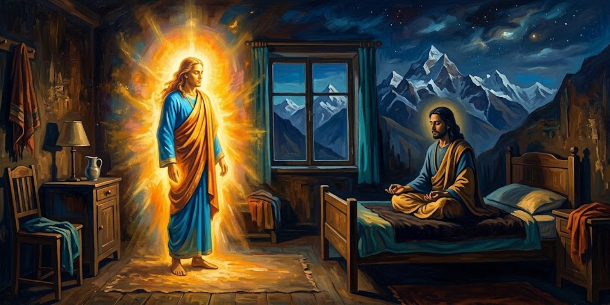</a>

En Bombay, Yogananda tiene suspendido su regreso a Occidente y prepara conferencias antes de volver a Bengala. Cuenta que ve a Krishna sobre un edificio frente a su hotel; la figura lo saluda y desaparece. Interpreta aquella visión como anuncio de un acontecimiento espiritual.

> Sentado en mi cama en el hotel de Bombay, a las tres de la tarde del 19 de junio de 1936, una semana después de la visión de Krishna, una luz beatífica me sacó de la meditación. Ante mis ojos abiertos y asombrados, toda la habitación se transformó en un mundo extraño, la luz del sol transmutada en esplendor sobrenatural.
>
> [Párrafo 4](#original-c43-p4)

Krishna es la figura divina que el autor dice haber visto una semana antes. La fecha, la hora y el cuarto sitúan una experiencia extraordinaria en un escenario cotidiano. "Beatífica" alude a una dicha de carácter divino; "sobrenatural" traduce aquí *supernal*, lo celestial o perteneciente a un ámbito superior. Son palabras del narrador para describir su percepción. El pasaje presenta una vivencia de fe, no una observación independiente que pruebe la transformación de la habitación.

Yogananda cuenta que aparece Sri Yukteswar, su maestro fallecido, y lo abraza sin arrodillarse como de costumbre. Le pregunta por qué lo dejó y si ese cuerpo es el que enterró. Según el relato, el maestro dice haber creado uno nuevo y resucitado en Hiranyaloka, planeta astral donde ayuda a seres avanzados. Explica los cuerpos causal, astral y físico; Yogananda pide saber más sobre ese cosmos.

> "El universo astral, hecho de diversas vibraciones sutiles de luz y color, es cientos de veces mayor que el cosmos material. Toda la creación física cuelga como una pequeña cesta sólida bajo el enorme globo luminoso de la esfera astral. Así como muchos soles y estrellas físicos recorren el espacio, hay también incontables sistemas solares y estelares astrales. Sus planetas tienen soles y lunas astrales, más hermosos que los físicos. Los astros astrales se parecen a la aurora boreal: la aurora solar astral, soleada, es más deslumbrante que la aurora lunar, de rayos suaves. El día y la noche astrales son más largos que los de la Tierra.
>
> [Párrafo 21](#original-c43-p21)

La imagen es la de un globo gigante del que cuelga una cesta: el cosmos físico sería esa cesta, pequeña y pesada, frente a un universo de luz mucho mayor. Es una comparación del maestro, tal como Yogananda la cuenta, y no una medida astronómica; el capítulo no aporta pruebas externas de ese "universo astral". Según el libro, el plano donde el maestro dice residir se llama Hiranyaloka, "planeta astral iluminado". La aurora boreal sirve de referencia visual: luces suaves en movimiento, aquí más brillantes y más largas.

> "El mundo astral es infinitamente hermoso, limpio, puro y ordenado. No hay planetas muertos ni tierras estériles. Las manchas terrestres - malas hierbas, bacterias, insectos, serpientes -  están ausentes. A diferencia de los climas y estaciones variables de la Tierra, los planetas astrales mantienen la temperatura pareja de una primavera eterna, con ocasional nieve blanca luminosa y lluvia de luces multicolores. Los planetas astrales abundan en lagos de ópalo, mares brillantes y ríos de arcoíris.
>
> [Párrafo 22](#original-c43-p22)

Aquí "astral" designa, en la doctrina que el libro presenta, un universo sutil de luz y vibración que el maestro dice haber visitado tras morir. Es una descripción de creencia, no un dato comprobable. Llama la atención el método: la lista de lo que falta (insectos, serpientes, malas hierbas) define el cielo por oposición a la Tierra. Conviene leerlo como la imagen de un paraíso, igual que otras tradiciones describen el suyo, y como parte del argumento del capítulo: que la vida después de la muerte es ordenada y no un vacío.

Después describe a sus habitantes: seres venidos de la Tierra y otras criaturas, regiones oscuras donde los caídos se combaten y regiones luminosas donde todo cambia por la voluntad. Dice que allí nadie nace de mujer, que el cuerpo copia el último físico, que todo se percibe por intuición y que las heridas se curan con solo quererlo. Yogananda pregunta si todos son hermosos.

> "Las alegres fiestas astrales en los planetas astrales superiores como Hiranyaloka tienen lugar cuando un ser se libera del mundo astral por su avance espiritual y queda así listo para entrar en el cielo del mundo causal. En esas ocasiones el Padre Celestial Invisible, y los santos fundidos en Él, se materializan en cuerpos de su elección y se suman a la celebración astral. Para agradar a su amado devoto, el Señor toma la forma que se desee. Si el devoto adoró por la devoción, ve a Dios como la Madre Divina. A Jesús, el aspecto de Padre del Uno Infinito le resultaba atrayente por encima de otras concepciones. ¡La individualidad con que el Creador ha dotado a cada una de sus criaturas hace toda exigencia concebible e inconcebible a la versatilidad del Señor!" Mi gurú y yo reímos felices juntos.
>
> [Párrafo 34](#original-c43-p34)

La cita enseña que, según el maestro, Dios adopta la forma que cada devoto necesita: Madre para unos, Padre para otros. Es una explicación del pluralismo religioso a la manera del libro, y por eso la mención de Jesús junto a la Madre Divina hindú. El "mundo causal" es el plano siguiente, más sutil, que el capítulo describe un poco después. El detalle final, la risa compartida, rebaja la solemnidad: el diálogo entre maestro y discípulo es afectuoso. Todo el pasaje es doctrina y creencia del autor, no un hecho comprobable.

Luego habla del reencuentro de amigos de otras vidas, de cómo esos seres ven la actividad humana y de la vida de los de Hiranyaloka, que pasan el largo día en éxtasis y aun así sufren si cometen errores.

> "La comunicación entre los habitantes astrales se realiza enteramente por telepatía y televisión astrales; no hay la confusión ni el malentendido de la palabra escrita y hablada que los habitantes de la Tierra deben soportar. Así como las personas en la pantalla del cine parecen moverse y actuar mediante una serie de imágenes de luz, y en realidad no respiran, los seres astrales caminan y trabajan como imágenes de luz guiadas y coordinadas con inteligencia, sin necesidad de obtener energía del oxígeno. El hombre depende de sólidos, líquidos, gases y energía para sustentarse; los seres astrales se sustentan principalmente de luz cósmica."
>
> [Párrafo 39](#original-c43-p39)

El texto de 1946 toma sus metáforas del cine y la televisión. Son comparaciones del autor para hacer pensable lo invisible, no afirmaciones físicas. La idea de fondo es que un cuerpo hecho de luz no necesita respirar ni comer como el cuerpo humano. Quien lea hoy hará bien en distinguir tres planos: lo que el libro cuenta (la enseñanza del maestro), lo que pertenece a la creencia del autor (que esos mundos existen) y lo que el capítulo no documenta con pruebas externas.

Yogananda pregunta qué comen. El maestro responde que verduras de luz y un néctar, y que al encontrar a parientes de varias vidas esos seres aprenden a amar a todos por igual. Dice que viven de quinientos a mil años, sin enfermedad ni vejez, y que solo sienten algo de nervios al pasar al cuerpo causal.

> "La muerte física va acompañada de la desaparición del aliento y la desintegración de las células de la carne. La muerte astral consiste en la dispersión de los vidatrones, esas unidades manifiestas de energía que constituyen la vida de los seres astrales. En la muerte física un ser pierde su conciencia de la carne y se da cuenta de su cuerpo sutil en el mundo astral. Al experimentar a su debido tiempo la muerte astral, un ser pasa así de la conciencia del nacimiento y la muerte astrales a la del nacimiento y la muerte físicos. Estos ciclos recurrentes de envoltura astral y física son el destino ineludible de todos los seres no iluminados. Las definiciones escriturales del cielo y el infierno a veces despiertan en el hombre recuerdos más hondos que el subconsciente de su larga serie de experiencias en los mundos astral, alegre, y terrestre, decepcionante."
>
> [Párrafo 45](#original-c43-p45)

"Vidatrones" (en el original, *lifetrons*) es el nombre que el libro da a unas unidades de energía vital, y lo usa como si fuera conocido. Aquí se traduce por calco. La cita describe la muerte como un cambio de plano de conciencia: se deja un cuerpo y se toma conciencia de otro, en un ciclo que, según el autor, solo termina con la iluminación. En este relato, la reencarnación incluye un paso intermedio por un mundo "astral". El cielo y el infierno de las escrituras serían, según esta enseñanza, ecos de esos mundos intermedios.

Yogananda pide detallar la diferencia entre renacer en la Tierra, en lo astral y en lo causal. El maestro dice que el alma es esencialmente causal, matriz de treinta y cinco ideas de Dios, de las que salen el cuerpo astral y el físico.

> "Los diecinueve elementos del cuerpo astral son mentales, emocionales y vidatrónicos. Los diecinueve componentes son: inteligencia; ego; sentimiento; mente (conciencia de los sentidos); cinco instrumentos de *conocimiento*, los equivalentes sutiles de los sentidos de la vista, el oído, el olfato, el gusto y el tacto; cinco instrumentos de *acción*, la correspondencia mental de las capacidades ejecutivas de procrear, excretar, hablar, caminar y ejercer la destreza manual; y cinco instrumentos de *fuerza vital*, los facultados para realizar las funciones corporales de cristalizar, asimilar, eliminar, metabolizar y hacer circular. Esta envoltura astral sutil de diecinueve elementos sobrevive a la muerte del cuerpo físico, que está hecho de dieciséis elementos groseros, metálicos y no metálicos.
>
> [Párrafo 48](#original-c43-p48)

Es una cuenta, y conviene leerla despacio: cuatro funciones internas (inteligencia, ego, sentimiento, mente) más tres grupos de cinco instrumentos suman diecinueve. La enumeración organiza lo que el libro llama cuerpo astral y lo relaciona con su término "vidatrones", del que sale "vidatrónicos". El número dieciséis del cuerpo físico responde a su propia clasificación y no a la química moderna. La cita expone una doctrina, no una anatomía verificable.

Explica que el cuerpo físico es un sueño fijado del Creador y que el deseo mantiene unidos los tres cuerpos, hasta que la sabiduría lo disuelve y el alma sale libre. Yogananda le pide hablar del mundo causal, que el maestro dice indescriptiblemente sutil.

> "Todo lo que un ser humano puede hacer en la fantasía, un ser causal puede hacerlo en la realidad. La inteligencia imaginativa humana más colosal puede, solo en la mente, recorrer de un extremo del pensamiento a otro, saltar mentalmente de planeta en planeta, o caer sin fin por un pozo de eternidad, o elevarse como un cohete hacia el dosel de galaxias, o centellear como un reflector sobre vías lácteas y espacios estrellados. Pero los seres del mundo causal tienen una libertad mucho mayor, y pueden manifestar sin esfuerzo sus pensamientos en objetividad instantánea, sin obstáculo material ni astral ni limitación kármica.
>
> [Párrafo 59](#original-c43-p59)

El mundo causal es, en esta enseñanza, el plano de las ideas con que Dios, según el maestro, modela todo lo demás. La cita define su rasgo central partiendo de algo que cualquiera conoce: la imaginación. Lo que aquí es fantasía, allí sería hecho. La mención del "karma" da la otra pista: la libertad causal no es total por capricho, sino porque se han saldado las deudas de acciones pasadas que atan a los planos inferiores.

Añade que los seres causales ven que el cosmos físico y el astral no están hechos en el fondo de electrones ni de vidatrones, sino de pensamiento de Dios, y que se reconocen como puntos de dicha del Espíritu.

> "Tanto la muerte como el renacimiento en el mundo causal son en pensamiento. Los seres de cuerpo causal se banquetean solo con la ambrosía del conocimiento eternamente nuevo. Beben de las fuentes de la paz, vagan por el suelo sin senderos de las percepciones, nadan en el océano sin fin de la dicha. ¡Mirad! Sus cuerpos de pensamiento luminosos pasan zumbando junto a billones de planetas creados por el Espíritu, burbujas frescas de universos, estrellas de sabiduría, sueños espectrales de nebulosas doradas, ¡por todo el seno azul de cielo del Infinito!
>
> [Párrafo 62](#original-c43-p62)

La cita acumula imágenes de movimiento y de bebida para decir algo que el lenguaje corriente no alcanza: una existencia de puro conocimiento y gozo. El tono es el del poema en prosa, no el de la exposición, y exige leerlo así. "Espíritu" con mayúscula nombra en el libro a Dios como realidad única, de modo que los planetas son, según esta visión, creaciones de esa realidad y no objetos independientes de ella.

Tras miles de años el alma sale del cuerpo causal y se funde en el océano de dicha. El maestro dice que un alma libre puede volver como profeta o servir en lo astral como salvador, como él. Yogananda pregunta por el karma que obliga a volver, y el maestro distingue dos clases de seres astrales.

> "A los seres con karma terrestre sin redimir no se les permite, tras la muerte astral, ir a la elevada esfera causal de las ideas cósmicas, sino que deben ir y venir solo entre el mundo físico y el astral, conscientes sucesivamente de su cuerpo físico de dieciséis elementos groseros y de su cuerpo astral de diecinueve elementos sutiles. Sin embargo, tras cada pérdida de su cuerpo físico, un ser no desarrollado de la Tierra permanece en su mayor parte en el hondo estupor del sueño de la muerte y apenas tiene conciencia de la hermosa esfera astral. Tras el descanso astral, ese hombre vuelve al plano material para más lecciones, acostumbrándose poco a poco, mediante viajes repetidos, a los mundos de textura astral sutil.
>
> [Párrafo 70](#original-c43-p70)

Es la versión del libro de la reencarnación: un vaivén entre dos mundos hasta que el karma, el conjunto de deseos y acciones que atan al alma, queda saldado. La imagen del "sueño de la muerte" sugiere que la mayoría ni siquiera percibe el más allá, y que el aprendizaje es lento y por repetición. La idea de renacer como escuela, y no como castigo, es el núcleo de la enseñanza que el autor transmite aquí.

Los residentes permanentes solo tienen karma astral y causal, y el maestro dice que vino sobre todo por ellos, no por los recién llegados de la Tierra. Añade que muchos, por apego, quieren volver al paraíso astral. Yogananda dice estar mudo de alegría.

> Nunca, por canción ni relato, había recibido un conocimiento tan inspirador. Aunque las escrituras hindúes se refieren a los mundos causal y astral y a los tres cuerpos del hombre, ¡qué remotas y sin sentido resultaban esas páginas frente a la cálida autenticidad de mi Maestro resucitado! ¡Para él, en verdad, no existía ni un solo "país por descubrir de cuyos confines ningún viajero regresa"!
>
> [Párrafo 77](#original-c43-p77)

La frase entre comillas es de *Hamlet* (Shakespeare, acto III, escena 1), donde el príncipe habla de la muerte como territorio del que nadie vuelve. Yogananda la cita para decir lo contrario: su maestro sí volvió. Es el momento en que el autor pasa de aprender doctrina a declarar que la ha comprobado a través de una persona. Conviene leerlo como testimonio personal y de fe del autor; el capítulo no ofrece pruebas externas de la aparición.

El maestro relaciona los tres cuerpos con la vigilia, los sueños y el sueño profundo. Yogananda reconoce el aspecto del cuerpo que lloró en Puri. Según el relato, Sri Yukteswar dice que ahora se materializa y viaja entre mundos a voluntad; bromea sobre su muerte y explica que tanto la Tierra como su nuevo cuerpo son sueños pasajeros de Dios. Yogananda dice comprender que su maestro siempre estuvo despierto en Dios.

> "Ahora te he contado, Yogananda, las verdades de mi vida, muerte y resurrección. No sufras por mí; ¡difunde más bien por todas partes la historia de mi resurrección desde la Tierra de los hombres soñada por Dios hasta otro planeta soñado por Dios, de almas revestidas de cuerpos astrales! Una nueva esperanza se infundirá en los corazones de los soñadores del mundo, enloquecidos por el sufrimiento y temerosos de la muerte."
>
> [Párrafo 87](#original-c43-p87)

El encargo convierte el consuelo privado en motivo para escribir: el narrador presenta este capítulo como cumplimiento de una petición de su maestro. La insistencia en el "sueño" no equivale aquí al sueño nocturno corriente, sino a la enseñanza del relato sobre el carácter transitorio de los mundos. "Resurrección" se usa para una nueva existencia en otro plano, no para un regreso permanente a la vida terrestre. Esa interpretación pertenece al testimonio y a la doctrina que Yogananda transmite; no es una comprobación externa de vida después de la muerte.

Yogananda acepta divulgar el relato. El maestro le dice que superó sus pruebas y que ya no lo reprenderá; promete que acabarán unidos en Dios. Durante dos horas, cuenta Yogananda, responde a sus preguntas y hace profecías, algunas ya cumplidas según el autor. Antes de desvanecerse promete volver cuando lo llame desde el nirbikalpa samadhi, estado de realización espiritual que el libro presenta como acceso a esa presencia.

> Se fue la pena de la despedida. La lástima y el dolor por su muerte, largo ladrón de mi paz, huyeron ahora en plena vergüenza. La dicha brotó como una fuente por incontables poros del alma recién abiertos. Antiguamente obstruidos por el desuso, ahora se ensanchaban en pureza ante la crecida arrolladora del éxtasis. Los pensamientos y sentimientos subconscientes de mis encarnaciones pasadas se desprendieron de sus máculas kármicas, lustrosamente renovados por la visita divina de Sri Yukteswar.
>
> [Párrafo 97](#original-c43-p97)

El párrafo describe el efecto de la visita como una limpieza interior. "Poros del alma" es metáfora del autor, no anatomía. La palabra "karma" reaparece como mancha que se desprende: la visita, según Yogananda, no solo consuela sino que purifica. Es el cierre emocional de la escena y deja ver por qué el narrador la considera uno de los hechos decisivos de su vida.

> En este capítulo de mi autobiografía he obedecido el mandato de mi gurú y he difundido la buena nueva, aunque vuelva a desconcertar a una generación sin curiosidad. Arrastrarse, el hombre lo sabe bien; la desesperación rara vez le es ajena; pero esas son perversidades, no forman parte del verdadero destino del hombre. El día que lo quiera, queda puesto en el camino de la libertad. Demasiado tiempo ha prestado oído al lúgubre pesimismo de sus consejeros del "polvo eres", sin atender al alma inconquistable.
>
> [Párrafo 98](#original-c43-p98)

"Polvo eres" remite al Génesis (3:19): "polvo eres y al polvo volverás". El autor se opone a leerlo como destino final del hombre. El párrafo es a la vez cumplimiento de un encargo (el maestro le pidió divulgar su resurrección) y declaración de tesis: la dignidad del alma frente al pesimismo. Es una postura de fe, formulada con tono de desafío a sus contemporáneos.

El capítulo añade el relato de Ma, discípula de Sri Yukteswar que vivía cerca de Puri. El 16 de marzo de 1936 fue al ashram a verlo. Sebananda le informó de que había muerto una semana antes y le ofreció mostrarle la tumba. Ella replicó que esa mañana su maestro había pasado por su puerta y le había pedido que fuera al ashram al anochecer. Según el relato, Sebananda se arrodilló y exclamó que había resucitado.

---

## Capítulo 44: Con Mahatma Gandhi en Wardha

Una mañana de agosto de 1935 Yogananda llega a la estación de Wardha con la señorita Bletch y el señor Wright. Mahadev Desai, secretario de Gandhi, los recibe con guirnaldas de algodón hilado a mano y los lleva ante Gandhi, que en su día de silencio escribe "bienvenido" en hindi. Yogananda describe al santo diminuto y sano que le entrega una nota de bienvenida, y los llevan a la casa de huéspedes.

> Nuestro guía nos condujo por huertos y campos en flor hasta un edificio de tejado de tejas y ventanas enrejadas. Un pozo en el patio delantero, de veinticinco pies de ancho, se usaba, dijo el señor Desai, para dar de beber al ganado; cerca había una rueda de cemento giratoria para trillar arroz. Cada uno de nuestros pequeños dormitorios resultó contener solo el mínimo irreducible: una cama hecha a mano, de cuerda. La cocina encalada ostentaba un grifo en un rincón y un hoyo de fuego para cocinar en otro. Sencillos sonidos arcádicos llegaban a nuestros oídos: los graznidos de cuervos y gorriones, el mugido del ganado y el golpeteo de cinceles que picaban piedra.
>
> [Párrafo 7](#original-c44-p7)

Wardha es una ciudad del centro de la India donde Gandhi tenía su ashram (comunidad de vida sencilla) en 1935, año de la visita; el libro fija la fecha en el diario de Wright, el secretario de Yogananda. Veinticinco pies son algo más de siete metros y medio. La lista de lo que hay, y de lo poco que hay, ilustra uno de los votos de Gandhi, la no posesión. "Arcádicos" alude a la Arcadia de la poesía pastoril: un campo tranquilo y sin lujo, con ruidos de animales y oficios.

Al ver el diario de viaje de Wright, Desai anota en él los once votos de los *satyagrahis*: no violencia, verdad, no robar, celibato, no poseer, trabajo manual, dominio del paladar, valentía, igual respeto por todas las religiones, *swadeshi* y fin de la intocabilidad. Gandhi firmó esa página al día siguiente, con fecha del 27 de agosto de 1935.

> Dos horas después de nuestra llegada, mis compañeros y yo fuimos llamados a almorzar. El Mahatma ya estaba sentado bajo la arcada del porche del ashram, al otro lado del patio desde su estudio. Unos veinticinco *satyagrahis* descalzos estaban en cuclillas ante tazas y platos de latón. Un coro comunitario de oración; luego una comida servida en grandes ollas de latón, con *chapatis* (pan integral sin levadura) rociados con ghee; talsari (verduras hervidas y en dados) y una mermelada de limón.
>
> [Párrafo 11](#original-c44-p11)

Un *satyagrahi* es quien practica la *Satyagraha*, la "firmeza en la verdad", nombre que Gandhi dio a su método de resistencia sin violencia. El almuerzo es una escena de vida común: oración conjunta, comida frugal y vegetariana, todos en el suelo. El ghee es mantequilla clarificada. "Mahatma" significa "gran alma" y es un título que, según el propio libro más adelante, le dio el pueblo, no él.

Durante el almuerzo, Gandhi come hojas amargas de *neem* sin un gesto de disgusto. Yogananda lo toma como señal de que separa la mente de los sentidos y recuerda que Gandhi soportó una apendicectomía sin anestesia. Por la tarde conversa con Mirabai, la discípula inglesa Madeleine Slade, que cuenta su trabajo en las aldeas, y ve la rueca presente en todo el ashram. Añade que Gandhi no rechaza todo el progreso moderno.

> Nuestro trío disfrutó de una cena a las seis como invitados de Babasaheb Deshmukh. La hora de oración de las 7:00 P.M. nos halló de regreso en el ashram de *Maganvadi*, subiendo al tejado donde treinta *satyagrahis* se agrupaban en semicírculo en torno a Gandhi. Estaba en cuclillas sobre una esterilla de paja, con un antiguo reloj de bolsillo apoyado ante él. El sol agonizante lanzaba un último destello sobre las palmeras y los banianos; había comenzado el zumbido de la noche y los grillos. La atmósfera era la serenidad misma; yo estaba en éxtasis.
>
> [Párrafo 21](#original-c44-p21)

Maganvadi (o Maganwadi) es el nombre del ashram de Gandhi en Wardha, instalado en lo que hoy es el Magan Sangrahalaya. El "trío" son Yogananda, el señor Wright y la señorita Bletch. El reloj de bolsillo es un detalle revelador: Gandhi ordenaba su tiempo con precisión, hasta en la oración. La escena prepara lo que el texto cuenta después: a las ocho en punto terminó su día de silencio y habló con Yogananda.

Tras la oración, la lectura del *Gita* y el fin del silencio a las ocho, Gandhi explica que su día de silencio, que empezó para despachar su correspondencia, se volvió una necesidad espiritual, y le pide dar una charla sobre yoga en el ayuntamiento. Al día siguiente vuelven a almorzar juntos, y a mediodía Yogananda pasea hasta las vacas del ashram. Cuenta que Gandhi las protege con pasión: para él la vaca representa a todo el mundo no humano y enseña piedad. De ahí pasa a las ofrendas diarias del hindú ortodoxo.

> Tres rituales diarios se imponen al hindú ortodoxo. Uno es *Bhuta Yajna*, una ofrenda de alimento al reino animal. Esta ceremonia simboliza que el hombre reconoce sus obligaciones hacia las formas menos evolucionadas de la creación, atadas por instinto a identificaciones corporales que también corroen la vida humana, pero carentes de esa cualidad de razón liberadora propia de la humanidad. *Bhuta Yajna* refuerza así la disposición del hombre a socorrer al débil, así como él a su vez es consolado por incontables desvelos de seres superiores invisibles. El hombre también está en deuda por los dones rejuvenecedores de la naturaleza, pródiga en tierra, mar y cielo. La barrera evolutiva de incomunicabilidad entre la naturaleza, los animales, el hombre y los ángeles astrales se supera así mediante oficios de amor silencioso.
>
> [Párrafo 33](#original-c44-p33)

Gandhi ve en la vaca, según el relato, un símbolo de compasión hacia todo ser vivo. Un *yajna* es un rito de ofrenda. El párrafo presenta el primero de tres: el que se dirige al mundo animal. Es una explicación del autor, con su propio vocabulario ("ángeles astrales", "identificaciones corporales"), no una descripción neutra de cómo todos los hindúes practican el rito. Los otros dos, *Pitri* (a los antepasados) y *Nri* (a los seres humanos), los trata a continuación, y Yogananda cumple el dirigido al prójimo visitando la escuela de niñas de Gandhi. Idea central: el hombre vive de deudas, con animales, naturaleza, antepasados y prójimos, y los ritos las reconocen.

Yogananda explica los otros dos ritos, a los antepasados y a los extraños, y cumple el dirigido al prójimo visitando la escuela de niñas de Gandhi, donde cae un aguacero. De vuelta, recuerda que Gandhi dejó su bufete y repartió su riqueza, y cita a Sri Yukteswar: el mendigo no renuncia a la riqueza. Habla de Kasturabai, que aceptó vivir sin bienes, y reproduce el tributo que ella dedicó a su marido.

> Durante años Kasturabai desempeñó las funciones de tesorera de los fondos públicos que el idolatrado Mahatma logra reunir por millones. Hay en los hogares indios muchas historias humorísticas según las cuales los maridos se ponen nerviosos de que sus esposas lleven joyas a una reunión de Gandhi; ¡la lengua mágica del Mahatma, que ruega por los oprimidos, hace caer los brazaletes de oro y los collares de diamantes de los brazos y cuellos de los ricos en el cesto de las colectas!
>
> [Párrafo 44](#original-c44-p44)

Kasturabai (Kasturba) Gandhi fue la esposa de Mahatma Gandhi. El párrafo es una de las pocas notas de humor del capítulo y muestra a un Gandhi persuasivo que reúne dinero para causas sociales. Lo que sigue en el libro (las cuatro rupias que no cuadraban y el aviso público de Gandhi) deja ver el otro lado: él no hacía excepciones ni con su esposa. El autor presenta la anécdota para explicar cómo Kasturabai, según él, veía a su marido: como gurú y no solo como cónyuge.

Cuenta que, al no cuadrar cuatro rupias, Gandhi publicó la diferencia de su esposa. Una oyente estadounidense se indignó, y Yogananda le explicó que ella lo ve como su gurú: antes de ir él a la cárcel, ella se echó a sus pies para pedirle perdón. A las tres de la tarde Yogananda va a ver a Gandhi. Este define *ahimsa* como no dañar a ningún ser vivo y admite que no podría charlar frente a una cobra. Sobre su escritorio, Yogananda ve libros de dieta.

> "Sí, la dieta es importante en el movimiento *Satyagraha*, como en todas partes", dijo con una risita. "Como abogo por la continencia completa para los *satyagrahis*, siempre procuro hallar la mejor dieta para el célibe. Hay que conquistar el paladar antes de poder controlar el instinto procreador. La semiinanición o las dietas desequilibradas no son la respuesta. Tras vencer la voracidad interior por la comida, un *satyagrahi* debe seguir una dieta vegetariana racional con todas las vitaminas, minerales, calorías y demás necesarias. Con sabiduría interior y exterior respecto de la comida, el fluido sexual del *satyagrahi* se convierte con facilidad en energía vital para todo el cuerpo."
>
> [Párrafo 56](#original-c44-p56)

La respuesta junta dos votos de la lista de Desai: dominio del paladar y celibato. Gandhi sostiene que lo primero ayuda a lo segundo, y rechaza la privación extrema. La última frase (el "fluido sexual" convertido en energía vital) expresa una creencia de la tradición yóguica y de Gandhi, no un hecho fisiológico comprobado; el libro la presenta como opinión suya. Conviene leer el pasaje como la explicación de un método de disciplina personal, no como consejo médico.

Hablan de sustitutos de la carne, y Yogananda promete mandar aguacates desde Los Ángeles. Gandhi cuenta por qué aceptó los huevos no fecundados. La noche anterior había pedido recibir el *Kriya Yoga*, y Yogananda, conmovido, empieza la enseñanza con Desai, el doctor Pingale y otros.

> Enseñé primero a la pequeña clase los ejercicios físicos de Yogoda. El cuerpo se visualiza dividido en veinte partes; la voluntad dirige la energía por turno a cada sección. Pronto todos vibraban ante mí como un motor humano. Fue fácil observar el efecto ondulante en las veinte partes del cuerpo de Gandhi, siempre completamente a la vista. Aunque muy delgado, no lo es de manera desagradable; la piel de su cuerpo es lisa y sin arrugas.
>
> [Párrafo 65](#original-c44-p65)

Yogoda es el sistema de ejercicios de recarga de energía que Yogananda enseñaba, antes de la iniciación en el *Kriya Yoga*, técnica de respiración y meditación que el libro atribuye a la línea de maestros de Lahiri Mahasaya y de Sri Yukteswar. La escena es casi doméstica: un grupo que practica, un maestro que observa. La mirada sobre el cuerpo de Gandhi, que usaba pocas ropas, es la de un observador atento a la salud y no la de un admirador distante.

Después los inicia en el *Kriya Yoga*. Yogananda recoge el credo de Gandhi: las escrituras jainas, el Nuevo Testamento y los escritos de Tolstói son las fuentes de su no violencia; cree que la Biblia, el Corán y el Zend-Avesta son tan inspirados como los Vedas, y que el hinduismo no es excluyente.

> De Cristo ha escrito Gandhi: "Estoy seguro de que si Él viviera ahora aquí entre los hombres, bendeciría la vida de muchos que quizá ni siquiera han oído su nombre... tal como está escrito: "No todo el que me dice: Señor, Señor... sino el que hace la voluntad de mi Padre." En la lección de su propia vida, Jesús dio a la humanidad el magnífico propósito y el objetivo único hacia el cual todos deberíamos aspirar. Creo que Él pertenece no solo al cristianismo, sino al mundo entero, a todas las tierras y razas."
>
> [Párrafo 71](#original-c44-p71)

La frase entre comillas internas es de Jesús en el Evangelio de Mateo (7:21). Gandhi, que no era cristiano, admiraba el Sermón de la Montaña, y Yogananda lo cita como prueba de una espiritualidad abierta. La cita muestra la tesis del capítulo y del libro entero: que las religiones convergen en un mismo punto. Es una afirmación de Gandhi tal como el autor la transcribe; el lector puede contrastarla con los escritos de Gandhi si necesita precisión.

En su última noche Yogananda habla ante unas cuatrocientas personas en el ayuntamiento. Al amanecer se despide de Gandhi: "La India está a salvo en tus manos". Pasan los años y llega otra guerra. Yogananda cita las palabras de Gandhi sobre el amor como ley superior a la destrucción, que pide un entrenamiento como el de un soldado.

> Si se consulta la historia, puede afirmarse con razón que los problemas de la humanidad no se han resuelto con la fuerza bruta. La Primera Guerra Mundial produjo una bola de nieve de karma de guerra que enfrió al mundo y creció hasta la Segunda. Solo el calor de la fraternidad puede fundir la actual colosal bola de nieve de karma de guerra que, de otro modo, podría crecer hasta una Tercera Guerra Mundial. Esta trinidad impía desterrará para siempre la posibilidad de una Cuarta Guerra Mundial con el desenlace definitivo de las bombas atómicas. Usar la lógica de la jungla en lugar de la razón humana para zanjar disputas devolverá la Tierra a la jungla. Si no hermanos en la vida, hermanos en la muerte violenta.
>
> [Párrafo 81](#original-c44-p81)

Este es un juicio de Yogananda, no de Gandhi, escrito hacia 1945 y con el golpe de las bombas atómicas aún cercano. Usa la palabra "karma" en su sentido de causa y efecto: la violencia produce más violencia, como una bola de nieve que rueda. El pasaje contiene una predicción (una tercera guerra mundial) que, en el momento de la edición, no se había cumplido. Lo que mantiene es su argumento moral: la razón o la fraternidad, o el desastre.

Sigue con una reflexión propia: la guerra y el crimen no compensan, y el gasto bélico habría bastado para un mundo casi libre de enfermedad y pobreza. Cita el *Mahabharata* sobre el perdón, a los *satyagrahis* que no devolvieron el golpe y el nacionalismo universal de Gandhi, que cambia el "recurrir a las armas" por la fuerza del amor. Dice que Gandhi ha formado a miles de seguidores.

> Gandhi ya ha conseguido por medios no violentos un número mayor de concesiones políticas para su tierra que las que cualquier dirigente de cualquier país ha obtenido salvo con balas. Los métodos no violentos para erradicar todos los males se han aplicado de modo notable no solo en el terreno político, sino en el delicado y complicado campo de la reforma social india. Gandhi y sus seguidores han eliminado muchas viejas enemistades entre hindúes y mahometanos; cientos de miles de musulmanes ven en el Mahatma a su líder. Los intocables han hallado en él a su campeón intrépido y triunfante. "Si me aguarda un renacimiento", escribió Gandhi, "deseo nacer paria entre parias, porque así podría prestarles un servicio más eficaz."
>
> [Párrafo 91](#original-c44-p91)

"Mahometanos" es el término de la época para los musulmanes, hoy en desuso. Los "intocables" son las comunidades que la jerarquía de castas excluía, a las que Gandhi llamó *harijans*, "hombres de Dios". La afirmación del primer renglón es una comparación sin cifras, hecha en 1946 por un admirador. El historiador puede matizarla, pero la cita permite ver el aprecio del autor. El libro se publicó en 1946, antes de la independencia de la India (1947).

Yogananda dice que fue el pueblo analfabeto quien dio a Gandhi el título de Mahatma. Un crítico le dice que no puede esperar que el mundo actúe como él, y Gandhi responde que intenta mostrar que no es un ser extraordinario.

> Los estadounidenses harían bien en recordar con orgullo el exitoso experimento no violento de William Penn al fundar su colonia del siglo XVII en Pensilvania. No había "fuertes, soldados, milicia, ni siquiera armas". En medio de las salvajes guerras de frontera y las matanzas entre los nuevos colonos y los pieles rojas, los cuáqueros de Pensilvania fueron los únicos que no sufrieron molestias. "A otros los mataron; a otros los masacraron; ellos estuvieron a salvo. Ninguna mujer cuáquera sufrió agresión; ningún niño cuáquero fue muerto, ningún hombre cuáquero fue torturado." Cuando por fin los cuáqueros se vieron obligados a ceder el gobierno del estado, "estalló la guerra y algunos pensilvanos murieron. Pero solo murieron tres cuáqueros, tres que habían caído tan lejos de su fe que portaban armas de defensa."
>
> [Párrafo 95](#original-c44-p95)

William Penn (1644-1718) fundó Pensilvania como colonia cuáquera. Los cuáqueros son una confesión cristiana pacifista. "Pieles rojas" es el término de la época para los pueblos originarios de Norteamérica y hoy resulta ofensivo; se conserva porque es el del texto. Las comillas internas son de una fuente que el autor no identifica aquí, y sus cifras y su descripción son una lectura optimista y simplificada de la historia: la cita no basta para establecer cómo fue toda esa convivencia. Se reproduce como argumento del autor.

Tras el pasaje sobre los cuáqueros, Yogananda reúne más voces contra la guerra: Franklin D. Roosevelt sobre la Primera Guerra Mundial, Lao Tse, y Gandhi, que dice luchar por la paz mundial. Pide a Occidente que, antes de tachar a Gandhi de soñador, considere la definición del *Satyagraha* que dio Jesús: no resistir al mal y poner la otra mejilla. Cierra diciendo que la época de Gandhi llega a un siglo devastado por dos guerras y que su vida es un aviso contra seguir derramando sangre entre hermanos.

---

## Capítulo 45: La bengalí «Madre Impregnada de Gozo»

<a href="img/261017_autobiografia-de-un-yogui_i-45.jpg">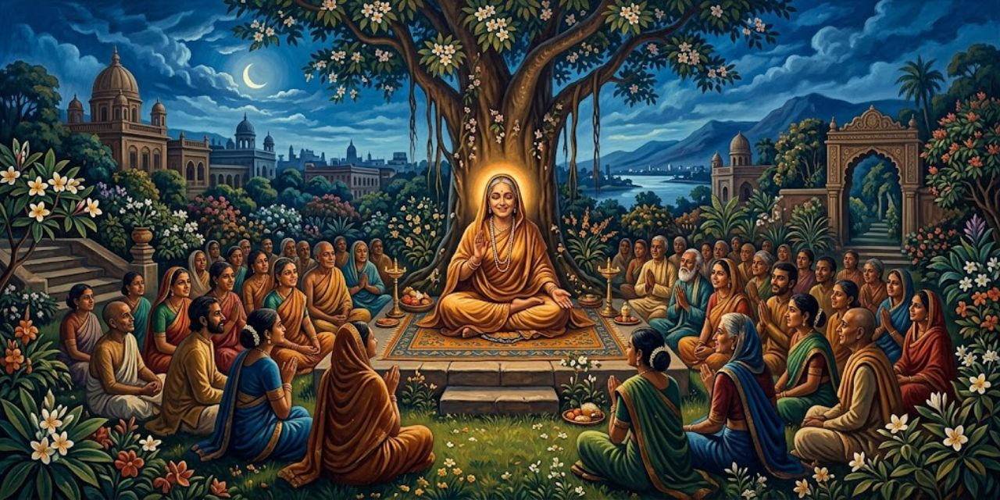</a>

Amiyo Bose, sobrina de Yogananda, le recomienda visitar a Ananda Moyi Ma: cuenta que la santa evitó una muerte con un toque. Yogananda y Wright van a verla en Calcuta.

> Ananda Moyi Ma estaba de pie en un automóvil descubierto, bendiciendo a una multitud de unos cien discípulos. Evidentemente estaba a punto de partir. El señor Wright estacionó el Ford a cierta distancia y me acompañó a pie hacia la tranquila concurrencia. La mujer santa miró en nuestra dirección; bajó de su automóvil y caminó hacia nosotros.
>
> [Párrafo 5](#original-c45-p5)

Ananda Moyi Ma ("Madre Impregnada de Gozo", o "Madre Bienaventurada" en el texto) es el nombre religioso de Nirmala Sundari Devi, una santa bengalí muy venerada en la India del siglo XX. El señor Wright es Richard Wright, secretario de Yogananda en el viaje. La escena arranca con un detalle revelador: la santa se acerca a ellos sin que nadie la llame, lo que el autor presentará como señal de un reconocimiento previo, al decir ella "Padre, ¡has venido!" Esa frase es una afirmación suya recogida por el autor.

Ella lo abraza como si lo conociera, pide que se quede y entra en éxtasis mientras los discípulos cantan.

> Había encontrado en la India a muchos hombres de realización de Dios, pero nunca antes a una mujer santa tan elevada. Su rostro dulce estaba bruñido por la dicha inefable que le había dado el nombre de Madre Bienaventurada. Largas trenzas negras caían sueltas tras su cabeza sin velo. Un punto rojo de pasta de sándalo en la frente simbolizaba el ojo espiritual, siempre abierto en ella. ¡Carita diminuta, manos diminutas, pies diminutos: un contraste con su magnitud espiritual!
>
> [Párrafo 11](#original-c45-p11)

"Realización de Dios" es la expresión del libro para el estado en que alguien, según la tradición, vive en unión con lo divino. Yogananda lee el punto de la frente como signo del "ojo espiritual", un concepto de su enseñanza. Son impresiones personales de un testigo admirador. La frase final, que contrapone el tamaño del cuerpo al de lo espiritual, resume el tono de todo el retrato.

Mientras sigue en trance, Yogananda interroga a una discípula.

> "La Madre Bienaventurada viaja mucho por la India; en muchas partes tiene cientos de discípulos", me dijo la chela. "Sus esfuerzos valientes han traído muchas reformas sociales deseables. Aunque brahmín, la santa no reconoce distinciones de casta. Un grupo de nosotros viaja siempre con ella, atendiendo a su comodidad. Tenemos que hacerle de madre; ella no toma nota de su cuerpo. Si nadie le diera de comer, no comería ni preguntaría. Incluso cuando le ponen las comidas delante, no las toca. Para evitar su desaparición de este mundo, los discípulos le damos de comer con nuestras propias manos. A menudo permanece días seguidos en el trance divino, apenas respirando, con los ojos sin parpadear. Uno de sus principales discípulos es su marido. Hace muchos años, poco después de casarse, él hizo voto de silencio."
>
> [Párrafo 13](#original-c45-p13)

Una *chela* es una discípula. Los brahmines son la casta sacerdotal, la más alta; que una brahmín rechace las distinciones de casta era un gesto de reforma. Lo que sigue es el testimonio de una seguidora, no una observación verificada: que la santa no toma la iniciativa de comer, que pasa días en trance y que sus discípulos la alimentan. El libro lo transmite como relato de la discípula. Más adelante el autor dirá que él mismo la vio comer con ayuda y volver del trance "con una risita alegre".

La discípula señala al marido silencioso. Al volver ella en sí, Yogananda le propone viajar a Estados Unidos; abandona la idea ante la resistencia de sus seguidores. La invita a su escuela de Ranchi.

> "¡Victoria! ¡Ananda Moyi Ma, ki jai!" Este canto reiterado de decenas de entusiastas gargantas pequeñas saludó a la comitiva de la santa al cruzar las puertas de la escuela. ¡Lluvia de caléndulas, tintineo de címbalos, soplo vigoroso de caracolas y redoble del tambor *mridanga*! La Madre Bienaventurada vagaba sonriente por los soleados terrenos del *Vidyalaya*, llevando siempre consigo el paraíso portátil.
>
> [Párrafo 27](#original-c45-p27)

"Ki jai" es una aclamación hindi que se traduce como "¡victoria a...!" El *Vidyalaya* es la escuela que Yogananda fundó en Ranchi para niños. Los instrumentos nombrados son los de las festividades religiosas: címbalos, caracolas (que se soplan como trompetas) y un tambor de dos caras. "Paraíso portátil" es una imagen del autor para decir que la santa, según él, vive en dicha constante dondequiera que esté.

Allí la santa dice que nunca se identificó con el cuerpo: siempre fue "la misma", antes y después de casarse. Cuenta que su marido sintió una sacudida al tocarla, pidió perdón y juró callar. Tras un trance, come con ayuda y parte. Yogananda cita el primer mandamiento de Cristo.

> Desechando todo apego inferior, Ananda Moyi Ma ofrece su única lealtad al Señor. No por las distinciones quisquillosas de los eruditos sino por la lógica segura de la fe, la santa infantil ha resuelto el único problema de la vida humana: establecer la unidad con Dios. El hombre ha olvidado esta simplicidad desnuda, ahora ofuscada por un millón de asuntos. Al negar a Dios un amor monoteísta, las naciones disfrazan su infidelidad con un respeto escrupuloso ante los santuarios exteriores de la caridad. Estos gestos humanitarios son virtuosos, porque por un momento apartan la atención del hombre de sí mismo, pero no lo liberan de su única responsabilidad en la vida, a la que Jesús se refirió como el primer mandamiento. La obligación edificante de amar a Dios se asume con el primer aliento de un aire concedido libremente por su único Benefactor.
>
> [Párrafo 42](#original-c45-p42)

Es la opinión de Yogananda, a partir de lo que vio en la santa. Por "primer mandamiento" entiende el de amar a Dios con todo el corazón (Mateo 22:37-38, que el texto cita justo antes). El párrafo sostiene que el amor a Dios es lo central y que las obras de caridad, aunque buenas, no lo sustituyen. El mismo Evangelio une a este mandamiento el amor al prójimo en los versículos siguientes (Mateo 22:39-40). Debe leerse como declaración de fe del autor, no como juicio sobre las naciones.

Meses después Yogananda la ve de nuevo en la estación de Serampore: ella le dice que va al Himalaya, donde unos discípulos le han levantado una ermita en Dehra Dun. Al subir al tren, él nota que sus ojos nunca se apartan de Dios, y el capítulo cierra con la frase que dice seguir oyendo: "Ahora y siempre uno con lo Eterno, yo soy siempre la misma".

---

## Capítulo 46: La yoguina que nunca come

Una mañana, al salir de la escuela de Ranchi, Yogananda lleva a Wright y a tres amigos en el Ford a ver a una santa que, dice, no come. Cuenta que oyó hablar de Giri Bala a Sthiti Lal Nundy, tutor de su hermano.

> ""Conozco bien a Giri Bala", me dijo Sthiti Babu. "Emplea cierta técnica de yoga que le permite vivir sin comer. Fui su vecino cercano en Nawabganj, cerca de Ichapur. Me propuse vigilarla de cerca; jamás hallé indicio de que tomara alimento o bebida. Mi interés creció tanto que acudí al maharajá de Burdwan y le pedí que hiciera una investigación. Asombrado por la historia, la invitó a su palacio. Ella aceptó una prueba y vivió dos meses encerrada en una pequeña sección de su casa. Más tarde volvió para una estancia de veinte días en el palacio; y luego para una tercera prueba de quince días. El propio maharajá me dijo que estos tres rigurosos escrutinios lo habían convencido sin duda de que ella no comía."
>
> [Párrafo 7](#original-c46-p7)

Es el primer testimonio del capítulo y llega de segunda mano: Yogananda cuenta lo que le dijo Sthiti Lal Nundy, un vecino de Giri Bala, quien a su vez cuenta lo que dijo el maharajá de Burdwan (un príncipe regional de Bengala). Las pruebas del palacio no se observan directamente en la escena: llegan en relatos encadenados. La afirmación central, que una persona vive sin comida ni bebida durante décadas, la presenta el libro como algo que sus testigos dan por cierto. El relato no aporta informes ni mediciones de esas pruebas, solo el testimonio de segunda mano. Debe leerse como lo que sostienen el autor y sus fuentes, no como un hecho comprobado.

Yogananda dice que la historia lo acompañó más de veinticinco años. En Purulia, Lambadar Dey, hermano de Giri Bala y abogado, le confirma que está viva en Biur, duda de que el coche llegue y asegura que en más de cinco décadas nunca la vio comer. Añade que ella vive entre su familia, habituada a su estado.

> La sinceridad del hermano era manifiesta. Nuestro pequeño grupo le dio las gracias con calidez y partió hacia Biur. Nos detuvimos en un puesto callejero para curry y *luchis,* atrayendo a un enjambre de chiquillos que se reunieron a mirar al señor Wright comer con los dedos, al sencillo modo hindú. Los apetitos robustos nos hicieron reforzarnos para una tarde que, sin saberlo entonces, resultaría bastante laboriosa.
>
> [Párrafo 18](#original-c46-p18)

Los *luchis* son panes fritos. El pasaje tiene un valor de contraste: mientras el viaje busca a alguien que no come, el grupo come con ganas, y el texto lo subraya con humor. La "sinceridad" del hermano es la impresión de Yogananda sobre una persona, no una verificación. El aviso final anuncia el tono de aventura de las páginas siguientes, dedicadas al mal estado de los caminos.

> Nuestro camino llevaba ahora al este, entre arrozales caldeados por el sol, hacia la sección de Burdwan, en Bengala. Seguimos por caminos bordeados de vegetación densa; los cantos de los *maynas* y de los *bulbules* de garganta rayada brotaban de árboles de enormes ramas como sombrillas. De vez en cuando, una carreta de bueyes, con el chirrido rini, rini, *manju, manju* de su eje y de sus ruedas de madera con llantas de hierro, que contrastaba en la mente con el siseo de los neumáticos sobre el aristocrático asfalto de las ciudades.
>
> [Párrafo 19](#original-c46-p19)

Los *maynas* y los *bulbules* son los pájaros cuyo canto describe aquí el autor. El "rini, rini, manju, manju" es la imitación sonora que el autor hace del chirrido del eje. Lo notable es el contraste entre el campo y la ciudad, entre el rodar de las carretas y el del automóvil. Es un pasaje de ambiente que sitúa al lector en la Bengala rural de 1936, lejos de los centros urbanos del libro.

Se detienen ante un mango cargado de fruta, y Yogananda dice que, si Giri Bala es auténtica, quiere escribir sobre ella. Wright pide llegar antes del anochecer para las fotos, porque Occidente es escéptico. El camino empeora, empujan el coche y cruzan aldeas.

> "Nuestro camino serpenteaba y giraba entre palmerales, por antiguas aldeas intactas, recogidas en la sombra del bosque", ha anotado el señor Wright en su diario de viaje, con fecha 5 de mayo de 1936. "Son fascinantes estos conjuntos de chozas de barro con techo de paja, decoradas con uno de los nombres de Dios en la puerta; muchos niños pequeños, desnudos, juegan inocentes, se detienen a mirar o corren despavoridos ante este gran carruaje negro, sin bueyes, que atraviesa a toda furia su aldea. Las mujeres apenas asoman desde la sombra, mientras los hombres se tumban con pereza bajo los árboles junto al camino, curiosos tras su indiferencia. En un lugar, todos los aldeanos se bañaban alegres en el gran estanque (con sus ropas, y se cambiaban envolviéndose el cuerpo con telas secas y dejando caer las mojadas). Mujeres llevaban agua a sus casas en enormes jarras de latón.
>
> [Párrafo 36](#original-c46-p36)

Aquí habla Richard Wright, no Yogananda: el libro cita su diario para dar una mirada de testigo occidental. Es una escena etnográfica con los ojos de la época: "desnudos" y "perezosos" son juicios de un viajero extranjero, no descripciones neutras. La fecha sitúa la visita en mayo de 1936. El "carruaje sin bueyes" es el Ford, cuya llegada suscita asombro entre los aldeanos del relato.

El diario de Wright cuenta cómo llegan a Biur entre arroyos y caminos difíciles. Unos chicos los guían y ayudan a despejar obstáculos, mientras el Ford se atasca entre arbustos, desniveles y un estanque seco. Atraen una procesión de vecinos. Ante la casa familiar, de dos pisos y en reparación, aparece Giri Bala envuelta en seda dorada; Wright describe su rostro con admiración.

> "Se acercó con humildad y consintió en silencio en que tomáramos varias imágenes con nuestras cámaras fotográficas y cinematográficas. Con paciencia y timidez soportó nuestras técnicas fotográficas de ajuste de postura y disposición de la luz. Por fin habíamos registrado para la posteridad muchas fotografías de la única mujer del mundo de quien se sabe que ha vivido sin comida ni bebida durante más de cincuenta años. (Therese Neumann, por supuesto, ayuna desde 1923.) Su expresión era sumamente maternal mientras permanecía de pie ante nosotros, completamente cubierta por la tela suelta, sin que se vieran de su cuerpo más que el rostro con los ojos bajos, las manos y los diminutos pies. Un rostro de rara paz e inocente aplomo: un labio ancho, infantil, tembloroso, una nariz femenina, ojos estrechos y chispeantes y una sonrisa melancólica."
>
> [Párrafo 44](#original-c46-p44)

Sigue hablando Richard Wright en su diario. La cámara puede dejar constancia del aspecto de Giri Bala y de la visita, pero una fotografía no demuestra cuánto tiempo lleva alguien sin comer. La afirmación de que era la única mujer conocida en esa condición es la del testigo, recogida por Yogananda. Therese Neumann es la otra figura de ayuno extraordinario que el libro había tratado antes; la fecha entre paréntesis también pertenece al relato. La descripción final mezcla rasgos visibles con impresiones afectivas del observador, como la paz o el carácter maternal del rostro.

> La impresión del señor Wright sobre Giri Bala era compartida por mí; la espiritualidad la envolvía como su velo de suave brillo. Me saludó con el *pronam*, el gesto acostumbrado de saludo de un laico a un monje. Su sencillo encanto y su tranquila sonrisa nos dieron una bienvenida mayor que la de una oratoria melosa; quedó olvidado nuestro difícil y polvoriento viaje.
>
> [Párrafo 45](#original-c46-p45)

El *pronam* es el saludo con las manos juntas y una inclinación, usado por laicos ante renunciantes (monjes). Que ella lo salude así marca su condición de swami. Las palabras sobre su "espiritualidad" son impresión del autor, hecha de modales: la modestia, la sonrisa. No hay en el párrafo ningún dato verificable sobre su dieta.

Ella se sienta en el porche; no está demacrada y su piel conserva un aspecto saludable. Yogananda le dice en bengalí que ha pensado en este viaje más de veinticinco años y que su vida debería darse a conocer al mundo. Ella responde que el "padre" sabe más.

> Me alegré de que no se hubiera ofendido; nunca se sabe cómo reaccionarán los grandes yoguis o yoguinis ante la idea de la publicidad. La rehúyen, por regla general, deseando proseguir en silencio la profunda investigación del alma. Les llega una aprobación interior cuando llega el momento oportuno de mostrar abiertamente sus vidas en beneficio de las mentes que buscan.
>
> [Párrafo 52](#original-c46-p52)

Una yoguina es una mujer que practica yoga a fondo. El párrafo defiende, de paso, la decisión del autor de escribir sobre ella: según él, los yoguis rehúyen la fama hasta que reciben una especie de permiso interior. Es la justificación de un autor que publica algo que su protagonista no pidió; el libro la presenta como norma de los yoguis, no como regla probada.

Él le pide perdón por sus preguntas. Ella dice ser la humilde servidora de todos y que le gusta cocinar y dar de comer. Al preguntarle si vive sin comer, responde que sí: desde los doce años y cuatro meses hasta los sesenta y ocho, sin comida ni líquidos, y que si sintiera antojo tendría que comer. Yogananda sugiere que se nutre del aire, de la luz y de la energía cósmica, y ella asiente sin insistir. Luego habla de su infancia de apetito insaciable y de la advertencia de su madre.

> "La calamidad que ella había previsto se cumplió. Yo tenía solo doce años cuando me uní a la familia de mi marido en Nawabganj. Mi suegra me avergonzaba mañana, tarde y noche por mis hábitos glotones. Sus regaños fueron sin embargo una bendición disfrazada; despertaron mis inclinaciones espirituales dormidas. Una mañana su burla fue despiadada.
>
> [Párrafo 70](#original-c46-p70)

Giri Bala dice que a los doce años pasó a vivir con la familia de su marido. "Calamidad" remite a la advertencia de su madre de que, entre extraños, su voracidad le traería problemas. El giro es dramático: el reproche cotidiano acaba siendo, según ella, el impulso de su vida espiritual. Todo lo que sigue es el relato de la propia Giri Bala, traducido por Yogananda del bengalí.

Ella cuenta que prometió a su suegra no volver a comer, ante su burla. Reza para que Dios le envíe un gurú y va al Ganges; un sacerdote le da una respuesta vaga. Tras bañarse, dice que su maestro apareció ante ella a plena luz del día.

> ""Querida pequeña", dijo con voz de amorosa compasión, "soy el gurú enviado aquí por Dios para cumplir tu urgente plegaria. ¡Él quedó hondamente conmovido por su carácter tan inusual! A partir de hoy vivirás de la luz astral, con tus átomos corporales alimentados por la corriente infinita.""
>
> [Párrafo 79](#original-c46-p79)

Es el momento central del relato de Giri Bala: según ella, un maestro aparece en el río y le promete una vida alimentada por la "luz astral". El texto no explica quién era él ni cómo llegó, y en la narración nadie más lo presencia. Se trata de una experiencia personal de fe contada por ella, que el libro recoge sin pruebas externas.

Giri Bala calla. Yogananda traduce al inglés lo dicho para Wright.

> La santa reanudó el relato, con su voz suave apenas audible. "El ghat estaba desierto, pero mi gurú tendió a nuestro alrededor un halo de luz protectora, para que ningún bañista ocasional nos molestara después. Me inició en una técnica kria que libera al cuerpo de la dependencia del alimento grosero de los mortales. La técnica incluye el uso de cierto *mantra*
> y un ejercicio de respiración más difícil de lo que una persona común podría ejecutar. No hay medicina ni magia; nada más allá de la kria."
>
> [Párrafo 81](#original-c46-p81)

Un *ghat* es la escalinata que baja al río. *Kria* es el nombre que este relato da a la técnica de práctica espiritual recibida del gurú. Giri Bala insiste en que no hay "medicina ni magia", y en su relato la técnica queda sin explicar: ella no la enseña por mandato de su gurú, como cuenta después. Por eso, aunque el capítulo trata de un método para no comer, el libro no ofrece pasos que el lector pueda seguir ni probar.

Yogananda le hace más preguntas. Ella dice que es viuda, no ha tenido hijos, duerme poco y nunca ha estado enferma. Cuando él pregunta por qué no enseña el método, responde que su gurú le prohibió revelarlo y que no quiere alterar el drama de Dios, y que su propósito es probar que el ser humano es Espíritu. Según Yogananda, entra en trance sin respirar; llega la noche y la despedida. Él le pide un trozo de sari, ella trae seda de Benarés y se postra, y él le pide, en cambio, tocar sus pies.

---

## Capítulo 47: Regreso a Occidente

En septiembre de 1936, de regreso de la India, Yogananda da clases en Londres y bromea sobre la alegría de un hindú al enseñar a alumnos ingleses.

> También Inglaterra es receptiva al mensaje atemporal del yoga. Reporteros y camarógrafos de noticiarios invadieron mis aposentos en Grosvenor House. El Consejo Nacional Británico de la Fraternidad Mundial de las Religiones organizó una reunión el 29 de septiembre en la iglesia congregacionalista de Whitefield, donde me dirigí al público sobre el grave tema "Cómo la fe en la confraternidad puede salvar la civilización". Las conferencias de las ocho en Caxton Hall atrajeron tales multitudes que dos noches el desborde esperó en el auditorio de Windsor House para mi segunda charla a las nueve y media. Las clases de yoga en las semanas siguientes crecieron tanto que el señor Wright tuvo que organizar un traslado a otra sala.
>
> [Párrafo 4](#original-c47-p4)

Los datos de lugares y fechas son los que aporta el autor: Grosvenor House (hotel londinense), Caxton Hall (sala de las conferencias) y la iglesia de Whitefield. La asistencia, en cambio, la cuenta él mismo, sin cifras. Una consecuencia que el libro añade a continuación: los alumnos de Londres se organizaron como centro de la Self-Realization Fellowship y siguieron reuniéndose durante la guerra.

Los alumnos forman un centro de meditación. Tras recorrer Inglaterra con Wright, el grupo zarpa en octubre y cruza Estados Unidos en el Ford hasta Los Ángeles. En Mount Washington, la Navidad reúne meditación, banquete y regalos traídos del viaje.

> ¡Hora de regalos! Presentes de los rincones lejanos de la Tierra: Palestina, Egipto, India, Inglaterra, Francia, Italia. ¡Con cuánto afán había contado el señor Wright los baúles en cada cruce extranjero, para que ninguna mano ladrona se llevara los tesoros destinados a los seres queridos de Estados Unidos! Placas del árbol sagrado del olivo de Tierra Santa, delicados encajes y bordados de Bélgica y Holanda, alfombras persas, chales de Cachemira finamente tejidos, bandejas de sándalo de Mysore, de fragancia eterna, piedras "ojo de toro" de Shiva de las Provincias Centrales, antiguas monedas indias de dinastías ya idas, jarrones y copas con pedrería, miniaturas, tapices, incienso y perfumes de templo, estampados de algodón *swadeshi*, trabajos de laca, tallas de marfil de Mysore, babuchas persas con su curiosa puntera larga, curiosos manuscritos antiguos iluminados, terciopelos, brocados, gorras de Gandhi, cerámicas, azulejos, objetos de latón, alfombras de oración: ¡botín de tres continentes!
>
> [Párrafo 11](#original-c47-p11)

Mount Washington es la sede de la Self-Realization Fellowship en Los Ángeles. La lista es una especie de mapa del viaje, con una nota de época: *swadeshi* ("de la propia tierra") es el movimiento que, con Gandhi, promovía las telas y bienes hechos en la India. Las "gorras de Gandhi" prolongan la presencia del dirigente en esta lista de recuerdos. La palabra "botín" da a la lista un tono juguetón de tesoros reunidos.

Gyanamata recibe un sari; Dickinson, una copa de plata. Días después, él explica su emoción: según cuenta, de niño vio en una luz a un hombre mientras se ahogaba; en Chicago, en 1893, reconoció al mismo hombre en Vivekananda. Este le anunció que otro maestro le daría una copa de plata.

> "Dejé Chicago a los pocos días", continuó el señor Dickinson, "y nunca volví a ver al gran Vivekananda. Pero cada palabra que había dicho quedó escrita indeleblemente en lo más hondo de mi conciencia. Pasaron los años; no apareció ningún maestro. Una noche de 1925 recé con hondura para que el Señor me enviara a mi gurú. Unas horas después me despertó de mi sueño un suave acorde de melodía. Una banda de seres celestiales, con flautas y otros instrumentos, se presentó ante mi vista. Tras llenar el aire de música gloriosa, los ángeles se desvanecieron lentamente.
>
> [Párrafo 26](#original-c47-p26)

Swami Vivekananda (1863-1902) fue un monje indio que habló en el Parlamento de las Religiones del Mundo de Chicago en 1893. Según Dickinson, allí le dijo, siendo él un joven de diecisiete años, que su futuro maestro "le daría una copa de plata". Yogananda transcribe el relato: la visión de niño, el encuentro en Chicago y la copa recibida 43 años después. Son relatos personales de fe, sin otro testigo en el texto. El párrafo siguiente termina con la conferencia que Dickinson oyó a Yogananda en 1925, que en su relato responde a su oración.

Dickinson cuenta que al día siguiente de aquella visión asistió por primera vez a una conferencia de Yogananda. Tras once años como discípulo, ya creía metafórica la copa prometida. Pero al abrir el regalo, dice, vio por tercera vez aquella luz: la copa cerraba su larga espera.

---

## Capítulo 48: En Encinitas, California

Gyanamata sorprende a Yogananda con una ermita en Encinitas, junto al Pacífico, regalo de discípulos estadounidenses. Recorre sus salas, jardines y cuevas de meditación; una oración del Zend-Avesta adorna una puerta. Ve cumplida la profecía de Sri Yukteswar sobre una ermita junto al mar.

> Pocos meses después, en la Pascua de 1937, dirigí en los suaves céspedes de Encinitas el primero de muchos Servicios del Amanecer. Como los magos de antaño, varios cientos de alumnos contemplaban con devoto asombro el milagro diario, el temprano rito de fuego solar en el cielo oriental. Al oeste yacía el inagotable Pacífico, rugiendo su solemne alabanza; a lo lejos, un diminuto velero blanco y el vuelo solitario de una gaviota. "¡Cristo, has resucitado!" ¡No solo con el sol primaveral, sino en el alba eterna del Espíritu!
>
> [Párrafo 9](#original-c48-p9)

Encinitas es una localidad costera del sur de California. El Servicio del Amanecer de Pascua es una ceremonia al aire libre para celebrar la resurrección de Cristo. El paralelismo con los magos (los "sabios" del Evangelio) y con el sol naciente sirve al autor para unir dos símbolos: el astro y el Espíritu. La frase "Cristo, has resucitado" recoge en tono de oración lo que el capítulo 43 contaba a propósito de su maestro.

Allí termina Cosmic Chants, unos cuarenta cantos con letras en inglés y notación occidental. En el prefacio recuerda una conferencia de 1926 en Carnegie Hall: Hunsicker duda de que el público acepte un canto indio; Yogananda confía en la música.

> Durante la conferencia el señor Hunsicker se había sentado detrás de mí en la plataforma, probablemente temiendo por mi seguridad. Sus dudas eran infundadas; no solo hubo ausencia de hortalizas indeseadas, sino que durante una hora y veinticinco minutos los compases de "¡Oh Dios hermoso!" sonaron sin interrupción desde tres mil gargantas. Ya no más hastiados, queridos neoyorquinos; ¡vuestros corazones se elevaron en un sencillo peán de regocijo! Aquella noche hubo curaciones divinas entre los devotos que cantaban con amor el bendito nombre del Señor.
>
> [Párrafo 15](#original-c48-p15)

Hunsicker, un alumno, había advertido a Yogananda de que el público estadounidense no aceptaría un canto indio, y bromeó sobre la posibilidad de que le lanzaran verduras. La frase "curaciones divinas" es lo que cuenta el autor; el texto no da casos concretos ni testigos. Un "peán" es un canto de alegría o de triunfo. La cita muestra el tipo de tesis que el libro defiende: que la música devocional es un lenguaje común.

La actividad lo devuelve a clases, correspondencia y viajes entre Los Ángeles y Encinitas. En 1938 inaugura la iglesia de Washington, dirigida por Premananda, antiguo alumno de Ranchi, y le agradece su trabajo.

> Premananda me acompañó desde Washington para una breve visita al centro de la Self-Realization Fellowship en Boston. ¡Qué alegría volver a ver al grupo de *Kriya Yoga* que había permanecido firme desde 1920! El jefe de Boston, el Dr. M. W. Lewis, nos alojó a mi compañero y a mí en una suite moderna, decorada con arte.
>
> [Párrafo 19](#original-c48-p19)

Premananda es el swami que dirigía el centro de Washington; según el libro estudió en la escuela de Ranchi y Yogananda lo llamó a ese puesto en 1928. Boston fue una de las primeras ciudades donde Yogananda enseñó en Estados Unidos. Lewis reaparece después en la conversación sobre la colonia mundial. El párrafo recuerda a los discípulos más antiguos y la fidelidad de un grupo a lo largo de casi dos décadas.

Lewis contrasta la suite con el cuarto sin baño de los primeros años. Se acerca la guerra. Desde Londres llegan cartas: el centro sigue meditando entre alarmas y bombas; Cranmer Byng, editor de The Wisdom of the East, describe la paz de Encinitas como consuelo para su Inglaterra sitiada, aunque quizá nunca llegue a visitarla.

> Los años de guerra trajeron un despertar espiritual entre hombres cuyas diversiones nunca antes habían incluido el estudio del Nuevo Testamento. ¡Un dulce destilado de las hierbas amargas de la guerra! Para satisfacer una necesidad creciente, se construyó y se dedicó en 1942, en Hollywood, una pequeña e inspiradora Iglesia de Autorrealización de Todas las Religiones. El terreno mira a Olive Hill y al lejano Planetario de Los Ángeles. La iglesia, acabada en azul, blanco y oro, se refleja entre los jacintos de agua de un gran estanque. Los jardines están alegres con flores, unos pocos ciervos de piedra sobresaltados, una pérgola de vidrieras y un curioso pozo de los deseos. ¡Entre los centavos y los deseos caleidoscópicos del hombre se ha echado más de una pura aspiración al único tesoro del Espíritu! Una benignidad universal fluye de pequeños nichos con estatuas de Lahiri Mahasaya y Sri Yukteswar, y de Krishna, Buda, Confucio, San Francisco, y una hermosa reproducción en madreperla de Cristo en la Última Cena.
>
> [Párrafo 27](#original-c48-p27)

La lista de estatuas muestra cómo entiende el autor la "Iglesia de Todas las Religiones": sus gurús junto a figuras de otras tradiciones. Lahiri Mahasaya y Sri Yukteswar son los maestros de su linaje. Que la guerra fuera ocasión de un despertar espiritual es una impresión del autor, sin datos. El lector actual puede notar que, como en otros pasajes, mezcla descripción del lugar y valoración propia de su obra.

En 1943 abre la iglesia de San Diego. Allí, al órgano, Yogananda responde a Lloyd Kennell que el esfuerzo en América ha valido la pena por acercar Oriente y Occidente. Canta sobre perseverar. En 1945, mientras revisa este libro, pasea con Lewis por Encinitas: proyecta una comunidad espiritual, encuentros de religiones, pequeños templos y un instituto de yoga, como ejemplo de fraternidad mundial.

> Hasta bien entrada la noche mi querido amigo, el primer yogui *Kriya* de Estados Unidos, habló conmigo de la necesidad de colonias mundiales fundadas sobre una base espiritual. Los males atribuidos a una abstracción antropomórfica llamada "sociedad" pueden achacarse con más realismo a la puerta de cada hombre. La utopía debe brotar en el seno privado antes de poder florecer en virtud cívica. El hombre es un alma, no una institución; solo sus reformas interiores pueden dar permanencia a las exteriores. Con el énfasis en los valores espirituales y la autorrealización, una colonia que ejemplifique la fraternidad mundial queda facultada para enviar vibraciones inspiradoras mucho más allá de su lugar.
>
> [Párrafo 47](#original-c48-p47)

El amigo es el Dr. Lewis, de Boston, a quien el libro presenta como el primer discípulo de *Kriya Yoga* en Estados Unidos. La tesis es la del autor: la reforma social empieza en cada persona. "Antropomórfica" significa con forma humana; el autor critica que se hable de la "sociedad" como si fuera alguien. Tras esta conversación, el capítulo cierra con el fin de la guerra, el 15 de agosto de 1945, y una oración por la paz.

El 15 de agosto de 1945, los residentes celebran el fin de la guerra con una oración para que no se repita y los seres humanos vivan como hermanos. Libre de aquella tensión, Yogananda mira a sus compañeros estadounidenses y agradece a Dios la gran familia que ha dado a este monje.

---

## Los Originales

Esta sección reúne, en el idioma del libro y por orden de aparición, los párrafos que arriba se leen en castellano. El número de cada uno lleva de vuelta a su lugar.

### Capítulo 1: Mis padres y mi primera infancia

> [Párrafo 3](#lugar-c1-p3)
>
> The helpless humiliations of infancy are not banished from my mind. I was resentfully conscious of not being able to walk or express myself freely. Prayerful surges arose within me as I realized my bodily impotence. My strong emotional life took silent form as words in many languages. Among the inward confusion of tongues, my ear gradually accustomed itself to the circumambient Bengali syllables of my people. The beguiling scope of an infant’s mind! adultly considered limited to toys and toes.

> [Párrafo 20](#lugar-c1-p20)
>
> Father tended to first say “No” to any new proposal. His attitude toward the strange woman who so readily enlisted Mother’s sympathy was an example of his customary caution. Aversion to instant acceptance—typical of the French mind in the West—is really only honoring the principle of “due reflection.” I always found Father reasonable and evenly balanced in his judgments. If I could bolster up my numerous requests with one or two good arguments, he invariably put the coveted goal within my reach, whether it were a vacation trip or a new motorcycle.

> [Párrafo 21](#lugar-c1-p21)
>
> Father was a strict disciplinarian to his children in their early years, but his attitude toward himself was truly Spartan. He never visited the theater, for instance, but sought his recreation in various spiritual practices and in reading the Bhagavad *Gita.* Shunning all luxuries, he would cling to one old pair of shoes until they were useless. His sons bought automobiles after they came into popular use, but Father was always content with the trolley car for his daily ride to the office. The accumulation of money for the sake of power was alien to his nature. Once, after organizing the Calcutta Urban Bank, he refused to benefit himself by holding any of its shares. He had simply wished to perform a civic duty in his spare time.

> [Párrafo 40](#lugar-c1-p40)
>
> His picture had a surpassing influence over my life. As I grew, the thought of the master grew with me. In meditation I would often see his photographic image emerge from its small frame and, taking a living form, sit before me. When I attempted to touch the feet of his luminous body, it would change and again become the picture. As childhood slipped into boyhood, I found Lahiri Mahasaya transformed in my mind from a little image, cribbed in a frame, to a living, enlightening presence. I frequently prayed to him in moments of trial or confusion, finding within me his solacing direction. At first I grieved because he was no longer physically living. As I began to discover his secret omnipresence, I lamented no more. He had often written to those of his disciples who were over-anxious to see him: “Why come to view my bones and flesh, when I am ever within range of your *kutastha* (spiritual sight)?”

> [Párrafo 41](#lugar-c1-p41)
>
> I was blessed about the age of eight with a wonderful healing through the photograph of Lahiri Mahasaya. This experience gave intensification to my love. While at our family estate in Ichapur, Bengal, I was stricken with Asiatic cholera. My life was despaired of; the doctors could do nothing. At my bedside, Mother frantically motioned me to look at Lahiri Mahasaya’s picture on the wall above my head.

> [Párrafo 54](#lugar-c1-p54)
>
> The photograph is reproduced in this book. Lahiri Mahasaya’s fair features, of a universal cast, hardly suggest to what race he belonged. His intense joy of God-communion is slightly revealed in a somewhat enigmatic smile. His eyes, half open to denote a nominal direction on the outer world, are half closed also. Completely oblivious to the poor lures of the earth, he was fully awake at all times to the spiritual problems of seekers who approached for his bounty.

> [Párrafo 64](#lugar-c1-p64)
>
> Another early recollection is outstanding; and literally so, for I bear the scar to this day. My elder sister Uma and I were seated in the early morning under a *neem* tree in our Gorakhpur compound. She was helping me with a Bengali primer, what time I could spare my gaze from the near-by parrots eating ripe margosa fruit. Uma complained of a boil on her leg, and fetched a jar of ointment. I smeared a bit of the salve on my forearm.

> [Párrafo 73](#lugar-c1-p73)
>
> Those simple and apparently harmless phrases to Uma, spoken with deep concentration, had possessed sufficient hidden force to explode like bombs and produce definite, though injurious, effects. I understood, later, that the explosive vibratory power in speech could be wisely directed to free one’s life from difficulties, and thus operate without scar or rebuke.

### Capítulo 2: La muerte de mi madre y el amuleto místico

> [Párrafo 3](#lugar-c2-p3)
>
> I had previously witnessed the splendor of nuptial rites for my two elder sisters, Roma and Uma; but for Ananta, as the eldest son, plans were truly elaborate. Mother was welcoming numerous relatives, daily arriving in Calcutta from distant homes. She lodged them comfortably in a large, newly acquired house at 50 Amherst Street. Everything was in readiness—the banquet delicacies, the gay throne on which Brother was to be carried to the home of the bride-to-be, the rows of colorful lights, the mammoth cardboard elephants and camels, the English, Scottish and Indian orchestras, the professional entertainers, the priests for the ancient rituals.

> [Párrafo 16](#lugar-c2-p16)
>
> Father and I returned to Bareilly soon after the crematory rites for the well-beloved. Early every morning I made a pathetic memorial-pilgrimage to a large *sheoli* tree which shaded the smooth, green-gold lawn before our bungalow. In poetical moments, I thought that the white *sheoli* flowers were strewing themselves with a willing devotion over the grassy altar. Mingling tears with the dew, I often observed a strange other-worldly light emerging from the dawn. Intense pangs of longing for God assailed me. I felt powerfully drawn to the Himalayas.

> [Párrafo 28](#lugar-c2-p28)
>
> “While I patted you, I was praying that the great guru take notice and bestow a blessing. As my silent devotional demand grew in intensity, he opened his eyes and beckoned me to approach. The others made a way for me; I bowed at the sacred feet. My master seated you on his lap, placing his hand on your forehead by way of spiritually baptizing you.

> [Párrafo 39](#lugar-c2-p39)
>
> A blaze of illumination came over me with possession of the amulet; many dormant memories awakened. The talisman, round and anciently quaint, was covered with Sanskrit characters. I understood that it came from teachers of past lives, who were invisibly guiding my steps. A further significance there was, indeed; but one does not reveal fully the heart of an amulet.

### Capítulo 3: El santo de los dos cuerpos

> [Párrafo 6](#lugar-c3-p6)
>
> I set forth with the zest of my twelve years (though time has never dimmed my delight in new scenes and strange faces). Reaching Benares, I proceeded immediately to the swami’s residence. The front door was open; I made my way to a long, hall-like room on the second floor. A rather stout man, wearing only a loincloth, was seated in lotus posture on a slightly raised platform. His head and unwrinkled face were clean-shaven; a beatific smile played about his lips. To dispel my thought that I had intruded, he greeted me as an old friend.

> [Párrafo 14](#lugar-c3-p14)
>
> Abruptly terminating our conversation, the saint became gravely motionless. A sphinxlike air enveloped him. At first his eyes sparkled, as if observing something of interest, then grew dull. I felt abashed at his pauciloquy; he had not yet told me how I could meet Father’s friend. A trifle restlessly, I looked about me in the bare room, empty except for us two. My idle gaze took in his wooden sandals, lying under the platform seat.

> [Párrafo 18](#lugar-c3-p18)
>
> I heard somebody coming up the stairs. An amazed incomprehension arose suddenly; my thoughts raced in confusion: “How is it possible that Father’s friend has been summoned to this place without the help of a messenger? The swami has spoken to no one but myself since my arrival!”

> [Párrafo 42](#lugar-c3-p42)
>
> “I will tell you how priceless is a guru’s help. I used to meditate with another disciple for eight hours every night. We had to work at the railroad office during the day. Finding difficulty in carrying on my clerical duties, I desired to devote my whole time to God. For eight years I persevered, meditating half the night. I had wonderful results; tremendous spiritual perceptions illumined my mind. But a little veil always remained between me and the Infinite. Even with superhuman earnestness, I found the final irrevocable union to be denied me. One evening I paid a visit to Lahiri Mahasaya and pleaded for his divine intercession. My importunities continued during the entire night.

> [Párrafo 56](#lugar-c3-p56)
>
> “Without further questioning the physician recommended me highly for a pension, which I soon received. I know the divine will of Lahiri Mahasaya worked through the doctor and the railroad officials, including your father. Automatically they obeyed the great guru’s spiritual direction, and freed me for a life of unbroken communion with the Beloved.”

> [Párrafo 59](#lugar-c3-p59)
>
> Kedar Nath Babu walked by my side in the gathering darkness. I delivered Father’s letter, which my companion read under a street lamp.

### Capítulo 4: Mi fuga frustrada hacia el Himalaya

> [Párrafo 4](#lugar-c4-p4)
>
> The memorable morning arrived with inauspicious rain. Hearing the wheels of Amar’s carriage in the road, I hastily tied together a blanket, a pair of sandals, Lahiri Mahasaya’s picture, a copy of the *Bhagavad Gita,* a string of prayer beads, and two loincloths. This bundle I threw from my third-story window. I ran down the steps and passed my uncle, buying fish at the door.

> [Párrafo 17](#lugar-c4-p17)
>
> Through Amar’s suggestion of a divine test, my heart steadied itself. We refreshed ourselves with famous Burdwan sweetmeats, *sitabhog* (food for the goddess) and *motichur* (nuggets of sweet pearl). In a few hours, we entrained for Hardwar, via Bareilly. Changing trains at Moghul Serai, we discussed a vital matter as we waited on the platform.

> [Párrafo 31](#lugar-c4-p31)
>
> By this time my inward mirth had reached a zenith; I unceremoniously made for the train, whistling for departure. Amar followed with the official, who was credulous and obliging enough to put us into a European compartment. It evidently pained him to think of two half-English boys traveling in the section allotted to natives. After his polite exit, I lay back on the seat and laughed uncontrollably. My friend wore an expression of blithe satisfaction at having outwitted a veteran European official.

> [Párrafo 38](#lugar-c4-p38)
>
> “I see you are crazy about saints! You will never meet a greater man of God than the one I saw only yesterday. My brother officer and I first encountered him five days ago. We were patrolling by the Ganges, on a sharp lookout for a certain murderer. Our instructions were to capture him, alive or dead. He was known to be masquerading as a *sadhu* in order to rob pilgrims. A short way before us, we spied a figure which resembled the description of the criminal. He ignored our command to stop; we ran to overpower him. Approaching his back, I wielded my ax with tremendous force; the man’s right arm was severed almost completely from his body.

> [Párrafo 42](#lugar-c4-p42)
>
> “‘Son, that was just an understandable mistake on your part.’ The saint regarded me kindly. ‘Run along, and don’t reproach yourself. The Beloved Mother is taking care of me.’ He pushed his dangling arm into its stump and lo! it adhered; the blood inexplicably ceased to flow.

> [Párrafo 46](#lugar-c4-p46)
>
> The officer concluded with a pious ejaculation; his experience had obviously moved him beyond his usual depths. With an impressive gesture, he handed me a printed clipping about the miracle. In the usual garbled manner of the sensational type of newspaper (not missing, alas! even in India), the reporter’s version was slightly exaggerated: it indicated that the sadhu had been almost decapitated!

> [Párrafo 58](#lugar-c4-p58)
>
> Ananta took me to their home. The son, a young man of ebullient manner, greeted me in the courtyard. He engaged me in a lengthy philosophic discourse. Professing to have a clairvoyant knowledge of my future, he discountenanced my idea of being a monk.

> [Párrafo 60](#lugar-c4-p60)
>
> Krishna’s immortal words rose to my lips in reply: “‘Even he with the worst of karma who ceaselessly meditates on Me quickly loses the effects of his past bad actions. Becoming a high-souled being, he soon attains perennial peace. Arjuna, know this for certain: the devotee who puts his trust in Me never perishes!’”

> [Párrafo 76](#lugar-c4-p76)
>
> “‘I started for the Himalayas in a buoyant spiritual mood,’ he explained. ‘Inspiration filled me at the prospect of meeting the masters. But as soon as Mukunda said, ”During our ecstasies in the Himalayan caves, tigers will be spellbound and sit around us like tame pussies,” my spirits froze; beads of perspiration formed on my brow. “What then?” I thought. ”If the vicious nature of the tigers be not changed through the power of our spiritual trance, shall they treat us with the kindness of house cats?” In my mind’s eye, I already saw myself the compulsory inmate of some tiger’s stomach—entering there not at once with the whole body, but by installments of its several parts!’”

> [Párrafo 84](#lugar-c4-p84)
>
> “Rarely fortunate, I was able to remain near Lahiri Mahasaya for ten years. His Benares home was my nightly goal of pilgrimage. The guru was always present in a small front parlor on the first floor. As he sat in lotus posture on a backless wooden seat, his disciples garlanded him in a semicircle. His eyes sparkled and danced with the joy of the Divine. They were ever half closed, peering through the inner telescopic orb into a sphere of eternal bliss. He seldom spoke at length. Occasionally his gaze would focus on a student in need of help; healing words poured then like an avalanche of light.

> [Párrafo 102](#lugar-c4-p102)
>
> “‘That is indeed different, Ramu. God’s limit is nowhere! He who ignites the stars and the cells of flesh with mysterious life-effulgence can surely bring luster of vision into your eyes.’

> [Párrafo 105](#lugar-c4-p105)
>
> “Lo! in one week it was so. For the first time, Ramu beheld the fair face of nature. The Omniscient One had unerringly directed his disciple to repeat the name of Rama, adored by him above all other saints. Ramu’s faith was the devotionally ploughed soil in which the guru’s powerful seed of permanent healing sprouted.” Kebalananda was silent for a moment, then paid a further tribute to his guru.

### Capítulo 5: Un «santo de los perfumes» exhibe sus maravillas

> [Párrafo 12](#lugar-c5-p12)
>
> “Man can understand no eternal verity until he has freed himself from pretensions. The human mind, bared to a centuried slime, is teeming with repulsive life of countless world-delusions. Struggles of the battlefields pale into insignificance here, when man first contends with inward enemies! No mortal foes these, to be overcome by harrowing array of might! Omnipresent, unresting, pursuing man even in sleep, subtly equipped with a miasmic weapon, these soldiers of ignorant lusts seek to slay us all. Thoughtless is the man who buries his ideals, surrendering to the common fate. Can he seem other than impotent, wooden, ignominious?”

> [Párrafo 15](#lugar-c5-p15)
>
> “To love both the invisible God, Repository of All Virtues, and visible man, apparently possessed of none, is often baffling! But ingenuity is equal to the maze. Inner research soon exposes a unity in all human minds—the stalwart kinship of selfish motive. In one sense at least, the brotherhood of man stands revealed. An aghast humility follows this leveling discovery. It ripens into compassion for one’s fellows, blind to the healing potencies of the soul awaiting exploration.”

> [Párrafo 17](#lugar-c5-p17)
>
> “Only the shallow man loses responsiveness to the woes of others’ lives, as he sinks into narrow suffering of his own.” The *sadhu’s* austere face was noticeably softened. “The one who practices a scalpel self-dissection will know an expansion of universal pity. Release is given him from the deafening demands of his ego. The love of God flowers on such soil. The creature finally turns to his Creator, if for no other reason than to ask in anguish: ‘Why, Lord, why?’ By ignoble whips of pain, man is driven at last into the Infinite Presence, whose beauty alone should lure him.”

> [Párrafo 21](#lugar-c5-p21)
>
> “You are young.” The sage surveyed me thoughtfully. “India too is young. The ancient *rishis*
> laid down ineradicable patterns of spiritual living. Their hoary dictums suffice for this day and land. Not outmoded, not unsophisticated against the guiles of materialism, the disciplinary precepts mold India still. By millenniums—more than embarrassed scholars care to compute! —the skeptic Time has validated Vedic worth. Take it for your heritage.”

> [Párrafo 32](#lugar-c5-p32)
>
> I looked directly at the saint; his quick gaze rested on mine. He was plump and bearded, with dark skin and large, gleaming eyes.

> [Párrafo 57](#lugar-c5-p57)
>
> A jasmine fragrance instantly shot from the petals. I thanked the wonder-worker and seated myself by one of his students. He informed me that Gandha Baba, whose proper name was Vishudhananda, had learned many astonishing yoga secrets from a master in Tibet. The Tibetan yogi, I was assured, had attained the age of over a thousand years.

> [Párrafo 58](#lugar-c5-p58)
>
> “His disciple Gandha Baba does not always perform his perfume-feats in the simple verbal manner you have just witnessed.” The student spoke with obvious pride in his master. “His procedure differs widely, to accord with diversity in temperaments. He is marvelous! Many members of the Calcutta intelligentsia are among his followers.”

> [Párrafo 72](#lugar-c5-p72)
>
> Hypnotism has been used by physicians in minor operations as a sort of psychical chloroform for persons who might be endangered by an anesthetic. But a hypnotic state is harmful to those often subjected to it; a negative psychological effect ensues which in time deranges the brain cells. Hypnotism is trespass into the territory of another’s consciousness. Its temporary phenomena have nothing in common with the miracles performed by men of divine realization. Awake in God, true saints effect changes in this dream-world by means of a will harmoniously attuned to the Creative Cosmic Dreamer.

### Capítulo 6: El Swami Tigre

> [Párrafo 3](#lugar-c6-p3)
>
> The next day dawned wintry cold, but Chandi and I sallied forth gaily. After much vain hunting in Bhowanipur, outside Calcutta, we arrived at the right house. The door held two iron rings, which I sounded piercingly. Notwithstanding the clamor, a servant approached with leisurely gait. His ironical smile implied that visitors, despite their noise, were powerless to disturb the calmness of a saint’s home.

> [Párrafo 15](#lugar-c6-p15)
>
> “Mind is the wielder of muscles. The force of a hammer blow depends on the energy applied; the power expressed by a man’s bodily instrument depends on his aggressive will and courage. The body is literally manufactured and sustained by mind. Through pressure of instincts from past lives, strengths or weaknesses percolate gradually into human consciousness. They express as habits, which in turn ossify into a desirable or an undesirable body. Outward frailty has mental origin; in a vicious circle, the habit-bound body thwarts the mind. If the master allows himself to be commanded by a servant, the latter becomes autocratic; the mind is similarly enslaved by submitting to bodily dictation.”

> [Párrafo 24](#lugar-c6-p24)
>
> “When my fame reached a zenith, it brought the intoxication of pride. I decided not only to fight tigers but to display them in various tricks. My ambition was to force savage beasts to behave like domesticated ones. I began to perform my feats publicly, with gratifying success.

> [Párrafo 29](#lugar-c6-p29)
>
> “‘Father, you astonish me! You well know what tigers are—beautiful but merciless! Even immediately after an enormous meal of some hapless creature, a tiger is fired with fresh lust at sight of new prey. It may be a joyous gazelle, frisking over the jungle grass. Capturing it and biting an opening in the soft throat, the malevolent beast tastes only a little of the mutely crying blood, and goes its wanton way.

> [Párrafo 38](#lugar-c6-p38)
>
> “Not long after Father’s warning, I visited the capital city of Cooch Behar. The picturesque territory was new to me, and I expected a restful change. As usual everywhere, a curious crowd followed me on the streets. I would catch bits of whispered comment:

> [Párrafo 47](#lugar-c6-p47)
>
> “I was bewildered the next day to be obsequiously escorted from my door into a magnificent coach drawn by four horses. A servant held an ornate umbrella to protect me from the scorching sunlight. I enjoyed the pleasant ride through the city and its woodland outskirts. The royal scion himself was at the palace door to welcome me. He proffered his own gold-brocaded seat, smilingly placing himself in a chair of simpler design.

> [Párrafo 58](#lugar-c6-p58)
>
> “The following week I methodically prepared my mind and body for the coming ordeal. Through my servant I learned of fantastic tales. The saint’s direful prediction to my father had somehow got abroad, enlarging as it ran. Many simple villagers believed that an evil spirit, cursed by the gods, had reincarnated as a tiger which took various demoniac forms at night, but remained a striped animal during the day. This demon-tiger was supposed to be the one sent to humble me.

> [Párrafo 59](#lugar-c6-p59)
>
> “Another imaginative version was that animal prayers to Tiger Heaven had achieved a response in the shape of Raja Begum. He was to be the instrument to punish me—the audacious biped, so insulting to the entire tiger species! A furless, fangless man daring to challenge a claw-armed, sturdy-limbed tiger! The concentrated venom of all humiliated tigers—the villagers declared—had gathered momentum sufficient to operate hidden laws and bring about the fall of the proud tiger tamer.

> [Párrafo 72](#lugar-c6-p72)
>
> “I found myself in a new uproar, this time one of delight. The crowd’s cheer broke as though from a single gigantic throat. Disastrously mauled, I had yet fulfilled the three conditions of the fight—stunning the tiger, binding him with a chain, and leaving him without requiring assistance for myself. In addition, I had so drastically injured and frightened the aggressive beast that he had been content to overlook the opportune prize of my head in his mouth!

### Capítulo 7: El santo levitante

> [Párrafo 5](#lugar-c7-p5)
>
> “I have seen him in remarkable feats. He has expertly mastered the various *pranayamas*
> of the ancient eightfold yoga outlined by Patanjali. Once Bhaduri Mahasaya performed the *Bhastrika Pranayama* before me with such amazing force that it seemed an actual storm had arisen in the room! Then he extinguished the thundering breath and remained motionless in a high state of superconsciousness. The aura of peace after the storm was vivid beyond forgetting.”

> [Párrafo 12](#lugar-c7-p12)
>
> On my way home from school that afternoon, I passed Bhaduri Mahasaya’s cloister and decided on a visit. The yogi was inaccessible to the general public. A lone disciple, occupying the ground floor, guarded his master’s privacy. The student was something of a martinet; he now inquired formally if I had an “engagement.” His guru put in an appearance just in time to save me from summary ejection.

> [Párrafo 17](#lugar-c7-p17)
>
> The sage locked his vibrant body in the lotus posture. In his seventies, he displayed no unpleasing signs of age or sedentary life. Stalwart and straight, he was ideal in every respect. His face was that of a *rishi*, as described in the ancient texts. Noble-headed, abundantly bearded, he always sat firmly upright, his quiet eyes fixed on Omnipresence.

> [Párrafo 23](#lugar-c7-p23)
>
> “Those letters come from far-off America.” The sage indicated several thick envelopes on a table. “I correspond with a few societies there whose members are interested in yoga. They are discovering India anew, with a better sense of direction than Columbus! I am glad to help them. The knowledge of yoga is free to all who will receive, like the ungarnishable daylight.

> [Párrafo 34](#lugar-c7-p34)
>
> “If by bathing daily God could be realized
> Sooner would I be a whale in the deep;
> If by eating roots and fruits He could be known
> Gladly would I choose the form of a goat;
> If the counting of rosaries uncovered Him
> I would say my prayers on mammoth beads;
> If bowing before stone images unveiled Him
> A flinty mountain I would humbly worship;
> If by drinking milk the Lord could be imbibed
> Many calves and children would know Him;
> If abandoning one’s wife would summon God
> Would not thousands be eunuchs?
> Mirabai knows that to find the Divine One
> The only indispensable is Love.”

### Capítulo 8: El gran científico de la India, J. C. Bose

> [Párrafo 9](#lugar-c8-p9)
>
> “I was educated at Cambridge. How admirable is the Western method of submitting all theory to scrupulous experimental verification! That empirical procedure has gone hand in hand with the gift for introspection which is my Eastern heritage. Together they have enabled me to sunder the silences of natural realms long uncommunicative. The telltale charts of my crescograph are evidence for the most skeptical that plants have a sensitive nervous system and a varied emotional life. Love, hate, joy, fear, pleasure, pain, excitability, stupor, and countless appropriate responses to stimuli are as universal in plants as in animals.”

> [Párrafo 13](#lugar-c8-p13)
>
> When the Bose Institute was opened, I attended the dedicatory services. Enthusiastic hundreds strolled over the premises. I was charmed with the artistry and spiritual symbolism of the new home of science. Its front gate, I noted, was a centuried relic from a distant shrine. Behind the lotus fountain, a sculptured female figure with a torch conveyed the Indian respect for woman as the immortal light-bearer. The garden held a small temple consecrated to the Noumenon beyond phenomena. Thought of the divine incorporeity was suggested by absence of any altar-image.

> [Párrafo 20](#lugar-c8-p20)
>
> “But high success is not to be obtained without rigid exactitude. Hence the long battery of super-sensitive instruments and apparatus of my design, which stand before you today in their cases in the entrance hall. They tell you of the protracted efforts to get behind the deceptive seeming into the reality that remains unseen, of the continuous toil and persistence and resourcefulness called forth to overcome human limitations. All creative scientists know that the true laboratory is the mind, where behind illusions they uncover the laws of truth.

> [Párrafo 30](#lugar-c8-p30)
>
> “By first chloroforming a huge tree, I achieved a successful transplantation. Usually, such monarchs of the forest die very quickly after being moved.” Jagadis smiled happily as he recounted the life-saving maneuver. “Graphs of my delicate apparatus have proved that trees possess a circulatory system; their sap movements correspond to the blood pressure of animal bodies. The ascent of sap is not explicable on the mechanical grounds ordinarily advanced, such as capillary attraction. The phenomenon has been solved through the crescograph as the activity of living cells. Peristaltic waves issue from a cylindrical tube which extends down a tree and serves as an actual heart! The more deeply we perceive, the more striking becomes the evidence that a uniform plan links every form in manifold nature.”

> [Párrafo 46](#lugar-c8-p46)
>
> O Hermit, call thou in the authentic words
> Of that old hymn called *Sama;* “Rise! Awake!”
> Call to the man who boasts his *shastric* lore
> From vain pedantic wranglings profitless,
> Call to that foolish braggart to come forth
> Out on the face of nature, this broad earth,
> Send forth this call unto thy scholar band;
> Together round thy sacrifice of fire
> Let them all gather. So may our India,
> Our ancient land unto herself return
> O once again return to steadfast work,
> To duty and devotion, to her trance
> Of earnest meditation; let her sit
> Once more unruffled, greedless, strifeless, pure,
> O once again upon her lofty seat
> And platform, teacher of all lands.

### Capítulo 9: El devoto dichoso y su romance cósmico

> [Párrafo 12](#lugar-c9-p12)
>
> Descending the long stairway, I was overwhelmed by memories. This house at 50 Amherst Street, now the residence of Master Mahasaya, had once been my family home, scene of my mother’s death. Here my human heart had broken for the vanished mother; and here today my spirit had been as though crucified by absence of the Divine Mother. Hallowed walls, silent witness of my grievous hurts and final healing!

> [Párrafo 17](#lugar-c9-p17)
>
> The sun on the following morning had hardly risen to an angle of decorum when I paid my second visit to Master Mahasaya. Climbing the staircase in the house of poignant memories, I reached his fourth-floor room. The knob of the closed door was wrapped around with a cloth; a hint, I felt, that the saint desired privacy. As I stood irresolutely on the landing, the door was opened by the master’s welcoming hand. I knelt at his holy feet. In a playful mood, I wore a solemn mask over my face, hiding the divine elation.

> [Párrafo 25](#lugar-c9-p25)
>
> Who was this simple saint, whose least request to the Universal Spirit met with sweet acquiescence? His role in the world was humble, as befitted the greatest man of humility I ever knew. In this Amherst Street house, Master Mahasaya conducted a small high school for boys. No words of chastisement passed his lips; no rule and ferule maintained his discipline. Higher mathematics indeed were taught in these modest classrooms, and a chemistry of love absent from the textbooks. He spread his wisdom by spiritual contagion rather than impermeable precept. Consumed by an unsophisticated passion for the Divine Mother, the saint no more demanded the outward forms of respect than a child.

> [Párrafo 34](#lugar-c9-p34)
>
> “He can serve as an earthly prototype for the very angels of heaven!” I thought fondly, watching him one day at his prayers. Without a breath of censure or criticism, he surveyed the world with eyes long familiar with the Primal Purity. His body, mind, speech, and actions were effortlessly harmonized with his soul’s simplicity.

> [Párrafo 49](#lugar-c9-p49)
>
> A transforming silence ensued. Just as the modern “talkies” become inaudible motion pictures when the sound apparatus goes out of order, so the Divine Hand, by some strange miracle, stifled the earthly bustle. The pedestrians as well as the passing trolley cars, automobiles, bullock carts, and iron-wheeled hackney carriages were all in noiseless transit. As though possessing an omnipresent eye, I beheld the scenes which were behind me, and to each side, as easily as those in front. The whole spectacle of activity in that small section of Calcutta passed before me without a sound. Like a glow of fire dimly seen beneath a thin coat of ashes, a mellow luminescence permeated the panoramic view.

### Capítulo 10: Encuentro a mi maestro, Sri Yukteswar

> [Párrafo 4](#lugar-c10-p4)
>
> The week of final examinations at the Hindu High School was fast approaching. This interrogatory period, like the sepulchral haunts, inspires a well-known terror. My mind was nevertheless at peace. Braving the ghouls, I was exhuming a knowledge not found in lecture halls. But it lacked the art of Swami Pranabananda, who easily appeared in two places at one time. My educational dilemma was plainly a matter for the Infinite Ingenuity. This was my reasoning, though to many it seems illogic. The devotee’s irrationality springs from a thousand inexplicable demonstrations of God’s instancy in trouble.

> [Párrafo 19](#lugar-c10-p19)
>
> A desolation fell over me one morning at thought of separation from my family. Since Mother’s death, my affection had grown especially tender for my two younger brothers, Sananda and Bishnu. I rushed to my retreat, the little attic which had witnessed so many scenes in my turbulent *sadhana.*
> After a two-hour flood of tears, I felt singularly transformed, as by some alchemical cleanser. All attachment disappeared; my resolution to seek God as the Friend of friends set like granite within me. I quickly completed my travel preparations.

> [Párrafo 31](#lugar-c10-p31)
>
> “Dyanandaji’s train is late; we are not going to eat until he arrives.” Jitendra brought me this devastating news. As gesture of welcome to the swami, who had been absent for two weeks, many delicacies were in readiness. An appetizing aroma filled the air. Nothing else offering, what else could be swallowed except pride over yesterday’s achievement of a fast?

> [Párrafo 42](#lugar-c10-p42)
>
> “Die, then!” This alarming counsel split the air. “Die if you must, Mukunda! Never admit that you live by the power of food and not by the power of God! He who has created every form of nourishment, He who has bestowed appetite, will certainly see that His devotee is sustained! Do not imagine that rice maintains you, or that money or men support you! Could they aid if the Lord withdraws your life-breath? They are His indirect instruments merely. Is it by any skill of yours that food digests in your stomach? Use the sword of your discrimination, Mukunda! Cut through the chains of agency and perceive the Single Cause!”

> [Párrafo 44](#lugar-c10-p44)
>
> The sole treasure which had accompanied me from Calcutta was the *sadhu’s* silver amulet bequeathed to me by Mother. Guarding it for years, I now had it carefully hidden in my ashram room. To renew my joy in the talismanic testimony, one morning I opened the locked box. The sealed covering untouched, lo! the amulet was gone. Mournfully I tore open its envelope and made unmistakably sure. It had vanished, in accordance with the *sadhu’s* prediction, into the ether whence he had summoned it.

> [Párrafo 52](#lugar-c10-p52)
>
> Another day I might have replied impatiently; now I wiped my tear-swollen face and meekly obeyed the summons. Together Habu and I set out for a distant market place in the Bengali section of Benares. The ungentle Indian sun was not yet at zenith as we made our purchases in the bazaars. We pushed our way through the colorful medley of housewives, guides, priests, simply-clad widows, dignified Brahmins, and the ubiquitous holy bulls. Passing an inconspicuous lane, I turned my head and surveyed the narrow length.

> [Párrafo 63](#lugar-c10-p63)
>
> My hand in his, my guru led me to his temporary residence in the Rana Mahal section of the city. His athletic figure moved with firm tread. Tall, erect, about fifty-five at this time, he was active and vigorous as a young man. His dark eyes were large, beautiful with plumbless wisdom. Slightly curly hair softened a face of striking power. Strength mingled subtly with gentleness.

> [Párrafo 72](#lugar-c10-p72)
>
> “Ordinary love is selfish, darkly rooted in desires and satisfactions. Divine love is without condition, without boundary, without change. The flux of the human heart is gone forever at the transfixing touch of pure love.” He added humbly, “If ever you find me falling from a state of God-realization, please promise to put my head on your lap and help to bring me back to the Cosmic Beloved we both worship.”

> [Párrafo 79](#lugar-c10-p79)
>
> His suggestion dismayed me. My family was predicting my return, though I had been unresponsive to many pleas by letter. “Let the young bird fly in the metaphysical skies,” Ananta had remarked. “His wings will tire in the heavy atmosphere. We shall yet see him swoop toward home, fold his pinions, and humbly rest in our family nest.” This discouraging simile fresh in my mind, I was determined to do no “swooping” in the direction of Calcutta.

> [Párrafo 89](#lugar-c10-p89)
>
> The next morning I noticed increased hostility in the attitude of the hermitage members. My days became spiked with invariable rudeness. In three weeks, Dyananda left the ashram to attend a conference in Bombay; pandemonium broke over my hapless head.

### Capítulo 11: Dos muchachos sin un céntimo en Brindaban

> [Párrafo 6](#lugar-c11-p6)
>
> My retort was summoned by the exigencies of the moment, and held no presentiment. Yet the leaves of time unfolded to early finality for Ananta; a few years later he entered the land where bank notes avail neither first nor last.

> [Párrafo 22](#lugar-c11-p22)
>
> “I propose that I send you and your fellow disciple Jitendra this morning to the near-by city of Brindaban. You must not take a single rupee; you must not beg, either for food or money; you must not reveal your predicament to anyone; you must not go without your meals; and you must not be stranded in Brindaban. If you return to my bungalow here before twelve o’clock tonight, without having broken any rule of the test, I shall be the most astonished man in Agra!”

> [Párrafo 23](#lugar-c11-p23)
>
> “I accept the challenge.” No hesitation was in my words or in my heart. Grateful memories flashed of the Instant Beneficence : my healing of deadly cholera through appeal to Lahiri Mahasaya’s picture; the playful gift of the two kites on the Lahore roof with Uma; the opportune amulet amidst my discouragement; the decisive message through the unknown Benares *sadhu* outside the compound of the pundit’s home; the vision of Divine Mother and Her majestic words of love; Her swift heed through Master Mahasaya to my trifling embarrassments ; the last-minute guidance which materialized my high school diploma; and the ultimate boon, my living Master from the mist of lifelong dreams. Never could I admit my “philosophy” unequal to any tussle on the world’s harsh proving ground!

> [Párrafo 25](#lugar-c11-p25)
>
> A half hour later Jitendra and I were in possession of one-way tickets for our impromptu trip. We submitted, in a secluded corner of the station, to a search of our persons. Ananta was quickly satisfied that we were carrying no hidden hoard; our simple *dhotis*
> concealed nothing more than was necessary.

> [Párrafo 47](#lugar-c11-p47)
>
> Lunch was announced; Gauri Ma led the way to a dining patio, spicy with savory odors. She vanished into an adjoining kitchen.

> [Párrafo 50](#lugar-c11-p50)
>
> The hostess reentered with a *punkha.* She steadily fanned us in the Oriental fashion as we squatted on ornate blanket-seats. Ashram disciples passed to and fro with some thirty courses. Rather than “meal,” the description can only be “sumptuous repast.” Since arriving on this planet, Jitendra and I had never before tasted such delicacies.

> [Párrafo 68](#lugar-c11-p68)
>
> I gladly consented. The young man, who said his name was Pratap Chatterji, hailed a horse carriage. We visited Madanamohana Temple and other Krishna shrines. Night descended while we were at our temple devotions.

> [Párrafo 74](#lugar-c11-p74)
>
> The initiation was concluded in a half hour. “*Kriya* is your *chintamani,”*
> I told the new student. “The technique, which as you see is simple, embodies the art of quickening man’s spiritual evolution. Hindu scriptures teach that the incarnating ego requires a million years to obtain liberation from *maya*. This natural period is greatly shortened through *Kriya* Yoga. Just as Jagadis Chandra Bose has demonstrated that plant growth can be accelerated far beyond its normal rate, so man’s psychological development can be also speeded by an inner science. Be faithful in your practice; you will approach the Guru of all gurus.”

> [Párrafo 85](#lugar-c11-p85)
>
> Bidding farewell to Ananta, my friend and I were soon before the glory of Agra, the Taj Mahal. White marble dazzling in the sun, it stands a vision of pure symmetry. The perfect setting is dark cypress, glossy lawn, and tranquil lagoon. The interior is exquisite with lacelike carvings inlaid with semiprecious stones. Delicate wreaths and scrolls emerge intricately from marbles, brown and violet. Illumination from the dome falls on the cenotaphs of Emperor Shah-Jahan and Mumtaz Mahall, queen of his realm and his heart.

> [Párrafo 89](#lugar-c11-p89)
>
> A throb of wonderment stole over me as I realized that twenty-eight days had elapsed since the Benares meeting with my guru. “You will come to me in four weeks!” Here I was, heart pounding, standing within his courtyard on quiet Rai Ghat Lane. I entered for the first time the hermitage where I was to spend the best part of the next ten years with India’s *Jyanavatar,* “incarnation of wisdom.”

### Capítulo 12: Años en la ermita de mi maestro

> [Párrafo 15](#lugar-c12-p15)
>
> An hour-long verbal tussle ensued. A master’s word cannot be falsified; it is not lightly given. The implications in the pledge open out vast metaphysical vistas. A guru must be on intimate terms indeed with the Creator before he can obligate Him to appear! I sensed Sri Yukteswar’s divine unity, and was determined, as his disciple, to press my advantage.

> [Párrafo 23](#lugar-c12-p23)
>
> Led by my guru, I strolled over the house and its grounds. Large, ancient and well-built, the hermitage was surrounded by a massive-pillared courtyard. Outer walls were moss-covered; pigeons fluttered over the flat gray roof, unceremoniously sharing the ashram quarters. A rear garden was pleasant with jackfruit, mango, and plantain trees. Balustraded balconies of upper rooms in the two-storied building faced the courtyard from three sides. A spacious ground-floor hall, with high ceiling supported by colonnades, was used, Master said, chiefly during the annual festivities of *Durgapuja.* A narrow stairway led to Sri Yukteswar’s sitting room, whose small balcony overlooked the street. The ashram was plainly furnished; everything was simple, clean, and utilitarian. Several Westernstyled chairs, benches, and tables were in evidence.

> [Párrafo 26](#lugar-c12-p26)
>
> “My family name was Priya Nath Karar. I was born here in Serampore, where Father was a wealthy businessman. He left me this ancestral mansion, now my hermitage. My formal schooling was little; I found it slow and shallow. In early manhood, I undertook the responsibilities of a householder, and have one daughter, now married. My middle life was blessed with the guidance of Lahiri Mahasaya. After my wife died, I joined the Swami Order and received the new name of Sri Yukteswar Giri. Such are my simple annals.”

> [Párrafo 42](#lugar-c12-p42)
>
> Master ate little; often rice, colored with turmeric or juice of beets or spinach and lightly sprinkled with buffalo ghee or melted butter. Another day he might have lentil-*dhal* or *channa*
> curry with vegetables. For dessert, mangoes or oranges with rice pudding, or jackfruit juice.

> [Párrafo 45](#lugar-c12-p45)
>
> Eight o’clock was the supper hour, and sometimes found lingering guests. My guru would not excuse himself to eat alone; none left his ashram hungry or dissatisfied. Sri Yukteswar was never at a loss, never dismayed by unexpected visitors; scanty food would emerge a banquet under his resourceful direction. Yet he was economical; his modest funds went far. “Be comfortable within your purse,” he often said. “Extravagance will buy you discomfort.” Whether in the details of hermitage entertainment, or his building and repair work, or other practical concerns, Master manifested the originality of a creative spirit.

> [Párrafo 59](#lugar-c12-p59)
>
> The instructive mosquitoes served for another early lesson at the ashram. It was the gentle hour of dusk. My guru was matchlessly interpreting the ancient texts. At his feet, I was in perfect peace. A rude mosquito entered the idyl and competed for my attention. As it dug a poisonous hypodermic needle into my thigh, I automatically raised an avenging hand. Reprieve from impending execution! An opportune memory came to me of one of Patanjali’s yoga aphorisms—that on ahimsa (harmlessness).

> [Párrafo 69](#lugar-c12-p69)
>
> “We were seated outdoors near the ashram,” Prafulla told me. “A cobra appeared near-by, a four-foot length of sheer terror. Its hood was angrily expanded as it raced toward us. My guru gave a welcoming chuckle, as though to a child. I was beside myself with consternation to see Master engage in a rhythmical clapping of hands. He was entertaining the dread visitor! I remained absolutely quiet, inwardly ejaculating what fervent prayers I could muster. The serpent, very close to my guru, was now motionless, seemingly magnetized by his caressing attitude. The frightful hood gradually contracted; the snake slithered between Master’s feet and disappeared into the bushes.

> [Párrafo 76](#lugar-c12-p76)
>
> Day by day, behold! I waxed. Two weeks after Master’s hidden blessing, I had accumulated the invigorating weight which eluded me in the past. My persistent stomach ailments vanished with a lifelong permanency. On later occasions I witnessed my guru’s instantaneous divine healings of persons suffering from ominous disease—tuberculosis, diabetes, epilepsy, or paralysis. Not one could have been more grateful for his cure than I was at sudden freedom from my cadaverous aspect.

> [Párrafo 90](#lugar-c12-p90)
>
> “‘Really, it has been your thoughts that have made you feel alternately weak and strong.’ My master looked at me affectionately. ‘You have seen how your health has exactly followed your expectations. Thought is a force, even as electricity or gravitation. The human mind is a spark of the almighty consciousness of God. I could show you that whatever your powerful mind believes very intensely would instantly come to pass.’

> [Párrafo 107](#lugar-c12-p107)
>
> Thus incidentally my guru revealed in his simple way the coming of three great events in my life. Since early youth I had had enigmatic glimpses of three buildings, each in a different setting. In the exact sequence Sri Yukteswar had indicated, these visions took ultimate form. First came my founding of a boys’ yoga school on a Ranchi plain, then my American headquarters on a Los Angeles hilltop, finally a hermitage in southern California by the vast Pacific.

> [Párrafo 113](#lugar-c12-p113)
>
> Because of my guru’s unspectacular guise, only a few of his contemporaries recognized him as a superman. The popular adage: “He is a fool that cannot conceal his wisdom,” could never be applied to Sri Yukteswar. Though born a mortal like all others, Master had achieved identity with the Ruler of time and space. In his life I perceived a godlike unity. He had not found any insuperable obstacle to mergence of human with Divine. No such barrier exists, I came to understand, save in man’s spiritual unadventurousness.

> [Párrafo 120](#lugar-c12-p120)
>
> Master seldom asked others to render him a personal service, nor would he accept help from a student unless the willingness were sincere. My guru quietly washed his clothes if the disciples overlooked that privileged task. Sri Yukteswar wore the traditional ocher-colored swami robe; his laceless shoes, in accordance with yogi custom, were of tiger or deer skin.

> [Párrafo 128](#lugar-c12-p128)
>
> “Good manners without sincerity are like a beautiful dead lady,” he remarked on suitable occasion. “Straightforwardness without civility is like a surgeon’s knife, effective but unpleasant. Candor with courtesy is helpful and admirable.”

> [Párrafo 135](#lugar-c12-p135)
>
> For every humbling blow he dealt my vanity, for every tooth in my metaphorical jaw he knocked loose with stunning aim, I am grateful beyond any facility of expression. The hard core of human egotism is hardly to be dislodged except rudely. With its departure, the Divine finds at last an unobstructed channel. In vain It seeks to percolate through flinty hearts of selfishness.

> [Párrafo 153](#lugar-c12-p153)
>
> When I had abandoned underlying resentment, I found a marked decrease in my chastisement. In a very subtle way, Master melted into comparative clemency. In time I demolished every wall of rationalization and subconscious reservation behind which the human personality generally shields itself The reward was an effortless harmony with my guru. I discovered him then to be trusting, considerate, and silently loving. Undemonstrative, however, he bestowed no word of affection.

> [Párrafo 168](#lugar-c12-p168)
>
> A year later, Kumar set out for a visit to his childhood home. He ignored the quiet disapproval of Sri Yukteswar, who never authoritatively controlled his disciples’ movements. On the boy’s return to Serampore in a few months, a change was unpleasantly apparent. Gone was the stately Kumar with serenely glowing face. Only an undistinguished peasant stood before us, one who had lately acquired a number of evil habits.

> [Párrafo 171](#lugar-c12-p171)
>
> Kumar’s departure brought me no elation; sadly I wondered how one with power to win a master’s love could ever respond to cheaper allures. Enjoyment of wine and sex are rooted in the natural man, and require no delicacies of perception for their appreciation. Sense wiles are comparable to the evergreen oleander, fragrant with its multicolored flowers: every part of the plant is poisonous. The land of healing lies within, radiant with that happiness blindly sought in a thousand misdirections.

> [Párrafo 188](#lugar-c12-p188)
>
> Outside of the scriptures, seldom was a book honored by Sri Yukteswar’s perusal. Yet he was invariably acquainted with the latest scientific discoveries and other advancements of knowledge. A brilliant conversationalist, he enjoyed an exchange of views on countless topics with his guests. My guru’s ready wit and rollicking laugh enlivened every discussion. Often grave, Master was never gloomy. “To seek the Lord, one need not disfigure his face,” he would remark. “Remember that finding God will mean the funeral of all sorrows.”

> [Párrafo 192](#lugar-c12-p192)
>
> “So you have inexplicably failed to isolate the Supreme Power in your test tubes!” Master’s gaze was stern. “I recommend an unheard-of experiment. Examine your thoughts unremittingly for twenty-four hours. Then wonder no longer at God’s absence.”

> [Párrafo 210](#lugar-c12-p210)
>
> “The *rishis* wrote in one sentence profundities that commentating scholars busy themselves over for generations,” he remarked. “Endless literary controversy is for sluggard minds. What more liberating thought than ‘God is‘—nay, ‘God’?”

> [Párrafo 229](#lugar-c12-p229)
>
> I often reflected that my majestic Master could easily have been an emperor or world-shaking warrior had his mind been centered on fame or worldly achievement. He had chosen instead to storm those inner citadels of wrath and egotism whose fall is the height of a man.

### Capítulo 13: El santo que no dormía

> [Párrafo 5](#lugar-c13-p5)
>
> In my Calcutta home that evening, I busied myself with travel preparations. Tying a few articles inside a blanket, I remembered a similar bundle, surreptitiously dropped from my attic window a few years earlier. I wondered if this were to be another ill-starred flight toward the Himalayas. The first time my spiritual elation had been high; tonight conscience smote heavily at thought of leaving my guru.

> [Párrafo 22](#lugar-c13-p22)
>
> My earlier informant, I thought sadly, was a distinct menace to travelers. After a relishable meal of coarse rice, lentil-dhal, and curry of potatoes with raw bananas, I retired to a small hut adjoining the courtyard. In the distance, villagers were singing to the loud accompaniment of *mridangas*
> and cymbals. Sleep was inconsiderable that night; I prayed deeply to be directed to the secret yogi, Ram Gopal.

> [Párrafo 35](#lugar-c13-p35)
>
> “Masters are under no cosmic compulsion to limit their residence.” My companion glanced at me quizzically. “The Himalayas in India and Tibet have no monopoly on saints. What one does not trouble to find within will not be discovered by transporting the body hither and yon. As soon as the devotee is *willing* to go even to the ends of the earth for spiritual enlightenment, his guru appears near-by.”

> [Párrafo 41](#lugar-c13-p41)
>
> “Young sir, your divine thirst is laudable. I feel great love for you.” Ram Gopal took my hand and led me to a quaint hamlet. The adobe houses were covered with coconut leaves and adorned with rustic entrances.

> [Párrafo 44](#lugar-c13-p44)
>
> A fire was kindled under a clay oven on the patio; rice and dhal were quickly served on large banana leaves. My host courteously refused my aid in all cooking chores. “The guest is God,” a Hindu proverb, has commanded devout observance from time immemorial. In my later world travels, I was charmed to see that a similar respect for visitors is manifested in rural sections of many countries. The city dweller finds the keen edge of hospitality blunted by superabundance of strange faces.

> [Párrafo 60](#lugar-c13-p60)
>
> He smiled and looked at me steadfastly. I stood rooted to the ground, peace rushing like a mighty flood through the gates of my eyes. I was instantaneously healed of a pain in my back, which had troubled me intermittently for years. Renewed, bathed in a sea of luminous joy, I wept no more. After touching the saint’s feet, I sauntered into the jungle, making my way through its tropical tangle until I reached Tarakeswar.

### Capítulo 14: Una experiencia de conciencia cósmica

> [Párrafo 5](#lugar-c14-p5)
>
> “Sir, one hears of divine love in a vague way, but for the first time I am having a concrete example in your angelic self! In the world, even a father does not easily forgive his son if he leaves his parent’s business without warning. But you show not the slightest vexation, though you must have been put to great inconvenience by the many unfinished tasks I left behind.”

> [Párrafo 16](#lugar-c14-p16)
>
> My body became immovably rooted; breath was drawn out of my lungs as if by some huge magnet. Soul and mind instantly lost their physical bondage, and streamed out like a fluid piercing light from my every pore. The flesh was as though dead, yet in my intense awareness I knew that never before had I been fully alive. My sense of identity was no longer narrowly confined to a body, but embraced the circumambient atoms. People on distant streets seemed to be moving gently over my own remote periphery. The roots of plants and trees appeared through a dim transparency of the soil; I discerned the inward flow of their sap.

> [Párrafo 19](#lugar-c14-p19)
>
> An oceanic joy broke upon calm endless shores of my soul. The Spirit of God, I realized, is exhaustless Bliss; His body is countless tissues of light. A swelling glory within me began to envelop towns, continents, the earth, solar and stellar systems, tenuous nebulae, and floating universes. The entire cosmos, gently luminous, like a city seen afar at night, glimmered within the infinitude of my being. The sharply etched global outlines faded somewhat at the farthest edges; there I could see a mellow radiance, ever-undiminished. It was indescribably subtle; the planetary pictures were formed of a grosser light.

> [Párrafo 28](#lugar-c14-p28)
>
> A master bestows the divine experience of cosmic consciousness when his disciple, by meditation, has strengthened his mind to a degree where the vast vistas would not overwhelm him. The experience can never be given through one’s mere intellectual willingness or open-mindedness. Only adequate enlargement by yoga practice and devotional *bhakti* can prepare the mind to absorb the liberating shock of omnipresence. It comes with a natural inevitability to the sincere devotee. His intense craving begins to pull at God with an irresistible force. The Lord, as the Cosmic Vision, is drawn by the seeker’s magnetic ardor into his range of consciousness.

> [Párrafo 30](#lugar-c14-p30)
>
> Vanished the veils of light and shade,
> Lifted every vapor of sorrow,
> Sailed away all dawns of fleeting joy,
> Gone the dim sensory mirage.
> Love, hate, health, disease, life, death,
> Perished these false shadows on the screen of duality.
> Waves of laughter, scyllas of sarcasm, melancholic whirlpools,
> Melting in the vast sea of bliss.
> The storm of *maya* stilled
> By magic wand of intuition deep.
> The universe, forgotten dream, subconsciously lurks,
> Ready to invade my newly-wakened memory divine.
> I live without the cosmic shadow,
> But it is not, bereft of me;
> As the sea exists without the waves,
> But they breathe not without the sea.
> Dreams, wakings, states of deep *turia* sleep,
> Present, past, future, no more for me,
> But ever-present, all-flowing I, I, everywhere.
> Planets, stars, stardust, earth,
> Volcanic bursts of doomsday cataclysms,
> Creation’s molding furnace,
> Glaciers of silent x-rays, burning electron floods,
> Thoughts of all men, past, present, to come,
> Every blade of grass, myself, mankind,
> Each particle of universal dust,
> Anger, greed, good, bad, salvation, lust,
> I swallowed, transmuted all
> Into a vast ocean of blood of my own one Being!
> Smoldering joy, oft-puffed by meditation
> Blinding my tearful eyes,
> Burst into immortal flames of bliss,
> Consumed my tears, my frame, my all.
> Thou art I, I am Thou,
> Knowing, Knower, Known, as One!
> Tranquilled, unbroken thrill, eternally living, ever-new peace!
> Enjoyable beyond imagination of expectancy, *samadhi* bliss!
> Not an unconscious state
> Or mental chloroform without wilful return,
> *Samadhi* but extends my conscious realm
> Beyond limits of the mortal frame
> To farthest boundary of eternity
> Where I, the Cosmic Sea,
> Watch the little ego floating in Me.
> The sparrow, each grain of sand, fall not without My sight.
> All space floats like an iceberg in My mental sea.
> Colossal Container, I, of all things made.
> By deeper, longer, thirsty, guru-given meditation
> Comes this celestial *samadhi*.
> Mobile murmurs of atoms are heard,
> The dark earth, mountains, vales, lo! molten liquid!
> Flowing seas change into vapors of nebulae!
> Aum blows upon vapors, opening wondrously their veils,
> Oceans stand revealed, shining electrons,
> Till, at last sound of the cosmic drum,
> Vanish the grosser lights into eternal rays
> Of all-pervading bliss.
> From joy I came, for joy I live, in sacred joy I melt.
> Ocean of mind, I drink all creation’s waves.
> Four veils of solid, liquid, vapor, light,
> Lift aright.
> Myself, in everything, enters the Great Myself.
> Gone forever, fitful, flickering shadows of mortal memory.
> Spotless is my mental sky, below, ahead, and high above.
> Eternity and I, one united ray.
> A tiny bubble of laughter, I
> Am become the Sea of Mirth Itself.

> [Párrafo 35](#lugar-c14-p35)
>
> My guru was smiling. “I am sure you aren’t expecting a venerable Personage, adorning a throne in some antiseptic corner of the cosmos! I see, however, that you are imagining that the possession of miraculous powers is knowledge of God. One might have the whole universe, and find the Lord elusive still! Spiritual advancement is not measured by one’s outward powers, but only by the depth of his bliss in meditation.

### Capítulo 15: El robo de la coliflor

> [Párrafo 14](#lugar-c15-p14)
>
> The peasant at once changed his direction and made for the rear of the ashram. Crossing a sandy tract, he entered the building by the back door. I had left it unlocked, even as my guru had said. The man emerged shortly, holding one of my prized cauliflowers. He now strode along respectably, invested with the dignity of possession.

> [Párrafo 20](#lugar-c15-p20)
>
> When the wonders of radio burst some years later on an astounded world, I remembered Master’s prediction. Age-old concepts of time and space were annihilated; no peasant’s home so narrow that London or Calcutta could not enter! The dullest intelligence enlarged before indisputable proof of one aspect of man’s omnipresence.

> [Párrafo 27](#lugar-c15-p27)
>
> “Very strange, very wonderful, seemingly very improbable phenomena may yet appear which, when once established, will not astonish us more than we are now astonished at all that science has taught us during the last century,” Charles Robert Richet, Nobel Prizeman in physiology, has declared. “It is assumed that the phenomena which we now accept without surprise, do not excite our astonishment because they are understood. But this is not the case. If they do not surprise us it is not because they are understood, it is because they are familiar; for if that which is not understood ought to surprise us, we should be surprised at everything-the fall of a stone thrown into the air, the acorn which becomes an oak, mercury which expands when it is heated, iron attracted by a magnet, phosphorus which burns when it is rubbed.... The science of today is a light matter; the revolutions and evolutions which it will experience in a hundred thousand years will far exceed the most daring anticipations. The truths—those surprising, amazing, unforeseen truths—which our descendants will discover, are even now all around us, staring us in the eyes, so to speak, and yet we do not see them. But it is not enough to say that we do not see them; we do not wish to see them; for as soon as an unexpected and unfamiliar fact appears, we try to fit it into the framework of the commonplaces of acquired knowledge, and we are indignant that anyone should dare to experiment further.”

> [Párrafo 41](#lugar-c15-p41)
>
> The festivities started in the morning with a barefoot procession along the streets. The voices of a hundred students rang out with sweet religious songs; a few musicians played the flute and *khol kartal* (drums and cymbals). Enthusiastic townspeople strewed the path with flowers, glad to be summoned from prosaic tasks by our resounding praise of the Lord’s blessed name. The long tour ended in the courtyard of the hermitage. There we encircled our guru, while students on upper balconies showered us with marigold blossoms.

> [Párrafo 49](#lugar-c15-p49)
>
> The ancient rishis discovered these laws of sound alliance between nature and man. Because nature is an objectification of *Aum*, the Primal Sound or Vibratory Word, man can obtain control over all natural manifestations through the use of certain *mantras* or chants. Historical documents tell of the remarkable powers possessed by Miyan Tan Sen, sixteenth century court musician for Akbar the Great. Commanded by the Emperor to sing a night *raga* while the sun was overhead, Tan Sen intoned a *mantra* which instantly caused the whole palace precincts to become enveloped in darkness.

> [Párrafo 50](#lugar-c15-p50)
>
> Indian music divides the octave into *22 srutis* or demi-semitones. These microtonal intervals permit fine shades of musical expression unattainable by the Western chromatic scale of 12 semitones. Each one of the seven basic notes of the octave is associated in Hindu mythology with a color, and the natural cry of a bird or beast—*Do* with green, and the peacock; *Re* with red, and the skylark; *Mi* with golden, and the goat; *Fa* with yellowish white, and the heron; *Sol* with black, and the nightingale; *La* with yellow, and the horse; *Si* with a combination of all colors, and the elephant.

> [Párrafo 55](#lugar-c15-p55)
>
> By sunset we had served our hundreds of visitors with *khichuri* (rice and lentils), vegetable curry, and rice pudding. We laid cotton blankets over the courtyard; soon the assemblage was squatting under the starry vault, quietly attentive to the wisdom pouring from Sri Yukteswar’s lips. His public speeches emphasized the value of Kriya Yoga, and a life of self-respect, calmness, determination, simple diet, and regular exercise.

> [Párrafo 56](#lugar-c15-p56)
>
> A group of very young disciples then chanted a few sacred hymns; the meeting concluded with sankirtan. From ten o’clock until midnight, the ashram residents washed pots and pans, and cleared the courtyard. My guru called me to his side.

### Capítulo 16: Cómo burlar a los astros

> [Párrafo 5](#lugar-c16-p5)
>
> “All parts of creation are linked together and interchange their influences. The balanced rhythm of the universe is rooted in reciprocity,” my guru continued. “Man, in his human aspect, has to combat two sets of forces—first, the tumults within his being, caused by the admixture of earth, water, fire, air, and ethereal elements; second, the outer disintegrating powers of nature. So long as man struggles with his mortality, he is affected by the myriad mutations of heaven and earth.

> [Párrafo 16](#lugar-c16-p16)
>
> “This problem received attention from our rishis; they found helpful not only a combination of metals, but also of plants and—most effective of all—faultless jewels of not less than two carats. The preventive uses of astrology have seldom been seriously studied outside of India. One little-known fact is that the proper jewels, metals, or plant preparations are valueless unless the required weight is secured, and unless these remedial agents are worn next to the skin.”

> [Párrafo 21](#lugar-c16-p21)
>
> I sought out a jeweler the next day, and was soon wearing the bangle. My health was excellent; Master’s prediction slipped from my mind. He left Serampore to visit Benares. Thirty days after our conversation, I felt a sudden pain in the region of my liver. The following weeks were a nightmare of excruciating pain. Reluctant to disturb my guru, I thought I would bravely endure my trial alone.

> [Párrafo 34](#lugar-c16-p34)
>
> A clear intuition came to me one night that the prophecy was wholly false. I set fire to the horoscope scroll, placing the ashes in a paper bag on which I wrote: “Seeds of past karma cannot germinate if they are roasted in the divine fires of wisdom.” I put the bag in a conspicuous spot; Ananta immediately read my defiant comment.

> [Párrafo 45](#lugar-c16-p45)
>
> “Fix one’s vision on the end of the nose.” This inaccurate interpretation of a *Bhagavad Gita* stanza, widely accepted by Eastern pundits and Western translators, used to arouse Master’s droll criticism.

> [Párrafo 52](#lugar-c16-p52)
>
> Master was more amused by my vehemence than my ignorance. “Genesis is deeply symbolic, and cannot be grasped by a literal interpretation,” he explained. “Its ‘tree of life’ is the human body. The spinal cord is like an upturned tree, with man’s hair as its roots, and afferent and efferent nerves as branches. The tree of the nervous system bears many enjoyable fruits, or sensations of sight, sound, smell, taste, and touch. In these, man may rightfully indulge; but he was forbidden the experience of sex, the ‘apple’ at the center of the bodily garden.”

### Capítulo 17: Sasi y los tres zafiros

> [Párrafo 1](#lugar-c17-p1)
>
> “BECAUSE YOU and my son think so highly of Swami Sri Yukteswar, I will take a look at him.” The tone of voice used by Dr. Narayan Chunder Roy implied that he was humoring the whim of half-wits. I concealed my indignation, in the best traditions of the proselyter.

> [Párrafo 13](#lugar-c17-p13)
>
> I recalled with amusement that Master had justifiably compared the man to a balky horse. Another seven days passed; the doctor, suddenly ill, meekly consented to wear the bangle. Two weeks later the physician in attendance told me that his patient’s case was hopeless. He supplied harrowing details of the ravages inflicted by diabetes.

> [Párrafo 20](#lugar-c17-p20)
>
> This case was one of my strangest experiences with Master. He healed the rebellious veterinary surgeon in spite of his disbelief, and extended the man’s natural term on earth by six months, just because of my earnest supplication. Sri Yukteswar was boundless in his kindness when confronted by the urgent prayer of a devotee.

> [Párrafo 29](#lugar-c17-p29)
>
> A year later I was visiting my guru at the Calcutta home of his disciple, Naren Babu. About ten o’clock in the morning, as Sri Yukteswar and I were sitting quietly in the second-floor parlor, I heard the front door open. Master straightened stiffly.

> [Párrafo 39](#lugar-c17-p39)
>
> Sasi’s smile illumined his tear-marred face like sudden sun over a sodden landscape. “Beloved guru, shall I take the medicines prescribed by the doctors?”

> [Párrafo 42](#lugar-c17-p42)
>
> “Sasi cannot last through the night.” These words from his physician, and the spectacle of my friend, now reduced almost to a skeleton, sent me posthaste to Serampore. My guru listened coldly to my tearful report.

> [Párrafo 53](#lugar-c17-p53)
>
> I returned to Calcutta, firmly suppressing all reasonable doubts that occasionally arose with unnerving ridicule. Surveying the mountain of books on my table, I felt like a traveler lost in a wilderness. A long period of meditation brought me a labor-saving inspiration. Opening each book at random, I studied only those pages which lay thus exposed. Pursuing this course during eighteen hours a day for a week, I considered myself entitled to advise all succeeding generations on the art of cramming.

### Capítulo 18: Un hacedor de milagros mahometano

> [Párrafo 9](#lugar-c18-p9)
>
> “‘You possess good karma from former lives,’ he observed solemnly. ‘I am going to teach you a certain yoga method which will give you command over one of the invisible realms. The great powers that will be yours should be exercised for worthy ends; never employ them selfishly! I perceive, alas! that you have brought over from the past some seeds of destructive tendencies. Do not allow them to sprout by watering them with fresh evil actions. The complexity of your previous karma is such that you must use this life to reconcile your yogic accomplishments with the highest humanitarian goals.’

> [Párrafo 15](#lugar-c18-p15)
>
> “These exploits created an indignant uproar; Bengali jewelers and ticket-sellers were succumbing to nervous breakdowns! The police who sought to arrest Afzal found themselves helpless; the *fakir* could remove incriminating evidence merely by saying: ‘Hazrat, take this away.’”

> [Párrafo 17](#lugar-c18-p17)
>
> “This *Panthi* house formerly belonged to a friend of mine. He became acquainted with Afzal and asked him here. My friend also invited about twenty neighbors, including myself. I was only a youth then, and felt a lively curiosity about the notorious *fakir*.” Master laughed. “I took the precaution of not wearing anything valuable! Afzal looked me over inquisitively, then remarked:

> [Párrafo 35](#lugar-c18-p35)
>
> “As soon as each man had expressed his preferences, the *fakir* addressed himself to the inexhaustible Hazrat. A great rattle ensued; gold platters filled with intricately-prepared curries, hot *luchis*, and many out-of-season fruits, landed from nowhere at our feet. All the food was delicious. After feasting for an hour, we started to leave the room. A tremendous noise, as though dishes were being piled up, caused us to turn around. Lo! there was no sign of the glittering plates or the remnants of the meal.”

> [Párrafo 53](#lugar-c18-p53)
>
> “My master regarded me with silent compassion. ‘I feel your sincerity,’ he said finally. ‘Because of your earlier years of strict obedience, and because of your present repentance, I will grant you one boon. Your other powers are now gone, but whenever food and clothing are needed, you may still call successfully on Hazrat to supply them. Devote yourself wholeheartedly to divine understanding in the mountain solitudes.’

### Capítulo 19: Mi maestro, estando en Calcuta, aparece en Serampore

> [Párrafo 4](#lugar-c19-p4)
>
> That evening Dijen accompanied me to the hermitage. In Master’s presence my friend received such spiritual peace that he was soon a constant visitor. The trivial preoccupations of daily life are not enough for man; wisdom too is a native hunger. In Sri Yukteswar’s words Dijen found an incentive to those attempts-first painful, then effortlessly liberating-to locate a realer self within his bosom than the humiliating ego of a temporary birth, seldom ample enough for the Spirit.

> [Párrafo 14](#lugar-c19-p14)
>
> Bewildered to the point of shock, I rose from my chair and knelt before him. With my customary gesture of respectful greeting at my guru’s feet, I touched his shoes. These were a pair familiar to me, of orange-dyed canvas, soled with rope. His ocher swami cloth brushed against me; I distinctly felt not only the texture of his robe, but also the gritty surface of the shoes, and the pressure of his toes within them. Too much astounded to utter a word, I stood up and gazed at him questioningly.

> [Párrafo 16](#lugar-c19-p16)
>
> As I still stared mutely, Sri Yukteswar went on, “This is not an apparition, but my flesh and blood form. I have been divinely commanded to give you this experience, rare to achieve on earth. Meet me at the station; you and Dijen will see me coming toward you, dressed as I am now. I shall be preceded by a fellow passenger—a little boy carrying a silver jug.”

> [Párrafo 17](#lugar-c19-p17)
>
> My guru placed both hands on my head, with a murmured blessing. As he concluded with the words, *“Taba asi,”*
> I heard a peculiar rumbling sound. His body began to melt gradually within the piercing light. First his feet and legs vanished, then his torso and head, like a scroll being rolled up. To the very last, I could feel his fingers resting lightly on my hair. The effulgence faded; nothing remained before me but the barred window and a pale stream of sunlight.

### Capítulo 20: No visitamos Cachemira

> [Párrafo 6](#lugar-c20-p6)
>
> That afternoon I exhibited my booty to Sri Yukteswar. Though he smiled at my enthusiasm, his words were noncommittal: “I would like to go; we shall see.” He made no comment when I asked his little hermitage disciple, Kanai, to accompany us. I also invited three other friends-Rajendra Nath Mitra, Jotin Auddy, and one other boy. Our date of departure was set for the following Monday.

> [Párrafo 15](#lugar-c20-p15)
>
> My guru silently resumed his walk; I soon reached the schoolmaster’s house. Behari, in the courtyard, greeted me with a friendly warmth that abruptly vanished as soon as I mentioned Kashmir. With a murmured word of apology, the servant left me and entered his employer’s house. I waited half an hour, nervously assuring myself that Behari’s delay was being caused by preparations for his trip. Finally I knocked at the front door.

> [Párrafo 25](#lugar-c20-p25)
>
> My simple request had the effect of an earthquake. Uncle jumped so violently that his chair overturned, the papers on the desk flew in every direction, and his pipe, a long, coconut-stemmed hubble-bubble, fell to the floor with a great clatter.

> [Párrafo 33](#lugar-c20-p33)
>
> Getting up from my blanket seat, I staggered suddenly with nausea and a ghastly churning sensation in my stomach. The stabbing pain was so intense that I felt I had been abruptly hurled into some violent hell. Groping blindly toward my guru, I collapsed before him, attacked by all symptoms of the dread Asiatic cholera. Sri Yukteswar and Kanai carried me to the sitting room.

> [Párrafo 37](#lugar-c20-p37)
>
> I understood at last. Inasmuch as great masters seldom see fit to display their powers openly, a casual observer of the day’s events would have imagined that their sequence was quite natural. My guru’s intervention had been too subtle to be suspected. He had worked his will through Behari and my Uncle Sarada and Rajendra and the others in such an inconspicuous manner that probably everyone but myself thought the situations had been logically normal.

> [Párrafo 44](#lugar-c20-p44)
>
> “Well, well, here you are, smiling and chatting as though you had had no close call with death.” He patted my hand gently. “I hardly expected to find you alive, after I had discovered from the specimens that your disease was Asiatic cholera. You are fortunate, young man, to have a guru with divine healing powers! I am convinced of it!”

### Capítulo 21: Visitamos Cachemira

> [Párrafo 7](#lugar-c21-p7)
>
> Sri Yukteswar’s forecast vanished from my mind, but reappeared there many years later, shortly after my arrival in America. I was a dinner guest at the home of Mrs. Alice T. Hasey (Sister Yogmata) in West Somerville, Massachusetts. When a dessert of strawberries was put on the table, my hostess picked up her fork and mashed my berries, adding cream and sugar. “The fruit is rather tart; I think you will like it fixed this way,” she remarked.

> [Párrafo 9](#lugar-c21-p9)
>
> Our party soon left Simla and entrained for Rawalpindi. There we hired a large landau, drawn by two horses, in which we started a seven-day trip to Srinagar, capital city of Kashmir. The second day of our northbound journey brought into view the true Himalayan vastness. As the iron wheels of our carriage creaked along the hot, stony roads, we were enraptured with changing vistas of mountainous grandeur.

> [Párrafo 21](#lugar-c21-p21)
>
> Joyous anticipations filled our hearts as we neared central Kashmir, paradise land of lotus lakes, floating gardens, gaily canopied houseboats, the many-bridged Jhelum River, and flower-strewn pastures, all ringed round by the Himalayan majesty. Our approach to Srinagar was through an avenue of tall, welcoming trees. We engaged rooms at a double-storied inn overlooking the noble hills. No running water was available; we drew our supply from a near-by well. The summer weather was ideal, with warm days and slightly cold nights.

> [Párrafo 26](#lugar-c21-p26)
>
> Our next excursions were to the famous royal “pleasure gardens” of the Emperor Jehangir, at Shalimar and Nishat Bagh. The ancient palace at Nishat Bagh is built directly over a natural waterfall. Rushing down from the mountains, the torrent has been regulated through ingenious contrivances to flow over colorful terraces and to gush into fountains amidst the dazzling flower-beds. The stream also enters several of the palace rooms, ultimately dropping fairy like into the lake below. The immense gardens are riotous with color-roses of a dozen hues, snapdragons, lavender, pansies, poppies. An emerald enclosing outline is given by symmetrical rows of *chinars,* cypresses, cherry trees; beyond them tower the white austerities of the Himalayas.

> [Párrafo 33](#lugar-c21-p33)
>
> The ancient majestic redwoods of Yosemite, stretching their huge columns far into the unfathomable sky, are green natural cathedrals designed with skill divine. Though there are wonderful falls in the Orient, none match the torrential beauty of Niagara near the Canadian border. The Mammoth Caves of Kentucky and the Carlsbad Caverns in New Mexico, with colorful iciclelike formations, are stunning fairylands. Their long needles of stalactite spires, hanging from cave ceilings and mirrored in underground waters, present a glimpse of other worlds as fancied by man.

> [Párrafo 46](#lugar-c21-p46)
>
> The devotee who has achieved final salvation in the Lord finds that his body has completely fulfilled its purpose; he can then use it in any way he deems fit. His work in the world is to alleviate the sorrows of mankind, whether through spiritual means or by intellectual counsel or through will power or by the physical transfer of disease. Escaping to the superconsciousness whenever he so desires, a master can remain oblivious of physical suffering; sometimes he chooses to bear bodily pain stoically, as an example to disciples. By putting on the ailments of others, a yogi can satisfy, for them, the karmic law of cause and effect. This law is mechanically or mathematically operative; its workings can be scientifically manipulated by men of divine wisdom.

> [Párrafo 55](#lugar-c21-p55)
>
> Numerous bewildered seekers in the West erroneously think that an eloquent speaker or writer on metaphysics must be a master. The rishis, however, have pointed out that the acid test of a master is a man’s ability to enter at will the breathless state, and to maintain the unbroken *samadhi* of *nirbikalpa.* Only by these achievements can a human being prove that he has “mastered” *maya* or the dualistic Cosmic Delusion. He alone can say from the depths of realization: “*Ekam sat,*”-“Only One exists.”

### Capítulo 22: El corazón de una imagen de piedra

> [Párrafo 6](#lugar-c22-p6)
>
> Sister agreed hopefully. Very early the next morning I was pleased to find that Roma and her husband were in readiness for the trip. As our hackney carriage rattled along Upper Circular Road toward Dakshineswar, my brother-in-law, Satish Chandra Bose, amused himself by deriding spiritual gurus of the past, present, and future. I noticed that Roma was quietly weeping.

> [Párrafo 20](#lugar-c22-p20)
>
> My inward petition was instantly acknowledged. First, a delightful cold wave descended over my back and under my feet, banishing all discomfort. Then, to my amazement, the temple became greatly magnified. Its large door slowly opened, revealing the stone figure of Goddess Kali. Gradually it changed into a living form, smilingly nodding in greeting, thrilling me with joy indescribable. As if by a mystic syringe, the breath was withdrawn from my lungs; my body became very still, though not inert.

> [Párrafo 24](#lugar-c22-p24)
>
> In my sacred experience at Dakshineswar, the only extraordinarily-enlarged objects were the temple and the form of the Goddess. Everything else appeared in its normal dimensions, although each was enclosed in a halo of mellow light-white, blue, and pastel rainbow hues. My body seemed to be of ethereal substance, ready to levitate. Fully conscious of my material surroundings, I was looking about me and taking a few steps without disturbing the continuity of the blissful vision.

> [Párrafo 38](#lugar-c22-p38)
>
> “‘Beloved *devi,’*
> he said, ‘I am happy beyond expression that this reforming scheme of your brother’s has wrought a transformation. I am going to undo every wrong I have done you. From tonight we will use our large bedroom only as a place of worship; your small meditation room shall be changed into our sleeping quarters. I am sincerely sorry that I have ridiculed your brother. For the shameful way I have been acting, I will punish myself by not talking to Mukunda until I have progressed in the spiritual path. Deeply I will seek the Divine Mother from now on; someday I must surely find Her!”’

### Capítulo 23: Recibo mi título universitario

> [Párrafo 3](#lugar-c23-p3)
>
> My instructors at Serampore College usually treated me with kindness, not untinged by an amused tolerance. “Mukunda is a bit over-drunk with religion.” Thus summing me up, they tactfully spared me the embarrassment of answering classroom questions; they trusted the final written tests to eliminate me from the list of A.B. candidates. The judgment passed by my fellow students was expressed in their nickname for me-“Mad Monk.”

> [Párrafo 13](#lugar-c23-p13)
>
> My customary routine was to set out on my bicycle about nine-thirty in the morning. In one hand I would carry an offering for my guru—a few flowers from the garden of my *Panthi* boardinghouse. Greeting me affably, Master would invite me to lunch. I invariably accepted with alacrity, glad to banish the thought of college for the day. After hours with Sri Yukteswar, listening to his incomparable flow of wisdom, or helping with ashram duties, I would reluctantly depart around midnight for the *Panthi*. Occasionally I stayed all night with my guru, so happily engrossed in his conversation that I scarcely noticed when darkness changed into dawn.

> [Párrafo 25](#lugar-c23-p25)
>
> “Not laziness but burning zeal for God has prevented you from seeking college honors,” my guru said kindly. After a silence, he quoted, “‘Seek ye first the kingdom of God, and His righteousness; and all these things shall be added unto you.’”

> [Párrafo 40](#lugar-c23-p40)
>
> The news was widely circulated in the college that something resembling a miracle was occurring, and that success seemed probable for the absent-minded “Mad Monk.” I made no attempt to hide the facts of the case. The local professors were powerless to alter the questions, which had been arranged by Calcutta University.

> [Párrafo 53](#lugar-c23-p53)
>
> I thanked Romesh and quickly bicycled to the college hall. The examination sheet in Bengali proved to contain two parts. The first instruction was: “Write two instances of the charities of Vidyasagar.” As I transferred to the paper the lore that I had so recently acquired, I whispered a few words of thanksgiving that I had heeded Romesh’s last-minute summons. Had I been ignorant of Vidyasagar’s benefactions to mankind (including ultimately myself), I could not have passed the Bengali examination. Failing in one subject, I would have been forced to stand examination anew in all subjects the following year. Such a prospect was understandably abhorrent.

### Capítulo 24: Me hago monje de la Orden de los Swamis

> [Párrafo 6](#lugar-c24-p6)
>
> The following day was one of the most memorable in my life. It was a sunny Thursday, I remember, in July, 1914, a few weeks after my graduation from college. On the inner balcony of his Serampore hermitage, Master dipped a new piece of white silk into a dye of ocher, the traditional color of the Swami Order. After the cloth had dried, my guru draped it around me as a renunciate’s robe.

> [Párrafo 17](#lugar-c24-p17)
>
> In addition to his new name, usually ending in *ananda*, the swami takes a title which indicates his formal connection with one of the ten subdivisions of the Swami Order. These *dasanamis* or ten agnomens include the Giri (mountain), to which Sri Yukteswar, and hence myself, belong. Among the other branches are the *Sagar* (sea), *Bharati* (land), *Aranya* (forest), *Puri* (tract), *Tirtha* (place of pilgrimage), and Saraswati (wisdom of nature).

> [Párrafo 19](#lugar-c24-p19)
>
> The ideal of selfless service to all mankind, and of renunciation of personal ties and ambitions, leads the majority of swamis to engage actively in humanitarian and educational work in India, or occasionally in foreign lands. Ignoring all prejudices of caste, creed, class, color, sex, or race, a swami follows the precepts of human brotherhood. His goal is absolute unity with Spirit. Imbuing his waking and sleeping consciousness with the thought, “I am He,” he roams contentedly, in the world but not of it. Thus only may he justify his title of swami—one who seeks to achieve union with the *Swa* or Self. It is needless to add that not all formally titled swamis are equally successful in reaching their high goal.

> [Párrafo 24](#lugar-c24-p24)
>
> The common thread linking all six systems is the declaration that no true freedom for man is possible without knowledge of the ultimate Reality. The later *Upanishads* uphold the *Yoga Sutras*, among the six systems, as containing the most efficacious methods for achieving direct perception of truth. Through the practical techniques of yoga, man leaves behind forever the barren realms of speculation and cognizes in experience the veritable Essence.

> [Párrafo 32](#lugar-c24-p32)
>
> “When a religious method recommends itself as ‘scientific,’ it can be certain of its public in the West. Yoga fulfills this expectation,” Dr. Jung writes. “Quite apart from the charm of the new, and the fascination of the half-understood, there is good cause for Yoga to have many adherents. It offers the possibility of controllable experience, and thus satisfies the scientific need of ‘facts,’ and besides this, by reason of its breadth and depth, its venerable age, its doctrine and method, which include every phase of life, it promises undreamed-of possibilities.

### Capítulo 25: El hermano Ananta y la hermana Nalini

> [Párrafo 12](#lugar-c25-p12)
>
> Father embraced me warmly as I entered our Gurpar Road home. “You have come,” he said tenderly. Two large tears dropped from his eyes. Ordinarily undemonstrative, he had never before shown me these signs of affection. Outwardly the grave father, inwardly he possessed the melting heart of a mother. In all his dealings with the family, his dual parental role was distinctly manifest.

> [Párrafo 16](#lugar-c25-p16)
>
> Elaborate marriage rites were celebrated in due time. On the wedding night, I joined the large and jovial group of relatives in the living room of our Calcutta home. The bridegroom was leaning on an immense gold-brocaded pillow, with Nalini at his side. A gorgeous purple silk *sari*
> could not, alas, wholly hide her angularity. I sheltered myself behind the pillow of my new brother-in-law and grinned at him in friendly fashion. He had never seen Nalini until the day of the nuptial ceremony, when he finally learned what he was getting in the matrimonial lottery.

> [Párrafo 25](#lugar-c25-p25)
>
> “Dear brother,” she said, “let us bury the old hatchet. I see that your feet are now firmly set on the spiritual path. I want to become like you in every way.” She added hopefully, “You are now robust in appearance; can you help me? My husband does not come near me, and I love him so dearly! But still more I want to progress in God-realization, even if I must remain thin and unattractive.”

> [Párrafo 39](#lugar-c25-p39)
>
> A week later I was thrilled to see Nalini open her eyes and gaze at me with loving recognition. From that day her recovery was swift. Although she regained her usual weight, she bore one sad scar of her nearly fatal illness: her legs were paralyzed. Indian and English specialists pronounced her a hopeless cripple.

> [Párrafo 46](#lugar-c25-p46)
>
> Sri Yukteswar smiled. “There is a deeper astrology, not dependent on the testimony of calendars and clocks. Each man is a part of the Creator, or Cosmic Man; he has a heavenly body as well as one of earth. The human eye sees the physical form, but the inward eye penetrates more profoundly, even to the universal pattern of which each man is an integral and individual part.”

### Capítulo 26: La ciencia del Kriya Yoga

> [Párrafo 7](#lugar-c26-p7)
>
> Krishna also relates that it was he, in a former incarnation, who communicated the indestructible yoga to an ancient illuminato, Vivasvat, who gave it to Manu, the great legislator. He, in turn, instructed Ikshwaku, the father of India’s solar warrior dynasty. Passing thus from one to another, the royal yoga was guarded by the rishis until the coming of the materialistic ages. Then, due to priestly secrecy and man’s indifference, the sacred knowledge gradually became inaccessible.

> [Párrafo 13](#lugar-c26-p13)
>
> The *Kriya Yogi* mentally directs his life energy to revolve, upward and downward, around the six spinal centers (medullary, cervical, dorsal, lumbar, sacral, and coccygeal plexuses) which correspond to the twelve astral signs of the zodiac, the symbolic Cosmic Man. One-half minute of revolution of energy around the sensitive spinal cord of man effects subtle progress in his evolution; that half-minute of *Kriya* equals one year of natural spiritual unfoldment.

> [Párrafo 20](#lugar-c26-p20)
>
> Many illustrations could be given of the mathematical relationship between man’s respiratory rate and the variations in his states of consciousness. A person whose attention is wholly engrossed, as in following some closely knit intellectual argument, or in attempting some delicate or difficult physical feat, automatically breathes very slowly. Fixity of attention depends on slow breathing; quick or uneven breaths are an inevitable accompaniment of harmful emotional states: fear, lust, anger. The restless monkey breathes at the rate of 32 times a minute, in contrast to man’s average of 18 times. The elephant, tortoise, snake and other animals noted for their longevity have a respiratory rate which is less than man’s. The tortoise, for instance, who may attain the age of 300 years, breathes only 4 times per minute.

> [Párrafo 26](#lugar-c26-p26)
>
> The yogic science is based on an empirical consideration of all forms of concentration and meditation exercises. Yoga enables the devotee to switch off or on, at will, life current from the five sense telephones of sight, sound, smell, taste, and touch. Attaining this power of sense-disconnection, the yogi finds it simple to unite his mind at will with divine realms or with the world of matter. No longer is he unwillingly brought back by the life force to the mundane sphere of rowdy sensations and restless thoughts. Master of his body and mind, the *Kriya Yogi* ultimately achieves victory over the “last enemy,” death.

> [Párrafo 31](#lugar-c26-p31)
>
> Gross man seldom or never realizes that his body is a kingdom, governed by Emperor Soul on the throne of the cranium, with subsidiary regents in the six spinal centers or spheres of consciousness. This theocracy extends over a throng of obedient subjects: twenty-seven thousand billion cells—endowed with a sure if automatic intelligence by which they perform all duties of bodily growths, transformations, and dissolutions—and fifty million substratal thoughts, emotions, and variations of alternating phases in man’s consciousness in an average life of sixty years. Any apparent insurrection of bodily or cerebral cells toward Emperor Soul, manifesting as disease or depression, is due to no disloyalty among the humble citizens, but to past or present misuse by man of his individuality or free will, given to him simultaneous with a soul, and revocable never.

### Capítulo 27: Fundación de una escuela de yoga en Ranchi

> [Párrafo 11](#lugar-c27-p11)
>
> The ideal of an all-sided education for youth had always been close to my heart. I saw clearly the arid results of ordinary instruction, aimed only at the development of body and intellect. Moral and spiritual values, without whose appreciation no man can approach happiness, were yet lacking in the formal curriculum. I determined to found a school where young boys could develop to the full stature of manhood. My first step in that direction was made with seven children at Dihika, a small country site in Bengal.

> [Párrafo 15](#lugar-c27-p15)
>
> The boys responded wonderfully to this training, developing extraordinary ability to shift the life energy from one part of the body to another part, and to sit in perfect poise in difficult body postures. They performed feats of strength and endurance which many powerful adults could not equal. My youngest brother, Bishnu Charan Ghosh, joined the Ranchi school; he later became a leading physical culturist in Bengal. He and one of his students traveled to Europe and America, giving exhibitions of strength and skill which amazed the university savants, including those at Columbia University in New York.

> [Párrafo 31](#lugar-c27-p31)
>
> The Ranchi headquarters maintains a Medical Department where medicines and the services of doctors are supplied freely to the poor of the locality. The number treated has averaged more than 18,000 persons a year. The *Vidyalaya* has made its mark, too, in Indian competitive sports, and in the scholastic field, where many Ranchi alumni have distinguished themselves in later university life.

> [Párrafo 43](#lugar-c27-p43)
>
> He smiled angelically. “The Beloved is more than ever with me now.” His complete conviction overwhelmed my mind and soul. He went on, “I am still enjoying the two pensions-one from Bhagabati here, and one from above.” Pointing his finger heavenward, the saint fell into an ecstasy, his face lit with a divine glow—an ample answer to my question.

> [Párrafo 45](#lugar-c27-p45)
>
> “I have left Benares permanently,” he said, “and am now on my way to the Himalayas. There I shall open an ashram for my disciples. These seeds will produce spinach and a few other vegetables. My dear ones will live simply, spending their time in blissful God-union. Nothing else is necessary.”

> [Párrafo 57](#lugar-c27-p57)
>
> “He looked at the sea of faces before us, and gave a blessing. Directing his gaze inwardly to the spiritual eye, he became immobile. While the bewildered crowd thought he was meditating in an ecstatic state, he had already left the tabernacle of flesh and plunged his soul into the cosmic vastness. The disciples touched his body, seated in the lotus posture, but it was no longer the warm flesh. Only a stiffened frame remained; the tenant had fled to the immortal shore.”

### Capítulo 28: Kashi, renacido y reencontrado

> [Párrafo 2](#lugar-c28-p2)
>
> I was addressing the young Ranchi students who were accompanying me on an eight-mile hike to a neighboring hill. The pond before us was inviting, but a distaste for it had arisen in my mind. The group around me followed my example of dipping buckets, but a few lads yielded to the temptation of the cool waters. No sooner had they dived than large water snakes wiggled around them. The boys came out of the pond with comical alacrity.

> [Párrafo 15](#lugar-c28-p15)
>
> During the summer vacation, I started on a short trip. Regretting that I could not take Kashi with me, I called him to my room before leaving, and carefully instructed him to remain, against all persuasion, in the spiritual vibrations of the school. Somehow I felt that if he did not go home, he might avoid the impending calamity.

> [Párrafo 24](#lugar-c28-p24)
>
> With undiminished zeal, I practiced the yoga method steadily for about six months after Kashi’s death. Walking with a few friends one morning in the crowded Bowbazar section of Calcutta, I lifted my hands in the usual manner. For the first time, there was response. I thrilled to detect electrical impulses trickling down my fingers and palms. These currents translated themselves into one overpowering thought from a deep recess of my consciousness: “I am Kashi; I am Kashi; come to me!”

> [Párrafo 29](#lugar-c28-p29)
>
> My companions and I approached closer to Serpentine Lane; the vibrations in my upraised hands grew stronger, more pronounced. As if by a magnet, I was pulled toward the right side of the road. Reaching the entrance of a certain house, I was astounded to find myself transfixed. I knocked at the door in a state of intense excitement, holding my very breath. I felt that the successful end had come for my long, arduous, and certainly unusual quest!

### Capítulo 29: Rabindranath Tagore y yo comparamos escuelas

> [Párrafo 7](#lugar-c29-p7)
>
> “The scholars severely flayed Tagore for introducing a new style into Bengali poetry,” I began. “He mixed colloquial and classical expressions, ignoring all the prescribed limitations dear to the pundits’ hearts. His songs embody deep philosophic truth in emotionally appealing terms, with little regard for the accepted literary forms.

> [Párrafo 14](#lugar-c29-p14)
>
> About two years after founding the Ranchi school, I received an invitation from Rabindranath to visit him at Santiniketan in order to discuss our educational ideals. I went gladly. The poet was seated in his study when I entered; I thought then, as at our first meeting, that he was as striking a model of superb manhood as any painter could desire. His beautifully chiseled face, nobly patrician, was framed in long hair and flowing beard. Large, melting eyes; an angelic smile; and a voice of flutelike quality which was literally enchanting. Stalwart, tall, and grave, he combined an almost womanly tenderness with the delightful spontaneity of a child. No idealized conception of a poet could find more suitable embodiment than in this gentle singer.

> [Párrafo 22](#lugar-c29-p22)
>
> The elder Tagore, Devendranath, known far and wide as “Maharishi,” was a very remarkable man, as one may discover from his *Autobiography.* Two years of his manhood were spent in meditation in the Himalayas. In turn, his father, Dwarkanath Tagore, had been celebrated throughout Bengal for his munificent public benefactions. From this illustrious tree has sprung a family of geniuses. Not Rabindranath alone; all his relatives have distinguished themselves in creative expression. His brothers, Gogonendra and Abanindra, are among the foremost artists of India; another brother, Dwijendra, is a deep-seeing philosopher, at whose gentle call the birds and woodland creatures respond.

### Capítulo 30: La ley de los milagros

> [Párrafo 12](#lugar-c30-p12)
>
> Fundamental natural activities all betray their mayic origin. Electricity, for example, is a phenomenon of repulsion and attraction; its electrons and protons are electrical opposites. Another example: the atom or final particle of matter is, like the earth itself, a magnet with positive and negative poles. The entire phenomenal world is under the inexorable sway of polarity; no law of physics, chemistry, or any other science is ever found free from inherent opposite or contrasted principles.

> [Párrafo 16](#lugar-c30-p16)
>
> The world illusion, *maya,* is individually called *avidya,* literally, “not-knowledge,” ignorance, delusion. *Maya* or *avidya* can never be destroyed through intellectual conviction or analysis, but solely through attaining the interior state of *nirbikalpa samadhi.* The Old Testament prophets, and seers of all lands and ages, spoke from that state of consciousness. Ezekiel says (43:1-2) : “Afterwards he brought me to the gate, even the gate that looketh toward the east: and, behold, the glory of the God of Israel came from the way of the east: and his voice was like a noise of many waters: and the earth shined with his glory.” Through the divine eye in the forehead (east), the yogi sails his consciousness into omnipresence, hearing the Word or *Aum,* divine sound of many waters or vibrations which is the sole reality of creation.

> [Párrafo 18](#lugar-c30-p18)
>
> In the gigantic conceptions of Einstein, the velocity of light—186,000 miles per second—dominates the whole Theory of Relativity. He proves mathematically that the velocity of light is, so far as man’s finite mind is concerned, the only constant in a universe of unstayable flux. On the sole absolute of light-velocity depend all human standards of time and space. Not abstractly eternal as hitherto considered, time and space are relative and finite factors, deriving their measurement validity only in reference to the yardstick of light-velocity. In joining space as a dimensional relativity, time has surrendered age-old claims to a changeless value. Time is now stripped to its rightful nature—a simple essence of ambiguity! With a few equational strokes of his pen, Einstein has banished from the cosmos every fixed reality except that of light.

> [Párrafo 25](#lugar-c30-p25)
>
> “For his discovery of the Jekyll-Hyde quality of the electron, which corroborated the prediction made in 1924 by De Broglie, French Nobel Prize winning physicist, and showed that the entire realm of physical nature had a dual personality, Dr. Davisson also received the Nobel Prize in physics.”

> [Párrafo 35](#lugar-c30-p35)
>
> “Optical images,” Dr. L. T. Troland of Harvard tells us, “are built up on the same principle as the ordinary ‘half-tone’ engravings; that is, they are made up of minute dottings or stripplings far too small to be detected by the eye.... The sensitiveness of the retina is so great that a visual sensation can be produced by relatively few Quanta of the right kind of light.” Through a master’s divine knowledge of light phenomena, he can instantly project into perceptible manifestation the ubiquitous light atoms. The actual form of the projection—whether it be a tree, a medicine, a human body—is in conformance with a yogi’s powers of will and of visualization.

> [Párrafo 42](#lugar-c30-p42)
>
> Hysterical tears poured forth as I joyfully stroked and pinched my regained possession—a body free from any bullet hole in the breast. I rocked to and fro, inhaling and exhaling to assure myself that I was alive. Amidst these self-congratulations, again I found my consciousness transferred to the captain’s dead body by the gory shore. Utter confusion of mind came upon me.

> [Párrafo 54](#lugar-c30-p54)
>
> My heart was still not comforted. The divine voice went on: “Creation is light and shadow both, else no picture is possible. The good and evil of *maya* must ever alternate in supremacy. If joy were ceaseless here in this world, would man ever seek another? Without suffering he scarcely cares to recall that he has forsaken his eternal home. Pain is a prod to remembrance. The way of escape is through wisdom! The tragedy of death is unreal; those who shudder at it are like an ignorant actor who dies of fright on the stage when nothing more is fired at him than a blank cartridge. My sons are the children of light; they will not sleep forever in delusion.”

> [Párrafo 56](#lugar-c30-p56)
>
> As I finished writing this chapter, I sat on my bed in the lotus posture. My room was dimly lit by two shaded lamps. Lifting my gaze, I noticed that the ceiling was dotted with small mustard-colored lights, scintillating and quivering with a radiumlike luster. Myriads of pencilled rays, like sheets of rain, gathered into a transparent shaft and poured silently upon me.

### Capítulo 31: Una entrevista con la Madre Sagrada

> [Párrafo 2](#lugar-c31-p2)
>
> I was addressing Srimati Kashi Moni, the life-companion of Lahiri Mahasaya. Finding myself in Benares for a short period, I was fulfilling a long-felt desire to visit the venerable lady. She received me graciously at the old Lahiri homestead in the Garudeswar Mohulla section of Benares. Although aged, she was blooming like a lotus, silently emanating a spiritual fragrance. She was of medium build, with a slender neck and fair skin. Large, lustrous eyes softened her motherly face.

> [Párrafo 17](#lugar-c31-p17)
>
> “Vision after vision broke as oceanic surf on the shores of my soul. The panoramic spheres finally melted in a sea of bliss. I lost myself in ever-surging blessedness. When I returned hours later to awareness of this world, the master gave me the technique of *Kriya Yoga.*

> [Párrafo 28](#lugar-c31-p28)
>
> I thanked Kashi Moni for sharing with me her wondrous experiences. On the following day I returned to her home and enjoyed several hours of philosophical discussion with Tincouri and Ducouri Lahiri. These two saintly sons of India’s great yogi followed closely in his ideal footsteps. Both men were fair, tall, stalwart, and heavily bearded, with soft voices and an old-fashioned charm of manner.

> [Párrafo 36](#lugar-c31-p36)
>
> The wheels of the snorting train continued to move round and round, but there was no onward progress. The engineer and passengers descended to the platform to view the phenomenon. An English railroad guard approached Abhoya and her husband. Contrary to all precedent, he volunteered his services.

> [Párrafo 52](#lugar-c31-p52)
>
> “This alarming threat failed to interrupt my regular program; I spent nearly every evening in my guru’s presence. One night my employer followed me and rushed rudely into the parlor. He was doubtless fully bent on uttering the pulverizing remarks he had promised. No sooner had the man seated himself than Lahiri Mahasaya addressed the little group of about twelve disciples.

> [Párrafo 61](#lugar-c31-p61)
>
> On many occasions the swami was seen to drink, with no ill effect, the most deadly poisons. Thousands of people, including a few who are still living, have seen Trailanga floating on the Ganges. For days together he would sit on top of the water, or remain hidden for very long periods under the waves. A common sight at the Benares bathing ghats was the swami’s motionless body on the blistering stone slabs, wholly exposed to the merciless Indian sun. By these feats Trailanga sought to teach men that a yogi’s life does not depend upon oxygen or ordinary conditions and precautions. Whether he were above water or under it, and whether or not his body lay exposed to the fierce solar rays, the master proved that he lived by divine consciousness: death could not touch him.

> [Párrafo 72](#lugar-c31-p72)
>
> The automatic adjustments of righteousness, often paid in an unexpected coin as in the case of Trailanga and his would be murderer, assuage our hasty indignance at human injustice. “Vengeance is mine; I will repay, saith the Lord.” What need for man’s brief resources? the universe duly conspires for retribution. Dull minds discredit the possibility of divine justice, love, omniscience, immortality. “Airy scriptural conjectures!” This insensitive viewpoint, aweless before the cosmic spectacle, arouses a train of events which brings its own awakening.

> [Párrafo 78](#lugar-c31-p78)
>
> The only known living disciple of the great yogi is a woman, Shankari Mai Jiew. Daughter of one of Trailanga’s disciples, she received the swami’s training from her early childhood. She lived for forty years in a series of lonely Himalayan caves near Badrinath, Kedarnath, Amarnath, and Pasupatinath. The *brahmacharini* (woman ascetic), born in 1826, is now well over the century mark. Not aged in appearance, however, she has retained her black hair, sparkling teeth, and amazing energy. She comes out of her seclusion every few years to attend the periodical *melas* or religious fairs.

### Capítulo 32: Rama es resucitado de entre los muertos

> [Párrafo 8](#lugar-c32-p8)
>
> “Rama was suddenly put to a severe test,” Sri Yukteswar continued. “He contracted the disease of Asiatic cholera. As our master never objected to the services of physicians at times of serious illness, two specialists were summoned. Amidst the frantic rush of ministering to the stricken man, I was deeply praying to Lahiri Mahasaya for help. I hurried to his home and sobbed out the story.

> [Párrafo 19](#lugar-c32-p19)
>
> “‘Yukteswar, control yourself. Sit calmly and meditate.’ My guru retired into *samadhi.* The afternoon and night passed in unbroken silence; I struggled unsuccessfully to regain an inner composure.

> [Párrafo 20](#lugar-c32-p20)
>
> “At dawn Lahiri Mahasaya glanced at me consolingly. ‘I see you are still disturbed. Why didn’t you explain yesterday that you expected me to give Rama tangible aid in the form of some medicine?’ The master pointed to a cup-shaped lamp containing crude castor oil. ‘Fill a little bottle from the lamp; put seven drops into Rama’s mouth.’

> [Párrafo 41](#lugar-c32-p41)
>
> The effective League of Nations will be a natural, nameless league of human hearts. The broad sympathies and discerning insight needed for the healing of earthly woes cannot flow from a mere intellectual consideration of man’s diversities, but from knowledge of man’s sole unity—his kinship with God. Toward realization of the world’s highest ideal—peace through brotherhood—may yoga, the science of personal contact with the Divine, spread in time to all men in all lands.

> [Párrafo 44](#lugar-c32-p44)
>
> Let the divine words be heard again, in this twentieth century, twice dyed in blood ere half over: No nation that can produce ten men, great in the eyes of the Unbribable Judge, shall know extinction. Heeding such persuasions, India has proved herself not witless against the thousand cunnings of time. Self-realized masters in every century have hallowed her soil; modern Christlike sages, like Lahiri Mahasaya and his disciple Sri Yukteswar, rise up to proclaim that the science of yoga is more vital than any material advances to man’s happiness and to a nation’s longevity.

> [Párrafo 51](#lugar-c32-p51)
>
> The boy Lahiri took lessons in Hindi and Urdu in Benares study-groups. He attended a school conducted by Joy Narayan Ghosal, receiving instruction in Sanskrit, Bengali, French, and English. Applying himself to a close study of the Vedas, the young yogi listened eagerly to scriptural discussions by learned Brahmins, including a Marhatta pundit named Nag-Bhatta.

### Capítulo 33: Babaji, el yogui-Cristo de la India moderna

> [Párrafo 4](#lugar-c33-p4)
>
> An avatar is unsubject to the universal economy; his pure body, visible as a light image, is free from any debt to nature. The casual gaze may see nothing extraordinary in an avatar’s form, but it casts no shadow nor makes any footprint on the ground. These are outward symbolic proofs of an inward lack of darkness and material bondage. Such a God-man alone knows the Truth behind the relativities of life and death. Omar Khayyam, so grossly misunderstood, sang of this liberated man in his immortal scripture, the *Rubaiyat:*

> [Párrafo 11](#lugar-c33-p11)
>
> The *Mahavatar* is in constant communion with Christ; together they send out vibrations of redemption, and have planned the spiritual technique of salvation for this age. The work of these two fully-illumined masters—one with the body, and one without it—is to inspire the nations to forsake suicidal wars, race hatreds, religious sectarianism, and the boomerang-evils of materialism. Babaji is well aware of the trend of modern times, especially of the influence and complexities of Western civilization, and realizes the necessity of spreading the self-liberations of yoga equally in the West and in the East.

> [Párrafo 18](#lugar-c33-p18)
>
> “The peerless master moves with his group from place to place in the mountains,” Kebalananda told me. “His small band contains two highly advanced American disciples. After Babaji has been in one locality for some time, he says: *‘Dera danda uthao.’* (‘Let us lift our camp and staff.’) He carries a symbolic *danda* (bamboo staff). His words are the signal for moving with his group instantaneously to another place. He does not always employ this method of astral travel; sometimes he goes on foot from peak to peak.

> [Párrafo 37](#lugar-c33-p37)
>
> “I soon reached the secluded spot. The night was bright with moonlight and the glittering stars. After I had sat in patient silence for awhile, my attention was drawn to a huge stone slab near my feet. It rose gradually, revealing an underground cave. As the stone remained balanced in some unknown manner, the draped form of a young and surpassingly lovely woman was levitated from the cave high into the air. Surrounded by a soft halo, she slowly descended in front of me and stood motionless, steeped in an inner state of ecstasy. She finally stirred, and spoke gently.

> [Párrafo 40](#lugar-c33-p40)
>
> “Before I had recovered from my bewilderment, I was further wonder-struck to behold a circling mass of mystical light traveling in the sky. Descending swiftly, the flaming whirlpool neared our group and materialized itself into the body of a beautiful youth who, I understood at once, was Babaji. He looked like Lahiri Mahasaya, the only difference being that Babaji appeared much younger, and had long, bright hair.

> [Párrafo 54](#lugar-c33-p54)
>
> “Lahiri Mahasaya later explained to me many metaphysical points concerning the hidden divine plan for this earth,” Ram Gopal concluded. “Babaji has been chosen by God to remain in his body for the duration of this particular world cycle. Ages shall come and go—still the deathless master, beholding the drama of the centuries, shall be present on this stage terrestrial.”

### Capítulo 34: Materialización de un palacio en el Himalaya

> [Párrafo 2](#lugar-c34-p2)
>
> These words were Swami Kebalananda’s preamble to a wondrous tale. The first time he recounted it I was literally spellbound. On many other occasions I coaxed my gentle Sanskrit tutor to repeat the story, which was later told me in substantially the same words by Sri Yukteswar. Both these Lahiri Mahasaya disciples had heard the awesome tale direct from the lips of their guru.

> [Párrafo 6](#lugar-c34-p6)
>
> “My office duties were not onerous; I was able to spend many hours roaming in the magnificent hills. A rumor reached me that great saints blessed the region with their presence; I felt a strong desire to see them. During a ramble one early afternoon, I was astounded to hear a distant voice calling my name. I continued my vigorous upward climb on Drongiri Mountain. A slight uneasiness beset me at the thought that I might not be able to retrace my steps before darkness had descended over the jungle.

> [Párrafo 18](#lugar-c34-p18)
>
> “‘For more than three decades I have waited for you here-waited for you to return to me!’ Babaji’s voice rang with celestial love. ‘You slipped away and vanished into the tumultuous waves of the life beyond death. The magic wand of your karma touched you, and you were gone! Though you lost sight of me, never did I lose sight of you! I pursued you over the luminescent astral sea where the glorious angels sail. Through gloom, storm, upheaval, and light I followed you, like a mother bird guarding her young. As you lived out your human term of womb-life, and emerged a babe, my eye was ever on you. When you covered your tiny form in the lotus posture under the Nadia sands in your childhood, I was invisibly present! Patiently, month after month, year after year, I have watched over you, waiting for this perfect day. Now you are with me! Lo, here is your cave, loved of yore! I have kept it ever clean and ready for you. Here is your hallowed *asana-*blanket, where you daily sat to fill your expanding heart with God! Behold there your bowl, from which you often drank the nectar prepared by me! See how I have kept the brass cup brightly polished, that you might drink again therefrom! My own, do you now understand?’

> [Párrafo 28](#lugar-c34-p28)
>
> “A vast palace of dazzling gold stood before us. Studded with countless jewels, and set amidst landscaped gardens, it presented a spectacle of unparalleled grandeur. Saints of angelic countenance were stationed by resplendent gates, half-reddened by the glitter of rubies. Diamonds, pearls, sapphires, and emeralds of great size and luster were imbedded in the decorative arches.

> [Párrafo 36](#lugar-c34-p36)
>
> “As I remained silent in awe, my guide made a sweeping gesture. ‘This shimmering palace, superbly embellished with jewels, has not been built by human effort or with laboriously mined gold and gems. It stands solidly, a monumental challenge to man. Whoever realizes himself as a son of God, even as Babaji has done, can reach any goal by the infinite powers hidden within him. A common stone locks within itself the secret of stupendous atomic energy; even so, a mortal is yet a powerhouse of divinity.’

> [Párrafo 50](#lugar-c34-p50)
>
> “I sat that afternoon on my blanket, hallowed by associations of past-life realizations. My divine guru approached and passed his hand over my head. I entered the *nirbikalpa samadhi* state, remaining unbrokenly in its bliss for seven days. Crossing the successive strata of self-knowledge, I penetrated the deathless realms of reality. All delusive limitations dropped away; my soul was fully established on the eternal altar of the Cosmic Spirit. On the eighth day I fell at my guru’s feet and implored him to keep me always near him in this sacred wilderness.

> [Párrafo 57](#lugar-c34-p57)
>
> “‘Angelic guru, as you have already favored mankind by resurrecting the lost Kriya art, will you not increase that benefit by relaxing the strict requirements for discipleship?’ I gazed beseechingly at Babaji. ‘I pray that you permit me to communicate *Kriya* to all seekers, even though at first they cannot vow themselves to complete inner renunciation. The tortured men and women of the world, pursued by the threefold suffering, need special encouragement. They may never attempt the road to freedom if *Kriya* initiation be withheld from them.’

> [Párrafo 74](#lugar-c34-p74)
>
> “‘Lahiri, do you call me for a trifle?’ The master’s gaze was stern. ‘Truth is for earnest seekers, not for those of idle curiosity. It is easy to believe when one sees; there is nothing then to deny. Supersensual truth is deserved and discovered by those who overcome their natural materialistic skepticism.’ He added gravely, ‘Let me go!’

> [Párrafo 75](#lugar-c34-p75)
>
> “I fell entreatingly at his feet. ‘Holy guru, I realize my serious error; I humbly ask pardon. It was to create faith in these spiritually blinded minds that I ventured to call you. Because you have graciously appeared at my prayer, please do not depart without bestowing a blessing on my friends. Unbelievers though they be, at least they were willing to investigate the truth of my strange assertions.’

> [Párrafo 80](#lugar-c34-p80)
>
> “‘Let *halua*
> be prepared.’ Babaji made this request, I knew, to further assure the group of his physical reality. While the porridge was boiling, the divine guru chatted affably. Great was the metamorphosis of these doubting Thomases into devout St. Pauls. After we had eaten, Babaji blessed each of us in turn. There was a sudden flash; we witnessed the instantaneous dechemicalization of the electronic elements of Babaji’s body into a spreading vaporous light. The God-tuned will power of the master had loosened its grasp of the ether atoms held together as his body; forthwith the trillions of tiny lifetronic sparks faded into the infinite reservoir.

### Capítulo 35: La vida de Lahiri Mahasaya, semejante a la de Cristo

> [Párrafo 2](#lugar-c35-p2)
>
> From a reverent study of the Bible from an Oriental viewpoint, and from intuitional perception, I am convinced that John the Baptist was, in past lives, the guru of Christ. There are numerous passages in the Bible which infer that John and Jesus in their last incarnations were, respectively, Elijah and his disciple Elisha. (These are the spellings in the Old Testament. The Greek translators spelled the names as Elias and Eliseus; they reappear in the New Testament in these changed forms.)

> [Párrafo 20](#lugar-c35-p20)
>
> Day after day, one or two devotees besought the sublime guru for *Kriya* initiation. In addition to these spiritual duties, and to those of his business and family life, the great master took an enthusiastic interest in education. He organized many study groups, and played an active part in the growth of a large high school in the Bengalitola section of Benares. His regular discourses on the scriptures came to be called his “*Gita* Assembly,” eagerly attended by many truth-seekers.

> [Párrafo 23](#lugar-c35-p23)
>
> A significant feature of Lahiri Mahasaya’s life was his gift of *Kriya* initiation to those of every faith. Not Hindus only, but Moslems and Christians were among his foremost disciples. Monists and dualists, those of all faiths or of no established faith, were impartially received and instructed by the universal guru. One of his highly advanced chelas was Abdul Gufoor Khan, a Mohammedan. It shows great courage on the part of Lahiri Mahasaya that, although a high-caste Brahmin, he tried his utmost to dissolve the rigid caste bigotry of his time. Those from every walk of life found shelter under the master’s omnipresent wings. Like all God-inspired prophets, Lahiri Mahasaya gave new hope to the outcastes and downtrodden of society.

> [Párrafo 28](#lugar-c35-p28)
>
> The great guru taught his disciples to avoid theoretical discussion of the scriptures. “He only is wise who devotes himself to realizing, not reading only, the ancient revelations,” he said. “Solve all your problems through meditation. exchange unprofitable religious speculations for actual God-contact. Clear your mind of dogmatic theological debris; let in the fresh, healing waters of direct perception. Attune yourself to the active inner Guidance; the Divine Voice has the answer to every dilemma of life. Though man’s ingenuity for getting himself into trouble appears to be endless, the Infinite Succor is no less resourceful.”

> [Párrafo 50](#lugar-c35-p50)
>
> To the awe of all beholders, Lahiri Mahasaya’s habitual physiological state exhibited the superhuman features of breathlessness, sleeplessness, cessation of pulse and heartbeat, calm eyes unblinking for hours, and a profound aura of peace. No visitors departed without upliftment of spirit; all knew they had received the silent blessing of a true man of God.

> [Párrafo 54](#lugar-c35-p54)
>
> Sri Ananda Mohan Lahiri, a grandson of the master, has written an interesting booklet on *Kriya*. “The text of the *Bhagavad Gita* is a part of the great epic, the *Mahabharata*, which possesses several knot-points *(vyas-kutas),”* Sri Ananda wrote. “Keep those knot-points unquestioned, and we find nothing but mythical stories of a peculiar and easily-misunderstood type. Keep those knot-points unexplained, and we have lost a science which the East has preserved with superhuman patience after a quest of thousands of years of experiment. It was the commentaries of Lahiri Mahasaya which brought to light, clear of allegories, the very science of religion that had been so cleverly put out of sight in the riddle of scriptural letters and imagery. No longer a mere unintelligible jugglery of words, the otherwise unmeaning formulas of Vedic worship have been proved by the master to be full of scientific significance....

> [Párrafo 61](#lugar-c35-p61)
>
> In reference to miracles, Lahiri Mahasaya often said, “The operation of subtle laws which are unknown to people in general should not be publicly discussed or published without due discrimination.” If in these pages I have appeared to flout his cautionary words, it is because he has given me an inward reassurance. Also, in recording the lives of Babaji, Lahiri Mahasaya, and Sri Yukteswar, I have thought it advisable to omit many true miraculous stories, which could hardly have been included without writing, also, an explanatory volume of abstruse philosophy.

### Capítulo 36: El interés de Babaji por Occidente

> [Párrafo 4](#lugar-c36-p4)
>
> The religious fairs held in India since time immemorial are known as *Kumbha Melas*; they have kept spiritual goals in constant sight of the multitude. Devout Hindus gather by the millions every six years to meet thousands of sadhus, yogis, swamis, and ascetics of all kinds. Many are hermits who never leave their secluded haunts except to attend the *melas* and bestow their blessings on worldly men and women.

> [Párrafo 5](#lugar-c36-p5)
>
> “I was not a swami at the time I met Babaji,” Sri Yukteswar went on. “But I had already received *Kriya* initiation from Lahiri Mahasaya. He encouraged me to attend the *mela* which was convening in January, 1894 at Allahabad. It was my first experience of a *kumbha;* I felt slightly dazed by the clamor and surge of the crowd. In my searching gazes around I saw no illumined face of a master. Passing a bridge on the bank of the Ganges, I noticed an acquaintance standing near-by, his begging bowl extended.

> [Párrafo 20](#lugar-c36-p20)
>
> “‘Sir,’ I commented, ‘I have been thinking of the scientific men of the West, greater by far in intelligence than most people congregated here, living in distant Europe and America, professing different creeds, and ignorant of the real values of such melas as the present one. They are the men who could benefit greatly by meetings with India’s masters. But, although high in intellectual attainments, many Westerners are wedded to rank materialism. Others, famous in science and philosophy, do not recognize the essential unity in religion. Their creeds serve as insurmountable barriers that threaten to separate them from us forever.’

> [Párrafo 39](#lugar-c36-p39)
>
> “At my utterance of these enigmatic words, Lahiri Mahasaya’s figure trembled as though touched by a lightning current. In an instant everything about him fell silent; his smiling countenance turned incredibly stern. Like a wooden statue, somber and immovable in its seat, his body became colorless. I was alarmed and bewildered. Never in my life had I seen this joyous soul manifest such awful gravity. The other disciples present stared apprehensively.

> [Párrafo 45](#lugar-c36-p45)
>
> “The morning after I had concluded my literary efforts,” Master continued, “I went to the Rai Ghat here to bathe in the Ganges. The ghat was deserted; I stood still for awhile, enjoying the sunny peace. After a dip in the sparkling waters, I started for home. The only sound in the silence was that of my Ganges-drenched cloth, swish-swashing with every step. As I passed beyond the site of the large banyan tree near the river bank, a strong impulse urged me to look back. There, under the shade of the banyan, and surrounded by a few disciples, sat the great Babaji!

> [Párrafo 62](#lugar-c36-p62)
>
> “That was one of my last visits to Benares to see my guru,” Sri Yukteswar concluded. “Even as Babaji had foretold at the *Kumbha Mela*, the householder-incarnation of Lahiri Mahasaya was drawing to a close. During the summer of 1895 his stalwart body developed a small boil on the back. He protested against lancing; he was working out in his own flesh the evil karma of some of his disciples. Finally a few chelas became very insistent; the master replied cryptically:

> [Párrafo 72](#lugar-c36-p72)
>
> “Lahiri Mahasaya’s beautiful body, so dear to the devotees, was cremated with solemn householder rites at Manikarnika Ghat by the holy Ganges,” Keshabananda continued. “The following day, at ten o’clock in the morning, while I was still in Benares, my room was suffused with a great light. Lo! before me stood the flesh and blood form of Lahiri Mahasaya! It looked exactly like his old body, except that it appeared younger and more radiant. My divine guru spoke to me.

> [Párrafo 75](#lugar-c36-p75)
>
> “When I returned to my isolated Hardwar hermitage,” Keshabananda went on, “I carried with me the sacred ashes of my guru. I know he has escaped the spatio-temporal cage; the bird of omnipresence is freed. Yet it comforted my heart to enshrine his sacred remains.”

### Capítulo 37: Parto hacia América

> [Párrafo 10](#lugar-c37-p10)
>
> Tears stood in my eyes as I cast a last look at the little boys and the sunny acres of Ranchi. A definite epoch in my life had now closed, I knew; henceforth I would dwell in far lands. I entrained for Calcutta a few hours after my vision. The following day I received an invitation to serve as the delegate from India to an International Congress of Religious Liberals in America. It was to convene that year in Boston, under the auspices of the American Unitarian Association.

> [Párrafo 19](#lugar-c37-p19)
>
> “The Lord will surely finance me.” As I made this reply, I thought of the similar one I had given long ago to my brother Ananta in Agra. Without very much guile, I added, “Father, perhaps God will put it into your mind to help me.”

> [Párrafo 28](#lugar-c37-p28)
>
> I prayed and prayed, muffling my sobs. No answer came. My silent petition increased in excruciating crescendo until, at noon, I had reached a zenith; my brain could no longer withstand the pressure of my agonies. If I cried once more with an increased depth of my inner passion, I felt as though my brain would split. At that moment there came a knock outside the vestibule adjoining the Gurpar Road room in which I was sitting. Opening the door, I saw a young man in the scanty garb of a renunciate. He came in, closed the door behind him and, refusing my request to sit down, indicated with a gesture that he wished to talk to me while standing.

> [Párrafo 40](#lugar-c37-p40)
>
> Until now, I have never recounted to anyone this story of my meeting with Babaji. Holding it as the most sacred of my human experiences, I have hidden it in my heart. But the thought occurred to me that readers of this autobiography may be more inclined to believe in the reality of the secluded Babaji and his world interests if I relate that I saw him with my own eyes. I have helped an artist to draw a true picture of the great Yogi-Christ of modern India; it appears in this book.

> [Párrafo 46](#lugar-c37-p46)
>
> I left India in August, 1920, on *The City of Sparta,* the first passenger boat sailing for America after the close of World War I. I had been able to book passage only after the removal, in ways fairly miraculous, of many “red-tape” difficulties concerned with the granting of my passport.

> [Párrafo 49](#lugar-c37-p49)
>
> Alas! I had to fight the battle of my own life, I discovered on Wednesday. Desperately trying to organize my ideas into a lecture in English, I finally abandoned all preparations; my thoughts, like a wild colt eyeing a saddle, refused any cooperation with the laws of English grammar. Fully trusting in Master’s past assurances, however, I appeared before my Thursday audience in the saloon of the steamer. No eloquence rose to my lips; speechlessly I stood before the assemblage. After an endurance contest lasting ten minutes, the audience realized my predicament and began to laugh.

> [Párrafo 68](#lugar-c37-p68)
>
> From the depths of slumber,
> As I ascend the spiral stairway of wakefulness,
> I whisper:
> God! God! God!
> Thou art the food, and when I break my fast
> Of nightly separation from Thee,
> I taste Thee, and mentally say:
> God! God! God!
> No matter where I go, the spotlight of my mind
> Ever keeps turning on Thee;
> And in the battle din of activity
> My silent war cry is ever:
> God! God! God!
> When boisterous storms of trials shriek,
> And when worries howl at me,
> I drown their clamor, loudly chanting:
> God! God! God!
> When my mind weaves dreams
> With threads of memories,
> Then on that magic cloth I find embossed:
> God! God! God!
> Every night, in time of deepest sleep,
> My peace dreams and calls, Joy! Joy! Joy!
> And my joy comes singing evermore:
> God! God! God!
> In waking, eating, working, dreaming, sleeping,
> Serving, meditating, chanting, divinely loving,
> My soul constantly hums, unheard by any:
> God! God! God!

### Capítulo 38: Luther Burbank, un santo entre las rosas

> [Párrafo 6](#lugar-c38-p6)
>
> The great horticulturist told me that his first notable triumph was the large potato, now known by his name. With the indefatigability of genius, he went on to present the world with hundreds of crossed improvements on nature—his new Burbank varieties of tomato, corn, squash, cherries, plums, nectarines, berries, poppies, lilies, roses.

> [Párrafo 10](#lugar-c38-p10)
>
> “She is my human plant.” Luther waved to her affectionately. “I see humanity now as one vast plant, needing for its highest fulfillments only love, the natural blessings of the great outdoors, and intelligent crossing and selection. In the span of my own lifetime I have observed such wondrous progress in plant evolution that I look forward optimistically to a healthy, happy world as soon as its children are taught the principles of simple and rational living. We must return to nature and nature’s God.”

> [Párrafo 16](#lugar-c38-p16)
>
> I read his little book that night with intense interest. His eye envisioning a glorious future for the race, he wrote: “The most stubborn living thing in this world, the most difficult to swerve, is a plant once fixed in certain habits.... Remember that this plant has preserved its individuality all through the ages; perhaps it is one which can be traced backward through eons of time in the very rocks themselves, never having varied to any great extent in all these vast periods. Do you suppose, after all these ages of repetition, the plant does not become possessed of a will, if you so choose to call it, of unparalleled tenacity? Indeed, there are plants, like certain of the palms, so persistent that no human power has yet been able to change them. The human will is a weak thing beside the will of a plant. But see how this whole plant’s lifelong stubbornness is broken simply by blending a new life with it, making, by crossing, a complete and powerful change in its life. Then when the break comes, fix it by these generations of patient supervision and selection, and the new plant sets out upon its new way never again to return to the old, its tenacious will broken and changed at last.

> [Párrafo 32](#lugar-c38-p32)
>
> As our friendship grew deeper, I called Burbank my “American saint.” “Behold a man,” I quoted, “in whom there is no guile!” His heart was fathomlessly deep, long acquainted with humility, patience, sacrifice. His little home amidst the roses was austerely simple; he knew the worthlessness of luxury, the joy of few possessions. The modesty with which he wore his scientific fame repeatedly reminded me of the trees that bend low with the burden of ripening fruits; it is the barren tree that lifts its head high in an empty boast.

### Capítulo 39: Therese Neumann, la estigmatizada católica

> [Párrafo 5](#lugar-c39-p5)
>
> This disciple and a number of others generously insisted on making a donation for my travels. The financial problem thus solved, I made arrangements to sail, via Europe, for India. Busy weeks of preparations at Mount Washington! In March, 1935 I had the Self-Realization Fellowship chartered under the laws of the State of California as a non-profit corporation. To this educational institution go all public donations as well as the revenue from the sale of my books, magazine, written courses, class tuition, and every other source of income.

> [Párrafo 17](#lugar-c39-p17)
>
> As always, whether in East or West, I was eager to meet a saint. I rejoiced as our little party entered, on July 16th, the quaint village of Konnersreuth. The Bavarian peasants exhibited lively interest in our Ford automobile (brought with us from America) and its assorted group-an American young man, an elderly lady, and an olive-hued Oriental with long hair tucked under his coat collar.

> [Párrafo 25](#lugar-c39-p25)
>
> Deeply touched at these words, I followed Dr. Wurz upstairs to the sitting room. Therese entered immediately, radiating an aura of peace and joy. She wore a black gown and spotless white head dress. Although her age was thirty-seven at this time, she seemed much younger, possessing indeed a childlike freshness and charm. Healthy, well-formed, rosy-cheeked, and cheerful, this is the saint that does not eat!

> [Párrafo 41](#lugar-c39-p41)
>
> The saint told me something of her weekly trances. “As a helpless onlooker, I observe the whole Passion of Christ.” Each week, from Thursday midnight until Friday afternoon at one o’clock, her wounds open and bleed; she loses ten pounds of her ordinary 121-pound weight. Suffering intensely in her sympathetic love, Therese yet looks forward joyously to these weekly visions of her Lord.

> [Párrafo 44](#lugar-c39-p44)
>
> “Several of us, including Therese, often travel for days on sight-seeing trips throughout Germany,” he told me. “It is a striking contrast—while we have three meals a day, Therese eats nothing. She remains as fresh as a rose, untouched by the fatigue which the trips cause us. As we grow hungry and hunt for wayside inns, she laughs merrily.”

> [Párrafo 55](#lugar-c39-p55)
>
> Blood flowed thinly and continuously in an inch-wide stream from Therese’s lower eyelids. Her gaze was focused upward on the spiritual eye within the central forehead. The cloth wrapped around her head was drenched in blood from the stigmata wounds of the crown of thorns. The white garment was redly splotched over her heart from the wound in her side at the spot where Christ’s body, long ages ago, had suffered the final indignity of the soldier’s spear-thrust.

> [Párrafo 63](#lugar-c39-p63)
>
> The following day our little group motored south, thankful that we were not dependent on trains, but could stop the Ford wherever we chose throughout the countryside. We enjoyed every minute of a tour through Germany, Holland, France, and the Swiss Alps. In Italy we made a special trip to Assisi to honor the apostle of humility, St. Francis. The European tour ended in Greece, where we viewed the Athenian temples, and saw the prison in which the gentle Socrates had drunk his death potion. One is filled with admiration for the artistry with which the Greeks have everywhere wrought their very fancies in alabaster.

### Capítulo 40: Regreso a la India

> [Párrafo 2](#lugar-c40-p2)
>
> Bombay was a city new to me; I found it energetically modern, with many innovations from the West. Palms line the spacious boulevards; magnificent state structures vie for interest with ancient temples. Very little time was given to sightseeing, however; I was impatient, eager to see my beloved guru and other dear ones. Consigning the Ford to a baggage car, our party was soon speeding eastward by train toward Calcutta.

> [Párrafo 13](#lugar-c40-p13)
>
> “Studying him reverently from time to time, I noted that he is of large, athletic stature, hardened by the trials and sacrifices of renunciation. His poise is majestic. A decidedly sloping forehead, as if seeking the heavens, dominates his divine countenance. He has a rather large and homely nose, with which he amuses himself in idle moments, flipping and wiggling it with his fingers, like a child. His powerful dark eyes are haloed by an ethereal blue ring. His hair, parted in the middle, begins as silver and changes to streaks of silvery-gold and silvery-black, ending in ringlets at his shoulders. His beard and moustache are scant or thinned out, yet seem to enhance his features and, like his character, are deep and light at the same time.

> [Párrafo 21](#lugar-c40-p21)
>
> “After several hours of flying Bengali phrases and the exchange of warm smiles and joyful glances, we paid obeisance at his feet, bade adieu with a *pronam,*
> and departed for Calcutta with an everlasting memory of a sacred meeting and greeting. Although I write chiefly of my external impressions of him, yet I was always conscious of the true basis of the saint—his spiritual glory. I felt his power, and shall carry that feeling as my divine blessing.”

> [Párrafo 32](#lugar-c40-p32)
>
> The school, or Yogoda Sat-Sanga Brahmacharya Vidyalaya, conducts outdoor classes in grammar and high school subjects. The residential students and day scholars also receive vocational training of some kind. The boys themselves regulate most of their activities through autonomous committees. Very early in my career as an educator I discovered that boys who impishly delight in outwitting a teacher will cheerfully accept disciplinary rules that are set by their fellow students. Never a model pupil myself, I had a ready sympathy for all boyish pranks and problems.

> [Párrafo 37](#lugar-c40-p37)
>
> Ranchi lies 2000 feet above sea level; the climate is mild and equable. The twenty-five acre site, by a large bathing pond, includes one of the finest orchards in India—five hundred fruit trees—mango, guava, litchi, jackfruit, date. The boys grow their own vegetables, and spin at their charkas.

### Capítulo 41: Un idilio en el sur de la India

> [Párrafo 8](#lugar-c41-p8)
>
> “Many rapturous moments have been spent in gazing, almost absent-mindedly, at the ever-changing canvas of God stretched across the firmament, for His touch alone is able to produce colors that vibrate with the freshness of life. That youth of colors is lost when man tries to imitate with mere pigments, for the Lord resorts to a more simple and effective medium—oils that are neither oils nor pigments, but mere rays of light. He tosses a splash of light here, and it reflects red; He waves the brush again and it blends gradually into orange and gold; then with a piercing thrust He stabs the clouds with a streak of purple that leaves a ringlet or fringe of red oozing out of the wound in the clouds; and so, on and on, He plays, night and morning alike, ever-changing, ever-new, ever-fresh; no patterns, no duplicates, no colors just the same. The beauty of the Indian change in day to night is beyond compare elsewhere; often the sky looks as if God had taken all the colors in His kit and given them one mighty kaleidoscopic toss into the heavens.

> [Párrafo 10](#lugar-c41-p10)
>
> “Our journey led past the omnipresent square rice fields, through a line of comforting banyan trees, in between a grove of towering coconut palms, with vegetation nearly as thick as in a jungle, and finally, approaching the crest of a hill, we came face-to-face with an immense artificial lake, reflecting the stars and fringe of palms and other trees, surrounded by lovely terraced gardens and a row of electric lights on the brink of the dam—and below it our eyes met a dazzling spectacle of colored beams playing on geyserlike fountains, like so many streams of brilliant ink pouring forth—gorgeously blue waterfalls, arresting red cataracts, green and yellow sprays, elephants spouting water, a miniature of the Chicago World’s Fair, and yet modernly outstanding in this ancient land of paddy fields and simple people, who have given us such a loving welcome that I fear it will take more than my strength to bring Yoganandaji back to America.

> [Párrafo 20](#lugar-c41-p20)
>
> Intensely interesting stories have been minutely recorded by Greek historians and others who accompanied or followed after Alexander in his expedition to India. The narratives of Arrian, Diodoros, Plutarch, and Strabo the geographer have been translated by Dr. J. W. M’Crindle to throw a shaft of light on ancient India. The most admirable feature of Alexander’s unsuccessful invasion was the deep interest he displayed in Hindu philosophy and in the yogis and holy men whom he encountered from time to time and whose society he eagerly sought. Shortly after the Greek warrior had arrived in Taxila in northern India, he sent a messenger, Onesikritos, a disciple of the Hellenic school of Diogenes, to fetch an Indian teacher, Dandamis, a great sannyasi of Taxila.

> [Párrafo 27](#lugar-c41-p27)
>
> “Know this, however, that what Alexander offers and the gifts he promises are things to me utterly useless; the things I prize and find of real use and worth are these leaves which are my house, these blooming plants which supply me with daily food, and the water which is my drink; while all other possessions which are amassed with anxious care are wont to prove ruinous to those who gather them, and cause only sorrow and vexation, with which every poor mortal is fully fraught. As for me, I lie upon the forest leaves, and having nothing which requires guarding, close my eyes in tranquil slumber; whereas had I anything to guard, that would banish sleep. The earth supplies me with everything, even as a mother her child with milk. I go wherever I please, and there are no cares with which I am forced to cumber myself.

> [Párrafo 28](#lugar-c41-p28)
>
> “Should Alexander cut off my head, he cannot also destroy my soul. My head alone, then silent, will remain, leaving the body like a torn garment upon the earth, whence also it was taken. I then, becoming Spirit, shall ascend to my God, who enclosed us all in flesh and left us upon earth to prove whether, when here below, we shall live obedient to His ordinances and who also will require of us all, when we depart hence to His presence, an account of our life, since He is Judge of all proud wrongdoing; for the groans of the oppressed become the punishment of the oppressor.

> [Párrafo 47](#lugar-c41-p47)
>
> Kalanos accompanied Alexander to Persia. On a stated day, at Susa in Persia, Kalanos gave up his aged body by entering a funeral pyre in view of the whole Macedonian army. The historians record the astonishment of the soldiers who observed that the yogi had no fear of pain or death, and who never once moved from his position as he was consumed in the flames. Before leaving for his cremation, Kalanos had embraced all his close companions, but refrained from bidding farewell to Alexander, to whom the Hindu sage had merely remarked:

> [Párrafo 51](#lugar-c41-p51)
>
> “The Indians,” runs another text, “neither put out money at usury, nor know how to borrow. It is contrary to established usage for an Indian either to do or suffer a wrong, and therefore they neither make contracts nor require securities.” Healing, we are told, was by simple and natural means. “Cures are effected rather by regulating diet than by the use of medicines. The remedies most esteemed are ointments and plasters. All others are considered to be in great measure pernicious.” Engagement in war was restricted to the Kshatriyas or warrior caste. “Nor would an enemy coming upon a husbandman at his work on his land, do him any harm, for men of this class being regarded as public benefactors, are protected from all injury. The land thus remaining unravaged and producing heavy crops, supplies the inhabitants with the requisites to make life enjoyable.”

> [Párrafo 59](#lugar-c41-p59)
>
> The origin of the caste system, formulated by the great legislator Manu, was admirable. He saw clearly that men are distinguished by natural evolution into four great classes: those capable of offering service to society through their bodily labor (Sudras); those who serve through mentality, skill, agriculture, trade, commerce, business life in general (Vaisyas); those whose talents are administrative, executive, and protective-rulers and warriors *(Kshatriyas);* those of contemplative nature, spiritually inspired and inspiring (Brahmins). “Neither birth nor sacraments nor study nor ancestry can decide whether a person is twice-born (i.e., a Brahmin);” the Mahabharata declares, “character and conduct only can decide.” Manu instructed society to show respect to its members insofar as they possessed wisdom, virtue, age, kinship or, lastly, wealth. Riches in Vedic India were always despised if they were hoarded or unavailable for charitable purposes. Ungenerous men of great wealth were assigned a low rank in society.

> [Párrafo 64](#lugar-c41-p64)
>
> Sadasiva never spoke a word or wore a cloth. One morning the nude yogi unceremoniously entered the tent of a Mohammedan chieftain. His ladies screamed in alarm; the warrior dealt a savage sword thrust at Sadasiva, whose arm was severed. The master departed unconcernedly. Overcome by remorse, the Mohammedan picked up the arm from the floor and followed Sadasiva. The yogi quietly inserted his arm into the bleeding stump. When the warrior humbly asked for some spiritual instruction, Sadasiva wrote with his finger on the sands:

### Capítulo 42: Los últimos días con mi gurú

> [Párrafo 10](#lugar-c42-p10)
>
> A Winter Solstice Festival was celebrated at the end of December in the Serampore hermitage. As always, Sri Yukteswar’s disciples gathered from far and near. Devotional sankirtans, solos in the nectar-sweet voice of Kristo-da, a feast served by young disciples, Master’s profoundly moving discourse under the stars in the thronged courtyard of the ashram—memories, memories! Joyous festivals of years long past! Tonight, however, there was to be a new feature.

> [Párrafo 20](#lugar-c42-p20)
>
> The following day I summoned from Ranchi a disciple, Swami Sebananda, and sent him to Puri to assume the hermitage duties. Later my guru discussed with me the legal details of settling his estate; he was anxious to prevent the possibility of litigation by relatives, after his death, for possession of his two hermitages and other properties, which he wished to be deeded over solely for charitable purposes.

> [Párrafo 22](#lugar-c42-p22)
>
> (“Attachment to bodily residence, springing up of its own nature [i.e., arising from immemorial roots, past experiences of death],” Patanjali wrote, “is present in slight degree even in great saints.” In some of his discourses on death, my guru had been wont to add: “Just as a long-caged bird hesitates to leave its accustomed home when the door is opened.”)

> [Párrafo 35](#lugar-c42-p35)
>
> Here and there under the trees, around huge piles of burning logs, were picturesque sadhus, their hair braided and massed in coils on top of their heads. Some wore beards several feet in length, curled and tied in a knot. They meditated quietly, or extended their hands in blessing to the passing throng-beggars, maharajas on elephants, women in multicolored *saris—*their bangles and anklets tinkling, *fakirs* with thin arms held grotesquely aloft, *brahmacharis* carrying meditation elbow-props, humble sages whose solemnity hid an inner bliss. High above the din we heard the ceaseless summons of the temple bells.

> [Párrafo 39](#lugar-c42-p39)
>
> “We rode in the Ford across the very low Ganges on a creaking pontoon bridge, crawling snakelike through the crowds and over narrow, twisting lanes, passing the site on the river bank which Yoganandaji pointed out to me as the meeting place of Babaji and Sri Yukteswarji. Alighting from the car a short time later, we walked some distance through the thickening smoke of the sadhus’ fires and over the slippery sands to reach a cluster of tiny, very modest mud-and-straw huts. We halted in front of one of these insignificant temporary dwellings, with a pigmy doorless entrance, the shelter of Kara Patri, a young wandering sadhu noted for his exceptional intelligence. There he sat, cross-legged on a pile of straw, his only covering—and incidentally his only possession-being an ocher cloth draped over his shoulders.

> [Párrafo 42](#lugar-c42-p42)
>
> “Such a modest soul! unusually learned in the Vedas, and possessing an M.A. degree and the title of *Shastri* (master of scriptures) from Benares University. A sublime feeling pervaded me as I sat at his feet; it all seemed to be an answer to my desire to see the real, the ancient India, for he is a true representative of this land of spiritual giants.”

> [Párrafo 57](#lugar-c42-p57)
>
> My object in seeking out Keshabananda was connected with this book. I had never forgotten Sri Yukteswar’s request that I write the life of Lahiri Mahasaya. During my stay in India I was taking every opportunity of contacting direct disciples and relatives of the Yogavatar. Recording their conversations in voluminous notes, I verified facts and dates, and collected photographs, old letters, and documents. My Lahiri Mahasaya portfolio began to swell; I realized with dismay that ahead of me lay arduous labors in authorship. I prayed that I might be equal to my role as biographer of the colossal guru. Several of his disciples feared that in a written account their master might be belittled or misinterpreted.

> [Párrafo 60](#lugar-c42-p60)
>
> Swami Keshabananda greeted our party warmly at Brindaban in his Katayani Peith Ashram, an imposing brick building with massive black pillars, set in a beautiful garden. He ushered us at once into a sitting room adorned with an enlargement of Lahiri Mahasaya’s picture. The swami was approaching the age of ninety, but his muscular body radiated strength and health. With long hair and a snow-white beard, eyes twinkling with joy, he was a veritable patriarchal embodiment. I informed him that I wanted to mention his name in my book on India’s masters.

> [Párrafo 78](#lugar-c42-p78)
>
> The Jumna beach is hallowed by memories of the child Sri Krishna. Here he engaged with innocent sweetness in his *lilas* (plays) with the *gopis* (maids), exemplifying the supernal love which ever exists between a divine incarnation and his devotees. The life of Lord Krishna has been misunderstood by many Western commentators. Scriptural allegory is baffling to literal minds. A hilarious blunder by a translator will illustrate this point. The story concerns an inspired medieval saint, the cobbler Ravidas, who sang in the simple terms of his own trade of the spiritual glory hidden in all mankind:

> [Párrafo 93](#lugar-c42-p93)
>
> I entered the ashram room where Master’s body, unimaginably lifelike, was sitting in the lotus posture—a picture of health and loveliness. A short time before his passing, my guru had been slightly ill with fever, but before the day of his ascension into the Infinite, his body had become completely well. No matter how often I looked at his dear form I could not realize that its life had departed. His skin was smooth and soft; in his face was a beatific expression of tranquillity. He had consciously relinquished his body at the hour of mystic summoning.

> [Párrafo 98](#lugar-c42-p98)
>
> His interpretations of the *Bhagavad Gita* and other scriptures testify to the depth of Sri Yukteswarji’s command of the philosophy, both Eastern and Western, and remain as an eye-opener for the unity between Orient and Occident. As he believed in the unity of all religious faiths, Sri Yukteswar Maharaj established *Sadhu Sabha* (Society of Saints) with the cooperation of leaders of various sects and faiths, for the inculcation of a scientific spirit in religion. At the time of his demise he nominated Swami Yogananda his successor as the president of *Sadhu Sabha.*

### Capítulo 43: La resurrección de Sri Yukteswar

> [Párrafo 4](#lugar-c43-p4)
>
> Sitting on my bed in the Bombay hotel at three o’clock in the afternoon of June 19, 1936—one week after the vision of Krishna—I was roused from my meditation by a beatific light. Before my open and astonished eyes, the whole room was transformed into a strange world, the sunlight transmuted into supernal splendor.

> [Párrafo 21](#lugar-c43-p21)
>
> “The astral universe, made of various subtle vibrations of light and color, is hundreds of times larger than the material cosmos. The entire physical creation hangs like a little solid basket under the huge luminous balloon of the astral sphere. Just as many physical suns and stars roam in space, so there are also countless astral solar and stellar systems. Their planets have astral suns and moons, more beautiful than the physical ones. The astral luminaries resemble the aurora borealis—the sunny astral aurora being more dazzling than the mild-rayed moon-aurora. The astral day and night are longer than those of earth.

> [Párrafo 22](#lugar-c43-p22)
>
> “The astral world is infinitely beautiful, clean, pure, and orderly. There are no dead planets or barren lands. The terrestrial blemishes—weeds, bacteria, insects, snakes—are absent. Unlike the variable climates and seasons of the earth, the astral planets maintain the even temperature of an eternal spring, with occasional luminous white snow and rain of many-colored lights. Astral planets abound in opal lakes and bright seas and rainbow rivers.

> [Párrafo 34](#lugar-c43-p34)
>
> “Joyous astral festivities on the higher astral planets like Hiranyaloka take place when a being is liberated from the astral world through spiritual advancement, and is therefore ready to enter the heaven of the causal world. On such occasions the Invisible Heavenly Father, and the saints who are merged in Him, materialize Themselves into bodies of Their own choice and join the astral celebration. In order to please His beloved devotee, the Lord takes any desired form. If the devotee worshiped through devotion, he sees God as the Divine Mother. To Jesus, the Father-aspect of the Infinite One was appealing beyond other conceptions. The individuality with which the Creator has endowed each of His creatures makes every conceivable and inconceivable demand on the Lord’s versatility!” My guru and I laughed happily together.

> [Párrafo 39](#lugar-c43-p39)
>
> “Communication among the astral inhabitants is held entirely by astral telepathy and television; there is none of the confusion and misunderstanding of the written and spoken word which earth-dwellers must endure. Just as persons on the cinema screen appear to move and act through a series of light pictures, and do not actually breathe, so the astral beings walk and work as intelligently guided and coordinated images of light, without the necessity of drawing power from oxygen. Man depends upon solids, liquids, gases, and energy for sustenance; astral beings sustain themselves principally by cosmic light.”

> [Párrafo 45](#lugar-c43-p45)
>
> “Physical death is attended by the disappearance of breath and the disintegration of fleshly cells. Astral death consists of the dispersement of lifetrons, those manifest units of energy which constitute the life of astral beings. At physical death a being loses his consciousness of flesh and becomes aware of his subtle body in the astral world. Experiencing astral death in due time, a being thus passes from the consciousness of astral birth and death to that of physical birth and death. These recurrent cycles of astral and physical encasement are the ineluctable destiny of all unenlightened beings. Scriptural definitions of heaven and hell sometimes stir man’s deeper-than-subconscious memories of his long series of experiences in the blithesome astral and disappointing terrestrial worlds.”

> [Párrafo 48](#lugar-c43-p48)
>
> “The nineteen elements of the astral body are mental, emotional, and lifetronic. The nineteen components are intelligence; ego; feeling; mind (sense-consciousness); five instruments of *knowledge*, the subtle counterparts of the senses of sight, hearing, smell, taste, touch; five instruments of *action,* the mental correspondence for the executive abilities to procreate, excrete, talk, walk, and exercise manual skill; and five instruments of *life force*, those empowered to perform the crystallizing, assimilating, eliminating, metabolizing, and circulating functions of the body. This subtle astral encasement of nineteen elements survives the death of the physical body, which is made of sixteen gross metallic and nonmetallic elements.

> [Párrafo 59](#lugar-c43-p59)
>
> “Whatever a human being can do in fancy, a causal being can do in reality. The most colossal imaginative human intelligence is able, in mind only, to range from one extreme of thought to another, to skip mentally from planet to planet, or tumble endlessly down a pit of eternity, or soar rocketlike into the galaxied canopy, or scintillate like a searchlight over milky ways and the starry spaces. But beings in the causal world have a much greater freedom, and can effortlessly manifest their thoughts into instant objectivity, without any material or astral obstruction or karmic limitation.

> [Párrafo 62](#lugar-c43-p62)
>
> “Both death and rebirth in the causal world are in thought. Causal-bodied beings feast only on the ambrosia of eternally new knowledge. They drink from the springs of peace, roam on the trackless soil of perceptions, swim in the ocean-endlessness of bliss. Lo! see their bright thought-bodies zoom past trillions of Spirit-created planets, fresh bubbles of universes, wisdom-stars, spectral dreams of golden nebulae, all over the skiey blue bosom of Infinity!

> [Párrafo 70](#lugar-c43-p70)
>
> “Beings with unredeemed earthly karma are not permitted after astral death to go to the high causal sphere of cosmic ideas, but must shuttle to and fro from the physical and astral worlds only, conscious successively of their physical body of sixteen gross elements, and of their astral body of nineteen subtle elements. After each loss of his physical body, however, an undeveloped being from the earth remains for the most part in the deep stupor of the death-sleep and is hardly conscious of the beautiful astral sphere. After the astral rest, such a man returns to the material plane for further lessons, gradually accustoming himself, through repeated journeys, to the worlds of subtle astral texture.

> [Párrafo 77](#lugar-c43-p77)
>
> Never from song or story had I ever received such inspiring knowledge. Though the Hindu scriptures refer to the causal and astral worlds and to man’s three bodies, how remote and meaningless those pages compared with the warm authenticity of my resurrected Master! For him indeed existed not a single “undiscover’d country from whose bourn no traveller returns”!

> [Párrafo 87](#lugar-c43-p87)
>
> “I have now told you, Yogananda, the truths of my life, death, and resurrection. Grieve not for me; rather broadcast everywhere the story of my resurrection from the God-dreamed earth of men to another God-dreamed planet of astrally garbed souls! New hope will be infused into the hearts of misery-mad, death-fearing dreamers of the world.”

> [Párrafo 97](#lugar-c43-p97)
>
> Gone was the sorrow of parting. The pity and grief for his death, long robber of my peace, now fled in stark shame. Bliss poured forth like a fountain through endless, newly opened soul-pores. Anciently clogged with disuse, they now widened in purity at the driving flood of ecstasy. Subconscious thoughts and feelings of my past incarnations shed their karmic taints, lustrously renewed by Sri Yukteswar’s divine visit.

> [Párrafo 98](#lugar-c43-p98)
>
> In this chapter of my autobiography I have obeyed my guru’s behest and spread the glad tiding, though it confound once more an incurious generation. Groveling, man knows well; despair is seldom alien; yet these are perversities, no part of man’s true lot. The day he wills, he is set on the path to freedom. Too long has he hearkened to the dank pessimism of his “dust-thou-art” counselors, heedless of the unconquerable soul.

### Capítulo 44: Con Mahatma Gandhi en Wardha

> [Párrafo 7](#lugar-c44-p7)
>
> Our guide led us through orchards and flowering fields to a tile-roofed building with latticed windows. A front-yard well, twenty-five feet across, was used, Mr. Desai said, for watering stock; near-by stood a revolving cement wheel for threshing rice. Each of our small bedrooms proved to contain only the irreducible minimum—a bed, handmade of rope. The whitewashed kitchen boasted a faucet in one corner and a fire pit for cooking in another. Simple Arcadian sounds reached our ears—the cries of crows and sparrows, the lowing of cattle, and the rap of chisels being used to chip stones.

> [Párrafo 11](#lugar-c44-p11)
>
> Two hours after our arrival my companions and I were summoned to lunch. The Mahatma was already seated under the arcade of the ashram porch, across the courtyard from his study. About twenty-five barefooted *satyagrahis* were squatting before brass cups and plates. A community chorus of prayer; then a meal served from large brass pots containing *chapatis* (whole-wheat unleavened bread) sprinkled with ghee; talsari (boiled and diced vegetables), and a lemon jam.

> [Párrafo 21](#lugar-c44-p21)
>
> Our trio enjoyed a six o’clock supper as guests of Babasaheb Deshmukh. The 7:00 P.M. prayer hour found us back at the *Maganvadi* ashram, climbing to the roof where thirty *satyagrahis* were grouped in a semicircle around Gandhi. He was squatting on a straw mat, an ancient pocket watch propped up before him. The fading sun cast a last gleam over the palms and banyans; the hum of night and the crickets had started. The atmosphere was serenity itself; I was enraptured.

> [Párrafo 33](#lugar-c44-p33)
>
> Three daily rituals are enjoined on the orthodox Hindu. One is *Bhuta Yajna*, an offering of food to the animal kingdom. This ceremony symbolizes man’s realization of his obligations to less evolved forms of creation, instinctively tied to bodily identifications which also corrode human life, but lacking in that quality of liberating reason which is peculiar to humanity. *Bhuta Yajna* thus reinforces man’s readiness to succor the weak, as he in turn is comforted by countless solicitudes of higher unseen beings. Man is also under bond for rejuvenating gifts of nature, prodigal in earth, sea, and sky. The evolutionary barrier of incommunicability among nature, animals, man, and astral angels is thus overcome by offices of silent love.

> [Párrafo 44](#lugar-c44-p44)
>
> For years Kasturabai performed the duties of treasurer of the public funds which the idolized Mahatma is able to raise by the millions. There are many humorous stories in Indian homes to the effect that husbands are nervous about their wives’ wearing any jewelry to a Gandhi meeting; the Mahatma’s magical tongue, pleading for the downtrodden, charms the gold bracelets and diamond necklaces right off the arms and necks of the wealthy into the collection basket!

> [Párrafo 56](#lugar-c44-p56)
>
> “Yes, diet is important in the *Satyagraha* movement—as everywhere else,” he said with a chuckle. “Because I advocate complete continence for *satyagrahis*, I am always trying to find out the best diet for the celibate. One must conquer the palate before he can control the procreative instinct. Semi-starvation or unbalanced diets are not the answer. After overcoming the inward greed for food, a *satyagrahi* must continue to follow a rational vegetarian diet with all necessary vitamins, minerals, calories, and so forth. By inward and outward wisdom in regard to eating, the *satyagrahi’s* sexual fluid is easily turned into vital energy for the whole body.”

> [Párrafo 65](#lugar-c44-p65)
>
> I first taught the little class the physical Yogoda exercises. The body is visualized as divided into twenty parts; the will directs energy in turn to each section. Soon everyone was vibrating before me like a human motor. It was easy to observe the rippling effect on Gandhi’s twenty body parts, at all times completely exposed to view! Though very thin, he is not unpleasingly so; the skin of his body is smooth and unwrinkled.

> [Párrafo 71](#lugar-c44-p71)
>
> Of Christ, Gandhi has written: “I am sure that if He were living here now among men, He would bless the lives of many who perhaps have never even heard His name... just as it is written: ‘Not every one that saith unto me, Lord, Lord ... but he that doeth the will of my Father.’ In the lesson of His own life, Jesus gave humanity the magnificent purpose and the single objective toward which we all ought to aspire. I believe that He belongs not solely to Christianity, but to the entire world, to all lands and races.”

> [Párrafo 81](#lugar-c44-p81)
>
> Consulting history, one may reasonably state that the problems of mankind have not been solved by the use of brute force. World War I produced a world-chilling snowball of war karma that swelled into World War II. Only the warmth of brotherhood can melt the present colossal snowball of war karma which may otherwise grow into World War III. This unholy trinity will banish forever the possibility of World War IV by a finality of atomic bombs. Use of jungle logic instead of human reason in settling disputes will restore the earth to a jungle. If brothers not in life, then brothers in violent death.

> [Párrafo 91](#lugar-c44-p91)
>
> Gandhi has already won through nonviolent means a greater number of political concessions for his land than have ever been won by any leader of any country except through bullets. Nonviolent methods for eradication of all wrongs and evils have been strikingly applied not only in the political arena but in the delicate and complicated field of Indian social reform. Gandhi and his followers have removed many longstanding feuds between Hindus and Mohammedans; hundreds of thousands of Moslems look to the Mahatma as their leader. The untouchables have found in him their fearless and triumphant champion. “If there be a rebirth in store for me,” Gandhi wrote, “I wish to be born a pariah in the midst of pariahs, because thereby I would be able to render them more effective service.”

> [Párrafo 95](#lugar-c44-p95)
>
> Americans may well remember with pride the successful nonviolent experiment of William Penn in founding his 17th century colony in Pennsylvania. There were “no forts, no soldiers, no militia, even no arms.” Amidst the savage frontier wars and the butcheries that went on between the new settlers and the Red Indians, the Quakers of Pennsylvania alone remained unmolested. “Others were slain; others were massacred; but they were safe. Not a Quaker woman suffered assault; not a Quaker child was slain, not a Quaker man was tortured.” When the Quakers were finally forced to give up the government of the state, “war broke out, and some Pennsylvanians were killed. But only three Quakers were killed, three who had so far fallen from their faith as to carry weapons of defence.”

### Capítulo 45: La bengalí «Madre Impregnada de Gozo»

> [Párrafo 5](#lugar-c45-p5)
>
> Ananda Moyi Ma was standing in an open-topped automobile, blessing a throng of about one hundred disciples. She was evidently on the point of departure. Mr. Wright parked the Ford some distance away, and accompanied me on foot toward the quiet assemblage. The woman saint glanced in our direction; she alit from her car and walked toward us.

> [Párrafo 11](#lugar-c45-p11)
>
> I had found many men of God-realization in India, but never before had I met such an exalted woman saint. Her gentle face was burnished with the ineffable joy that had given her the name of Blissful Mother. Long black tresses lay loosely behind her unveiled head. A red dot of sandalwood paste on her forehead symbolized the spiritual eye, ever open within her. Tiny face, tiny hands, tiny feet—a contrast to her spiritual magnitude!

> [Párrafo 13](#lugar-c45-p13)
>
> “The Blissful Mother travels widely in India; in many parts she has hundreds of disciples,” the chela told me. “Her courageous efforts have brought about many desirable social reforms. Although a Brahmin, the saint recognizes no caste distinctions. A group of us always travel with her, looking after her comforts. We have to mother her; she takes no notice of her body. If no one gave her food, she would not eat, or make any inquiries. Even when meals are placed before her, she does not touch them. To prevent her disappearance from this world, we disciples feed her with our own hands. For days together she often stays in the divine trance, scarcely breathing, her eyes unwinking. One of her chief disciples is her husband. Many years ago, soon after their marriage, he took the vow of silence.”

> [Párrafo 27](#lugar-c45-p27)
>
> “Victory! Ananda Moyi Ma, ki jai!” This reiterated chant from scores of enthusiastic little throats greeted the saint’s party as it entered the school gates. Showers of marigolds, tinkle of cymbals, lusty blowing of conch shells and beat of the *mridanga* drum! The Blissful Mother wandered smilingly over the sunny *Vidyalaya* grounds, ever carrying within her the portable paradise.

> [Párrafo 42](#lugar-c45-p42)
>
> Casting aside every inferior attachment, Ananda Moyi Ma offers her sole allegiance to the Lord. Not by the hairsplitting distinctions of scholars but by the sure logic of faith, the childlike saint has solved the only problem in human life—establishment of unity with God. Man has forgotten this stark simplicity, now befogged by a million issues. Refusing a monotheistic love to God, the nations disguise their infidelity by punctilious respect before the outward shrines of charity. These humanitarian gestures are virtuous, because for a moment they divert man’s attention from himself, but they do not free him from his single responsibility in life, referred to by Jesus as the first commandment. The uplifting obligation to love God is assumed with man’s first breath of an air freely bestowed by his only Benefactor.

### Capítulo 46: La yoguina que nunca come

> [Párrafo 7](#lugar-c46-p7)
>
> “‘I know Giri Bala well,’ Sthiti Babu told me. ‘She employs a certain yoga technique which enables her to live without eating. I was her close neighbor in Nawabganj near Ichapur. I made it a point to watch her closely; never did I find evidence that she was taking either food or drink. My interest finally mounted so high that I approached the Maharaja of Burdwan and asked him to conduct an investigation. Astounded at the story, he invited her to his palace. She agreed to a test and lived for two months locked up in a small section of his home. Later she returned for a palace visit of twenty days; and then for a third test of fifteen days. The Maharaja himself told me that these three rigorous scrutinies had convinced him beyond doubt of her non-eating state.’

> [Párrafo 18](#lugar-c46-p18)
>
> The brother’s sincerity was manifest. Our little party thanked him warmly and set out toward Biur. We stopped at a street shop for curry and *luchis,* attracting a swarm of urchins who gathered round to watch Mr. Wright eating with his fingers in the simple Hindu manner. Hearty appetites caused us to fortify ourselves against an afternoon which, unknown at the moment, was to prove fairly laborious.

> [Párrafo 19](#lugar-c46-p19)
>
> Our way now led east through sun-baked rice fields into the Burdwan section of Bengal. On through roads lined with dense vegetation; the songs of the *maynas* and the stripethroated *bulbuls* streamed out from trees with huge, umbrellalike branches. A bullock cart now and then, the rini, rini, *manju, manju* squeak of its axle and iron-shod wooden wheels contrasting sharply in mind with the swish, swish of auto tires over the aristocratic asphalt of the cities.

> [Párrafo 36](#lugar-c46-p36)
>
> “Our way twisted and turned through groves of palms among ancient, unspoiled villages nestling in the forest shade,” Mr. Wright has recorded in his travel diary, under date of May 5, 1936. “Very fascinating are these clusters of thatched mud huts, decorated with one of the names of God on the door; many small, naked children innocently playing about, pausing to stare or run wildly from this big, black, bullockless carriage tearing madly through their village. The women merely peep from the shadows, while the men lazily loll beneath the trees along the roadside, curious beneath their nonchalance. In one place, all the villagers were gaily bathing in the large tank (in their garments, changing by draping dry cloths around their bodies, dropping the wet ones). Women bearing water to their homes, in huge brass jars.

> [Párrafo 44](#lugar-c46-p44)
>
> “Meekly she approached and silently assented to our snapping a number of pictures with our ‘still’ and ‘movie’ cameras. Patiently and shyly she endured our photo techniques of posture adjustment and light arrangement. Finally we had recorded for posterity many photographs of the only woman in the world who is known to have lived without food or drink for over fifty years. (Therese Neumann, of course, has fasted since 1923.) Most motherly was Giri Bala’s expression as she stood before us, completely covered in the loose-flowing cloth, nothing of her body visible but her face with its downcast eyes, her hands, and her tiny feet. A face of rare peace and innocent poise—a wide, childlike, quivering lip, a feminine nose, narrow, sparkling eyes, and a wistful smile.”

> [Párrafo 45](#lugar-c46-p45)
>
> Mr. Wright’s impression of Giri Bala was shared by myself; spirituality enfolded her like her gently shining veil. She *pronamed* before me in the customary gesture of greeting from a householder to a monk. Her simple charm and quiet smile gave us a welcome beyond that of honeyed oratory; forgotten was our difficult, dusty trip.

> [Párrafo 52](#lugar-c46-p52)
>
> I was happy that she had taken no offense; one never knows how great yogis or yoginis will react to the thought of publicity. They shun it, as a rule, wishing to pursue in silence the profound soul research. An inner sanction comes to them when the proper time arrives to display their lives openly for the benefit of seeking minds.

> [Párrafo 70](#lugar-c46-p70)
>
> “The calamity she had foreseen came to pass. I was only twelve when I joined my husband’s people in Nawabganj. My mother-in-law shamed me morning, noon, and night about my gluttonous habits. Her scoldings were a blessing in disguise, however; they roused my dormant spiritual tendencies. One morning her ridicule was merciless.

> [Párrafo 79](#lugar-c46-p79)
>
> “‘Dear little one,’ he said in a voice of loving compassion, ‘I am the guru sent here by God to fulfill your urgent prayer. He was deeply touched by its very unusual nature! From today you shall live by the astral light, your bodily atoms fed from the infinite current.’”

> [Párrafo 81](#lugar-c46-p81)
>
> The saint resumed the tale, her gentle voice barely audible. “The ghat was deserted, but my guru cast round us an aura of guarding light, that no stray bathers later disturb us. He initiated me into a kria technique which frees the body from dependence on the gross food of mortals. The technique includes the use of a certain *mantra*
> and a breathing exercise more difficult than the average person could perform. No medicine or magic is involved; nothing beyond the kria.”

### Capítulo 47: Regreso a Occidente

> [Párrafo 4](#lugar-c47-p4)
>
> England, too, is receptive to the timeless yoga message. Reporters and newsreel cameramen swarmed over my quarters at Grosvenor House. The British National Council of the World Fellowship of Faiths organized a meeting on September 29th at Whitefield’s Congregational Church where I addressed the audience on the weighty subject of “How Faith in Fellowship may Save Civilization.” The eight o’clock lectures at Caxton Hall attracted such crowds that on two nights the overflow waited in Windsor House auditorium for my second talk at nine-thirty. Yoga classes during the following weeks grew so large that Mr. Wright was obliged to arrange a transfer to another hall.

> [Párrafo 11](#lugar-c47-p11)
>
> Gift-time! Presents from the earth’s far corners—Palestine, Egypt, India, England, France, Italy. How laboriously had Mr. Wright counted the trunks at each foreign junction, that no pilfering hand receive the treasures intended for loved ones in America! Plaques of the sacred olive tree from the Holy Land, delicate laces and embroideries from Belgium and Holland, Persian carpets, finely woven Kashmiri shawls, everlastingly fragrant sandalwood trays from Mysore, Shiva “bull’s eye” stones from Central Provinces, old Indian coins of dynasties long fled, bejeweled vases and cups, miniatures, tapestries, temple incense and perfumes, *swadeshi* cotton prints, lacquer work, Mysore ivory carvings, Persian slippers with their inquisitive long toe, quaint old illuminated manuscripts, velvets, brocades, Gandhi caps, potteries, tiles, brasswork, prayer rugs—booty of three continents!

> [Párrafo 26](#lugar-c47-p26)
>
> “I left Chicago in a few days,” Mr. Dickinson went on, “and never saw the great Vivekananda again. But every word he had uttered was indelibly written on my inmost consciousness. Years passed; no teacher appeared. One night in 1925 I prayed deeply that the Lord would send me my guru. A few hours later, I was awakened from sleep by soft strains of melody. A band of celestial beings, carrying flutes and other instruments, came before my view. After filling the air with glorious music, the angels slowly vanished.

### Capítulo 48: En Encinitas, California

> [Párrafo 9](#lugar-c48-p9)
>
> A few months later, Easter of 1937, I conducted on the smooth lawns at Encinitas the first of many Sunrise Services. Like the magi of old, several hundred students gazed in devotional awe at the daily miracle, the early solar fire rite in the eastern sky. To the west lay the inexhaustible Pacific, booming its solemn praise; in the distance, a tiny white sailing boat, and the lonely flight of a seagull. “Christ, thou art risen!” Not alone with the vernal sun, but in the eternal dawn of Spirit!

> [Párrafo 15](#lugar-c48-p15)
>
> During the lecture Mr. Hunsicker had sat behind me on the platform, probably fearing for my safety. His doubts were groundless; not only had there been an absence of unwelcome vegetables, but for one hour and twenty-five minutes the strains of “O God Beautiful!” had sounded uninterruptedly from three thousand throats. Blase no longer, dear New Yorkers; your hearts had soared out in a simple paean of rejoicing! Divine healings had taken place that evening among the devotees chanting with love the Lord’s blessed name.

> [Párrafo 19](#lugar-c48-p19)
>
> Premananda accompanied me from Washington for a brief visit to the Self-Realization Fellowship center in Boston. What joy to see again the *Kriya Yoga* band who had remained steadfast since 1920! The Boston leader, Dr. M. W. Lewis, lodged my companion and myself in a modern, artistically decorated suite.

> [Párrafo 27](#lugar-c48-p27)
>
> The war years brought a spiritual awakening among men whose diversions had never before included a study of the New Testament. One sweet distillment from the bitter herbs of war! To satisfy a growing need, an inspiring little Self-Realization Church of All Religions was built and dedicated in 1942 at Hollywood. The site faces Olive Hill and the distant Los Angeles Planetarium. The church, finished in blue, white, and gold, is reflected amidst the water hyacinths in a large pool. The gardens are gay with flowers, a few startled stone deer, a stained-glass pergola, and a quaint wishing well. Thrown in with the pennies and the kaleidoscopic wishes of man has been many a pure aspiration for the sole treasure of Spirit! A universal benignity flows from small niches with statues of Lahiri Mahasaya and Sri Yukteswar, and of Krishna, Buddha, Confucius, St. Francis, and a beautiful mother-of-pearl reproduction of Christ at the Last Supper.

> [Párrafo 47](#lugar-c48-p47)
>
> Far into the night my dear friend—the first *Kriya* Yogi in America—discussed with me the need for world colonies founded on a spiritual basis. The ills attributed to an anthropomorphic abstraction called “society” may be laid more realistically at the door of Everyman. Utopia must spring in the private bosom before it can flower in civic virtue. Man is a soul, not an institution; his inner reforms alone can lend permanence to outer ones. By stress on spiritual values, self-realization, a colony exemplifying world brotherhood is empowered to send inspiring vibrations far beyond its locale.

© 2026 Osmancito

[volver](../destileria.html)
