# Mientras Escribo I

*Mientras Escribo* es el título castellano de *On Writing*, el libro en que Stephen King cuenta cómo llegó al oficio y cómo se hace. Salió en el año 2000. Antes de entrar en materia trae tres prólogos cortos; después viene el cuerpo del libro: La Memoria, y luego Qué Es Escribir, la Caja de Herramientas y más. Aquí lo destilamos en ese orden, empezando por lo primero que King pone en manos del lector: Los Prólogos.

---

## Los prólogos

### La pregunta de Amy

Los tres prólogos caben en una unidad; el primero empieza en una banda de rock:

> A principios de los noventa (puede que fuera en 1992, pero es difícil acordarse cuando uno se lo está pasando bien) entré en una banda de rock and roll formada en su mayoría por escritores.
>
> <small>[Frase 23](#original-23)</small>

La banda era la Rock Bottom Remainders, con Amy Tan entre sus cantantes. Una noche, antes de un concierto en Miami Beach:

Amy Tan es la autora de *The Joy Luck Club*.

> Una noche, mientras comíamos comida china antes de un concierto en Miami Beach, le pregunté a Amy si había alguna pregunta que nunca le hicieran en el turno de preguntas y respuestas que sigue a casi todas las charlas de un escritor: esa pregunta que nunca llegas a contestar cuando estás de pie ante un grupo de fans deslumbrados por el autor y fingiendo que no te pones los pantalones de una pierna a la vez, como todo el mundo.
>
> <small>[Frase 37](#original-37)</small>

El *Q-and-A* (de *questions and answers*) es el turno de preguntas del público al final de una charla.

Amy se lo pensó con cuidado y respondió: «Nadie pregunta nunca por el lenguaje». King llevaba más de un año con la idea de escribir un libro pequeño sobre escritura, pero desconfiaba de sus motivos: haber vendido tantos libros no era razón suficiente (el Coronel Sanders vendió muchísimo pollo frito y a nadie le interesa cómo lo hacía), y no quería sumar otro charlatán literario a los que ya sobran. Pero Amy tenía razón: a los DeLillo, los Updike y los Styron sí les preguntan por el lenguaje; a los novelistas populares, no, aunque a muchos les apasione igual el arte y el oficio de contar historias en papel. De ahí nace este libro: contar, breve y sencillo, cómo llegó al oficio, qué sabe ahora y cómo se hace. Es sobre el trabajo diario; es sobre el lenguaje. Va dedicado a Amy Tan, que con esa respuesta, simple y directa, le dijo que estaba bien escribirlo.

El segundo prólogo explica por qué el libro es corto: la mayoría de los libros sobre escritura están llenos de paja, porque ni los propios novelistas entienden bien por qué lo que hacen funciona cuando sale bien ni por qué falla cuando sale mal; cuanto más corto, menos paja. La única excepción que salva es *The Elements of Style*, de Strunk y White: ochenta y cinco páginas sin paja, lectura obligada para todo el que aspire a escribir. King promete cumplir aquí su regla 17: omitir las palabras que sobran.

El tercer prólogo deja una regla de la carretera que no aparece en ninguna otra parte del libro: «el editor siempre tiene razón», con su corolario: ningún escritor sigue todos los consejos de su editor; escribir es humano, editar es divino. Lo firma «Steve» agradeciendo a Chuck Verrill, editor de este libro y de tantas de sus novelas.

---

## La memoria

### M1 · El paisaje con niebla

King abre La Memoria avisando: no recuerda como Mary Karr, que lo recuerda todo. Lo suyo fue distinto:

> Viví una infancia rara, a saltos, criado por un padre soltero que se mudaba mucho en mis primeros años y que —no estoy del todo seguro— puede habernos dejado a mi hermano y a mí al cuidado de una de sus hermanas durante un tiempo, porque no podía con nosotros, por dinero o por ánimo.
>
> <small>[Frase 74](#original-74)</small>

Mary Karr es poeta y memorista americana; *The Liars' Club*, «el club de los mentirosos», salió en 1995.

«Curriculum vitae»: King titula así La Memoria, el papel donde cuenta su oficio.

---

### M2 · El niño forzudo

El primer recuerdo de King: a los dos años y medio se creía el Forzudo del circo; cargaba un bloque de cemento, le picó una avispa y el bloque le aplastó los dedos del pie. Y entonces:

El Ringling Brothers fue el circo más famoso de Estados Unidos; su Strongboy, el forzudo, levantaba pesas en la pista central. «Cinderblock» es el bloque hueco de cemento de la construcción americana.

> No recuerdo si me llevaron al médico, y mi tía Ethelyn tampoco (el tío Oren, a quien sin duda pertenecía el Maligno Bloque de Cemento, lleva muerto casi veinte años), pero ella sí recuerda la picadura, los dedos machacados y mi reacción.
>
> <small>[Frase 104](#original-104)</small>

Su madre recordaba aquella actuación.

---

### M3 · Siete huevos

Un año después están en West De Pere, Wisconsin: King, su madre y su hermano David. Pasó una fila de niñeras; la única que recuerda es Eula, o quizá Beulah: adolescente, enorme y de risa fácil, con un humor magnífico y peligroso. De ahí su conclusión:

> Después de que una niñera de doscientas libras te suelte un pedo en la cara y grite «¡Pow!», The Village Voice ya no inspira muchos terrores.
>
> <small>[Frase 134](#original-134)</small>

The Village Voice fue un semanario neoyorquino de crítica y cultura, célebre por su dureza.

La despidieron por culpa de los huevos.

> Una mañana Eula-Beulah me frió un huevo para el desayuno.
>
> <small>[Frase 137](#original-137)</small>

Lo comió y pidió otro.

> Eula-Beulah me frió un segundo huevo y luego me preguntó si quería otro.
>
> <small>[Frase 139](#original-139)</small>

> Tenía en los ojos una mirada que decía: «No te atreves a comerte otro, Stevie».
>
> <small>[Frase 140](#original-140)</small>

Pidió otro. Y otro. Aguantó hasta el séptimo; entonces vomitó, y ella, entre risas y golpes, lo encerró en el armario. Ahí acabó lo suyo:

> Cuando mi madre volvió del trabajo ese día, la niñera dormía profundamente en el sofá y el pequeño Stevie estaba encerrado en el armario, profundamente dormido, con huevos fritos a medio digerir secándose en su pelo.
>
> <small>[Frase 160](#original-160)</small>

---

### M4 · El tejado

[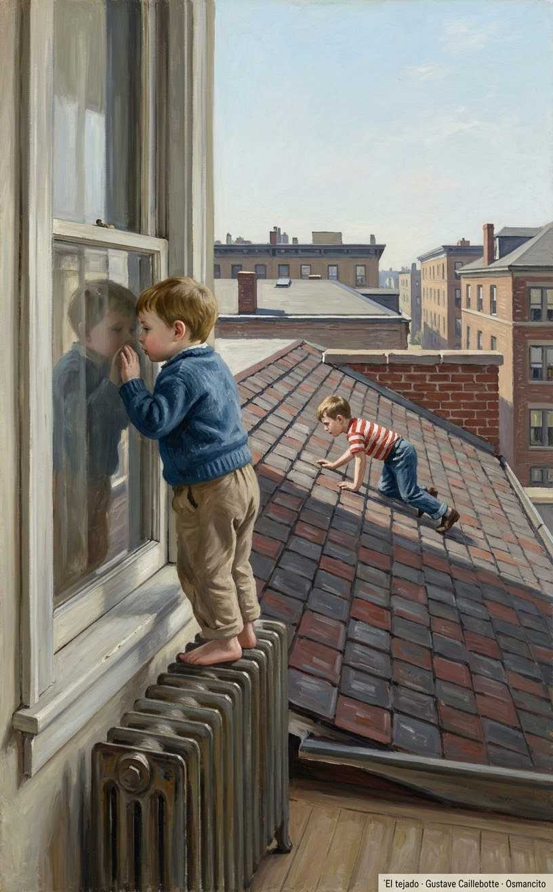](../img/261017_mientras-escribo_el-tejado.jpg)

Un vecino vio al hermano de King en el tejado:

> Solo sé que yo estaba en el baño, de pie con los pies descalzos sobre el radiador, mirando para ver si mi hermano se caía del tejado o lograba volver al baño sano y salvo.
>
> <small>[Frase 165](#original-165)</small>

Se salvó; hoy, New Hampshire.

---

### M5 · Ver morir

King preguntó a su madre si había visto morir a alguien: una la vio; otra, solo la oyó.

> Le pregunté cómo se puede oír morir a una persona y me contó que era una muchacha que se había ahogado frente a Prout's Neck en los años veinte. Dijo que la muchacha nadó más allá de la resaca, no pudo volver y empezó a gritar pidiendo ayuda.
>
> <small>[Frase 170](#original-170)</small>

Prout's Neck es un cabo de la costa de Maine; la resaca es la corriente que arrastra mar adentro.

> Mamá dijo que tenía catorce años, luego me leyó un comic y me despachó a la cama.
>
> <small>[Frase 175](#original-175)</small>

Otro día, el que vio: un marinero que saltó del Graymore; tampoco lo olvidan.

---

### M6 · No va a doler

Los nueve meses de primer grado los pasó casi todos en cama: sarampión, y luego acceso tras acceso de lo que él creía llamarse «stripe throat».

En realidad era «strep throat», la faringitis estreptocócica; lo aclara el propio libro.

> En cierto momento mis oídos se vieron afectados, y un día mi madre llamó un taxi (ella no manejaba) y me llevó a un médico demasiado importante para hacer visitas a domicilio: un especialista del oído.
>
> <small>[Frase 184](#original-184)</small>

El médico prometió que no dolería.

> Deslizó la aguja dentro de mi oído y me perforó el tímpano con ella.
>
> <small>[Frase 198](#original-198)</small>

A la semana, otro taxi.

> El médico del oído produjo una vez más el olor a alcohol —un olor que todavía asocio, como supongo que hace mucha gente, con el dolor, la enfermedad y el terror— y, con él, la aguja larga.
>
> <small>[Frase 213](#original-213)</small>

Volvió a asegurarle que no dolería, y él volvió a creerlo lo suficiente para quedarse quieto. Dolió casi tanto como la primera vez, y el sonido de besos en su cabeza fue más fuerte: gigantes besándose. Al acabar, mientras lloraba sobre un charco de pus aguado, la enfermera le dijo que solo dolía un poco y que ya había pasado todo.

Se lo creyó unos cinco días, y entonces llegó otro taxi (el taxista amenazó a su madre con dejarlos en la carretera si no conseguía callar a aquel niño). Tercera vez en la camilla: el pañal bajo la cabeza, su madre en la sala de espera, el olor a alcohol, la aguja larga como su regla del colegio, la sonrisa, la promesa de que esta vez no dolería. Desde aquellas punciones repetidas a los seis años, King tiene uno de los principios más firmes de su vida: «Fool me once, shame on you. Fool me twice, shame on me. Fool me three times, shame on both of us» («Engáñame una vez, vergüenza tuya; engáñame dos, vergüenza mía; engáñame tres, vergüenza de los dos»). La tercera vez forcejeó, gritó, se debatió y peleó: cada vez que la aguja se acercaba a su cara, la apartaba de un manotazo.

> Al final la enfermera llamó a mi madre desde la sala de espera, y entre las dos lograron sujetarme el tiempo suficiente para que el médico introdujera su aguja.
>
> <small>[Frase 232](#original-232)</small>

Ese grito lo oye todavía.

---

### M7 · Las amígdalas

En enero o febrero de 1954, otro médico: había que sacarle las amígdalas. En la mesa de operaciones:

> Estaba de pie a la cabecera de la mesa en la que yo yacía (1953 y 1954 fueron mis años de yacer en mesas), y a mí me parecía estar cabeza abajo.
>
> <small>[Frase 249](#original-249)</small>

Entonces:

> «¿Puedes oírme?».
>
> <small>[Frase 251](#original-251)</small>

Dijo que sí.

> «Quiero que respires hondo», dijo.
>
> <small>[Frase 253](#original-253)</small>

Le bajaron el artilugio y todo se puso negro; despertó con helado permitido y sin ganas. Mejor que la aguja en el oído; al otiólogo no lo perdona.

---

### M8 · Escribe uno tuyo

Aquel año, sin colegio por enfermo, King leyó tebeos a montones y empezó a escribir: copiaba comics de Combat Casey en su libreta.

> Con el tiempo le enseñé uno de esos híbridos imitados a mi madre, y quedó encantada: recuerdo su sonrisa un poco asombrada, como si no pudiera creer que un hijo suyo pudiera ser tan listo, un maldito prodigio, prácticamente, por el amor de Dios.
>
> <small>[Frase 274](#original-274)</small>

Le preguntó si lo había inventado él; al admitir que lo copió de un tebeo, ella se decepcionó y se la devolvió.

> —Escribe uno tuyo, Stevie —dijo.
>
> <small>[Frase 279](#original-279)</small>

Y se lo repitió con razones.

---

### M9 · A cuarto el cuento

]

La idea le abrió un mundo. Escribió un cuento de cuatro animales mágicos que ayudaban a niños; el jefe, un conejo blanco llamado Mr. Rabbit Trick:

> Cuando lo terminé, se lo di a mi madre, que se sentó en la sala, puso su cartera en el suelo a su lado y lo leyó todo de una vez.
>
> <small>[Frase 290](#original-290)</small>

Se rió en los lugares correctos, aunque él no podía saber si porque el cuento era bueno de verdad o porque ella lo quería y quería que se sintiera bien. Al terminar le preguntó: «¿Este no lo copiaste?». No, no lo había copiado. Entonces ella dijo que era suficientemente bueno para estar en un libro. Nada de lo que nadie le ha dicho desde entonces lo ha hecho sentirse más feliz. Escribió cuatro cuentos más sobre el señor Rabbit Trick y sus amigos:

> Me dio un cuarto de dólar por cada uno y los hizo circular entre sus cuatro hermanas, que sentían un poco de lástima por ella, creo.
>
> <small>[Frase 296](#original-296)</small>

Las tías seguían casadas; Ruth criaba sola. Le compraron los cuatro: su primer sueldo de escritor.

---

### M10 · La jungla

[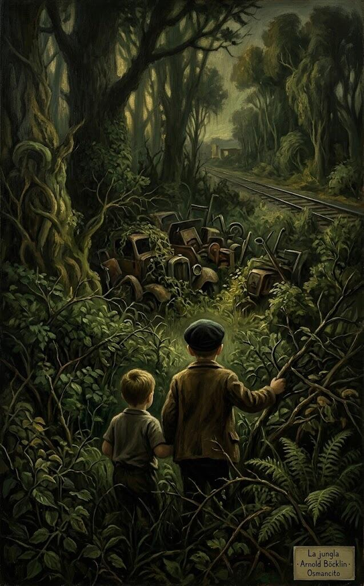](../img/261017_mientras-escribo_la-jungla.jpg)]

En Stratford, Connecticut, cerca de casa había un terreno salvaje que volvería siempre en sus libros: los chicos de *It* lo llaman los Barrens; ellos, la jungla.

*It*, la novela de King, salió en 1986.

> Dave y yo la exploramos por primera vez poco después de mudarnos al nuevo lugar.
>
> <small>[Frase 313](#original-313)</small>

Explorando, a King le vino una urgencia; David no quiso llevarlo a casa.

> Llevarme a casa a pie tomaría por lo menos media hora, y él no tenía ninguna intención de renunciar a un rato tan resplandeciente solo porque su hermanito tenía que hacer caca.
>
> <small>[Frase 324](#original-324)</small>

King protestó; David tenía la solución:

> —Límpiate con unas hojas.
>
> <small>[Frase 329](#original-329)</small>

Le encantó la idea de hacerlo como los cowboys: se agachó en la maleza, revólver en mano.

> Hice lo mío, y me encargué de la limpieza como había sugerido mi hermano mayor, limpiándome con cuidado el trasero con grandes puñados de hojas verdes y brillantes.
>
> <small>[Frase 334](#original-334)</small>

Eran hojas de hiedra venenosa. King acabó seis semanas en baños de almidón.

---

### M11 · El Súper Duper Electromán

]

Dave era buen hermano, pero con ideas demasiado grandes para sus diez años, y solían acabar con los dos en problemas.

> Compartir la culpa fue también la razón de que los dos corriéramos el riesgo de morir mientras poníamos en práctica su potencialmente letal proyecto de ciencias del colegio.
>
> <small>[Frase 346](#original-346)</small>

Era quizá 1958; el proyecto de ciencias de Dave, ese año, fue el Súper Duper Electromán.

> Cada uno tenía su parte que hacer en la creación del Súper Duper Electromán.
>
> <small>[Frase 364](#original-364)</small>

Dave lo construyó; la versión nueva iba enchufada a la pared.

> Luego, sentado en el suelo de la cocina de nuestro apartamento de West Broad Street, me ofreció el Súper Duper Electromán y me ordenó que hiciera mi parte y lo enchufara.
>
> <small>[Frase 370](#original-370)</small>

King lo enchufó: fundió las luces de su edificio y del de al lado; estalló el transformador y vinieron los policías.

> Ese día solo podíamos preguntarnos si nuestra madre vendría a vernos al reformatorio.
>
> <small>[Frase 379](#original-379)</small>

No los cogieron. Dave mudó de proyecto: el Súper Duper Planeador, con King de primer pasajero.

---

### M12 · Video bullshit

]

King nació en 1947; en casa no hubo tele hasta 1958. A él no le parece mal:

> Soy, si uno se detiene a pensarlo, miembro de un grupo bastante selecto: el último puñado de novelistas americanos que aprendieron a leer y escribir antes de aprender a comerse una ración diaria de basura audiovisual.
>
> <small>[Frase 393](#original-393)</small>

«Robot Monster», la primera película que recuerda haber visto, es de 1953.

---

### M13 · El Ackermonster

]

King mandó un cuento a *Spacemen*, la revista de Forrest J. Ackerman. Lo rechazaron, pero Forry lo guardaba todo:

Forrest J. Ackerman, «el Ackermonster», fue agente literario y coleccionista de ciencia ficción.

> Unos veinte años después, mientras firmaba autógrafos en una librería de Los Ángeles, Forry apareció en la cola... con mi cuento, a un solo espacio y mecanografiado con la máquina de escribir Royal, desaparecida hacía mucho, que mi mamá me regaló la Navidad del año en que cumplí once años.
>
> <small>[Frase 406](#original-406)</small>

Le pidió que se lo firmara; no daba crédito.

---

### M14 · Yo fui un ladrón de tumbas adolescente

[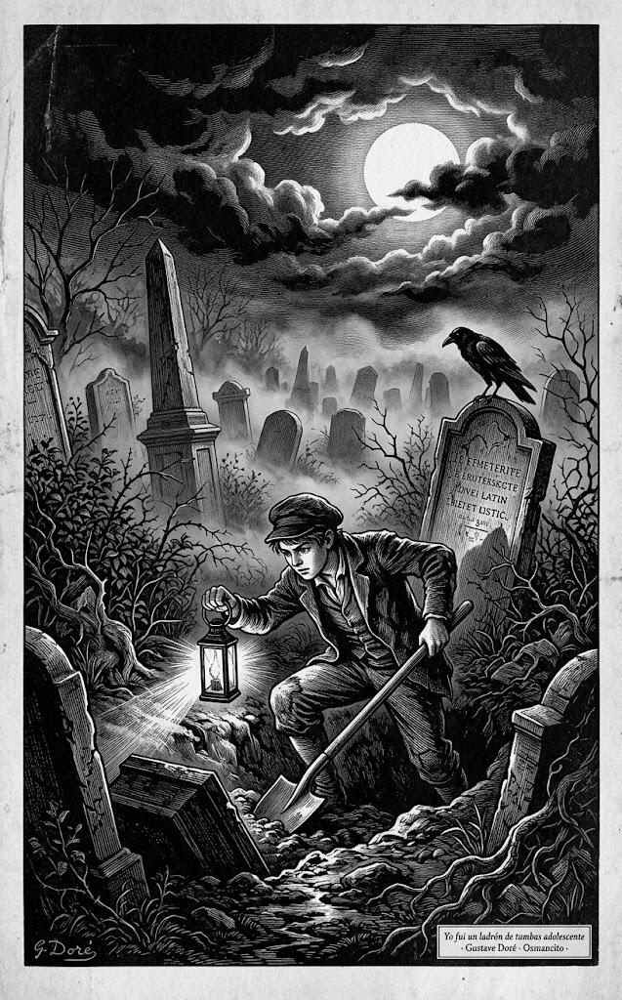(../img/261017_mientras-escribo_yo-fui-un-ladron-de-tumbas-adolescente.jpg)

Su primer cuento publicado, en un fanzine:

> Publicó esta novela corta bajo el título «In a Half-World of Terror» —«En un semimundo de terror»—, pero a mí me sigue gustando mucho más mi título.
>
> <small>[Frase 411](#original-411)</small>

El suyo: *Yo fui un ladrón de tumbas adolescente*.

---

### M15 · El Problema de Ruth

[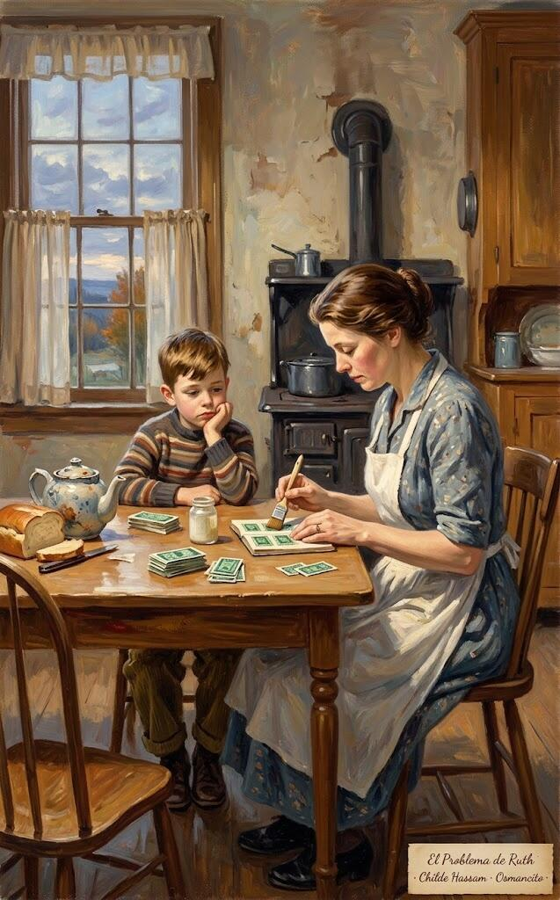](../img/261017_mientras-escribo_el-problema-de-ruth.jpg)]

De vuelta en Maine, la madre de King cuidaba a sus padres; las hermanas le buscaron trabajo:

Los sellos S&H Green Stamps se canjeaban por regalos.

> Las hermanas de mi madre le habían conseguido a mi mamá ese trabajo, tal vez pensando que podían matar dos pájaros de un tiro: los ancianos P. —los padres— serían cuidados en un ambiente hogareño por una hija amorosa, y El Pesado Problema de Ruth quedaría resuelto.
>
> <small>[Frase 421](#original-421)</small>

Ya no iría a la deriva con dos niños.

> Odiaba su nuevo trabajo, creo: en su empeño por cuidar de ella, sus hermanas convirtieron a nuestra madre —autosuficiente, graciosa, un poco chiflada— en una aparcera que vivía una existencia casi sin dinero en efectivo.
>
> <small>[Frase 423](#original-423)</small>

Y allí quedó atrapada: vivió en esa casa hasta que el cáncer se la llevó.

---

### M16 · Happy Stamps

]

Aclaremos una cosa desde ya, pide King: no hay almacén de ideas, ni central de historias, ni isla de los best sellers enterrados; las buenas ideas de relato parecen llegar literalmente de la nada, navegando hacia ti desde el cielo vacío: dos ideas antes sin relación se juntan y hacen algo nuevo bajo el sol. Tu trabajo no es encontrar esas ideas, sino reconocerlas cuando aparecen.

La primera idea original de King: su madre lamía sellos para una lámpara; pensó en falsificarlos, y nació «Happy Stamps». Roger, su héroe, exfalsificador de dinero, descubre que puede crear el artículo auténtico:

> En una escena graciosa —probablemente la primera escena realmente competente que escribí—, Roger está sentado en la sala con su vieja mamá, los dos embobados con el catálogo de Happy Stamps mientras la imprenta funciona en el piso de abajo, expulsando fardo tras fardo de esas mismas estampillas de canje.
>
> <small>[Frase 443](#original-443)</small>

El negocio marcha:

> La mamá llama alegremente desde arriba: acaba de colgar el teléfono con el Centro Nacional de Canje de Happy Stamps, en Terre Haute —una ciudad de Indiana—, y la señora dijo que probablemente podían conseguir una bonita casa Tudor en Weston por solo once millones seiscientas mil libretas de Happy Stamps.
>
> <small>[Frase 455](#original-455)</small>

Roger vuelve a la mesa y sigue pegando sellos.

> Solo once millones quinientas noventa mil libretas por delante, piensa cuando termina el cuento, y mamá podrá tener su casa Tudor.
>
> <small>[Frase 460](#original-460)</small>

El cuento fue rechazado en *Alfred Hitchcock's Mystery Magazine*, con una nota a mano al pie: la única respuesta personal en ocho años de envíos. Desde entonces no grapa un manuscrito.

---

### M17 · La noche del tigre

]

En su cuarto, los rechazos se empalmaban en un clavo de la pared; a los dieciséis empezaron a llegar notas manuscritas alentadoras:

Algis Budrys fue escritor y editor de ciencia ficción; *The Fugitive*, una serie de televisión de los sesenta.

> La primera de aquellas notas esperanzadoras fue de Algis Budrys, entonces editor de Fantasy and Science Fiction, que leyó un cuento mío llamado «The Night of the Tiger» —la inspiración fue, creo, un episodio de «The Fugitive» en el que el doctor Richard Kimble trabajaba de asistente limpiando jaulas en un zoológico o un circo— y escribió: «Esto es bueno.
>
> <small>[Frase 485](#original-485)</small>

Diez años después, ya con novelas vendidas, reencontró «La noche del tigre» en una caja:

> Lo reescribí y, por capricho, lo volví a enviar a F&SF.
>
> <small>[Frase 491](#original-491)</small>

Esta vez la compraron.

---

### M18 · Dave's Rag

]

Dave, un año menor que sus compañeros, se aburría en el instituto: lo resolvió creando un periódico, *Dave's Rag*, con oficina en el sótano de casa; pasó de cinco ejemplares a sesenta.

> Un número típico informaba a la gente de cómo iba sanando la pierna rota de Charley Harrington, qué oradores invitados podrían venir a la iglesia metodista de West Durham, cuánta agua estaban acarreando los muchachos King desde la bomba del pueblo para no agotar el pozo de detrás de la casa —por supuesto, se secaba cada maldito verano, no importaba cuánta agua acarrearan—, quién estaba visitando a los Brown o a los Hall del otro lado de Methodist Corners y de quién se esperaban parientes en el pueblo cada verano.
>
> <small>[Frase 502](#original-502)</small>

El primer año se imprimía en morado, con un hectógrafo de gelatina: demasiado lento para Dave.

El hectógrafo era una plancha de gelatina para copiar páginas a mano.

> Éramos capaces de armar en dos noches lo que antes tomaba una semana con el hectógrafo, y aunque la rotativa de tambor era sucia, no parecía infectada con una enfermedad potencialmente mortal.
>
> <small>[Frase 524](#original-524)</small>

Hasta ahí la crónica del Dave's Rag.

---

### M19 · El pozo y el péndulo

[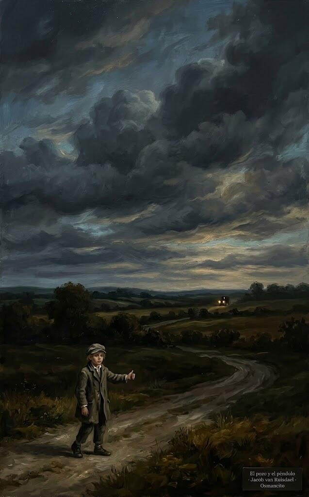](../img/261017_mientras-escribo_el-pozo-y-el-pendulo.jpg)]

Entre 1958 y 1966 lo suyo fue el cine: en el Ritz de Lewiston vio todas las de terror, sobre todo las «Poepictures», como las llamaban Chris y él: Roger Corman tomando títulos de Poe. La que más los marcó:

Roger Corman dirigió una serie de películas de terror de bajo presupuesto inspiradas en Edgar Allan Poe; *El pozo y el péndulo* es de 1961.

> De todas las Poepictures, la que más hondamente nos afectó a Chris y a mí fue «The Pit and the Pendulum» —«El pozo y el péndulo»—.
>
> <small>[Frase 562](#original-562)</small>

Matheson la escribió; la escena que los heló: John Kerr abriendo la pared del castillo, el cadáver con filtro rojo.

> En el largo dedo de regreso a casa esa noche —si los aventones se hacían lentos, podías terminar caminando cuatro o cinco millas y no llegar a casa hasta bien entrada la oscuridad— tuve una idea maravillosa: ¡convertiría «The Pit and the Pendulum» en un libro!
>
> <small>[Frase 567](#original-567)</small>

Decidió novelizarla, como hacía Monarch Books con los clásicos.

> Pero no me limitaría a escribir esta obra maestra: ¡también la imprimiría, usando la rotativa de tambor de nuestro sótano, y vendería ejemplares en la escuela!
>
> <small>[Frase 569](#original-569)</small>

Lo hizo.

> Aunque no sobrevive ningún ejemplar de esa obra maestra en particular —al menos que yo sepa—, creo que tenía ocho páginas, cada una a un solo espacio y con los saltos de párrafo reducidos al mínimo absoluto —cada stencil costaba diecinueve centavos, recuerden—.
>
> <small>[Frase 574](#original-574)</small>

Imprimió a doble cara, con portada y sello propios: A V.I.B. BOOK, Very Important Book.

> Tiré unos cuarenta ejemplares de «The Pit and the Pendulum», felizmente ignorante de que estaba violando todos los estatutos de plagio y derechos de autor de la historia del mundo; mis pensamientos estaban concentrados casi por completo en cuánto dinero podría ganar si mi cuento era un éxito en la escuela.
>
> <small>[Frase 579](#original-579)</small>

Aquel mismo día:

> Cuando el día escolar terminó a las dos, fui llamado a la oficina del director, donde se me dijo que no podía convertir la escuela en un mercado, sobre todo no —dijo la señorita Hisler— para vender basura como «The Pit and the Pendulum».
>
> <small>[Frase 591](#original-591)</small>

Le hicieron devolver cada cuarto, y lo devolvió sin protestar, incluso a los chicos (bastantes, dice con gusto) que insistieron en quedarse su ejemplar; acabó perdiendo dinero en el trato.

Antes del castigo vino el sermón: «Lo que no entiendo, Stevie (le dijo la señorita Hisler, blandiendo un ejemplar enrollado de su librito como quien amenaza con un periódico a un perro que ha hecho pis en la alfombra), es por qué escribes basura como esta. Eres talentoso. ¿Por qué quieres desperdiciar tus aptitudes?». Ella esperó una respuesta (para ser justos, la pregunta no era del todo retórica), pero él no tenía ninguna. Se sintió avergonzado, y desde entonces ha pasado muchos años (demasiados, cree) avergonzado de lo que escribe. Tendría unos cuarenta años cuando comprendió que a casi todo escritor de ficción o poesía que ha publicado una línea alguien lo ha acusado de desperdiciar el talento que Dios le dio: si escribes (o pintas, bailas, esculpes o cantas), alguien intentará hacerte sentir mal por ello. No está editorializando, dice; solo intenta dar los hechos tal como los ve.

Cuando llegaron las vacaciones de verano, imprimió cuatro docenas de un cuento nuevo y original, «The Invasion of the Star-Creatures», y vendió todas menos cuatro o cinco: supone que eso significa que ganó al final, al menos en lo económico. Pero en su corazón siguió avergonzado, oyendo a la señorita Hisler preguntar por qué quería desperdiciar su talento, por qué quería desperdiciar su tiempo, por qué quería escribir basura.

---

### M20 · The Village Vomit

]

En el instituto de Lisbon, King editó el periódico escolar, *The Drum*, que no prosperó. Una noche creó su propio periódico satírico, *The Village Vomit*: noticias inventadas sobre los profesores. Casi todos se lo tomaron bien, menos la señorita Margitan, de mecanografía. Y en el *Vomit*, King escribió un ítem que empezaba:

«Maggot» significa gusano, larva; la Honor Society premia a los mejores estudiantes del instituto.

> El señor Higgins, nuestro director calvo —al que el Vomit se refería con toda confianza como Old Cue-Ball, «la Vieja Bola de Billar»—, me dijo que Miss Margitan estaba muy dolida y muy alterada por lo que yo había escrito.
>
> <small>[Frase 657](#original-657)</small>

> Sin embargo, al parecer no estaba demasiado dolida para recordar aquella vieja amonestación de las Escrituras que dice «Mía es la venganza, dice la maestra de taquigrafía»; el señor Higgins dijo que ella quería que me expulsaran de la escuela.
>
> <small>[Frase 658](#original-658)</small>

El caso estaba en manos del director Higgins; no quería llorar en su despacho.

> Al final, Miss Margitan se conformó con una disculpa formal y dos semanas de detención para el chico malo que se había atrevido a llamarla Maggot en letra impresa.
>
> <small>[Frase 665](#original-665)</small>

Lo confiscaron con su nombre al pie. Uno o dos días después lo llevaron al despacho y lo pusieron de pie frente a ella:

> Más tarde, mientras lanzaba aviones de papel con los otros chicos y chicas malos del salón de detención —la detención resultó no ser tan mala—, decidí que era bastante simple: a Miss Margitan no le gustaban los chicos.
>
> <small>[Frase 672](#original-672)</small>

> Era la primera mujer que yo conocía en la vida a la que no le gustaban los chicos, ni un poquito siquiera.
>
> <small>[Frase 673](#original-673)</small>

No supo encantarla. Desde entonces, poco trato con la sátira.

---

### M21 · Con la puerta cerrada

]

El orientador del instituto le buscó cauce a su «pluma inquieta»: una plaza de cronista deportivo en el semanario de John Gould, en Lisbon. Era la primera vez que le prometían sueldo por escribir.

Llevó dos textos de un partido: una crónica y un perfil. La crónica pasó casi limpia; el perfil recibió el bolígrafo negro de Gould entero:

> Ojalá conservara todavía la pieza —merecería ser enmarcada, con las correcciones editoriales y todo—, pero recuerdo bastante bien cómo iba y cómo quedó después de que Gould la peinara con ese bolígrafo negro suyo.
>
> <small>[Frase 709](#original-709)</small>

Al terminar, Gould dijo que solo había quitado las partes malas, que casi todo estaba bien. King contestó:

> —Lo sé —dije, queriendo decir las dos cosas: sí, la mayor parte era buena —bueno, aceptable, servible— y sí, él solo había quitado las partes malas.
>
> <small>[Frase 723](#original-723)</small>

Gould soltó su lección: qué es escribir y qué es reescribir.

> Gould dijo algo más que era interesante el día que le entregué mis dos primeras piezas: escribe con la puerta cerrada, reescribe con la puerta abierta.
>
> <small>[Frase 732](#original-732)</small>

Terminada, la historia ya es del público.

> Si tienes mucha suerte —esto es idea mía, no de John Gould, aunque creo que él la habría suscrito—, serán más los que quieran hacer lo primero que lo segundo.
>
> <small>[Frase 736](#original-736)</small>

---

### M22 · Ratas grandes como perros

]

Al volver del viaje de fin de curso a Washington, King consiguió trabajo en una fábrica textil de Lisbon Falls.

> Mi madre ganaba unos sueldos míseros como limpiadora en una institución para enfermos mentales de New Gloucester, pero estaba decidida a que yo fuera a la universidad como mi hermano David (Universidad de Maine, promoción del 66, cum laude).
>
> <small>[Frase 739](#original-739)</small>

King pasó un verano en la tintorería del sótano de la fábrica. Ya en la universidad, un día recordó las historias de sus compañeros:

> Un día, ya avanzado mi último semestre de la universidad, con los exámenes finales terminados y sin nada que hacer, recordé la historia del tipo de la tintorería sobre las ratas que había debajo de la fábrica —grandes como gatos, maldita sea, algunas como perros— y empecé a escribir un cuento titulado «Graveyard Shift».
>
> <small>[Frase 767](#original-767)</small>

La revista *Cavalier* compró «Graveyard Shift» por doscientos dólares: tres veces todo lo que había ganado escribiendo hasta entonces.

---

### M23 · La risa sin miedo

Verano de 1969: King trabajaba en la biblioteca de la universidad. Un día, comiendo en el césped, vio a una muchacha de risa escandalosa:

*Soul on Ice* es el libro de Eldridge Cleaver, activista de los Panteras Negras; la lista del decano es el cuadro de honor de las mejores notas.

> No me la había cruzado por la biblioteca, y no me creía que una estudiante universitaria pudiera soltar una risa tan maravillosa y tan sin miedo.
>
> <small>[Frase 787](#original-787)</small>

Se llamaba Tabitha Spruce.

> Seguimos casados, y ella nunca me ha dejado olvidar que la primera vez que la vi pensé que era la novia del pueblo de Eddie Marsh.
>
> <small>[Frase 792](#original-792)</small>

Quizá una camarera lectora en su tarde libre.

---

### M24 · Me gustan los osos

Venían de familias obreras parecidas; los dos eran demócratas; y lo que más fuerte los ata es el lenguaje:

> Nos conocimos cuando trabajábamos en una biblioteca, y me enamoré de ella durante un taller de poesía en el otoño de 1969, cuando yo estaba en cuarto año y Tabby en tercero.
>
> <small>[Frase 801](#original-801)</small>

> Me enamoré de ella en parte porque entendía lo que ella hacía con su obra.
>
> <small>[Frase 802](#original-802)</small>

> Me enamoré porque ella entendía lo que hacía con ella.
>
> <small>[Frase 803](#original-803)</small>

> También me enamoré porque llevaba un vestido negro sexy y medias de seda, de las que se enganchan con liguero.
>
> <small>[Frase 804](#original-804)</small>

Entre los poetas del taller reinaba la idea del arte como dictado venido de «ahí fuera»; King no comulgaba, y la muchacha del vestido negro tampoco:

> Yo no me apuntaba a casi nada de esa actitud (aunque no me atrevía a decirlo en voz alta, al menos no con tantas palabras), y me llenó de alegría descubrir que la chica guapa del vestido negro y las medias de seda tampoco se apuntaba a casi nada de ella.
>
> <small>[Frase 824](#original-824)</small>

El taller se reunía en casa del instructor. Una noche Tabby leyó un poema, «A Gradual Canticle for Augustine»: el cántico de un oso que despierta.

> En la discusión que siguió a la lectura de Tab, me quedó claro que ella entendía su propio poema.
>
> <small>[Frase 861](#original-861)</small>

Tabby entendió el poema: conocía a san Agustín, que se comparaba con un oso; inclinó la barbilla y sonrió con su respuesta, que da título a la unidad. Y él está casi seguro de que nada de eso fue casualidad.

---

### M25 · Su mujer está de parto

A los tres años de casados tenían dos hijos: Naomi y Joe:

> Cuando Tabby se puso de parto con él, yo estaba en un autocine de Brewer con un amigo: era una función triple del Día de los Caídos, tres películas de terror.
>
> <small>[Frase 889](#original-889)</small>

Joe nació aquella noche:

> Incluso cuando Naomi arrancaba el papel pintado de encima de su cuna (quizá creía que estaba haciendo limpieza) y Joe se cagaba en el asiento de mimbre de la mecedora que teníamos en el porche de nuestro apartamento de Sanford Street, eran una delicia.
>
> <small>[Frase 906](#original-906)</small>

---

### M26 · Un pato muerto en las fauces

Su madre sabía que quería ser escritor, pero le aconsejó hacerse profesor, por si acaso:

> «Puede que quieras casarte, Stephen, y una buhardilla junto al Sena solo es romántica si eres soltero», le dijo una vez.
>
> <small>[Frase 907](#original-907)</small>

Su madre insistía en el matrimonio.

> Hice lo que ella sugirió, entré en la Facultad de Educación de la UMO —la Universidad de Maine en Orono, glosa— y salí cuatro años después con el certificado de profesor… más o menos como un golden retriever que sale de un estanque con un pato muerto en las fauces.
>
> <small>[Frase 910](#original-910)</small>

Pero no encontró trabajo de profesor y se fue a la lavandería New Franklin, con sueldo de fábrica y la familia en buhardillas de Bangor. Lo que más cargaba:

> La mayor parte de lo que yo cargaba y sacaba eran sábanas de motel de los pueblos costeros de Maine y manteles de los restaurantes costeros de Maine.
>
> <small>[Frase 915](#original-915)</small>

Los manteles de langosta apestaban a gusanos; las sábanas de hospital, a sangre. Entre la ropa infectada aparecían sorpresas: un orinal, unas tijeras, un puñado de dientes. Su mujer lo aguantó casi todo.

---

### M27 · El margen deslizante

Desde el punto de vista financiero, dos niños eran probablemente dos de más para dos graduados universitarios que trabajaban en una lavandería y en el segundo turno de Dunkin' Donuts —la cadena de cafeterías y rosquillas donde Tabby tenía su empleo, glosa—. La única ventaja de la que disponían venía por cortesía de revistas como Dude, Cavalier, Adam y Swank —lo que su tío Oren llamaba «the titty books», «las revistas de tetas», glosa—: para 1972 ya enseñaban bastante más que pechos al aire y la ficción estaba de salida, pero King tuvo la suerte de montar la última ola.

Dos niños eran quizá dos de más para un lavandero y una camarera de Dunkin' Donuts. La única ventaja venía de las revistas masculinas, lo que su tío Oren llamaba las revistas de tetas:

> Escribía después del trabajo; cuando vivíamos en Grove Street, que quedaba cerca de la New Franklin, a veces escribía un poco también en la hora del almuerzo.
>
> <small>[Frase 942](#original-942)</small>

Así pasó aquella temporada en la lavandería.

> Los cuentos que vendí a las revistas masculinas entre agosto de 1970, cuando me llegó el cheque de doscientos dólares por «Graveyard Shift», y el invierno de 1973-1974 fueron justo lo bastante para crear un tosco margen deslizante entre nosotros y la oficina de asistencia pública (mi madre, republicana toda su vida, me había contagiado su profundo horror a «pasar a cargo del condado»; Tabby compartía algo de ese mismo horror).
>
> <small>[Frase 955](#original-955)</small>

Un domingo volvieron con Naomi ardiendo de otitis y sin dinero para el antibiótico: en el buzón, un cheque de quinientos dólares. Ella sirvió donuts, él lavó sábanas y siguió escribiendo.

---

### M28 · Nunca una sola duda

Cuando empezó *Carrie*, enseñaba inglés en Hampden por 6.400 dólares al año. A finales del invierno de 1973 vivían en una casa rodante, sin teléfono:

> Yo conducía un Buick con problemas de transmisión que no podíamos permitirnos arreglar, Tabby seguía trabajando en Dunkin' Donuts y no teníamos teléfono.
>
> <small>[Frase 984](#original-984)</small>

Por primera vez, escribir era duro; el problema era la enseñanza. Tabby, sin embargo, nunca expresó una sola duda:

> Si ella hubiera insinuado que el tiempo que pasaba escribiendo cuentos en el porche de nuestra casa alquilada de Pond Street o en el lavadero de nuestro tráiler alquilado de Klatt Road, en Hermon, era tiempo perdido, creo que se me habría salido gran parte del ánimo.
>
> <small>[Frase 1002](#original-1002)</small>

El apoyo de Tabby nunca flaqueó: fue una constante, una de las pocas cosas buenas que él podía dar por seguras. Por eso, cuando ve una primera novela dedicada a una esposa (o a un esposo), sonríe y piensa: ahí hay alguien que sabe. Escribir es un trabajo solitario; tener a alguien que cree en ti marca una gran diferencia. No hace falta que dé discursos: normalmente basta con que crea.

---

### M29 · Aquí tienes algo

Su hermano Dave trabajaba los veranos de conserje en el instituto de Brunswick; parte de un verano, King trabajó allí también, con Harry, un tipo de uniforme verde y llavero enorme:

> Una hora de almuerzo, Harry me contó lo que había sido enfrentarse a una carga banzai japonesa en la isla de Tarawa —una batalla del Pacífico en la Segunda Guerra Mundial—: todos los oficiales japoneses blandían espadas hechas con latas de café Maxwell House, y todos los soldados rasos que venían detrás gritando iban hasta las cejas y olían a adormidera quemada.
>
> <small>[Frase 1016](#original-1016)</small>

Todo un cuentista, Harry.

> Un día se suponía que él y yo teníamos que restregar las manchas de óxido de las paredes de la ducha de las chicas.
>
> <small>[Frase 1018](#original-1018)</small>

Años después, aquel recuerdo le volvió un día en la lavandería, y con él la primera escena de una historia: chicas duchándose en un vestuario sin cortinas ni intimidad; a una le viene la regla y no sabe qué es; las otras, asqueadas, horrorizadas y divertidas, la bombardean con compresas y tampones; la chica grita, cree que se muere... y se defiende. ¿Cómo? Años antes había leído en la revista *Life* un artículo que sugería que parte de la actividad poltergeist registrada podía ser telequinesis (mover objetos con el pensamiento), sobre todo en chicas jóvenes, cerca de su primera regla. «¡Pum!»: dos ideas sin relación, la crueldad adolescente y la telequinesis, se juntaron, y tuvo una idea. No salió corriendo a gritar «¡Eureka!» (había tenido otras ideas igual de buenas y algunas mejores), pero podía ser la base de un cuento para *Cavalier*, con *Playboy* rondándole la cabeza: dos mil dólares por ficción corta compraban una transmisión nueva para el Buick y sobraba para la compra. La historia siguió a fuego lento hasta que, ya de profesor, se sentó una noche a intentarlo y escribió tres páginas a espacio sencillo.

Le pesaban cuatro problemas: la historia no lo conmovía; no le gustaba Carrie White, espesa y pasiva, una víctima prefabricada; no se sentía en casa en aquel Planeta Femenino; y la historia solo funcionaría siendo larga, más larga de lo que el mercado de revistas masculinas aceptaba, así que no veía sentido a gastar un mes en una nouvelle que no le gustaba y no podría vender. Disgustado, arrugó las tres páginas y las tiró a la basura:

> La noche siguiente, cuando volví de la escuela, Tabby tenía las páginas.
>
> <small>[Frase 1062](#original-1062)</small>

Las había rescatado de la papelera:

> Quería que yo siguiera con él, dijo.
>
> <small>[Frase 1064](#original-1064)</small>

Quiso saber el resto; él dijo que no sabía de chicas de instituto; ella le ayudaría con eso.

> «Aquí tienes algo», dijo.
>
> <small>[Frase 1069](#original-1069)</small>

Lo creía de verdad. King nunca llegó a tomarle cariño a Carrie White ni a fiarse de los motivos de Sue Snell al mandar a su novio al baile con ella, pero ahí había algo: como toda una carrera. Tabby lo supo de algún modo y, cuando el montón llegó a cincuenta páginas a espacio sencillo, él también.

Antes de *Carrie* había escrito otras tres novelas, publicadas después: *Rage*, la más inquietante; *The Long Walk*, quizá la mejor, y *The Running Man*. Ninguna le enseñó lo que aprendió de Carrie White. Lo más importante: la percepción original que un escritor tiene de sus personajes puede ser tan errónea como la del lector. Y casi a la par: abandonar un trabajo solo porque es duro, emocional o imaginativamente, es una mala idea; a veces hay que seguir cuando no te apetece, y a veces estás haciendo un buen trabajo cuando sientes que lo único que haces es palear mierda sentado.

Tabby le ayudó, empezando por el dato de que los dispensadores de compresas de los institutos no solían funcionar con monedas.

---

### M30 · La resaca del instituto

King se ayudó recordando a las dos chicas más solas y odiadas de su clase. A una la llamará Sondra: voz burbujeante, ningún amigo salvo el perro, y en su casa un Jesucristo crucificado casi a tamaño natural:

> Se me ocurrió que Sondra había crecido bajo la mirada agónica de ese dios moribundo, y que hacerlo había contribuido sin duda a hacer de ella lo que era cuando la conocí: una marginada tímida y poco agraciada que recorría los pasillos de Lisbon High escabulléndose como un ratón asustado.
>
> <small>[Frase 1095](#original-1095)</small>

> La otra chica la llamaré Dodie Franklin, solo que las otras chicas la llamaban Dodo o Doodoo —«Caca», glosa—.
>
> <small>[Frase 1102](#original-1102)</small>

Dodie y su hermano vistieron la misma ropa un año y medio; las burlas pasaron de susurros a carcajadas.

> Dodie lo tuvo peor, creo.
>
> <small>[Frase 1123](#original-1123)</small>

Tras las Navidades, Dodie volvió con ropa nueva:

> No tengo idea de si ahorró para esa ropa nueva, de si sus padres se la regalaron por Navidad o de si pasó por un infierno de súplicas que por fin dio frutos.
>
> <small>[Frase 1132](#original-1132)</small>

La ropa no cambió nada; las burlas arreciaron: la castigaban por intentarlo.

> Compartía varias clases con ella y pude observar la ruina de Dodie de primera mano.
>
> <small>[Frase 1136](#original-1136)</small>

> Vi cómo su sonrisa se apagaba, vi cómo la luz de sus ojos primero se atenuaba y luego se extinguió.
>
> <small>[Frase 1137](#original-1137)</small>

Se aferró a la ropa nueva: la llevó a diario hasta el verano.

> Tanto Sondra como Dodie estaban muertas cuando empecé a escribir «Carrie».
>
> <small>[Frase 1146](#original-1146)</small>

Sondra, epiléptica, murió sola en una crisis; Dodie, tras el segundo hijo, bajó al sótano con un rifle. Dijeron depresión posparto; él sospecha resaca del instituto.

> Nunca me gustó Carrie, esa versión femenina de Eric Harris y Dylan Klebold —los autores de la masacre de Columbine—, pero a través de Sondra y Dodie llegué por fin a entenderla un poco.
>
> <small>[Frase 1156](#original-1156)</small>

Le dolieron todos: él también había mirado desde el otro bando.

---

### M31 · Una noche para soñar

[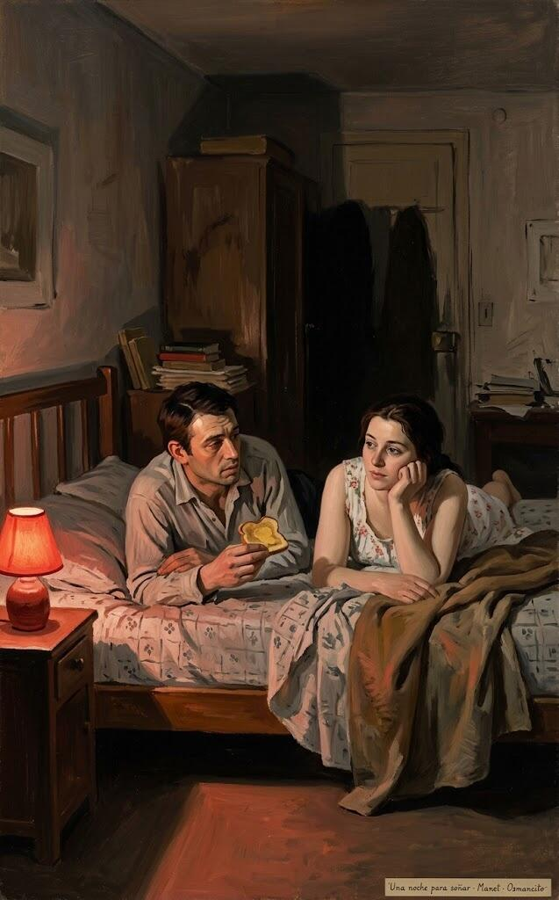](../img/261017_mientras-escribo_una-noche-para-sonar.jpg)

El manuscrito de *Carrie* salió hacia Doubleday, donde tenía un amigo, William Thompson:

> Me olvidé del asunto y seguí con mi vida, que por entonces consistía en dar clase, criar niños, querer a mi mujer, emborracharme los viernes por la tarde y escribir relatos.
>
> <small>[Frase 1159](#original-1159)</small>

Su hora libre aquel semestre era la quinta. El interfono: que bajara a la oficina, su mujer al teléfono:

> O Joe o Naomi se habían caído de los escalones de la entrada y se habían roto una pierna, o yo había vendido «Carrie».
>
> <small>[Frase 1168](#original-1168)</small>

Eso, o que había vendido *Carrie*: anticipo de 2.500 dólares. Tabby preguntó si podía dejar la enseñanza:

> Le dije que no, no sobre la base de un anticipo de dos mil quinientos dólares y solo posibilidades nebulosas más allá.
>
> <small>[Frase 1186](#original-1186)</small>

Solo, quizá; con mujer y dos hijos, ni hablar. Pero era una noche para soñar.

---

### M32 · Un cuatro y cinco ceros

[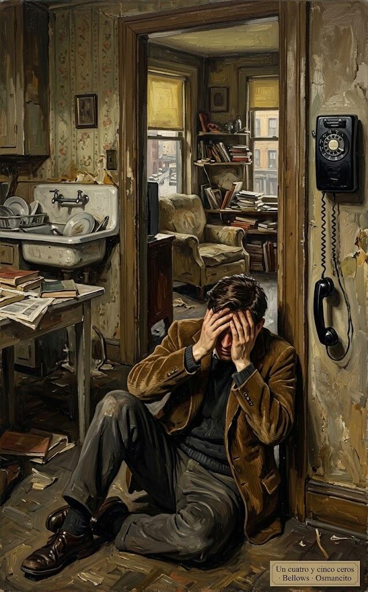](../img/261017_mientras-escribo_un-cuatro-y-cinco-ceros.jpg)

Mientras *Carrie* avanzaba, le preocupaba su madre: su mesilla estaba cubierta de analgésicos con receta. Su hermano Dave la acusó de fumar como una chimenea:

> Él era muy indicado para hablar, porque él también fumaba como una chimenea (y yo también, y cómo odiaba mi mujer el gasto y la constante suciedad cenicienta de aquello), pero sabía lo que quería decir.
>
> <small>[Frase 1215](#original-1215)</small>

Un domingo llamó Bill Thompson: los derechos de bolsillo de *Carrie* se habían vendido a Signet por cuatrocientos mil dólares; doscientos mil eran suyos. King siguió de pie en el umbral, mirando hacia la cuna de Joe:

> Nuestro piso de Sanford Street se alquilaba por noventa dólares al mes, y aquel hombre al que solo había visto una vez en persona me estaba diciendo que acababa de ganar la lotería.
>
> <small>[Frase 1245](#original-1245)</small>

No daba crédito; le preguntó si estaba seguro:

> Le pedí que dijera el número otra vez, muy despacio y muy claro, para estar seguro de no haberlo entendido mal.
>
> <small>[Frase 1251](#original-1251)</small>

Se la repitió, despacio.

> Hablamos media hora más, pero no recuerdo ni una sola palabra de lo que dijimos.
>
> <small>[Frase 1254](#original-1254)</small>

Salió a comprarle a Tabby un regalo del Día de la Madre: en la farmacia, lo único abierto, hizo lo que pudo: un secador de pelo.

---

### M33 · Chicos de universidad

[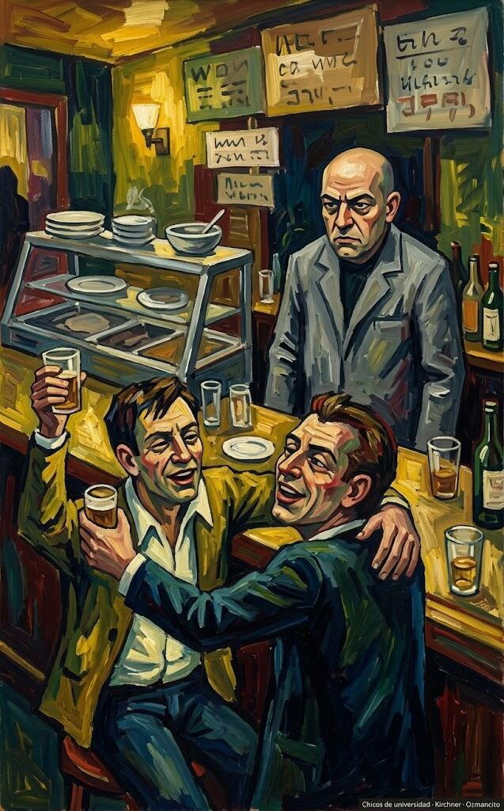](../img/261017_mientras-escribo_chicos-de-universidad.jpg)

Se emborrachó por primera vez en 1966, en el viaje de fin de curso. En una licorería de Nueva York preguntó al empleado —el mismo calvo de bata gris que, jura, vende a los vírgenes del alcohol su primera botella— qué era barato:

> Al final me rendí y le pregunté al tipo de detrás del mostrador (el mismo tipo calvo, de aspecto aburrido y chaqueta gris que, estoy convencido, les ha vendido a los vírgenes del alcohol su primera botella desde los albores del comercio) qué era barato.
>
> <small>[Frase 1280](#original-1280)</small>

Aquella noche acabó de rodillas ante el inodoro; al atardecer siguiente bajó por un ginger ale, y en el vestíbulo estaba Old Cue-Ball, el director, el del periódico satírico:

> Ahí vienen más problemas con el director, probablemente peores que los que me busqué con The Village Vomit —«El Vómito del Pueblo», su periódico satírico del instituto, contado en los tramos 17 y 18, glosa—.
>
> <small>[Frase 1330](#original-1330)</small>

Lo llamó: el señor Higgins era, en realidad, buen tipo.

> Me castigó con dureza por mi periódico de broma, pero quizá fue la señorita Margitan —la profesora que lo descubrió, glosa— quien insistió en ello.
>
> <small>[Frase 1332](#original-1332)</small>

El director lo llamó:

> «Qué lástima que te perdieras la diversión», dice Old Cue-Ball.
>
> <small>[Frase 1338](#original-1338)</small>

Le preguntó si se encontraba mejor; él alegó un virus pasajero.

> «Espero que no vuelvas a pillar ese virus», dice.
>
> <small>[Frase 1342](#original-1342)</small>

Al día siguiente, camino de Washington, parada en tierra amish; una licorería cerca del autobús:

> El dependiente me vende una botella de Four Roses sin pedirme el carnet, y para cuando paramos a pasar la noche estoy borracho otra vez.
>
> <small>[Frase 1354](#original-1354)</small>

Diez años después, en un saloon irlandés, celebrando *The Shining* —la del escritor alcohólico—. Un cartel anunciaba *screwdrivers* a un dólar de ocho a diez de la mañana:

> Le hago una seña al camarero.
>
> <small>[Frase 1366](#original-1366)</small>

Se acercó:

> Es calvo, lleva una chaqueta gris, podría ser el tipo que me vendió mi primera pinta allá en 1966.
>
> <small>[Frase 1368](#original-1368)</small>

Probablemente era el mismo. Le señaló el cartel y preguntó quién pide un *screwdriver* a las ocho y cuarto de la mañana. La respuesta lo devuelve a 1966.

---

### M34 · Mis niños

[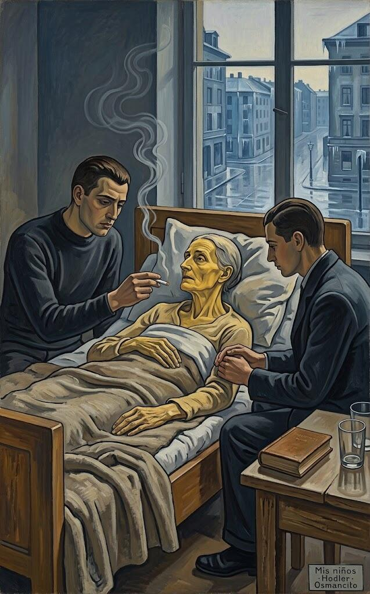](../img/261017_mientras-escribo_mis-ninos.jpg)

En 1971 o 72 murió la tía Carolyn; su madre voló al funeral y en el avión de vuelta empezó a sangrar profusamente. Se contuvo con tampones y no dijo nada:

> No dijo nada a Ethelyn y nada a David y a mí.
>
> <small>[Frase 1380](#original-1380)</small>

Luego dejó de ir bien: en agosto de 1973 le diagnosticaron cáncer de útero. El final llegó en febrero de 1974; él estaba allí:

> Creo que Nellie Ruth Pillsbury King, que una vez volcó un bol de gelatina en el suelo y luego bailó dentro mientras sus dos niños yacían desplomados en la esquina, muertos de risa, murió en realidad de vergüenza —de un cáncer de «sus partes», de lo que no se nombraba, glosa—.
>
> <small>[Frase 1387](#original-1387)</small>

Ya en casa de Dave y Linda:

> Dave me despertó a las 6:15 de la mañana, llamando en voz baja a través de la puerta: creía que ella se iba.
>
> <small>[Frase 1393](#original-1393)</small>

Fumaron y hablaron un poco, en turnos a su lado; las calles amanecieron heladas.

> Oíamos cómo la pausa después de cada bocanada áspera que tomaba se hacía más y más larga.
>
> <small>[Frase 1413](#original-1413)</small>

Hasta que la pausa fue definitiva.

---

### M35 · El elogio

> A mi madre la enterraron desde la iglesia congregacional de Southwest Bend; la iglesia a la que ella había ido en Methodist Corners, donde crecimos mi hermano y yo, estaba cerrada por el frío.
>
> <small>[Frase 1415](#original-1415)</small>

Él dio el elogio: bien, borracho.

---

### M36 · Soy alcohólico

[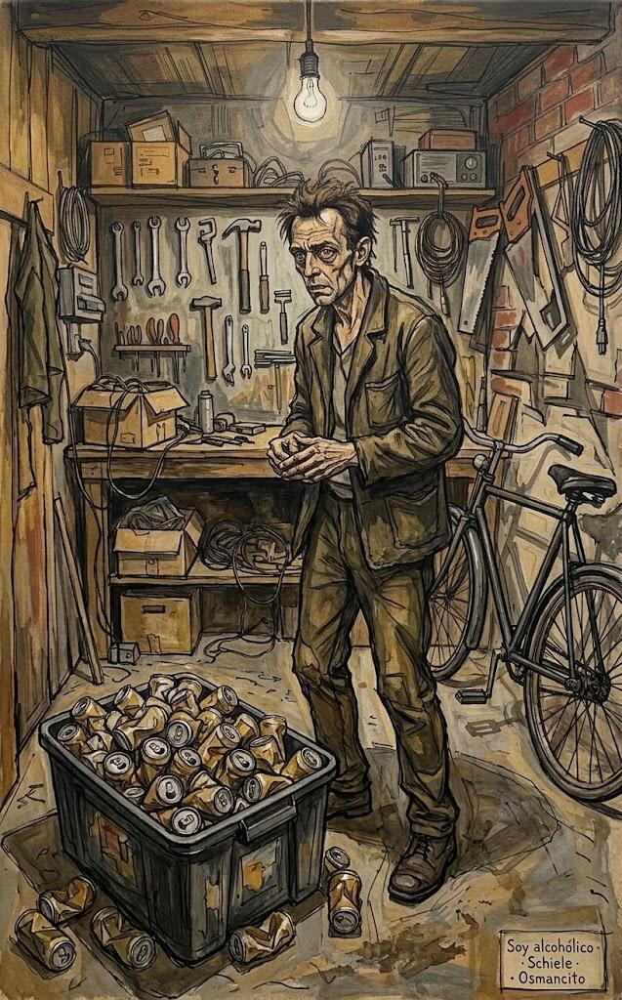](../img/261017_mientras-escribo_soy-alcoholico.jpg)

Los alcohólicos construyen defensas. Cuando Maine aprobó la ley de envases retornables, sus latas de Miller Lite pasaron a un contenedor del garaje:

> Un jueves por la noche salí a echar unos cuantos soldados muertos —las latas vacías, glosa— y vi que aquel contenedor, que el lunes por la noche estaba vacío, ahora estaba casi lleno.
>
> <small>[Frase 1429](#original-1429)</small>

Sus noches terminaban siempre con el mismo ritual:

> Mis noches de los últimos cinco años de bebida terminaban siempre con el mismo ritual: echaba por el fregadero las cervezas que quedaran en la nevera.
>
> <small>[Frase 1446](#original-1446)</small>

Si no, le hablaban desde la cama.

---

### M37 · Dos semanas para pensarlo

[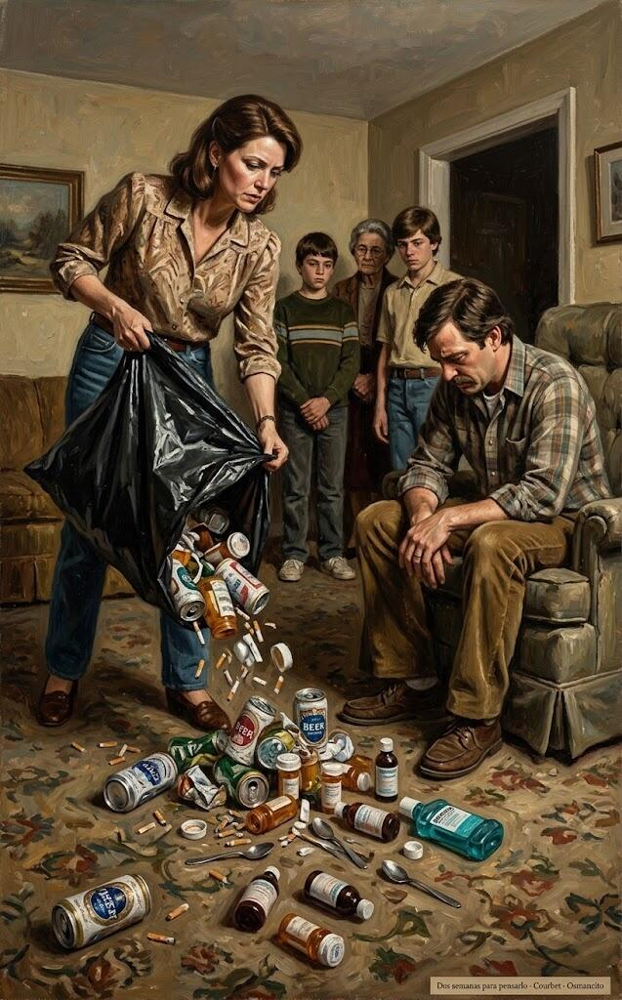](../img/261017_mientras-escribo_dos-semanas-para-pensarlo.jpg)

> Hacia 1985 había añadido la adicción a las drogas a mi problema con el alcohol, y sin embargo seguía funcionando, como hacen muchos adictos, a un nivel marginalmente competente.
>
> <small>[Frase 1450](#original-1450)</small>

Escondía la droga por terror y por vergüenza: no podía pedir ayuda; en su familia uno se guardaba las cosas.

Pero la parte de él que escribe las historias (la parte profunda que sabía que era alcohólico desde 1975, cuando escribió *The Shining*) no aceptó ese silencio, porque de silencio no va esa parte. Empezó a pedir ayuda a gritos del único modo que sabía: a través de su ficción y de sus monstruos. A finales de 1985 y comienzos de 1986 escribió *Misery* (el título describía con precisión su estado de ánimo), donde una enfermera psicótica mantiene prisionero a un escritor y lo tortura. En la primavera y el verano de 1986 escribió *The Tommyknockers*, a menudo hasta medianoche, con el corazón a ciento treinta pulsaciones y bastoncillos de algodón en la nariz para frenar la hemorragia de la cocaína. En esa novela, unos alienígenas entran en tu cabeza y te dan energía y una inteligencia superficial; a cambio, entregas el alma: la mejor metáfora de las drogas y el alcohol que su mente cansada y sobrecargada fue capaz de producir.

Entonces Tabby intervino:

> Organizó un grupo de intervención formado por familia y amigos, y a mí me tocó una especie de This Is Your Life en el infierno —«Esta es tu vida», el programa de televisión que sorprendía a un invitado repasando su vida delante de todos—.
>
> <small>[Frase 1470](#original-1470)</small>

Tabby empezó vaciando en la alfombra una bolsa de su estudio: latas, colillas, cocaína, pastillas, jarabes y enjuague bucal. Él lo venía negando todo.

> La cuestión de esta intervención, que fue desde luego tan desagradable para mi mujer, mis hijos y mis amigos como para mí, era que yo me estaba muriendo delante de ellos.
>
> <small>[Frase 1476](#original-1476)</small>

> Tabby dijo que yo podía elegir: buscar ayuda en un centro de rehabilitación o largarme de casa.
>
> <small>[Frase 1477](#original-1477)</small>

Él negoció, que es lo que hacen los adictos, y fue encantador, que es lo que son los adictos; consiguió dos semanas para pensarlo. En retrospectiva, eso resume toda la locura de aquella época: un hombre en la azotea de un edificio en llamas, llega un helicóptero y le tira una escalera de cuerda; «¡Sube!», le gritan, y el hombre responde: «Dame dos semanas para pensarlo».

Pensó, en la medida en que su aturdido estado se lo permitía, y lo que terminó de decidirlo fue Annie Wilkes, la enfermera psicótica de *Misery*: Annie era la cocaína, Annie era el alcohol, y decidió que estaba cansado de ser el escritor mascota de Annie. Temía no poder volver a trabajar si dejaba de beber y drogarse, pero decidió (hasta donde se puede decidir algo en ese estado) que cambiaría la escritura por seguir casado y ver crecer a sus hijos, si llegaba a eso.

No llegó. La idea de que la creatividad y las sustancias que alteran la mente van entrelazadas es uno de los grandes mitos pop intelectuales de nuestro tiempo, alimentado por Hemingway, Fitzgerald, Sherwood Anderson y Dylan Thomas. Los escritores que abusan de sustancias son simplemente adictos, ebrios y drogadictos de la variedad más común: Hemingway y Fitzgerald no bebían porque fueran creativos, alienados o moralmente débiles, sino porque es lo que los alcohólicos están programados para hacer. Los creativos quizá corren más riesgo que otros, pero ¿y qué? Todos tenemos bastante el mismo aspecto cuando vomitamos en la cuneta.

---

### M38 · La casa de verano

[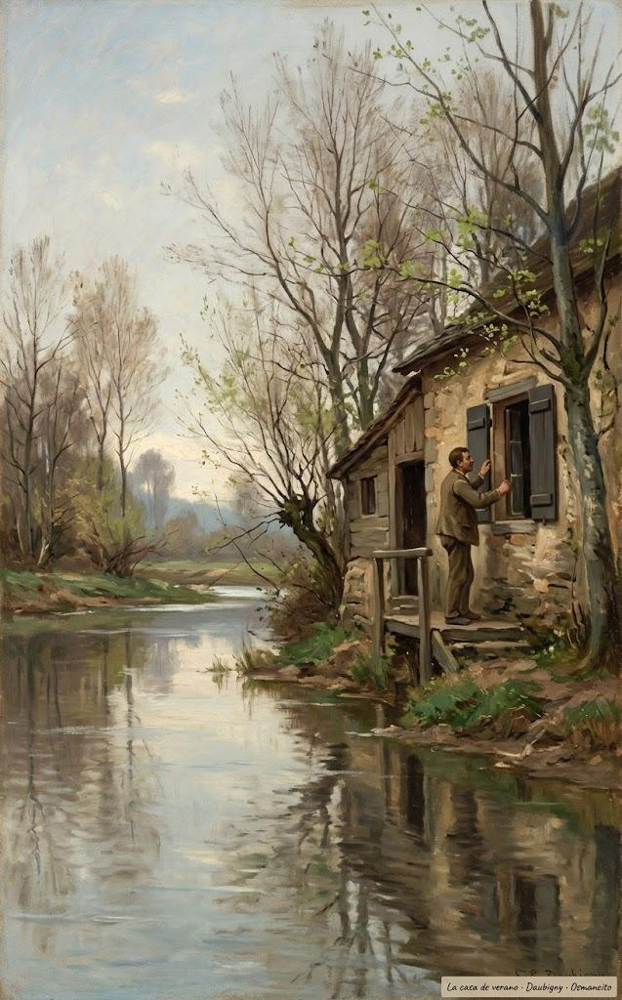](../img/261017_mientras-escribo_la-casa-de-verano.jpg)

Al final bebía una caja de cervezas por noche; *Cujo* apenas la recuerda. No quería beber ni estar sobrio:

Nunca dejó de escribir; poco a poco recuperó el ritmo y la alegría:

> Volví a mi familia con gratitud, y a mi trabajo con alivio: volví a él como la gente vuelve a una casa de verano después de un largo invierno, comprobando primero que nada haya sido robado ni roto durante la estación fría.
>
> <small>[Frase 1515](#original-1515)</small>

Descongeladas las tuberías, todo funcionaba.

---

### M39 · El escritorio en el rincón

[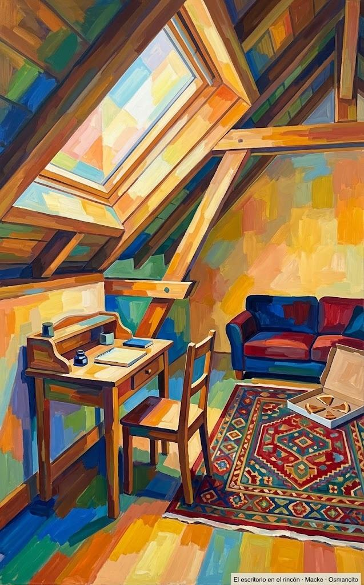](../img/261017_mientras-escribo_el-escritorio-en-el-rincon.jpg)

Lo último de esta parte: su escritorio.

> Durante años soñé con tener una de esas macizas planchas de roble capaces de dominar una habitación: se acabó el escritorio de niño en el lavadero del tráiler, se acabó el hueco estrecho para las rodillas de una casa de alquiler.
>
> <small>[Frase 1520](#original-1520)</small>

En 1981 lo consiguió. Ya sobrio, lo cambió por sofás; los niños subían a ver baloncesto y comer pizza:

> Normalmente dejaban atrás una caja llena de bordes de pizza cuando se iban, pero no me importaba.
>
> <small>[Frase 1525](#original-1525)</small>

Otro escritorio: artesanal, la mitad del T. rex:

> Lo puse en el extremo oeste del despacho, en un rincón bajo el alero.
>
> <small>[Frase 1528](#original-1528)</small>

Bajo ese alero se sienta ahora sin resaca.

---

## Los Originales

Esta sección reúne, en el idioma del libro y por orden de aparición, las frases que arriba van en castellano. El número de cada una lleva de vuelta a su lugar en la lectura.

> <small>[Frase 23](#lugar-23)</small>
>
> In the early nineties (it might have been 1992, but it’s hard to remember when you’re having a good time) I joined a rock-and-roll band composed mostly of writers.

> <small>[Frase 37](#lugar-37)</small>
>
> One night while we were eating Chinese before a gig in Miami Beach, I asked Amy if there was any one question she was never asked during the Q-and-A that follows almost every writer’s talk—that question you never get to answer when you’re standing in front of a group of author-struck fans and pretending you don’t put your pants on one leg at a time like everyone else.

> <small>[Frase 74](#lugar-74)</small>
>
> I lived an odd, herky-jerky childhood, raised by a single parent who moved around a lot in my earliest years and who—I am not completely sure of this—may have farmed my brother and me out to one of her sisters for awhile because she was economically or emotionally unable to cope with us for a time.

> <small>[Frase 104](#lugar-104)</small>
>
> I can’t remember if I was taken to the doctor, and neither can my Aunt Ethelyn (Uncle Oren, to whom the Evil Cinderblock surely belonged, is almost twenty years dead), but she remembers the sting, the mashed toes, and my reaction.

> <small>[Frase 134](#lugar-134)</small>
>
> After having a two-hundred-pound babysitter fart on your face and yell Pow!, The Village Voice holds few terrors.

> <small>[Frase 137](#lugar-137)</small>
>
> One morning Eula-Beulah fried me an egg for breakfast.

> <small>[Frase 139](#lugar-139)</small>
>
> Eula-Beulah fried me a second egg, then asked if I wanted another one.

> <small>[Frase 140](#lugar-140)</small>
>
> She had a look in her eye that said, “You don’t dare eat another one, Stevie.”

> <small>[Frase 160](#lugar-160)</small>
>
> When my mother came home from work that day, the babysitter was fast asleep on the couch and little Stevie was locked in the closet, fast asleep with half-digested fried eggs drying in his hair.

> <small>[Frase 165](#lugar-165)</small>
>
> I only know that I was in the bathroom, standing with my bare feet on the heater, watching to see if my brother would fall off the roof or make it back into the bathroom okay.

> <small>[Frase 170](#lugar-170)</small>
>
> I asked how you could hear a person die and she told me that it was a girl who had drowned off Prout’s Neck in the 1920s. She said the girl swam out past the rip, couldn’t get back in, and began screaming for help.

> <small>[Frase 175](#lugar-175)</small>
>
> Mom said she was fourteen, then read me a comic book and packed me off to bed.

> <small>[Frase 184](#lugar-184)</small>
>
> At some point my ears became involved, and one day my mother called a taxi (she did not drive) and took me to a doctor too important to make house calls—an ear specialist.

> <small>[Frase 198](#lugar-198)</small>
>
> He slid the needle into my ear and punctured my eardrum with it.

> <small>[Frase 213](#lugar-213)</small>
>
> The ear doctor once again produced the smell of alcohol—a smell I still associate, as I suppose many people do, with pain and sickness and terror—and with it, the long needle.

> <small>[Frase 232](#lugar-232)</small>
>
> Finally the nurse called my mother in from the waiting room, and the two of them managed to hold me long enough for the doctor to get his needle in.

> <small>[Frase 249](#lugar-249)</small>
>
> He was standing at the head of the table I was lying on (1953 and 1954 were my years for lying on tables), and to me he looked upside down.

> <small>[Frase 251](#lugar-251)</small>
>
> “Can you hear me?”

> <small>[Frase 253](#lugar-253)</small>
>
> “I want you to breathe deep,” he said.

> <small>[Frase 274](#lugar-274)</small>
>
> Eventually I showed one of these copycat hybrids to my mother, and she was charmed—I remember her slightly amazed smile, as if she was unable to believe a kid of hers could be so smart—practically a damned prodigy, for God’s sake.

> <small>[Frase 279](#lugar-279)</small>
>
> “Write one of your own, Stevie,” she said.

> <small>[Frase 290](#lugar-290)</small>
>
> When I finished, I gave it to my mother, who sat down in the living room, put her pocketbook on the floor beside her, and read it all at once.

> <small>[Frase 296](#lugar-296)</small>
>
> She gave me a quarter apiece for them and sent them around to her four sisters, who pitied her a little, I think.

> <small>[Frase 313](#lugar-313)</small>
>
> Dave and I explored it for the first time not long after we had moved into our new place.

> <small>[Frase 324](#lugar-324)</small>
>
> It would take at least half an hour to walk me home, and he had no intention of giving up such a shining stretch of time just because his little brother had to take a dump.

> <small>[Frase 329](#lugar-329)</small>
>
> “Wipe yourself with some leaves.

> <small>[Frase 334](#lugar-334)</small>
>
> I did my business, and took care of the cleanup as my older brother had suggested, carefully wiping my ass with big handfuls of shiny green leaves.

> <small>[Frase 346](#lugar-346)</small>
>
> Sharing the blame was also the reason we both ran the risk of getting killed while implementing his potentially lethal school science project.

> <small>[Frase 364](#lugar-364)</small>
>
> We each had our part to play in creating the Super Duper Electromagnet.

> <small>[Frase 370](#lugar-370)</small>
>
> Then, sitting on the floor in the kitchen of our West Broad Street apartment, he offered me the Super Duper Electromagnet and bade me do my part and plug it in.

> <small>[Frase 379](#lugar-379)</small>
>
> That day we could only wonder if our mother would come and see us in reform school.

> <small>[Frase 393](#lugar-393)</small>
>
> I am, when you stop to think of it, a member of a fairly select group: the final handful of American novelists who learned to read and write before they learned to eat a daily helping of video bullshit.

> <small>[Frase 406](#lugar-406)</small>
>
> About twenty years later, while I was signing autographs at a Los Angeles bookstore, Forry turned up in line … with my story, single-spaced and typed with the long-vanished Royal typewriter my mom gave me for Christmas the year I was eleven.

> <small>[Frase 411](#lugar-411)</small>
>
> He published this novella under the title “In a Half-World of Terror,” but I still like my title much better.

> <small>[Frase 421](#lugar-421)</small>
>
> My mother’s sisters had gotten my mom this job, perhaps thinking they could kill two birds with one stone—the aged Ps would be taken care of in a homey environment by a loving daughter, and The Nagging Problem of Ruth would be solved.

> <small>[Frase 423](#lugar-423)</small>
>
> She hated her new job, I think—in their effort to take care of her, her sisters turned our self-sufficient, funny, slightly nutty mother into a sharecropper living a largely cashless existence.

> <small>[Frase 443](#lugar-443)</small>
>
> In a funny scene—probably the first really competent scene I ever wrote—Roger sits in the living room with his old mom, the two of them mooning over the Happy Stamps catalogue while the printing press runs downstairs, ejecting bale after bale of those same trading stamps.

> <small>[Frase 455](#lugar-455)</small>
>
> Mom calls cheerily down the stairs, saying she has just gotten off the phone with the Happy Stamps National Redemption Center in Terre Haute, and the lady said they could probably get a nice Tudor home in Weston for only eleven million, six hundred thousand books of Happy Stamps.

> <small>[Frase 460](#lugar-460)</small>
>
> Only eleven million, five hundred and ninety thousand books to go, he thinks as the story ends, and Mom can have her Tudor.

> <small>[Frase 485](#lugar-485)</small>
>
> The first of these hopeful notes was from Algis Budrys, then the editor of Fantasy and Science Fiction, who read a story of mine called “The Night of the Tiger” (the inspiration was, I think, an episode of The Fugitive in which Dr. Richard Kimble worked as an attendant cleaning out cages in a zoo or a circus) and wrote: “This is good.

> <small>[Frase 491](#lugar-491)</small>
>
> I rewrote it and on a whim resubmitted it to F&SF.

> <small>[Frase 502](#lugar-502)</small>
>
> A typical number would let people know how Charley Harrington’s broken leg was mending, what guest speakers might be coming to the West Durham Methodist Church, how much water the King boys were hauling from the town pump to keep from draining the well behind the house (of course it went dry every fucking summer no matter how much water we hauled), who was visiting the Browns or the Halls on the other side of Methodist Corners, and whose relatives were due to hit town each summer.

> <small>[Frase 524](#lugar-524)</small>
>
> We were able to put together in two nights what had previously taken a week with the hectograph, and while the drum-press was messy, it did not look infected with a potentially fatal disease.

> <small>[Frase 562](#lugar-562)</small>
>
> Of all the Poepictures, the one that affected Chris and me the most deeply was The Pit and the Pendulum.

> <small>[Frase 567](#lugar-567)</small>
>
> On the long hitch home that night (if rides were slow in coming, you might end up walking four or five miles and not get home until well after dark) I had a wonderful idea: I would turn The Pit and the Pendulum into a book!

> <small>[Frase 569](#lugar-569)</small>
>
> But I wouldn’t just write this masterpiece; I would also print it, using the drum-press in our basement, and sell copies at school!

> <small>[Frase 574](#lugar-574)</small>
>
> Although no copies of that particular masterpiece survive (at least to my knowledge), I believe it was eight pages long, each page single-spaced and paragraph breaks kept to an absolute minimum (each stencil cost nineteen cents, remember).

> <small>[Frase 579](#lugar-579)</small>
>
> I ran off about forty copies of The Pit and the Pendulum, blissfully unaware that I was in violation of every plagiarism and copyright statute in the history of the world; my thoughts were focused almost entirely on how much money I might make if my story was a hit at school.

> <small>[Frase 591](#lugar-591)</small>
>
> When the school day ended at two o’clock, I was summoned to the principal’s office, where I was told I couldn’t turn the school into a marketplace, especially not, Miss Hisler said, to sell such trash as The Pit and the Pendulum.

> <small>[Frase 657](#lugar-657)</small>
>
> Mr. Higgins, our bald principal (breezily referred to in the Vomit as Old Cue-Ball), told me that Miss Margitan had been very hurt and very upset by what I had written.

> <small>[Frase 658](#lugar-658)</small>
>
> She was apparently not too hurt to remember that old scriptural admonition which goes “Vengeance is mine, saith the shorthand teacher,” however; Mr. Higgins said she wanted me suspended from school.

> <small>[Frase 665](#lugar-665)</small>
>
> In the end, Miss Margitan settled for a formal apology and two weeks of detention for the bad boy who had dared call her Maggot in print.

> <small>[Frase 672](#lugar-672)</small>
>
> Later, while I was flying paper planes with the other bad boys and bad girls in detention hall (detention turned out to be not so bad), I decided that it was pretty simple: Miss Margitan didn’t like boys.

> <small>[Frase 673](#lugar-673)</small>
>
> She was the first woman I ever met in my life who didn’t like boys, not even one little bit.

> <small>[Frase 709](#lugar-709)</small>
>
> I wish I still had the piece—it deserves to be framed, editorial corrections and all—but I can remember pretty well how it went and how it looked after Gould had combed through it with that black pen of his.

> <small>[Frase 723](#lugar-723)</small>
>
> “I know,” I said, meaning both things: yes, most of it was good—okay anyway, serviceable—and yes, he had only taken out the bad parts.

> <small>[Frase 732](#lugar-732)</small>
>
> Gould said something else that was interesting on the day I turned in my first two pieces: write with the door closed, rewrite with the door open.

> <small>[Frase 736](#lugar-736)</small>
>
> If you’re very lucky (this is my idea, not John Gould’s, but I believe he would have subscribed to the notion), more will want to do the former than the latter.

> <small>[Frase 739](#lugar-739)</small>
>
> My mother was making lousy wages as a housekeeper at a facility for the mentally ill in New Gloucester, but she was determined I was going to college like my brother David (University of Maine, class of ’66, cum laude).

> <small>[Frase 767](#lugar-767)</small>
>
> One day late in my final semester at college, finals over and at loose ends, I recalled the dyehouse guy’s story about the rats under the mill—big as cats, goddam, some as big as dogs—and started writing a story called “Graveyard Shift.”

> <small>[Frase 787](#lugar-787)</small>
>
> I hadn’t run across her in the library, and I didn’t believe a college student could utter such a wonderful, unafraid laugh.

> <small>[Frase 792](#lugar-792)</small>
>
> We’re still married, and she has never let me forget that the first time I met her I thought she was Eddie Marsh’s townie girlfriend.

> <small>[Frase 801](#lugar-801)</small>
>
> We met when we were working in a library, and I fell in love with her during a poetry workshop in the fall of 1969, when I was a senior and Tabby was a junior.

> <small>[Frase 802](#lugar-802)</small>
>
> I fell in love with her partly because I understood what she was doing with her work.

> <small>[Frase 803](#lugar-803)</small>
>
> I fell because she understood what she was doing with it.

> <small>[Frase 804](#lugar-804)</small>
>
> I also fell because she was wearing a sexy black dress and silk stockings, the kind that hook with garters.

> <small>[Frase 824](#lugar-824)</small>
>
> I didn’t cop to much of this attitude (although I didn’t dare say so out loud, at least not in so many words), and was overjoyed to find that the pretty girl in the black dress and the silk stockings didn’t cop to much of it, either.

> <small>[Frase 861](#lugar-861)</small>
>
> In the discussion that followed Tab’s reading, it became clear to me that she understood her own poem.

> <small>[Frase 889](#lugar-889)</small>
>
> When Tabby went into labor with him, I was at a drive-in movie in Brewer with a friend—it was a Memorial Day triple feature, three horror films.

> <small>[Frase 906](#lugar-906)</small>
>
> Even when Naomi was tearing off the wallpaper above her crib (maybe she thought she was housekeeping) and Joe was shitting in the wicker seat of the rocker we kept on the porch of our apartment on Sanford Street, they were a treat.

> <small>[Frase 907](#lugar-907)</small>
>
> My mother knew I wanted to be a writer (with all those rejection slips hanging from the spike on my bedroom wall, how could she not?), but she encouraged me to get a teacher’s credential “so you’ll have something to fall back on.”

> <small>[Frase 910](#lugar-910)</small>
>
> I did as she suggested, entering the College of Education at UMO and emerging four years later with a teacher’s certificate … sort of like a golden retriever emerging from a pond with a dead duck in its jaws.

> <small>[Frase 915](#lugar-915)</small>
>
> The greater part of what I loaded and pulled were motel sheets from Maine’s coastal towns and table linen from Maine’s coastal restaurants.

> <small>[Frase 942](#lugar-942)</small>
>
> I wrote after work; when we lived on Grove Street, which was close to the New Franklin, I would sometimes write a little on my lunch hour, too.

> <small>[Frase 955](#lugar-955)</small>
>
> The stories I sold to the men’s magazines between August of 1970, when I got my two-hundred-dollar check for “Graveyard Shift,” and the winter of 1973-1974 were just enough to create a rough sliding margin between us and the welfare office (my mother, a Republican all her life, had communicated her deep horror of “going on the county” to me; Tabby had some of that same horror).

> <small>[Frase 984](#lugar-984)</small>
>
> I was driving a Buick with transmission problems we couldn’t afford to fix, Tabby was still working at Dunkin’ Donuts, and we had no telephone.

> <small>[Frase 1002](#lugar-1002)</small>
>
> If she had suggested that the time I spent writing stories on the front porch of our rented house on Pond Street or in the laundry room of our rented trailer on Klatt Road in Hermon was wasted time, I think a lot of the heart would have gone out of me.

> <small>[Frase 1016](#lugar-1016)</small>
>
> One lunch hour Harry told me what it had been like to face a Japanese banzai charge on the island of Tarawa, all the Japanese officers waving swords made out of Maxwell House coffee cans, all the screaming enlisted men behind them stoned out of their gourds and smelling of burned poppies.

> <small>[Frase 1018](#lugar-1018)</small>
>
> One day he and I were supposed to scrub the rust-stains off the walls in the girls’ shower.

> <small>[Frase 1062](#lugar-1062)</small>
>
> The next night, when I came home from school, Tabby had the pages.

> <small>[Frase 1064](#lugar-1064)</small>
>
> She wanted me to go on with it, she said.

> <small>[Frase 1069](#lugar-1069)</small>
>
> “You’ve got something here,” she said.

> <small>[Frase 1095](#lugar-1095)</small>
>
> It occurred to me that Sondra had grown up beneath the agonal gaze of this dying god, and doing so had undoubtedly played a part in making her what she was when I knew her: a timid and homely outcast who went scuttling through the halls of Lisbon High like a frightened mouse.

> <small>[Frase 1102](#lugar-1102)</small>
>
> The other girl I’ll call Dodie Franklin, only the other girls called her Dodo or Doodoo.

> <small>[Frase 1123](#lugar-1123)</small>
>
> Dodie had it worse, I think.

> <small>[Frase 1132](#lugar-1132)</small>
>
> I have no idea if she saved for those new clothes, if they were given to her for Christmas by her parents, or if she went through a hell of begging that finally bore dividends.

> <small>[Frase 1136](#lugar-1136)</small>
>
> I had several classes with her, and was able to observe Dodie’s ruination at first hand.

> <small>[Frase 1137](#lugar-1137)</small>
>
> I saw her smile fade, saw the light in her eyes first dim and then go out.

> <small>[Frase 1146](#lugar-1146)</small>
>
> Both Sondra and Dodie were dead by the time I started writing Carrie.

> <small>[Frase 1156](#lugar-1156)</small>
>
> I never liked Carrie, that female version of Eric Harris and Dylan Klebold, but through Sondra and Dodie I came at last to understand her a little.

> <small>[Frase 1159](#lugar-1159)</small>
>
> I pretty much forgot about it and moved on with my life, which at that time consisted of teaching school, raising kids, loving my wife, getting drunk on Friday afternoons, and writing stories.

> <small>[Frase 1168](#lugar-1168)</small>
>
> Tabby would have had to dress the kids in their boots and jackets to use the neighbors’ phone, and I could think of only two reasons she might have done so.

> <small>[Frase 1186](#lugar-1186)</small>
>
> I told her no, not based on a twenty-five-hundred-dollar advance and only nebulous possibilities beyond that.

> <small>[Frase 1215](#lugar-1215)</small>
>
> He was a great one to talk, since he smoked like a chimney himself (so did I, and how my wife hated the expense and the constant ashy dirt of it), but I knew what he meant.

> <small>[Frase 1245](#lugar-1245)</small>
>
> Our place on Sanford Street rented for ninety dollars a month and this man I’d only met once face-to-face was telling me I’d just won the lottery.

> <small>[Frase 1251](#lugar-1251)</small>
>
> I asked him to say the number again, very slowly and very clearly, so I could be sure I hadn’t misunderstood.

> <small>[Frase 1254](#lugar-1254)</small>
>
> We talked for another half an hour, but I don’t remember a single word of what we said.

> <small>[Frase 1280](#lugar-1280)</small>
>
> Finally I gave up and asked the guy behind the counter (the same bald, bored-looking, gray-coated guy who has, I’m convinced, sold alcohol virgins their first bottle since the dawn of commerce) what was cheap.

> <small>[Frase 1330](#lugar-1330)</small>
>
> Here is more trouble with the principal, probably even worse than the trouble I got into over The Village Vomit.

> <small>[Frase 1332](#lugar-1332)</small>
>
> He bounced me pretty hard over my joke newspaper, but perhaps Miss Margitan had insisted on that.

> <small>[Frase 1338](#lugar-1338)</small>
>
> “A shame for you to miss the fun,” Old Cue-Ball says.

> <small>[Frase 1342](#lugar-1342)</small>
>
> “I hope you won’t get that bug again,” he says.

> <small>[Frase 1354](#lugar-1354)</small>
>
> The clerk sells me a fifth of Four Roses without asking to see any ID, and by the time we stop for the night I’m drunk again.

> <small>[Frase 1366](#lugar-1366)</small>
>
> I motion to the bartender.

> <small>[Frase 1368](#lugar-1368)</small>
>
> He’s bald, he’s wearing a gray jacket, he could be the guy who sold me my first pint back in 1966.

> <small>[Frase 1380](#lugar-1380)</small>
>
> She said nothing to Ethelyn and nothing to David and me.

> <small>[Frase 1387](#lugar-1387)</small>
>
> I think Nellie Ruth Pillsbury King, who once dumped a bowl of Jell-O on the floor and then danced in it while her two boys lay collapsed in the corner, screaming with laughter, actually died of embarrassment.

> <small>[Frase 1393](#lugar-1393)</small>
>
> Dave woke me at 6:15 in the morning, calling softly through the door that he thought she was going.

> <small>[Frase 1413](#lugar-1413)</small>
>
> We could hear the pause after each rasping breath she drew growing longer and longer.

> <small>[Frase 1415](#lugar-1415)</small>
>
> My mother was buried out of the Congregational Church at Southwest Bend; the church she’d attended in Methodist Corners, where my brother and I grew up, was closed because of the cold.

> <small>[Frase 1429](#lugar-1429)</small>
>
> One Thursday night I went out there to toss in a few dead soldiers and saw that this container, which had been empty on Monday night, was now almost full.

> <small>[Frase 1446](#lugar-1446)</small>
>
> My nights during the last five years of my drinking always ended with the same ritual: I’d pour any beers left in the refrigerator down the sink.

> <small>[Frase 1450](#lugar-1450)</small>
>
> By 1985 I had added drug addiction to my alcohol problem, yet I continued to function, as a good many substance abusers do, on a marginally competent level.

> <small>[Frase 1470](#lugar-1470)</small>
>
> She organized an intervention group formed of family and friends, and I was treated to a kind of This Is Your Life in hell.

> <small>[Frase 1476](#lugar-1476)</small>
>
> The point of this intervention, which was certainly as unpleasant for my wife and kids and friends as it was for me, was that I was dying in front of them.

> <small>[Frase 1477](#lugar-1477)</small>
>
> Tabby said I had my choice: I could get help at a rehab or I could get the hell out of the house.

> <small>[Frase 1515](#lugar-1515)</small>
>
> I came back to my family with gratitude, and back to my work with relief—I came back to it the way folks come back to a summer cottage after a long winter, checking first to make sure nothing has been stolen or broken during the cold season.

> <small>[Frase 1520](#lugar-1520)</small>
>
> For years I dreamed of having the sort of massive oak slab that would dominate a room—no more child’s desk in a trailer laundry-closet, no more cramped kneehole in a rented house.

> <small>[Frase 1525](#lugar-1525)</small>
>
> They usually left a boxful of crusts behind when they moved on, but I didn’t care.

> <small>[Frase 1528](#lugar-1528)</small>
>
> I put it at the far west end of the office, in a corner under the eave.

© 2026 Osmancito

[volver](../destileria.html)
