17 de octubre de 2026

# La Tragedia del Rey Lear

[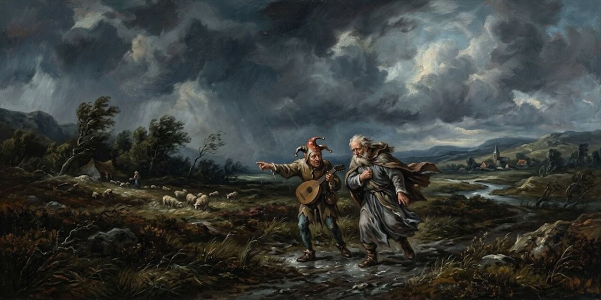](img/261017_rey-lear_og.jpg)

William Shakespeare

Hacia 1605-1606, William Shakespeare escribió *King Lear*, una de sus grandes tragedias: un rey viejo, cansado de gobernar, reparte su reino entre sus tres hijas según el amor que cada una diga tenerle, y deshereda a la menor, la única que se niega a mentir. Esta lectura sigue la obra escena por escena: las frases de Shakespeare van en castellano, con su original al final, y entre ellas unos textos cuentan lo que pasa y explican lo que haga falta.

## Acto I, escena 1

[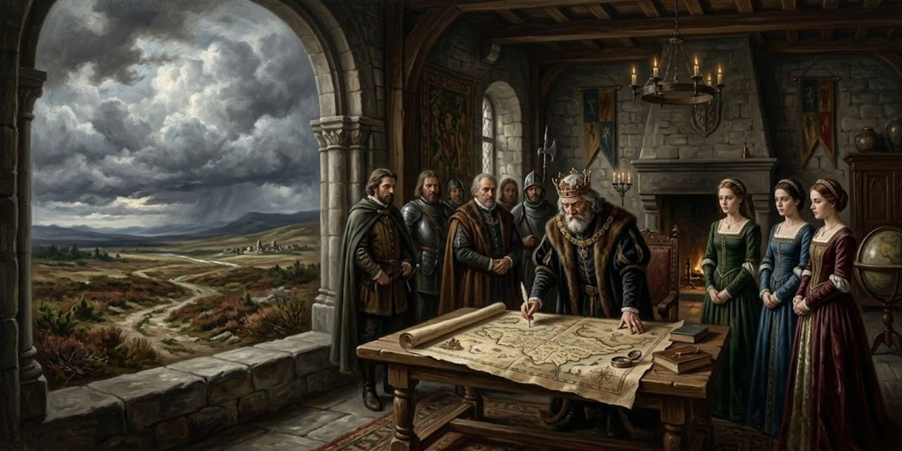](img/261017_rey-lear_i-1.jpg)

La primera frase de la obra es de Kent: al rey lo vieron siempre más inclinado a un yerno que al otro. Entra Lear, viejo y cansado de gobernar, pide el mapa y anuncia su plan.

> Entre tanto, expresaremos nuestro más oscuro designio.
>
> <small>[Frase 47](#original-47)</small>

Lear

El plan es un concurso: cada hija dirá cuánto lo ama y la que más lo quiera se llevará la mejor parte. Goneril, la mayor, habla primero.

> Señor, os amo más de lo que la palabra puede expresar, más que a la vista, al espacio y a la libertad; más allá de todo lo que pueda valorarse, rico o raro; no menos que a la vida, con gracia, salud, belleza y honor; tanto como jamás hija amó o padre halló; un amor que deja pobre al aliento y sin fuerza al habla.
>
> <small>[Frase 56](#original-56)</small>

Goneril

Regan la sigue con la misma música. Cordelia, la menor y la más querida, se niega a jugar: «nada, mi señor». Presionada, lo ama según su deber, ni más ni menos. Ella insiste:

> Mi buen señor, vos me engendrasteis, me criasteis, me amasteis.
>
> <small>[Frase 95](#original-95)</small>

Cordelia

Ella devuelve deber por deber. Lear, ciego de ira, la deshereda. Kent, el consejero más leal, se interpone:

> A la franqueza está el honor obligado cuando la majestad cae en la locura.
>
> <small>[Frase 141](#original-141)</small>

Kent

La franqueza le cuesta a Kent el destierro. Lear ofrece a Cordelia, ya sin dote, a Borgoña; ella confiesa que le falta el arte meloso de declarar lo que no siente, y su padre la despide con una maldición:

> Mejor fuera que no hubieras nacido a no haberme complacido mejor.
>
> <small>[Frase 210](#original-210)</small>

Lear

Borgoña se retira; Francia la acepta tal como es y se la lleva. A solas, las hermanas se quitan la máscara: su padre apenas se conoce y seguirá dando problemas. Goneril cierra la escena:

> Debemos hacer algo, y en caliente.
>
> <small>[Frase 287](#original-287)</small>

Goneril

---

## Acto I, escena 2

[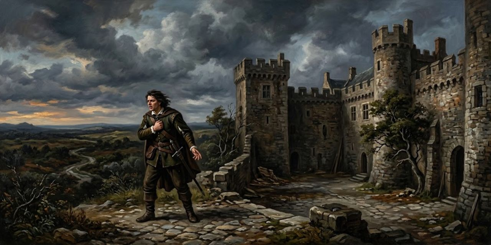](img/261017_rey-lear_i-2.jpg)

Edmund, hijo bastardo de Gloucester, habla a solas: su diosa es la Naturaleza («Thou, Nature, art my goddess») y no acepta la costumbre que lo condena por bastardo:

> ¿Por qué habría de quedar bajo la plaga de la costumbre y permitir que la curiosidad de las naciones me prive por ser yo unas doce o catorce lunas más joven que un hermano?
>
> <small>[Frase 294](#original-294)</small>

Edmund

Con una carta falsificada hace creer a su padre que Edgar, el hermano legítimo, planea matarlo. Gloucester reconoce la letra; Edmund hunde el cuchillo con cuidado:

> Es su mano, mi señor, pero espero que su corazón no esté en el contenido.
>
> <small>[Frase 367](#original-367)</small>

Edmund

Gloucester traga el anzuelo: manda buscar a Edgar y culpa a los eclipses de todo lo que se rompe en el mundo:

> El amor se enfría, la amistad decae, los hermanos se dividen; en las ciudades, motines; en los países, discordia; en los palacios, traición; y el vínculo agrietado entre hijo y padre.
>
> <small>[Frase 406](#original-406)</small>

Gloucester

Solo, Edmund se burla del padre crédulo. Ve llegar a Edgar y se ajusta la máscara:

> Mi pie es una melancolía de villano, con un suspiro como el de Tom el de Bedlam.
>
> <small>[Frase 426](#original-426)</small>

Edmund

Su «pie», su entrada en escena; Tom el de Bedlam, un loco de manicomio. Le hace creer a Edgar que su padre lo odia, y el hermano noble le cree. Solo, celebra el engaño y cierra la escena: le vale todo lo que pueda ajustar a su plan.

---

## Acto I, escena 3

[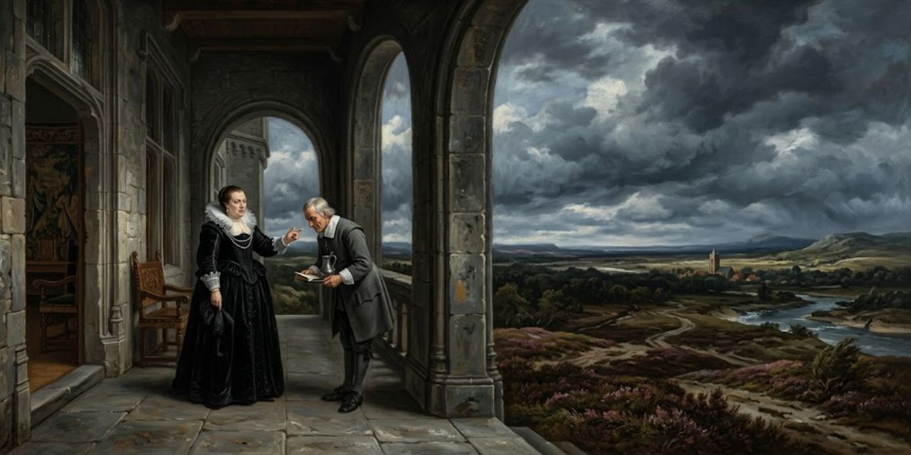](img/261017_rey-lear_i-3.jpg)

Goneril sabe que Lear golpeó a un caballero suyo, y dice:

> No lo soportaré.
>
> <small>[Frase 488](#original-488)</small>

Goneril

Planea tratar con frialdad a Lear y a sus caballeros, y explica:

> Viejo ocioso que aún querría manejar esas autoridades que ha cedido.
>
> <small>[Frase 501](#original-501)</small>

Goneril

Escribe a Regan para que haga igual.

---

## Acto I, escena 4

[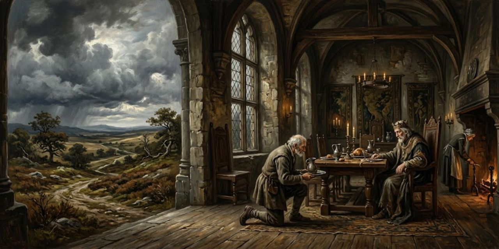](img/261017_rey-lear_i-4.jpg)

Kent, desterrado, vuelve disfrazado para servir al rey que lo condenó. Lear llega a casa de Goneril, lo ve y le pregunta qué sabe hacer. Kent responde que servir, callar y pelear si hace falta, y que es tan pobre como el rey. Lear bromea:

> Si eres tan pobre como súbdito como él lo es como rey, eres bastante pobre.
>
> <small>[Frase 537](#original-537)</small>

Lear

Lo toma a su servicio. Lear manda volver a Oswald, que pasó sin saludar, y lo golpea; Kent lo derriba de una zancadilla.

Llega el Bufón, mustio desde que Cordelia se fue a Francia, y le ofrece a Kent su gorra por seguir a un amo caído. Lear pregunta si lo llama loco. El Bufón responde:

> Todos tus otros títulos los has regalado.
>
> <small>[Frase 722](#original-722)</small>

Bufón

Es el único título con que nació. Entra Goneril con una queja ordenada: los cien caballeros de Lear convierten el palacio en taberna, y pide que reduzca su séquito. Lear estalla:

> Bastardo degenerado, no te molestaré más.
>
> <small>[Frase 819](#original-819)</small>

Lear

Se consuela con que le queda otra hija. Llega Albany, que jura su inocencia. Lear pide a la Naturaleza que Goneril no tenga hijos, o que tenga uno que la hiera. La maldición sube:

> ¡Que las heridas sin cura de la maldición de un padre te traspasen todos los sentidos!
>
> <small>[Frase 873](#original-873)</small>

Lear

Sale hacia Regan, seguro de que ella tomará su parte. El Bufón lo sigue. Goneril, a solas con Albany, defiende su prudencia:

> ¡Es prudente y seguro dejarle mantener a punto cien caballeros!
>
> <small>[Frases 898–899](#original-898)</small>

Goneril

Es sarcasmo: cien hombres armados serían un peligro. Ya escribió a Regan y manda la carta con Oswald. Albany duda y solo dice que el desenlace dirá.

---

## Acto I, escena 5

[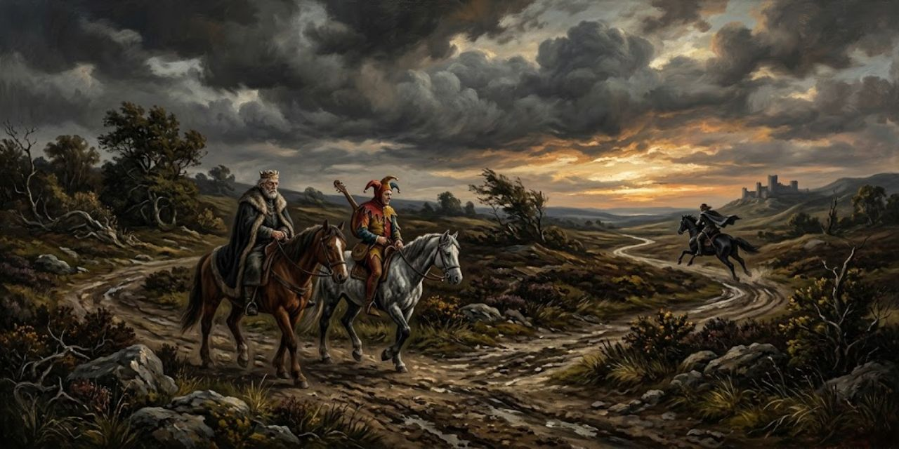](img/261017_rey-lear_i-5.jpg)

Lear envía a Kent con cartas a Gloucester. El Bufón suelta adivinanzas, y Lear, dolido, baja la voz.

El Bufón dice que Lear sería buen bufón; el rey estalla, y el Bufón replica:

> Si fueras mi Bufón, tío, te haría azotar por ser viejo antes de tiempo.
>
> <small>[Frase 988](#original-988)</small>

Bufón

Dice que Lear envejeció antes de ser sabio. Lear pide no enloquecer. El Bufón cierra:

---

## Acto II, escena 1

[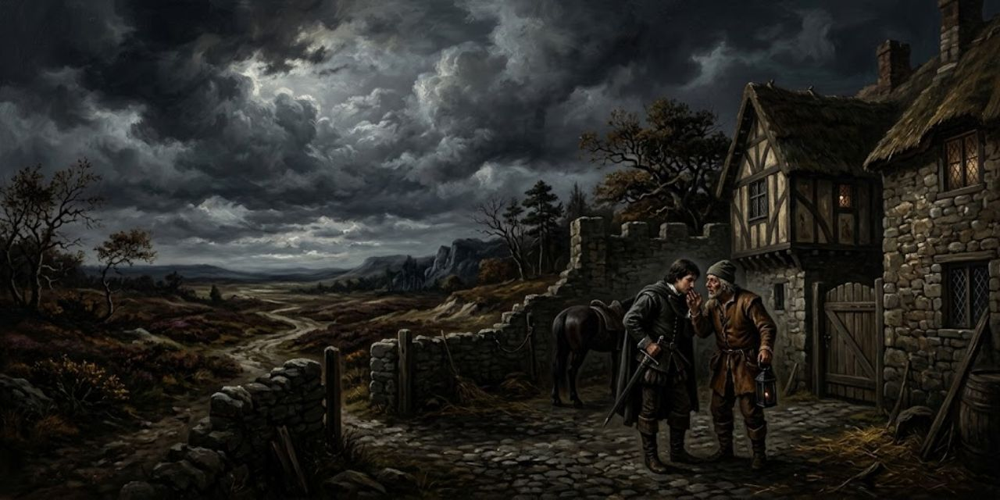](img/261017_rey-lear_i-6.jpg)

En casa de Gloucester, Edmund oye de un caballerizo que Cornwall y Regan llegan esta noche, y que hay tensión entre los duques. Llama a Edgar: su padre lo busca, que huya. Y le dice:

> Con astucia debo desenvainar mi espada contra ti.
>
> <small>[Frase 1054](#original-1054)</small>

Edmund

La pelea es teatro. Edgar huye y Edmund se corta el brazo para acreditar su defensa, y dice a su padre que el villano conjuraba a la luna. Gloucester manda perseguirlo:

> No quedará en esta tierra sin ser capturado, y hallado—ejecutado.
>
> <small>[Frase 1094](#original-1094)</small>

Gloucester

Su retrato correrá por el reino y sus tierras irán a Edmund. Llegan Cornwall y Regan; ella dice que Edgar andaba con los caballeros alborotosos de Lear. Cornwall toma a Edmund a su servicio. Edmund agradece con doble fondo:

> Os serviré, señor, fielmente, sea lo demás como sea.
>
> <small>[Frase 1158](#original-1158)</small>

Edmund

Regan explica que viene a pedir consejo a Gloucester, y este se ofrece a servirlos.

---

## Acto II, escena 2

[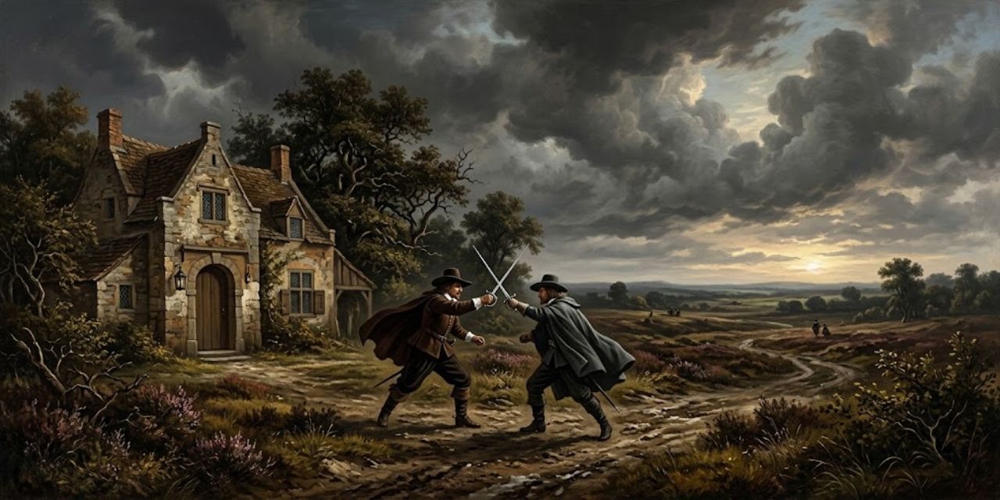](img/261017_rey-lear_i-7.jpg)

Ante la casa de Gloucester, de noche, Oswald llega con cartas de Goneril y Kent con las del rey, y lo reconoce: es el criado que insultó a Lear. Oswald pregunta por qué lo trata así. Kent responde:

> Mozo, yo sí te conozco.
>
> <small>[Frase 1196](#original-1196)</small>

Kent

Lo insulta y desenvaina. Al grito de asesinato salen Edmund, Gloucester y los duques. Oswald se pinta como víctima, y Kent explica su oficio ante Cornwall:

> Señor, es mi oficio ser llano: he visto mejores caras en mi tiempo que las que hay sobre cualquier hombro que veo ante mí en este instante.
>
> <small>[Frase 1300](#original-1300)</small>

Kent

Cornwall no se lo cree y manda traer el cepo. Kent avisa que sirve al rey, y que castigar a su mensajero es agraviarlo. Regan pide dejarlo toda la noche. Kent insiste:

> Vamos, señora, si yo fuera el perro de vuestro padre, no me trataríais así.
>
> <small>[Frase 1338](#original-1338)</small>

Kent

Le ponen las piernas en el cepo y lo dejan solo. Kent bromea con su suerte, lee a la luz de la luna una carta de Cordelia y se duerme.

---

## Acto II, escena 3

[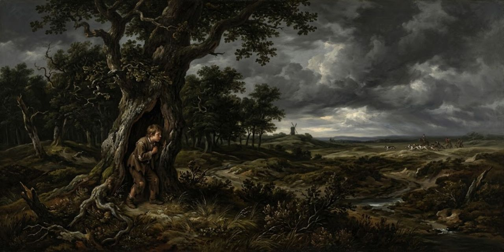](img/261017_rey-lear_i-8.jpg)

Edgar, proscrito, se esconde y decide:

> Mientras pueda escapar, me preservaré, y estoy decidido a tomar la forma más baja y más pobre que jamás la penuria, en desprecio del hombre, acercara a la bestia.
>
> <small>[Frase 1389](#original-1389)</small>

Edgar

Será un mendigo loco de Bedlam, tiznado y casi desnudo.

---

## Acto II, escena 4

[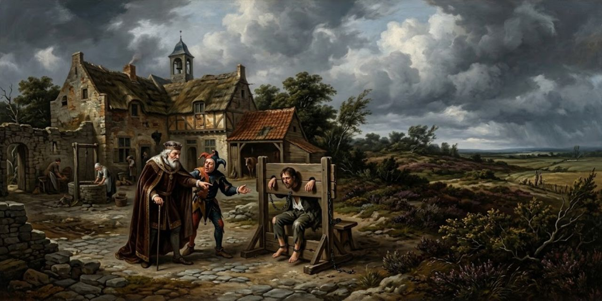](img/261017_rey-lear_i-9.jpg)

Lear llega con el Bufón a casa de Gloucester y encuentra a Kent en el cepo, como un ladrón. Le pregunta quién lo puso ahí. Kent dice que su hijo y su hija. Lear lo nombra:

> Es peor que el asesinato cometer sobre el respeto tan violento ultraje.
>
> <small>[Frase 1435](#original-1435)</small>

Lear

Kent cuenta que, apenas entregadas las cartas, llegó otro mensajero de Goneril, y a él lo castigaron por sacar la espada. El Bufón canta que el que sirve por ganancia se va cuando llueve. Lear pide hablar con los duques, que dicen estar cansados. Por fin salen Cornwall y Regan.

Regan lo recibe con frialdad: su hermana no pudo faltar a su deber. Y le dice la verdad:

> ¡Oh señor, sois viejo!
>
> <small>[Frase 1564](#original-1564)</small>

Regan

Necesita que alguien lo gobierne. Que vuelva con su hermana y le pida perdón. Lear lo ridiculiza de rodillas, maldice a Goneril y jura que a Regan no, porque ella es tierna. Regan responde con cuatro palabras:

> Buen señor, al grano.
>
> <small>[Frase 1603](#original-1603)</small>

Regan

Lear pregunta de nuevo quién puso a su hombre en el cepo. Llega Goneril, que toma la mano de Regan. Cornwall confiesa que lo puso él. Regan le ofrece volver con su hermana un mes y despedir a la mitad del séquito. Lear prefiere vivir a la intemperie, y a Goneril le ruega:

> Te ruego, hija, no me hagas enloquecer.
>
> <small>[Frase 1660](#original-1660)</small>

Lear

Dice que no volverán a verse, pero que no la regañará, y se queda con Regan y sus cien caballeros. Entonces empieza la subasta: Regan ofrece veinticinco, Goneril rebaja a cinco, y Regan remata con uno. Lear responde con la pregunta de la obra: no se razona la necesidad, y si la naturaleza solo tuviera lo necesario, la vida del hombre valdría lo que la de una bestia. Y se muestra a los dioses:

> Me veis aquí, dioses, un pobre viejo tan lleno de pena como de edad, desdichado en ambas.
>
> <small>[Frase 1722](#original-1722)</small>

Lear

Si los dioses revuelven esos corazones, que lo toquen con ira noble. No llorará: antes se romperá su corazón en mil pedazos. Dice al Bufón que se volverá loco y sale a la noche. Gloucester avisa que el rey se va; Cornwall dice que lo dejen. Las hijas cierran las puertas, y Cornwall remata con una orden que abre la tormenta.

---

## Acto III, escena 1

[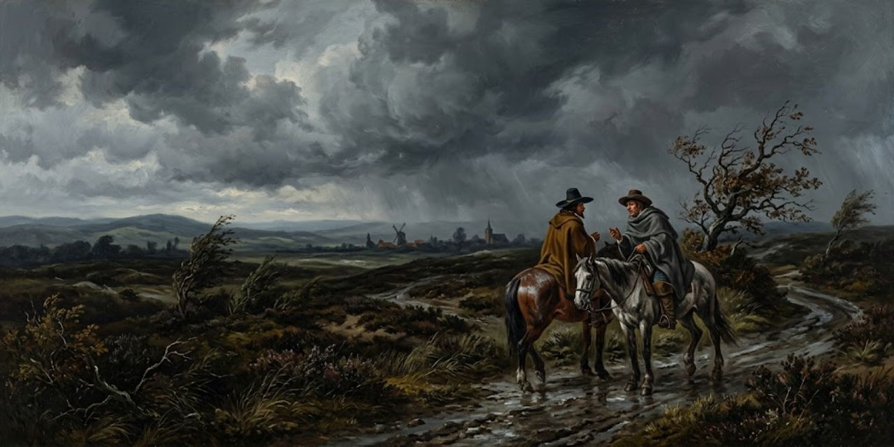](img/261017_rey-lear_i-10.jpg)

En el páramo, en plena tormenta, Kent encuentra a un caballero. El rey, dice este, pelea con los elementos y solo lo acompaña el Bufón.

Kent le cuenta que hay división entre los duques y que Francia desembarca. Le da un anillo para Cordelia. El caballero pregunta si no tiene más que decir, y Kent cierra:

> Pocas palabras, pero, en efecto, más que todo hasta ahora: que cuando hayamos hallado al Rey—en lo cual vos os afanaréis por allá, yo por acá—el que primero dé con él grite al otro.
>
> <small>[Frase 1813](#original-1813)</small>

Kent

---

## Acto III, escena 2

[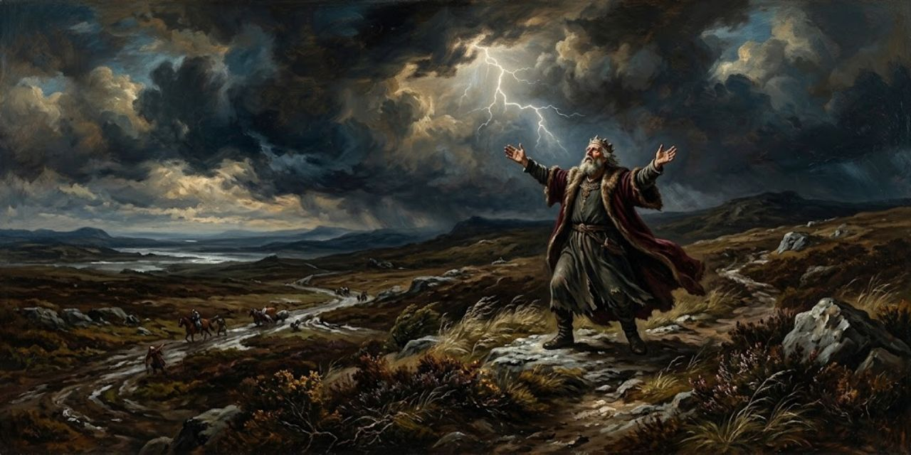](img/261017_rey-lear_i-11.jpg)

En el páramo, bajo la tormenta, Lear manda al viento y al trueno destruir el mundo. El Bufón le pide que se refugie.

Lear disculpa a los elementos, que no le deben nada, y se presenta:

> Aquí estoy, esclavo vuestro, un pobre viejo enfermo, débil y despreciado.
>
> <small>[Frase 1837](#original-1837)</small>

Lear

Los llama ministros serviles que se unen a sus hijas. Kent lo encuentra. Lear dirige la tormenta contra los culpables:

> ¡Que los grandes dioses que mantienen este pavoroso estrépito sobre nuestras cabezas descubran ahora a sus enemigos!
>
> <small>[Frase 1860](#original-1860)</small>

Lear

Que tiemblen los criminales ocultos; él ha pecado menos de lo que han pecado contra él. Kent lo lleva a un cobertizo, y Lear mira el frío de otro:

> —Pobre Bufón y bribón, tengo una parte del corazón que aún se apena por ti.
>
> <small>[Frase 1880](#original-1880)</small>

Lear

El Bufón canta al viento y la lluvia y profetiza un mundo al revés.

---

## Acto III, escena 3

[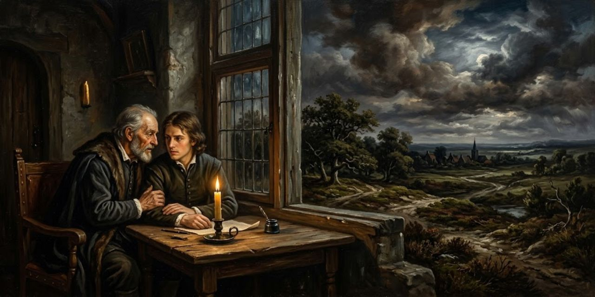](img/261017_rey-lear_i-12.jpg)

Gloucester cuenta a Edmund que le prohibieron socorrer al rey.

Decide desobedecer:

> Lo buscaré y lo socorreré a escondidas.
>
> <small>[Frase 1906](#original-1906)</small>

Gloucester

Edmund, solo, se prepara para delatarlo: el joven sube cuando el viejo cae.

---

## Acto III, escena 4

[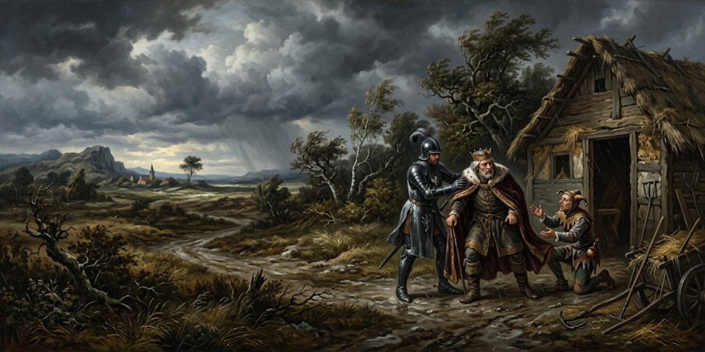](img/261017_rey-lear_i-13.jpg)

Kent lleva a Lear al cobertizo, pero él no quiere entrar: su mente tormentosa no siente el frío. Piensa en la ingratitud de sus hijas, y se frena:

> Oh, por ahí yace la locura.
>
> <small>[Frase 1950](#original-1950)</small>

Lear

Entra al fin, pero manda pasar primero al Bufón. Ora por los pobres desnudos que soportan la tormenta:

> ¡Oh, me he cuidado demasiado poco de esto!
>
> <small>[Frase 1965](#original-1965)</small>

Lear

Se examina y concluye que los poderosos deben sentir lo que sienten los miserables. Sale un mendigo loco del cobertizo: es Edgar, como Tom. Lear le pregunta si les dio todo a sus hijas, ve en él al hombre sin préstamos y empieza a desvestirse.

Llega Gloucester con una antorcha y no cree la compañía del rey. Y desobedece:

> Mi deber no puede sufrir obedecer en todo los duros mandatos de vuestras hijas.
>
> <small>[Frase 2091](#original-2091)</small>

Gloucester

Cuenta que desobedeció las órdenes y salió a buscarlo. Lear solo quiere hablar con su filósofo, Tom. Kent pide a Gloucester que insista. Gloucester dice:

> Dices que el Rey enloquece; te diré, amigo, que yo mismo estoy casi loco.
>
> <small>[Frase 2117](#original-2117)</small>

Gloucester

Su hijo buscó su vida hace poco. Entran todos al cobertizo, y Tom se queda cantando.

---

## Acto III, escena 5

[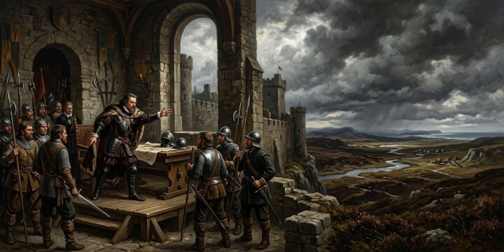](img/261017_rey-lear_i-14.jpg)

Cornwall quiere vengarse de Gloucester, y Edmund le sigue el juego:

> ¡Cuán maliciosa es mi fortuna, que debo arrepentirme de ser justo!
>
> <small>[Frase 2171](#original-2171)</small>

Edmund

Edmund entrega la carta de su padre. Cornwall lo hace conde de Gloucester.

---

## Acto III, escena 6

[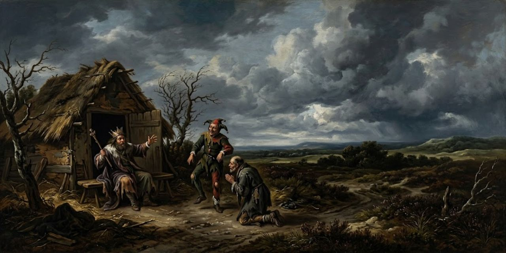](img/261017_rey-lear_i-15.jpg)

Bajo techo, Tom habla con su demonio. El Bufón pregunta si el loco es caballero o villano, y suelta su sabiduría:

> Está loco quien confía en la mansedumbre de un lobo, la salud de un caballo, el amor de un muchacho o el juramento de una puta.
>
> <small>[Frase 2214](#original-2214)</small>

Bufón

Lear juzga a sus hijas: el tribunal es Tom y el Bufón, y las reas, dos taburetes. Acusa a Goneril. El Bufón cita a la primera rea:

> Ven aquí, señora.
>
> <small>[Frase 2261](#original-2261)</small>

Bufón

Lear la reconoce, pide que no escape la otra y que abran a Regan para ver qué endurece los corazones. Toma a Tom por uno de sus cien.

Al fin se duerme. Gloucester vuelve: hay una trama de muerte contra el rey y una litera para llevarlo a Dover. Kent responde:

> Aquí, señor, pero no lo turbéis; sus sesos se han ido.
>
> <small>[Frase 2315](#original-2315)</small>

Kent

Lo suben a la litera. Edgar, solo, dice que su dolor pesa menos si el rey carga con el suyo, y que debe esconderse.

---

## Acto III, escena 7

[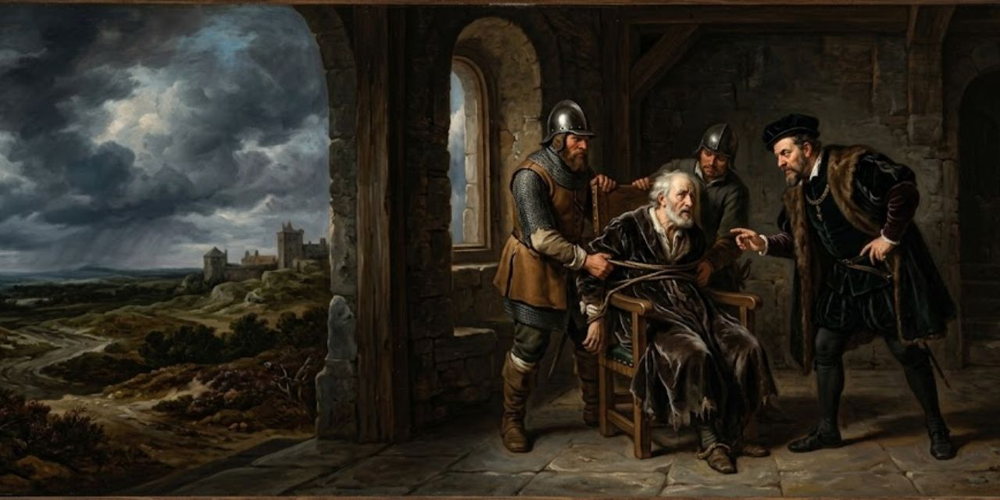](img/261017_rey-lear_i-16.jpg)

Cornwall manda aviso a Albany de que Francia desembarcó. Goneril pide sacar los ojos a Gloucester, a quien traen atado. Él apela a la hospitalidad:

> Mis buenos amigos, considerad: sois mis huéspedes; no me hagáis juego sucio, amigos.
>
> <small>[Frase 2393](#original-2393)</small>

Gloucester

Cornwall lo manda atar; Regan le arranca la barba. Le preguntan por la carta y el rey. Gloucester responde como un oso atado al poste:

> Estoy atado al poste, y debo aguantar el asalto.
>
> <small>[Frase 2440](#original-2440)</small>

Gloucester

Dice que no quiso ver sus uñas sobre el rey, y que verá la venganza. Cornwall le pisa un ojo. Un criado se interpone y Regan lo mata. Moribundo, dice:

> Mi señor, os queda un ojo para ver algún daño sobre él.
>
> <small>[Frase 2483](#original-2483)</small>

⌜ First ⌝ Servant

Cornwall le saca el otro ojo. Regan le dice a Gloucester que fue Edmund quien lo delató; Gloucester entiende que Edgar fue calumniado, y lo echan. Cornwall sale herido. Los criados dicen:

> Nunca me cuidaré de qué maldad haga si este hombre llega a buen fin.
>
> <small>[Frase 2518](#original-2518)</small>

⌜ Second ⌝ Servant

Deciden seguir a Gloucester y buscar al loco de Bedlam.

---

## Acto IV, escena 1

[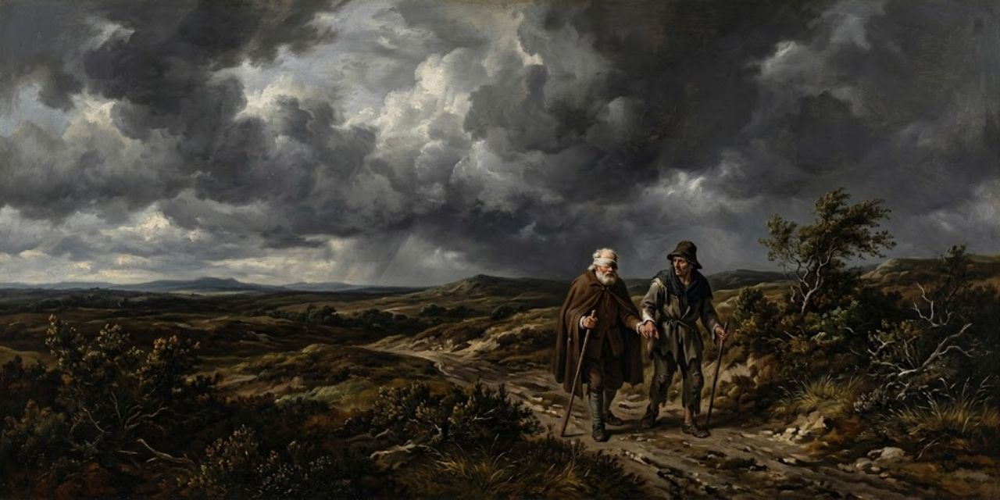](img/261017_rey-lear_i-17.jpg)

Edgar, solo, se consuela: lo peor aún permite esperanza. Entra su padre, ciego, con un anciano.

Gloucester despide al anciano y dice que tropezó cuando veía. Sin saber que Edgar oye, confiesa:

> ¡Oh querido hijo Edgar, alimento de la ira de tu padre engañado! Si pudiera vivir para verte con mi tacto, diría que tengo ojos otra vez.
>
> <small>[Frase 2554](#original-2554)</small>

Gloucester

Edgar descubre que aún no está en lo peor. Gloucester ve al loco y manda al anciano por ropa.

Edgar no soporta fingir ante su padre ciego, y se le escapa:

> —Benditos sean tus dulces ojos, sangran.
>
> <small>[Frase 2613](#original-2613)</small>

Edgar

Gloucester le da su bolso y pide justicia para los pobres. Pide que lo lleve a Dover. Edgar le ofrece el brazo:

> Dame el brazo.
>
> <small>[Frase 2637](#original-2637)</small>

Edgar

El hijo guía al padre sin que lo sepa.

---

## Acto IV, escena 2

[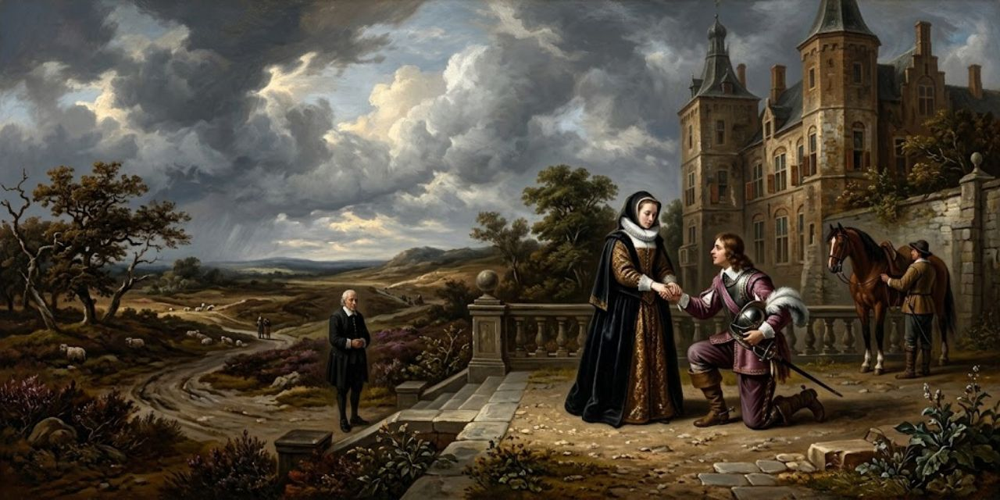](img/261017_rey-lear_i-18.jpg)

Ante el palacio de Albany, Goneril se despide de Edmund con un beso y un favor. Oswald cuenta que Albany sonrió ante la noticia de la invasión. Goneril, sola, se queja de su marido:

> A ti se deben los servicios de una mujer; mi bufón usurpa mi cuerpo.
>
> <small>[Frase 2676](#original-2676)</small>

Goneril

Llega Albany, ya sin dulzura, y le dice que es una tigresa que ha enloquecido a un padre. Goneril se burla de su cobardía. Albany la llama demonio, y al límite:

> Por más demonio que seas, la forma de mujer te escuda.
>
> <small>[Frase 2712](#original-2712)</small>

Albany

Solo la forma de mujer la protege. Llega la noticia: Cornwall murió a manos de un criado cuando sacaba el otro ojo a Gloucester. Albany pregunta:

> Ambos, ambos, mi señor.
>
> <small>[Frase 2728](#original-2728)</small>

Mensajero

Goneril calcula: viuda, podría quedarse con Edmund. Albany sabe que Edmund denunció a Gloucester, y jura vengar sus ojos.

---

## Acto IV, escena 3

[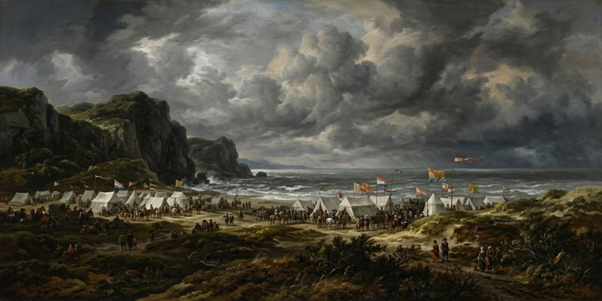](img/261017_rey-lear_i-19.jpg)

En el campamento francés, Kent pregunta por qué partió el rey. Un caballero cuenta cómo Cordelia leyó las cartas:

Dijo el nombre de su padre, y se quejó de sus hermanas:

> ¡Que la piedad no sea creída!
>
> <small>[Frase 2787](#original-2787)</small>

Caballero

Kent atribuye la diferencia entre hermanas a las estrellas. Lear está cerca, pero la vergüenza le impide ver a Cordelia. Kent irá, aunque se ocultará un tiempo:

> Cuando sea conocido rectamente, no os dolerá haberme prestado este trato.
>
> <small>[Frase 2816](#original-2816)</small>

Kent

Se van juntos.

---

## Acto IV, escena 4

[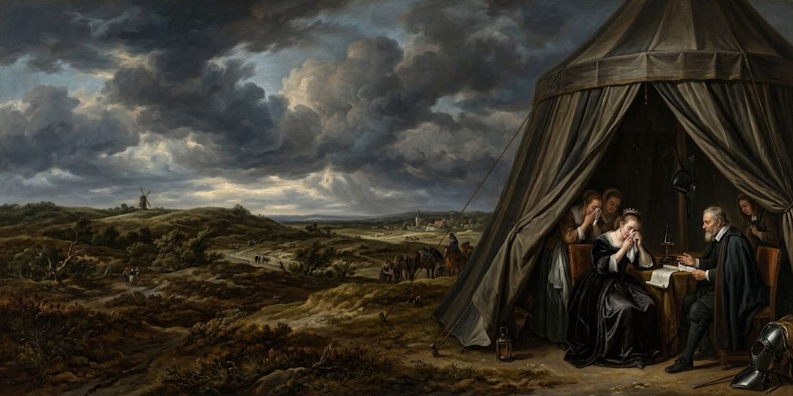](img/261017_rey-lear_i-20.jpg)

Cordelia manda buscar a su padre, loco, y pide al médico que lo cure. Reza:

> Buscadlo, buscadlo, no sea que su rabia ingobernable disuelva la vida que carece de medios para guiarla.
>
> <small>[Frase 2836](#original-2836)</small>

Cordelia

Llega el ejército inglés. Cordelia dice que lucha por amor a su padre.

---

## Acto IV, escena 5

[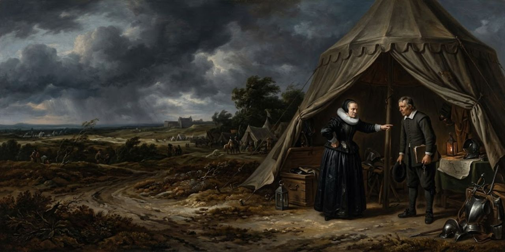](img/261017_rey-lear_i-21.jpg)

Regan interroga a Oswald, que lleva una carta de Goneril para Edmund, y pregunta por qué le escribe:

> ¿No podrías tú transportar sus propósitos de palabra?
>
> <small>[Frase 2884](#original-2884)</small>

Regan

Oswald no cede, y Regan dice que sabe que Goneril quiere a Edmund. Le da un mensaje: ella es viuda y le conviene más. Oswald asiente.

---

## Acto IV, escena 6

[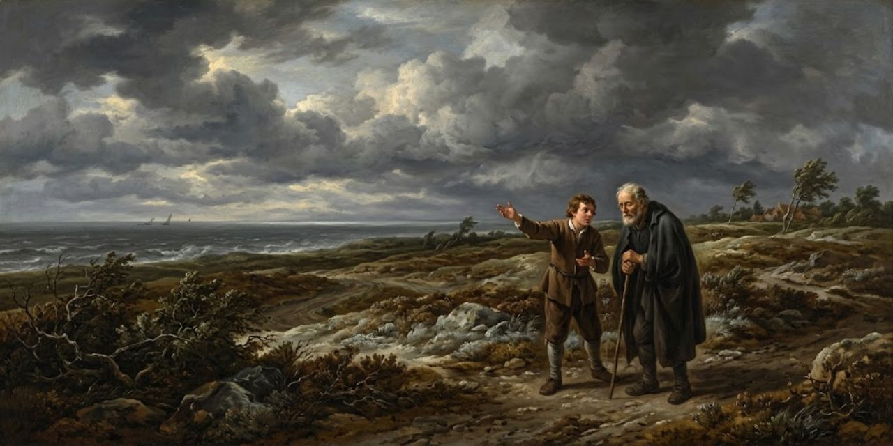](img/261017_rey-lear_i-22.jpg)

En el campo, camino de Dover, Edgar engaña a su padre ciego y lo lleva a un llano que presenta como un precipicio. Pinta el vértigo:

> ¡Qué espantoso y vertiginoso es echar los ojos tan abajo!
>
> <small>[Frase 2935](#original-2935)</small>

Edgar

Describe cuervos como escarabajos, pescadores como ratones y un barco como boya. Gloucester deja otro bolso, se despide del mundo y se arroja, pero cae en el llano.

Edgar lo levanta con una mentira piadosa: cayó de una altura enorme y vivió por milagro, y en la cima había un demonio. Gloucester lo acepta:

> De aquí en adelante soportaré la aflicción hasta que ella misma grite «¡Basta, basta!
>
> <small>[Frase 3020](#original-3020)</small>

Gloucester

Llega Lear, loco y coronado de hierbas, que dice ser el rey y reparte dinero de recluta. Gloucester reconoce su voz. Lear indulta al adúltero y se burla de la ley; dice que ve el mundo sin ojos, con el tacto.

Lear predica que un juez y un ladrón se confunden, que a un perro se le obedece en el cargo y que el oro esconde el pecado. Edgar ve razón en la locura, y Lear reconoce a Gloucester:

> Si quieres llorar mis fortunas, toma mis ojos.
>
> <small>[Frase 3151](#original-3151)</small>

Lear

Dice que venimos llorando al mundo. Trama herrar de fieltro a los caballos y matar a sus yernos. Llegan los criados de Cordelia, y él huye gritando que es rey. Un caballero lo ve irse:

> Un espectáculo dignísimo de lástima en el más ruin de los miserables; indecible en un rey.
>
> <small>[Frase 3196](#original-3196)</small>

Caballero

Es una vista digna de lástima, pero tiene una hija que redime a las otras dos. Hay batalla cercana. Gloucester pide morir y Edgar se presenta como un pobre hombre.

Entra Oswald con el pregón: hay premio por la cabeza de Gloucester. Edgar se interpone, fingiendo acento de campesino:

> No, no te acerques al viejo.
>
> <small>[Frase 3255](#original-3255)</small>

Edgar

Pelean, Oswald cae y pide que lleven sus cartas a Edmund. Edgar dice:

> Te conozco bien: un villano servicial, tan obediente a los vicios de tu señora como la maldad desearía.
>
> <small>[Frase 3274](#original-3274)</small>

Edgar

Registra sus bolsillos y lee la carta de Goneril, que pide a Edmund matar a Albany. Edgar la guardará. Gloucester envidia la locura del rey, y Edgar lo lleva con un amigo.

---

## Acto IV, escena 7

[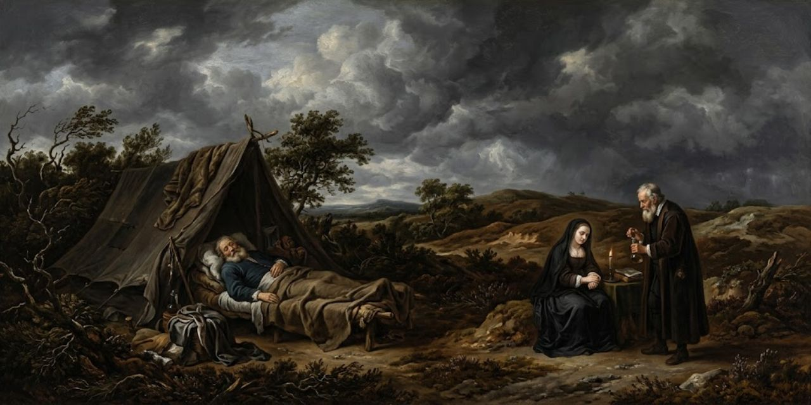](img/261017_rey-lear_i-23.jpg)

En el campamento francés, Cordelia agradece a Kent, que pide seguir sin ser conocido. El rey duerme. Cordelia reza:

> ¡Oh, dioses bondadosos, curad esta gran brecha en su abusada naturaleza!
>
> <small>[Frase 3331](#original-3331)</small>

Cordelia

El médico manda tocar música y Cordelia besa al durmiente. Lear despierta, cree que ella es un espíritu y que él está en una rueda de fuego. Vuelve en sí:

> Estoy poderosamente confundido; hasta moriría de piedad por ver a otro así.
>
> <small>[Frase 3390](#original-3390)</small>

Lear

Teme no estar en su juicio y por fin reconoce a Cordelia. Dice que ella tendría motivo para no amarlo. El médico advierte que no hay que hacerle repasar el tiempo perdido, y Lear pide perdón por viejo y necio.

Kent y un caballero hablan de la muerte de Cornwall y de la batalla que se acerca, que será sangrienta. Kent cierra el acto:

> Mi punto y mi fin serán cumplidos del todo, bien o mal, según se libre la batalla de este día.
>
> <small>[Frase 3452](#original-3452)</small>

Kent

---

## Acto V, escena 1

[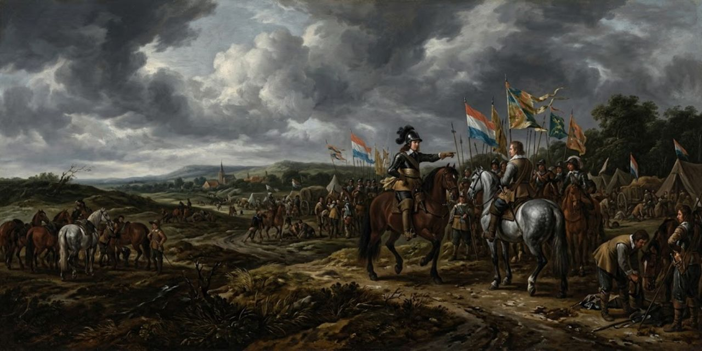](img/261017_rey-lear_i-24.jpg)

Edmund manda saber si Albany mantiene su propósito. Regan le pregunta si ama a su hermana:

> Mi querido señor, no seáis familiar con ella.
>
> <small>[Frase 3482](#original-3482)</small>

Regan

Goneril prefiere perder la batalla a perder a Edmund. Albany pelea contra Francia, no a favor del rey.

Edgar, encapuchado, entrega a Albany una carta: si gana, un campeón lo probará. Albany quiere retenerlo:

> Cuando el tiempo sirva, que solo grite el heraldo y apareceré de nuevo.
>
> <small>[Frase 3538](#original-3538)</small>

Edgar

Edmund, solo, duda entre las dos hermanas, a las que ha jurado amor. Decide:

> Ahora, pues, usaremos su apoyo para la batalla, la cual, una vez hecha, que la que quiera librarse de él maquine su pronta eliminación.
>
> <small>[Frase 3561](#original-3561)</small>

Edmund

Usará a ambas en la batalla y matará a la que estorbe.

---

## Acto V, escena 2

[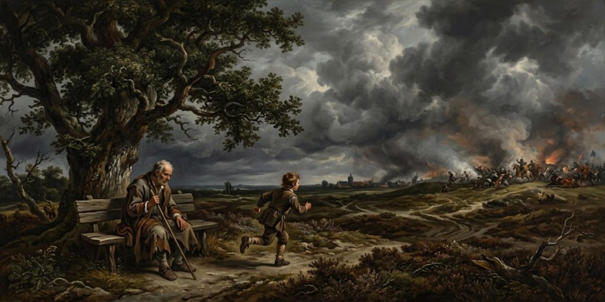](img/261017_rey-lear_i-25.jpg)

Edgar vuelve y dice:

> Dame la mano.
>
> <small>[Frase 3577](#original-3577)</small>

Edgar

Gloucester no quiere seguir, y Edgar dice:

---

## Acto V, escena 3

[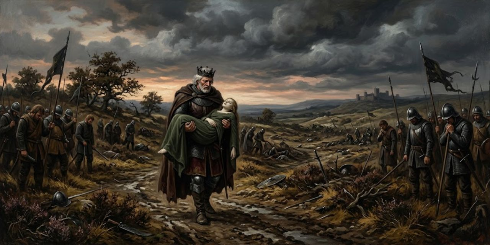](img/261017_rey-lear_i-26.jpg)

Los prisioneros salen bajo guardia. Cordelia se consuela; Lear propone ir juntos a la prisión:

> Cuando tú me pidas la bendición, me arrodillaré y te pediré perdón.
>
> <small>[Frase 3609](#original-3609)</small>

Lear

Allí vivirán rezando, cantando y contando cuentos, como espías de Dios. Edmund da en voz baja una orden secreta a un capitán.

Albany pide a los prisioneros y rebaja a Edmund. Regan y Goneril se lo disputan. Albany arresta a Edmund por traición y desafía a quien quiera probar lo contrario. Regan se siente enferma. A la tercera trompeta entra un caballero armado y reta:

> Di "no": esta espada, este brazo y mis mejores bríos están inclinados a probar sobre tu corazón, a lo cual hablo, que mientes.
>
> <small>[Frase 3772](#original-3772)</small>

Edgar

Edmund responde al reto, pelean y cae. Goneril grita que fue un engaño; Albany le muestra su carta y ella sale. Edmund confiesa, y Edgar se da a conocer como su hermano. Edmund dice que la rueda ha dado la vuelta.

Edgar cuenta que huyó disfrazado de loco, guió a su padre y solo se reveló hace poco, y que el padre murió entre alegría y pena. Luego llegó Kent, que había servido en secreto al rey. A Edmund le llega algo:

> Este vuestro discurso me ha conmovido, y quizá haga bien.
>
> <small>[Frase 3842](#original-3842)</small>

Edmund

Entra un caballero con un cuchillo humeante: Goneril envenenó a Regan y se mató. Llega Kent, a dar las buenas noches a su rey. Edmund quiere hacer algo bueno:

> Algún bien pretendo hacer a despecho de mi propia naturaleza.
>
> <small>[Frase 3909](#original-3909)</small>

Edmund

Que corran al castillo: ordenó ahorcar a Cordelia en la prisión y echar la culpa a su desesperación.

Es tarde. Entra Lear con Cordelia muerta en brazos, aullando. Pide un espejo y cree ver que respira. Espanta a quienes se acercan y dice que mató al que la ahorcaba.

Kent se nombra:

> Si la Fortuna se jacta de dos a quienes amó y odió, a uno de ellos lo contemplamos.
>
> <small>[Frase 3980](#original-3980)</small>

Kent

Lear no lo reconoce bien. Kent le dice que sus hijas mayores murieron. Albany devuelve el poder al rey, y Lear dice:

Habla del Bufón ahorcado y repite que Cordelia no volverá. Pide que le desabrochen un botón, mira sus labios y se desmaya. Kent reza:

> No atormentéis su fantasma.
>
> <small>[Frase 4037](#original-4037)</small>

Kent

Lear muere. Albany pide a Kent y Edgar que gobiernen, y Kent dice que su amo lo llama. Edgar cierra la obra:

> El peso de este triste tiempo debemos obedecer, hablar lo que sentimos, no lo que deberíamos decir.
>
> <small>[Frase 4054](#original-4054)</small>

Edgar

Los jóvenes no verán tanto ni vivirán tanto.

---

## Los Originales

Esta sección reúne, en el idioma del libro y por orden de aparición, las frases que arriba van en castellano. El número de cada una lleva de vuelta a su lugar en la lectura.

> <small>[Frase 47](#lugar-47)</small>
>
> Meantime we shall express our darker purpose.

> <small>[Frase 56](#lugar-56)</small>
>
> Sir, I love you more than word can wield the matter, Dearer than eyesight, space, and liberty, Beyond what can be valued, rich or rare, No less than life, with grace, health, beauty, honor; As much as child e’er loved, or father found; A love that makes breath poor, and speech unable.

> <small>[Frase 95](#lugar-95)</small>
>
> Good my lord, You have begot me, bred me, loved me.

> <small>[Frase 141](#lugar-141)</small>
>
> To plainness honor’s bound When majesty falls to folly.

> <small>[Frase 210](#lugar-210)</small>
>
> Better thou Hadst not been born than not t’ have pleased me better.

> <small>[Frase 287](#lugar-287)</small>
>
> We must do something, and i’ th’ heat.

> <small>[Frase 294](#lugar-294)</small>
>
> Wherefore should I Stand in the plague of custom, and permit The curiosity of nations to deprive me For that I am some twelve or fourteen moonshines Lag of a brother?

> <small>[Frase 367](#lugar-367)</small>
>
> It is his hand, my lord, but I hope his heart is not in the contents.

> <small>[Frase 406](#lugar-406)</small>
>
> Love cools, friendship falls off, brothers divide; in cities, mutinies; in countries, discord; in palaces, treason; and the bond cracked ’twixt son and father.

> <small>[Frase 426](#lugar-426)</small>
>
> My cue is villainous melancholy, with a sigh like Tom o’ Bedlam.

> <small>[Frase 488](#lugar-488)</small>
>
> I’ll not endure it.

> <small>[Frase 501](#lugar-501)</small>
>
> Idle old man That still would manage those authorities That he hath given away.

> <small>[Frase 537](#lugar-537)</small>
>
> If thou be’st as poor for a subject as he’s for a king, thou art poor enough.

> <small>[Frase 722](#lugar-722)</small>
>
> All thy other titles thou hast given away.

> <small>[Frase 819](#lugar-819)</small>
>
> Degenerate bastard, I’ll not trouble thee.

> <small>[Frase 873](#lugar-873)</small>
>
> Th’ untented woundings of a father’s curse Pierce every sense about thee!

> <small>[Frases 898–899](#lugar-898)</small>
>
> ’Tis politic and safe to let him keep At point a hundred knights!

> <small>[Frase 988](#lugar-988)</small>
>
> If thou wert my Fool, nuncle, I’d have thee beaten for being old before thy time.

> <small>[Frase 1054](#lugar-1054)</small>
>
> In cunning I must draw my sword upon you.

> <small>[Frase 1094](#lugar-1094)</small>
>
> Not in this land shall he remain uncaught, And found—dispatch.

> <small>[Frase 1158](#lugar-1158)</small>
>
> I shall serve you, sir, Truly, however else.

> <small>[Frase 1196](#lugar-1196)</small>
>
> Fellow, I know thee.

> <small>[Frase 1300](#lugar-1300)</small>
>
> Sir, ’tis my occupation to be plain: I have seen better faces in my time Than stands on any shoulder that I see Before me at this instant.

> <small>[Frase 1338](#lugar-1338)</small>
>
> Why, madam, if I were your father’s dog, You should not use me so.

> <small>[Frase 1389](#lugar-1389)</small>
>
> Whiles I may ’scape, I will preserve myself, and am bethought To take the basest and most poorest shape That ever penury in contempt of man Brought near to beast.

> <small>[Frase 1435](#lugar-1435)</small>
>
> ’Tis worse than murder To do upon respect such violent outrage.

> <small>[Frase 1564](#lugar-1564)</small>
>
> O sir, you are old.

> <small>[Frase 1603](#lugar-1603)</small>
>
> Good sir, to th’ purpose.

> <small>[Frase 1660](#lugar-1660)</small>
>
> I prithee, daughter, do not make me mad.

> <small>[Frase 1722](#lugar-1722)</small>
>
> You see me here, you gods, a poor old man As full of grief as age, wretched in both.

> <small>[Frase 1813](#lugar-1813)</small>
>
> Few words, but, to effect, more than all yet: That when we have found the King—in which your pain That way, I’ll this—he that first lights on him Holla the other.

> <small>[Frase 1837](#lugar-1837)</small>
>
> Here I stand your slave, A poor, infirm, weak, and despised old man.

> <small>[Frase 1860](#lugar-1860)</small>
>
> Let the great gods That keep this dreadful pudder o’er our heads Find out their enemies now.

> <small>[Frase 1880](#lugar-1880)</small>
>
> — Poor Fool and knave, I have one part in my heart That’s sorry yet for thee.

> <small>[Frase 1906](#lugar-1906)</small>
>
> I will look him and privily relieve him.

> <small>[Frase 1950](#lugar-1950)</small>
>
> O, that way madness lies.

> <small>[Frase 1965](#lugar-1965)</small>
>
> O, I have ta’en Too little care of this.

> <small>[Frase 2091](#lugar-2091)</small>
>
> My duty cannot suffer T’ obey in all your daughters’ hard commands.

> <small>[Frase 2117](#lugar-2117)</small>
>
> Thou sayest the King grows mad; I’ll tell thee, friend, I am almost mad myself.

> <small>[Frase 2171](#lugar-2171)</small>
>
> How malicious is my fortune that I must repent to be just!

> <small>[Frase 2214](#lugar-2214)</small>
>
> He’s mad that trusts in the tameness of a wolf, a horse’s health, a boy’s love, or a whore’s oath.

> <small>[Frase 2261](#lugar-2261)</small>
>
> Come hither, mistress.

> <small>[Frase 2315](#lugar-2315)</small>
>
> Here, sir, but trouble him not; his wits are gone.

> <small>[Frase 2393](#lugar-2393)</small>
>
> Good my friends, consider You are my guests; do me no foul play, friends.

> <small>[Frase 2440](#lugar-2440)</small>
>
> I am tied to th’ stake, and I must stand the course.

> <small>[Frase 2483](#lugar-2483)</small>
>
> My lord, you have one eye left To see some mischief on him.

> <small>[Frase 2518](#lugar-2518)</small>
>
> I’ll never care what wickedness I do If this man come to good.

> <small>[Frase 2554](#lugar-2554)</small>
>
> O dear son Edgar, The food of thy abusèd father’s wrath, Might I but live to see thee in my touch, I’d say I had eyes again.

> <small>[Frase 2613](#lugar-2613)</small>
>
> —Bless thy sweet eyes, they bleed.

> <small>[Frase 2637](#lugar-2637)</small>
>
> Give me thy arm.

> <small>[Frase 2676](#lugar-2676)</small>
>
> To thee a woman’s services are due; My fool usurps my body.

> <small>[Frase 2712](#lugar-2712)</small>
>
> Howe’er thou art a fiend, A woman’s shape doth shield thee.

> <small>[Frase 2728](#lugar-2728)</small>
>
> Both, both, my lord.

> <small>[Frase 2787](#lugar-2787)</small>
>
> Let pity not be believed!

> <small>[Frase 2816](#lugar-2816)</small>
>
> When I am known aright, you shall not grieve Lending me this acquaintance.

> <small>[Frase 2836](#lugar-2836)</small>
>
> Seek, seek for him, Lest his ungoverned rage dissolve the life That wants the means to lead it.

> <small>[Frase 2884](#lugar-2884)</small>
>
> Might not you Transport her purposes by word?

> <small>[Frase 2935](#lugar-2935)</small>
>
> How fearful And dizzy ’tis to cast one’s eyes so low!

> <small>[Frase 3020](#lugar-3020)</small>
>
> Henceforth I’ll bear Affliction till it do cry out itself “Enough, enough!

> <small>[Frase 3151](#lugar-3151)</small>
>
> If thou wilt weep my fortunes, take my eyes.

> <small>[Frase 3196](#lugar-3196)</small>
>
> A sight most pitiful in the meanest wretch, Past speaking of in a king.

> <small>[Frase 3255](#lugar-3255)</small>
>
> Nay, come not near th’ old man.

> <small>[Frase 3274](#lugar-3274)</small>
>
> I know thee well, a serviceable villain, As duteous to the vices of thy mistress As badness would desire.

> <small>[Frase 3331](#lugar-3331)</small>
>
> O, you kind gods, Cure this great breach in his abusèd nature!

> <small>[Frase 3390](#lugar-3390)</small>
>
> I am mightily abused; I should e’en die with pity To see another thus.

> <small>[Frase 3452](#lugar-3452)</small>
>
> My point and period will be throughly wrought, Or well, or ill, as this day’s battle’s fought.

> <small>[Frase 3482](#lugar-3482)</small>
>
> Dear my lord, Be not familiar with her.

> <small>[Frase 3538](#lugar-3538)</small>
>
> When time shall serve, let but the herald cry And I’ll appear again.

> <small>[Frase 3561](#lugar-3561)</small>
>
> Now, then, we’ll use His countenance for the battle, which, being done, Let her who would be rid of him devise His speedy taking off.

> <small>[Frase 3577](#lugar-3577)</small>
>
> Give me thy hand.

> <small>[Frase 3609](#lugar-3609)</small>
>
> When thou dost ask me blessing, I’ll kneel down And ask of thee forgiveness.

> <small>[Frase 3772](#lugar-3772)</small>
>
> Say thou “no,” This sword, this arm, and my best spirits are bent To prove upon thy heart, whereto I speak, Thou liest.

> <small>[Frase 3842](#lugar-3842)</small>
>
> This speech of yours hath moved me, And shall perchance do good.

> <small>[Frase 3909](#lugar-3909)</small>
>
> Some good I mean to do Despite of mine own nature.

> <small>[Frase 3980](#lugar-3980)</small>
>
> If Fortune brag of two she loved and hated, One of them we behold.

> <small>[Frase 4037](#lugar-4037)</small>
>
> Vex not his ghost.

> <small>[Frase 4054](#lugar-4054)</small>
>
> The weight of this sad time we must obey, Speak what we feel, not what we ought to say.

© 2026 Osmancito
