# Mientras Escribo II

23 de octubre de 2026

Mientras Escribo II sigue a Mientras Escribo I, la primera parte del libro de Stephen King sobre el oficio de escribir, On Writing. Empieza donde la otra termina, en «What Writing Is» («Qué Es Escribir»), y recorre «Toolbox» («Caja de Herramientas»), «On Writing» («Mientras Escribo»), «On Living» («Sobre Vivir») y «And Furthermore» («Y Además»), que trae un ejemplo de edición y una lista de libros.

---

## Qué es escribir

### El conejo del ocho

[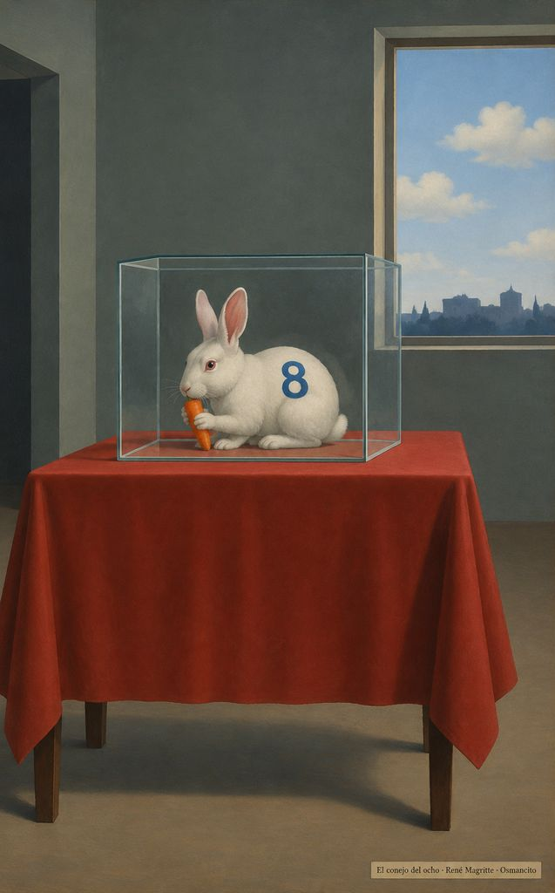](../img/261017_mientras-escribo_el-conejo-del-ocho.jpg)

¿Qué es escribir? Telepatía, por supuesto. Llevan años investigadores como el parapsicólogo J. B. Rhine intentando aislarla en pruebas, y todo el tiempo ha estado a la vista, como la carta robada del relato de Edgar Allan Poe. King redacta esta parte una mañana nevada de diciembre de 1997, en el escritorio bajo el alero: arriba, preocupaciones y alegrías; abajo, un lugar-sótano de luces brillantes, su lugar de visión lejana, que cada cual puede poner en una copa de árbol o en el tejado del World Trade Center.

> Este libro está previsto que se publique a finales del verano o principios del otoño de 2000. Si las cosas salen así, entonces usted está en algún punto río abajo de mí en la línea del tiempo... pero es muy probable que esté en su propio lugar de visión lejana, aquel adonde va a recibir mensajes telepáticos. No es que *tenga* que estar ahí; los libros son una magia singularmente portátil. Yo suelo escuchar uno en el coche (siempre sin abreviar; creo que los audiolibros abreviados son una porquería), y llevo otro dondequiera que voy. Nunca se sabe cuándo se necesitará una escotilla de escape: colas kilométricas en las plazas de peaje, los quince minutos que hay que pasar en el pasillo de algún aburrido edificio universitario esperando a que su tutor (que tiene ahí dentro a algún pesado amenazando con suicidarse porque suspende Kurmfurling Aplicado 101) salga para firmarle la baja de una asignatura, las salas de embarque de los aeropuertos, las lavanderías automáticas en las tardes de lluvia y, el peor de todos, el consultorio del médico cuando el tipo va con retraso y usted tiene que esperar media hora para que le magullen algo sensible. En esos momentos un libro me resulta vital. Si tengo que pasar un tiempo en el purgatorio antes de ir a un sitio o a otro, supongo que estaré bien mientras haya una biblioteca pública (si la hay, probablemente estará provista solo de novelas de Danielle Steel y libros de *Chicken Soup*, ja, ja, la broma le toca a usted, Steve).
> [Párrafo 3](#original-q-p3)

Danielle Steel es la novelista romántica más vendida del mundo, y *Chicken Soup* (*Sopa de pollo para el alma*), una serie de antologías de relatos edificantes: el purgatorio de King es una biblioteca provista solo de eso. El lugar de visión lejana del apartado anterior puede estar hasta en el tejado del World Trade Center: las torres neoyorquinas aún existían cuando King escribió esta parte, en 1997. Y el «usted» del pasaje era el lector del año 2000; el de hoy lee mucho más río abajo, y el truco sigue funcionando, que es lo que el apartado se propone demostrar.

Todos tenemos un lugar favorito de recepción; el de King es el sillón azul de su estudio. Si aún leemos a Dickens, a Shakespeare y, con notas, al griego Heródoto, el salto de 1997 a 2000 es manejable. Telepatía en acción: una mesa con un mantel rojo; sobre ella, una jaula del tamaño de una pecera pequeña; dentro, un conejo blanco que mordisquea un resto de zanahoria; en su lomo, en tinta azul, el número 8.

> ¿Vemos lo mismo? Tendríamos que juntarnos y comparar notas para estar absolutamente seguros, pero creo que sí. Habrá variaciones necesarias, por supuesto: algunos receptores verán un mantel rojo turco, otros verán uno escarlata, y otros verán matices aún otros. (Para los receptores daltónicos, el mantel rojo es el gris oscuro de la ceniza de un puro.) Algunos verán bordes festoneados, otros verán bordes rectos. Las almas decorativas pueden añadir un poco de encaje, y bienvenido sea: mi mantel es su mantel, dese un gustazo.
> [Párrafo 7](#original-q-p7)

El experimento solo funciona si el receptor aporta: el escritor da «mantel rojo» y el lector pone el tono exacto, los festones y el encaje. Es la primera mitad de la lección técnica del apartado: describir es repartir trabajo, no acapararlo.

> Lo mismo ocurre con la jaula, que deja bastante margen a la interpretación individual. Para empezar, está descrita en términos de *comparación aproximada*, que solo sirve si usted y yo vemos el mundo y medimos las cosas en él con ojos parecidos. Es fácil descuidarse haciendo comparaciones aproximadas, pero la alternativa es una atención remilgada al detalle que le quita toda la gracia a escribir. ¿Qué voy a decir, «sobre la mesa hay una jaula de tres pies y seis pulgadas de largo, dos pies de ancho y catorce pulgadas de alto»? Eso no es prosa, es un manual de instrucciones. El párrafo tampoco nos dice de qué material está hecha la jaula (¿malla de alambre?, ¿barras de acero?, ¿vidrio?), pero ¿de verdad importa? Todos entendemos que la jaula es un medio transparente; más allá de eso, no nos importa. Lo más interesante aquí ni siquiera es el conejo que mordisquea la zanahoria en la jaula, sino el número de su lomo. No un seis, no un cuatro, no un diecinueve coma cinco. Es un ocho. Esto es lo que estamos mirando, y todos lo vemos. Yo no se lo dije. Usted no me lo preguntó. Yo nunca abrí la boca y usted nunca abrió la suya. Ni siquiera estamos juntos en el mismo *año*, y no digamos en la misma habitación... excepto que *sí* estamos juntos. Estamos cerca.
> [Párrafo 8](#original-q-p8)

El conejo del ocho da título a el apartado y es la demostración completa de su tesis: un número en tinta azul transmitido de una mente a otra con años de distancia. La moraleja técnica es doble: la comparación aproximada basta cuando emisor y receptor comparten mundo, y el detalle que fija la escena es uno solo y exacto: el ocho.

Encuentro de mentes: mesa, jaula, conejo y ocho azul, enviados y recibidos. Y exige seriedad: a la página en blanco se llega nervioso o desesperado, pero nunca a la ligera; si no, cierre el libro y lávese el coche.

---

## Caja de herramientas

### T1 · La caja heredada

[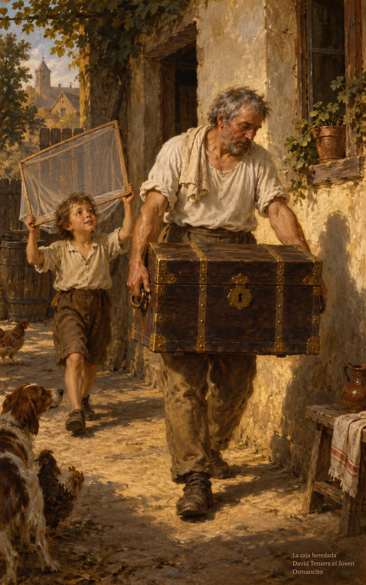](../img/261023_mientras-escribo-ii_la-caja-heredada.jpg)

Abre una estrofa del cantautor John Prine sobre su abuelo carpintero; el de King, Guy Pillsbury, también lo fue y cuidó años la finca de Winslow Homer; su caja de herramientas la heredó el tío Oren, también carpintero.

> La caja de herramientas era lo que llamábamos una de las grandes. Tenía tres niveles, los dos de arriba extraíbles, y los tres con cajoncitos tan ingeniosos como cajas chinas. Era hecha a mano, por supuesto. Tablillas de madera oscura iban unidas por clavos diminutos y tiras de latón. La tapa se sujetaba con grandes broches; a mis ojos de niño parecían los broches de la fiambrera de un gigante. Dentro de la tapa había un forro de seda, bastante raro en semejante contexto y más llamativo aún por el estampado, unas rosas repollo de un rojo rosáceo que se desvanecían en una bruma de grasa y suciedad. A los lados tenía sendas asas enormes. Créame que nunca se ha visto una caja de herramientas así a la venta en Wal-Mart ni en Western Auto. Cuando mi tío la recibió, encontró en el fondo un grabado en latón de un famoso cuadro de Homer; creo que era *The Undertow*. Años después, el tío Oren lo hizo autenticar por un experto en Homer de Nueva York, y unos años más tarde creo que lo vendió por un buen dinero. Cómo y por qué llegó Fazza a tener ese grabado es un misterio, pero no había ningún misterio sobre el origen de la caja: la hizo él mismo.
> [Párrafo 3](#original-t1-p3)

Fazza, el abuelo, se construyó la caja con sus propias manos, y eso fija la medida de la metáfora que gobierna el apartado: una caja de herramientas propia no se compra, se hace. Wal-Mart es una cadena estadounidense de grandes tiendas y Western Auto, una de repuestos de automóvil: la caja no tiene equivalente comercial. El grabado reproducía *The Undertow* (1886), cuadro del pintor Winslow Homer, dueño de la finca que el abuelo cuidaba: un pequeño tesoro escondido en el fondo de la arca familiar.

Un día de verano, de niño, King ayudó al tío Oren a cambiar una malla rota: él, con la malla nueva en la cabeza; el tío, con la caja por las asas y un Camel en el labio.

> Por fin llegamos a la ventana de la malla rota y dejó la caja en el suelo con un audible suspiro de alivio. Cuando Dave y yo intentamos levantarla de su sitio en el suelo del garaje, cada uno agarrando un asa, apenas pudimos moverla. Es cierto que entonces éramos unos críos, pero aun así yo diría que la caja de herramientas de Fazza, cargada a tope, pesaba entre ochenta y ciento veinte libras.
> [Párrafo 5](#original-t1-p5)

Ochenta a ciento veinte libras son entre treinta y seis y cincuenta y cuatro kilos: la caja exigía músculo de verdad, y ese dato físico sostiene el consejo que el apartado desarrolla después, porque una caja de herramientas que no se puede cargar pierde su principal virtud.

El niño preguntó para qué cargar la caja entera si bastaba un destornillador: mejor llevar las herramientas encima, por si aparece trabajo inesperado. Lección: constrúyase su caja, de al menos cuatro niveles, y haga músculo. Arriba van las comunes, y la más común, el pan de la escritura: el vocabulario. Algunos manejan vocabularios enormes; King cita ejemplos de H. P. Lovecraft y de T. Coraghessan Boyle, y añade un tercero:

> Alguien le arrancó la venda a la vieja y a ella y al malabarista los apartaron a golpes y cuando la compañía se retiró a dormir y el fuego bajo rugía en la ráfaga como una cosa viva aquellos cuatro seguían en cuclillas al borde de la lumbre entre sus extraños enseres y miraban cómo las llamas desharrapadas huían viento abajo como si las succionara alguna vorágine allá afuera en el vacío, algún vórtice en aquel erial frente al cual el tránsito del hombre y sus cálculos yacían por igual anulados.
> [Párrafo 23](#original-t1-p23)

Es una sola frase, de Cormac McCarthy en *Meridiano de sangre* (1985), y su fuerza está en palabras que buena parte de los lectores no usa nunca: maelstrom, vortex, apposite, abrogate. H. P. Lovecraft, citado justo antes, es el maestro del terror cósmico, y T. Coraghessan Boyle, un novelista estadounidense contemporáneo. King ofrece el párrafo como muestra de vocabulario opulento y deja caer la pregunta que el apartado contestará enseguida: ¿qué pasa cuando el lector no entiende las palabras?

Frente a ellos, otros usan vocabularios sencillos: «Llegó al río. El río estaba ahí» (Ernest Hemingway), «Esto es lo que pasó» (Douglas Fairbairn). Y esta frase de John Steinbeck en *Las uvas de la ira*, citada en inglés porque lo que sigue la analiza: «Some of the owner men were kind because they hated what they had to do, and some of them were angry because they hated to be cruel, and some of them were cold because they had long ago found that one could not be an owner unless one were cold.»

> La frase de Steinbeck es especialmente interesante. Tiene cincuenta palabras. De esas cincuenta, treinta y nueve tienen una sola sílaba. Quedan once, pero hasta ese número engaña; Steinbeck usa because tres veces, owner dos y hated dos. En toda la frase no hay ninguna palabra de más de dos sílabas. La estructura es compleja; el vocabulario no anda lejos de los viejos libritos de lectura de Dick y Jane. *Las uvas de la ira* es, por supuesto, una novela excelente. Yo creo que *Meridiano de sangre* es otra, aunque hay buenos trozos que no entiendo del todo. ¿Y qué? Tampoco descifro la letra de muchas de las canciones populares que me encantan.
> [Párrafo 34](#original-t1-p34)

La frase analizada dice, en español: «Algunos de los dueños eran amables porque odiaban lo que tenían que hacer, y algunos se enojaban porque odiaban ser crueles, y algunos eran fríos porque hacía mucho que habían descubierto que no se puede ser dueño sin ser frío.» *Las uvas de la ira* (1939) ganó el premio Pulitzer de novela. Dick y Jane protagonizaban los manuales con los que aprendieron a leer generaciones de escolares estadounidenses. El contraste con McCarthy es la lección: una estructura compleja puede salir entera de palabras de una sílaba, y entender solo a medias no invalida la lectura.

También hay vocabulario que jamás saldrá en el diccionario: réplicas callejeras de *La hoguera de las vanidades*, de Tom Wolfe («Here come Hymie!»); Elmore Leonard es otro que lo consigue.

> Ponga su vocabulario en el estante de arriba de su caja de herramientas, y no haga ningún esfuerzo consciente por mejorarlo. (Lo irá haciendo a medida que lea, por supuesto... pero eso viene después.) Una de las peores cosas que se le pueden hacer a la propia escritura es engalanar el vocabulario, buscando palabras largas porque quizá le avergüenzan un poco las cortas. Es como vestir de etiqueta a una mascota. La mascota se siente avergonzada, y la persona que cometió ese acto de monería premeditada debería estarlo aún más. Prométase ahora mismo, con toda solemnidad, que nunca usará «emolumento» cuando quiera decir «propina», y que nunca dirá **John se detuvo lo suficiente para realizar un acto de excreción** cuando quiera decir **John se detuvo lo suficiente para echar una mierda.** Si cree que su público consideraría «echar una mierda» ofensivo o inapropiado, no dude en decir **John se detuvo lo suficiente para mover el vientre** (o quizá John se detuvo lo suficiente para «empujar»). No intento que hable usted guarro, solo claro y directo. Recuerde que la regla básica del vocabulario es *use la primera palabra que le venga a la mente, si es apropiada y tiene color.* Si duda y cavilando busca otra, la encontrará, por supuesto que la encontrará, siempre hay otra palabra, pero probablemente no será tan buena como la primera, ni estará tan cerca de lo que de verdad quiere decir.
> [Párrafo 38](#original-t1-p38)

El consejo desactiva la tentación que los párrafos de Lovecraft, Boyle y McCarthy podían haber despertado: el vocabulario enorme no es una meta sino un dato, y la palabra larga elegida por vergüenza de la corta es una mascota vestida de etiqueta. La cursiva final resume la regla: primera palabra, si es apropiada y tiene color.

La palabra nunca llega del todo al significado; elegir una prima de la justa lo empeora. Y la conveniencia cuenta: como observó el humorista George Carlin, en cierta compañía está bien pincharse el dedo, pero no «finger your prick».

---

### T2 · Las montañas flotan

La gramática también va en el estante de arriba, y nada de gemidos: los principios de la lengua materna se absorben hablando y leyendo; la clase de inglés apenas les pone nombre.

> Y esto no es el instituto. Ahora que ya no le preocupa que (a) la falda le quede muy corta o muy larga y los demás se rían, (b) no entrar en el equipo de natación del colegio, (c) seguir siendo un virgen lleno de granos al graduarse (probablemente al morir, a este paso), (d) que el profesor de física no evalúe el examen final con curva, o (e) que en el fondo nadie le quiere Y NUNCA LE QUISO... ahora que toda esa mierda ajena está fuera del camino, puede estudiar ciertas materias académicas con un grado de concentración que jamás logró mientras asistía al manicomio local de los libros de texto. Y una vez que empiece, descubrirá que casi todo eso ya lo sabe; es, como dije, sobre todo cuestión de limpiar el óxido de las brocas y afilar la hoja de la sierra.
> [Párrafo 3](#original-t2-p3)

El inventario de preocupaciones adolescentes es deliberado: la gramática deja de ser asignatura temida para ser solo materia que estudiar. «Evaluar con curva» es ajustar las notas a una distribución estadística. La metáfora final enlaza con la caja de herramientas del apartado anterior: limpiar el óxido de las brocas y afilar la sierra, no comprar herramientas nuevas.

Si recuerda los accesorios de su mejor conjunto, la alineación de los Yankees o el sello de «Hang On Sloopy», de los McCoys, puede recordar la diferencia entre un gerundio y un participio. King sopesó una sección de gramática (la enseñó en el instituto), pero decidió lo mismo que William Strunk en *The Elements of Style*: quien no lo sabe, ya es tarde. Baste esto: siete partes de la oración, y la mala gramática produce frases malas; el ejemplo favorito de Strunk y White: **«Como madre de cinco, con otro en camino, mi tabla de planchar siempre está montada.»**

> Tome cualquier sustantivo, júntelo con cualquier verbo, y tiene una frase. Nunca falla. **Rocas explotan. Jane transmite. Montañas flotan.** Todas son frases perfectas. Muchos de esos pensamientos tienen poco sentido racional, pero hasta los más raros (**¡Ciruelas deifican!**) tienen un peso poético que está bien. La sencillez de la construcción sustantivo-verbo es útil; como mínimo puede servir de red de seguridad para su escritura. Strunk y White advierten contra demasiadas frases simples seguidas, pero las frases simples ofrecen un camino que seguir cuando teme perderse en las marañas de la retórica: todas esas cláusulas especificativas y explicativas, esas frases modificadoras, esos apositivos y oraciones compuestas complejas. Si empieza a asustarse ante territorio tan inexplorado (inexplorado por usted, al menos), recuerde que las rocas explotan, Jane transmite, las montañas flotan y las ciruelas deifican. La gramática no es solo un dolor de culo; es el mástil del que se agarra para poner sus pensamientos de pie y caminando. Además, todas esas frases simples le funcionaron a Hemingway, ¿no? Incluso borracho como una cuba, era un maldito genio.
> [Párrafo 11](#original-t2-p11)

La regla del sustantivo más el verbo es el fondo de la caja de herramientas: la pieza que siempre funciona y a la que se vuelve cuando la retórica se enreda. William Strunk publicó *The Elements of Style* en 1918; E. B. White, su antiguo alumno, la revisó y amplió en 1959, y desde entonces circula como «Strunk y White», el manual de estilo más famoso del inglés. La reverencia final a Hemingway enlaza con el ejemplo de vocabulario sencillo del apartado anterior: frases simples, genio intacto.

Para repasarla, busque en una librería de viejo un *Warriner's English Grammar and Composition*: casi todo cabe en las guardas.

---

### T3 · La cuerda tendida

[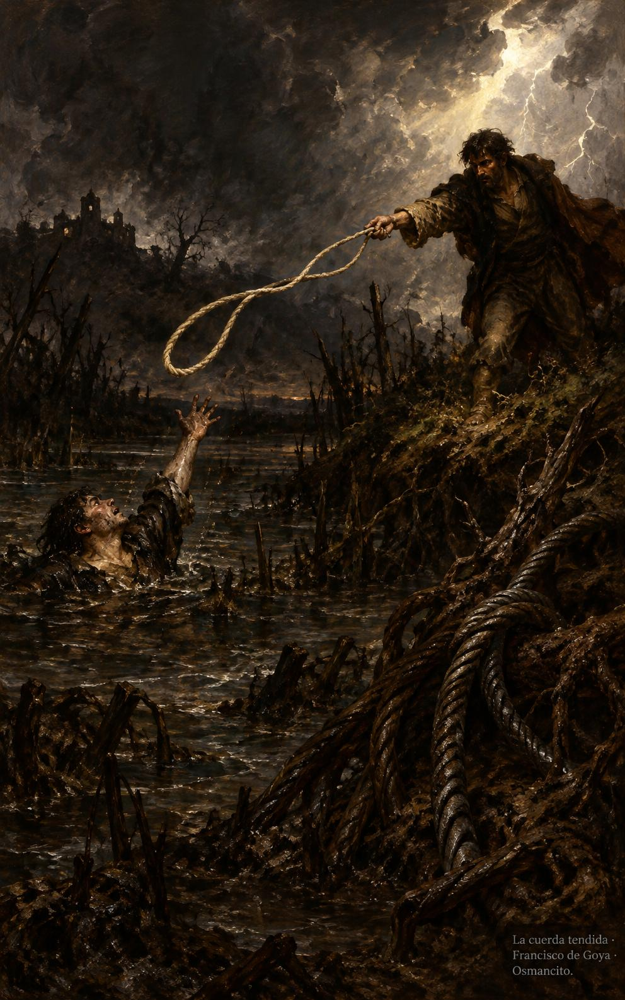](../img/261023_mientras-escribo-ii_la-cuerda-tendida.jpg)

Strunk también tenía sus manías de uso (aborrecía student body y the fact that); King tiene dos que afectan al nivel básico. La primera: los verbos son activos o pasivos; con el activo el sujeto actúa, con el pasivo algo le sucede. Evite la voz pasiva: también lo dice *The Elements of Style.*

> Los señores Strunk y White no especulan sobre por qué tantos escritores se sienten atraídos por los verbos pasivos, pero yo estoy dispuesto a hacerlo; creo que a los escritores timoratos les gustan por la misma razón por la que a los amantes timoratos les gustan las parejas pasivas. La voz pasiva es segura. No hay ninguna acción problemática con la que lidiar; el sujeto solo tiene que cerrar los ojos y pensar en Inglaterra, parafraseando a la reina Victoria. Creo que los escritores inseguros también sienten que la voz pasiva presta a su trabajo autoridad, quizá incluso una cualidad majestuosa. Si a usted le parecen majestuosos los manuales de instrucciones y los escritos de abogados, supongo que sí.
> [Párrafo 4](#original-t3-p4)

El remate «cerrar los ojos y pensar en Inglaterra» se atribuye con frecuencia a la reina Victoria, como hace King, pero no hay evidencia de que ella lo dijera: la frase aparece documentada por primera vez en el diario de 1912 de lady Hillingdon, como consejo para sobrellevar los deberes conyugales pensando en el deber nacional. La ironía es exacta: la pasiva como rendición.

El timorato escribe La reunión se celebrará a las siete porque le suena a autoridad; purgue ese pensamiento quisling (traidor) y escriba **La reunión es a las siete.** Hay excepciones: El cuerpo fue llevado de la cocina y puesto en el sofá es aceptable, pero mejor: **Freddy y Myra sacaron el cuerpo y lo tendieron en el sofá.**

> Dos páginas de voz pasiva (cualquier documento de empresa jamás escrito, en otras palabras, por no hablar de legajos de mala ficción) me dan ganas de gritar. Es débil, es tortuosa y, con frecuencia, también torticera. ¿Qué les parece esto: **Mi primer beso será siempre recordado por mí como cómo fue comenzado mi romance con Shayna.** Uf, ¿quién se ha tirado un pedo? Una forma más sencilla de expresar esta idea, y también más dulce y más enérgica, podría ser esta: **Mi romance con Shayna comenzó con nuestro primer beso. Nunca lo olvidaré.** No me entusiasma porque usa *con* dos veces en cuatro palabras, pero al menos hemos salido de esa horrible voz pasiva.
> [Párrafo 7](#original-t3-p7)

El ejemplo inflado suena a oficina, y esa es la acusación: la pasiva es la voz del documento empresarial, no del narrador. La solución propuesta añade un pequeño defecto (el *con* repetido) y aun así gana con claridad: mejor una frase viva con una repetición que una frase muerta sin ella.

La frase partida en dos también se entiende mejor: el lector es siempre la prioridad. Segunda manía: *el adverbio no es su amigo.* En Cerró la puerta firmemente, ¿no debería decir la prosa anterior cómo la cerró? Los adverbios son como dientes de león: uno parece bonito y al día siguiente hay cincuenta.

King se pone estricto con el adverbio en las acotaciones de diálogo. Tres limpias: **«¡Suéltalo!», gritó ella; «Devuélvelo —suplicó él—, es mío»; «No seas tan idiota, Jekyll», dijo Utterson.** Y tres debilitadas: **gritó amenazadoramente, suplicó abyectamente, dijo despectivamente.**

> Las tres últimas frases son más flojas que las tres primeras, y la mayoría de los lectores verán de inmediato por qué. **«No seas tan idiota, Jekyll», dijo Utterson despectivamente** es la mejor del lote; es solo un cliché, mientras que las otras dos son ridículas de verdad. Semejantes acotaciones de diálogo se conocen a veces como «Swifties», por Tom Swift, el valiente héroe inventor de una serie de novelas juveniles de aventuras escritas por Victor Appleton II. A Appleton le gustaban frases como **«¡Haz tu peor jugada!», gritó Tom valientemente,** y **«Mi padre ayudó con las ecuaciones», dijo Tom modestamente.** Cuando yo era adolescente había un juego de fiestas basado en la capacidad de crear Swifties ingeniosos (o medio ingeniosos). **«Qué buen trasero tiene, señora», dijo él descaradamente** es uno que recuerdo; otro es **«Soy el fontanero», dijo él, sonrojado.** (En este caso el modificador es una frase adverbial.) Cuando esté debatiendo si hacer o no que algún pernicioso diente de león de un adverbio forme parte de su acotación de diálogo, le sugiero que se pregunte si de verdad quiere escribir el tipo de prosa que podría acabar en un juego de fiestas.
> [Párrafo 21](#original-t3-p21)

Tom Swift es el héroe inventor de una serie juvenil de aventuras; los volúmenes de Tom Swift Jr. se publicaron entre 1954 y 1971 bajo el seudónimo colectivo Victor Appleton II. El segundo ejemplo de fiesta es un juego de palabras intraducible: en inglés, flush es tanto sonrojo como tirar de la cadena. La moraleja no es teórica: antes de dejar crecer un adverbio en una acotación, conviene preguntarse si se quiere escribir prosa que acabe como chiste de sobremesa.

Otros inyectan esteroides al verbo de la acotación: **«¡Baja el arma, Utterson!», escupió Jekyll; «¡Nunca dejes de besarme!», jadeó Shayna.** No lo haga.

> La mejor forma de acotación de diálogo es **dijo,** como en **dijo él, dijo ella, dijo Bill, dijo Monica.** Si quiere ver esto llevado a la práctica con rigor, le ruego que lea o relea una novela de Larry McMurtry, el Shane de la acotación de diálogo. Parece muy sarcástico sobre el papel, pero lo digo con total sinceridad. McMurtry ha dejado crecer pocos dientes de león adverbiales en su césped. Cree en el dijo-él/dijo-ella incluso en momentos de crisis emocional (y en las novelas de Larry McMurtry hay muchos). Vaya y haga lo mismo.
> [Párrafo 27](#original-t3-p27)

Larry McMurtry es el novelista tejano autor de *Lonesome Dove*, ganadora del premio Pulitzer de 1986. El Shane al que King lo compara es el héroe lacónico de la novela homónima del Oeste de Jack Schaefer (1949): decir que McMurtry es «el Shane de la acotación» es llamarlo el pistolero sobrio que no gasta balas de más.

¿«Haz lo que digo y no lo que hago»? Sí: él también ha soltado adverbios por miedo a no ser entendido, y ese miedo es la raíz de casi toda mala escritura. Dumbo, el elefante de Disney, creía necesitar una pluma mágica para volar; usted tampoco la necesita: la magia está en usted.

> Ningún escritor está del todo libre de pecado en estas materias. Aunque William Strunk atrapó a E. B. White en sus garras cuando White era solo un ingenuo estudiante de Cornell (dámelos de jóvenes y son míos para siempre, ji-ji-ji), y aunque White entendía y compartía los prejuicios de Strunk contra la escritura floja y el pensamiento flojo que la motiva, él mismo admite: «Supongo que he escrito *the fact that* unas mil veces en el calor de la composición, y lo he corregido unas quinientas en la fría revisión posterior. Batear apenas .500 a estas alturas de la temporada, fallar la mitad de las veces con semejante lanzamiento regalado, me entristece...» Y sin embargo E. B. White siguió escribiendo durante muchos años después de sus primeras revisiones del «librito» de Strunk en 1957. Yo seguiré escribiendo a pesar de lapsus tan tontos como **«No puedes hablar en serio», dijo Bill incrédulo.** Espero que usted haga lo mismo. El inglés y su variante estadounidense tienen un núcleo de sencillez, pero es un núcleo escurridizo. Todo lo que pido es que lo haga lo mejor que pueda, y que recuerde que, si escribir adverbios es humano, escribir dijo él o dijo ella es divino.
> [Párrafo 32](#original-t3-p32)

Cornell es la universidad neoyorquina donde White fue alumno de Strunk. Batear .500 es conectar la mitad de los lanzamientos en béisbol, y el «lanzamiento regalado» es el más fácil de batear: White se reprocha fallar hasta con lo fácil, y esa confesión del maestro es el permiso que el apartado da al aprendiz. La regla no es pureza sino práctica: pecar, corregir y seguir escribiendo.

---

### T4 · El pulso interior

[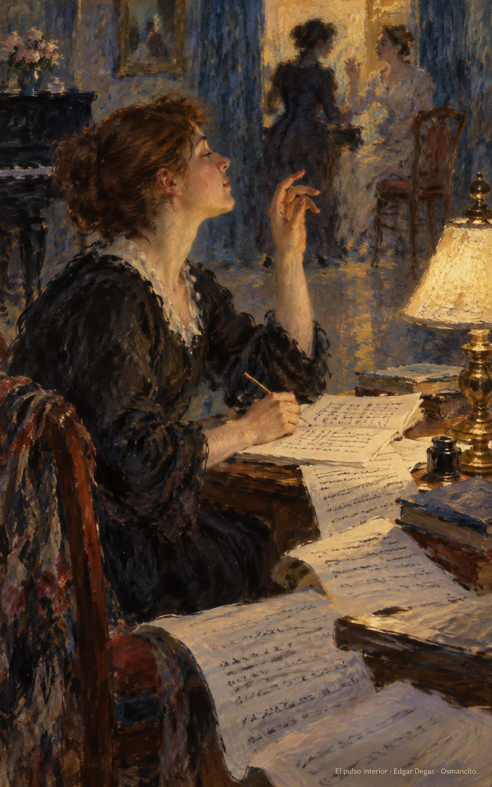](../img/261023_mientras-escribo-ii_el-pulso-interior.jpg)

Saque la capa superior; debajo van los elementos de estilo. Ahora toca el párrafo: abra una novela por la mitad y mire dos páginas. Los libros fáciles tienen párrafos cortos y mucho blanco, aireados como un helado de Dairy Queen; los densos, aspecto compacto: son mapas de intención. En prosa expositiva, el párrafo ideal lleva una frase temática y frases que la explican; dos ejemplos:

> **Cuando tenía diez años, le tenía miedo a mi hermana Megan. Era imposible que entrara en mi cuarto sin romper al menos uno de mis juguetes favoritos, por lo general el favorito de los favoritos. Su mirada tenía una mágica cualidad destruye-celos; cualquier póster que mirara parecía despegarse de la pared solo unos segundos después. Las prendas de ropa muy queridas desaparecían del armario. Ella no se las llevaba (al menos eso creo), solo hacía que se esfumaran. Meses más tarde solía encontrar aquella camiseta atesorada o mis Nike favoritos en lo más hondo debajo de la cama, con aspecto triste y abandonado entre los gatitos de polvo. Cuando Megan estaba en mi cuarto, los altavoces del equipo de música petaban, las persianas se disparaban hacia arriba con un golpe y la lámpara de mi escritorio se moría casi siempre.**
> [Párrafo 5](#original-t4-p5)

El párrafo cumple exactamente la forma anunciada: una frase temática («le tenía miedo a mi hermana Megan») y seis frases de apoyo, cada una una prueba nueva. El tono infantil, los gatitos de polvo y los Nike desaparecidos, demuestra que la estructura no exige solemnidad: la misma forma sirve para una tesis y para un recuerdo cómico. Dairy Queen, la comparación de arriba, es una cadena estadounidense de helados.

Segundo ejemplo: Megan también era cruel a conciencia: zumo de naranja en los cereales, pasta de dientes en los calcetines y, él lo jura, mocos en el pelo durante el partido del domingo.

> Los ensayos informales son, en general, cosas bobas e insustanciales; a menos que consiga un empleo de columnista en su periódico local, escribir semejante tontería es una habilidad que nunca usará en el mundo real de los centros comerciales y las gasolineras. Los profesores los encargan cuando no se les ocurre otra forma de hacerle perder el tiempo. El tema más famoso, por supuesto, es «Cómo pasé mis vacaciones de verano». Yo enseñé escritura un año en la Universidad de Maine en Orono y tuve una clase cargada de atletas y animadoras. Les gustaban los ensayos informales; los saludaban como a los viejos amigos del instituto que eran. Pasé un semestre entero resistiendo el impulso de pedirles dos páginas de prosa bien torneada sobre el tema «Si Jesús fuera mi compañero de equipo». Lo que me frenaba era el conocimiento seguro y terrible de que la mayoría acometería la tarea con entusiasmo. Algunos podrían incluso llorar en plenas fiebres de la composición.
> [Párrafo 7](#original-t4-p7)

La Universidad de Maine en Orono es donde King estudió y luego enseñó. La broma de «Si Jesús fuera mi compañero de equipo» no termina aquí: reaparece en el pasaje de ficción que cierra el apartado, donde el tal O'Leary ha escrito precisamente ese relato, y ese eco interno es una muestra de cómo se conectan las ideas en un mismo libro.

Aun en el ensayo informal, la forma obliga a ordenar el pensamiento; escribir es pensamiento refinado, y una tesis no puede estar peor organizada que una redacción de instituto sobre Shania Twain. En ficción, en cambio, el párrafo es menos estructura que ritmo: se forma solo, y si no gusta se corrige en la reescritura. Ejemplo:

La habitación del gran Tony: luz de motel, un póster torcido, un zapato bajo la cama. «Cuando tu historia es verdad no cambia.» El gran Tony se sentó, encendió un cigarrillo, se pasó una mano por el pelo. «O'Leary me enseñó un relato suyo sobre Jesús en el equipo de fútbol del instituto, con casco y rodilleras.» King lo descompone: acotaciones innecesarias si sabemos quién habla, la coma suprimida para que salga de un aliento. ¿Para qué ese párrafo de una sola frase?

> Primero: la frase puede ser defectuosa en sentido técnico, pero es buena en términos del pasaje entero. Su brevedad y su estilo telegráfico varían el ritmo y mantienen fresca la escritura. El novelista de suspense Jonathan Kellerman usa esta técnica con mucho éxito. En *Survival of the Fittest* escribe: **El barco eran nueve metros de fibra de vidrio blanca y elegante con molduras grises. Mástiles altos, las velas recogidas. *Satori* pintado en el casco en letra negra ribeteada de oro.**
> [Párrafo 19](#original-t4-p19)

En la jerga gramatical, un fragmento es una frase que no tiene la forma completa de una oración. *Satori* es una palabra japonesa del budismo zen que nombra una iluminación súbita; aquí es solo el nombre del barco. Las tres frases de Kellerman son fragmentos, y ninguna le falta al lector: la imagen llega entera, y el ritmo corto la hace más nítida.

> Es posible abusar del fragmento bien torneado (y Kellerman lo hace a veces), pero los fragmentos también pueden funcionar de maravilla para agilizar la narración, crear imágenes claras y crear tensión, además de variar la línea de la prosa. Una serie de frases gramaticalmente correctas puede endurecer esa línea, hacerla menos flexible. Los puristas odian oír eso y lo negarán hasta su último aliento, pero es cierto. El lenguaje no siempre tiene que llevar corbata y zapatos de cordones. El objeto de la ficción no es la corrección gramatical, sino hacer sentir bienvenido al lector y luego contarle una historia... hacerle olvidar, siempre que sea posible, que está leyendo una historia. El párrafo de una sola frase se parece más al habla que a la escritura, y eso es bueno. Escribir es seducción. La buena conversación es parte de la seducción. Si no, ¿por qué tantas parejas que empiezan la noche cenando acaban en la cama?
> [Párrafo 20](#original-t4-p20)

Jonathan Kellerman es un novelista de suspense estadounidense, autor de la serie del psicólogo Alex Delaware, a la que pertenece *Survival of the Fittest*. El fragmento citado hace en tres frases lo mismo que el párrafo del gran Tony en una: telegrafía la imagen. Y el apartado aterriza su escalera completa, de la palabra a la frase, de la frase al párrafo y del párrafo a la voz: la corrección gramatical es medio, no fin; el fin es que el lector olvide que lee.

El párrafo suelto sirve además de dirección de escena y transición, decisión de oído. King concluye: el párrafo, no la frase, es la unidad básica; puede tener una palabra o dieciséis páginas, como uno de *Paradise Falls*, de Don Robertson.

---

### T5 · La casa viva

[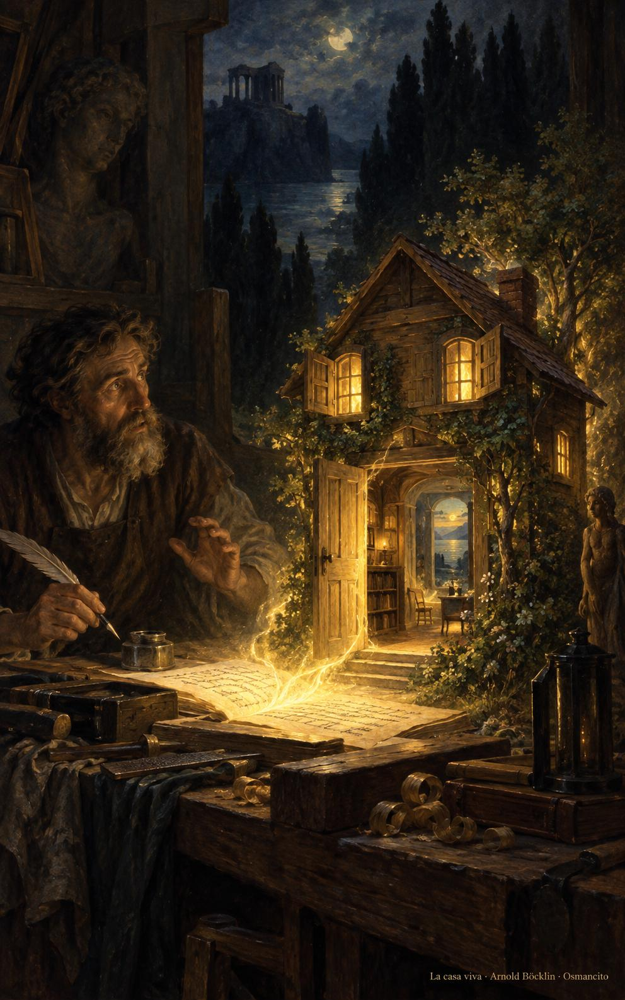](../img/261023_mientras-escribo-ii_la-casa-viva.jpg)

> ¿Por qué no vuelves a coger de la estantería ese libro que estabas mirando? El peso en las manos te dice otras cosas que puedes captar sin leer una sola palabra. La extensión del libro, naturalmente, pero más: el compromiso que asumió el escritor para crear la obra, el compromiso que debe asumir el Lector Constante para digerirla. No es que la extensión y el peso indiquen por sí solos la excelencia; muchas historias épicas son más o menos épica porquería: pregúntaselo a mis críticos, que se lamentarán de los bosques canadienses enteros masacrados para imprimir mis chorradas. A la inversa, corto no siempre significa dulce. En algunos casos (*The Bridges of Madison County,* por ejemplo), corto significa demasiado dulce. Pero existe esa cuestión del compromiso, sea el libro bueno o malo, un fracaso o un éxito. Las palabras pesan. Pregúntaselo a cualquiera que trabaje en el departamento de envíos del almacén de una editorial, o en la trastienda de una gran librería.
> [Párrafo 1](#original-t5-p1)

Aquí King habla de cuando uno coge un libro de la estantería y lo sopesa. El libro se juzga antes de abrirlo: el grosor anuncia cuánto trabajó el autor y cuánto tendrá que trabajar el lector. Lector Constante es como King llama a su lector fiel, el que se compromete a leer. *The Bridges of Madison County* (*Los puentes de Madison County*) es una novela de Robert James Waller, de 1992, que King pone como ejemplo de brevedad empalagosa. El chiste sobre los bosques canadienses masacrados es una broma sobre su fama de autor de libros largos, y sobre los críticos que se la echan en cara. Conviene fijarse en el giro final: la frase «las palabras pesan» pasa de lo literal (cajas en un almacén) a lo figurado (esfuerzo y peso moral de cada línea).

Las palabras forman frases y las frases párrafos, y a veces un párrafo cobra vida, como el monstruo de Frankenstein en su camilla. Entonces se pasa al tercer nivel de la caja de herramientas, donde van los instrumentos propios del oficio. Los carpinteros no construyen monstruos sino casas, un párrafo cada vez, y con paciencia se pueden levantar mansiones.

> ¿Hay alguna razón para construir mansiones enteras de palabras? Creo que sí, y creo que la entienden los lectores de *Gone with the Wind,* de Margaret Mitchell, y de *Bleak House,* de Charles Dickens: a veces ni siquiera un monstruo es un monstruo. A veces es hermoso y nos enamoramos de toda esa historia, más de lo que cualquier película o programa de televisión podría ofrecernos. Incluso después de mil páginas no queremos abandonar el mundo que el escritor ha hecho para nosotros, ni a la gente imaginaria que vive en él. No te irías después de dos mil páginas, si las hubiera. La trilogía de *The Lord of the Rings,* de J. R. R. Tolkien, es un ejemplo perfecto. Mil páginas de hobbits no han bastado a tres generaciones de aficionados a la fantasía de después de la Segunda Guerra Mundial; ni siquiera sumando ese epílogo torpe y pesado como un dirigible, *The Silmarillion,* han bastado. De ahí Terry Brooks, Piers Anthony, Robert Jordan, los conejos andariegos de *Watership Down* y otro medio centenar. Los autores de esos libros crean los hobbits que todavía aman y añoran; intentan traer de vuelta a Frodo y a Sam desde los Puertos Grises porque Tolkien ya no está para hacerlo por ellos.
> [Párrafo 4](#original-t5-p4)

King responde a la pregunta de por qué escribir libros enormes con una idea simple: el monstruo puede ser hermoso, y el lector quiere quedarse. Retoma así la imagen del monstruo de Frankenstein del párrafo anterior y la da vuelta. Las mansiones del carpintero son las novelas largas, como *Gone with the Wind* (*Lo que el viento se llevó,* de Margaret Mitchell, 1936) o *Bleak House* (*Casa desolada,* de Charles Dickens, 1852-1853). *The Lord of the Rings* (*El Señor de los Anillos*) es la gran obra de fantasía de J. R. R. Tolkien; *The Silmarillion* (*El Silmarillion*) se publicó en 1977, después de su muerte, editado por su hijo Christopher, y por eso King lo llama epílogo. Terry Brooks, Piers Anthony y Robert Jordan son autores de fantasía que King nombra, y *Watership Down* es la novela de Richard Adams sobre unos conejos. La frase final es la clave: el escritor que continúa o imita a Tolkien no hace negocio sino duelo, quiere traer de vuelta un mundo que ama. A King le importa más ese deseo que la pura extensión.

King cierra el capítulo con una advertencia: hasta aquí hablaban de una destreza aprendida, de herramientas y carpintería, pero no hay que olvidar que también hablan de magia.

---

## Mientras escribo

### La musa del sótano

> Según el título de un popular manual de adiestramiento, no existen perros malos, pero no se lo digas al padre de un niño destrozado por un pitbull o un rottweiler; es capaz de romperte la nariz. Y por mucho que quiera animar al hombre o a la mujer que intenta escribir en serio por primera vez, no puedo mentir y decir que no existen malos escritores. Lo siento, pero hay *montones* de malos escritores. Algunos están en la plantilla del periódico de tu localidad, normalmente reseñando montajes de teatro aficionado o pontificando sobre los equipos deportivos de la zona. Algunos han garabateado hasta conseguirse casas en el Caribe, dejando tras de sí un rastro de adverbios palpitantes, personajes de madera y detestables construcciones en voz pasiva. Otros perorean en los recitales de poesía de micrófono abierto, con jersey negro de cuello alto y pantalones caqui arrugados; sueltan ripios sobre «mis pechos de lesbiana enfadada» y «el callejón torcido donde grité el nombre de mi madre».
> [Párrafo 1](#original-w0-p1)

King abre con un chiste de perros para decir algo incómodo: hay malos escritores. Aquí empieza la parte del libro llamada «La musa del sótano», donde sostiene que escribir bien es un oficio que se puede mejorar, pero no del todo regalar. El desfile tiene tres paradas: el periodista local, el autor de éxito que escribe mal y el poeta de café. El segundo es el más pícaro: se ha hecho rico dejando adverbios y voz pasiva («el sujeto recibe la acción», como en «la puerta fue cerrada por él»), dos manías que King ataca más adelante. Los versos de los poetas son parodia suya. «Micrófono abierto» es una noche en que cualquiera sube a leer.

Los escritores forman una pirámide: abajo los malos, encima los competentes, luego los buenos de verdad y, por encima de casi todos, los genios como Shakespeare, regalos del azar que ni ellos entienden. De ahí las dos tesis de King: escribir bien es dominar lo básico y llenar el tercer nivel de la caja de herramientas; y aunque nadie convierte a un malo en competente ni a un bueno en genio, a un competente se le puede ayudar a ser bueno.

> Me temo que esta idea la rechazan muchos críticos, y también muchos profesores de escritura. Muchos de ellos son liberales en política pero crustáceos en su campo. Los hombres y mujeres que saldrían a la calle a protestar por la exclusión de afroamericanos o de nativos americanos (puedo imaginar lo que el señor Strunk habría hecho con estos términos políticamente correctos pero torpes) del club de campo local suelen ser los mismos que dicen a sus clases que la capacidad de escribir es fija e inmutable; quien una vez fue un chapucero, siempre lo será. Aunque un escritor suba en la estima de uno o dos críticos influyentes, él o ella arrastra siempre su reputación temprana, como una respetable mujer casada que de adolescente fue una chica alocada. Hay gente que no olvida, eso es todo, y buena parte de la crítica literaria sirve solo para reforzar un sistema de castas tan viejo como el esnobismo intelectual que lo alimentó. Raymond Chandler puede estar hoy reconocido como una figura importante de la literatura estadounidense del siglo XX, una voz temprana que describió la anomia de la vida urbana en los años posteriores a la Segunda Guerra Mundial, pero hay muchísimos críticos que rechazarán de plano ese juicio. ¡Es un chapucero!, gritan indignados. ¡Un chapucero con pretensiones! ¡Lo peor! ¡El que cree que puede pasar por uno de *nosotros!*
> [Párrafo 5](#original-w0-p5)

Aquí King se pelea con quienes creen que el talento viene fijado de nacimiento. «Hack», que traducimos por chapucero, es el escritor que produce a destajo y sin calidad. La imagen de los «crustáceos» alude al caparazón: gente blanda por dentro y dura por fuera, que defiende sus ideas como un cangrejo. El señor Strunk es William Strunk Jr., profesor de inglés y autor del manual de estilo *The Elements of Style*; de ahí el chiste sobre los términos «políticamente correctos pero torpes». Raymond Chandler escribió novelas de detectives, con Philip Marlowe como protagonista, y publicó en *Black Mask*, una revista barata de relatos policiales; hoy se lo lee como un clásico. Es el ejemplo de King para mostrar que el desdén de la crítica se hereda.

Los críticos que quieren superar ese prejuicio apenas lo logran: a Chandler lo sientan al pie de la mesa, y a Dickens lo atacan por su éxito popular. Esas sospechas a veces tienen razón y a veces sirven de excusa para no pensar. King espera que lo acusen de predicar una filosofía ingenua de ascenso social y se resigna, pero repite su premisa: a un mal escritor nadie puede hacerlo bueno, ni competente, y a uno bueno que quiere llegar a grande, que lo olvide.

> Lo que sigue es todo lo que sé sobre cómo escribir buena ficción. Seré lo más breve posible, porque tu tiempo es valioso y el mío también, y ambos entendemos que las horas que pasamos hablando de escribir son tiempo que no pasamos *haciéndolo.* Seré lo más alentador posible, porque está en mi naturaleza y porque amo este trabajo. Quiero que tú también lo ames. Pero si no quieres dejarte el culo trabajando, no tienes nada que hacer intentando escribir bien: vuelve a la competencia y da gracias por tener siquiera eso donde caer. Existe una musa, pero no va a bajar revoloteando a tu cuarto de escribir ni a esparcir polvo mágico de creatividad sobre tu máquina de escribir o tu ordenador. Vive bajo tierra. Es un tipo de sótano. Tienes que bajar a su nivel, y una vez allí tienes que amueblarle un apartamento donde vivir. Tienes que hacer todo el trabajo duro, en otras palabras, mientras la musa se sienta a fumar puros, a admirar sus trofeos de bolos y a fingir que te ignora. ¿Crees que es justo? *Yo* creo que es justo. Puede que no sea gran cosa de ver, ese tipo musa, y puede que no sea muy conversador (lo que yo saco de la mía son sobre todo gruñidos huraños, a menos que esté de servicio), pero tiene la inspiración. Es justo que tú hagas todo el trabajo y quemes todo el aceite de medianoche, porque el tipo del puro y las alitas tiene una bolsa de magia. Ahí dentro hay cosas que pueden cambiarte la vida.
> [Párrafo 9](#original-w0-p9)

En la tradición clásica, la musa es una diosa que inspira al artista desde lo alto; King la baja al sótano, la convierte en un tipo huraño con puros y trofeos de bolos, y pone al escritor de portero y de amueblador. La broma tiene una moraleja práctica: la inspiración existe, pero no se espera, se atrae trabajando en el lugar donde está. «Quemar el aceite de medianoche» es la vieja expresión de quien estudia o escribe hasta tarde con una lámpara de aceite. También importa el tono: King promete ser breve y alentador, y a la vez avisa de que quien no quiera trabajar duro debería quedarse en la competencia, que no es poco.

Y añade: créeme, lo sé.

---

### W1 · Leer mucho, escribir mucho

Quien quiera escribir debe hacer dos cosas sobre todas las demás: leer mucho y escribir mucho. King lee setenta u ochenta libros al año, por gusto, en su sillón azul, y aun así aprende: los malos enseñan más que los buenos.

> Cuando estaba en octavo curso, me topé con una novela de bolsillo de Murray Leinster, un escritor de ciencia ficción de revistas baratas (*pulp*) que hizo casi toda su obra en los años cuarenta y cincuenta, cuando revistas como *Amazing Stories* pagaban un penique por palabra. Yo había leído otros libros del señor Leinster, los bastantes para saber que la calidad de su escritura era desigual. Esta historia en concreto, que trataba de la minería en el cinturón de asteroides, era uno de sus esfuerzos menos logrados. Aunque decir eso es ser demasiado amable. Era terrible, en realidad, un relato poblado de personajes finos como el papel y movido por giros de trama extravagantes. Lo peor de todo (o eso me pareció entonces) era que Leinster se había enamorado de la palabra *zestful.* Los personajes veían acercarse los asteroides cargados de mineral con sonrisas *zestful.* Los personajes se sentaban a cenar a bordo de su nave minera con una expectación *zestful.* Hacia el final del libro, el héroe levantaba a la heroína rubia y de pecho generoso en un abrazo *zestful.* Para mí fue el equivalente literario de una vacuna contra la viruela: que yo sepa, nunca he usado la palabra *zestful* en una novela ni en un relato. Si Dios quiere, nunca la usaré.
> [Párrafo 3](#original-w1-p3)

*Zestful* es un adjetivo inglés que significa lleno de brío o de entusiasmo. Leinster lo repite hasta convertirlo en tic, y ese tic enseña al joven King lo que no hay que hacer. La comparación con la vacuna es exacta: una dosis pequeña de mal estilo inmuniza contra él. Una revista *pulp* es una publicación barata, impresa en papel de mala calidad, de relatos de aventuras y ciencia ficción; escribir allí a un penique por palabra explica la prisa y el relleno. El párrafo también muestra la humildad con que King aprende: del peor libro sale la lección que recuerda toda la vida.

Aquel libro, *Asteroid Miners* (no era el título, pero se le parece), fue el primero que dejó pensando: yo lo hago mejor. Un solo libro malo vale un semestre de escuela de escritura; los buenos enseñan estilo y verdad, y la envidia que dan empuja. Se lee para reconocer lo podrido y esquivarlo, para medirse con lo grande y para conocer estilos.

> Puede que te descubras adoptando un estilo que te parece especialmente emocionante, y no hay nada de malo en eso. Cuando de niño leía a Ray Bradbury, escribía como Ray Bradbury: todo verde y maravilloso y visto a través de una lente untada con la grasa de la nostalgia. Cuando leía a James M. Cain, todo lo que escribía salía cortante, pelado y duro como la novela negra. Cuando leía a Lovecraft, mi prosa se volvía suntuosa y bizantina. En mi adolescencia escribí relatos donde se fundían todos estos estilos y formaban una especie de guiso hilarante. Esta mezcla de estilos es parte necesaria de desarrollar el estilo propio, pero no ocurre en el vacío. Hay que leer mucho, afinando (y redefiniendo) tu propia obra a medida que lo haces. Me cuesta creer que gente que lee muy poco (o nada en algunos casos) pretenda escribir y esperar que a la gente le guste lo que ha escrito, pero sé que es verdad. Si me dieran un centavo por cada persona que me ha dicho que quería ser escritor pero «no tenía tiempo para leer», podría pagarme una cena de filete bastante buena. ¿Puedo ser franco en este tema? Si no tienes tiempo para leer, no tienes el tiempo (ni las herramientas) para escribir. Así de simple.
> [Párrafo 8](#original-w1-p8)

Ray Bradbury fue un escritor estadounidense de fantasía y ciencia ficción, con un tono nostálgico. James M. Cain, un novelista estadounidense de novela negra, de frases secas y duras. H. P. Lovecraft, un escritor estadounidense de relatos de horror, de prosa recargada. Los tres sirven a King de ejemplo de que un estilo se contagia: al leerlos escribía como ellos, y de la mezcla salió, con los años, su propia voz. La frase final no es un consejo amable sino una condición: quien no lee no tiene las herramientas, y por eso King da por perdido al que dice no tener tiempo.

La lectura es el centro creativo de la vida del escritor. King lleva un libro a todas partes, lo lee a sorbos en salas de espera, colas y hasta en el baño, y escucha audiolibros al conducir. Leer en la mesa es de mala educación, pero eso debería importarte poco.

> ¿Dónde más puedes leer? Siempre está la cinta de correr, o lo que uses en el gimnasio de tu barrio para hacer aeróbic. Procuro pasar una hora al día en eso, y creo que me volvería loco sin una buena novela que me haga compañía. La mayoría de las instalaciones de ejercicio (en casa y fuera de ella) están ahora equipadas con televisores, pero la tele, haciendo ejercicio o en cualquier otro sitio, es de verdad lo último que necesita un aspirante a escritor. Si sientes que debes tener a los charlatanes analistas de noticias de CNN mientras haces ejercicio, o a los charlatanes de la bolsa de MSNBC, o a los charlatanes del deporte de ESPN, es hora de que te preguntes cuán en serio te tomas lo de ser escritor. Debes estar preparado para volcarte seriamente hacia dentro, hacia la vida de la imaginación, y eso significa, me temo, que Geraldo, Keith Obermann y Jay Leno tienen que irse. Leer lleva tiempo, y la teta de cristal consume demasiado.
> [Párrafo 11](#original-w1-p11)

CNN, MSNBC y ESPN son canales estadounidenses de noticias, de economía y de deportes. Geraldo Rivera es un periodista de televisión, Keith Olbermann, un presentador de deportes y noticias, y Jay Leno, el presentador de un programa nocturno de humor. «Teta de cristal» es una expresión de jerga estadounidense para la televisión, que alimenta sin nutrir. King escribe esto hacia el año 2000, con la televisión por cable en pleno auge, pero el argumento no depende de la época: el tiempo es limitado, y lo que se gasta en una cosa no se gasta en otra.

Apagar la tele mejora la vida y la escritura. Su hijo Owen, de siete años, quiso tocar el saxofón como Clarence Clemons, el saxofonista de la banda de Bruce Springsteen. A los siete meses lo dejó, aliviado: tocaba bien, pero solo practicaba en las horas fijadas, nunca jugaba con el instrumento. Sin alegría, dice King, no sirve.

> El talento vuelve inútil la idea misma del ensayo; cuando encuentras algo para lo que tienes talento, lo haces (sea lo que sea *eso*) hasta que se te desangran los dedos o los ojos están a punto de salírsete de la cabeza. Incluso cuando nadie escucha (ni lee, ni mira), cada salida es una actuación de bravura, porque tú, el creador, eres feliz. Quizá hasta extático. Eso vale para leer y escribir igual que para tocar un instrumento, batear una pelota de béisbol o correr la vuelta de las cuatrocientas cuarenta yardas. El programa intenso de lectura y escritura que defiendo, de cuatro a seis horas al día, todos los días, no te parecerá intenso si de verdad disfrutas haciendo estas cosas y tienes aptitud para ellas; de hecho, puede que ya lo estés siguiendo. Pero si sientes que necesitas permiso para leer y escribir todo lo que tu corazoncito desee, considéralo concedido por este servidor.
> [Párrafo 16](#original-w1-p16)

Aquí King da la razón de la historia de Owen: el talento se reconoce porque el trabajo no pesa. El ensayo es lo contrario del juego, y cuando un niño solo hace lo que debe, falta el gusto. La frase final es un guiño: ofrece un permiso que nadie le ha pedido, y con eso nombra el miedo de quien duda si le toca dedicar tantas horas a leer y escribir. Cuatro a seis horas al día es la cifra que él mismo cumple.

Leer da familiaridad con el proceso: sabes qué está hecho, qué es trillado y qué es fresco, y haces menos el ridículo con la pluma.

---

### W2 · Dos mil palabras

[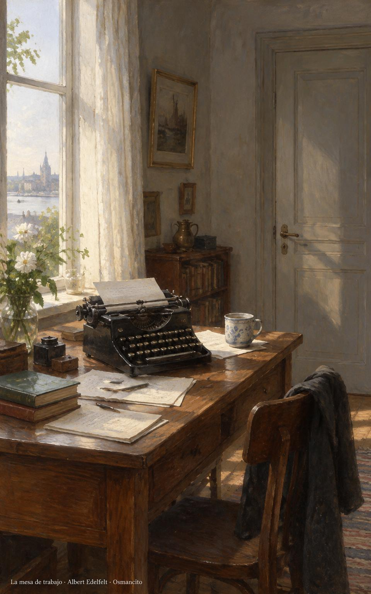](../img/261023_mientras-escribo-ii_dos-mil-palabras.jpg)

Si leer mucho y escribir mucho es el Gran Mandamiento, ¿cuánto es mucho? Depende del escritor. King cuenta una anécdota, más mito que verdad: un amigo encuentra al novelista irlandés James Joyce desplomado sobre su escritorio, desesperado. Ese día ha escrito siete palabras. El amigo le dice que para él eso es bueno. Joyce responde que sí, pero que no sabe en qué orden van.

> En el otro extremo del espectro están escritores como Anthony Trollope. Escribía novelas enormes (*Can You Forgive Her?* [¿Puedes perdonarla?] es un ejemplo bastante bueno; para el público moderno podría retitularse *Can You Possibly Finish It?* [¿Podrás acabarla?]) y las sacaba con una regularidad asombrosa. Su trabajo de día era el de empleado del Departamento de Correos británico (los buzones rojos públicos de todo el Reino Unido fueron un invento de Anthony Trollope); escribía durante dos horas y media cada mañana antes de irse a trabajar. Este horario era de hierro. Si estaba a mitad de una frase cuando se acababan las dos horas y media, dejaba esa frase sin terminar hasta la mañana siguiente. Y si ocurría que terminaba uno de sus pesos pesados de seiscientas páginas con quince minutos de sesión por delante, escribía **Fin,** apartaba el manuscrito y empezaba a trabajar en el libro siguiente.
> [Párrafo 8](#original-w2-p8)

Trollope fue un novelista inglés del siglo XIX, famoso por sus novelas largas y por esta disciplina de reloj. Es el contrapunto de Joyce: uno no sabe en qué orden poner siete palabras y el otro no deja una frase a medias ni para ir a comer. King lo cuenta con humor, y los dos títulos son una broma sobre la extensión. Detrás hay una idea seria: el oficio se hace con horario fijo, sin esperar a estar inspirado. Lo de los buzones rojos es una afirmación de King sobre el hombre que, además de novelista, trabajaba en Correos.

Según King, el británico John Creasey escribió quinientas novelas con diez nombres distintos. En el otro extremo está Harper Lee, que firmó un solo libro, y King se pregunta qué hizo el resto de su tiempo. Él reserva las mañanas a lo nuevo, las tardes a siestas y cartas, las noches a leer, a la familia y al béisbol. Si no escribe a diario, los personajes se enfrían y el trabajo empieza a sentirse como trabajo.

> Yo solía decir a los entrevistadores que escribía todos los días excepto Navidad, el Cuatro de Julio y mi cumpleaños. Era mentira. Lo decía porque, si aceptas una entrevista, tienes que decir *algo,* y queda mejor si es algo al menos medio ingenioso. Además, no quería sonar como un bobo adicto al trabajo (solo adicto al trabajo, supongo). La verdad es que cuando escribo, escribo todos los días, bobo adicto al trabajo o no. Eso *incluye* Navidad, el Cuatro y mi cumpleaños (a mi edad uno intenta ignorar de todos modos el maldito cumpleaños). Y cuando no estoy trabajando, no trabajo en absoluto, aunque en esos periodos de parón suelo sentirme sin rumbo y me cuesta dormir. Para mí, no trabajar es el verdadero trabajo. Cuando escribo, todo es el patio de recreo, y las peores tres horas que pasé nunca allí fueron aun así bastante buenas, maldita sea.
> [Párrafo 13](#original-w2-p13)

El Cuatro de Julio es la fiesta nacional de Estados Unidos, así que la excusa que daba a los entrevistadores sonaba a escritor de costumbres: descansa solo en las fiestas grandes. King desmonta su propia frase y confiesa algo menos simpático, que no se detiene nunca mientras trabaja en un libro. Lo notable es la inversión: para él el descanso es lo duro, y escribir es el patio de recreo, un lugar de juego y no de sacrificio. Eso encaja con lo que dijo antes sobre leer y escribir por placer, y explica por qué una rutina tan dura le parece liviana.

Antes escribía más rápido: *The Running Man,* una de sus novelas, le llevó una semana. Cree que el primer borrador debe terminarse en tres meses, el tiempo de una estación, y su meta son diez páginas diarias, dos mil palabras.

> La mayor ayuda para una producción regular (¿a lo Trollope?) es trabajar en una atmósfera serena. A cualquier escritor, por naturalmente productivo que sea, le cuesta trabajar en un entorno donde las alarmas y los sobresaltos son la regla y no la excepción. Cuando me piden «el secreto de mi éxito» (idea absurda, pero imposible de esquivar), a veces digo que son dos: me mantuve sano físicamente (al menos hasta que una furgoneta me derribó al borde de la carretera en el verano de 1999) y me mantuve casado. Es una buena respuesta porque hace desaparecer la pregunta, y porque tiene un elemento de verdad. La combinación de un cuerpo sano y una relación estable con una mujer autosuficiente que no aguanta tonterías de mí ni de nadie ha hecho posible la continuidad de mi vida laboral. Y creo que también es cierto lo contrario: que mi escritura y el placer que me da han contribuido a la estabilidad de mi salud y de mi vida en casa.
> [Párrafo 16](#original-w2-p16)

King fue atropellado en 1999 mientras caminaba por una carretera, y es un episodio del que el libro habla más adelante, de ahí que aquí lo mencione de pasada, entre paréntesis. La respuesta de «el secreto» es una forma de cortar la pregunta con humor. Detrás hay una observación práctica: la serenidad doméstica sostiene el trabajo, que no se hace en el vacío ni en medio del caos. Y la frase final cierra el círculo: escribir también cuida la casa y la salud.

---

### W3 · Una puerta cerrada

[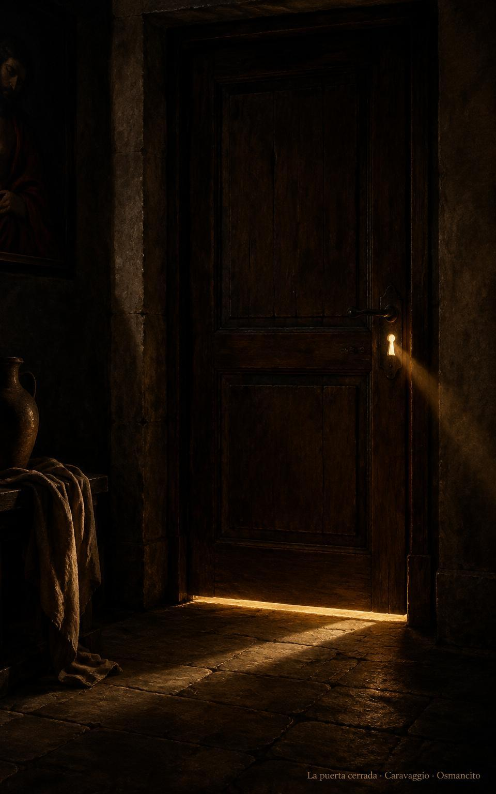](../img/261023_mientras-escribo-ii_una-puerta-cerrada.jpg)

Puedes leer casi en cualquier parte, pero para escribir necesitas un lugar propio. King escribió *Carrie* y *'Salem's Lot,* sus dos primeras novelas publicadas, en el cuarto de la lavadora de un remolque, con una máquina Olivetti portátil de su mujer y un pupitre infantil sobre los muslos. El espacio puede ser humilde y solo necesita una cosa: una puerta que estés dispuesto a cerrar.

> Para cuando entres en tu nuevo espacio de escritura y cierres la puerta, ya deberías haber fijado una meta diaria de escritura. Igual que con el ejercicio físico, lo mejor sería poner esta meta baja al principio, para evitar el desánimo. Yo sugiero mil palabras diarias, y como me siento magnánimo, sugiero también que puedes tomarte un día libre a la semana, al menos al principio. No más; si lo haces, perderás la urgencia y la inmediatez de tu historia. Con la meta fijada, proponte que la puerta seguirá cerrada hasta cumplirla. Ponte manos a la obra y vuelca esas mil palabras en papel o en un disquete. En una entrevista temprana (creo que para promocionar *Carrie*), un presentador de un programa de radio me preguntó cómo escribía. Mi respuesta, «Una palabra a la vez», pareció dejarlo sin respuesta. Creo que intentaba decidir si bromeaba o no. No bromeaba. Al final, siempre es así de simple. Ya sea una viñeta de una sola página o una trilogía épica como *The Lord of the Rings,* la obra se hace siempre una palabra a la vez. La puerta deja fuera al resto del mundo; también sirve para encerrarte dentro y mantenerte concentrado en la tarea que tienes entre manos.
> [Párrafo 3](#original-w3-p3)

Aquí aparece el primer número concreto del libro: mil palabras al día, con un día libre por semana. King pide poco al principio, igual que un entrenador, para que el hábito no se rompa. El disquete es el soporte de almacenamiento de los ordenadores de entonces. El presentador de radio no entendió «una palabra a la vez» porque esperaba un secreto, y King insiste en que esa es la respuesta completa. La puerta cumple dos funciones que él subraya: deja fuera al mundo y te deja dentro a ti.

Sin teléfono, sin tele ni videojuegos, con las cortinas corridas: hay que eliminar toda distracción. King escribe con música fuerte, que para él es otra forma de cerrar la puerta. Escribir y dormir se parecen: el horario fijo y la habitación privada habitúan la mente a soñar a voluntad.

> Pero necesitas la habitación, necesitas la puerta y necesitas la determinación de cerrar la puerta. Necesitas también una meta concreta. Cuanto más tiempo te mantengas en estos fundamentos, más fácil se volverá el acto de escribir. No esperes a la musa. Como he dicho, es un tipo testarudo que no es susceptible a mucho revoloteo creativo. Aquí no hablamos del tablero de güija ni del mundo de los espíritus, sino de un trabajo más, como tender tuberías o conducir camiones de larga distancia. Tu trabajo es asegurarte de que la musa sepa dónde vas a estar cada día de nueve a mediodía o de siete a tres. Si lo sabe, te aseguro que tarde o temprano empezará a aparecer, mordiendo su puro y haciendo su magia.
> [Párrafo 6](#original-w3-p6)

La musa del sótano vuelve aquí, ya conocida del capítulo anterior: no baja a darte ideas, pero aparece si sabe a qué hora y dónde encontrarte. El tablero de güija es el juego con que se pretende hablar con los espíritus, y King lo usa para negar toda idea mística de la inspiración. El pasaje cierra con una imagen de oficio, tender tuberías o conducir un camión, y con una promesa práctica: la inspiración llega a la cita fija.

---

### W4 · Escribe lo que sabes

[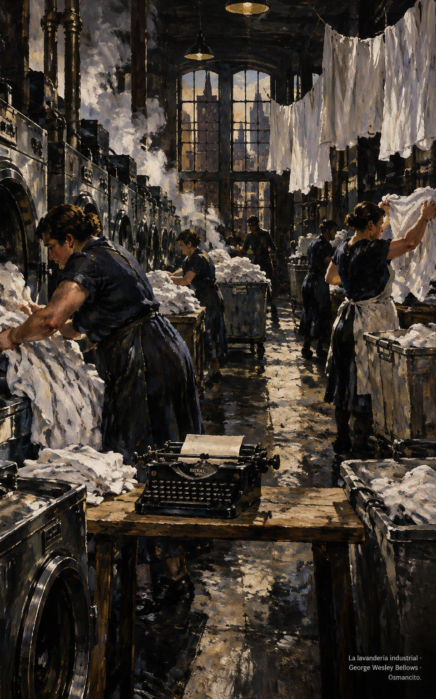](../img/261023_mientras-escribo-ii_escribe-lo-que-sabes.jpg)

¿Sobre qué escribir? Sobre lo que quieras, siempre que digas la verdad. «Escribe lo que sabes» se entiende en sentido amplio: el fontanero sabe de fontanería, pero también saben el corazón y la imaginación. King empezó escribiendo lo que amaba leer, cómics y películas de terror, y de ahí salió «Yo fui un ladrón de tumbas adolescente».

> Si resulta que eres aficionado a la ciencia ficción, es natural que quieras escribir ciencia ficción (y cuanta más ciencia ficción hayas leído, menos probable será que te limites a revisitar las convenciones ya muy explotadas del género, como la ópera espacial y la sátira distópica). Si eres aficionado al misterio, querrás escribir misterio, y si te gustan las novelas románticas, es natural que quieras escribir las tuyas. No hay nada malo en escribir ninguna de estas cosas. Lo que sí estaría muy mal, creo, es apartarse de lo que conoces y te gusta (o amas, como yo amaba aquellos viejos EC y aquellas películas de terror en blanco y negro) a favor de cosas que crees que impresionarán a tus amigos, parientes y colegas del círculo de escritura. Igual de malo es volverse deliberadamente hacia algún género o tipo de ficción para ganar dinero. Es moralmente torcido, para empezar: el trabajo de la ficción es encontrar la verdad dentro de la trama de mentiras de la historia, no cometer deshonestidad intelectual a la caza del dólar. Además, hermanos y hermanas, no funciona.
> [Párrafo 5](#original-w4-p5)

EC Comics fue una editorial estadounidense de cómics que publicó terror y ciencia ficción en los años cuarenta y cincuenta; son los cómics que King leyó de niño. La ópera espacial es la aventura de ciencia ficción de naves, imperios y batallas, y la sátira distópica es la fábula que critica el presente imaginando un futuro opresivo. King nombra dos malos motivos para elegir un género, quedar bien y ganar dinero, y los condena por razones distintas: el primero traiciona lo que amas, el segundo es deshonesto con el trabajo mismo. Su criterio es que la ficción es mentira al servicio de una verdad. Lo de «hermanos y hermanas» imita el tono de un predicador.

Cuando le preguntan por qué escribe lo que escribe, King piensa que la pregunta supone que el autor controla el material y no al revés. El escritor serio no mide las historias como un inversor mide acciones: si fuera así, todas las novelas serían superventas.

> Grisham, Clancy, Crichton y yo, entre otros, cobramos estas sumas enormes porque vendemos cantidades fuera de lo común de libros a públicos fuera de lo común. A veces se supone, con ánimo crítico, que tenemos acceso a alguna vulgata mística que otros escritores (y a menudo mejores) no logran encontrar o no se dignan usar. Dudo que sea verdad. Tampoco creo la afirmación de algunos novelistas populares (aunque no era la única, pienso en la fallecida Jacqueline Susann) de que su éxito se basa en el mérito literario: de que el público entiende la verdadera grandeza de maneras que el establishment literario, estirado y devorado por la envidia, no puede. Esta idea es ridícula, producto de la vanidad y la inseguridad.
> [Párrafo 7](#original-w4-p7)

John Grisham, Tom Clancy y Michael Crichton son, como King, autores de superventas: el primero escribe thrillers jurídicos, el segundo thrillers técnicos y de espionaje y el tercero, ciencia ficción y thrillers técnicos. Jacqueline Susann escribió *Valley of the Dolls* (literalmente, «el valle de las muñecas»), un superventas de 1966. King se niega a los dos relatos cómodos: ni el éxito prueba calidad ni el desdén de la crítica prueba envidia. Una «vulgata» es una versión corriente; aquí significa un código secreto para gustar al gran público, que según él no existe.

Los lectores compran por una historia que los atrape, y eso pasa cuando reconocen en ella gente y ecos de su propia vida; no se consigue apuntando al mercado. Se puede imitar un estilo, no el enfoque de un género. Escribe lo que te gusta y dale vida con lo que sabes de la vida y del trabajo. Como ejemplo, la novela de Grisham *The Firm*: un joven abogado descubre que su primer empleo, demasiado bueno para ser cierto, es para la mafia, y el dilema y su ingenio para salir de él atrapan al lector.

> Aunque no lo sé a ciencia cierta, apostaría mi perro y mi parcela a que John Grisham nunca trabajó para la mafia. Todo eso es pura invención (y la invención total es el mayor placer del escritor de ficción). Sin embargo, él *sí* fue un joven abogado, y claramente no ha olvidado nada de aquella lucha. Tampoco ha olvidado dónde están los distintos pozos financieros y trampas de miel que hacen tan difícil el campo del derecho empresarial. Usando un humor sencillo y llano como brillante contrapunto, y sin sustituir nunca la historia por jerga, dibuja un mundo de lucha darwiniana donde todos los salvajes visten traje de tres piezas. Y, aquí viene lo bueno, *es un mundo en el que es imposible no creer.* Grisham ha estado allí, ha espiado el terreno y las posiciones enemigas, y ha traído un informe completo. Dijo la verdad de lo que sabía, y por eso, aunque no fuera por nada más, merece cada dólar que ganó *The Firm.*
> [Párrafo 13](#original-w4-p13)

Este es el ejemplo con el que King prueba su regla. Grisham inventó una trama imposible, pero la apoyó en lo que de verdad conocía, el mundo de los abogados de empresa. La verdad que importa no está en los hechos sino en el mundo que se sostiene: el lector cree la mafia porque cree el despacho. La «trampa de miel» es la tentación que seduce, aquí el dinero. Y la imagen del explorador que vuelve con un informe resume la tarea del escritor: ir, mirar y contar lo visto.

Los críticos que desprecian *The Firm* no ven lo obvio: es un cuento inventado sobre una realidad que Grisham conoce y cuenta con honestidad casi ingenua. A ti te toca imitar esa franqueza, no su género. Sé valiente, y recuerda que fontaneros en el espacio no es mala premisa.

---

### W5 · Excavar el fósil

Para King, un relato se compone de narración, descripción y diálogo. ¿Y la trama? Desconfía de ella porque la vida casi no tiene trama y porque planear no se lleva con la creación espontánea. Cree que las historias se hacen casi solas, y que el escritor les da un sitio donde crecer y las transcribe.

> Cuando, durante una entrevista para *The New Yorker,* le dije al entrevistador (Mark Singer) que creía que las historias son cosas encontradas, como fósiles en la tierra, él dijo que no me creía. Le contesté que no pasaba nada, siempre que creyera que *yo* lo creo. Y lo creo. Las historias no son camisetas de recuerdo ni GameBoys. Las historias son reliquias, parte de un mundo preexistente por descubrir. El trabajo del escritor es usar las herramientas de su caja para sacar de la tierra, intacta, la mayor parte posible de cada una. A veces el fósil que desentierras es pequeño: una concha marina. A veces es enorme, un *Tyrannosaurus Rex* con todas esas costillas gigantescas y esos dientes sonrientes. En cualquier caso, cuento corto o novelón de mil páginas, las técnicas de excavación son básicamente las mismas.
> [Párrafo 3](#original-w5-p3)

Esta es la imagen central del capítulo: la historia ya existe bajo tierra y el escritor la desentierra, en lugar de fabricarla pieza a pieza. Una camiseta de recuerdo o un GameBoy, una videoconsola portátil de entonces, son objetos hechos en serie; un fósil se encuentra. Mark Singer escribía en la revista *The New Yorker,* y lo que King le pide no es que le crea sino que admita que él cree, una distinción que muestra cómo se defiende sin pretender convencer. La caja de herramientas es la que ya vimos en capítulos anteriores, y aquí cambia de trabajo: ya no sirve para construir, sirve para excavar.

No se saca el fósil entero sin pérdidas, y hace falta pasar de la pala a herramientas delicadas. La trama es el martillo neumático: rompe casi tanto como libera, es torpe y anticreativa, último recurso del buen escritor y primera elección del torpe. King confía en la intuición porque sus libros parten de una situación, no de una historia: pone a unos personajes en un aprieto y mira cómo salen. Es el primer lector de su novela y tampoco sabe cómo acabará.

> A principios de los años ochenta, mi mujer y yo fuimos a Londres en un viaje mezcla de negocios y placer. Me quedé dormido en el avión y tuve un sueño sobre un escritor popular (puede que fuera yo o puede que no, pero desde luego por Dios no era James Caan) que caía en las garras de una fan psicótica que vivía en una granja en medio de ninguna parte. La fan era una mujer aislada por su creciente paranoia. Tenía algo de ganado en el establo, incluida su cerda de compañía, Misery. La cerda se llamaba así por la protagonista recurrente de los superventas de novela rosa picante (*bodice-rippers*) del escritor. Mi recuerdo más claro de este sueño al despertar era algo que la mujer decía al escritor, que tenía una pierna rota y estaba prisionero en el dormitorio del fondo. Lo escribí en una servilleta de cóctel de American Airlines para no olvidarlo y me la metí en el bolsillo. La perdí en algún sitio, pero recuerdo casi todo lo que anoté:
> [Párrafo 7](#original-w5-p7)

Aquí King cuenta cómo nació su novela *Misery.* Es un caso de situación sin trama: un escritor herido, una fan que lo retiene, y el resto por descubrir. James Caan fue el actor que interpretó a Paul Sheldon, el escritor prisionero, en la película de 1990, y King se divierte tachándose de la lista de candidatos. *Bodice-rippers* es el nombre inglés de un tipo de novela romántica de época, de las que «rompen el corsé»; Misery Chastain es la heroína de las novelas que escribe el personaje. La servilleta importa porque es la prueba de que la idea llegó entera, antes de cualquier plan.

En el sueño, la mujer decía al escritor que había llamado Misery a su cerda por amor de fan, el amor más puro. Esa noche, en el Brown's Hotel de Londres, King no podía dormir: el apunte de la servilleta le parecía demasiado bueno para no escribirlo.

> Me levanté, bajé y pregunté al conserje si había un lugar tranquilo donde pudiera trabajar a mano un rato. Me llevó a un precioso escritorio en el rellano de la escalera del segundo piso. Había sido el escritorio de Rudyard Kipling, me dijo con un orgullo quizá justificable. Esta información me intimidó un poco, pero el sitio era tranquilo y el escritorio parecía bastante hospitalario; para empezar, tenía un acre de superficie de trabajo de madera de cerezo. Espoleado por taza tras taza de té (lo bebía por galones cuando escribía... a menos que estuviera bebiendo cerveza, claro), llené dieciséis páginas de un cuaderno de taquigrafía. Me gusta trabajar a mano, la verdad; el único problema es que, cuando me animo, no puedo seguir el ritmo de las líneas que se forman en mi cabeza y me desquicio.
> [Párrafo 10](#original-w5-p10)

Rudyard Kipling fue un escritor británico, autor de *The Jungle Book* (*El libro de la selva*). King lo menciona sin presentarlo porque a su lector le basta con saber que era un grande: lo intimida y a la vez lo anima. Un acre es una medida inglesa de terreno, unos cuatro mil metros cuadrados, así que la exageración es parte del chiste. Lo importante es la escena: a las tantas, sin dormir, el escritor encuentra el sitio y llena dieciséis páginas. Escribir a mano es su forma de dejar que la historia salga sin frenarla.

Al irse, agradeció al conserje, que le contó que Kipling había muerto en ese escritorio, mientras escribía. King subió a dormir pensando en cuánta información sobra. El título de trabajo era «La edición Annie Wilkes»; tenía la situación, y el resto sería excavación. Aconseja a quien se sienta esclavo del esquema y de las fichas de personaje que pruebe este camino. Imaginó que Annie obligaría a Paul Sheldon a escribir una novela solo para ella, encuadernada en piel de cerdo, y un final con una habitación convertida en santuario, donde el libro ocupa el centro.

> No estaba mal, y habría sido un cuento bastante bueno (no tan buena novela, sin embargo: a nadie le gusta animar a un tipo a lo largo de trescientas páginas para descubrir que entre los capítulos dieciséis y diecisiete se lo comió la cerda), pero las cosas no fueron así al final. Paul Sheldon resultó ser bastante más ingenioso de lo que yo pensé al principio, y sus esfuerzos por hacer de Sherezade y salvar la vida me dieron ocasión de decir algunas cosas sobre el poder redentor de la escritura que hacía tiempo que sentía pero que nunca había articulado. Annie también resultó más compleja de lo que la había imaginado al principio, y fue muy divertido escribir sobre ella: aquí había una mujer prácticamente atascada en *cockadoodie brat* (algo así como «mocoso cacareante») a la hora de soltar tacos, pero que no sentía el menor reparo en cortar el pie a su escritor favorito cuando él intentó escaparse de ella. Al final, sentí que Annie merecía casi tanta compasión como miedo. Y ninguno de los detalles e incidentes del relato procedía de la trama; eran orgánicos, cada uno surgía naturalmente de la situación inicial, cada uno era una parte desenterrada del fósil. Y escribo todo esto sonriendo. Aunque estaba enfermo de drogas y alcohol buena parte del tiempo, me divertí muchísimo con aquella.
> [Párrafo 19](#original-w5-p19)

Este párrafo muestra lo que gana una historia cuando el escritor la deja crecer. El final que planeó, con la cerda comiéndose a Paul, habría cerrado el relato con un golpe de humor negro. En cambio Paul y Annie le enseñaron algo más. Sherezade es la narradora de *Las mil y una noches:* se salva de la ejecución contando al rey una sucesión de historias enlazadas durante mil y una noches. Paul, prisionero, sobrevive de un modo parecido, escribiendo. Los tacos de Annie, *cockadoodie,* son un insulto infantil e inventado, lo que la hace más inquietante: una mujer que corta el pie al escritor pero no dice una palabrota. King admite que escribió el libro enfermo de adicciones, y sin embargo lo disfrutó, una confesión que da peso a su idea de que la historia se encuentra, no se fabrica.

> *Gerald's Game* y *The Girl Who Loved Tom Gordon* son otras dos novelas puramente de situación. Si *Misery* es «dos personajes en una casa», entonces *Gerald* es «una mujer en un dormitorio» y *The Girl Who* es «una niña perdida en el bosque». Como te dije, *he* escrito novelas con trama, pero los resultados, en libros como *Insomnia* y *Rose Madder,* no han sido especialmente inspiradores. Son (aunque me cuesta admitirlo) novelas rígidas, que se esfuerzan demasiado. La única novela mía guiada por la trama que de verdad me gusta es *The Dead Zone* (y, para ser justos, debo decir que esa me gusta muchísimo). Un libro que *parece* tener trama, *Bag of Bones,* es en realidad otra situación: «escritor viudo en una casa encantada». La historia de fondo de *Bag of Bones* es satisfactoriamente gótica (al menos yo lo creo) y muy compleja, pero ninguno de los detalles fue premeditado. La historia de TR-90 y lo que de verdad hacía la mujer del escritor viudo Mike Noonan durante el último verano de su vida surgieron espontáneamente: todos esos detalles eran partes del fósil, en otras palabras.
> [Párrafo 20](#original-w5-p20)

Aquí King resume cada novela en una línea, lo que él llama la situación. Ese resumen es la prueba de que el método le sirve: una situación se puede decir en pocas palabras, una trama no. El párrafo también sirve de autocrítica: sus libros con trama son los menos queridos, y el que parece de trama, *Bag of Bones,* nació igual que los demás. La palabra clave es «premeditado»: lo que ocurre en la historia no estaba escrito antes, y sin embargo termina por sostenerse con coherencia.

Una situación fuerte vuelve irrelevante la trama, y suele decirse como un *¿y si...?*: vampiros que invaden un pueblo, un policía que enloquece y mata, una mujer sospechosa de un crimen que no cometió, una madre atrapada por un perro rabioso. Ninguna se planeó. Historia es honorable; trama es esquiva. King propone un ejercicio: escribir cinco o seis páginas de narración sin trama sobre un fósil que él enseña.

> Todo el mundo conoce los detalles básicos de la historia siguiente; con pequeñas variaciones, parece salir en la sección de Sucesos de los diarios metropolitanos cada dos semanas más o menos. Una mujer (llamémosla Jane) se casa con un hombre brillante, ingenioso y rebosante de magnetismo sexual. Al tipo lo llamaremos Dick; es el nombre más freudiano del mundo. Por desgracia, Dick tiene un lado oscuro. Es de mal genio, un obsesivo del control, quizá incluso (lo averiguarás mientras habla y actúa) un paranoico. Jane se esfuerza mucho por pasar por alto los defectos de Dick y hacer que el matrimonio funcione (por qué se esfuerza tanto es algo que también averiguarás; ella saldrá a escena y te lo dirá). Tienen una hija, y durante un tiempo las cosas parecen mejorar. Luego, cuando la niña tiene unos tres años, el maltrato y las diatribas de celos vuelven a empezar. El maltrato es verbal al principio y luego físico. Dick está convencido de que Jane se acuesta con alguien, quizá alguien de su trabajo. ¿Alguien concreto? No lo sé y no me importa. Con el tiempo Dick quizá te diga de quién sospecha. Si lo hace, los dos lo sabremos, ¿verdad?
> [Párrafo 29](#original-w5-p29)

Este es el punto de partida del ejercicio, y King lo cuenta como si fuera una noticia. «Dick» es el diminutivo de Richard y, además, una palabra vulgar inglesa para el pene, de ahí que lo llame el nombre más freudiano del mundo. Importa cómo habla el narrador: deja huecos a propósito («lo averiguarás», «no lo sé y no me importa»). Eso es el método en acción, porque el escritor no decide por los personajes sino que los espera, y el ejercicio consiste en excavar lo que él deja sin decidir.

Jane se divorcia de Dick y obtiene la custodia de su hija, Little Nell. Dick la acosa, ella consigue una orden de alejamiento, y tras una agresión pública lo detienen y lo encarcelan. Eso es el pasado. La situación empieza un día en que Jane deja a la niña en una fiesta y vuelve a una casa tranquila. Algo la inquieta al entrar. En las noticias dice que tres presos se han fugado de la cárcel de la ciudad, y ella reconoce el olor del tónico capilar de Dick mientras oye pasos que bajan por la escalera.

> Es una historia bastante buena, ¿no? Yo creo que sí, pero no exactamente única. Como ya he señalado, ESPOSO SEPARADO GOLPEA (o ASESINA) A SU EXMUJER sale en el periódico cada dos semanas; triste pero cierto. Lo que quiero que hagas en este ejercicio es *cambiar los sexos del antagonista y la protagonista* antes de empezar a trabajar la situación en tu narración: convierte a la exmujer en la acosadora, en otras palabras (quizá es de un hospital psiquiátrico del que se ha escapado, en lugar de la cárcel de la ciudad), y al marido en la víctima. Narra esto sin trama: deja que la situación y esa inversión inesperada te lleven. Predigo que lo lograrás con soltura... si, eso sí, eres honesto sobre cómo hablan y se comportan tus personajes. La honestidad al contar compensa muchísimos defectos de estilo, como demuestra la obra de escritores de prosa acartonada como Theodore Dreiser y Ayn Rand, pero mentir es el gran defecto irreparable. Los mentirosos prosperan, sin duda, pero solo en el gran panorama, nunca allá abajo en las junglas de la composición real, donde tienes que alcanzar tu objetivo una sangrienta palabra a la vez. Si empiezas a mentir sobre lo que sabes y sientes mientras estás ahí abajo, todo se derrumba.
> [Párrafo 34](#original-w5-p34)

La inversión de sexos sirve para quitar la rutina: si el lector ya sabe cómo termina esa historia, el giro lo obliga a mirar otra vez, y al escritor a no usar lo que ya sabe. Theodore Dreiser y Ayn Rand, dos novelistas del siglo XX, son los ejemplos de King de que la sinceridad puede salvar un estilo torpe. Lo que no se perdona es mentir, y aquí la mentira no es la ficción sino traicionar lo que se sabe de los personajes mientras se escribe. Es la misma regla que enunció en el capítulo anterior, «di la verdad».

King invita a escribirle al terminar el ejercicio, curioso por saber qué fósil sacó cada lector.

---

### W6 · Decir lo que ves

[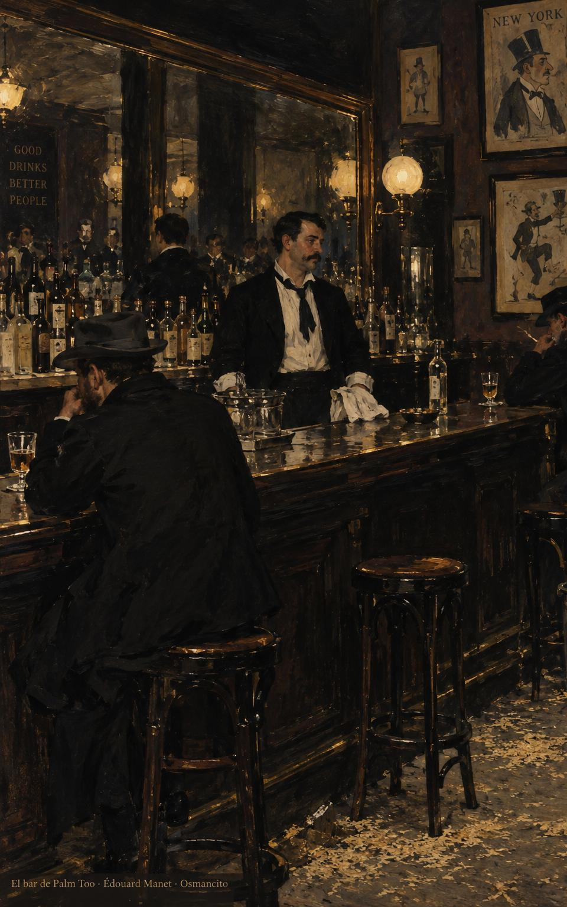](../img/261023_mientras-escribo-ii_decir-lo-que-ves.jpg)

La descripción hace del lector un participante sensorial. Es un oficio que se aprende leyendo y escribiendo, y no solo se trata de cómo describir sino de cuánto. Empieza visualizando lo que quieres que el lector viva y termina traduciéndolo a palabras. Si es escasa, el lector queda miope; si es excesiva, lo entierra en detalles.

> No me entusiasma demasiado la escritura que describe exhaustivamente las características físicas de los personajes del relato y lo que visten (el inventario de vestuario me irrita en particular; si quiero leer descripciones de ropa, siempre puedo conseguir un catálogo de J. Crew). No recuerdo muchos casos en que sintiera que debía describir el aspecto de las personas de un relato mío: prefiero dejar que el lector ponga los rostros, las complexiones y también la ropa. Si te digo que Carrie White es una marginada de instituto con mala piel y un vestuario de víctima de la moda, creo que puedes hacer el resto, ¿no? No necesito darte un repaso grano por grano, falda por falda. Todos recordamos a uno o varios perdedores del instituto, al fin y al cabo; si describo el mío, congelo el tuyo, y pierdo un poco del vínculo de comprensión que quiero forjar entre nosotros. La descripción empieza en la imaginación del escritor, pero debería terminar en la del lector. A la hora de lograrlo de verdad, el escritor tiene mucha más suerte que el cineasta, que casi siempre está condenado a mostrar demasiado... incluida, en nueve casos de diez, la cremallera que sube por la espalda del monstruo.
> [Párrafo 4](#original-w6-p4)

Carrie White es la protagonista de *Carrie,* la primera novela publicada de King. J. Crew es una marca de ropa que King usa como ejemplo de catálogo de prendas. Aquí King propone una idea de lector activo: el lector no recibe la imagen hecha, la completa con sus propios recuerdos, y por eso la descripción corta lo vuelve más cercano. El chiste de la cremallera es de cine de monstruos: la cámara enseña el disfraz, y las palabras no pueden delatarlo.

Para King, el lugar y la textura importan más que el físico de los personajes, y la descripción física no debe ser un atajo para el carácter. La buena descripción son unos pocos detalles bien elegidos, normalmente los primeros que vienen a la mente. Para mostrarlo toma un asador de Nueva York que conoce, Palm Too, y anota lo primero que recuerda: el bar oscuro con el espejo brillante, el serrín en el suelo, las caricaturas en las paredes, el olor a carne y a pescado. Con eso basta, porque lo que importa es la historia. Escribe entonces una muestra: Billy llega en taxi una tarde de verano, mira si está Martin y entra.

> **Tras la claridad abrasadora de la Segunda Avenida, Palm Too estaba oscuro como una cueva. El espejo del fondo de la barra recogía parte del resplandor de la calle y relucía en la penumbra como un espejismo. Por un momento fue todo lo que Billy pudo ver, y luego sus ojos empezaron a adaptarse. Había unos pocos bebedores solitarios en la barra. Más allá, el maître, con la corbata deshecha y los puños de la camisa remangados para mostrar sus muñecas peludas, hablaba con el camarero. Todavía había serrín esparcido por el suelo, notó Billy, como si aquello fuera un bar clandestino de los años veinte y no un restaurante del milenio donde no se podía fumar, y mucho menos escupir un salivazo de tabaco entre los pies. Y las caricaturas que bailaban por las paredes (caricaturas de revista de cotilleos de trapicheros políticos del centro, periodistas que hacía tiempo que se habían jubilado o bebido hasta morir, famosos que no acababas de reconocer) seguían retozando hasta el techo. El aire olía a carne y a cebolla frita. Todo igual que siempre.**
> [Párrafo 12](#original-w6-p12)

Este es el párrafo de muestra que King escribe a la vista del lector. Usa los cuatro detalles que recordó: la oscuridad y el espejo, el serrín, las caricaturas, los olores. Los símiles, «oscuro como una cueva» y «como un espejismo», dan imagen sin gastar espacio. Y el serrín, que parece un detalle inútil, dice algo de la época y del lugar, un vestigio de los bares clandestinos en un sitio donde ya no se puede fumar. El *maître* es quien recibe a los clientes en un restaurante.

El maître pregunta a Billy si puede ayudarlo, y Billy dice que busca a Richie Martin. King explica que la llegada en taxi es narración y la entrada es descripción pura, con casi todos los detalles que le vinieron primero, y que le gusta el maître con la corbata deshecha y los puños remangados: es como una fotografía.

> Volvemos a la narración propiamente dicha con un poco de acción (el maître da un paso adelante hasta el centro del escenario) y luego el diálogo. A estas alturas ya vemos con claridad el lugar. Hay muchos detalles que podría haber añadido (lo estrecho del salón, Tony Bennett en el equipo de sonido, la pegatina de los Yankees en la caja registradora), pero ¿para qué? A la hora de ambientar una escena y de describir en general, una comida vale tanto como un banquete. Queremos saber si Billy ha encontrado a Richie Martin: esa es la historia por la que pagamos nuestros veinticuatro dólares. Más sobre el restaurante frenaría el ritmo de esa historia, quizá irritándonos lo bastante como para romper el hechizo que puede tejer la buena ficción. En muchos casos en que un lector deja un relato de lado porque «se hizo aburrido», el aburrimiento surgió porque el escritor se encandiló con su poder de descripción y perdió de vista su prioridad, que es mantener la pelota rodando. Si el lector quiere saber más sobre Palm Too de lo que hay arriba, puede visitarlo la próxima vez que esté en Nueva York, o pedir un folleto. Ya he gastado aquí tinta suficiente como para indicar que Palm Too será un escenario importante de mi historia. Si resulta que no lo es, haría bien en reducir lo descriptivo en unas cuantas líneas en el siguiente borrador. Desde luego no podría dejarlo por el motivo de que es bueno; *debería* ser bueno, si me pagan por hacerlo. Lo que no me pagan por hacer es complacerme a mí mismo.
> [Párrafo 16](#original-w6-p16)

King comenta su propio texto como un editor. Tony Bennett es un cantante estadounidense de jazz y pop tradicional, y los Yankees son el equipo de béisbol de Nueva York; dos detalles que podría haber añadido y que no añadió, y con eso demuestra su idea de que describir es elegir. Los veinticuatro dólares son el precio que King imagina para un libro nuevo. La advertencia sobre el aburrimiento es la parte más útil: no se aburre el lector del lugar, se aburre de la vanidad del escritor. Y su criterio final es de oficio: si me pagan por hacerlo bien, no me pagan por lucirme.

Hay en el texto descripción directa y otra más poética; a King le gusta la figurada, porque un símil bien puesto deleita como encontrar a un viejo amigo entre desconocidos. Cuando falla, da risa o vergüenza: un novelista, cuyo nombre no da, escribe que alguien esperaba al forense «tan pacientemente como un hombre esperando un sándwich de pavo», y King cierra el libro. El otro riesgo es el cliché. Sus símiles favoritos vienen de la novela negra de los cuarenta y cincuenta.

> La clave de la buena descripción empieza en ver con claridad y acaba en escribir con claridad, la clase de escritura que emplea imágenes frescas y vocabulario sencillo. Empecé a aprender mis lecciones en este terreno leyendo a Chandler, Hammett y Ross MacDonald; quizá gané aún más respeto por el poder del lenguaje descriptivo y compacto leyendo a T. S. Eliot (esas garras desgarradas que corretean por el fondo del océano; esas cucharillas de café) y a William Carlos Williams (gallinas blancas, la carretilla roja, las ciruelas que estaban en la nevera, tan dulces y tan frías).
> [Párrafo 21](#original-w6-p21)

Dashiell Hammett y Ross MacDonald, como Chandler, escribieron novela de detectives. Eliot y Williams son poetas. Las garras y las cucharillas de café vienen de poemas de Eliot, y la carretilla roja y las ciruelas de la nevera, de poemas de Williams: ejemplos de imágenes concretas que dicen mucho en pocas palabras. King va de la novela negra a la poesía sin complejos, y con eso muestra que el oído para la imagen se educa con lecturas muy distintas.

Con la práctica mejorarás, aunque nunca serás perfecto. Tu trabajo es decir lo que ves y seguir con la historia.

---

### W7 · El oído afinado

[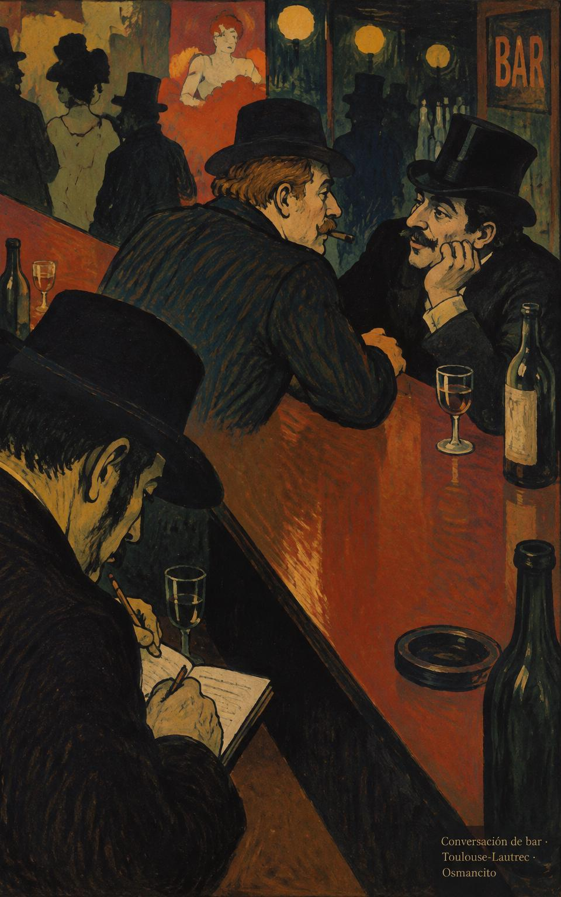](../img/261023_mientras-escribo-ii_el-oido-afinado.jpg)

El diálogo da voz al reparto y define a los personajes; King lo muestra con una escena: un hombre, Mistuh Butts, que apenas fue a la escuela y dice «aminite» por «apetito», y un chico que le pregunta si la Tierra gira alrededor del sol.

> El diálogo bien trabajado indicará si un personaje es listo o tonto (Mistuh Butts no es necesariamente un imbécil solo porque no sabe decir *appetite*; tenemos que escucharlo un rato más antes de formarnos una opinión al respecto), honesto o deshonesto, divertido o un viejo gruñón. El buen diálogo, como el que escriben George V. Higgins, Peter Straub o Graham Greene, es un placer de leer; el mal diálogo es mortal.
> [Párrafo 8](#original-w7-p8)

Higgins, Straub y Greene son tres narradores que King admira por el oído. George V. Higgins, novelista estadounidense de novelas de crimen, es conocido por sus diálogos realistas; Peter Straub escribe novelas de terror; Graham Greene fue un novelista inglés de intriga. La escena de Mistuh Butts muestra por qué: con tres líneas, sin decir que no fue a la escuela, ya sabemos cuánto sabe y cómo se defiende. Y lo que King dice del personaje, que no es necesariamente un imbécil, es la lección: el diálogo da pistas y deja al lector decidir.

No todos tienen el mismo talento para el diálogo, y hay que conocer los propios límites, como dijo el actor Clint Eastwood. Lovecraft, genio del relato macabro, era un mal dialoguista: de sus millones de palabras, menos de cinco mil son diálogo. King cita a un granjero moribundo que habla del color extraterrestre que ha envenenado su pozo, y afirma que nadie habla así, ni en el lecho de muerte.

> Lovecraft era, según todos los testimonios, tan esnob como dolorosamente tímido (y además un racista galopante, con sus relatos llenos de africanos siniestros y de la clase de judíos intrigantes por los que mi tío Oren siempre se preocupaba después de cuatro o cinco cervezas), el tipo de escritor que mantiene una voluminosa correspondencia pero se lleva mal con la gente en persona: si viviera hoy, probablemente existiría con más vigor en diversos chats de internet. El diálogo es una destreza que aprenden mejor las personas a las que les gusta hablar con otros y escucharlos, sobre todo escucharlos, captando los acentos, los ritmos, el dialecto y la jerga de distintos grupos. Los solitarios como Lovecraft suelen escribirlo mal, o con el cuidado de quien compone en una lengua que no es la suya materna.
> [Párrafo 12](#original-w7-p12)

Esta es una opinión de King sobre Lovecraft, y no un dato: la usa para explicar por qué un escritor así tiene mal oído. Su razonamiento tiene dos partes. La primera es que el diálogo se aprende escuchando, y quien no convive no escucha. La segunda, que la timidez de Lovecraft pasaba a la página: un hombre que escribe cartas en vez de hablar escribe a sus personajes como quien traduce. El comentario sobre los chats de internet, de 2000, es un chiste sobre los solitarios que se sienten cómodos por escrito.

Otro caso es *Hart's War,* de John Katzenbach, un misterio en un campo de prisioneros de la Segunda Guerra Mundial: el comandante que se despide habla con frases hechas de película bélica y nada suena verdadero. King lo contrasta con un pasaje de *Be Cool,* de Elmore Leonard, donde dos hombres charlan de una película y de su secuela.

> Dos tipos almorzando en Beverly Hills, y enseguida sabemos que los dos son gente del negocio. Pueden ser unos farsantes (y quizá no lo sean), pero los compramos al instante en el contexto de la historia de Leonard; de hecho, los recibimos con los brazos abiertos. Su conversación es tan real que parte de lo que sentimos es el placer culpable de quien primero sintoniza y luego espía una conversación interesante. También nos hacemos una idea del carácter, aunque solo con trazos tenues. Esto es al principio de la novela (en la página dos, en realidad), y Leonard es un veterano. Sabe que no tiene que hacerlo todo de golpe. Aun así, ¿no aprendemos algo del carácter de Tommy cuando asegura a Chili que *Get Leo* no solo es genial, sino también buena?
> [Párrafo 24](#original-w7-p24)

Elmore Leonard fue un novelista estadounidense de novelas de crimen; *Be Cool* es una de ellas, y Chili y Tommy son los dos hombres de la escena. Beverly Hills es el barrio de Los Ángeles donde viven las estrellas. Lo que King pide al lector que note es la frase «genial, pero también buena»: es un hombre que alaba demasiado y se delata en el reparo. Con una línea Leonard dice cómo es Tommy.

¿Es verdad ese diálogo, o solo la idea que tenemos de Hollywood? Quizá lo segundo, pero suena a verdad: poesía callejera. La clave es la honestidad, y por eso King recibe cartas indignadas por lo que dicen sus personajes.

> Mi madre, que Dios la tenga en su gloria, no aprobaba las palabrotas ni nada por el estilo; lo llamaba «el lenguaje de los ignorantes». Eso no le impedía, sin embargo, gritar «¡Oh, mierda!» si quemaba el asado o se daba un martillazo en el pulgar al clavar un colgador de cuadros en la pared. Ni impide a la mayoría de la gente, cristiana o pagana, decir algo parecido (o incluso más fuerte) cuando el perro vomita sobre la alfombra de pelo largo o el coche se escurre del gato. Es importante decir la verdad; tanto depende de ella, como casi dijo William Carlos Williams cuando escribía sobre aquella carretilla roja. A la Legión de la Decencia quizá no le guste la palabra *mierda,* y a ti quizá tampoco te guste mucho, pero a veces no hay más remedio: ningún niño ha corrido nunca a decirle a su madre que su hermanita acaba de *defecar* en la bañera. Supongo que podría decir *empujó* o *hizo pupú,* pero *se cagó* está, me temo, muy en el terreno (las orejas pequeñas lo oyen todo, al fin y al cabo).
> [Párrafo 27](#original-w7-p27)

La Legión de la Decencia fue una organización católica estadounidense, fundada en 1934, que calificaba películas y presionaba contra las que juzgaba inmorales. King la usa como emblema de cualquier pudor oficial. La broma sobre su madre tiene una enseñanza: el lenguaje que se condena es el que de verdad se dice cuando duele. «Tanto depende de ella» es un eco del primer verso del poema de Williams sobre la carretilla roja, que ya apareció antes en el libro. Y el niño que no dice *defecar* es el argumento de oído: la verdad del diálogo es la verdad de quien habla.

Hay que decir la verdad: cambiar «mierda» por «caramba» por pudor rompe el pacto entre el escritor y el lector, aunque un personaje, una tía solterona, pueda decirlo así si es su carácter. Los censores quieren que veas el mundo como ellos. King coincide con su madre en que la vulgaridad suele ser lenguaje de ignorantes, pero hay excepciones de mucho color, y cita al novelista Richard Dooling.

> **«Prueba A: un pene patán y testarudo, un devorador bárbaro de coños sin una mota de decencia. El cabecilla de todos los bribones. Un sarnoso y vermiforme canalla con un destello serpentino en su único ojo. Un orgulloso turco que ataca en las oscuras bóvedas de la carne como un rayo peniano. Un chucho codicioso que busca sombras, grietas resbaladizas, éxtasis de atún y sueño…»**
> [Párrafo 31](#original-w7-p31)

Este es el pasaje con el que King demuestra que la vulgaridad puede ser poesía. «Prueba A» es la fórmula de las pruebas de un juicio, y Dooling la convierte en una acusación cómica contra un órgano sexual, con palabras de otros siglos como *orgulous* (orgulloso) o *capscallion,* mezcla de «cap» y *rapscallion* (bribón). La vulgaridad no está en el insulto suelto sino en el trabajo de la frase: el ritmo y las imágenes sostienen lo que, dicho de otra manera, sería simple grosería.

Otro pasaje de Dooling prueba lo contrario: se puede ser explícito sin vulgaridad. King creció en la clase media baja y escribe de ella con honestidad; ya hizo las paces con el «mierda» que dicen. Cuando lo acusan de vulgar se consuela con el novelista Frank Norris: «¿Qué me importan sus opiniones? Yo nunca me rebajé. Les dije la verdad». El diálogo, feo o hermoso, es un índice del carácter; la pregunta es cómo suena. Para que suene verdadero, tienes que hablar y, más aún, callar y escuchar.

---

### W8 · Nadie es el malo

[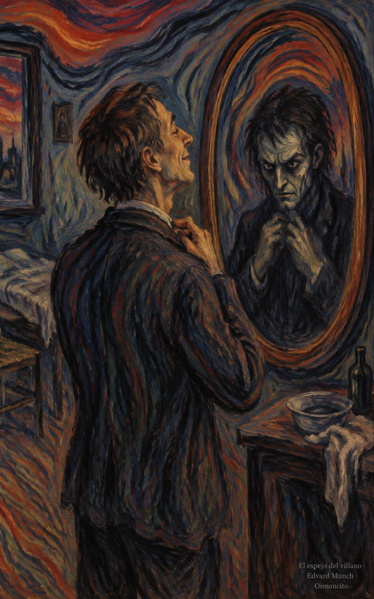](../img/261023_mientras-escribo-ii_nadie-es-el-malo.jpg)

Todo lo dicho del diálogo vale para crear personajes: atender a cómo se comporta la gente real y decir la verdad de lo que ves. El vecino que se hurga la nariz cuando cree que nadie mira es un gran detalle, pero solo sirve si lo llevas a un relato.

> ¿Se dibujan los personajes de ficción directamente de la vida? Obviamente no, al menos de forma uno a uno: *más te vale* que no, a menos que quieras que te demanden o te disparen de camino al buzón una buena mañana. En muchos casos, como en las novelas *roman à clef* del tipo de *Valley of the Dolls,* los personajes están sacados *sobre todo* de la vida, pero cuando los lectores acaban de jugar al inevitable juego de adivinar quién es quién, esos relatos suelen resultar insatisfactorios, rellenos de celebridades de escaparate que se acuestan entre sí y luego se borran pronto de la mente del lector. Leí *Valley of the Dolls* poco después de que saliera (aquel verano era ayudante de cocinero en un complejo turístico del oeste de Maine), devorándola con tanto afán como todos los demás que la compraron, supongo, pero no recuerdo mucho de lo que trataba. En conjunto, creo que prefiero la bazofia semanal que sirve *The National Enquirer,* donde puedo conseguir recetas y fotos de pin-ups además de escándalo.
> [Párrafo 2](#original-w8-p2)

*Roman à clef* es una expresión francesa, «novela con clave», para el libro cuyos personajes son personas reales con otro nombre. *Valley of the Dolls* es el mismo libro de Jacqueline Susann que King mencionó antes. *The National Enquirer* es un semanario sensacionalista estadounidense. La broma tiene su lado serio: un personaje copiado de la vida se queda en retrato, y el lector lo olvida; el personaje que funciona nace de mezclar, no de calcar. King, que cuenta que aquel verano trabajaba de ayudante de cocina, se incluye entre los lectores que devoraron el libro y no recuerdan nada.

Lo que le pasa a un personaje depende de lo que King descubre de él al avanzar, de cómo crece; si crece mucho, influye en el rumbo de la historia. Casi siempre parte de una situación, y las mejores historias terminan tratando de las personas, pero la historia debe mandar. Y nadie en la vida real es «el malo» o «el mejor amigo»: cada uno se cree el protagonista.

> Annie Wilkes, la enfermera que tiene prisionero a Paul Sheldon en *Misery,* puede parecernos psicópata, pero es importante recordar que a sí misma le parece perfectamente cuerda y razonable; heroica, de hecho, una mujer asediada que intenta sobrevivir en un mundo hostil lleno de *cockadoodie brats.* La vemos pasar por peligrosos cambios de humor, pero procuré no decir nunca sin más «Annie estaba deprimida y posiblemente suicida ese día» ni «Annie parecía especialmente feliz ese día». Si tengo que decírtelo, pierdo. Si, en cambio, puedo mostrarte a una mujer silenciosa, de pelo sucio, que devora compulsivamente tarta y caramelos, y hacer que tú saques la conclusión de que Annie está en la parte depresiva de un ciclo maníaco-depresivo, gano. Y si consigo, aunque sea brevemente, darte una visión del mundo desde los ojos de Wilkes (si consigo que entiendas su locura), quizá pueda convertirla en alguien con quien simpatices o incluso te identifiques. ¿El resultado? Da más miedo que nunca, porque se acerca a lo real. Si, en cambio, la convierto en una vieja bruja cacareante, es otra bruja de caja de sorpresas. En ese caso pierdo por goleada, y el lector también. ¿Quién querría pasar un rato con una arpía tan rancia? Esa versión de Annie era vieja ya cuando *El mago de Oz* estaba en su primer estreno.
> [Párrafo 5](#original-w8-p5)

Aquí King aplica a Annie la regla que enunció para todo el libro: mostrar, no decir. La torta y los caramelos hacen el trabajo de la palabra «depresión», y el lector llega solo. Lo más llamativo es la paradoja: entender a Annie la hace más aterradora, porque ya no es un monstruo de feria sino alguien que podría estar al otro lado de la puerta. La bruja cacareante es la del cine de los años treinta, y por eso King dice que ya era vieja cuando se estrenó la película de Oz.

¿Es Paul Sheldon el propio King? En parte, como todo personaje, que mezcla lo que tú harías, rasgos observados en otros e imaginación pura; ser Annie le resultó fácil y divertido, ser Paul más difícil. *The Dead Zone* nació de dos preguntas: ¿puede tener razón un asesino político, y puede ser el héroe? Su protagonista, Johnny Smith, ve el futuro por un accidente de infancia; al estrechar la mano del político Greg Stillson lo ve presidente y causante de una guerra mundial, y concluye que debe pegarle un tiro. King quería un Johnny decente sin ser un santo de yeso, y un Stillson persuasivo y repulsivo.

> Cuando conocemos por primera vez al posible asesino, lleva a su chica a la feria del condado, montando en las atracciones y jugando a los juegos. ¿Qué podría ser más normal o más simpático? El hecho de que esté a punto de proponerle matrimonio a Sarah nos lo hace caer aún mejor. Más tarde, cuando Sarah sugiere rematar una cita perfecta durmiendo juntos por primera vez, Johnny le dice que quiere esperar hasta que estén casados. Sentí que caminaba por la cuerda floja con eso: quería que los lectores vieran a Johnny como sincero y sinceramente enamorado, un tipo franco pero no un mojigato estirado. Pude suavizar un poco su conducta de principios dándole un sentido del humor infantil; saluda a Sarah con una máscara de Halloween que brilla en la oscuridad (ojalá la máscara funcione también de forma simbólica; desde luego a Johnny lo perciben como un monstruo cuando apunta con un arma al candidato Stillson). «El mismo Johnny de siempre», dice Sarah riendo, y para cuando los dos regresan de la feria en el viejo Escarabajo de Volkswagen de Johnny, creo que Johnny Smith se ha convertido en nuestro amigo, un estadounidense corriente que espera vivir feliz para siempre. El tipo de hombre que te devolvería la cartera con el dinero dentro si la encontrara en la calle, o que se detendría a ayudarte a cambiar un pinchazo si te encontrara averiado al borde de la carretera. Desde que dispararon a John F. Kennedy en Dallas, el gran coco estadounidense ha sido el tipo del rifle en un lugar alto. Yo quería hacer de ese tipo el amigo del lector.
> [Párrafo 10](#original-w8-p10)

Sarah es la novia de Johnny en la novela. El paso importante es el último: si el lector quiere a Johnny, entonces el disparo que se prepara se vuelve una tragedia y no un crimen, y la pregunta moral de la novela (¿puede ser bueno un asesino?) se instala en el lector sin explicarla. Kennedy fue asesinado en 1963, en Dallas, y King dice que desde entonces el hombre con rifle es el miedo nacional; elige a propósito ese miedo y lo viste de amigo.

> Johnny fue difícil. Tomar a un tipo corriente y hacerlo vívido e interesante siempre lo es. Greg Stillson (como la mayoría de los villanos) fue más fácil y mucho más divertido. Quería clavar su carácter peligroso y dividido en la primera escena del libro. Aquí, varios años antes de presentarse a la Cámara de Representantes de Estados Unidos por New Hampshire, Stillson es un joven viajante que vende Biblias a la gente del campo del Medio Oeste. Cuando se detiene en una granja, lo amenaza un perro que gruñe. Stillson se mantiene amable y sonriente (el señor Gente Sencilla) hasta que está seguro de que no hay nadie en la granja. Entonces rocía gas lacrimógeno en los ojos del perro y lo mata a patadas.
> [Párrafo 11](#original-w8-p11)

La escena presenta la cara doble del personaje en un solo gesto: sonríe mientras lo miran y mata cuando nadie ve. «Gente sencilla» es la pose que usará más tarde en política, y el perro le sirve de prueba. King dice que el villano es más fácil que el héroe, porque lo extremo se distingue sin esfuerzo y lo corriente exige oído fino.

La primera escena le valió cartas indignadas por la crueldad con los animales. King contestó que ni Stillson ni el perro eran reales y que él nunca había pateado a una mascota; lo importante era mostrar de entrada que Stillson era muy peligroso. Siguió construyendo a ambos en escenas alternas hasta el enfrentamiento. Los personajes los determina la historia, el fósil: deben ayudar a la historia y parecer razonables. Si lo haces bien, cobran vida y hacen cosas por su cuenta.

---

### W9 · Todo sobre la mesa

Hasta aquí, lo básico: práctica y honestidad. Quedan los adornos, como la onomatopeya, el tiempo verbal, la historia de fondo, el tema o el ritmo, que los cursos explican a veces hasta el agotamiento. King responde sencillo: todo está sobre la mesa, usa lo que mejore tu escritura y no estorbe a la historia; si una frase aliterada queda mal, para eso está la tecla de borrar.

> No hay absolutamente ninguna necesidad de ser rígido y conservador en tu trabajo, igual que no estás obligado a escribir prosa experimental y no lineal porque *The Village Voice* o *The New York Review of Books* digan que la novela ha muerto. Tanto lo tradicional como lo moderno están a tu disposición. Mierda, escribe cabeza abajo si quieres, o hazlo con pictogramas de Crayola. Pero hagas lo que hagas, llega un punto en que debes juzgar lo que has escrito y lo bien que lo has escrito. No creo que un relato o una novela deba salir por la puerta de tu estudio o cuarto de escribir a menos que te sientas seguro de que es razonablemente amable con el lector. No puedes complacer a todos los lectores todo el tiempo; no puedes complacer ni siquiera a algunos lectores todo el tiempo, pero de verdad deberías intentar complacer al menos a algunos lectores algunas veces. Creo que lo dijo William Shakespeare. Y ahora que he agitado esa bandera de precaución, cumpliendo debidamente todas las normas de la OSHA, de MENSA, de la NASA y del Sindicato de Escritores, permíteme reiterar que todo está sobre la mesa, todo disponible. ¿No es un pensamiento embriagador? Creo que sí. Prueba cualquier maldita cosa que te guste, por aburridamente normal o escandalosa que sea. Si funciona, bien. Si no, tírala. Tírala aunque la ames. Sir Arthur Quiller-Couch dijo una vez: «Mata a tus favoritos», y tenía razón.
> [Párrafo 4](#original-w9-p4)

*The Village Voice* y *The New York Review of Books* son dos publicaciones de Nueva York que King usa de símbolo de la crítica seria. Crayola es una marca de lápices de cera. OSHA es la agencia estadounidense de seguridad laboral y MENSA, un club de gente de alto coeficiente; King las menciona como autoridades de las que se burla al poner su propia advertencia. Arthur Quiller-Couch fue un crítico y novelista británico, y su frase «mata a tus favoritos» se entiende así: corta incluso el pasaje que más gusta si no sirve a la historia. El párrafo guarda un equilibrio: libertad total, con una sola prueba, que el texto sea amable con el lector. En cuanto a la frase atribuida a Shakespeare, es otra broma: la frase es popular, de dudoso dueño.

Los adornos suelen aparecer cuando ya está hecho lo básico. Al ver que el protagonista de *The Green Mile* era un inocente a punto de morir por el crimen de otro, King le puso las iniciales J. C., como Jesucristo, igual que Faulkner con Joe Christmas en *Light in August.* Después, con la historia terminada, relee y busca patrones. El simbolismo no tiene que ser difícil: es un hueso más del fósil, y si está, hay que sacarle brillo.

> *Carrie,* como ya he señalado, es una novela corta sobre una chica a la que todos fastidian y que descubre en sí misma una capacidad telequinética: puede mover objetos pensando en ellos. Para expiar una cruel broma en las duchas en la que ha participado, la compañera de clase de Carrie, Susan Snell, convence a su novio de que invite a Carrie al baile de graduación. Los eligen rey y reina. Durante la celebración, otra compañera de Carrie, la desagradable Christine Hargensen, le gasta una segunda broma, esta vez mortal. Carrie se venga usando su poder telequinético para matar a la mayoría de sus compañeros (y a su atroz madre) antes de morir ella misma. Eso es todo, en realidad; es tan sencillo como un cuento de hadas. No había necesidad de estropearlo con adornos, aunque *sí* añadí varios interludios epistolares (pasajes de libros ficticios, una anotación de diario, cartas, boletines de teletipo) entre los segmentos narrativos. Fue en parte para inyectar mayor sensación de realismo (pensaba en la adaptación radiofónica de *War of the Worlds* hecha por Orson Welles), pero sobre todo porque el primer borrador del libro era tan condenadamente corto que apenas parecía una novela.
> [Párrafo 10](#original-w9-p10)

Aquí King resume su primera novela publicada para usarla de ejemplo. Telequinesis es mover objetos con la mente. Lo que importa es la confesión: los interludios que dan el aire de documento los puso por dos razones, una de oficio (el realismo, como en la célebre adaptación radiofónica de Welles de 1938) y otra más modesta, el libro era corto. Es una forma de decir que no todo adorno nace de una gran intención, y que a veces la necesidad enseña.

Al releer *Carrie,* King notó sangre en los tres momentos clave: el principio (la primera regla de Carrie), el clímax (el cubo de sangre de cerdo en el baile) y el final (Sue Snell descubre que no está embarazada). No lo buscó; pensar en *Carrie* como manjar intelectual sería de locos. Pero el significado estaba ahí.

> Fuera o no un manjar intelectual, el significado de toda esa sangre era difícil de pasar por alto cuando empecé a releer mi manuscrito del primer borrador, salpicado de cerveza y de té. Así que empecé a jugar con la idea, la imagen y las connotaciones emocionales de la sangre, tratando de pensar en tantas asociaciones como pudiera. Había muchas, casi todas bastante pesadas. La sangre está fuertemente ligada a la idea de sacrificio; para las mujeres jóvenes se asocia con alcanzar la madurez física y la capacidad de dar a luz; en la religión cristiana (y en muchas otras) simboliza a la vez el pecado y la salvación. Por último, se asocia con la transmisión de rasgos y talentos familiares. Se dice que nos parecemos a esto o nos comportamos como aquello porque «lo llevamos en la sangre». Sabemos que no es muy científico, que esas cosas están en realidad en nuestros genes y en los patrones del ADN, pero usamos lo uno para resumir lo otro.
> [Párrafo 13](#original-w9-p13)

Este es el método de King para el símbolo: primero la historia, luego la lectura. Él no puso la sangre como símbolo; la vio al releer y entonces la pulió. Su lista es una pequeña lección: sacrificio, madurez, pecado y salvación, herencia. Cada asociación sirve a la novela, porque en *Carrie* hay una chica que sangra, un baile que se vuelve sacrificio y una herencia familiar que pesa. Lo último, «lo llevamos en la sangre», muestra el valor del símbolo: ahorra una explicación científica con una frase que todos entienden.

Esa capacidad de resumir hace interesante el símbolo, que es otra forma de lenguaje figurado. No es necesario para el éxito de un cuento y puede hacer daño si te dejas llevar: solo la historia trata de la historia. Pero puede enfocar al escritor y al lector. Si es parte del fósil, potencia; si no, déjalo.

---

### W10 · De qué trata

[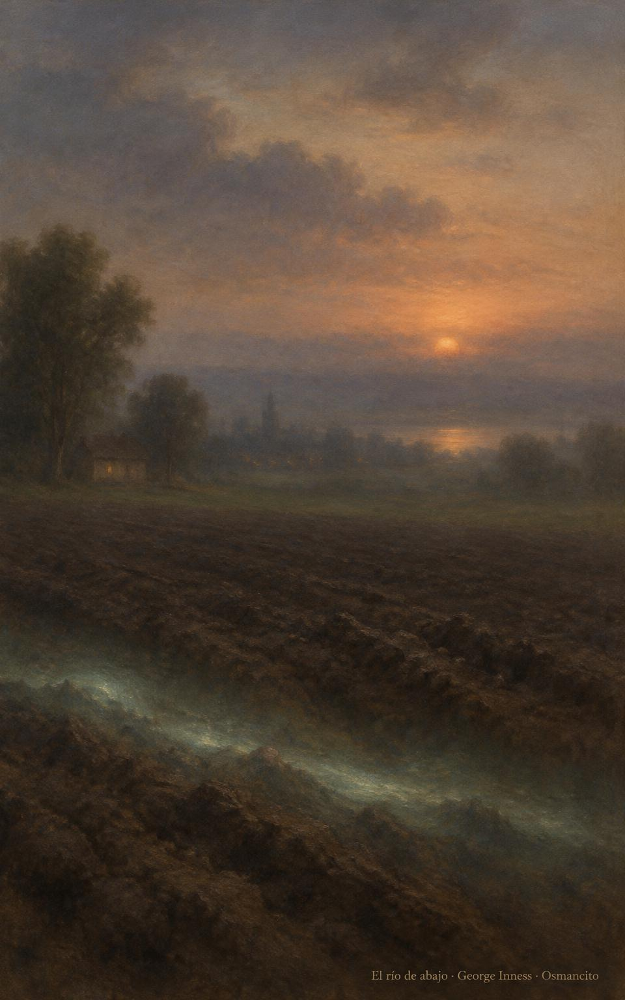](../img/261023_mientras-escribo-ii_de-que-trata.jpg)

Lo mismo vale para el tema: los cursos lo tratan como una vaca sagrada, pero no es para tanto. Al terminar un libro hay que dar un paso atrás y preguntarse de qué trata, para aclararlo en el segundo borrador. El libro que más tardó en escribir King fue *The Stand,* unos dieciséis meses el primer borrador, porque casi muere en la recta final.

> Yo había querido escribir una novela extensa, con muchos personajes (una épica de fantasía, si lo lograba), y con ese fin empleé una narración de perspectiva cambiante, añadiendo un personaje importante en cada capítulo de la larga primera sección. Así, el Capítulo Uno se ocupaba de Stuart Redman, un obrero de fábrica de Texas; el Capítulo Dos se ocupaba primero de Fran Goldsmith, una universitaria embarazada de Maine, y luego volvía a Stu; el Capítulo Tres empezaba con Larry Underwood, un cantante de rock and roll de Nueva York, antes de volver primero a Fran y luego otra vez a Stu Redman.
> [Párrafo 4](#original-w10-p4)

*The Stand* es una de las novelas más largas de King: un virus creado por el hombre arrasa a la humanidad y los supervivientes se reúnen en dos bandos. Aquí se ve la técnica que usó para abrir el libro: un personaje nuevo por capítulo, que se suma a los anteriores como los afluentes de un río. Es un método de situación y de reparto, y por eso él no sabe aún cómo van a encontrarse.

Planeaba reunir a los personajes, buenos y malos, en dos ciudades, Boulder y Las Vegas, con un virus que mata al noventa y nueve por ciento de la humanidad.

> Escribía esta historia hacia el final de la llamada Crisis de la Energía de los años setenta, y me lo pasé absolutamente maravillosamente imaginando un mundo que se hacía pedazos durante un solo verano horrorizado e infectado (en realidad poco más de un mes). La vista era panorámica, detallada, de todo el país y (al menos para mí) de quitar el aliento. Pocas veces he visto con tanta claridad con el ojo de mi imaginación, desde el atasco que tapona el tubo muerto del túnel Lincoln de Nueva York hasta el siniestro renacer casi nazi de Las Vegas bajo el ojo rojo, vigilante (y a menudo divertido), de Randall Flagg. Todo esto suena terrible, *es* terrible, pero para mí la visión era también extrañamente optimista. Para empezar, se acababa la crisis de la energía, ya no más hambre, ya no más masacres en Uganda, ya no más lluvia ácida ni agujero en la capa de ozono. *Finito* también para las superpotencias nucleares que hacían sonar sables, y desde luego se acababa la superpoblación. En su lugar, había una oportunidad para que lo que quedaba de la humanidad empezara de nuevo en un mundo centrado en Dios al que habían regresado los milagros, la magia y la profecía. Me gustaba mi historia. Me gustaban mis personajes. Y aun así llegó un momento en que ya no pude escribir porque no sabía qué escribir. Como Pilgrim en la epopeya de John Bunyan, había llegado a un lugar donde se había perdido el camino recto. No fui el primer escritor en descubrir este lugar terrible, y estoy muy lejos de ser el último; esta es la tierra del bloqueo del escritor.
> [Párrafo 6](#original-w10-p6)

Randall Flagg es el villano de la novela, y Pilgrim, el héroe de *El progreso del peregrino,* una alegoría cristiana del siglo XVII de John Bunyan, en la que el protagonista pierde el camino recto. La imagen sirve a King para decir que el bloqueo del escritor no es un fracaso raro, sino un lugar por el que pasan todos. El párrafo revela algo: el escritor ama su historia y sus personajes y aun así se atasca. El bloqueo no viene de falta de ganas.

Con más de quinientas páginas escritas no podía abandonar el libro. Empezó a dar largos paseos, aburrido, pensando en el manuscrito. Tras semanas sin salida, la respuesta llegó de golpe: el mundo de su novela estaba demasiado poblado de supervivientes, y la solución era otra explosión, una bomba en el armario de un personaje, que forzaría a los supervivientes a viajar de Boulder a Las Vegas. Lo que más ama de escribir es ese destello. El resto del libro fluyó en nueve semanas. Terminado el primer borrador, entendió qué lo había detenido.

> La verdadera fuente de mi malestar, decidí, había sido que, tras la plaga, mis personajes de Boulder, los buenos, estaban poniendo en marcha el mismo viejo viaje de muerte tecnológico. Las primeras vacilantes emisiones de radio de banda ciudadana, que llamaban a la gente a Boulder, pronto llevarían a la televisión; los infomerciales y los números 900 volverían enseguida. Lo mismo con las centrales eléctricas. Desde luego a mi gente de Boulder no le llevó mucho decidir que buscar la voluntad del Dios que los había salvado era mucho menos importante que volver a poner en marcha las neveras y los aires acondicionados. En Las Vegas, Randall Flagg y sus amigos aprendían a pilotar reactores y bombarderos además de volver a encender las luces, pero estaba bien, era de esperar, porque eran los malos. Lo que me había detenido era darme cuenta, en algún nivel de mi mente, de que los buenos y los malos empezaban a parecerse peligrosamente, y lo que me puso otra vez en marcha fue darme cuenta de que los buenos adoraban un becerro de oro electrónico y necesitaban una llamada de atención. Una bomba en el armario serviría perfectamente.
> [Párrafo 12](#original-w10-p12)

Aquí King explica lo que no sabía mientras escribía: el bloqueo era una señal. Sus buenos repetían el mal que los había matado, y él lo sentía sin saberlo. La bomba, en ese sentido, es un correctivo moral del propio libro. El becerro de oro es la imagen bíblica de un ídolo hecho por el hombre, aquí la tecnología. Los números 900 son líneas telefónicas de pago de los años ochenta y noventa, y los infomerciales, los anuncios largos de televisión: dos símbolos de lo que él llama la vieja carrera tecnológica.

> Todo esto me sugirió que la violencia como solución está tejida en la naturaleza humana como un hilo rojo condenatorio. Ese se convirtió en el tema de *The Stand,* y escribí el segundo borrador con él firmemente fijado en la mente. Una y otra vez los personajes (los malos como Lloyd Henreid y los buenos como Stu Redman y Larry Underwood) mencionan el hecho de que «todas esas cosas [es decir, las armas de destrucción masiva] están ahí tiradas, esperando a que alguien las recoja». Cuando los de Boulder proponen (inocentemente, con la mejor intención) reconstruir la misma vieja torre de Babel de neón, los borra más violencia. Los que ponen la bomba hacen lo que Randall Flagg les dijo, pero la Madre Abagail, la contrafigura de Flagg, dice una y otra vez que «todas las cosas sirven a Dios». Si esto es verdad (y dentro del contexto de *The Stand* desde luego lo es), entonces la bomba es en realidad un mensaje severo del de arriba, una manera de decir: «No os traje hasta aquí solo para que volvierais a empezar la misma vieja mierda».
> [Párrafo 13](#original-w10-p13)

Este párrafo muestra el orden que King defiende: primero la historia, después el tema. Lo encuentra al releer y entonces lo refuerza en el segundo borrador, sin cambiar el relato. La torre de Babel es el relato bíblico de una torre que los hombres levantan para llegar al cielo y que Dios derriba. La Madre Abagail es la anciana de la novela que habla con Dios. «El de arriba» es una forma coloquial de decir Dios. Y la última frase, con su humor y su dureza, resume el tema en un tono que solo King usa: no sermonea, se burla.

Cerca del final, Fran pregunta a Stu si hay esperanza de que la gente aprenda, y Stu responde «no sé»; King no encontró una frase mejor. No hay moraleja en *The Stand,* pero si el tema se ve, otros sacarán las suyas. Antes de ese libro no había pensado en el tema; pensar temáticamente es una lupa más en la caja de herramientas, y desde entonces se pregunta de qué trata lo que escribe y por qué.

> No creo que ningún novelista, ni siquiera uno que haya escrito cuarenta y pico libros, tenga demasiadas preocupaciones temáticas; tengo muchos intereses, pero solo unos pocos lo bastante profundos como para mover novelas. Estos intereses profundos (no los llamaré del todo obsesiones) incluyen lo difícil que es, ¡quizá imposible!, volver a cerrar la tecnocaja de Pandora una vez abierta *(The Stand, The Tommyknockers, Firestarter);* la pregunta de por qué, si hay un Dios, ocurren cosas tan terribles *(The Stand, Desperation, The Green Mile);* la delgada línea entre la realidad y la fantasía *(The Dark Half, Bag of Bones, The Drawing of the Three);* y sobre todo, la terrible atracción que la violencia ejerce a veces sobre personas fundamentalmente buenas *(The Shining, The Dark Half).* También he escrito una y otra vez sobre las diferencias fundamentales entre niños y adultos, y sobre el poder curativo de la imaginación humana.
> [Párrafo 18](#original-w10-p18)

La caja de Pandora es el mito griego de la caja que, una vez abierta, suelta los males del mundo; King la usa como imagen de la tecnología que no se puede volver a cerrar. La lista es el mapa de su obra: cada preocupación sostiene varios libros. Lo importante es la modestia del párrafo, sus intereses profundos son pocos, y eso basta. Tampoco los llama obsesiones ni los eligió por estrategia: surgieron de su vida.

Estos intereses nacieron de la vida y de los pensamientos de King, y los tuyos nacerán de la tuya: úsalos. Pero empezar por el tema es receta de mala ficción: la buena ficción empieza por la historia y llega al tema, con la posible excepción de alegorías como *Animal Farm,* de George Orwell. Una vez que tienes la historia en el papel, piensa qué significa y enriquece los borradores siguientes con tus conclusiones; si no, privas a tu obra de la visión que la hace única.

---

### W11 · Puerta cerrada, puerta abierta

King revisa en dos borradores y una última limpieza. Otros escritores corrigen cada página hasta acabarla; a quien empieza le recomienda escribir primero a solas y después admitir lectores. Avanzar deprisa protege el entusiasmo frente a la duda.

> Este primer borrador, el Borrador de Toda la Historia, debe escribirse sin ayuda (ni interferencia) de nadie más. Puede llegar un momento en que quieras mostrarle lo que estás haciendo a un amigo íntimo (muy a menudo, el primero que se te ocurre es quien comparte tu cama), ya sea porque estás orgulloso de lo que haces o porque tienes dudas. Mi mejor consejo es que resistas ese impulso. Mantén la presión; no la rebajes exponiendo lo escrito a las dudas, los elogios o incluso las preguntas bienintencionadas de alguien del Mundo Exterior. Deja que la esperanza de triunfar (y el miedo al fracaso) te lleven adelante, por difícil que sea. Ya habrá tiempo de presumir de lo que has hecho cuando termines… pero incluso después de terminar creo que debes ser prudente y darte la oportunidad de pensar mientras la historia sigue siendo como un campo de nieve recién caída, sin más huellas que las tuyas.
> [Párrafo 4](#original-w11-p4)

La nieve guarda algo más que intimidad: permite reconocer qué decisiones nacieron de la historia y cuáles aparecieron al responder a otra persona. King no pide que el escritor renuncie a ser leído. Separa dos momentos que pueden estorbarse: descubrir lo que se quiere contar y comprobar si otro logra entenderlo.

A solas no hay que justificar símbolos ni entretenerse en los elogios. Al acabar se puede entregar el manuscrito a alguien, con una condición: que espere para comentarlo.

> Esto puede sonar un poco autoritario, pero en realidad no lo es. Has trabajado mucho y necesitas un período de descanso (su duración depende de cada escritor). Tu mente y tu imaginación, dos cosas relacionadas pero que no son lo mismo, tienen que renovarse, al menos en lo que concierne a esta obra concreta. Mi consejo es que te tomes un par de días libres, vayas a pescar, salgas en kayak, hagas un rompecabezas, y después te pongas a trabajar en otra cosa. Algo más corto, preferiblemente, y que suponga un cambio completo de dirección y de ritmo respecto del libro que acabas de terminar. (Escribí algunas novelas cortas bastante buenas, entre ellas «The Body» y «Apt Pupil», entre borradores de obras más largas como *The Dead Zone* y *The Dark Half*).
> [Párrafo 8](#original-w11-p8)

Descansar de un libro no equivale aquí a dejar de escribir. Cambiar de escala y de asunto permite que una obra pierda su dominio sobre la atención. Por eso aparecen juntos el rompecabezas y las novelas cortas: no tienen el mismo valor literario, pero ambos pueden interrumpir la familiaridad que impide ver errores.

Propone guardar el libro al menos seis semanas, sin releer sus mejores páginas. Después hay que leerlo, si se puede, de una sentada, con lápiz y papel: corregir faltas e incoherencias y aprovechar la distancia que lo vuelve casi ajeno.

> Con seis semanas de recuperación también podrás ver los agujeros evidentes de la trama o del desarrollo de los personajes. Hablo de agujeros por los que podría pasar un camión. Es asombroso que algunas de estas cosas se le escapen al escritor mientras está ocupado en el trabajo diario de componer. Y escucha: si descubres unos cuantos agujeros de esos grandes, tienes *prohibido* deprimirte por ellos o castigarte. Hasta los mejores metemos la pata. Hay una historia según la cual el arquitecto del edificio Flatiron se suicidó al descubrir, justo antes de la ceremonia de inauguración, que había olvidado poner baños de hombres en su rascacielos pionero. Probablemente no sea cierta, pero recuerda esto: alguien *sí que* diseñó el *Titanic* y después lo declaró insumergible.
> [Párrafo 15](#original-w11-p15)

El Flatiron es un edificio de Nueva York terminado en 1902 y diseñado por Daniel Burnham, que murió en 1912 en Alemania por enfermedad, no por aquel supuesto olvido. King ya presenta la historia como dudosa. También conviene distinguir el desastre del *Titanic*, el transatlántico hundido en 1912, de la leyenda publicitaria de su invulnerabilidad: la afirmación de que era insumergible circuló, pero no permite atribuírsela sin más al diseñador. Los ejemplos alivian la vergüenza del error; no hacen falta como pruebas históricas para aceptar que un borrador necesita revisión.

En esa lectura King detecta acciones impropias de un personaje, aclara pronombres y corta adverbios. Bajo esas reparaciones busca una forma para el conjunto.

> Por debajo, sin embargo, me hago las Grandes Preguntas. La mayor: ¿es coherente esta historia? Y si lo es, ¿qué convertirá esa coherencia en una canción? ¿Cuáles son los elementos recurrentes? ¿Se entrelazan y forman un tema? Me pregunto de qué va todo esto, Stevie, en otras palabras, y qué puedo hacer para que esas preocupaciones de fondo queden aún más claras. Lo que más quiero es *resonancia*, algo que permanezca un rato en la mente (y en el corazón) del Lector Constante después de cerrar el libro y devolverlo al estante. Busco maneras de lograrlo sin dárselo todo masticado al lector ni vender mi primogenitura por un plato de mensaje. Agarra todos esos mensajes y esas moralejas y métetelos donde no da el sol, ¿de acuerdo? Quiero resonancia. Sobre todo, *busco lo que quise decir*, porque en el segundo borrador querré añadir escenas e incidentes que refuercen ese sentido. También querré borrar lo que vaya en otras direcciones. Suele haber mucho de eso, sobre todo al principio de una historia, cuando tengo tendencia a dar palos de ciego. Todo ese manoteo tiene que desaparecer si quiero conseguir algo parecido a un efecto unificado. Cuando termino de leer y de hacer todas mis pequeñas revisiones de maniático del detalle, llega el momento de abrir la puerta y mostrar lo escrito a cuatro o cinco amigos íntimos que hayan manifestado ganas de echarle un vistazo.
> [Párrafo 19](#original-w11-p19)

«Stevie» es el propio Stephen, hablándose como quien le pide cuentas a un amigo. «Lector Constante» es su manera de dirigirse a quien vuelve a sus libros. Buscar lo que quiso decir después de escribirlo no es una contradicción: el primer intento puede contener relaciones que todavía no se reconocían. La revisión las vuelve perceptibles sin reducirlas a una lección que el lector deba repetir.

Su primera lectora es Tabitha, su esposa. La aprecia porque lo apoya y también lo contradice: distingue una preferencia discutible de un error comprobable. Lo ilustra con una película: la esposa de su director advirtió que la actriz tragaba cuando debía estar muerta. Él aceptó la corrección.

> Además de la primera lectura de Tabby, suelo mandar los manuscritos a entre cuatro y ocho personas que han criticado mis historias a lo largo de los años. Muchos manuales de escritura previenen contra pedirles a los amigos que lean tus cosas: sugieren que difícilmente recibirás una opinión muy imparcial de gente que ha cenado en tu casa y ha mandado a sus hijos a jugar con los tuyos en el patio. Según ese punto de vista, es injusto poner a un amigo en semejante situación. ¿Qué pasa si siente que tiene que decir: «Lo siento, amigo, has escrito historias buenísimas, pero esta es una mierda como un piano»?
> [Párrafo 25](#original-w11-p25)

«Tabby» es el nombre familiar de Tabitha. La amistad puede sesgar una lectura, pero también permite hablar con una franqueza que un desconocido no se tomaría. La pregunta útil no es si el lector carece de afectos, sino si puede señalar una dificultad sin tener que proteger al escritor de cualquier disgusto.

Si las opiniones se contradicen, King conserva su decisión; si coinciden en una dificultad, la atiende. Prefiere enterarse de un fracaso entre amigos y antes de imprimirlo.

> Algunos primeros lectores se especializan en señalar errores de hecho, que son los más fáciles de resolver. Uno de mis sabios primeros lectores, el difunto Mac McCutcheon, un magnífico profesor de inglés de secundaria, sabía mucho de armas. Si yo hacía que un personaje llevara un Winchester del .330, Mac podía anotar al margen que Winchester no fabricaba ese calibre, pero Remington sí. En esos casos consigues dos por el precio de uno: el error y la solución. Es un buen trato, porque quedas como un experto y tu primer lector se siente halagado de haber ayudado. Y el mejor hallazgo que Mac hizo para mí no tuvo nada que ver con armas. Un día, mientras leía una parte de un manuscrito en la sala de profesores, se echó a reír; se rio tanto, de hecho, que las lágrimas le rodaron por las mejillas barbudas. Como la historia en cuestión, *’Salem’s Lot*, no pretendía ser un festival de carcajadas, le pregunté qué había encontrado. Yo había escrito una frase que decía más o menos así: **Aunque la temporada de caza del ciervo no empieza hasta noviembre en Maine, los campos de octubre suelen resonar con disparos; los lugareños matan a tantos campesinos como creen que sus familias podrán comerse.** Sin duda un corrector habría detectado el error, pero Mac me ahorró esa vergüenza.
> [Párrafo 28](#original-w11-p28)

La broma nace de dos palabras del inglés: *pheasants* significa «faisanes» y *peasants*, «campesinos». Una letra desaparecida convierte la caza en canibalismo. Traducir la palabra equivocada conserva el disparate, pero no permite ver por sí solo lo pequeño del tropiezo original. También muestra una diferencia entre corregir hechos y corregir sentido: una oración puede estar bien formada y decir algo que su autor jamás quiso escribir.

La resistencia a los cambios aumenta cuando se toca un pasaje querido. Eso no elimina la importancia de escuchar a lectores que señalan el mismo problema.

> Y sí, puedo comprender, al menos un poco, esa clase de resentimiento. En el cine, donde he llevado una vida casi profesional, las primeras exhibiciones de un borrador se llaman «proyecciones de prueba». Se han vuelto habituales en la industria y sacan por completo de quicio a la mayoría de los cineastas. Tal vez con razón. El estudio suelta entre quince y cien millones de dólares para hacer una película y luego le pide al director que la vuelva a montar basándose en las opiniones del público de un multicine de Santa Bárbara, formado por peluqueros, vigilantes de parquímetros, dependientes de zapatería y repartidores de pizza sin trabajo. ¿Y lo peor, lo que más los enloquece? Si eliges bien el grupo de población, las proyecciones de prueba parecen funcionar.
> [Párrafo 31](#original-w11-p31)

La enumeración deja oír el orgullo herido de quien descubre que una persona sin su oficio puede detectar un problema real. King no convierte por eso una novela en una votación comercial. La comparación le permite admitir una incomodidad: el conocimiento del autor sobre cómo hizo la obra no le garantiza saber cómo la recibe otro.

Para él pesa más la opinión de Tabitha, la persona a quien desea emocionar. Imaginarla leyendo ya orienta el borrador; verla reír confirma después si la escena funciona. La llama su Lectora Ideal.

> Esto no siempre se lo pone fácil. Le di el manuscrito de mi novela corta *Hearts in Atlantis* cuando estábamos en Carolina del Norte, adonde habíamos ido a ver un partido de la WNBA entre las Cleveland Rockers y las Charlotte Sting. Al día siguiente viajamos en coche hacia el norte, a Virginia, y fue durante ese trayecto cuando Tabby leyó mi historia. Tiene algunas partes graciosas, o al menos eso creía yo, y no dejaba de mirarla de reojo para ver si soltaba una risita (o por lo menos sonreía). Pensaba que no se daría cuenta, pero por supuesto se dio cuenta. A la octava o novena mirada (supongo que *podría* haber sido la decimoquinta), levantó la vista y soltó: «¿Quieres prestar atención a la carretera antes de que nos estampemos? ¡Deja de ser tan jodidamente *necesitado*!».
> [Párrafo 36](#original-w11-p36)

La WNBA es la liga profesional femenina de baloncesto de Estados Unidos; Rockers y Sting son los dos equipos del partido que recuerda. El episodio le devuelve cuerpo a una expresión abstracta: la Lectora Ideal tiene sus propios nervios, tiempos y límites. Necesitar su reacción no autoriza a exigirla a cada página.

King volvió a mirar la carretera. Minutos después oyó una pequeña risa: le bastó. Abrir el manuscrito al mundo también lo volvía vulnerable.

---

### W12 · Menos el diez por ciento

[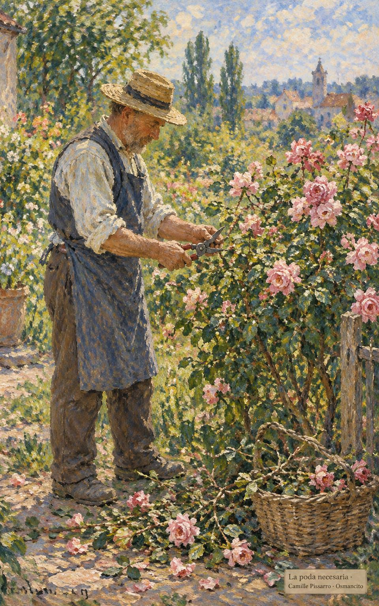](../img/261023_mientras-escribo-ii_menos-el-diez-por-ciento.jpg)

La Lectora Ideal ayuda a medir la velocidad del relato y cuánto pasado hace falta contar. King rechaza que vender exija correr siempre: la prisa también pierde lectores.

> No es que las novelas de ritmo rápido tengan nada de malo. Algunos escritores bastante buenos, Nelson DeMille, Wilbur Smith y Sue Grafton, por nombrar solo tres, han ganado millones escribiéndolas. Pero también puedes pasarte con la velocidad. Si avanzas demasiado deprisa, corres el riesgo de dejar al lector atrás, ya sea porque lo confundes o porque lo agotas. Y, por mi parte, a mí *me gusta* un ritmo más lento y un desarrollo más amplio y ascendente. La experiencia reposada de viajar en un transatlántico de lujo que ofrece una novela larga y absorbente como *The Far Pavilions* o *A Suitable Boy* ha sido uno de los principales atractivos de esta forma desde sus primeros ejemplos: relatos interminables escritos en cartas y divididos en muchas partes, como *Clarissa*. Creo que a cada historia hay que dejarla desplegarse a su propio ritmo, y ese ritmo no siempre es a paso de carga. Aun así, hay que tener cuidado: si lo frenas demasiado, hasta el lector más paciente puede inquietarse.
> [Párrafo 4](#original-w12-p4)

DeMille escribe suspense; Smith, aventuras; Grafton, novelas de investigación criminal. Los otros ejemplos amplían la comparación: *The Far Pavilions*, de M. M. Kaye, y *A Suitable Boy*, de Vikram Seth, son novelas extensas situadas en la India; *Clarissa*, del inglés Samuel Richardson, cuenta su historia mediante cartas. La lentitud que King disfruta no es falta de acontecimientos: permite quedarse dentro de un mundo y sentir que sus cambios necesitan tiempo.

Conviene preguntar dónde se aburre el lector y qué deja de entender. Al revisar, King suele necesitar cortes. En 1966, una nota de rechazo le dio una regla: segundo borrador igual al primero menos un diez por ciento.

> Ojalá pudiera recordar quién escribió esa nota; quizá Algis Budrys. Fuera quien fuera, me hizo un favor de los buenos. Copié la fórmula en un trozo del cartón de una camisa y lo pegué en la pared, junto a la máquina de escribir. Poco después empezaron a pasarme cosas buenas. No llegó de golpe una inundación dorada de ventas a revistas, pero el número de notas personales en los rechazos aumentó deprisa. Hasta recibí una de Durant Imboden, el editor de narrativa de *Playboy*. Aquel mensaje casi me paró el corazón. *Playboy* pagaba dos mil dólares o más por un cuento, y dos mil dólares eran la cuarta parte de lo que mi madre ganaba al año limpiando en el Pineland Training Center.
> [Párrafo 9](#original-w12-p9)

Budrys fue escritor y editor de ciencia ficción, pero King no asegura que la nota fuera suya: esa duda pertenece a la anécdota y debe conservarse. El primer resultado del recorte tampoco fue una venta. Que alguien se tomara el trabajo de escribirle personalmente ya indicaba una lectura más atenta. Pineland Training Center es el lugar donde trabajaba su madre limpiando. Comparar aquel sueldo con el pago de un cuento da la escala que tenían entonces esas cantidades para él.

Recortar frenó su costumbre de engordar los borradores. El pasado de los personajes también pide selección: mostrar un gesto puede contar mejor un divorcio que poner su explicación en boca de la pareja. King prefiere avanzar en orden antes que depender de retrocesos.

> Incluso contando la historia de esta manera directa, descubrirás que no puedes escapar de *algo* de pasado. En un sentido muy real, toda vida está *in medias res*. Si en la primera página de tu novela presentas como protagonista a un hombre de cuarenta años, y si la acción empieza porque una persona o una situación completamente nueva irrumpe en el escenario de su vida, un accidente de tráfico, digamos, o hacerle un favor a una mujer hermosa que no deja de mirar seductoramente por encima del hombro (¿notaste el adverbio espantoso de esta frase que no fui capaz de matar?), *aun así* tendrás que ocuparte en algún momento de los primeros cuarenta años de la vida del tipo. Cuánto te ocupes de esos años, y lo bien que lo hagas, tendrá mucho que ver con el éxito de tu historia, con que los lectores la recuerden como «una buena lectura» o «un tostón enorme». Probablemente J. K. Rowling, autora de las historias de Harry Potter, sea la campeona actual en el manejo del pasado. Podrías hacer algo peor que leerlas, fijándote en la facilidad con que cada libro nuevo repasa lo ocurrido antes. (Además, las novelas de Harry Potter son pura *diversión*, historia de principio a fin).
> [Párrafo 18](#original-w12-p18)

*In medias res* quiere decir «en medio de las cosas»: empezar cuando algo ya está ocurriendo. King lo convierte por un momento en una condición de toda vida, no solo en una forma de abrir un relato. Cualquier comienzo elegido deja años detrás. La pregunta no es cómo eliminarlos, sino qué parte de ellos necesita el lector para comprender una decisión presente. Su elogio de Rowling corresponde al momento en que escribe este libro, no a una clasificación permanente.

Hay que distinguir lo que el autor sabe pero no logró explicar de lo que todavía no entiende. También hay que escuchar qué parte del pasado aburre.

> También debes prestar mucha atención a las cosas del pasado que aburrieron a tu Lector Ideal. En *Bag of Bones*, por ejemplo, el protagonista, Mike Noonan, es un escritor de unos cuarenta años que, al comenzar el libro, acaba de perder a su mujer por un aneurisma cerebral. Empezamos el día de su muerte, pero aun así hay aquí una barbaridad de pasado, mucho más del que suelo incluir en mi narrativa. Eso comprende el primer empleo de Mike (como periodista), la venta de su primera novela, sus relaciones con la extensa familia de su difunta esposa, su trayectoria editorial y, sobre todo, el asunto de su casa de verano en el oeste de Maine: cómo llegaron a comprarla y parte de su historia anterior a Mike y Johanna. Tabitha, mi Lectora Ideal, leyó todo eso con aparente disfrute, pero también había un pasaje de dos o tres páginas sobre el trabajo comunitario de Mike durante el año posterior a la muerte de su mujer, un año en que su dolor se agrava por un caso severo de bloqueo del escritor. A Tabby no le gustó lo del trabajo comunitario.
> [Párrafo 20](#original-w12-p20)

El ejemplo permite separar dos necesidades que el escritor puede confundir: saber qué hizo un personaje durante un año y conseguir que ese año importe en la lectura. Una explicación puede ser razonable dentro de su biografía y aun así interrumpir la tensión del relato. El lector no está obligado a interesarse por todo lo que el autor tuvo que imaginar.

Tabitha quería sus pesadillas, no su campaña municipal. King redujo dos páginas a dos párrafos y después comprobó que sobraban. Todos tienen historia; no toda merece contarse.

---

### W13 · Un toque de verosimilitud

[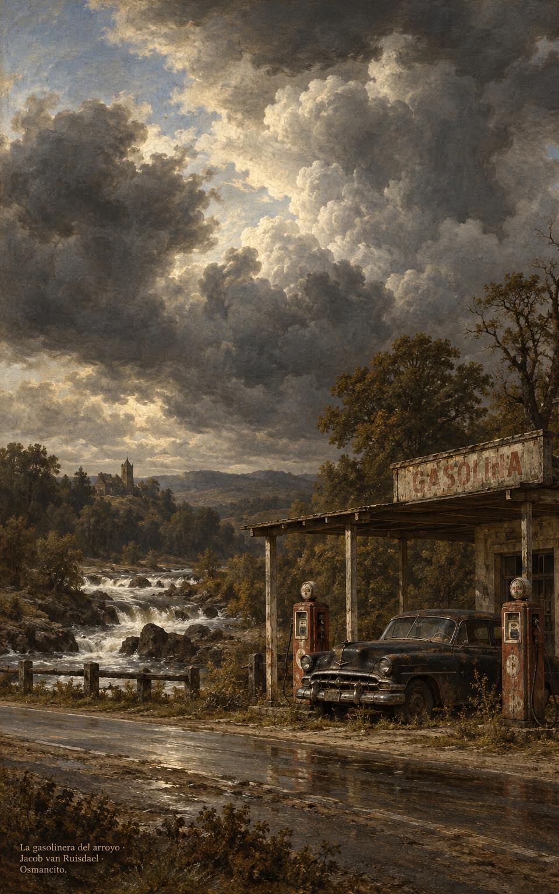](../img/261023_mientras-escribo-ii_un-toque-de-verosimilitud.jpg)

Investigar hace falta cuando se ignora un aspecto de la historia. Pero los datos deben sostenerla desde el fondo, no desplazar a los personajes.

> ¿Hay excepciones a la regla? Claro, ¿acaso no las hay siempre? Ha habido escritores de enorme éxito, Arthur Hailey y James Michener son los primeros que me vienen a la cabeza, cuyas novelas dependen mucho de los hechos y de la investigación. Las de Hailey son manuales apenas disfrazados sobre cómo funcionan las cosas (bancos, aeropuertos, hoteles), y las de Michener combinan relatos de viaje, lecciones de geografía y textos de historia. Otros escritores populares, como Tom Clancy y Patricia Cornwell, se centran más en la historia, pero aun así sirven grandes cucharadas de información, a veces difíciles de digerir, junto con el melodrama. A veces pienso que estos escritores atraen a un sector amplio de lectores que consideran que la ficción es de algún modo inmoral, un gusto bajo que solo puede justificarse diciendo: «Bueno, ejem, sí, *leo* a [ponga aquí el nombre del autor], pero solo en aviones y en habitaciones de hotel donde no hay CNN; además, aprendí muchísimo sobre [ponga aquí la materia correspondiente]».
> [Párrafo 2](#original-w13-p2)

Hailey y Michener son novelistas; Clancy escribe suspense de asuntos militares y Cornwell, novelas policiales ligadas a la investigación forense, la que examina pruebas para esclarecer un delito. CNN es un canal de noticias. La división de King es una crítica de sus modos de contar, no una definición neutral de esos escritores. Su burla apunta además a una disculpa del lector: necesitar que la ficción enseñe un dato para poder disfrutar de ella sin culpa.

Un resbalón junto a una gasolinera le sugirió una novela: un automóvil abandonado, algo no humano y unos policías que transmiten sus secretos a un muchacho. King desconocía su trabajo y, en el primer borrador, lo inventó.

> Podía hacerlo porque estaba escribiendo con la puerta cerrada, solo para mí y para el Lector Ideal que llevaba en la cabeza (mi versión mental de Tabby rara vez es tan espinosa como puede ser mi esposa de verdad; en mis fantasías suele aplaudir y animarme a seguir siempre adelante, con los ojos brillantes). Una de mis sesiones más memorables tuvo lugar en una habitación del cuarto piso del hotel Eliot, en Boston: yo sentado al escritorio junto a la ventana, escribiendo sobre la autopsia de una criatura murciélago extraterrestre mientras el maratón de Boston fluía lleno de vida justo debajo y los radiocasetes de las azoteas atronaban con «Dirty Water», de The Standells. Había mil personas ahí abajo, en las calles, pero ni una sola en mi habitación que me aguara la fiesta diciéndome que aquel detalle estaba mal o que los policías no hacían las cosas así en el oeste de Pensilvania, así que chincha, chincha, chincha.
> [Párrafo 8](#original-w13-p8)

The Standells es el grupo que grabó «Dirty Water», una canción que Boston adoptó como propia. El contraste deja juntos dos mundos: la ciudad que corre y celebra bajo la ventana y la habitación donde alguien examina un monstruo inventado. La libertad de esa habitación no vuelve correctos los detalles policiales; solo aplaza su comprobación hasta que exista una historia que comprobar.

La novela se llama *From a Buick Eight*. King espera acompañar a policías para corregir errores y añadir detalles creíbles. Quiere realidad suficiente para sostener monstruos y secretos, no un manual de procedimientos: primero va la historia.

---

### W14 · Seminarios entre ostras

No hay un secreto de escritura que se compre con un curso. King imagina el retiro perfecto de una novela: cabaña, comida en la puerta y colegas reunidos por la noche. Le atrae porque su propia casa está llena de interrupciones.

> La verdad es que he descubierto que las interrupciones y distracciones habituales del día no perjudican mucho una obra en marcha y hasta pueden ayudarla de algún modo. Al fin y al cabo, lo que produce la perla es la pizca de arenilla que entra en la concha de una ostra, no los seminarios de fabricación de perlas con otras ostras. Y cuanto más espacio ocupa la obra en mi día, cuanto más se parece a un *tengo que* en vez de a un simple *quiero*, más problemática puede volverse. Un problema serio de los talleres de escritura es que el *tengo que* se vuelve la norma. Después de todo, no has venido a vagar solitario como una nube, experimentando la belleza del bosque o la grandeza de las montañas. Se supone que estás *escribiendo*, maldita sea, aunque solo sea para que tus colegas tengan algo que criticar mientras tuestan sus puñeteros malvaviscos en la casa principal. En cambio, cuando asegurarte de que el niño llegue a tiempo al campamento de baloncesto importa tanto como tu obra en marcha, hay mucha menos presión por producir.
> [Párrafo 5](#original-w14-p5)

La imagen de la ostra importa por la fricción que representa, no como una explicación de biología. El detalle está en el reparto del día: cuando escribir deja de ser la única actividad que debe justificar la jornada, una página imperfecta pesa menos. King defiende las obligaciones corrientes porque impiden que cada sesión se convierta en un examen del propio talento.

Las críticas vagas tampoco ayudan a revisar: sentir «algo» ante una historia no indica qué frase, acción o relación necesita un cambio.

> Además, las críticas diarias te obligan a escribir con la puerta siempre abierta, y a mi entender eso frustra un poco el propósito. ¿De qué sirve que el camarero se acerque de puntillas y sin ruido a la entrada de tu cabaña con el almuerzo y luego se retire con el mismo silencio solícito, si cada noche lees en voz alta lo que estás escribiendo (o lo repartes en fotocopias) a un grupo de aspirantes a escritores que te dicen que les gusta cómo manejas el tono y la atmósfera, pero quieren saber si el gorro de Dolly, el de los cascabeles, es simbólico? La presión por explicar no cesa, y me parece que, por eso, buena parte de tu energía creadora se dirige hacia donde no debe. Te descubres cuestionando sin parar tu prosa y tu propósito cuando probablemente deberías estar escribiendo tan deprisa como corre el Hombre de Jengibre, dejando ese primer borrador en el papel mientras la forma del fósil sigue viva y clara en tu mente. Demasiadas clases de escritura convierten el *Espera un momento, explica qué querías decir con eso* en una especie de reglamento.
> [Párrafo 10](#original-w14-p10)

Dolly es un personaje usado aquí como ejemplo; no hace falta buscar un significado oculto en su gorro para entender la objeción. El fósil prolonga la imagen de una historia que se descubre al escribirla. El Hombre de Jengibre es una galleta con forma humana que huye corriendo en un cuento tradicional. La pregunta que un día servirá para revisar una historia puede interrumpir su descubrimiento si llega demasiado pronto. La oportunidad de un comentario también forma parte de su utilidad.

King admite un prejuicio personal: durante dos cursos universitarios de escritura sufrió un bloqueo. Allí conoció a su futura esposa, pero también comparó lo que deseaba escribir con lo que parecía prestigioso.

> Llevaba mis propios poemas a clase, pero en mi habitación de la residencia tenía mi pequeño secreto sucio: el manuscrito a medio terminar de una novela sobre el plan de una banda de adolescentes para provocar un disturbio racial. Lo usarían como cobertura para robar a dos docenas de negocios de préstamos usurarios y redes ilegales de droga en la ciudad de Harding, mi versión ficticia de Detroit (nunca había estado a menos de seiscientas millas de Detroit, pero no dejé que eso me detuviera ni siquiera me hiciera ir más despacio). Esa novela, *Sword in the Darkness*, me parecía muy chabacana al lado de lo que mis compañeros intentaban conseguir; supongo que por eso nunca llevé ninguna parte a clase para que la criticaran. Que además fuera mejor y de algún modo más verdadera que todos mis poemas sobre anhelos sexuales y angustia posadolescente solo empeoraba las cosas. El resultado fue un período de cuatro meses en el que no pude escribir casi nada. Lo que hice fue beber cerveza, fumar Pall Mall, leer libros de bolsillo de John D. MacDonald y ver telenovelas por la tarde.
> [Párrafo 12](#original-w14-p12)

Detroit es una ciudad de Michigan, en Estados Unidos. John D. MacDonald es un escritor de novelas policiales y de suspense; Pall Mall es la marca de cigarrillos que King nombra. El «secreto sucio» no consiste en una falta cometida, sino en una vergüenza aprendida: sospechar que la historia que uno quiere contar es inferior a la que debería querer contar. King concede valor a su novela desde la distancia, pero recuerda que entonces esa valoración no bastó para defenderla.

Un curso sí puede tomar en serio un deseo que familiares y amigos desprecian. Eso ayuda, aunque nadie necesita un permiso de escritor para empezar.

> Otro argumento a favor de los cursos de escritura tiene que ver con los hombres y las mujeres que los imparten. Hay miles de escritores con talento trabajando en Estados Unidos, y solo unos pocos (creo que la cifra podría ser tan baja como un cinco por ciento) pueden mantener a sus familias y mantenerse ellos con su trabajo. Siempre hay algo de dinero en becas, pero nunca alcanza para todos. En cuanto a las subvenciones públicas para escritores, ni pensarlo. Subvenciones al tabaco, claro. Becas de investigación para estudiar la movilidad del semen de toro sin conservar, por supuesto. Subvenciones a la escritura creativa, jamás. Creo que la mayoría de los votantes estaría de acuerdo. Con la excepción de Norman Rockwell y Robert Frost, Estados Unidos nunca ha venerado demasiado a sus creadores; en conjunto, nos interesan más los platos conmemorativos de Franklin Mint y las tarjetas de felicitación por internet. Y si no te gusta, ajo y agua, porque las cosas son así. A los estadounidenses les interesan mucho más los concursos de televisión que los cuentos de Raymond Carver.
> [Párrafo 14](#original-w14-p14)

Rockwell es un pintor e ilustrador; Frost, un poeta; Carver, un autor de cuentos y poemas. Franklin Mint fabrica objetos de colección, entre ellos platos decorativos. Los tres artistas representan aquí formas distintas de reconocimiento público. La cifra del cinco por ciento es una estimación que King presenta como tal, y su protesta sobre las ayudas es una generalización airada, no un censo de programas vigentes. La pregunta que prepara es material: de qué vive la persona que enseña escritura cuando sus libros no bastan para sostenerla.

Enseñar da ingresos y permite encuentros útiles: un profesor acercó los cuentos de King a su primer agente. Pero se aprende también trabajando fuera del aula, leyendo y escribiendo. Un retiro puede ser una alegría, aun sin secretos mágicos que revelar.

---

### W15 · Las tres caras de Frank

[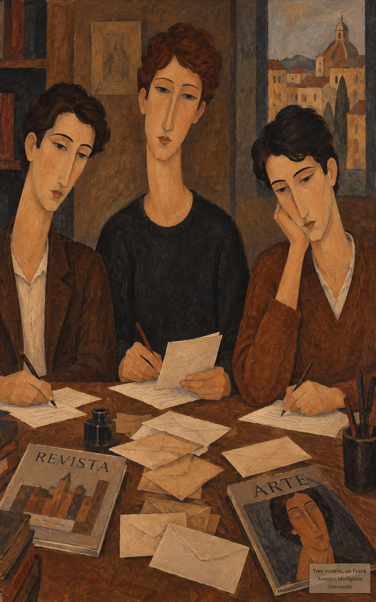](../img/261023_mientras-escribo-ii_las-tres-caras-de-frank.jpg)

King rechaza que publicar exija pertenecer a una familia cerrada de contactos. Un agente literario representa al escritor ante editoriales y revistas; también necesita encontrar obras que pueda vender.

> No es verdad. Tampoco es verdad que los agentes sean una pandilla estirada y superior que preferiría morir antes que permitir que sus dedos sin guantes tocaran un manuscrito no solicitado. (Bueno, vale, sí, hay *unos cuantos* así). La realidad es que agentes, editores y responsables de publicación buscan al próximo escritor de éxito que pueda vender muchos libros y ganar mucho dinero… y tampoco tiene que ser el próximo escritor *joven*: Helen Santmyer estaba en una residencia de ancianos cuando publicó *… And Ladies of the Club*. Frank McCourt era bastante más joven cuando publicó *Angela’s Ashes*, pero tampoco era ningún chaval.
> [Párrafo 3](#original-w15-p3)

Santmyer es la autora de una novela sobre varias generaciones de mujeres vinculadas a un club de lectura en Ohio; McCourt cuenta en sus memorias *Angela’s Ashes* una infancia de pobreza entre Estados Unidos e Irlanda. King los reúne para discutir una condición que a menudo se da por hecha: que una primera oportunidad literaria tenga que llegar al comienzo de la vida. Son ejemplos contra ese límite, no garantías de que toda obra encontrará editor.

Al joven King le parecía que un agente resolvería todo. Después supo que los había malos y que convenía comprobar su trabajo. Para buscar destino a un manuscrito, el primer paso es leer las revistas y consultar directorios editoriales.

> Si estás empezando y escribes cuentos, lo que más te interesará serán las «pequeñas revistas». Si escribes o has escrito una novela, querrás fijarte en las listas de agentes literarios de las revistas para escritores y de *Writer’s Market*. Quizá también quieras añadir un ejemplar del *LMP (Literary Market Place)* a tu estante de consulta. Debes ser sagaz, cuidadoso y constante al buscar agente o editor, pero, y vale la pena repetirlo, lo más importante que puedes hacer por ti es *leer el mercado*. Consultar las breves descripciones de *Writer’s Digest* puede ayudar («… publica principalmente narrativa general, de 2.000 a 4.000 palabras; evite personajes estereotipados y situaciones románticas trilladas»), pero una descripción breve, seamos sinceros, no deja de ser una descripción breve. Mandar cuentos sin haber leído antes ese mercado es como jugar a los dardos a oscuras: puede que aciertes de vez en cuando, pero no te lo mereces.
> [Párrafo 9](#original-w15-p9)

«Leer el mercado» significa leer las obras que publica la revista o editorial a la que se quiere enviar un texto, no solo sus instrucciones. *Writer’s Market* y *Literary Market Place* son los directorios que recomienda King; *Writer’s Digest*, la revista profesional que cita. Esos nombres pertenecen a su recorrido de entonces. El consejo que no depende de una edición concreta es comparar lo que uno escribe con lo que aquel destinatario realmente ofrece a sus lectores.

Para mostrar ese camino inventa a Frank reuniendo tres escritores reales. En la universidad Frank lee revistas, envía cuentos, publica en la revista del campus y guarda rechazos personales. Busca agentes interesados en suspense, crimen y lo sobrenatural.

> Un año después de terminar la universidad, Frank recibe su primera carta de aceptación: qué día tan feliz. Viene de una pequeña revista disponible en unos pocos quioscos, aunque sobre todo por suscripción; llamémosla *Kingsnake*. El editor ofrece comprar su estampa de mil doscientas palabras, «The Lady in the Trunk», por veinticinco dólares más una docena de ejemplares para el autor. Frank, por supuesto, está delirante; mucho más allá del séptimo cielo. Llama a todos los familiares, incluso a los que no le caen bien (*sobre todo* a los que no le caen bien, me imagino). Veinticinco dólares no pagarán el alquiler, ni siquiera comprarán comida para una semana para Frank y su mujer, pero confirman su ambición, y eso, cualquier escritor recién publicado estaría de acuerdo, creo, no tiene precio: *¡Alguien quiere algo que hice! ¡Yuju!* Y ese no es el único beneficio. Es una publicación que puede acreditar, una pequeña bola de nieve que Frank empezará ahora a hacer rodar cuesta abajo, con la esperanza de que llegue al fondo convertida en un enorme peñasco de nieve.
> [Párrafo 14](#original-w15-p14)

Frank y *Kingsnake* forman parte del ejemplo construido por King, no de una biografía que deba tomarse al pie de la letra. El primer pago tiene dos valores distintos: el dinero, pequeño, y la prueba de que alguien eligió publicar el cuento. Esa diferencia explica por qué un trabajo mal pagado puede importar en el relato sin convertirse por ello en una manera suficiente de vivir.

Otra revista acepta un cuento, pero cierra antes de publicarlo. Frank vuelve a enviarlo. El antiguo editor lo recomienda a una revista nueva, que lo publica seis meses después. Su constancia empieza a producir contactos nacidos del trabajo.

> Al año siguiente, Frank consigue empleo como profesor de inglés de secundaria. Aunque le resulta muy difícil enseñar literatura y corregir redacciones durante el día y luego trabajar en sus propias cosas por la noche, sigue haciéndolo: escribe nuevos cuentos y los pone en circulación, colecciona cartas de rechazo y de vez en cuando «jubila» historias que ha enviado a todos los sitios que se le ocurren. «Quedarán bien en mi colección cuando por fin salga», le dice a su mujer. Nuestro héroe también ha conseguido un segundo trabajo, escribiendo reseñas de libros y películas para un periódico de una ciudad cercana. Es un chico muy, muy ocupado. Aun así, en el fondo de su cabeza ha empezado a pensar en escribir una novela.
> [Párrafo 20](#original-w15-p20)

«Poner en circulación» incluye aquí un trabajo que no se ve en las páginas publicadas: llevar cuentas, esperar, volver a enviar y decidir cuándo dejar de insistir con un cuento. El empleo y las reseñas no son una sala de espera vacía antes de la novela. Ocupan tiempo y fuerzas que Frank debe repartir sin saber todavía qué resultado tendrá su escritura.

Cuando le preguntan qué debe recordar un principiante, Frank responde: buena presentación. Carta breve, agradecimiento, texto legible a doble espacio, datos de contacto y una cuenta honesta de palabras.

> «No», dice. «Te vuelves práctico enseguida cuando sales de la universidad e intentas hacerte un sitio en el negocio. Lo primero que aprendí fue que no te escucha nadie si no entras con aspecto de profesional». Algo en su tono me hace pensar que cree que he olvidado bastante de lo difícil que es empezar, y quizá tenga razón. Después de todo, hace casi cuarenta años que tenía una pila de rechazos clavada en un pincho en mi dormitorio. «No puedes obligarlos a que les guste tu cuento», termina Frank, «pero al menos puedes ponérselo fácil para que intenten que les guste».
> [Párrafo 26](#original-w15-p26)

King permite que su personaje compuesto lo corrija. Quien ya publica puede olvidar los obstáculos que aparecen antes de la primera lectura. La presentación no reemplaza al cuento ni obliga a aprobarlo; evita que la forma de entregarlo añada dificultades innecesarias a su recepción.

Frank reúne seis publicaciones, gana un premio y empieza una novela. Escribe a doce agentes una carta trabajada con cuidado. Enumera revistas, fechas y pagos de sus cuentos; esta es una de las entradas de esa lista.

> «Big Thumps, Charlie Takes His Lumps», *Cemetery Dance*, enero-febrero de 1998 (50 dólares más ejemplares)
> [Párrafo 36](#original-w15-p36)

La línea conserva la forma de una acreditación: título, lugar de publicación, fecha y retribución. Dentro de la carta, los datos permiten valorar un recorrido sin confiar solo en lo que Frank afirma de sí mismo. Como Frank reúne varias personas y su historia usa nombres inventados, esta entrada debe leerse como parte del modelo de carta, no como comprobación independiente de que ese cuento se publicó allí.

La carta ofrece cuentos y las primeras ochenta páginas de la novela, un suspense sobre asesinatos antiguos. Incluye dirección y teléfono. Solo un agente no muestra interés; otros piden el cuento premiado o el comienzo de la novela.

> «Fue increíble», dice, «absolutamente increíble. Esperaba aceptar a quien quisiera aceptarme *a mí*, si alguien quería, y darme por afortunado. En cambio, pude elegir». Atribuye su abundante cosecha de posibles agentes a varias cosas. Primero, la carta que envió estaba bien escrita y bien expresada («Hicieron falta cuatro borradores y dos discusiones con mi mujer para conseguir ese tono informal», dice Frank). Segundo, podía aportar una lista real de cuentos publicados, y bastante considerable. No mucho dinero, pero las revistas tenían prestigio. Tercero, estaba el cuento premiado. Frank cree que eso pudo ser decisivo. No sé si lo fue o no, pero sin duda no perjudicó.
> [Párrafo 44](#original-w15-p44)

El tono informal de la carta no salió de un descuido: tuvo cuatro versiones y dos discusiones. La soltura que recibe el destinatario puede ser el resultado de mucho trabajo invisible. King mantiene además una diferencia honesta entre hechos y explicación: sabe que llegaron respuestas, pero no sabe qué peso tuvo cada mérito en ellas.

Frank también pide pruebas del trabajo de los agentes: a qué editoriales y revistas han vendido textos. King advierte contra quienes cobran por leer y se aprovechan de la desesperación de un autor. Desear representación no vuelve fiable a quien la ofrece.

---

### W16 · Un camino de vuelta

[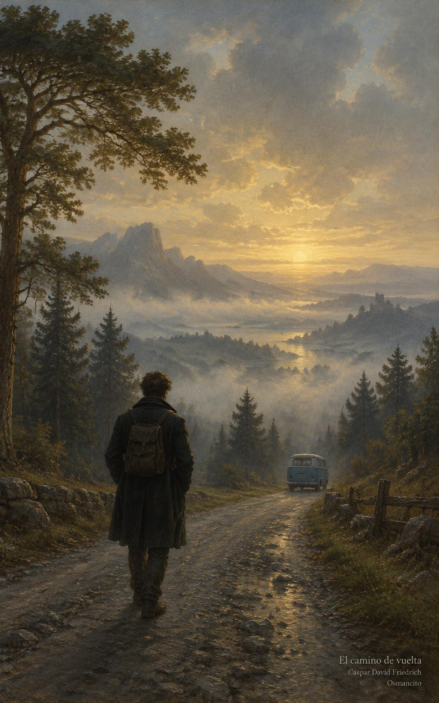](../img/261023_mientras-escribo-ii_un-camino-de-vuelta.jpg)

King llega al final de sus consejos sin creer que haya respondido a todo. Mientras los escribía le faltó confianza y le sobró dolor.

> Cuando le propuse a mi editor de Scribner la idea de un libro sobre escritura, sentía que sabía muchísimo del tema; la cabeza casi me estallaba con todas las cosas distintas que quería decir. Y quizá *sí* sepa mucho, pero parte resultó aburrida y he descubierto que casi todo lo demás tiene más que ver con el instinto que con algo parecido al «pensamiento elevado». Expresar esas verdades instintivas me resultó dolorosamente difícil. Además, a mitad de la escritura de *On Writing* ocurrió algo que me cambió la vida, como suele decirse. Enseguida te lo contaré. Por ahora, ten presente, por favor, que lo hice lo mejor que pude.
> [Párrafo 2](#original-w16-p2)

Scribner es la editorial a la que presentó el libro. Saber hacer algo no incluye necesariamente saber explicarlo: la experiencia reúne decisiones que se toman antes de poder nombrarlas. La dificultad de este libro nace en parte de intentar volver visibles esas decisiones, con el riesgo de que su explicación parezca más simple que el trabajo.

Queda una pregunta directa: si escribe por dinero.

> La respuesta es no. Ni ahora ni nunca. Sí, he ganado un montón de pasta con mi narrativa, pero jamás puse una sola palabra en el papel pensando en cobrar por ella. He hecho algunos trabajos como favores a amigos; intercambio de elogios es la expresión del oficio, pero, en el peor de los casos, habría que llamarlo una forma rudimentaria de trueque. He escrito porque me llenaba. Puede que pagara la hipoteca de la casa y los estudios universitarios de los niños, pero esas cosas vinieron por añadidura: lo hice por el subidón. Lo hice por el puro placer de hacerlo. Y si puedes hacerlo por placer, puedes hacerlo siempre.
> [Párrafo 4](#original-w16-p4)

El dinero que una obra produce y el motivo por el que se escribe no son lo mismo. King habla del suyo, no demuestra que todo escritor deba sentir igual. Tampoco niega las necesidades materiales que acaba de describir en la búsqueda de agentes y empleos: distingue el sustento que llegó de la satisfacción por la que volvía a la página.

Escribir también le permitió resistir la desesperación. En 1999, después de que una furgoneta casi lo matara, encontró en ello un camino de vuelta a la vida.

---

## Sobre vivir: una posdata

### L1 · La cuesta de la Ruta 5

[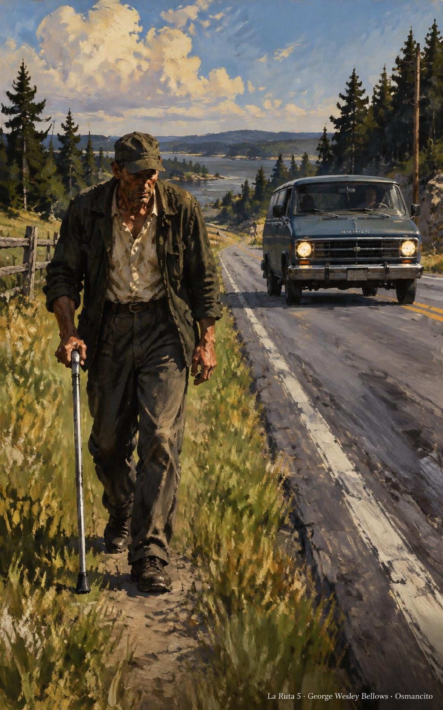](../img/261023_mientras-escribo-ii_ruta-5.jpg)

King caminaba cada día cerca de su casa de verano, en Maine. El 19 de junio de 1999 salió como de costumbre. Sus hijos y su primer nieto estaban de visita. Quería volver a tiempo para ir al cine en familia.

> Al llegar a la carretera giré hacia el norte, caminando por el arcén de grava, de frente al tráfico. Un coche me pasó, también hacia el norte. Unos tres cuartos de milla más adelante, la mujer que lo conducía vio una furgoneta Dodge azul claro que venía hacia el sur. La furgoneta zigzagueaba de un lado al otro de la carretera, apenas bajo el control del conductor. Cuando dejaron atrás sin peligro aquella furgoneta errante, la mujer se volvió hacia su acompañante y dijo: «Ese que caminaba ahí atrás era Stephen King. Espero de verdad que el tipo de la furgoneta no lo atropelle».
> [Párrafo 5](#original-l1-p5)

La advertencia llega desde una mirada que King no tuvo: la de alguien que ve acercarse el peligro desde otro punto de la carretera. Al incluirla antes de su recuerdo del golpe, el relato pone al lector en una posición dolorosa. Ya sabe que aquella esperanza no se cumplirá, mientras el caminante todavía no puede verlo.

En una cuesta con poca visibilidad, Bryan Smith invadió el arcén donde caminaba King y lo golpeó. Tras vacíos en la memoria, King se vio en el suelo, ensangrentado. Smith estaba sentado cerca, con un bastón.

> Smith no estaba mirando la carretera aquella tarde en que nuestras vidas se cruzaron porque su rottweiler había saltado desde el fondo de la furgoneta al espacio del asiento trasero, donde había una nevera portátil Igloo con carne dentro. El rottweiler se llama Bullet (Smith tiene otro en casa; ese se llama Pistol). Bullet empezó a empujar con el hocico la tapa de la nevera. Smith se volvió e intentó apartarlo. Seguía mirando a Bullet y empujándole la cabeza lejos de la nevera cuando coronó la cuesta; seguía mirando y empujando cuando me atropelló. Smith contó después a sus amigos que creía haber golpeado «a un ciervo pequeño» hasta que vio mis gafas ensangrentadas en el asiento delantero de su furgoneta. Se me habían desprendido de la cara cuando intenté apartarme de su camino. La montura quedó doblada y retorcida, pero los cristales no se rompieron. Son los cristales que llevo ahora, mientras escribo esto.
> [Párrafo 8](#original-l1-p8)

El rottweiler es el perro de Smith; Igloo es la marca de la nevera. Bullet y Pistol significan «bala» y «pistola». La repetición de «seguía» dilata una distracción que dura apenas unos instantes y cambia dos vidas. Las gafas cierran la distancia entre el accidente y el escritorio: el objeto que atravesó el golpe sigue sirviendo para mirar las palabras que lo cuentan.

### L2 · ¿Voy a morir?

[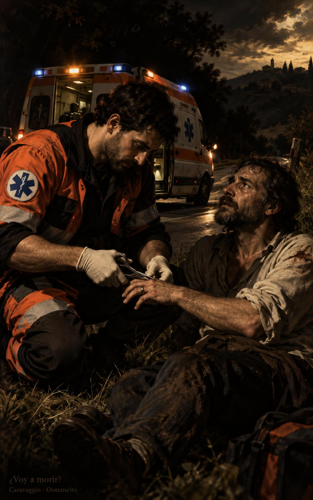](../img/261023_mientras-escribo-ii_voy-a-morir.jpg)

> Smith ve que estoy despierto y me dice que la ayuda está en camino. Habla con calma, incluso alegremente. Sentado en su roca, con el bastón cruzado sobre el regazo, tiene una expresión de amable compasión: parece decir *¿No acabamos de tener los dos una suerte de mierda?* Él y Bullet salieron del campamento donde se alojaban, le cuenta después a un investigador, porque quería «unas de esas barras Marzes que tienen en la tienda». Cuando me entero de ese detalle unas semanas más tarde, se me ocurre que casi me mata un personaje salido de una de mis novelas. Es casi gracioso.
> [Párrafo 1](#original-l2-p1)

Las barras «Marzes» son las golosinas que Smith quería comprar, conservadas aquí con la pronunciación que King le atribuye. «Casi» es la palabra que frena la risa: el escritor reconoce material narrativo incluso en quien acaba de destrozarle el cuerpo, pero esa semejanza no lo protege del dolor ni lo vuelve un personaje inventado.

Su pierna parecía torcida. El técnico de emergencias Paul Fillebrown lo atendió, comprobó que movía los dedos del pie y lo subió a la ambulancia. King intentó explicar por qué llevaba dos alianzas mientras le cortaban la de la mano hinchada.

> Sale alguna versión confusa de todo esto, probablemente nada que Paul Fillebrown pueda entender, pero él sigue asintiendo y sonriendo mientras corta aquella segunda alianza, más cara, de mi mano derecha hinchada. Unos dos meses después llamo a Fillebrown para darle las gracias; para entonces entiendo que probablemente me salvó la vida al prestarme la atención médica correcta allí mismo y luego llevarme al hospital a unas ciento diez millas por hora, por carreteras secundarias llenas de parches y baches.
> [Párrafo 10](#original-l2-p10)

Fillebrown entiende una urgencia que King todavía no puede medir. Por eso conviven dos escalas de importancia: para el herido, la historia de sus alianzas; para quien lo atiende, mantenerlo vivo y llevarlo al hospital. El agradecimiento llega cuando el paciente logra reconstruir lo que estaba ocurriendo mientras él solo podía aferrarse a algunos detalles.

Fillebrown le diría después que dudó que llegara vivo. En el primer hospital resolvieron trasladarlo: sus lesiones superaban lo que podían tratar allí.

> La gravedad de las lesiones del impacto hace que los médicos del Northern Cumberland Hospital decidan que no pueden tratarme allí; alguien llama a un helicóptero de LifeFlight para llevarme al Central Maine Medical Center, en Lewiston. En ese momento llegan mi esposa, mi hijo mayor y mi hija. A los chicos les permiten una visita breve; a mi esposa le permiten quedarse más tiempo. Los médicos le han asegurado que estoy maltrecho, pero que saldré adelante. Me han cubierto la mitad inferior del cuerpo. No le dejan ver la curiosa manera en que mi regazo se ha desplazado hacia la derecha, pero sí le permiten lavarme la sangre de la cara y sacarme algunos cristales del pelo.
> [Párrafo 12](#original-l2-p12)

Los dos nombres corresponden a los hospitales entre los que lo trasladan; LifeFlight es el servicio del helicóptero. La palabra «curiosa» produce un extrañamiento que evita describir la lesión desde fuera: todavía la vemos con la incredulidad del herido. Frente a la atención técnica, el gesto de Tabitha le devuelve algo reconocible de su vida cotidiana, aunque sea quitarle sangre del rostro.

Por centímetros evitó golpes que podían matarlo o paralizarlo. Ya en el helicóptero comenzó a ahogarse: un pulmón se había colapsado. Le anunciaron que iban a introducir un tubo en el pecho.

> Mi experiencia (aprendida cuando era un crío con infecciones de oído) es que, si alguien de la medicina te dice que vas a notar un pequeño pinchazo, va a hacerte muchísimo daño. Esta vez no es tan malo como esperaba, quizá porque estoy lleno de analgésicos, quizá porque vuelvo a estar a punto de desmayarme. Es como recibir un golpe muy arriba, en el lado derecho del pecho, de alguien que sostiene un objeto corto y afilado. Entonces se oye un silbido alarmante en mi pecho, como si tuviera una fuga. De hecho, supongo que la tengo. Un instante después, la suave entrada y salida de la respiración normal, que he oído durante toda mi vida (casi siempre sin advertirla, gracias a Dios), ha sido sustituida por un desagradable *shlup-shlup-shlup*. El aire que tomo está muy frío, pero al menos es aire, *aire*, y sigo respirándolo. No quiero morir. Quiero a mi mujer, a mis hijos, mis paseos de tarde junto al lago. También me gusta escribir; tengo un libro sobre escritura en el escritorio de casa, a medio terminar. No quiero morir, y mientras voy tumbado en el helicóptero, mirando el brillante cielo azul de verano, comprendo que estoy realmente en el umbral de la muerte. Alguien va a tirar de mí hacia un lado o hacia el otro dentro de poco; en buena medida no depende de mí. Lo único que puedo hacer es quedarme tumbado, mirar el cielo y escuchar mi respiración débil y agujereada: *shlup-shlup-shlup*.
> [Párrafo 20](#original-l2-p20)

La infección de oído enlaza al adulto herido con el niño que aprendió a desconfiar de las promesas médicas tranquilizadoras. Después la enumeración reúne afectos y costumbres sin jerarquizarlos: familia, paseos, escritura. El libro inacabado deja de ser una tarea profesional y pasa a ser una de las cosas por las que quiere seguir vivo. El sonido de respirar sostiene todo el párrafo.

En el hospital pidió que le dijeran a Tabitha cuánto la quería. Le respondieron que pronto podría decírselo él. Después perdió la conciencia: quedaron destellos de quirófanos, voces y alucinaciones, pero sobre todo oscuridad.

### L3 · Canicas en un calcetín

[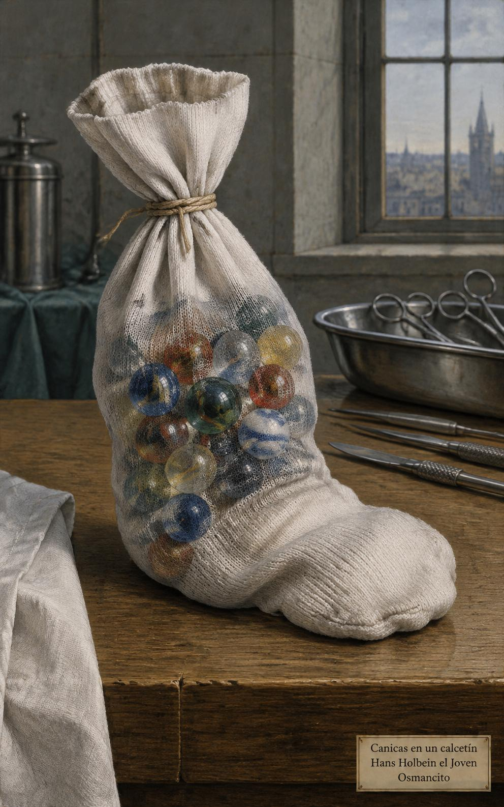](../img/261023_mientras-escribo-ii_canicas-en-un-calcetin.jpg)

> La estimación de mis lesiones que había hecho Bryan Smith resultó conservadora. Tenía la parte inferior de la pierna rota en al menos nueve puntos; el cirujano ortopédico que me reconstruyó, el formidable David Brown, dijo que la zona bajo la rodilla derecha había quedado reducida a «un montón de canicas en un calcetín». La gravedad de esas lesiones exigió dos incisiones profundas, llamadas fasciotomías medial y lateral, para aliviar la presión causada por la tibia destrozada y también permitir que la sangre volviera a circular por la parte inferior de la pierna. Sin las fasciotomías (o si se hubieran retrasado), probablemente habría sido necesario amputarla. La propia rodilla derecha estaba partida casi por el centro; el término técnico de la lesión es «fractura tibial intraarticular conminuta». También sufrí una fractura acetabular de la cadera derecha, un descarrilamiento serio, en otras palabras, y una fractura intertrocantérica abierta del fémur en esa misma zona. Tenía la columna astillada en ocho puntos. Cuatro costillas rotas. La clavícula derecha resistió, pero la carne de encima quedó en carne viva. La herida del cuero cabelludo necesitó veinte o treinta puntos.
> [Párrafo 1](#original-l3-p1)

La tibia es uno de los huesos de la pierna; el fémur es el del muslo. «Conminuta» indica que el hueso se rompió en varios fragmentos; «intraarticular», que la fractura alcanza la articulación. El acetábulo es la cavidad de la pelvis donde encaja el fémur. «Intertrocantérica» sitúa la fractura entre dos salientes de la parte alta del fémur; «abierta» indica que hay una herida que comunica con el exterior. Las fasciotomías son los cortes con los que se libera la presión que amenaza la circulación. Junto al vocabulario clínico, las canicas en un calcetín ofrecen una imagen inmediata: permiten imaginar una pierna que ha perdido su sostén, sin exigir que el lector domine un informe médico.

> Sí, en conjunto diría que Bryan Smith había sido un poquito conservador.
> [Párrafo 2](#original-l3-p2)

Después de acumular lesiones, King vuelve a la apreciación del hombre que lo atropelló. La moderación de «un poquito» es irónica: su tamaño verbal queda enfrentado al tamaño de lo que acaba de leerse. El humor reaparece sin cancelar la violencia del inventario.

### L4 · Dos cargos

[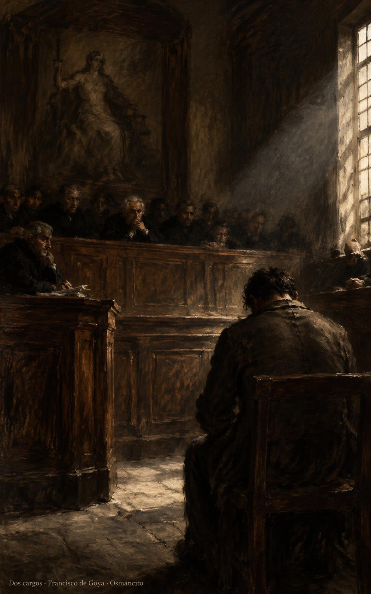](../img/261023_mientras-escribo-ii_dos-cargos.jpg)

> La conducta de conducción del señor Smith en este caso fue examinada finalmente por un gran jurado, que lo acusó de dos delitos: conducción que pone en peligro a otros (bastante grave) y agresión agravada (muy grave, de las que suponen cárcel). Tras la debida consideración, el fiscal responsable de perseguir estos casos en mi rincón del mundo permitió que Smith se declarara culpable del cargo menor de conducción peligrosa. Recibió seis meses de cárcel del condado (pena suspendida) y un año de suspensión de su permiso para conducir. También quedó un año en libertad vigilada, con restricciones para manejar otros vehículos de motor, como motos de nieve y vehículos todoterreno. Es posible que Bryan Smith pueda volver legalmente a la carretera en el otoño o el invierno de 2001.
> [Párrafo 1](#original-l4-p1)

Una pena suspendida no equivale a pasar esos seis meses dentro de la cárcel: su ejecución queda condicionada. El gran jurado decide si hay base para formular una acusación; no es aquí quien dicta una condena en juicio. King dispone los cargos y el acuerdo de modo que se perciba la distancia entre la gravedad sufrida y la sanción. La frase sobre 2001 expresa lo que él podía prever cuando escribió este pasaje, no una noticia posterior sobre Smith.

### L5 · Aprender a caminar de nuevo

[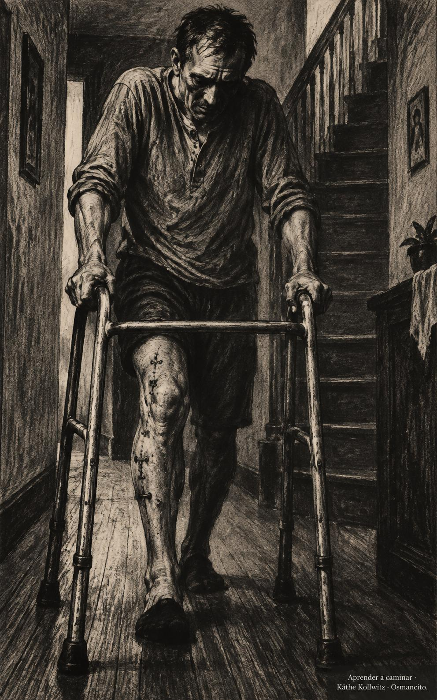](../img/261023_mientras-escribo-ii_aprender-a-caminar.jpg)

> David Brown me reconstruyó la pierna en cinco operaciones maratonianas que me dejaron delgado, débil y casi al límite de mi resistencia. También me dejaron al menos una oportunidad real de volver a caminar. Me sujetaron a la pierna un gran aparato de acero y fibra de carbono llamado fijador externo. Ocho grandes clavos de acero llamados clavos de Schanz atraviesan el fijador y entran en los huesos por encima y por debajo de la rodilla. Cinco varillas de acero más pequeñas salen de la rodilla en forma radial. Parecen un dibujo infantil de rayos de sol. La propia rodilla estaba inmovilizada. Tres veces al día las enfermeras desenvolvían los clavos más pequeños y los mucho mayores clavos de Schanz y limpiaban los orificios con agua oxigenada. Nunca me han sumergido la pierna en queroseno para luego prenderle fuego, pero, si alguna vez ocurre, estoy seguro de que se parecerá bastante a la limpieza diaria de los clavos.
> [Párrafo 1](#original-l5-p1)

El aparato mantiene unidos los fragmentos desde fuera del cuerpo; los clavos los conectan con los huesos. La imagen de los rayos de sol hace visible la forma antes de que aparezca la comparación del fuego. King no describe el tratamiento como una sucesión abstracta de mejoras: cada posibilidad de recuperación trae también una tarea dolorosa que debe repetirse.

Levantarse, sentarse y dar diez pasos exigieron un esfuerzo enorme. Durante la rehabilitación compartió ánimos y bromas con Alice, una mujer de ochenta años que también aprendía a caminar.

> Para el Cuatro de Julio podía permanecer sentado en una silla de ruedas el tiempo suficiente para salir al muelle de carga detrás del hospital y ver parte de los fuegos artificiales. Era una noche de calor feroz, las calles llenas de gente que comía, bebía cerveza y refrescos y miraba el cielo. Tabby estaba de pie a mi lado, cogiéndome la mano, mientras el cielo se iluminaba de rojo y verde, azul y amarillo. Se alojaba en un apartamento al otro lado de la calle del hospital, y cada mañana me llevaba huevos escalfados y té. Parecía que necesitaba el alimento. En 1997, después de volver de un viaje en moto por el desierto australiano, pesaba doscientas dieciséis libras. El día que me dieron el alta del Central Maine Medical Center pesaba ciento sesenta y cinco.
> [Párrafo 5](#original-l5-p5)

El Cuatro de Julio es la fiesta de la independencia de Estados Unidos; por eso hay fuegos artificiales y gente en la calle. Para King, la celebración depende de un logro mucho más pequeño: poder mantenerse sentado el tiempo necesario para verla. La mano de Tabitha y el desayuno diario muestran un cuidado que continúa cuando terminan las operaciones y los grandes acontecimientos.

Volvió a casa el 9 de julio. Siguieron rehabilitación y otra operación, que permitió doblar la rodilla. El 24 de julio, cinco semanas después del atropello, empezó a escribir otra vez.

### L6 · El voto decisivo

[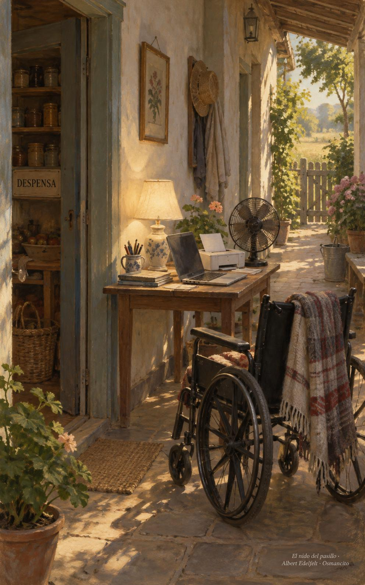](../img/261023_mientras-escribo-ii_el-nido-del-pasillo.jpg)

Había empezado este libro a finales de 1997 y lo dejó meses sin saber cómo seguir. En junio de 1999 volvió a encontrarle camino. Escribió cuatro páginas sobre el oficio el día anterior al accidente; en julio seguía ahí.

> No *quería* volver al trabajo. Me dolía muchísimo, no podía doblar la rodilla derecha y dependía de un andador. No podía imaginarme sentado mucho tiempo ante un escritorio, ni siquiera en la silla de ruedas. Por la manera catastrófica en que me había destrozado la cadera, sentarme era una tortura al cabo de unos cuarenta minutos e imposible después de una hora y cuarto. A eso se añadía el propio libro, que parecía más intimidante que nunca: ¿cómo iba a escribir sobre diálogo, personajes y cómo conseguir agente cuando lo más urgente en mi mundo era cuánto faltaba para la siguiente dosis de Percocet?
> [Párrafo 4](#original-l6-p4)

Percocet es un medicamento para el dolor que combina oxicodona y paracetamol. La pregunta devuelve los consejos de escritura a un cuerpo concreto: el autor no dispone de una atención ilimitada ni de una silla en la que pueda olvidarse de sí. Volver al libro no nace aquí del entusiasmo, sino de intentar recuperar una actividad bajo condiciones que parecen excluirla.

Escribir ya le había servido en otras crisis. Tabitha, que solía pedirle descanso, esta vez preguntó dónde quería instalarse. Preparó una mesa en el pasillo del fondo, con enchufes y ventilador para el calor.

> Tabby dedicó un par de horas a prepararlo todo, y aquella tarde, a las cuatro, me llevó en la silla de ruedas por la cocina y por la rampa recién instalada hasta el pasillo del fondo. Me había hecho allí un pequeño nido maravilloso: el portátil y la impresora conectados uno al lado de la otra, una lámpara de mesa, el manuscrito (con mis notas del mes anterior ordenadas encima), bolígrafos, material de consulta. En una esquina del escritorio había una fotografía enmarcada de nuestro hijo menor, que ella había tomado a comienzos de aquel verano.
> [Párrafo 9](#original-l6-p9)

El nido no es un refugio que lo aparte de la vida familiar: está hecho dentro de ella. La rampa, los cables y las notas ordenadas son condiciones de trabajo tan reales como una idea o un argumento. La fotografía del hijo termina la enumeración con una presencia que no cumple ninguna función práctica y, sin embargo, pertenece al lugar donde puede empezar.

A King le encantó. Tabitha entendía que a veces el trabajo lo ayudaba a salir a flote. Lo besó y lo dejó averiguar si aún tenía algo que decir.

> Aquella primera sesión de escritura duró una hora y cuarenta minutos, con mucha diferencia el período más largo que había pasado sentado erguido desde que me atropelló la furgoneta de Smith. Cuando terminó, chorreaba sudor y estaba casi demasiado agotado para mantenerme derecho en la silla de ruedas. El dolor de la cadera rozaba lo apocalíptico. Y las primeras quinientas palabras fueron aterradoras de una manera singular: era como si nunca hubiera escrito nada antes de ellas en toda mi vida. Todos mis viejos trucos parecían haberme abandonado. Pasaba de una palabra a la siguiente como un anciano que cruza un arroyo por una línea zigzagueante de piedras mojadas. Aquella primera tarde no hubo inspiración, solo una especie de determinación obstinada y la esperanza de que las cosas mejoraran si seguía.
> [Párrafo 13](#original-l6-p13)

El escritor que acaba de enseñar un oficio vuelve a sentirse principiante. Eso no borra lo aprendido, pero sí impide presentarlo como una reserva que siempre está disponible con solo quererlo. Las piedras mojadas permiten sentir la cautela de cada palabra. La medida de esa tarde es haber empezado, no haber escrito sin esfuerzo ni dolor.

Al beber una Pepsi recordó que sus primeras novelas habían nacido en un lavadero: aquel pasillo cerraba un círculo. El dolor siguió, pero al escribir se alejó un poco. No hubo milagro repentino; sí la satisfacción de haber arrancado.

### L7 · El agua de la vida

> Para mí, las cosas han seguido mejorando. Desde aquella primera tarde sofocante en el pasillo del fondo me han operado dos veces más de la pierna, he pasado una infección bastante seria y sigo tomando alrededor de cien pastillas al día, pero ya no tengo el fijador externo y continúo escribiendo. Algunos días ese trabajo es una marcha sombría. Otros, cada vez más a medida que la pierna sana y la mente vuelve a acostumbrarse a su antigua rutina, siento ese subidón de felicidad, esa sensación de haber encontrado las palabras justas y haberlas puesto en fila. Es como despegar en un avión: estás en tierra, en tierra, en tierra… y luego estás arriba, viajando sobre un cojín mágico de aire y siendo príncipe de cuanto ves. Eso me hace feliz, porque es para lo que estoy hecho. Todavía no tengo muchas fuerzas, puedo hacer algo menos de la mitad de lo que hacía en un día, pero he tenido las suficientes para llegar al final de este libro, y por eso estoy agradecido. Escribir no me salvó la vida, eso lo hicieron la habilidad del doctor David Brown y el cuidado amoroso de mi esposa, pero ha seguido haciendo lo que siempre hizo: vuelve mi vida un lugar más luminoso y agradable.
> [Párrafo 1](#original-l7-p1)

King le pone un límite preciso al poder de la escritura: no fue lo que lo mantuvo vivo. Nombra al cirujano y a su esposa para que el placer de crear no borre la intervención médica ni los cuidados. Esa distinción hace más creíble lo que sí le atribuye: cambiar la calidad de una vida que otros ayudaron a conservar.

> Escribir no consiste en ganar dinero, hacerse famoso, conseguir citas, acostarse con alguien o hacer amigos. Al final, consiste en enriquecer la vida de quienes leerán tu trabajo y enriquecer también la tuya. Consiste en levantarse, ponerse bien y seguir adelante. En ser feliz, ¿de acuerdo? Ser feliz. Parte de este libro, quizá demasiada, ha tratado de cómo aprendí a hacerlo. Buena parte ha tratado de cómo puedes hacerlo mejor. El resto, quizá lo mejor, es un permiso: puedes, debes y, si tienes el valor de empezar, *lo harás*. Escribir es magia, tan agua de la vida como cualquier otra forma de creación artística. El agua es gratis. Así que bebe.
> [Párrafo 2](#original-l7-p2)

El permiso final responde a los permisos falsos que aparecieron antes: el diploma de escritor, el ambiente perfecto, el acceso a una familia editorial. «Gratis» no quiere decir que el trabajo no cueste tiempo ni esfuerzo. Quiere decir que el derecho a intentarlo no lo administra una persona que deba aceptarnos primero. La invitación vale también para otras artes, no solo para escribir libros.

Bebe hasta llenarte.

---

## Y además I: puerta cerrada, puerta abierta

### F1a · La historia desnuda

[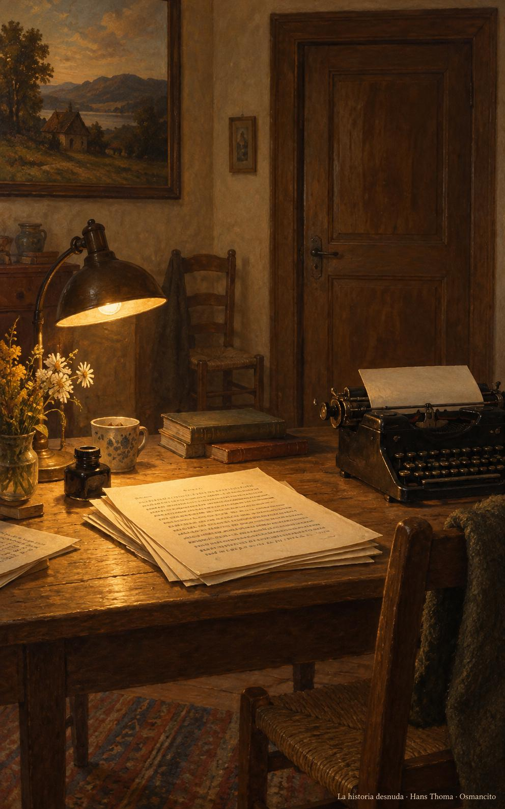](../img/261023_mientras-escribo-ii_la-historia-desnuda.jpg)

> Antes, en este libro, al escribir sobre mi breve carrera como reportero deportivo del *Weekly Enterprise* de Lisbon (yo era, en realidad, todo el departamento de deportes; un Howard Cosell de pueblo), ofrecí un ejemplo de cómo funciona la edición. Aquel ejemplo era necesariamente breve y trataba de un texto de no ficción. El pasaje que sigue es ficción. Está completamente en bruto, la clase de cosa que me permito hacer con la puerta cerrada: la historia desnuda, de pie, sin más ropa que calcetines y calzoncillos. Te sugiero que la examines con atención antes de pasar a la versión corregida.
> [Párrafo 1](#original-f1a-p1)

Howard Cosell fue un comentarista deportivo de radio y televisión; King se compara con él para burlarse del tamaño de su propio «departamento». Ahora ofrece un texto sin arreglar y pide mirarlo antes de conocer las correcciones. El orden importa: una versión acabada hace fácil creer que la frase correcta existió desde el principio. El borrador conserva las decisiones que el resultado final suele ocultar.

### F1b · La historia del hotel

[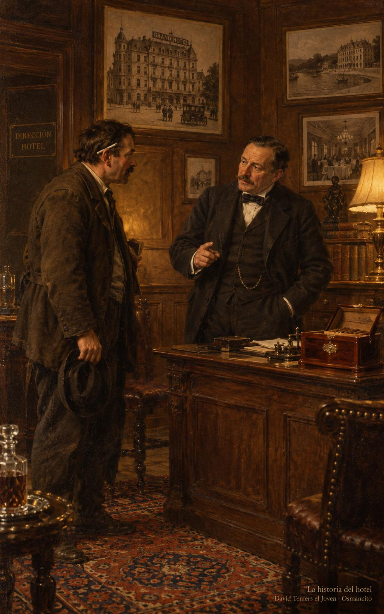](../img/261023_mientras-escribo-ii_la-historia-del-hotel.jpg)

Mike Enslin, escritor, llega al hotel Dolphin para pasar la noche en la habitación 1408. Su gerente, Ostermeyer, ya intentó impedírselo. Mike teme otro obstáculo, pero también sabe que una advertencia más enriquecería lo que quiere contar.

> **Ostermeyer lo vio, se levantó y cruzaba el vestíbulo con una mano regordeta extendida cuando Mike salió de la puerta giratoria. El Dolphin estaba en la calle Sesenta y Uno, a la vuelta de la Quinta Avenida; pequeño, pero elegante. Un hombre y una mujer vestidos de etiqueta pasaron junto a Mike cuando este extendió la mano y estrechó la de Ostermeyer, cambiándose el pequeño maletín de viaje a la izquierda para hacerlo. La mujer era rubia, vestida de negro, por supuesto, y el olor suave y floral de su perfume parecía resumir Nueva York. En el entresuelo, alguien tocaba «Night and Day» en el bar, como para subrayar el resumen.**
> [Párrafo 3](#original-f1b-p3)

«Night and Day» es una canción de Cole Porter, compositor estadounidense. Perfume, ropa y música construyen una elegancia que Mike reconoce y disfruta. Es su manera de interpretar el hotel, no una descripción sin mirada. Esa comodidad importa porque pronto tendrá que convivir con el miedo del gerente a una habitación concreta.

Ostermeyer lo invita al despacho. Mike comprende que su temor es sincero, no una actuación para impresionar al visitante. Rechaza que le lleve el equipaje y lo sigue.

> **En el vestíbulo, el gerente del hotel había parecido inseguro, deprimido, casi vencido. En su despacho revestido de roble, con las fotografías del hotel en las paredes (el Dolphin había abierto en octubre de 1910; puede que Mike publicara sin recibir reseñas en revistas ni en los periódicos de las grandes ciudades, pero investigaba), Ostermeyer pareció recuperar la seguridad. Había una alfombra persa en el suelo. Dos lámparas de pie daban una luz amarilla suave. Sobre el escritorio había una lámpara con una pantalla verde en forma de rombo, junto a una caja humidificadora de puros. Y junto a la caja estaban los tres últimos libros de Mike Enslin. Ediciones de bolsillo, por supuesto; no las había de tapa dura. Aun así, le iba bastante bien. *Mi anfitrión también ha estado investigando un poco*, pensó Mike.**
> [Párrafo 17](#original-f1b-p17)

Una caja humidificadora conserva los puros con la humedad adecuada. El despacho contiene dos formas de preparación: Mike conoce la historia del hotel y Ostermeyer ha leído sus libros. La escena deja de ser solo un visitante que interroga a un gerente; cada uno dispone de información sobre el otro. El espacio, además, devuelve al anfitrión una seguridad que no tenía en el vestíbulo.

Mike rechaza un puro: dejó de fumar tras la muerte de su hermano, aunque lleva un cigarrillo como amuleto. Bromea con encenderlo si hay guerra nuclear. El gerente insiste en disuadirlo. Después King comenta su revisión: recortó para acelerar y quitó palabras innecesarias.

> 1. Está claro que «The Hotel Story» nunca va a sustituir a «Killdozer!» ni a *Norma Jean, the Termite Queen* como título. Simplemente lo puse en el primer borrador, sabiendo que se me ocurriría uno mejor al avanzar. (Si no se te ocurre un título mejor, un editor suele aportar su idea de uno mejor, y los resultados suelen ser feos). Me gusta «1408» porque esta es una historia de «decimotercer piso» y las cifras suman trece.
> [Párrafo 32](#original-f1b-p32)

«Killdozer!» es una narración de ciencia ficción y horror de Theodore Sturgeon; *Norma Jean and the Termite Queen* es una novela de Sheila Ballantyne. King la nombra aquí como *Norma Jean, the Termite Queen*. Los títulos llamativos le sirven para burlarse del suyo, «La historia del hotel». «1408» hace otra cosa: parece un dato del edificio y guarda un número amenazante en sus cifras, sin explicar de antemano qué ocurrirá.

Cambió Ostermeyer por Olin: ahorraba espacio y facilitaba leerlo en voz alta. Cortó explicaciones, movimientos obvios y pasado torpe; adelantó una camisa que importaba al final. Conservó un adverbio que mostraba la burla de Mike y añadió la comodidad del gerente en su territorio.

> Jugué con la idea de incluir en este libro el texto terminado y completo de «1408», pero la idea iba contra mi decisión de ser breve, por una vez en la vida. Si quieres escucharlo entero, está disponible en una colección sonora de tres cuentos, *Blood and Smoke*. Puedes acceder a una muestra en el sitio de Simon and Schuster, http://www.SimonSays.com. Y recuerda que, para lo que nos ocupa aquí, no necesitas terminar el cuento. Esto trata de mantenimiento del motor, no de salir a dar una vuelta.
> [Párrafo 41](#original-f1b-p41)

*Blood and Smoke* reúne tres relatos leídos por el propio King, entre ellos «1408». La dirección que da el pasaje pertenece al libro y se conserva como parte de su texto, no como recomendación de un enlace vigente. La diferencia final es de propósito: seguir una historia por placer y desmontar su comienzo para ver cómo está hecho son dos lecturas distintas. Ninguna sustituye a la otra.

---

## Y además II: una lista de libros

### F2a · ¿Qué lees?

[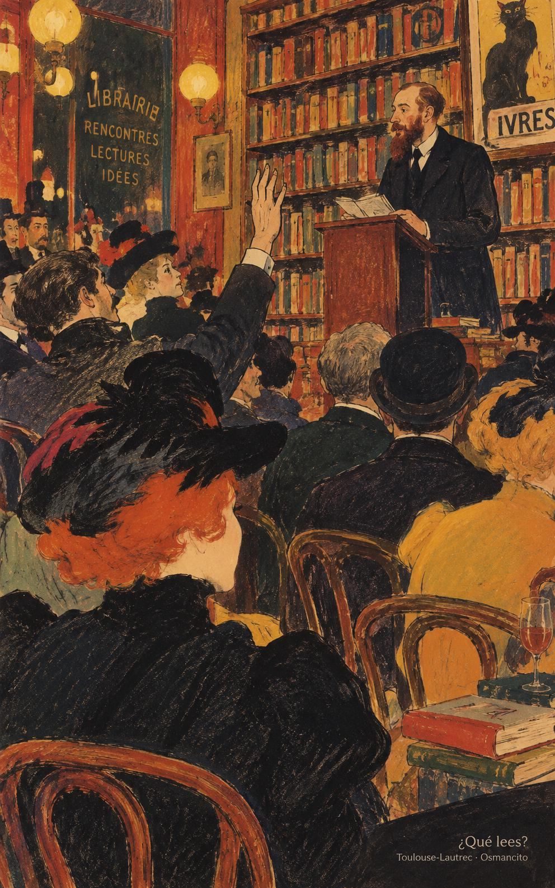](../img/261023_mientras-escribo-ii_que-lees.jpg)

Al hablar en público, King insiste en leer y escribir mucho. Después siempre le preguntan qué lee él.

> Nunca he dado una respuesta muy satisfactoria a esa pregunta, porque me provoca una especie de sobrecarga en los circuitos del cerebro. La respuesta fácil, «Todo lo que cae en mis manos», es bastante cierta, pero no ayuda. La lista que sigue ofrece una respuesta más concreta. Son los mejores libros que he leído en los últimos tres o cuatro años, el período durante el que escribí *The Girl Who Loved Tom Gordon, Hearts in Atlantis, On Writing* y el todavía inédito *From a Buick Eight*. De una manera u otra, sospecho que cada libro de la lista influyó en los que escribí.
> [Párrafo 2](#original-f2a-p2)

Los cuatro títulos son obras del propio King; la condición de inédita de la última corresponde al momento de esta lista. «Influir» no significa aquí copiar una trama o aprender una regla identificable. También puede ser descubrir un ritmo, una libertad o una forma de atender a algo. Por eso reconoce la influencia como una sospecha, sin adjudicarle a cada lectura una deuda exacta.

> Mientras recorres esta lista, recuerda, por favor, que no soy Oprah y que esto no es mi club de lectura. Estos son los que me funcionaron a mí, eso es todo. Pero podrías elegir algo peor, y bastantes de ellos quizá te muestren maneras nuevas de hacer tu trabajo. Aunque no lo hagan, seguramente te entretendrán. Desde luego, a mí me entretuvieron.
> [Párrafo 3](#original-f2a-p3)

Oprah Winfrey es una presentadora de televisión que impulsó un club de lectura entre su público. King toma distancia de una selección convertida en autoridad: ofrece una experiencia personal, no un canon obligatorio. Y termina por devolverle a la lectura algo que sus propios consejos podrían hacer olvidar: un libro no necesita enseñarnos a trabajar para merecer nuestro tiempo.

### F2b · Noventa y seis libros

La lista completa, tal como la deja King:

> Abrahams, Peter: A Perfect Crime  
> Abrahams, Peter: Lights Out  
> Abrahams, Peter: Pressure Drop  
> Abrahams, Peter: Revolution #9  
> Agee, James: A Death in the Family  
> Bakis, Kirsten: Lives of the Monster Dogs  
> Barker, Pat: Regeneration  
> Barker, Pat: The Eye in the Door  
> Barker, Pat: The Ghost Road  
> Bausch, Richard: In the Night Season  
> Blauner, Peter: The Intruder  
> Bowles, Paul: The Sheltering Sky  
> Boyle, T. Coraghessan: The Tortilla Curtain  
> Bryson, Bill: A Walk in the Woods  
> Buckley, Christopher: Thank You for Smoking  
> Carver, Raymond: Where I’m Calling From  
> Chabon, Michael: Werewolves in Their Youth  
> Chorlton, Windsor: Latitude Zero  
> Connelly, Michael: The Poet  
> Conrad, Joseph: Heart of Darkness  
> Constantine, K. C.: Family Values  
> DeLillo, Don: Underworld  
> DeMille, Nelson: Cathedral  
> DeMille, Nelson: The Gold Coast  
> Dickens, Charles: Oliver Twist  
> Dobyns, Stephen: Common Carnage  
> Dobyns, Stephen: The Church of Dead Girls  
> Doyle, Roddy: The Woman Who Walked into Doors  
> Elkin, Stanley: The Dick Gibson Show  
> Faulkner, William: As I Lay Dying  
> Garland, Alex: The Beach  
> George, Elizabeth: Deception on His Mind  
> Gerritsen, Tess: Gravity  
> Golding, William: Lord of the Flies  
> Gray, Muriel: Furnace  
> Greene, Graham: A Gun for Sale (aka This Gun for Hire)  
> Greene, Graham: Our Man in Havana  
> Halberstam, David: The Fifties  
> Hamill, Pete: Why Sinatra Matters  
> Harris, Thomas: Hannibal  
> Haruf, Kent: Plainsong  
> Hoeg, Peter: Smilla’s Sense of Snow  
> Hunter, Stephen: Dirty White Boys  
> Ignatius, David: A Firing Offense  
> Irving, John: A Widow for One Year  
> Joyce, Graham: The Tooth Fairy  
> Judd, Alan: The Devil’s Own Work  
> Kahn, Roger: Good Enough to Dream  
> Karr, Mary: The Liars’ Club  
> Ketchum, Jack: Right to Life  
> King, Tabitha: Survivor  
> King, Tabitha: The Sky in the Water (unpublished)  
> Kingsolver, Barbara: The Poisonwood Bible  
> Krakauer, Jon: Into Thin Air  
> Lee, Harper: To Kill a Mockingbird  
> Lefkowitz, Bernard: Our Guys  
> Little, Bentley: The Ignored  
> Maclean, Norman: A River Runs Through It and Other Stories  
> Maugham, W. Somerset: The Moon and Sixpence  
> McCarthy, Cormac: Cities of the Plain  
> McCarthy, Cormac: The Crossing  
> McCourt, Frank: Angela’s Ashes  
> McDermott, Alice: Charming Billy  
> McDevitt, Jack: Ancient Shores  
> McEwan, Ian: Enduring Love  
> McEwan, Ian: The Cement Garden  
> McMurtry, Larry: Dead Man’s Walk  
> McMurtry, Larry, and Diana Ossana: Zeke and Ned  
> Miller, Walter M.: A Canticle for Leibowitz  
> Oates, Joyce Carol: Zombie  
> O’Brien, Tim: In the Lake of the Woods  
> O’Nan, Stewart: The Speed Queen  
> Ondaatje, Michael: The English Patient  
> Patterson, Richard North: No Safe Place  
> Price, Richard: Freedomland  
> Proulx, Annie: Close Range: Wyoming Stories  
> Proulx, Annie: The Shipping News  
> Quindlen, Anna: One True Thing  
> Rendell, Ruth: A Sight for Sore Eyes  
> Robinson, Frank M.: Waiting  
> Rowling, J. K.: Harry Potter and the Chamber of Secrets  
> Rowling, J. K.: Harry Potter and the Prisoner of Azakaban  
> Rowling, J. K.: Harry Potter and the Sorcerer’s Stone  
> Russo, Richard: Mohawk  
> Schwartz, John Burnham: Reservation Road  
> Seth, Vikram: A Suitable Boy  
> Shaw, Irwin: The Young Lions  
> Slotkin, Richard: The Crater  
> Smith, Dinitia: The Illusionist  
> Spencer, Scott: Men in Black  
> Stegner, Wallace: Joe Hill  
> Tartt, Donna: The Secret History  
> Tyler, Anne: A Patchwork Planet  
> Vonnegut, Kurt: Hocus Pocus  
> Waugh, Evelyn: Brideshead Revisited  
> Westlake, Donald E.: The Ax  
>
>   

>   
>
> <small>Frases 4182–4277</small>

Los títulos van en su idioma original; es una lista de lectura, no una selección de este trabajo: están los noventa y seis.

---

## Los Originales

Esta sección reúne, en el idioma del libro y por orden de aparición, los párrafos que arriba van en castellano. El número de cada uno lleva de vuelta a su lugar en la lectura.

### El conejo del ocho

> [Párrafo 3](#lugar-q-p3)
> This book is scheduled to be published in the late summer or early fall of 2000. If that’s how things work out, then you are somewhere downstream on the timeline from me … but you’re quite likely in your own far-seeing place, the one where you go to receive telepathic messages. Not that you *have* to be there; books are a uniquely portable magic. I usually listen to one in the car (always unabridged; I think abridged audio-books are the pits), and carry another wherever I go. You just never know when you’ll want an escape hatch: mile-long lines at tollbooth plazas, the fifteen minutes you have to spend in the hall of some boring college building waiting for your advisor (who’s got some yank-off in there threatening to commit suicide because he/she is flunking Custom Kurmfurling 101) to come out so you can get his signature on a drop-card, airport boarding lounges, laundromats on rainy afternoons, and the absolute worst, which is the doctor’s office when the guy is running late and you have to wait half an hour in order to have something sensitive mauled. At such times I find a book vital. If I have to spend time in purgatory before going to one place or the other, I guess I’ll be all right as long as there’s a lending library (if there is it’s probably stocked with nothing but novels by Danielle Steel and *Chicken Soup* books, ha-ha, joke’s on you, Steve).

> [Párrafo 7](#lugar-q-p7)
> Do we see the same thing? We’d have to get together and compare notes to make absolutely sure, but I think we do. There will be necessary variations, of course: some receivers will see a cloth which is turkey red, some will see one that’s scarlet, while others may see still other shades. (To colorblind receivers, the red tablecloth is the dark gray of cigar ashes.) Some may see scalloped edges, some may see straight ones. Decorative souls may add a little lace, and welcome—my tablecloth is your tablecloth, knock yourself out.

> [Párrafo 8](#lugar-q-p8)
> Likewise, the matter of the cage leaves quite a lot of room for individual interpretation. For one thing, it is described in terms of *rough comparison,* which is useful only if you and I see the world and measure the things in it with similar eyes. It’s easy to become careless when making rough comparisons, but the alternative is a prissy attention to detail that takes all the fun out of writing. What am I going to say, “on the table is a cage three feet, six inches in length, two feet in width, and fourteen inches high”? That’s not prose, that’s an instruction manual. The paragraph also doesn’t tell us what sort of material the cage is made of—wire mesh? steel rods? glass?—but does it really matter? We all understand the cage is a see-through medium; beyond that, we don’t care. The most interesting thing here isn’t even the carrot-munching rabbit in the cage, but the number on its back. Not a six, not a four, not nineteen-point-five. It’s an eight. This is what we’re looking at, and we all see it. I didn’t tell you. You didn’t ask me. I never opened my mouth and you never opened yours. We’re not even in the same *year* together, let alone the same room … except we *are* together. We’re close.

### T1 · La caja heredada

> [Párrafo 3](#lugar-t1-p3)
> The toolbox was what we called a big ’un. It had three levels, the top two removable, all three containing little drawers as cunning as Chinese boxes. It was handmade, of course. Dark wooden slats were bound together by tiny nails and strips of brass. The lid was held down by big latches; to my child’s eye they looked like the latches on a giant’s lunchbox. Inside the top was a silk lining, rather odd in such a context and made more striking still by the pattern, which was pinkish-red cabbage roses fading into a smog of grease and dirt. On the sides were great big grabhandles. You never saw a toolbox like this one for sale at Wal-Mart or Western Auto, believe me. When my uncle first got it, he found a brass etching of a famous Homer painting—I believe it was *The Undertow*—lying in the bottom. Some years later Uncle Oren had it authenticated by a Homer expert in New York, and a few years after that I believe he sold it for a good piece of money. Exactly how or why Fazza came by the engraving in the first place is a mystery, but there was no mystery about the origins of the toolbox—he made it himself.

> [Párrafo 5](#lugar-t1-p5)
> We finally reached the window with the broken screen and he set the toolbox down with an audible sigh of relief. When Dave and I tried to lift it from its place on the garage floor, each of us holding one of the handles, we could barely budge it. Of course we were just little kids back then, but even so I’d guess that Fazza’s fully loaded toolbox weighed between eighty and a hundred and twenty pounds.

> [Párrafo 23](#lugar-t1-p23)
> Someone snatched the old woman’s blindfold from her and she and the juggler were clouted away and when the company turned in to sleep and the low fire was roaring in the blast like a thing alive these four yet crouched at the edge of the firelight among their strange chattels and watched how the ragged flames fled down the wind as if sucked by some maelstrom out there in the void, some vortex in that waste apposite to which man’s transit and his reckonings alike lay abrogate.

> [Párrafo 34](#lugar-t1-p34)
> The Steinbeck sentence is especially interesting. It’s fifty words long. Of those fifty words, thirty-nine have but one syllable. That leaves eleven, but even that number is deceptive; Steinbeck uses because three times, owner twice, and hated twice. There is no word longer than two syllables in the entire sentence. The structure is complex; the vocabulary is not far removed from the old Dick and Jane primers. *The Grapes of Wrath* is, of course, a fine novel. I believe that *Blood Meridian* is another, although there are great whacks of it that I don’t fully understand. What of that? I can’t decipher the words to many of the popular songs I love, either.

> [Párrafo 38](#lugar-t1-p38)
> Put your vocabulary on the top shelf of your toolbox, and don’t make any conscious effort to improve it. (You’ll be doing that as you read, of course … but that comes later.) One of the really bad things you can do to your writing is to dress up the vocabulary, looking for long words because you’re maybe a little bit ashamed of your short ones. This is like dressing up a household pet in evening clothes. The pet is embarrassed and the person who committed this act of premeditated cuteness should be even more embarrassed. Make yourself a solemn promise right now that you’ll never use “emolument” when you mean “tip” and you’ll never say John stopped long enough to perform an act of excretion when you mean John stopped long enough to take a shit. If you believe “take a shit” would be considered offensive or inappropriate by your audience, feel free to say John stopped long enough to move his bowels (or perhaps John stopped long enough to “push”). I’m not trying to get you to talk dirty, only plain and direct. Remember that the basic rule of vocabulary is *use the first word that comes to your mind, if it is appropriate and colorful.* If you hesitate and cogitate, you will come up with another word—of course you will, there’s always another word—but it probably won’t be as good as your first one, or as close to what you really mean.

### T2 · Las montañas flotan

> [Párrafo 3](#lugar-t2-p3)
> And this isn’t high school. Now that you’re not worried that (a) your skirt is too short or too long and the other kids will laugh at you, (b) you’re not going to make the varsity swimming team, (c) you’re still going to be a pimple-studded virgin when you graduate (probably when you die, for that matter), (d) the physics teacher won’t grade the final on a curve, or (e) nobody really likes you anyway AND THEY NEVER DID … now that all that extraneous shit is out of the way, you can study certain academic matters with a degree of concentration you could never manage while attending the local textbook loonybin. And once you start, you’ll find you know almost all of the stuff anyway—it is, as I said, mostly a matter of cleaning the rust off the drillbits and sharpening the blade of your saw.

> [Párrafo 11](#lugar-t2-p11)
> Take any noun, put it with any verb, and you have a sentence. It never fails. Rocks explode. Jane transmits. Mountains float. These are all perfect sentences. Many such thoughts make little rational sense, but even the stranger ones (Plums deify!) have a kind of poetic weight that’s nice. The simplicity of noun-verb construction is useful—at the very least it can provide a safety net for your writing. Strunk and White caution against too many simple sentences in a row, but simple sentences provide a path you can follow when you fear getting lost in the tangles of rhetoric—all those restrictive and nonrestrictive clauses, those modifying phrases, those appositives and compound-complex sentences. If you start to freak out at the sight of such unmapped territory (unmapped by you, at least), just remind yourself that rocks explode, Jane transmits, mountains float, and plums deify. Grammar is not just a pain in the ass; it’s the pole you grab to get your thoughts up on their feet and walking. Besides, all those simple sentences worked for Hemingway, didn’t they? Even when he was drunk on his ass, he was a fucking genius.

### T3 · La cuerda tendida

> [Párrafo 4](#lugar-t3-p4)
> Messrs. Strunk and White don’t speculate as to why so many writers are attracted to passive verbs, but I’m willing to; I think timid writers like them for the same reason timid lovers like passive partners. The passive voice is safe. There is no troublesome action to contend with; the subject just has to close its eyes and think of England, to paraphrase Queen Victoria. I think unsure writers also feel the passive voice somehow lends their work authority, perhaps even a quality of majesty. If you find instruction manuals and lawyers’ torts majestic, I guess it does.

> [Párrafo 7](#lugar-t3-p7)
> Two pages of the passive voice—just about any business document ever written, in other words, not to mention reams of bad fiction—make me want to scream. It’s weak, it’s circuitous, and it’s frequently tortuous, as well. How about this: My first kiss will always be recalled by me as how my romance with Shayna was begun. Oh, man—who farted, right? A simpler way to express this idea—sweeter and more forceful, as well—might be this: My romance with Shayna began with our first kiss. I’ll never forget it. I’m not in love with this because it uses *with* twice in four words, but at least we’re out of that awful passive voice.

> [Párrafo 21](#lugar-t3-p21)
> The three latter sentences are all weaker than the three former ones, and most readers will see why immediately. “Don’t be such a fool, Jekyll,” Utterson said contemptuously is the best of the lot; it is only a cliché, while the other two are actively ludicrous. Such dialogue attributions are sometimes known as “Swifties,” after Tom Swift, the brave inventor-hero in a series of boys’ adventure novels written by Victor Appleton II. Appleton was fond of such sentences as “Do your worst!” Tom cried bravely and “My father helped with the equations,” Tom said modestly. When I was a teenager there was a party-game based on one’s ability to create witty (or half-witty) Swifties. “You got a nice butt, lady,” he said cheekily is one I remember; another is “I’m the plumber,” he said, with a flush. (In this case the modifier is an adverbial phrase.) When debating whether or not to make some pernicious dandelion of an adverb part of your dialogue attribution, I suggest you ask yourself if you really want to write the sort of prose that might wind up in a party-game.

> [Párrafo 27](#lugar-t3-p27)
> The best form of dialogue attribution is said, as in he said, she said, Bill said, Monica said. If you want to see this put stringently into practice, I urge you to read or reread a novel by Larry McMurtry, the Shane of dialogue attribution. That looks damned snide on the page, but I’m speaking with complete sincerity. McMurtry has allowed few adverbial dandelions to grow on his lawn. He believes in he-said/she-said even in moments of emotional crisis (and in Larry McMurtry novels there are a lot of those). Go and do thou likewise.

> [Párrafo 32](#lugar-t3-p32)
> No writer is entirely without sin in these matters. Although William Strunk got E. B. White in his clutches when White was but a naive undergraduate at Cornell (give them to me when they’re young and they’re mine forever, heh-heh-heh), and although White both understood and shared Strunk’s prejudice against loose writing and the loose thinking which prompts it, he admits, “I suppose I have written *the fact that* a thousand times in the heat of composition, revised it out maybe five hundred times in the cool aftermath. To be batting only .500 this late in the season, to fail half the time to connect with this fat pitch, saddens me …” Yet E. B. White went on to write for a good many years following his initial revisions of Strunk’s “little book” in 1957. I will go on writing in spite of such stupid lapses as “You can’t be serious,” Bill said unbelievingly. I expect you to do the same thing. There is a core simplicity to the English language and its American variant, but it’s a slippery core. All I ask is that you do as well as you can, and remember that, while to write adverbs is human, to write he said or she said is divine.

### T4 · El pulso interior

> [Párrafo 5](#lugar-t4-p5)
> When I was ten, I feared my sister Megan. It was impossible for her to come into my room without breaking at least one of my favorite toys, usually the favorite of favorites. Her gaze had some magical tape-destroying quality; any poster she looked at seemed to fall off the wall only seconds later. Well-loved articles of clothing disappeared from the closet. She didn’t take them (at least I don’t think so), only made them vanish. I’d usually find that treasured tee-shirt or my favorite Nikes deep under the bed months later, looking sad and abandoned among the dust kitties. When Megan was in my room, stereo speakers blew, window-shades flew up with a bang, and the lamp on my desk usually went dead.

> [Párrafo 7](#lugar-t4-p7)
> Informal essays are, by and large, silly and insubstantial things; unless you get a job as a columnist at your local newspaper, writing such fluffery is a skill you’ll never use in the actual mall-and-filling-station world. Teachers assign them when they can’t think of any other way to waste your time. The most notorious subject, of course, is “How I Spent My Summer Vacation.” I taught writing for a year at the University of Maine in Orono and had one class loaded with athletes and cheerleaders. They liked informal essays, greeting them like the old high school friends they were. I spent one whole semester fighting the urge to ask them to write two pages of well-turned prose on the subject of “If Jesus Were My Teammate.” What held me back was the sure and terrible knowledge that most of them would take to the task with enthusiasm. Some might actually weep while in the throes of composition.

> [Párrafo 19](#lugar-t4-p19)
> First, the sentence may be flawed in a technical sense, but it’s a good one in terms of the entire passage. Its brevity and telegraphic style vary the pace and keep the writing fresh. Suspense novelist Jonathan Kellerman uses this technique very successfully. In *Survival of the Fittest,* he writes: The boat was thirty feet of sleek white fiberglass with gray trim. Tall masts, the sails tied. *Satori* painted on the hull in black script edged with gold.

> [Párrafo 20](#lugar-t4-p20)
> It is possible to overuse the well-turned fragment (and Kellerman sometimes does), but frags can also work beautifully to streamline narration, create clear images, and create tension as well as to vary the prose-line. A series of grammatically proper sentences can stiffen that line, make it less pliable. Purists hate to hear that and will deny it to their dying breath, but it’s true. Language does not always have to wear a tie and lace-up shoes. The object of fiction isn’t grammatical correctness but to make the reader welcome and then tell a story … to make him/her forget, whenever possible, that he/she is reading a story at all. The single-sentence paragraph more closely resembles talk than writing, and that’s good. Writing is seduction. Good talk is part of seduction. If not so, why do so many couples who start the evening at dinner wind up in bed?

### T5 · La casa viva

> [Párrafo 1](#lugar-t5-p1)
> Grab that book you were looking at off the shelf again, would you? The weight of it in your hands tells you other stuff that you can take in without reading a single word. The book’s length, naturally, but more: the commitment the writer shouldered in order to create the work, the commitment Constant Reader must make to digest it. Not that length and weight alone indicate excellence; many epic tales are pretty much epic crap—just ask my critics, who will moan about entire Canadian forests massacred in order to print my drivel. Conversely, short doesn’t always mean sweet. In some cases (*The Bridges of Madison County,* for instance), short means far too sweet. But there is that matter of commitment, whether a book is good or bad, a failure or a success. Words have weight. Ask anyone who works in the shipping department of a book company warehouse, or in the storage room of a large bookstore.

> [Párrafo 4](#lugar-t5-p4)
> Is there any rationale for building entire mansions of words? I think there is, and that the readers of Margaret Mitchell’s *Gone with the Wind* and Charles Dickens’s *Bleak House* understand it: sometimes even a monster is no monster. Sometimes it’s beautiful and we fall in love with all that story, more than any film or TV program could ever hope to provide. Even after a thousand pages we don’t want to leave the world the writer has made for us, or the make-believe people who live there. You wouldn’t leave after two thousand pages, if there were two thousand. The *Rings* trilogy of J. R. R. Tolkien is a perfect example of this. A thousand pages of hobbits hasn’t been enough for three generations of post-World War II fantasy fans; even when you add in that clumsy, galumphing dirigible of an epilogue, *The Silmarillion,* it hasn’t been enough. Hence Terry Brooks, Piers Anthony, Robert Jordan, the questing rabbits of *Watership Down,* and half a hundred others. The writers of these books are creating the hobbits they still love and pine for; they are trying to bring Frodo and Sam back from the Grey Havens because Tolkien is no longer around to do it for them.

### La musa del sótano

> [Párrafo 1](#lugar-w0-p1)
> There are no bad dogs, according to the title of a popular training manual, but don’t tell that to the parent of a child mauled by a pit bull or a rottweiler; he or she is apt to bust your beak for you. And no matter how much I want to encourage the man or woman trying for the first time to write seriously, I can’t lie and say there are no bad writers. Sorry, but there are *lots* of bad writers. Some are on-staff at your local newspaper, usually reviewing little-theater productions or pontificating about the local sports teams. Some have scribbled their way to homes in the Caribbean, leaving a trail of pulsing adverbs, wooden characters, and vile passive-voice constructions behind them. Others hold forth at open-mike poetry slams, wearing black turtlenecks and wrinkled khaki pants; they spout doggerel about “my angry lesbian breasts” and “the tilted alley where I cried my mother’s name.”

> [Párrafo 5](#lugar-w0-p5)
> I’m afraid this idea is rejected by lots of critics and plenty of writing teachers, as well. Many of these are liberals in their politics but crustaceans in their chosen fields. Men and women who would take to the streets to protest the exclusion of African-Americans or Native Americans (I can imagine what Mr. Strunk would have made of these politically correct but clunky terms) from the local country club are often the same men and women who tell their classes that writing ability is fixed and immutable; once a hack, always a hack. Even if a writer rises in the estimation of an influential critic or two, he/she always carries his/her early reputation along, like a respectable married woman who was a wild child as a teenager. Some people never forget, that’s all, and a good deal of literary criticism serves only to reinforce a caste system which is as old as the intellectual snobbery which nurtured it. Raymond Chandler may be recognized now as an important figure in twentieth-century American literature, an early voice describing the anomie of urban life in the years after World War II, but there are plenty of critics who will reject such a judgment out of hand. He’s a hack! they cry indignantly. A hack with pretensions! The worst kind! The kind who thinks he can pass for one of *us!*

> [Párrafo 9](#lugar-w0-p9)
> What follows is everything I know about how to write good fiction. I’ll be as brief as possible, because your time is valuable and so is mine, and we both understand that the hours we spend talking about writing is time we don’t spend actually *doing* it. I’ll be as encouraging as possible, because it’s my nature and because I love this job. I want you to love it, too. But if you don’t want to work your ass off, you have no business trying to write well—settle back into competency and be grateful you have even that much to fall back on. There is a muse, but he’s not going to come fluttering down into your writing room and scatter creative fairy-dust all over your typewriter or computer station. He lives in the ground. He’s a basement guy. You have to descend to his level, and once you get down there you have to furnish an apartment for him to live in. You have to do all the grunt labor, in other words, while the muse sits and smokes cigars and admires his bowling trophies and pretends to ignore you. Do you think this is fair? *I* think it’s fair. He may not be much to look at, that muse-guy, and he may not be much of a conversationalist (what I get out of mine is mostly surly grunts, unless he’s on duty), but he’s got the inspiration. It’s right that you should do all the work and burn all the midnight oil, because the guy with the cigar and the little wings has got a bag of magic. There’s stuff in there that can change your life.

### W1 · Leer mucho, escribir mucho

> [Párrafo 3](#lugar-w1-p3)
> When I was in the eighth grade, I happened upon a paperback novel by Murray Leinster, a science fiction pulp writer who did most of his work during the forties and fifties, when magazines like *Amazing Stories* paid a penny a word. I had read other books by Mr. Leinster, enough to know that the quality of his writing was uneven. This particular tale, which was about mining in the asteroid belt, was one of his less successful efforts. Only that’s too kind. It was terrible, actually, a story populated by paper-thin characters and driven by outlandish plot developments. Worst of all (or so it seemed to me at the time), Leinster had fallen in love with the word *zestful.* Characters watched the approach of ore-bearing asteroids with *zestful smiles.* Characters sat down to supper aboard their mining ship with *zestful anticipation.* Near the end of the book, the hero swept the large-breasted, blonde heroine into a *zestful embrace.* For me, it was the literary equivalent of a smallpox vaccination: I have never, so far as I know, used the word *zestful* in a novel or a story. God willing, I never will.

> [Párrafo 8](#lugar-w1-p8)
> You may find yourself adopting a style you find particularly exciting, and there’s nothing wrong with that. When I read Ray Bradbury as a kid, I wrote like Ray Bradbury—everything green and wondrous and seen through a lens smeared with the grease of nostalgia. When I read James M. Cain, everything I wrote came out clipped and stripped and hardboiled. When I read Lovecraft, my prose became luxurious and Byzantine. I wrote stories in my teenage years where all these styles merged, creating a kind of hilarious stew. This sort of stylistic blending is a necessary part of developing one’s own style, but it doesn’t occur in a vacuum. You have to read widely, constantly refining (and redefining) your own work as you do so. It’s hard for me to believe that people who read very little (or not at all in some cases) should presume to write and expect people to like what they have written, but I know it’s true. If I had a nickel for every person who ever told me he/she wanted to become a writer but “didn’t have time to read,” I could buy myself a pretty good steak dinner. Can I be blunt on this subject? If you don’t have time to read, you don’t have the time (or the tools) to write. Simple as that.

> [Párrafo 11](#lugar-w1-p11)
> Where else can you read? There’s always the treadmill, or whatever you use down at the local health club to get aerobic. I try to spend an hour doing that every day, and I think I’d go mad without a good novel to keep me company. Most exercise facilities (at home as well as outside it) are now equipped with TVs, but TV—while working out or anywhere else—really is about the last thing an aspiring writer needs. If you feel you must have the news analyst blowhards on CNN while you exercise, or the stock market blowhards on MSNBC, or the sports blowhards on ESPN, it’s time for you to question how serious you really are about becoming a writer. You must be prepared to do some serious turning inward toward the life of the imagination, and that means, I’m afraid, that Geraldo, Keith Obermann, and Jay Leno must go. Reading takes time, and the glass teat takes too much of it.

> [Párrafo 16](#lugar-w1-p16)
> Talent renders the whole idea of rehearsal meaningless; when you find something at which you are talented, you do it (whatever *it* is) until your fingers bleed or your eyes are ready to fall out of your head. Even when no one is listening (or reading, or watching), every outing is a bravura performance, because you as the creator are happy. Perhaps even ecstatic. That goes for reading and writing as well as for playing a musical instrument, hitting a baseball, or running the four-forty. The sort of strenuous reading and writing program I advocate—four to six hours a day, every day—will not seem strenuous if you really enjoy doing these things and have an aptitude for them; in fact, you may be following such a program already. If you feel you need permission to do all the reading and writing your little heart desires, however, consider it hereby granted by yours truly.

### W2 · Dos mil palabras

> [Párrafo 8](#lugar-w2-p8)
> At the other end of the spectrum, there are writers like Anthony Trollope. He wrote humongous novels (*Can You Forgive Her?* is a fair enough example; for modern audiences it might be retitled *Can You Possibly Finish It?*), and he pumped them out with amazing regularity. His day job was as a clerk in the British Postal Department (the red public mailboxes all over Britain were Anthony Trollope’s invention); he wrote for two and a half hours each morning before leaving for work. This schedule was ironclad. If he was in mid-sentence when the two and a half hours expired, he left that sentence unfinished until the next morning. And if he happened to finish one of his six-hundred-page heavyweights with fifteen minutes of the session remaining, he wrote The End, set the manuscript aside, and began work on the next book.

> [Párrafo 13](#lugar-w2-p13)
> I used to tell interviewers that I wrote every day except for Christmas, the Fourth of July, and my birthday. That was a lie. I told them that because if you agree to an interview you have to say *something,* and it plays better if it’s something at least half-clever. Also, I didn’t want to sound like a workaholic dweeb (just a workaholic, I guess). The truth is that when I’m writing, I write every day, workaholic dweeb or not. That *includes* Christmas, the Fourth, and my birthday (at my age you try to ignore your goddam birthday anyway). And when I’m not working, I’m not working at all, although during those periods of full stop I usually feel at loose ends with myself and have trouble sleeping. For me, not working is the real work. When I’m writing, it’s all the playground, and the worst three hours I ever spent there were still pretty damned good.

> [Párrafo 16](#lugar-w2-p16)
> The biggest aid to regular (Trollopian?) production is working in a serene atmosphere. It’s difficult for even the most naturally productive writer to work in an environment where alarms and excursions are the rule rather than the exception. When I’m asked for “the secret of my success” (an absurd idea, that, but impossible to get away from), I sometimes say there are two: I stayed physically healthy (at least until a van knocked me down by the side of the road in the summer of 1999), and I stayed married. It’s a good answer because it makes the question go away, and because there is an element of truth in it. The combination of a healthy body and a stable relationship with a self-reliant woman who takes zero shit from me or anyone else has made the continuity of my working life possible. And I believe the converse is also true: that my writing and the pleasure I take in it has contributed to the stability of my health and my home life.

### W3 · Una puerta cerrada

> [Párrafo 3](#lugar-w3-p3)
> By the time you step into your new writing space and close the door, you should have settled on a daily writing goal. As with physical exercise, it would be best to set this goal low at first, to avoid discouragement. I suggest a thousand words a day, and because I’m feeling magnanimous, I’ll also suggest that you can take one day a week off, at least to begin with. No more; you’ll lose the urgency and immediacy of your story if you do. With that goal set, resolve to yourself that the door stays closed until that goal is met. Get busy putting those thousand words on paper or on a floppy disk. In an early interview (this was to promote *Carrie,* I think), a radio talk-show host asked me how I wrote. My reply—“One word at a time”—seemingly left him without a reply. I think he was trying to decide whether or not I was joking. I wasn’t. In the end, it’s always that simple. Whether it’s a vignette of a single page or an epic trilogy like *The Lord of the Rings,* the work is always accomplished one word at a time. The door closes the rest of the world out; it also serves to close you in and keep you focused on the job at hand.

> [Párrafo 6](#lugar-w3-p6)
> But you need the room, you need the door, and you need the determination to shut the door. You need a concrete goal, as well. The longer you keep to these basics, the easier the act of writing will become. Don’t wait for the muse. As I’ve said, he’s a hardheaded guy who’s not susceptible to a lot of creative fluttering. This isn’t the Ouija board or the spirit-world we’re talking about here, but just another job like laying pipe or driving long-haul trucks. Your job is to make sure the muse knows where you’re going to be every day from nine ’til noon or seven ’til three. If he does know, I assure you that sooner or later he’ll start showing up, chomping his cigar and making his magic.

### W4 · Escribe lo que sabes

> [Párrafo 5](#lugar-w4-p5)
> If you happen to be a science fiction fan, it’s natural that you should want to write science fiction (and the more sf you’ve read, the less likely it is that you’ll simply revisit the field’s well-mined conventions, such as space opera and dystopian satire). If you’re a mystery fan, you’ll want to write mysteries, and if you enjoy romances, it’s natural for you to want to write romances of your own. There’s nothing wrong with writing any of these things. What would be very wrong, I think, is to turn away from what you know and like (or love, the way I loved those old ECs and black-and-white horror flicks) in favor of things you believe will impress your friends, relatives, and writing-circle colleagues. What’s equally wrong is the deliberate turning toward some genre or type of fiction in order to make money. It’s morally wonky, for one thing— the job of fiction is to find the truth inside the story’s web of lies, not to commit intellectual dishonesty in the hunt for the buck. Also, brothers and sisters, it doesn’t work.

> [Párrafo 7](#lugar-w4-p7)
> Grisham, Clancy, Crichton, and myself—among others— are paid these large sums of money because we are selling uncommonly large numbers of books to uncommonly large audiences. A critical assumption is sometimes made that we have access to some mystical vulgate that other (and often better) writers either cannot find or will not deign to use. I doubt if this is true. Nor do I believe the contention of some popular novelists (although she was not the only one, I am thinking of the late Jacqueline Susann) that their success is based on literary merit—that the public understands true greatness in ways the tight-assed, consumed-by-jealousy literary establishment cannot. This idea is ridiculous, a product of vanity and insecurity.

> [Párrafo 13](#lugar-w4-p13)
> Although I don’t know for sure, I’d bet my dog and lot that John Grisham never worked for the mob. All of that is total fabrication (and total fabrication is the fiction-writer’s purest delight). He *was* once a young lawyer, though, and he has clearly forgotten none of the struggle. Nor has he forgotten the location of the various financial pitfalls and honey-traps that make the field of corporate law so difficult. Using plainspun humor as a brilliant counterpoint and never substituting cant for story, he sketches a world of Darwinian struggle where all the savages wear three-piece suits. And— here’s the good part—*this is a world impossible not to believe.* Grisham has been there, spied out the land and the enemy positions, and brought back a full report. He told the truth of what he knew, and for that if nothing else, he deserves every buck *The Firm* made.

### W5 · Excavar el fósil

> [Párrafo 3](#lugar-w5-p3)
> When, during the course of an interview for *The New Yorker,* I told the interviewer (Mark Singer) that I believed stories are found things, like fossils in the ground, he said that he didn’t believe me. I replied that that was fine, as long as he believed that *I* believe it. And I do. Stories aren’t souvenir tee-shirts or GameBoys. Stories are relics, part of an undiscovered pre-existing world. The writer’s job is to use the tools in his or her toolbox to get as much of each one out of the ground intact as possible. Sometimes the fossil you uncover is small; a seashell. Sometimes it’s enormous, a *Tyrannosaurus Rex* with all those gigantic ribs and grinning teeth. Either way, short story or thousand-page whopper of a novel, the techniques of excavation remain basically the same.

> [Párrafo 7](#lugar-w5-p7)
> In the early 1980s, my wife and I went to London on a combined business/pleasure trip. I fell asleep on the plane and had a dream about a popular writer (it may or may not have been me, but it sure to God wasn’t James Caan) who fell into the clutches of a psychotic fan living on a farm somewhere out in the back of the beyond. The fan was a woman isolated by her growing paranoia. She kept some livestock in the barn, including her pet pig, Misery. The pig was named after the continuing main character in the writer’s best-selling bodice-rippers. My clearest memory of this dream upon waking was something the woman said to the writer, who had a broken leg and was being kept prisoner in the back bedroom. I wrote it on an American Airlines cocktail napkin so I wouldn’t forget it, then put it in my pocket. I lost it somewhere, but can remember most of what I wrote down:

> [Párrafo 10](#lugar-w5-p10)
> I got up, went downstairs, and asked the concierge if there was a quiet place where I could work longhand for a bit. He led me to a gorgeous desk on the second-floor stair landing. It had been Rudyard Kipling’s desk, he told me with perhaps justifiable pride. I was a little intimidated by this intelligence, but the spot was quiet and the desk seemed hospitable enough; it featured about an acre of cherrywood working surface, for one thing. Stoked on cup after cup of tea (I drank it by the gallon when I wrote … unless I was drinking beer, that is), I filled sixteen pages of a steno notebook. I like to work longhand, actually; the only problem is that, once I get jazzed, I can’t keep up with the lines forming in my head and I get frazzled.

> [Párrafo 19](#lugar-w5-p19)
> Not bad, and it would have made a pretty good story (not such a good novel, however; no one likes to root for a guy over the course of three hundred pages only to discover that between chapters sixteen and seventeen the pig ate him), but that wasn’t the way things eventually went. Paul Sheldon turned out to be a good deal more resourceful than I initially thought, and his efforts to play Scheherazade and save his life gave me a chance to say some things about the redemptive power of writing that I had long felt but never articulated. Annie also turned out to be more complex than I’d first imagined her, and she was great fun to write about—here was a woman pretty much stuck with “cockadoodie brat” when it came to profanity, but who felt absolutely no qualms about chopping off her favorite writer’s foot when he tried to get away from her. In the end, I felt that Annie was almost as much to be pitied as to be feared. And none of the story’s details and incidents proceeded from plot; they were organic, each arising naturally from the initial situation, each an uncovered part of the fossil. And I’m writing all this with a smile. As sick with drugs and alcohol as I was much of the time, I had such fun with that one.

> [Párrafo 20](#lugar-w5-p20)
> *Gerald’s Game* and *The Girl Who Loved Tom Gordon* are two other purely situational novels. If *Misery* is “two characters in a house,” then *Gerald* is “one woman in a bedroom” and *The Girl Who* is “one kid lost in the woods.” As I told you, I *have* written plotted novels, but the results, in books like *Insomnia* and *Rose Madder,* have not been particularly inspiring. These are (much as I hate to admit it) stiff, trying-too-hard novels. The only plot-driven novel of mine which I really like is *The Dead Zone* (and in all fairness, I must say I like that one a great deal). One book which *seems* plotted—*Bag of Bones*—is actually another situation: “widowed writer in a haunted house.” The back story of *Bag of Bones* is satisfyingly gothic (at least I think so) and very complex, but none of the details were premeditated. The history of TR-90 and the story of what widowed writer Mike Noonan’s wife was really up to during the last summer of her life arose spontaneously—all those details were parts of the fossil, in other words.

> [Párrafo 29](#lugar-w5-p29)
> Everyone is familiar with the basic details of the following story; with small variations, it seems to pop up in the Police Beat section of metropolitan daily papers every other week or so. A woman—call her Jane—marries a man who is bright, witty, and pulsing with sexual magnetism. We’ll call the guy Dick; it’s the world’s most Freudian name. Unfortunately, Dick has a dark side. He’s short-tempered, a control freak, perhaps even (you’ll find this out as he speaks and acts) a paranoid. Jane tries mightily to overlook Dick’s faults and make the marriage work (why she tries so hard is something you will also find out; she will come onstage and tell you). They have a child, and for awhile things seem better. Then, when the little girl is three or so, the abuse and the jealous tirades begin again. The abuse is verbal at first, then physical. Dick is convinced that Jane is sleeping with someone, perhaps someone from her job. Is it someone specific? I don’t know and don’t care. Eventually Dick may tell you who he suspects. If he does, we’ll both know, won’t we?

> [Párrafo 34](#lugar-w5-p34)
> It’s a pretty good story, yes? I think so, but not exactly unique. As I’ve already pointed out, ESTRANGED HUBBY BEATS UP (or MURDERS) EX-WIFE makes the paper every other week, sad but true. What I want you to do in this exercise is *change the sexes of the antagonist and protagonist* before beginning to work out the situation in your narrative—make the ex-wife the stalker, in other words (perhaps it’s a mental institution she’s escaped from instead of the city jail), the husband the victim. Narrate this without plotting—let the situation and that one unexpected inversion carry you along. I predict you will succeed swimmingly … if, that is, you are honest about how your characters speak and behave. Honesty in storytelling makes up for a great many stylistic faults, as the work of wooden-prose writers like Theodore Dreiser and Ayn Rand shows, but lying is the great unrepairable fault. Liars prosper, no question about it, but only in the grand sweep of things, never down in the jungles of actual composition, where you must take your objective one bloody word at a time. If you begin to lie about what you know and feel while you’re down there, everything falls down.

### W6 · Decir lo que ves

> [Párrafo 4](#lugar-w6-p4)
> I’m not particularly keen on writing which exhaustively describes the physical characteristics of the people in the story and what they’re wearing (I find wardrobe inventory particularly irritating; if I want to read descriptions of clothes, I can always get a J. Crew catalogue). I can’t remember many cases where I felt I had to describe what the people in a story of mine looked like—I’d rather let the reader supply the faces, the builds, and the clothing as well. If I tell you that Carrie White is a high school outcast with a bad complexion and a fashion-victim wardrobe, I think you can do the rest, can’t you? I don’t need to give you a pimple-by-pimple, skirt-by-skirt rundown. We all remember one or more high school losers, after all; if I describe mine, it freezes out yours, and I lose a little bit of the bond of understanding I want to forge between us. Description begins in the writer’s imagination, but should finish in the reader’s. When it comes to actually pulling this off, the writer is much more fortunate than the filmmaker, who is almost always doomed to show too much … including, in nine cases out of ten, the zipper running up the monster’s back.

> [Párrafo 12](#lugar-w6-p12)
> After the hot clarity of Second Avenue, Palm Too was as dark as a cave. The backbar mirror picked up some of the street-glare and glimmered in the gloom like a mirage. For a moment it was all Billy could see, and then his eyes began to adjust. There were a few solitary drinkers at the bar. Beyond them, the maître d’, his tie undone and his shirt cuffs rolled back to show his hairy wrists, was talking with the bartender. There was still sawdust sprinkled on the floor, Billy noted, as if this were a twenties speakeasy instead of a millennium eatery where you couldn’t smoke, let alone spit a gob of tobacco between your feet. And the cartoons dancing across the walls—gossip-column caricatures of downtown political hustlers, newsmen who had long since retired or drunk themselves to death, celebrities you couldn’t quite recognize—still gambolled all the way to the ceiling. The air was redolent of steak and fried onions. All of it the same as it ever was.

> [Párrafo 16](#lugar-w6-p16)
> We come back to actual storytelling with a bit of narration (the maître d’ steps forward to center stage) and then the dialogue. By now we see our location clearly. There are plenty of details I could have added—the narrowness of the room, Tony Bennett on the sound system, the Yankees bumper-sticker on the cash register—but what would be the point? When it comes to scene-setting and all sorts of description, a meal is as good as a feast. We want to know if Billy has located Richie Martin—that’s the story we paid our twenty-four bucks to read. More about the restaurant would slow the pace of that story, perhaps annoying us enough to break the spell good fiction can weave. In many cases when a reader puts a story aside because it “got boring,” the boredom arose because the writer grew enchanted with his powers of description and lost sight of his priority, which is to keep the ball rolling. If the reader wants to know more about Palm Too than can be found above, he or she can either visit the next time he or she is in New York, or send for a brochure. I’ve already spilled enough ink here for me to indicate Palm Too will be a major setting for my story. If it turns out not to be, I’d do well to revise the descriptive stuff down by a few lines in the next draft. Certainly I couldn’t keep it in on the grounds that it’s good; it *should* be good, if I’m being paid to do it. What I’m not being paid to do is be self-indulgent.

> [Párrafo 21](#lugar-w6-p21)
> The key to good description begins with clear seeing and ends with clear writing, the kind of writing that employs fresh images and simple vocabulary. I began learning my lessons in this regard by reading Chandler, Hammett, and Ross MacDonald; I gained perhaps even more respect for the power of compact, descriptive language from reading T. S. Eliot (those ragged claws scuttling across the ocean floor; those coffee spoons), and William Carlos Williams (white chickens, red wheelbarrow, the plums that were in the ice box, so sweet and so cold).

### W7 · El oído afinado

> [Párrafo 8](#lugar-w7-p8)
> Well-crafted dialogue will indicate if a character is smart or dumb (Mistuh Butts isn’t necessarily a moron just because he can’t say *appetite;* we must listen to him awhile longer before making up our minds on that score), honest or dishonest, amusing or an old sobersides. Good dialogue, such as that written by George V. Higgins, Peter Straub, or Graham Greene, is a delight to read; bad dialogue is deadly.

> [Párrafo 12](#lugar-w7-p12)
> Lovecraft was, by all accounts, both snobbish and painfully shy (a galloping racist as well, his stories full of sinister Africans and the sort of scheming Jews my Uncle Oren always worried about after four or five beers), the kind of writer who maintains a voluminous correspondence but gets along poorly with others in person—were he alive today, he’d likely exist most vibrantly in various Internet chatrooms. Dialogue is a skill best learned by people who enjoy talking and listening to others—particularly listening, picking up the accents, rhythms, dialect, and slang of various groups. Loners such as Lovecraft often write it badly, or with the care of someone who is composing in a language other than his or her native tongue.

> [Párrafo 24](#lugar-w7-p24)
> Two guys at lunch in Beverly Hills, and right away we know they’re both players. They may be phonies (and maybe they’re not), but they’re an instant buy within the context of Leonard’s story; in fact, we welcome them with open arms. Their talk is so real that part of what we feel is the guilty pleasure of anyone first tuning in and then eavesdropping on an interesting conversation. We’re getting a sense of character, as well, although only in faint strokes. This is early on in the novel (page two, actually), and Leonard is an old pro. He knows he doesn’t have to do it all at once. Still, don’t we learn something about Tommy’s character when he assures Chili that *Get Leo* is not only terrific, but also good?

> [Párrafo 27](#lugar-w7-p27)
> My mother, God rest her, didn’t approve of profanity or any such talk; she called it “the language of the ignorant.” This did not, however, keep her from yelling “Oh shit!” if she burned the roast or nailed her thumb a good one while hammering a picture-hook in the wall. Nor does it preclude most people, Christian as well as heathen, from saying something similar (or even stronger) when the dog barfs on the shag carpet or the car slips off the jack. It’s important to tell the truth; so much depends upon it, as William Carlos Williams almost said when he was writing about that red wheelbarrow. The Legion of Decency might not like the word *shit,* and you might not like it much, either, but sometimes you’re just stuck with it—no kid ever ran to his mother and said that his little sister just *defecated* in the tub. I suppose he might say *pushed* or *went woowoo,* but *took a shit* is, I fear, very much in the ballpark (little pitchers have big ears, after all).

> [Párrafo 31](#lugar-w7-p31)
> “Exhibit A: One loutish, headstrong penis, a barbarous cuntivore without a flyspeck of decency in him. The capscallion of all rapscallions. A scurvy, vermiform scug with a serpentine twinkle in his solitary eye. An orgulous Turk who strikes in the dark vaults of flesh like a penile thunderbolt. A greedy cur seeking shadows, slick crevices, tuna fish ecstasy, and sleep …”

### W8 · Nadie es el malo

> [Párrafo 2](#lugar-w8-p2)
> Are fictional characters drawn directly from life? Obviously not, at least on a one-to-one basis—you’d *better* not, unless you want to get sued or shot on your way to the mailbox some fine morning. In many cases, such as *roman à clef* novels like *Valley of the Dolls,* characters are drawn *mostly* from life, but after readers get done playing the inevitable guessing game about who’s who, these stories tend to be unsatisfying, stuffed with shadowbox celebrities who bonk each other and then fade quickly from the reader’s mind. I read *Valley of the Dolls* shortly after it came out (I was a cook’s boy at a western Maine resort that summer), gobbling it up as eagerly as everyone else who bought it, I suppose, but I can’t remember much of what it was about. On the whole, I think I prefer the weekly codswallop served up by *The National Enquirer,* where I can get recipes and cheesecake photographs as well as scandal.

> [Párrafo 5](#lugar-w8-p5)
> Annie Wilkes, the nurse who holds Paul Sheldon prisoner in *Misery,* may seem psychopathic to us, but it’s important to remember that she seems perfectly sane and reasonable to herself—heroic, in fact, a beleaguered woman trying to survive in a hostile world filled with cockadoodie brats. We see her go through dangerous mood-swings, but I tried never to come right out and say “Annie was depressed and possibly suicidal that day” or “Annie seemed particularly happy that day.” If I have to tell you, I lose. If, on the other hand, I can show you a silent, dirty-haired woman who compulsively gobbles cake and candy, then have you draw the conclusion that Annie is in the depressive part of a manic-depressive cycle, I win. And if I am able, even briefly, to give you a Wilkes’-eye-view of the world—if I can make you understand her madness—then perhaps I can make her someone you sympathize with or even identify with. The result? She’s more frightening than ever, because she’s close to real. If, on the other hand, I turn her into a cackling old crone, she’s just another pop-up bogeylady. In that case I lose bigtime, and so does the reader. Who would want to visit with such a stale shrew? That version of Annie was old when *The Wizard of Oz* was in its first run.

> [Párrafo 10](#lugar-w8-p10)
> When we first meet the potential assassin, he’s taking his girl to the county fair, riding the rides and playing the games. What could be more normal or likable? The fact that he’s on the verge of proposing to Sarah makes us like him even more. Later, when Sarah suggests they cap a perfect date by sleeping together for the first time, Johnny tells her he wants to wait until they’re married. I felt I was walking a fine line on that one—I wanted readers to see Johnny as sincere and sincerely in love, a straight shooter but not a tight-assed prude. I was able to cut his principled behavior a bit by giving him a childish sense of humor; he greets Sarah wearing a glow-in-the-dark Halloween mask (the mask hopefully works in a symbolic way, too; certainly Johnny is perceived as a monster when he points a gun at candidate Stillson). “Same old Johnny,” Sarah says, laughing, and by the time the two of them are headed back from the fair in Johnny’s old Volkswagen Bug, I think Johnny Smith has become our friend, just an average American guy who’s hoping to live happily ever after. The sort of guy who’d return your wallet with the money still in it if he found it on the street or stop and help you change your flat tire if he came upon you broke down by the side of the road. Ever since John F. Kennedy was shot in Dallas, the great American bogeyman has been the guy with the rifle in a high place. I wanted to make this guy into the reader’s friend.

> [Párrafo 11](#lugar-w8-p11)
> Johnny was hard. Taking an average guy and making him vivid and interesting always is. Greg Stillson (like most villains) was easier and a lot more fun. I wanted to nail his dangerous, divided character in the first scene of the book. Here, several years before he runs for the U.S. House of Representatives in New Hampshire, Stillson is a young travelling salesman hawking Bibles to midwest country folk. When he stops at one farm, he is menaced by a snarling dog. Stillson remains friendly and smiling—Mr. Jes’ Folks—until he’s positive no one’s home at the farm. Then he sprays teargas into the dog’s eyes and kicks it to death.

### W9 · Todo sobre la mesa

> [Párrafo 4](#lugar-w9-p4)
> There is absolutely no need to be hidebound and conservative in your work, just as you are under no obligation to write experimental, nonlinear prose because *The Village Voice* or *The New York Review of Books* says the novel is dead. Both the traditional and the modern are available to you. Shit, write upside down if you want to, or do it in Crayola pictographs. But no matter how you do it, there comes a point when you must judge what you’ve written and how well you wrote it. I don’t believe a story or a novel should be allowed outside the door of your study or writing room unless you feel confident that it’s reasonably reader-friendly. You can’t please all of the readers all of the time; you can’t please even some of the readers all of the time, but you really ought to try to please at least some of the readers some of the time. I think William Shakespeare said that. And now that I’ve waved that caution flag, duly satisfying all OSHA, MENSA, NASA, and Writers’ Guild guidelines, let me reiterate that it’s all on the table, all up for grabs. Isn’t that an intoxicating thought? I think it is. Try any goddam thing you like, no matter how boringly normal or outrageous. If it works, fine. If it doesn’t, toss it. Toss it even if you love it. Sir Arthur Quiller-Couch once said, “Murder your darlings,” and he was right.

> [Párrafo 10](#lugar-w9-p10)
> *Carrie,* as I’ve already noted, is a short novel about a picked-on girl who discovers a telekinetic ability within herself—she can move objects by thinking about them. To atone for a vicious shower-room prank in which she has participated, Carrie’s classmate Susan Snell persuades her boyfriend to invite Carrie to the Senior Prom. They are elected King and Queen. During the celebration, another of Carrie’s classmates, the unpleasant Christine Hargensen, pulls a second prank on Carrie, this one deadly. Carrie takes her revenge by using her telekinetic power to kill most of her classmates (and her atrocious mother) before dying herself. That’s the whole deal, really; it’s as simple as a fairy-tale. There was no need to mess it up with bells and whistles, although I *did* add a number of epistolary interludes (passages from fictional books, a diary entry, letters, teletype bulletins) between narrative segments. This was partly to inject a greater sense of realism (I was thinking of Orson Welles’s radio adaptation of *War of the Worlds*) but mostly because the first draft of the book was so damned short it barely seemed like a novel.

> [Párrafo 13](#lugar-w9-p13)
> Intellectual treat or not, the significance of all that blood was hard to miss once I started reading over my beer- and tea-splattered first-draft manuscript. So I started to play with the idea, image, and emotional connotations of blood, trying to think of as many associations as I could. There were lots, most of them pretty heavy. Blood is strongly linked to the idea of sacrifice; for young women it’s associated with reaching physical maturity and the ability to bear children; in the Christian religion (plenty of others, as well), it’s symbolic of both sin and salvation. Finally, it is associated with the handing down of family traits and talents. We are said to look like this or behave like that because “it’s in our blood.” We know this isn’t very scientific, that those things are really in our genes and DNA patterns, but we use the one to summarize the other.

### W10 · De qué trata

> [Párrafo 4](#lugar-w10-p4)
> I’d wanted to write a sprawling, multi-character sort of novel—a fantasy epic, if I could manage it—and to that end I employed a shifting-perspective narrative, adding a major character in each chapter of the long first section. Thus Chapter One concerned itself with Stuart Redman, a blue-collar factory worker from Texas; Chapter Two first concerned itself with Fran Goldsmith, a pregnant college girl from Maine, and then returned to Stu; Chapter Three began with Larry Underwood, a rock-and-roll singer in New York, before going back first to Fran, then to Stu Redman again.

> [Párrafo 6](#lugar-w10-p6)
> I was writing this story near the end of the so-called Energy Crisis in the 1970s, and I had an absolutely marvellous time envisioning a world that went smash during the course of one horrified, infected summer (really not much more than a month). The view was panoramic, detailed, nationwide, and (to me, at least) breathtaking. Rarely have I seen so clearly with the eye of my imagination, from the traffic jam plugging the dead tube of New York’s Lincoln Tunnel to the sinister, Nazi-ish rebirth of Las Vegas under the watchful (and often amused) red eye of Randall Flagg. All this sounds terrible, *is* terrible, but to me the vision was also strangely optimistic. No more energy crisis, for one thing, no more famine, no more massacres in Uganda, no more acid rain or hole in the ozone layer. *Finito* as well to saber-rattling nuclear superpowers, and certainly no more overpopulation. Instead, there was a chance for humanity’s remaining shred to start over again in a God-centered world to which miracles, magic, and prophecy had returned. I liked my story. I liked my characters. And still there came a point when I couldn’t write any longer because I didn’t know what to write. Like Pilgrim in John Bunyan’s epic, I had come to a place where the straight way was lost. I wasn’t the first writer to discover this awful place, and I’m a long way from being the last; this is the land of writer’s block.

> [Párrafo 12](#lugar-w10-p12)
> The real source of my malaise, I decided, had been that in the wake of the plague, my Boulder characters—the good guys—were starting up the same old technological deathtrip. The first hesitant CB broadcasts, beckoning people to Boulder, would soon lead to TV; infomercials and 900 numbers would be back in no time. Same deal with the power plants. It certainly didn’t take my Boulder folks long to decide that seeking the will of the God who spared them was a lot less important than getting the refrigerators and air conditioners up and running again. In Vegas, Randall Flagg and his friends were learning how to fly jets and bombers as well as getting the lights back on, but that was okay—to be expected—because they were the bad guys. What had stopped me was realizing, on some level of my mind, that the good guys and bad guys were starting to look perilously alike, and what got me going again was realizing the good guys were worshipping an electronic golden calf and needed a wake-up call. A bomb in the closet would do just fine.

> [Párrafo 13](#lugar-w10-p13)
> All this suggested to me that violence as a solution is woven through human nature like a damning red thread. That became the theme of *The Stand,* and I wrote the second draft with it fixed firmly in my mind. Again and again characters (the bad ones like Lloyd Henreid as well as the good ones like Stu Redman and Larry Underwood) mention the fact that “all that stuff [i.e., weapons of mass destruction] is just lying around, waiting to be picked up.” When the Boulderites propose—innocently, meaning only the best—to rebuild the same old neon Tower of Babel, they are wiped out by more violence. The folks who plant the bomb are doing what Randall Flagg told them to, but Mother Abagail, Flagg’s opposite number, says again and again that “all things serve God.” If this is true—and within the context of *The Stand* it certainly is—then the bomb is actually a stern message from the guy upstairs, a way of saying “I didn’t bring you all this way just so you could start up the same old shit.”

> [Párrafo 18](#lugar-w10-p18)
> I don’t believe any novelist, even one who’s written forty-plus books, has too many thematic concerns; I have many interests, but only a few that are deep enough to power novels. These deep interests (I won’t quite call them obsessions) include how difficult it is—perhaps impossible!—to close Pandora’s technobox once it’s open *(The Stand, The Tommy-knockers, Firestarter);* the question of why, if there is a God, such terrible things happen *(The Stand, Desperation, The Green Mile);* the thin line between reality and fantasy *(The Dark Half, Bag of Bones, The Drawing of the Three);* and most of all, the terrible attraction violence sometimes has for fundamentally good people *(The Shining, The Dark Half).* I’ve also written again and again about the fundamental differences between children and adults, and about the healing power of the human imagination.

### W11 · Puerta cerrada, puerta abierta

> [Párrafo 4](#lugar-w11-p4)
> This first draft—the All-Story Draft—should be written with no help (or interference) from anyone else. There may come a point when you want to show what you’re doing to a close friend (very often the close friend you think of first is the one who shares your bed), either because you’re proud of what you’re doing or because you’re doubtful about it. My best advice is to resist this impulse. Keep the pressure on; don’t lower it by exposing what you’ve written to the doubt, the praise, or even the well-meaning questions of someone from the Outside World. Let your hope of success (and your fear of failure) carry you on, difficult as that can be. There’ll be time to show off what you’ve done when you finish … but even after finishing I think you must be cautious and give yourself a chance to think while the story is still like a field of freshly fallen snow, absent of any tracks save your own.

> [Párrafo 8](#lugar-w11-p8)
> This may sound a little high-handed, but it’s really not. You’ve done a lot of work and you need a period of time (how much or how little depends on the individual writer) to rest. Your mind and imagination—two things which are related, but not really the same—have to recycle themselves, at least in regard to this one particular work. My advice is that you take a couple of days off—go fishing, go kayaking, do a jigsaw puzzle—and then go to work on something else. Something shorter, preferably, and something that’s a complete change of direction and pace from your newly finished book. (I wrote some pretty good novellas, “The Body” and “Apt Pupil” among them, between drafts of longer works like *The Dead Zone* and *The Dark Half.*)

> [Párrafo 15](#lugar-w11-p15)
> With six weeks’ worth of recuperation time, you’ll also be able to see any glaring holes in the plot or character development. I’m talking about holes big enough to drive a truck through. It’s amazing how some of these things can elude the writer while he or she is occupied with the daily work of composition. And listen—if you spot a few of these big holes, you are *forbidden* to feel depressed about them or to beat up on yourself. Screw-ups happen to the best of us. There’s a story that the architect of the Flatiron Building committed suicide when he realized, just before the ribbon-cutting ceremony, that he had neglected to put any men’s rooms in his prototypical skyscraper. Probably not true, but remember this: someone *really did* design the *Titanic* and then label it unsinkable.

> [Párrafo 19](#lugar-w11-p19)
> Underneath, however, I’m asking myself the Big Questions. The biggest: Is this story coherent? And if it is, what will turn coherence into a song? What are the recurring elements? Do they entwine and make a theme? I’m asking myself What’s it all about, Stevie, in other words, and what I can do to make those underlying concerns even clearer. What I want most of all is *resonance,* something that will linger for a little while in Constant Reader’s mind (and heart) after he or she has closed the book and put it up on the shelf. I’m looking for ways to do that without spoon-feeding the reader or selling my birthright for a plot of message. Take all those messages and those morals and stick em where the sun don’t shine, all right? I want resonance. Most of all, *I’m looking for what I meant,* because in the second draft I’ll want to add scenes and incidents that reinforce that meaning. I’ll also want to delete stuff that goes in other directions. There’s apt to be a lot of that stuff, especially near the beginning of a story, when I have a tendency to flail. All that thrashing around has to go if I am to achieve anything like a unified effect. When I’ve finished reading and making all my little anal-retentive revisions, it’s time to open the door and show what I’ve written to four or five close friends who have indicated a willingness to look.

> [Párrafo 25](#lugar-w11-p25)
> In addition to Tabby’s first read, I usually send manuscripts to between four and eight other people who have critiqued my stories over the years. Many writing texts caution against asking friends to read your stuff, suggesting you’re not apt to get a very unbiased opinion from folks who’ve eaten dinner at your house and sent their kids over to play with your kids in your backyard. It’s unfair, according to this view, to put a pal in such a position. What happens if he/she feels he/she has to say, “I’m sorry, good buddy, you’ve written some great yarns in the past but this one sucks like a vacuum cleaner”?

> [Párrafo 28](#lugar-w11-p28)
> Some first readers specialize in pointing out factual errors, which are the easiest to deal with. One of my first-reader smart guys, the late Mac McCutcheon, a wonderful high school English teacher, knew a lot about guns. If I had a character toting a Winchester .330, Mac might jot in the margin that Winchester didn’t make that caliber but Remington did. In such cases you’ve got two for the price of one—the error and the fix. It’s a good deal, because you come off looking like you’re an expert and your first reader will feel flattered to have been of help. And the best catch Mac ever made for me had nothing to do with guns. One day while reading a piece of a manuscript in the teachers’ room, he burst out laughing—laughed so hard, in fact, that tears went rolling down his bearded cheeks. Because the story in question, *’Salem’s Lot,* had not been intended as a laff riot, I asked him what he had found. I had written a line that went something like this: Although deer season doesn’t start until November in Maine, the fields of October are often alive with gunshots; the locals are shooting as many peasants as they think their families will eat. A copyeditor would no doubt have picked up the mistake, but Mac spared me that embarrassment.

> [Párrafo 31](#lugar-w11-p31)
> And yes, I can relate, at least a bit, to that sort of resentment. In the film business, where I have had a quasi-professional life, first-draft showings are called “test screenings.” These have become standard practice in the industry, and they drive most filmmakers absolutely bugshit. Maybe they should. The studio shells out somewhere between fifteen and a hundred million dollars to make a film, then asks the director to recut it based on the opinions of a Santa Barbara multiplex audience composed of hairdressers, meter maids, shoe-store clerks, and out-of-work pizza-delivery guys. And the worst, most maddening thing about it? If you get the demographic right, test screenings seem to work.

> [Párrafo 36](#lugar-w11-p36)
> This isn’t always easy on her. I gave her the manuscript of my novella *Hearts in Atlantis* while we were in North Carolina, where we’d gone to see a Cleveland Rockers-Charlotte Sting WNBA game. We drove north to Virginia the following day, and it was during this drive that Tabby read my story. There are some funny parts in it—at least I thought so—and I kept peeking over at her to see if she was chuckling (or at least smiling). I didn’t think she’d notice, but of course she did. On my eighth or ninth peek (I guess it *could* have been my fifteenth), she looked up and snapped: “Pay attention to your driving before you crack us up, will you? Stop being so god-dam *needy!”*

### W12 · Menos el diez por ciento

> [Párrafo 4](#lugar-w12-p4)
> Not that there’s anything wrong with rapidly paced novels. Some pretty good writers—Nelson DeMille, Wilbur Smith, and Sue Grafton, to name just three—have made millions writing them. But you can overdo the speed thing. Move too fast and you risk leaving the reader behind, either by confusing or by wearing him/her out. And for myself, I *like* a slower pace and a bigger, higher build. The leisurely luxury-liner experience of a long, absorbing novel like *The Far Pavilions* or *A Suitable Boy* has been one of the form’s chief attractions since the first examples—endless, multipart epistolary tales like *Clarissa.* I believe each story should be allowed to unfold at its own pace, and that pace is not always double time. Nevertheless, you need to beware—if you slow the pace down too much, even the most patient reader is apt to grow restive.

> [Párrafo 9](#lugar-w12-p9)
> I wish I could remember who wrote that note—Algis Budrys, perhaps. Whoever it was did me a hell of a favor. I copied the formula out on a piece of shirt-cardboard and taped it to the wall beside my typewriter. Good things started to happen for me shortly after. There was no sudden golden flood of magazine sales, but the number of personal notes on the rejection slips went up fast. I even got one from Durant Imboden, the fiction editor at *Playboy.* That communiqué almost stopped my heart. *Playboy* paid two thousand dollars and up for short stories, and two grand was a quarter of what my mother made each year in her housekeeping job at Pineland Training Center.

> [Párrafo 18](#lugar-w12-p18)
> Even when you tell your story in this straightforward manner, you’ll discover you can’t escape at least *some* back story. In a very real sense, every life is *in medias res.* If you introduce a forty-year-old man as your main character on page one of your novel, and if the action begins as the result of some brand-new person or situation’s exploding onto the stage of this fellow’s life—a road accident, let’s say, or doing a favor for a beautiful woman who keeps looking sexily back over her shoulder (did you note the awful adverb in this sentence which I could not bring myself to kill?)—you’ll *still* have to deal with the first forty years of the guy’s life at some point. How much and how well you deal with those years will have a lot to do with the level of success your story achieves, with whether readers think of it as “a good read” or “a big fat bore.” Probably J. K. Rowling, author of the Harry Potter stories, is the current champ when it comes to back story. You could do worse than read these, noting how effortlessly each new book recaps what has gone before. (Also, the Harry Potter novels are just *fun,* pure story from beginning to end.)

> [Párrafo 20](#lugar-w12-p20)
> You also need to pay close attention to those things in the back story that bored your Ideal Reader. In *Bag of Bones,* for instance, main character Mike Noonan is a fortyish writer who, as the book opens, has just lost his wife to a brain aneurysm. We start on the day of her death, but there’s still a hell of a lot of back story here, much more than I usually have in my fiction. This includes Mike’s first job (as a newspaper reporter), the sale of his first novel, his relations with his late wife’s sprawling family, his publishing history, and especially the matter of their summer home in western Maine—how they came to buy it and some of its pre-Mike-and-Johanna history. Tabitha, my I.R., read all this with apparent enjoyment, but there was also a two- or three-page section about Mike’s community-service work in the year after his wife dies, a year in which his grief is magnified by a severe case of writer’s block. Tabby didn’t like the community-service stuff.

### W13 · Un toque de verosimilitud

> [Párrafo 2](#lugar-w13-p2)
> Exceptions to the rule? Sure, aren’t there always? There have been very successful writers—Arthur Hailey and James Michener are the first ones that come to my mind—whose novels rely heavily on fact and research. Hailey’s are barely disguised manuals about how things work (banks, airports, hotels), and Michener’s are combination travelogues, geography lessons, and history texts. Other popular writers, like Tom Clancy and Patricia Cornwell, are more story-oriented but still deliver large (and sometimes hard to digest) dollops of factual information along with the melodrama. I sometimes think that these writers appeal to a large segment of the reading population who feel that fiction is somehow immoral, a low taste which can only be justified by saying, “Well, ahem, yes, I *do* read [Fill in author’s name here], but only on airplanes and in hotel rooms that don’t have CNN; also, I learned a great deal about [Fill in appropriate subject here].”

> [Párrafo 8](#lugar-w13-p8)
> I could do that because I was writing with the door shut— writing only for myself and the Ideal Reader in my mind (my mental version of Tabby is rarely as prickly as my real-life wife can be; in my daydreams she usually applauds and urges me ever onward with shining eyes). One of my most memorable sessions took place in a fourth-floor room of Boston’s Eliot Hotel—me sitting at the desk by the window, writing about an autopsy on an alien bat-creature while the Boston Marathon flowed exuberantly by just below me and rooftop boomboxes blasted out “Dirty Water,” by The Standells. There were a thousand people down there below me in the streets, but not a single one in my room to be a party-pooper and tell me I got this detail wrong or the cops don’t do things that way in western Pennsylvania, so nyah-nyah-nyah.

### W14 · Seminarios entre ostras

> [Párrafo 5](#lugar-w14-p5)
> In truth, I’ve found that any day’s routine interruptions and distractions don’t much hurt a work in progress and may actually help it in some ways. It is, after all, the dab of grit that seeps into an oyster’s shell that makes the pearl, not pearl-making seminars with other oysters. And the larger the work looms in my day—the more it seems like an I *hafta* instead of just an I *wanna*—the more problematic it can become. One serious problem with writers’ workshops is that I *hafta* becomes the rule. You didn’t come, after all, to wander lonely as a cloud, experiencing the beauty of the woods or the grandeur of the mountains. You’re supposed to be *writing,* dammit, if only so that your colleagues will have something to critique as they toast their goddam marshmallows there in the main lodge. When, on the other hand, making sure the kid gets to his basketball camp on time is every bit as important as your work in progress, there’s a lot less pressure to produce.

> [Párrafo 10](#lugar-w14-p10)
> Also, daily critiques force you to write with the door constantly open, and in my mind that sort of defeats the purpose. What good does it do you to have the waiter tiptoe soundlessly up to the stoop of your cabin with your lunch and then tiptoe away with equal solicitous soundlessness, if you are reading your current work aloud every night (or handing it out on Xeroxed sheets) to a group of would-be writers who are telling you they like the way you handle tone and mood but want to know if Dolly’s cap, the one with the bells on it, is symbolic? The pressure to explain is always on, and a lot of your creative energy, it seems to me, is therefore going in the wrong direction. You find yourself constantly questioning your prose and your purpose when what you should probably be doing is writing as fast as the Gingerbread Man runs, getting that first draft down on paper while the shape of the fossil is still bright and clear in your mind. Too many writing classes make *Wait a minute, explain what you meant by that* a kind of bylaw.

> [Párrafo 12](#lugar-w14-p12)
> I brought poems of my own to class, but back in my dorm room was my dirty little secret: the half-completed manuscript of a novel about a teenage gang’s plan to start a race-riot. They would use this for cover while ripping off two dozen loan-sharking operations and illegal drug-rings in the city of Harding, my fictional version of Detroit (I had never been within six hundred miles of Detroit, but I didn’t let that stop or even slow me down). This novel, *Sword in the Darkness,* seemed very tawdry to me when compared to what my fellow students were trying to achieve; which is why, I suppose, I never brought any of it to class for a critique. The fact that it was also better and somehow truer than all my poems about sexual yearning and post-adolescent angst only made things worse. The result was a four-month period in which I could write almost nothing at all. What I did instead was drink beer, smoke Pall Malls, read John D. MacDonald paperbacks, and watch afternoon soap operas.

> [Párrafo 14](#lugar-w14-p14)
> Another argument in favor of writing courses has to do with the men and women who teach them. There are thousands of talented writers at work in America, and only a few of them (I think the number might be as low as five percent) can support their families and themselves with their work. There’s always some grant money available, but it’s never enough to go around. As for government subsidies for creative writers, perish the thought. Tobacco subsidies, sure. Research grants to study the motility of unpreserved bull sperm, of course. Creative-writing subsidies, never. Most voters would agree, I think. With the exception of Norman Rockwell and Robert Frost, America has never much revered her creative people; as a whole, we’re more interested in commemorative plates from the Franklin Mint and Internet greeting-cards. And if you don’t like it, it’s a case of tough titty said the kitty, ’cause that’s just the way things are. Americans are a lot more interested in TV quiz shows than in the short fiction of Raymond Carver.

### W15 · Las tres caras de Frank

> [Párrafo 3](#lugar-w15-p3)
> It’s not true. Neither is it true that agents are a snooty, superior bunch that would die before allowing their ungloved fingers to touch an unsolicited manuscript. (Well okay, yeah, there are a *few* like that.) The fact is that agents, publishers, and editors are all looking for the next hot writer who can sell a lot of books and make lots of money … and not just the next hot *young* writer, either; Helen Santmyer was in a retirement home when she published … *And Ladies of the Club.* Frank McCourt was quite a bit younger when he published *Angela’s Ashes,* but he’s still no spring chicken.

> [Párrafo 9](#lugar-w15-p9)
> As a beginning writer, you’ll be most interested in the “little magazines,” if you’re writing short stories. If you’re writing or have written a novel, you’ll want to note the lists of literary agents in the writing magazines and in *Writer’s Market.* You may also want to add a copy of the *LMP (Literary Market Place)* to your reference shelf. You need to be canny, careful, and assiduous in your search for an agent or a publisher, but—this bears repeating—the most important thing you can do for yourself is *read the market.* Looking at the thumbnail rundowns in *Writer’s Digest* may help (“… publishes mostly mainstream fiction, 2,000-4,000 words, steer clear of stereotyped characters and hackneyed romance situations”), but a thumbnail is, leave us face it, just a thumbnail. Submitting stories without first reading the market is like playing darts in a dark room—you might hit the target every now and then, but you don’t deserve to.

> [Párrafo 14](#lugar-w15-p14)
> A year out of college, Frank gets his first acceptance letter—oh happy day. It is from a little magazine available at a few newsstands but mostly by subscription; let’s call it *Kingsnake.* The editor offers to buy Frank’s twelve-hundredword vignette, “The Lady in the Trunk,” for twenty-five dollars plus a dozen cc’s—contributor’s copies. Frank is, of course, delirious; way past Cloud Nine. All the relatives get a call, even the ones he doesn’t like (*especially* the ones he doesn’t like, is my guess). Twenty-five bucks won’t pay the rent, won’t even buy a week’s worth of groceries for Frank and his wife, but it’s a validation of his ambition, and that— any newly published writer would agree, I think—is priceless: *Someone wants something I did! Yippee!* Nor is that the only benefit. It is a credit, a small snowball which Frank will now begin rolling downhill, hoping to turn it into a snow-boulder by the time it gets to the bottom.

> [Párrafo 20](#lugar-w15-p20)
> In the next year, Frank lands a job teaching high school English. Although he finds it extremely difficult to teach literature and correct student themes in the daytime and then work on his own stuff at night, he continues to do so, writing new short stories and getting them into circulation, collecting rejection slips and occasionally “retiring” stories he’s sent to all the places he can think of. “They’ll look good in my collection when it finally comes out,” he tells his wife. Our hero has also picked up a second job, writing book and film reviews for a newspaper in a nearby city. He’s a busy, busy boy. Nevertheless, in the back of his mind, he has begun to think about writing a novel.

> [Párrafo 26](#lugar-w15-p26)
> “Nah,” he says. “You get practical in a hurry once you’re out of school and trying to find a place for yourself in the business. The very first thing I learned was that you don’t get any kind of hearing at all unless you go in looking like a professional.” Something in his tone makes me think he believes I’ve forgotten a lot about how tough things are at the entry-level, and perhaps he’s right. It’s been almost forty years since I had a stack of rejection-slips pinned to a spike in my bedroom, after all. “You can’t make them like your story,” Frank finishes, “but you can at least make it easy for them to try to like it.”

> [Párrafo 36](#lugar-w15-p36)
> “Big Thumps, Charlie Takes His Lumps,” *Cemetery Dance,* January-February 1998 ($50 plus copies)

> [Párrafo 44](#lugar-w15-p44)
> “It was amazing,” he says, “absolutely amazing. I expected to take whoever wanted to take *me*—if anybody did—and count myself lucky. Instead, I got to pick and choose.” He puts down his bumper crop of possible agents to several things. First, the letter he sent around was literate and well-spoken (“It took four drafts and two arguments with my wife to get that casual tone just right,” Frank says). Second, he could supply an actual list of published short stories, and a fairly substantial one. No big money, but the magazines were reputable. Third, there was the prize-winner. Frank thinks that may have been key. I don’t know if it was or not, but it certainly didn’t hurt.

### W16 · Un camino de vuelta

> [Párrafo 2](#lugar-w16-p2)
> When I proposed the idea of a book on writing to my publisher at Scribner, I felt that I knew a great deal about the subject; my head all but burst with the different things I wanted to say. And perhaps I *do* know a lot, but some of it turned out to be dull and most of the rest, I’ve discovered, has more to do with instinct than with anything resembling “higher thought.” I found the act of articulating those instinctive truths painfully difficult. Also, something happened halfway through the writing of *On Writing*—a life-changer, as they say. I’ll tell you about it presently. For now, just please know that I did the best I could.

> [Párrafo 4](#lugar-w16-p4)
> The answer is no. Don’t now and never did. Yes, I’ve made a great deal of dough from my fiction, but I never set a single word down on paper with the thought of being paid for it. I have done some work as favors for friends—logrolling is the slang term for it—but at the very worst, you’d have to call that a crude kind of barter. I have written because it fulfilled me. Maybe it paid off the mortgage on the house and got the kids through college, but those things were on the side—I did it for the buzz. I did it for the pure joy of the thing. And if you can do it for joy, you can do it forever.

### L1 · La cuesta de la Ruta 5

> [Párrafo 5](#lugar-l1-p5)
> When I reached the highway I turned north, walking on the gravel shoulder, against traffic. One car passed me, also headed north. About three-quarters of a mile farther along, the woman driving the car observed a light blue Dodge van heading south. The van was looping from one side of the road to the other, barely under the driver’s control. The woman in the car turned to her passenger when they were safely past the wandering van and said, “That was Stephen King walking back there. I sure hope that guy in the van doesn’t hit him.”

> [Párrafo 8](#lugar-l1-p8)
> Smith wasn’t looking at the road on the afternoon our lives came together because his rottweiler had jumped from the very rear of his van into the back-seat area, where there was an Igloo cooler with some meat stored inside. The rottweiler’s name is Bullet (Smith has another rottweiler at home; that one is named Pistol). Bullet started to nose at the lid of the cooler. Smith turned around and tried to push Bullet away. He was still looking at Bullet and pushing his head away from the cooler when he came over the top of the knoll; still looking and pushing when he struck me. Smith told friends later that he thought he’d hit “a small deer” until he noticed my bloody spectacles lying on the front seat of his van. They were knocked from my face when I tried to get out of Smith’s way. The frames were bent and twisted, but the lenses were unbroken. They are the lenses I’m wearing now, as I write this.

### L2 · ¿Voy a morir?

> [Párrafo 1](#lugar-l2-p1)
> Smith sees I’m awake and tells me help is on the way. He speaks calmly, even cheerily. His look, as he sits on his rock with his cane drawn across his lap, is one of pleasant commiseration: *Ain’t the two of us just had the shittiest luck?* it says. He and Bullet left the campground where they were staying, he later tells an investigator, because he wanted “some of those Marzes-bars they have up to the store.” When I hear this little detail some weeks later, it occurs to me that I have nearly been killed by a character right out of one of my own novels. It’s almost funny.

> [Párrafo 10](#lugar-l2-p10)
> Some garbled version of this comes out, probably nothing Paul Fillebrown can actually understand, but he keeps nodding and smiling as he cuts that second, more expensive, wedding ring off my swollen right hand. Two months or so later, I call Fillebrown to thank him; by then I understand that he probably saved my life by administering the correct on-scene medical aid and then getting me to the hospital at a speed of roughly one hundred and ten miles an hour, over patched and bumpy back roads.

> [Párrafo 12](#lugar-l2-p12)
> The extent of the impact injuries is such that the doctors at Northern Cumberland Hospital decide they cannot treat me there; someone summons a LifeFlight helicopter to take me to Central Maine Medical Center in Lewiston. At this point my wife, older son, and daughter arrive. The kids are allowed a brief visit; my wife is allowed to stay longer. The doctors have assured her that I’m banged up, but I’ll make it. The lower half of my body has been covered. She isn’t allowed to look at the interesting way my lap has shifted around to the right, but she is allowed to wash the blood off my face and pick some of the glass out of my hair.

> [Párrafo 20](#lugar-l2-p20)
> It’s been my experience (learned when I was just a wee lad with infected ears) that if a medical person tells you you’re going to feel a little pinch, they’re going to hurt you really bad. This time it isn’t as bad as I expected, perhaps because I’m full of painkiller, perhaps because I’m on the verge of passing out again. It’s like being thumped very high up on the right side of the chest by someone holding a short sharp object. Then there’s an alarming whistle in my chest, as if I’ve sprung a leak. In fact, I suppose I have. A moment later the soft in-out of normal respiration, which I’ve listened to my whole life (mostly without being aware of it, thank God), has been replaced by an unpleasant *shloop-shloop-shloop* sound. The air I’m taking in is very cold, but it’s air, at least, *air,* and I keep breathing it. I don’t want to die. I love my wife, my kids, my afternoon walks by the lake. I also love to write; I have a book on writing that’s sitting back home on my desk, half-finished. I don’t want to die, and as I lie in the helicopter looking out at the bright blue summer sky, I realize that I am actually lying in death’s doorway. Someone is going to pull me one way or the other pretty soon; it’s mostly out of my hands. All I can do is lie there, look at the sky, and listen to my thin, leaky breathing: *shloop-shloop-shloop.*

### L3 · Canicas en un calcetín

> [Párrafo 1](#lugar-l3-p1)
> Bryan Smith’s estimate of my injuries turned out to be conservative. My lower leg was broken in at least nine places— the orthopedic surgeon who put me together again, the formidable David Brown, said that the region below my right knee had been reduced to “so many marbles in a sock.” The extent of those lower-leg injuries necessitated two deep incisions—they’re called medial and lateral fasciotomies—to release the pressure caused by the exploded tibia and also to allow blood to flow back into the lower leg. Without the fasciatomies (or if the fasciotomies had been delayed), it probably would have been necessary to amputate the leg. My right knee itself was split almost directly down the middle; the technical term for the injury is “comminuted intra-articular tibial fracture.” I also suffered an acetabular fracture of the right hip—a serious derailment, in other words—and an open femoral intertrochanteric fracture in the same area. My spine was chipped in eight places. Four ribs were broken. My right collarbone held, but the flesh above it was stripped raw. The laceration in my scalp took twenty or thirty stitches.

> [Párrafo 2](#lugar-l3-p2)
> Yeah, on the whole I’d say Bryan Smith was a tad conservative.

### L4 · Dos cargos

> [Párrafo 1](#lugar-l4-p1)
> Mr. Smith’s driving behavior in this case was eventually examined by a grand jury, who indicted him on two counts: driving to endanger (pretty serious) and aggravated assault (very serious, the kind of thing that means jail time). After due consideration, the District Attorney responsible for prosecuting such cases in my little corner of the world allowed Smith to plead out to the lesser charge of driving to endanger. He received six months of county jail time (sentence suspended) and a year’s suspension of his privilege to drive. He was also put on probation for a year with restrictions on other motor vehicles, such as snowmobiles and ATVs. It is conceivable that Bryan Smith could be legally back on the road in the fall or winter of 2001.

### L5 · Aprender a caminar de nuevo

> [Párrafo 1](#lugar-l5-p1)
> David Brown put my leg back together in five marathon surgical procedures that left me thin, weak, and nearly at the end of my endurance. They also left me with at least a fighting chance to walk again. A large steel and carbon-fiber apparatus called an external fixator was clamped to my leg. Eight large steel pegs called Schanz pins run through the fixator and into the bones above and below my knee. Five smaller steel rods radiate out from the knee. These look sort of like a child’s drawing of sunrays. The knee itself was locked in place. Three times a day, nurses would unwrap the smaller pins and the much larger Schanz pins and swab the holes out with hydrogen peroxide. I’ve never had my leg dipped in kerosene and then lit on fire, but if that ever happens, I’m sure it will feel quite a bit like daily pin-care.

> [Párrafo 5](#lugar-l5-p5)
> By the Fourth of July I was able to sit up in a wheelchair long enough to go out to the loading dock behind the hospital and watch some of the fireworks. It was a fiercely hot night, the streets filled with people eating snacks, drinking beer and soda, watching the sky. Tabby stood next to me, holding my hand, as the sky lit up red and green, blue and yellow. She was staying in a condo apartment across the street from the hospital, and each morning she brought me poached eggs and tea. I could use the nourishment, it seemed. In 1997, after returning from a motorcycle trip across the Australian desert, I weighed two hundred and sixteen pounds. On the day I was released from Central Maine Medical Center, I weighed a hundred and sixty-five.

### L6 · El voto decisivo

> [Párrafo 4](#lugar-l6-p4)
> I didn’t *want* to go back to work. I was in a lot of pain, unable to bend my right knee, and restricted to a walker. I couldn’t imagine sitting behind a desk for long, even in my wheelchair. Because of my cataclysmically smashed hip, sitting was torture after forty minutes or so, impossible after an hour and a quarter. Added to this was the book itself, which seemed more daunting than ever—how was I supposed to write about dialogue, character, and getting an agent when the most pressing thing in my world was how long until the next dose of Percocet?

> [Párrafo 9](#lugar-l6-p9)
> Tabby spent a couple of hours putting things together, and that afternoon at four o’clock she rolled me out through the kitchen and down the newly installed wheelchair ramp into the back hall. She had made me a wonderful little nest there: laptop and printer connected side by side, table lamp, manuscript (with my notes from the month before placed neatly on top), pens, reference materials. Standing on the corner of the desk was a framed picture of our younger son, which she had taken earlier that summer.

> [Párrafo 13](#lugar-l6-p13)
> That first writing session lasted an hour and forty minutes, by far the longest period I’d spent sitting upright since being struck by Smith’s van. When it was over, I was dripping with sweat and almost too exhausted to sit up straight in my wheelchair. The pain in my hip was just short of apocalyptic. And the first five hundred words were uniquely terrifying—it was as if I’d never written anything before them in my life. All my old tricks seemed to have deserted me. I stepped from one word to the next like a very old man finding his way across a stream on a zigzag line of wet stones. There was no inspiration that first afternoon, only a kind of stubborn determination and the hope that things would get better if I kept at it.

### L7 · El agua de la vida

> [Párrafo 1](#lugar-l7-p1)
> For me, things have continued to get better. I’ve had two more operations on my leg since that first sweltering afternoon in the back hall, I’ve had a fairly serious bout of infection, and I continue to take roughly a hundred pills a day, but the external fixator is now gone and I continue to write. On some days that writing is a pretty grim slog. On others— more and more of them as my leg begins to heal and my mind reaccustoms itself to its old routine—I feel that buzz of happiness, that sense of having found the right words and put them in a line. It’s like lifting off in an airplane: you’re on the ground, on the ground, on the ground … and then you’re up, riding on a magical cushion of air and prince of all you survey. That makes me happy, because it’s what I was made to do. I still don’t have much strength—I can do a little less than half of what I used to be able to do in a day—but I’ve had enough to get me to the end of this book, and for that I’m grateful. Writing did not save my life—Dr. David Brown’s skill and my wife’s loving care did that—but it has continued to do what it always has done: it makes my life a brighter and more pleasant place.

> [Párrafo 2](#lugar-l7-p2)
> Writing isn’t about making money, getting famous, getting dates, getting laid, or making friends. In the end, it’s about enriching the lives of those who will read your work, and enriching your own life, as well. It’s about getting up, getting well, and getting over. Getting happy, okay? Getting happy. Some of this book—perhaps too much—has been about how I learned to do it. Much of it has been about how you can do it better. The rest of it—and perhaps the best of it—is a permission slip: you can, you should, and if you’re brave enough to start, *you will.* Writing is magic, as much the water of life as any other creative art. The water is free. So drink.

### F1a · La historia desnuda

> [Párrafo 1](#lugar-f1a-p1)
> Earlier in this book, when writing about my brief career as a sports reporter for the Lisbon *Weekly Enterprise* (I was, in fact, the entire sports department; a small-town Howard Cosell), I offered an example of how the editing process works. That example was necessarily brief, and dealt with nonfiction. The passage that follows is fiction. It is completely raw, the sort of thing I feel free to do with the door shut—it’s the story undressed, standing up in nothing but its socks and undershorts. I suggest that you look at it closely before going on to the edited version.

### F1b · La historia del hotel

> [Párrafo 3](#lugar-f1b-p3)
> Ostermeyer saw him, got up, and was crossing the room with one pudgy hand held out as Mike left the revolving door. The Dolphin was on Sixty-first Street, around the corner from Fifth Avenue; small but smart. A man and woman dressed in evening clothes passed Mike as he reached out and took Ostermeyer’s hand, switching his small overnight case to his left hand in order to do it. The woman was blonde, dressed in black, of course, and the light, flowery smell of her perfume seemed to summarize New York. On the mezzanine level, someone was playing “Night and Day” in the bar, as if to underline the summary.

> [Párrafo 17](#lugar-f1b-p17)
> The hotel manager had seemed tentative in the lobby, depressed, almost beaten. In his oak-paneled office, with the pictures of the hotel on the walls (the Dolphin had opened in October of 1910—Mike might publish without the benefit of reviews in the journals or the big-city papers, but he did his research), Ostermeyer seemed to gain assurance again. There was a Persian carpet on the floor. Two standing lamps cast a mild yellow light. A desk-lamp with a green lozenge-shaped shade stood on the desk, next to a humidor. And next to the humidor were Mike Enslin’s last three books. Paperback editions, of course; there had been no hardbacks. Yet he did quite well. *Mine host has been doing a little research of his own,* Mike thought.

> [Párrafo 32](#lugar-f1b-p32)
> 1. Obviously, “The Hotel Story” is never going to replace “Killdozer!” or *Norma Jean, the Termite Queen* as a title. I simply slotted it into the first draft, knowing a better one would occur as I went along. (If a better title doesn’t occur, an editor will usually supply his or her idea of a better one, and the results are usually ugly.) I like “1408” because this is a “thirteenth floor” story, and the numbers add up to thirteen.

> [Párrafo 41](#lugar-f1b-p41)
> I toyed with the idea of including the entire finished text of “1408” in this book, but the idea ran counter to my determination to be brief, for once in my life. If you would like to listen to the entire thing, it’s available as part of a three-story audio collection, *Blood and Smoke.* You may access a sample on the Simon and Schuster Web site, http://www.SimonSays.com. And remember, for our purposes here, you don’t need to finish the story. This is about engine maintenance, not joyriding.

### F2a · ¿Qué lees?

> [Párrafo 2](#lugar-f2a-p2)
> I’ve never given a very satisfactory answer to that question, because it causes a kind of circuit overload in my brain. The easy answer—“Everything I can get my hands on”—is true enough, but not helpful. The list that follows provides a more specific answer to that question. These are the best books I’ve read over the last three or four years, the period during which I wrote *The Girl Who Loved Tom Gordon, Hearts in Atlantis, On Writing,* and the as-yet-unpublished *From a Buick Eight.* In some way or other, I suspect each book in the list had an influence on the books I wrote.

> [Párrafo 3](#lugar-f2a-p3)
> As you scan this list, please remember that I’m not Oprah and this isn’t my book club. These are the ones that worked for me, that’s all. But you could do worse, and a good many of these might show you some new ways of doing your work. Even if they don’t, they’re apt to entertain you. They certainly entertained me.

© 2026 Osmancito

[volver](../destileria.html)
