25 de octubre de 2026

# White Noise

[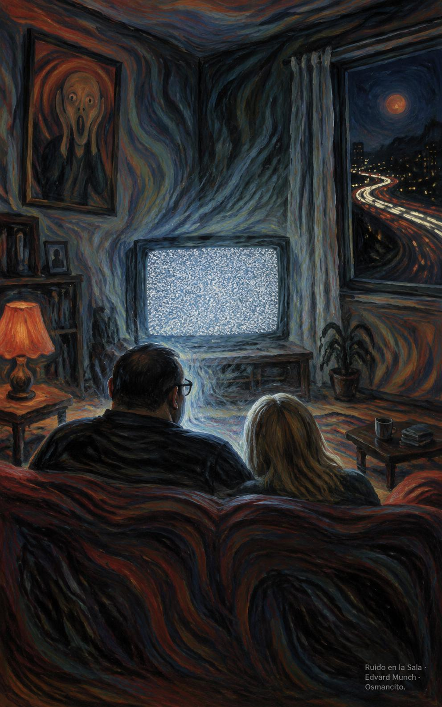](../img/261025_white-noise.jpg)

*White Noise* es una novela del escritor estadounidense Don DeLillo, publicada en 1985 por la editorial Viking. Ese año ganó el National Book Award, un premio literario de Estados Unidos.

Se divide en tres partes: «Waves and Radiation» («Ondas y Radiación»), «The Airborne Toxic Event» («El Evento Tóxico en el Aire») y «Dylarama». Suman cuarenta capítulos numerados, y ninguno trae título; aquí cada uno recibe el suyo. La narra Jack Gladney, profesor universitario.

---

## Parte I: Ondas y Radiación

### Capítulo 1: Las Camionetas

*Jack, los estudios sobre Hitler, el espectáculo de la llegada y el rector.*

[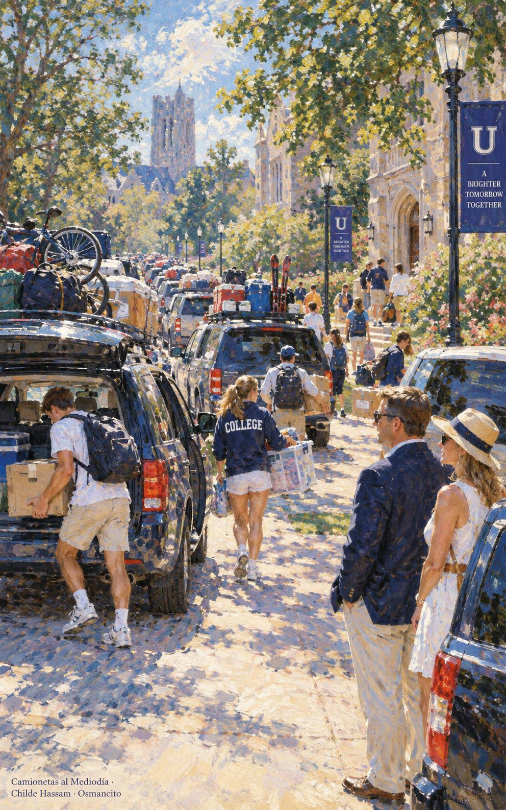](../img/261025_white-noise_las-camionetas.jpg)

Las camionetas familiares llegan a mediodía al campus de una universidad, cargadas de maletas. El narrador, Jack, cuenta:

> Cuando los coches reducían la marcha hasta casi detenerse y paraban, los estudiantes saltaban afuera y corrían a las puertas traseras para empezar a sacar los objetos del interior: los equipos de música, las radios, los ordenadores personales; los pequeños frigoríficos y las cocinas de mesa; las cajas de discos y casetes; los secadores de pelo y los rizadores; las raquetas de tenis, los balones de fútbol, los palos de hockey y lacrosse, los arcos y las flechas; las sustancias controladas, las píldoras y los dispositivos anticonceptivos; la comida basura aún en las bolsas de la compra: chips de cebolla y ajo, nachos finos, tortitas de crema de cacahuete, Waffelos y Kabooms, gominolas de fruta y palomitas de caramelo; los chupa-chups Dum-Dum, las pastillas de menta Mystic.
> [Frase 4](#original-4)

Jack dirige el departamento de estudios sobre Hitler de la universidad. Fue un día frío y luminoso, cuando habló con el rector, la máxima autoridad de la universidad. Jack cuenta:

> Cuando le sugerí al rector que podríamos construir un departamento entero en torno a la vida y la obra de Hitler, él vio enseguida las posibilidades.
> [Frase 25](#original-25)

---

### Capítulo 2: Babette en la Cocina

*Denise, Steffie, Jack, Babette, Wilder y el almuerzo.*

Es mediodía en la cocina de Jack, el narrador, y de su esposa Babette. Jack cuenta:

> Yo la miro todo el tiempo haciendo cosas en secuencia medida, con destreza, con aparente soltura, a diferencia de mis antiguas esposas, que tenían tendencia a sentirse ajenas al mundo objetivo: un grupo ensimismado y de nervios tensos, con vínculos con la comunidad de inteligencia.
> [Frase 55](#original-55)

Wilder, el menor de los niños, está sentado en el mostrador. Denise y Steffie, las niñas, bajan:

> Denise y Steffie bajaron y hablamos de los útiles escolares que necesitarían.
> [Frase 79](#original-79)

Es la hora del almuerzo:

> Entramos en un período de caos y ruido.
> [Frase 81](#original-81)

> Dimos vueltas, discutimos un poco, dejamos caer utensilios.
> [Frase 82](#original-82)

> Por fin quedamos todos satisfechos con lo que habíamos logrado sacar de los armarios y del refrigerador o quitarnos unos a otros, y empezamos a untar con calma mostaza o mayonesa en nuestra comida de colores vivos.
> [Frase 83](#original-83)

Jack defiende a Babette ante las niñas. Arriba suena una alarma:

> La alarma de humo sonó en el pasillo de arriba, o para avisarnos de que la pila acababa de morir o porque la casa se incendiaba.
> [Frase 112](#original-112)

> Terminamos el almuerzo en silencio.
> [Frase 113](#original-113)

---

### Capítulo 3: El Granero Fotografiado

*Murray, el narrador, el calor, la gente, el granero y los profesores.*

Los jefes de departamento usan togas académicas en el College-on-the-Hill. El departamento de Jack comparte edificio con el de cultura popular, cuyos profesores, casi todos emigrados de Nueva York, estudian los placeres brillantes de la cultura. Jack cuenta:

> Una excepción a parte de lo anterior es Murray Jay Siskind, un ex periodista deportivo que me pidió almorzar con él en el comedor, donde el olor institucional de una comida vagamente definida despertó en mí un recuerdo oscuro y sombrío.
> [Frase 131](#original-131)

Murray es nuevo, encorvado y de barba amish; da clases sobre íconos vivos. Le gusta el pueblo porque quiere huir de las ciudades, del calor y de las complicaciones con mujeres. Vive en una pensión. Jack cuenta:

> Tuve la impresión de que, desde los once años, en su abarrotada parcela de concreto, había asociado esta tela resistente con los estudios superiores en algún lugar imposiblemente lejano y sombreado de árboles.
> [Frase 172](#original-172)

Murray dice que está aquí para evitar situaciones y que lo que más ama de las mujeres son sus mentes. Elogia lo que Jack ha creado en torno a Hitler y quiere hacer lo mismo con Elvis. Jack cuenta:

> Varios días después, Murray me preguntó por una atracción turística conocida como el granero más fotografiado de América.
> [Frase 205](#original-205)

> Manejamos veintidós millas hacia el campo en torno a Farmington.
> [Frase 206](#original-206)

Hay prados, huertos de manzanos y vallas blancas, y empiezan a aparecer carteles. Jack cuenta:

> Contamos cinco carteles antes de llegar al lugar.
> [Frase 211](#original-211)

Hay cuarenta autos y un autobús en el estacionamiento improvisado. Jack cuenta:

> Caminamos por un sendero de vacas hasta el punto ligeramente elevado reservado para ver y fotografiar.
> [Frase 213](#original-213)

Todos tienen cámaras y un hombre vende postales. Jack cuenta:

> Nos paramos cerca de una arboleda y miramos a los fotógrafos.
> [Frase 216](#original-216)

Murray guarda silencio y anota en una libreta. Dice que nadie ve el granero: tras ver los carteles, es imposible verlo. Dice que cada foto refuerza el aura y que son parte de una percepción colectiva. La gente toma fotos de tomar fotos. Jack cuenta:

> Escuchamos el incesante chasquido de los botones del obturador, el crujido de las palancas que hacían avanzar la película.
> [Frase 238](#original-238)

Murray pregunta cómo era el granero antes de ser fotografiado y concluye que no pueden salir del aura. Se le ve muy contento.

---

### Capítulo 4: ¿Quién Morirá Primero?

*Jack, Babette, la pregunta de quién morirá primero, las chicas y Bee.*

Jack mira desde el estadio de un colegio a Babette, que corre escaleras arriba. Jack cuenta:

> Tenía la cara inclinada hacia arriba, captando el aire fresco, y no me vio.
> [Frase 259](#original-259)

> Después del último descenso me reuní con ella en el borde del campo de juego y la abracé, poniendo las manos dentro de la cintura elástica de sus pantalones grises de algodón.
> [Frase 266](#original-266)

Babette corre, palea nieve y lee clásicos eróticos en voz alta. Jack cuenta:

> Ella planea viajes de esquí que nunca hacemos, con la cara radiante de entusiasmo.
> [Frase 276](#original-276)

Jack sube la colina hacia la universidad y se pregunta quién morirá primero. En la pista de ceniza abraza a Babette. Jack cuenta:

> Nos cura de nuestra inocencia respecto del futuro.
> [Frase 288](#original-288)

> Vimos a las chicas dar otra vuelta.
> [Frase 290](#original-290)

De camino a casa, Jack dice que Bee quiere visitarlos en Navidad. Jack cuenta:

> «Podemos ponerla con Steffie.»
> [Frase 294](#original-294)

Bee y Steffie se conocieron en Disney World. Bee, hija de Jack y de Tweedy Browner, vuelve de dos años en Corea del Sur. Jack cuenta:

> Esa noche, un viernes, pedimos comida china y vimos televisión juntos, los seis.
> [Frase 308](#original-308)

Babette impuso ver televisión una noche por semana con los hijos. Los viernes, después de la tele, Jack lee a Hitler hasta tarde. Jack cuenta:

> Una de esas noches me metí en la cama junto a Babette y le conté cómo el rector me había aconsejado, allá por 1968, que hiciera algo con mi nombre y mi aspecto si quería que me tomaran en serio como innovador de Hitler.
> [Frase 320](#original-320)

El rector le sugiere inventar la inicial J. A. K. y engordar para parecerse a Hitler.

---

### Capítulo 5: Envases Blancos

*Murray, Jack, Babette, el cuarto y el porche.*

Jack disfruta los días sin rumbo, pero teme una aceleración; una noche cree caer a través de sí mismo y piensa que la muerte debería ser una zambullida elegante. Jack cuenta:

> Nos topamos con Murray Jay Siskind en el supermercado.
> [Frase 344](#original-344)

Murray lleva alimentos genéricos en paquetes blancos: latas de DURAZNOS EN CONSERVA, cacahuates IRREGULARES. Jack cuenta:

> Murray no dejaba de asentir hacia Babette mientras yo los presentaba.
> [Frase 349](#original-349)

Murray dice que los envases sin sabor son la nueva austeridad, la última vanguardia. Elogia el cabello de Babette. Murray dice:

> «Espero que aprecies a esa mujer.»
> [Frase 389](#original-389)

Murray supone que Babette sería firme en una tragedia familiar. Jack responde que se derrumba. Jack cuenta:

> Los tres nos fuimos juntos, intentando maniobrar nuestros carritos entre los libros de bolsillo esparcidos por la entrada.
> [Frase 411](#original-411)

> Murray llevó rodando uno de nuestros carritos hasta el estacionamiento y luego nos ayudó a levantar y empujar toda nuestra mercadería en doble bolsa hacia la parte trasera de la camioneta.
> [Frase 412](#original-412)

Cargan las compras en la camioneta y llevan a Murray a su pensión. Murray dice:

> «Les pediría que visitaran mi cuarto, pero es demasiado pequeño para dos personas, a menos que estén dispuestas a ser íntimas.»
> [Frase 418](#original-418)

Murray intenta desarrollar una vulnerabilidad que las mujeres encuentren atractiva. Jack cuenta:

> Nos dio las gracias por llevarlo.
> [Frase 427](#original-427)

> Lo vimos caminar hacia el porche torcido, apuntalado con bloques de cemento, donde un hombre en una mecedora miraba al vacío.
> [Frase 428](#original-428)

---

### Capítulo 6: ¿Llueve o No?

*Heinrich, Jack, la radio y el escritorio.*

A Heinrich, de catorce años, le retrocede el pelo. Jack se pregunta si lo crió cerca de un vertedero químico. Jack cuenta:

> ¿Lo he criado, sin saberlo, cerca de un vertedero químico, en la trayectoria de corrientes de aire que llevan desechos industriales capaces de producir degeneración del cuero cabelludo, gloriosos atardeceres?
> [Frase 433](#original-433)

Heinrich dice que lloverá esta noche. Jack dice que ya llueve. Jack cuenta:

> Lo llevé a la escuela en su primer día de regreso después de un dolor de garganta y fiebre.
> [Frase 442](#original-442)

Una mujer con impermeable amarillo detiene el tráfico para que crucen unos niños. Jack cuenta:

> «Mira el parabrisas», dije.
> [Frase 445](#original-445)

> «Solo te cuento lo que dijeron.»
> [Frase 447](#original-447)

Heinrich dice que los sentidos fallan y que el tiempo está solo en la mente. Jack imagina a un hombre armado que exige saber si llueve. Heinrich dice:

> «Quizá si esa gente pudiera vernos con un telescopio parezcamos medir dos pies y dos pulgadas de alto, y podría estar lloviendo ayer en vez de hoy.»
> [Frase 475](#original-475)

Jack le pone nombre al hombre armado. Heinrich duda de que exista el ahora, y Jack le pregunta si hay lluvia aquí y ahora. Heinrich dice:

> «Si quieres hablar de este lugar preciso mientras vas en un vehículo que obviamente se mueve, entonces creo que ese es el problema de esta discusión.»
> [Frase 495](#original-495)

> «Solo dame una respuesta, ¿de acuerdo, Heinrich?»
> [Frase 496](#original-496)

Jack insiste en que o llueve o no. Heinrich pregunta cómo saber que no es ácido sulfúrico. Heinrich dice:

> ¿Cómo sé yo que lo que llamas lluvia es realmente lluvia?
> [Frase 512](#original-512)

Jack define la lluvia como lo que cae del cielo y moja. Heinrich pregunta si Jack está mojado. Jack cuenta:

> «De primera», le dije.
> [Frase 520](#original-520)

Jack celebra la victoria de la incertidumbre. Heinrich le dice que sea sarcástico. Heinrich dice:

> «Adelante, sé sarcástico, no me importa.»
> [Frase 525](#original-525)

La madre de Heinrich vive en un ashram. Jack cuenta:

> Vi cómo caminaba bajo el aguacero hasta la entrada de la escuela.
> [Frase 530](#original-530)

Heinrich se quita la gorra. Jack cuenta:

> En esos momentos descubro que lo amo con una desesperación animal, la necesidad de llevarlo bajo mi abrigo y estrujarlo contra mi pecho, mantenerlo allí, protegerlo.
> [Frase 532](#original-532)

> Lo vemos en su escritorio, una mesa sin pintar cubierta de libros y revistas.
> [Frase 536](#original-536)

Babette hornea sus galletas favoritas. Heinrich juega ajedrez por correo con un asesino. Jack da su clase de Nazismo Avanzado y habla de las tramas, que tienden hacia la muerte.

---

### Capítulo 7: Quién Complace a Quién

*Babette, Jack, los ancianos y la lectura.*

Dos noches por semana Babette da clases de postura a ancianos en una iglesia. Esa noche Jack y ella se desvisten en el dormitorio. Jack cuenta:

> Creíamos que algo vivía en el sótano.
> [Frase 594](#original-594)

Cada uno quiere complacer al otro. Babette ofrece leerle. Jack dice:

> «Pensé que a ti también te gustaba.»
> [Frase 612](#original-612)

Babette dice que el beneficio es de quien escucha. Jack le recuerda que a ella le gusta leer pasajes eróticos. Babette dice:

> «Si a ti te agrada, entonces me gusta hacerlo.»
> [Frase 617](#original-617)

Jack dice que también debe agradarle a ella. Babette dice:

> «Me agrada que disfrutes mi lectura.»
> [Frase 620](#original-620)

Babette quiere leer. Jack le pide que elija un siglo y le propone lecturas. Jack dice:

> Tenemos íncubos y súcubos.
> [Frase 634](#original-634)

Cada uno quiere que el otro elija. Babette dice:

> ¿No queremos un equilibrio, una especie de toma y daca?
> [Frase 640](#original-640)

Jack elegirá y ella leerá. Babette dice:

> «Pero no quiero que elijas nada que tenga hombres dentro de mujeres, entre comillas, o hombres que entran en mujeres. “Entré en ella.” “Él entró en mí.” No somos vestíbulos ni ascensores. “Lo quería dentro de mí”, como si pudiera arrastrarse del todo hacia adentro, firmar el registro, dormir, comer, y así sucesivamente.»
> [Frase 646](#original-646)

Babette se ríe de sus propias frases eróticas. Jack y Babette se cuentan todo. Jack cuenta:

> En estos recitales nocturnos creamos un espacio entre las cosas como las sentimos en su momento y como las decimos ahora.
> [Frase 669](#original-669)

Jack elige el siglo veinte y va a buscar una revista al cuarto de Heinrich. Jack cuenta:

> Me puse la bata y fui por el pasillo hasta el cuarto de Heinrich a buscar una revista chabacana de la que Babette pudiera leer, de esas que traen cartas de lectores que detallan sus experiencias sexuales.
> [Frase 672](#original-672)

Heinrich hace un experimento con Wilder. Jack encuentra álbumes de fotos. Jack cuenta:

> Pasamos horas revisándolos, sentados en la cama.
> [Frase 682](#original-682)

En las fotos, la gente se ve escéptica ante la cámara. Jack se pregunta quién morirá primero.

---

### Capítulo 8: Lecciones de Alemán

*Dunlop, el casero, Murray y Jack.*

Jack es la máxima figura de los estudios sobre Hitler en Norteamérica y oculta que no sabe alemán. Quiere aprenderlo en secreto. Jack cuenta:

> Me puse en contacto con un hombre sin vínculos con la universidad, alguien de quien Murray Jay Siskind me había hablado.
> [Frase 706](#original-706)

El hombre se llama Howard Dunlop y vive en la pensión de Murray. Jack cuenta:

> Dijo que había sido quiropráctico, pero no ofreció una razón por la que ya no ejercía, y no dijo cuándo había aprendido alemán, ni por qué, y algo en su manera me impidió preguntar.
> [Frase 712](#original-712)

Dunlop da clases en su cuarto oscuro; al hablar alemán parece estrangularse. Jack le pide que no hable de las lecciones y va a buscar a Murray. Jack cuenta:

> Nos detuvimos en el porche el tiempo suficiente para que Murray le contara al casero, que estaba sentado allí, de un grifo que goteaba en el baño del segundo piso.
> [Frase 731](#original-731)

> El casero era un hombre corpulento y rubicundo, de una salud tan robusta y desbordante que parecía estar sufriendo un infarto incluso mientras lo mirábamos.
> [Frase 732](#original-732)

> «Ya se ocupará de arreglarlo», dijo Murray, mientras salíamos a pie en dirección a Elm.
> [Frase 733](#original-733)

Murray dice que el casero es un fanático, como todos los que arreglan cosas. Jack cuenta:

> Me preguntó por qué había elegido precisamente este año para aprender alemán, después de tantos años esquivando el radar.
> [Frase 747](#original-747)

Jack dice que hay un congreso sobre Hitler en primavera. En casa, Denise enciende el compactador de basura, y Babette llega de correr.

---

### Capítulo 9: La Invitación de Murray

*Murray, Babette, Jack, Denise, Wilder y Steffie.*

[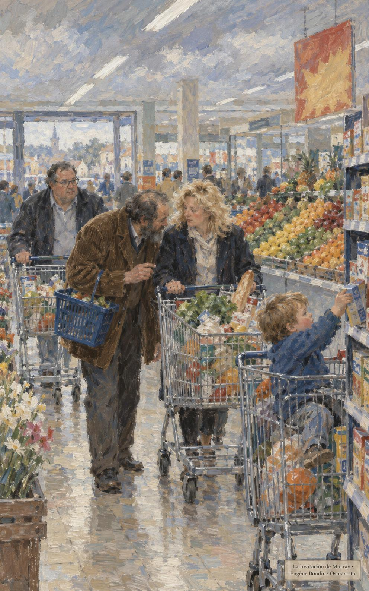](../img/261025_white-noise_la-invitacion-de-murray.jpg)

En el colegio de los niños evacuan a todos: dolores de cabeza, sabor a metal, una maestra que habla lenguas extrañas. Nadie sabe la causa. Jack cuenta:

> Minutos después de entrar, nos topamos con Murray.
> [Frase 785](#original-785)

> Pasamos a la zona de alimentos genéricos y Murray se detuvo con su cesta de plástico a hurgar entre los cartones y los frascos blancos.
> [Frase 802](#original-802)

En el supermercado, Murray dice que allí se aprende sobre la muerte. Babette cuenta que Denise lleva una visera verde a todas partes. Jack cuenta:

> Oí a Babette decirle a Murray que llevaba catorce horas diarias con la visera, desde hacía tres semanas.
> [Frase 841](#original-841)

Murray habla de los tibetanos, y Babette escucha. Babette pregunta dónde está Wilder. Jack cuenta:

> Los tres adultos nos plantamos cada uno a la entrada de un pasillo y escrutamos el tráfico de carritos y de cuerpos que se deslizaban.
> [Frase 909](#original-909)

> Luego recorrimos tres pasillos más, con la cabeza adelantada, zigzagueando un poco mientras cambiábamos las líneas de visión.
> [Frase 910](#original-910)

Murray ve a Wilder en el carrito de otra mujer. Jack cuenta:

> Antes de ir a la caja rápida, Murray nos invitó a cenar, dentro de ocho días, el sábado.
> [Frase 921](#original-921)

> «No tienen que avisarme hasta el último minuto.»
> [Frase 922](#original-922)

> «No voy a preparar nada importante, así que llamen antes y avísenme si surgió otra cosa.»
> [Frase 924](#original-924)

> «Si no aparecen, sabré que surgió algo y que no pudieron avisarme.»
> [Frase 926](#original-926)

> No quiero que sientan que los obligo a algo.
> [Frase 932](#original-932)

> Tengo que comer de todos modos, así que no es ninguna catástrofe si surge algo y tienen que cancelar.
> [Frase 935](#original-935)

> Solo quiero que sepan que estaré ahí si deciden pasar, con niños o sin ellos.
> [Frase 936](#original-936)

> «Tenemos hasta mayo o junio del año que viene para hacer esto, así que la cena del sábado no tiene ninguna mística especial.»
> [Frase 937](#original-937)

En la fila de la caja, Jack se pega a Babette. Afuera corre el rumor de que murió un hombre durante la inspección de la escuela.

---

### Capítulo 10: El Chicle y el Preso

*Tommy Roy, Heinrich, Babette, Jack, Steffie y Denise.*

[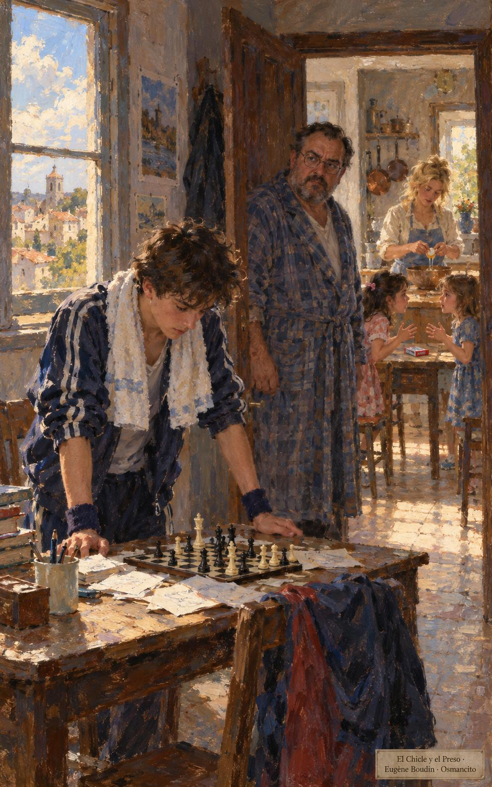](../img/261025_white-noise_el-chicle-y-el-preso.jpg)

Denise ve cómo Babette abre un paquete de chicles. Dice que provoca cáncer en ratas de laboratorio. Babette responde, y Jack cuenta:

> «Ahora ponen una advertencia, y me costaría creer que no la hayas visto.»
> [Frase 966](#original-966)

> «No mastiques nada», dijo.
> [Frase 974](#original-974)

Steffie cuelga el teléfono después de hablar con los Stover, y Babette sigue discutiendo con Denise. Jack cuenta:

> Me lanzó una mirada que se preguntaba cómo la niña podía hablar por teléfono y escucharnos al mismo tiempo.
> [Frase 977](#original-977)

> Quise decir que era porque nos encuentra interesantes.
> [Frase 978](#original-978)

> Babette dijo a las niñas: «Miren, o mastico chicle o fumo.»
> [Frase 979](#original-979)

> «Si quieren que empiece a fumar otra vez, quítenme el chicle y mi Mentho-Lyptus.»
> [Frase 980](#original-980)

> «¿Por qué tienes que hacer una cosa o la otra?», dijo Steffie.
> [Frase 981](#original-981)

> «¿Y por qué no hacer las dos?», dijo Denise, mientras la cara se le vaciaba con cuidado de toda expresión.
> [Frase 983](#original-983)

> «No los queremos», dijo Babette.
> [Frase 1004](#original-1004)

Jack sube a ver a Heinrich, que juega al ajedrez por correo con un preso. Jack cuenta:

> «Creo que lo tengo arrinconado.»
> [Frase 1038](#original-1038)

> ¿Qué sabes de él, aparte de que está en la cárcel de por vida, por asesinato?
> [Frase 1045](#original-1045)

> «A veces nos mandamos notas.»
> [Frase 1048](#original-1048)

Heinrich cuenta que el preso mató a cinco personas desde un tejado. Jack cuenta:

> «Bueno, te ha contado todo esto en las cartas que te manda.»
> [Frase 1101](#original-1101)

> «Sabes lo que diría tu madre de esta relación de ajedrez por correo.»
> [Frase 1106](#original-1106)

Jack le pregunta por su madre. Heinrich dice:

> «Quiere que vaya al ashram este verano.»
> [Frase 1111](#original-1111)

Heinrich duda de que sepamos lo que queremos. A la mañana siguiente, Jack va al banco y comprueba su saldo en el cajero.

---

### Capítulo 11: El Cuarto de Murray

*Babette, Jack, Murray, la gallina de Cornualles, el brazo de Jack y la posibilidad.*

[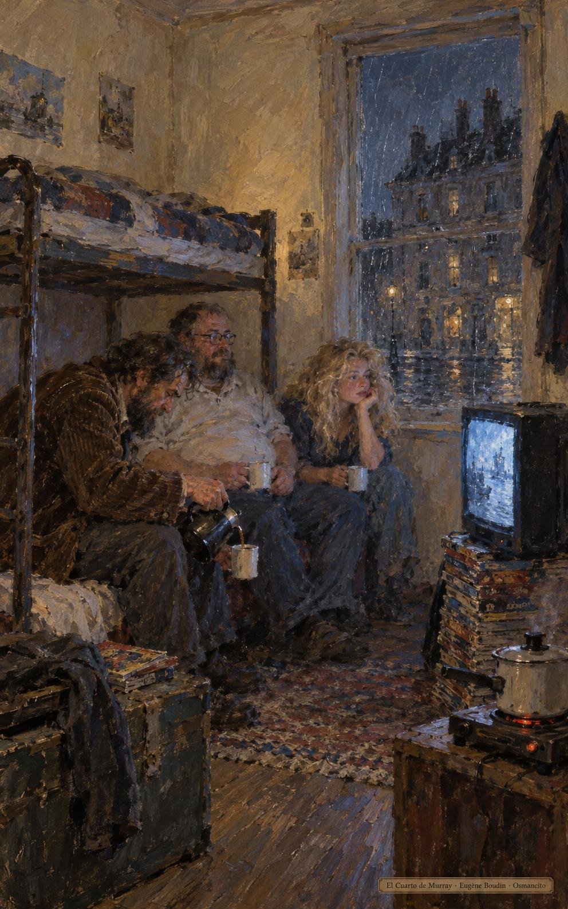](../img/261025_white-noise_el-cuarto-de-murray.jpg)

De madrugada, Jack despierta con sudor de muerte y vuelve a dormirse junto a Babette. Por la mañana baja a la cocina, y Jack cuenta:

> Babette murmuró en sueños y yo me acerqué, respirando su calor.
> [Frase 1149](#original-1149)

> Pensé que seguía en la cama.
> [Frase 1161](#original-1161)

Steffie quema tostadas porque le gusta el olor. Pregunta por su madre, que trabaja para la CIA. Babette pregunta también, y Jack cuenta:

> «¿Qué hace exactamente?», dijo Babette.
> [Frase 1179](#original-1179)

> «¿La conozco?», dijo Babette.
> [Frase 1187](#original-1187)

Esa noche cenan en el cuarto de Murray, frente al antiguo manicomio. Jack cuenta:

> Esa noche, en el cuarto blanco roto de Murray, después de una comida espectacular de gallina de Cornualles con forma de rana, preparada en un hornillo de dos fuegos, pasamos de nuestras sillas plegables de metal a la litera para el café.
> [Frase 1217](#original-1217)

> «Has hecho maravillas», dijo Babette, con la mirada recorriendo desesperada el cuarto.
> [Frase 1220](#original-1220)

> «Siento que no hayan traído a los niños.»
> [Frase 1231](#original-1231)

Murray quiere conocer a los niños pequeños y les cuenta lo que dice a sus alumnos. Jack cuenta:

> Como estábamos sentados en la cama, Murray tenía que inclinarse bien hacia delante, mirando más allá de la taza de café que sostenía yo en la mano, para dirigirse a Babette.
> [Frase 1241](#original-1241)

Murray habla de la televisión con Jack. Murray dice:

> Una experiencia grande y humilde, déjame decirte.
> [Frase 1262](#original-1262)

Babette le pregunta a Murray cómo sabe tanto. Jack cuenta:

> «¿Cómo sabes tanto?», dijo Babette.
> [Frase 1284](#original-1284)

> «¿Alguna vez has estado casado?», dijo ella.
> [Frase 1288](#original-1288)

> «No creas que no agradecería una visita dramática entre las dos y las tres de la madrugada», le dijo, «de una mujer inteligente con tacones de aguja y una falda con abertura, con accesorios de gran impacto.»
> [Frase 1292](#original-1292)

Murray bromea con una visita de madrugada. Jack cuenta:

> Caía una llovizna cuando volvimos a casa a pie, con mi brazo alrededor de su cintura.
> [Frase 1293](#original-1293)

Babette habla de su mala memoria. Babette dice:

> «Olvido que a Steffie no le gusta que la llamen Stephanie.»
> [Frase 1309](#original-1309)

> A veces la llamo Denise.
> [Frase 1310](#original-1310)

Jack le dice que quizá toma algo, algo que oyó de Steffie. Jack cuenta:

> «Quería preguntártelo antes de preguntárselo a ella.»
> [Frase 1325](#original-1325)

> «No podemos descartarlo.»
> [Frase 1329](#original-1329)

Llega el otoño: hojas, bolsas negras en la acera y niños que piden dulces en la puerta de casa.

---

### Capítulo 12: Dunlop y el Clima

*Jack, Dunlop, Bob Pardee, Babette, algo más, la compasión y los ojos.*

[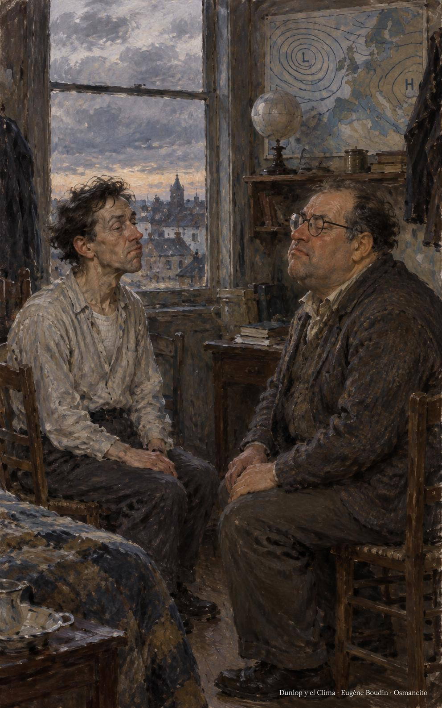](../img/261025_white-noise_dunlop-y-el-clima.jpg)

Jack toma clases de alemán dos veces por semana. Howard Dunlop exige que se sienten frente a frente toda la lección. Dunlop deforma la cara y hace muecas al pronunciar, y Jack lo imita:

> Cuando llegaba el momento de que repitiera los ruidos, yo hacía lo mismo, aunque solo fuera para complacer al profesor, torciendo la boca, cerrando los ojos del todo, consciente de una sobrearticulación tan torturada que debía de haber sonado como una flexión repentina de la ley natural, una piedra o un árbol que se esfuerza por hablar.
> [Frase 1352](#original-1352)

Dunlop mira a lo lejos, desprendido. Jack es su único alumno de alemán; también enseña griego, latín y navegación:

> «¿Enseña algo más?», dije.
> [Frase 1376](#original-1376)

Dunlop también enseña meteorología: tras la muerte de su madre vio por televisión a un joven pronosticando el tiempo y encontró paz; hoy da clases en sótanos de iglesias. En casa, Bob Pardee, el padre de Denise, practica su swing de golf en la cocina:

> Dijo que iba de paso por la ciudad hacia Glassboro para hacer una presentación y pensó en llevarnos a todos a cenar.
> [Frase 1413](#original-1413)

Denise le pregunta para qué son los fondos. Bob habla de una fundación para la defensa legal de la industria nuclear y dice que tiene hambre:

> Vamos a acercarnos sigilosos a unas costillas, ¿por qué no?
> [Frase 1438](#original-1438)

Bob lleva a los hijos mayores al Wagon Wheel. Jack acompaña a Babette a leerle al ciego Treadwell; ella sale y no hay nadie, ni él ni su hermana. La policía no sabe nada. En el Dinky Donut:

> Me di cuenta de que Babette lo miraba con atención, tratando de captar el sentido de los cuatro años desbocados que habían pasado como marido y mujer.
> [Frase 1472](#original-1472)

Bob bebía, apostaba, tiraba el auto por terraplenes y le pagó a una mujer para que le hablara en sueco; eso enfureció a Babette, que le pegó:

> Ahora ella lo miraba con una tierna compasión, una reflexión que parecía honda, cariñosa y generosa como para contener todos los contrahechizos mágicos contra su actual racha de desgracias, aunque yo sabía, por supuesto, mientras volvía a mi libro, que era solo un afecto pasajero, una de esas bondades que nadie entiende.
> [Frase 1477](#original-1477)

Al día siguiente, al mediodía, dragan el río.

---

### Capítulo 13: La Vidente de la Policía

*La sobrina nieta, Heinrich, los Treadwell y Babette.*

[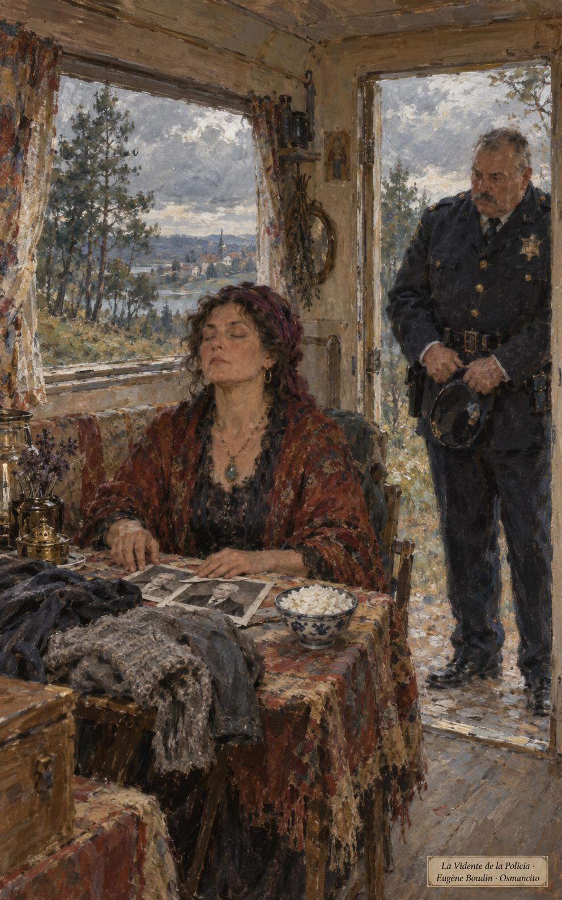](../img/261025_white-noise_la-vidente-de-la-policia.jpg)

En Blacksmith, el pueblo, Babette llama a Jack a su oficina para hablar de los Treadwell, un anciano y su hermana desaparecidos, y de Heinrich, el hijo de Jack:

> Dijo que Heinrich había estado en el río, con su gorra de camuflaje y una Instamatic, para ver cómo dragaban en busca de los cuerpos, y que mientras estaba allí llegó la noticia de que habían encontrado a los Treadwell vivos pero estremecidos en un quiosco de galletas abandonado del Mid-Village Mall, un enorme centro comercial junto a la autopista.
> [Frase 1488](#original-1488)

Los Treadwell vagaron dos días por el centro comercial y pasaron otros dos en el quiosco. Antes, la policía había consultado a una vidente, Adele T., que la guió hacia tierra seca. Nadie sabe cómo llegaron allí:

> Posiblemente su sobrina nieta los había dejado allí en su coche y después se había olvidado de ir a buscarlos.
> [Frase 1496](#original-1496)

Babette dice que no pudieron localizar a la sobrina nieta. El misterio americano se profundiza.

---

### Capítulo 14: El Desvanecimiento Cerebral

*Jack, Grappa, Denise, Lasher, Alfonse, Cotsakis, Babette, Heinrich y Murray.*

[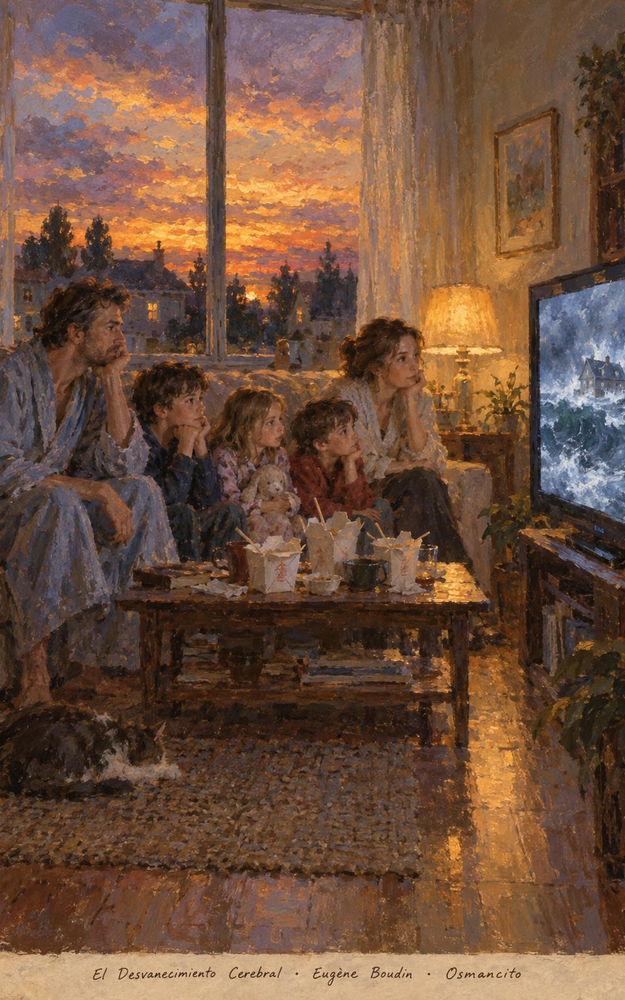](../img/261025_white-noise_el-desvanecimiento-cerebral.jpg)

Jack cuenta:

> Nos apiñamos ante la ventana en el cuarto pequeño de Steffie, viendo la espectacular puesta de sol.
> [Frase 1509](#original-1509)

Más tarde Jack estudia alemán en la cama. Denise entra y se tumba a los pies, de espaldas a él. Pasa un minuto. Denise dice:

> «¿Qué vamos a hacer con Baba?», dijo ella.
> [Frase 1517](#original-1517)

Denise cuenta que Babette no recuerda nada y que encontró en la basura un frasco de Dylar, uno cada tres días. No sale en su libro de fármacos. Jack dice que debe ser reciente y ofrece:

> «¿Quieres que vuelva a mirar el libro?»
> [Frase 1539](#original-1539)

Denise responde que ya miró; Jack propone otra salida:

> «Miré.» «Siempre podríamos llamar a su médico.»
> [Frase 1541](#original-1541)

Jack no quiere darle demasiada importancia: todos toman algo y olvidan cosas. Denise sigue queriendo saber. Jack cuenta:

> Pero ahora cambió de postura, se apoyó en un codo para incorporar la parte superior del cuerpo y me observó con aire especulativo desde los pies de la cama.
> [Frase 1559](#original-1559)

> «¿Puedo preguntarte algo?»
> [Frase 1560](#original-1560)

Ella pregunta por qué Jack le puso Heinrich a su hijo Heinrich. Jack responde que le pareció un nombre fuerte, con autoridad, y que quería protegerlo. Hubo un largo silencio. Jack cuenta:

> Siguió mirándome.
> [Frase 1583](#original-1583)

Con los rasgos apretados en el centro de la cara, tiene en la concentración un aire de dogo medio beligerante. Ella pregunta:

> «¿Crees que me equivoqué en el cálculo?»
> [Frase 1585](#original-1585)

Jack dice que no le toca decirlo. Hablan de Hitler, que siempre sale en televisión, y de los uniformes. Steffie entra con la visera verde de Denise. Jack cuenta:

> Se subió a la cama y los tres repasamos mi diccionario alemán-inglés, buscando palabras que suenan casi igual en los dos idiomas, como orgy y shoe.
> [Frase 1607](#original-1607)

Heinrich llama a ver imágenes de un accidente aéreo y todos corren al televisor. Jack llega tarde y solo ve humo negro. Jack cuenta:

> Teníamos dos puertas de armario que se abrían solas.
> [Frase 1617](#original-1617)

> Esa noche, un viernes, nos reunimos frente al aparato, como era costumbre y regla, con comida china para llevar.
> [Frase 1618](#original-1618)

Había inundaciones, terremotos, deslaves y volcanes en erupción. Jack cuenta:

> Nunca antes habíamos estado tan atentos a nuestro deber, nuestra reunión de los viernes.
> [Frase 1620](#original-1620)

Heinrich no estaba hosco ni Jack aburrido. Steffie casi llora ante una comedia; Babette quiso cambiar de canal y se asombró de la protesta. Jack cuenta:

> Por lo demás permanecíamos en silencio, viendo casas deslizarse hacia el océano, aldeas enteras crepitar y encenderse en una masa de lava que avanzaba.
> [Frase 1625](#original-1625)

> Cada desastre nos hacía desear más, algo más grande, más imponente, más arrasador.
> [Frase 1626](#original-1626)

El lunes Murray espera a Jack en su oficina: no logra imponer su base de Elvis Presley en el departamento. En el almuerzo Jack ve a Alfonse presidir la mesa de los emigrados de Nueva York. Jack cuenta:

> Una vez me dijo que el arte de salir adelante en Nueva York se basaba en aprender a expresar la insatisfacción de manera interesante.
> [Frase 1641](#original-1641)

Alfonse aplasta toda opinión ajena. Jack cuenta:

> Le dije: «¿Por qué es, Alfonse, que personas decentes, bienintencionadas y responsables se sienten intrigadas por la catástrofe cuando la ven por televisión?»
> [Frase 1650](#original-1650)

> Le conté la reciente velada de lava, barro y aguas furiosas que a los niños y a mí nos había resultado tan entretenida.
> [Frase 1651](#original-1651)

Alfonse dice que es natural: sufrimos de desvanecimiento cerebral y necesitamos catástrofes que ocurran en otra parte, como California. Murray añade que la gente ha olvidado cómo mirar y escuchar. Grappa lanza medio panecillo a Lasher para llamar su atención y le dice:

> Grappa le dijo: «¿Alguna vez te lavaste los dientes con el dedo?»
> [Frase 1702](#original-1702)

Lasher, Cotsakis y Murray cuentan dónde se lavaron los dientes con el dedo. Alfonse pregunta dónde estaban cuando murió James Dean, y Grappa dice tener lagunas. Jack cuenta:

> Vi a Grappa lanzar una galleta salada a Murray.
> [Frase 1781](#original-1781)

La lanzó de revés, como un frisbi.

---

### Capítulo 15: La Madre y la Multitud

*Hitler, Elvis, Jack, Gladys, Murray y las multitudes.*

[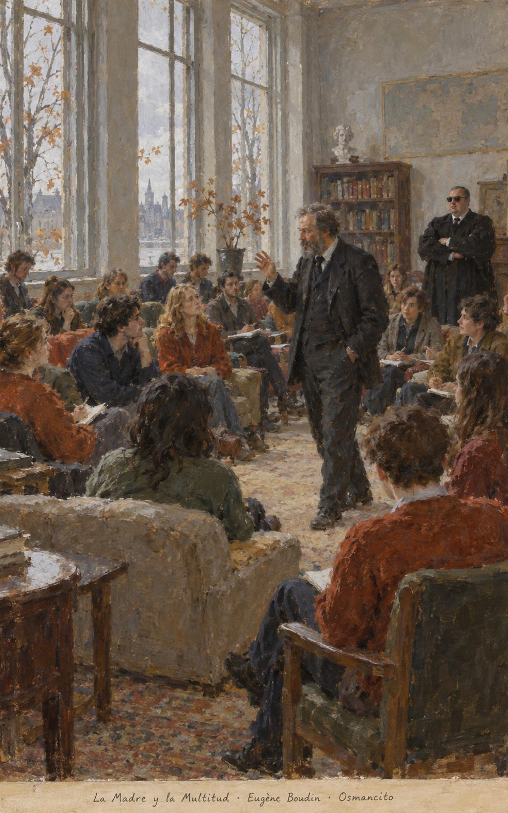](../img/261025_white-noise_la-madre-y-la-multitud.jpg)

Jack, con gafas oscuras y toga negra, entra en el aula de Murray. Murray habla de Elvis y de su madre, Gladys, y dice que las madres saben. Jack contesta:

> «Hitler adoraba a su madre», dije.
> [Frase 1800](#original-1800)

Un rumor de atención recorre el aula. Murray sigue andando, con más cuidado, entre los estudiantes.

> «A Elvis y a Gladys les gustaba acurrucarse y acariciarse», dijo.
> [Frase 1804](#original-1804)

> «Dormían en la misma cama hasta que él empezó a acercarse a la madurez física.
> [Frase 1805](#original-1805)

> Hablaban entre sí en lenguaje de bebé a todas horas.»
> [Frase 1806](#original-1806)

Jack habla de Hitler y de su madre, Klara, que lo mimaba. Murray, de Gladys, que llevaba a Elvis al colegio cada día. Murray dice:

> Lo defendía en pequeñas riñas callejeras y arremetía contra cualquier chico que intentara intimidarlo.»
> [Frase 1812](#original-1812)

Jack cuenta que Hitler fantaseaba, tocaba el piano y dibujaba, y Klara lo toleraba. Murray dice que Elvis se confiaba a Gladys.

> Llevaba a sus novias para que la conocieran.»
> [Frase 1820](#original-1820)

Murray cuenta que Gladys enfermó cuando Elvis entró en el ejército. Un estudiante murmura «Mutter-söhnchen» y Jack se pone a pasear como Murray. Murray dice:

> «Elvis apenas soportaba dejar que Gladys se le fuera de la vista cuando su estado empeoró.
> [Frase 1831](#original-1831)

> Le habló en lenguaje de bebé hasta que estuvo bajo tierra.»
> [Frase 1837](#original-1837)

Hitler lloró en la tumba de Klara. Murray se sienta en el suelo. Jack imagina a Hitler mirando atrás desde el búnker:

> ¿Pensó en los pequeños grupos de turistas que visitaban el pequeño poblado donde nació su madre y donde él había pasado los veranos con sus primos, montando en carretas de bueyes y haciendo cometas?
> [Frase 1865](#original-1865)

Los turistas honraban el lugar donde nació Klara y entraban en la granja. Luego llegaron multitudes que cantaban canciones patrióticas y pintaban esvásticas en las paredes. Jack sigue:

> Llegaron multitudes a su villa de montaña, tanta gente que tuvo que quedarse dentro.
> [Frase 1872](#original-1872)

Se llevaban a casa guijarros que él había pisado.

> Llegaban multitudes a oírlo hablar, multitudes cargadas de erotismo, las masas que él llamó una vez su única novia.
> [Frase 1874](#original-1874)

Jack cuenta hasta siete mirando la alfombra. Luego dice que las multitudes se reunían en nombre de la muerte. Murray lo mira agradecido. La gente se junta alrededor y Jack comprende que ya son una multitud.

---

### Capítulo 16: El Llanto de Wilder

*Jack, Babette, Wilder, el médico y el llanto.*

[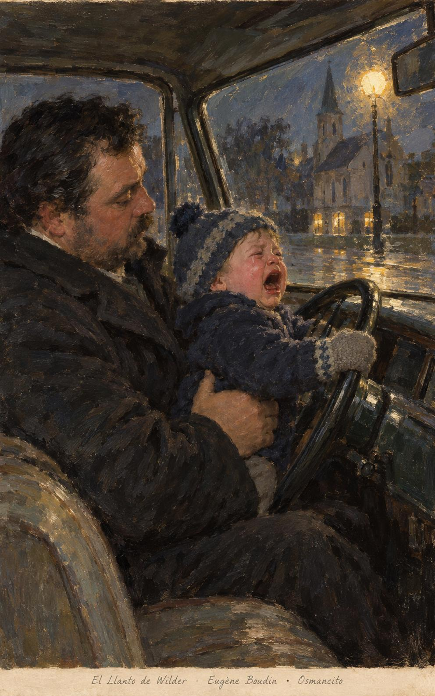](../img/261025_white-noise_el-llanto-de-wilder.jpg)

Wilder empezó a llorar a las dos de la tarde. Jack, que lo cuenta, recuerda la hora de la cena:

> A las seis seguía llorando, sentado en el suelo de la cocina y mirando por la ventanilla del horno, y cenamos deprisa, moviéndonos a su alrededor o pasando por encima de él para llegar a los fogones y al frigorífico.
> [Frase 1909](#original-1909)

Babette tiene que dar en una hora y media su clase de sentarse, estar de pie y caminar a unos ancianos en el sótano de una iglesia. Ya le ha hablado con suavidad, lo ha bañado y lo ha examinado. Jack dice:

> «Vamos a llevarlo al médico», dije.
> [Frase 1918](#original-1918)

Hablan de qué médico podría ver a un niño que llora, y deciden ir. Jack cuenta:

> Pero una vez decidido que iríamos al médico, empezamos a apresurarnos, a inquietarnos.
> [Frase 1928](#original-1928)

> Buscamos la chaqueta y los zapatos de Wilder, tratamos de recordar qué había comido en las últimas veinticuatro horas, anticipamos las preguntas del médico y ensayamos con cuidado las respuestas.
> [Frase 1929](#original-1929)

Les parece vital coincidir en las respuestas: los médicos pierden interés en quienes se contradicen. Jack cuenta:

> Esperé en el coche mientras Babette y Wilder entraban en el edificio médico, al final de Elm.
> [Frase 1933](#original-1933)

A Jack los consultorios lo deprimen más que los hospitales. Al salir, madre e hijo cruzan la acera y Jack los ve:

> El niño caminaba junto a su madre, de la mano, todavía llorando, y parecían una imagen de tristeza y calamidad tan aficionada que casi me eché a reír, reír no de la tristeza sino de la imagen que daban de ella, del desajuste entre su dolor y sus apariencias.
> [Frase 1939](#original-1939)

Jack pregunta qué dijo el médico: que le dé una aspirina y lo acueste, lo mismo que dijo Denise. Babette cuenta lo que contestó el médico:

> Dijo: «Bueno, ¿y por qué no lo hizo?»
> [Frase 1948](#original-1948)

Ya en el coche el llanto cambia de tono y se vuelve lamento. Jack pregunta qué hacen. Babette dice que piense algo, que faltan quince minutos para su clase:

> Llevémoslo al hospital, a la entrada de urgencias.
> [Frase 1969](#original-1969)

Babette dice que llorar no es una urgencia y que la lleve a su clase. Jack la deja en la iglesia y se queda con Wilder, que lleva seis horas llorando. Lo sienta contra el volante, escucha el llanto y casi se duerme. Cuando Babette vuelve:

> Íbamos a medio camino de casa cuando se detuvo el llanto.
> [Frase 2023](#original-2023)

En casa nadie habla. Cuando Wilder pide leche, Denise corre descalza a la cocina, y él se la bebe de un trago. Es como si volviera de un lugar remoto y santo.

---

### Capítulo 17: La Cuna de la Desinformación

*Jack, Babette, Denise, Steffie, Heinrich, Wilder y la comida.*

[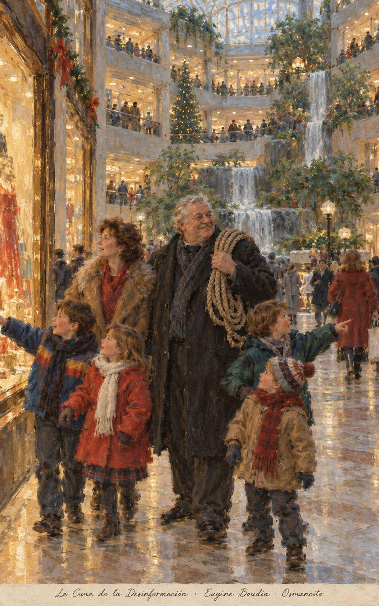](../img/261025_white-noise_la-cuna-de-la-desinformacion.jpg)

Una noche Babette dice que pronto habrá otro niño en casa: Bee llega en un par de días. Al día siguiente Denise quiere sonsacar a su madre sobre la medicación que toma o no toma. Los seis van en el coche al centro comercial:

> Los seis íbamos apretados en el coche camino del centro comercial Mid-Village y Denise esperó sin más una pausa natural en la conversación para dirigir su pregunta a la nuca de Babette, con una voz vaciada de inferencias.
> [Frase 2044](#original-2044)

La charla se desvía: Babette cree que el Dylar es una chica, y hablan de camellos y de Bolivia. Jack piensa en la familia como cuna de la desinformación. En una ferretería del centro comercial se cruza con Eric Massingale, que le dice que es otra persona. Eso le da ganas de comprar. Jack cuenta:

> Encontré a los otros y cruzamos dos aparcamientos hasta el edificio principal del Mid-Village Mall, un edificio de diez plantas dispuesto en torno a un patio central de cascadas, paseos y jardines.
> [Frase 2134](#original-2134)

> Babette y los niños me siguieron al ascensor, a las tiendas dispuestas en los pisos, por los emporios y los grandes almacenes, desconcertados pero entusiasmados por mi deseo de comprar.
> [Frase 2135](#original-2135)

> Cuando no podía decidirme entre dos camisas, me animaban a comprar las dos.
> [Frase 2136](#original-2136)

> Cuando dije que tenía hambre, me dieron de comer pretzels, cerveza, souvlaki.
> [Frase 2137](#original-2137)

Las dos chicas van delante, buscando cosas que él podría querer, y suena un órgano en el patio.

> Olíamos chocolate, palomitas, colonia; olíamos alfombras y pieles, salamis colgados y vinilo sepulcral.
> [Frase 2142](#original-2142)

Su familia se gloria con el acontecimiento. Jack se siente uno de ellos, comprando por fin.

> Me daban consejos, acosaban a los dependientes en mi nombre.
> [Frase 2145](#original-2145)

> Íbamos de tienda en tienda, rechazando no solo artículos de ciertos departamentos, no solo departamentos enteros sino tiendas completas, corporaciones gigantescas que por una razón u otra no nos llamaban la atención.
> [Frase 2147](#original-2147)

Siempre hay otra tienda. Jack compra sin freno y se siente crecer. Manda a los niños a elegir sus regalos de Navidad, y ellos se dispersan y avisan en secreto a Babette de lo que escogen. Jack es el benefactor. Los niños saben que no se le puede pedir que discuta los detalles.

> Hicimos otra comida.
> [Frase 2171](#original-2171)

Suena música enlatada en vivo y el rugido de las voces sube diez pisos. Vuelven a casa en silencio, cada uno a su cuarto. Jack ve a Steffie ante el televisor, moviendo los labios para igualar las palabras.

---

### Capítulo 18: Tweedy y el Aterrizaje Forzoso

*Tweedy, Jack, Bee, Janet y los niños.*

Jack va al aeropuerto de Iron City a buscar a Bee, su hija de doce años. Quien aparece en la sala de llegadas es la madre de Bee, Tweedy Browner:

> Por un momento pensé que Bee había muerto y que Tweedy había venido a decírmelo en persona.
> [Frase 2191](#original-2191)

Tweedy dice que Bee viene con su padre. Jack responde que el padre es él; ella habla de Malcolm Hunt, su marido. Pregunta:

> «¿Todavía me quieres, Tuck?», dijo ella.
> [Frase 2204](#original-2204)

> Me llamó Tuck, que es como su madre solía llamar a su padre.
> [Frase 2205](#original-2205)

Los Browner llaman Tuck a todos sus hombres y a quien se casa con ellos. Jack fue el primero. Jack pregunta por tercera vez dónde está Bee. Tweedy dice que en Indonesia, más o menos, y que Malcolm trabaja en secreto para derrocar a Castro. Y propone:

> «Salgamos de aquí, Tuck, antes de que vengan niños en enjambre a mendigar.»
> [Frase 2222](#original-2222)

Bee sabrá arreglárselas, dice Tweedy. En el aeropuerto no hay bares ni restaurantes.

> Recogimos el equipaje de Tweedy, salimos al coche y atravesamos Iron City, junto a fábricas desiertas, por avenidas casi siempre desiertas, una ciudad de colinas, con alguna calle empedrada, hermosas casas antiguas aquí y allá, coronas de Navidad en las ventanas.
> [Frase 2231](#original-2231)

Tweedy dice que no es feliz. Jack pregunta por qué. Ella contesta:

> «Pensé que me querrías para siempre, francamente.
> [Frase 2234](#original-2234)

Depende de él para eso, dice, porque Malcolm está muy a menudo fuera. Jack contesta:

> «Nos divorciamos, tú te quedas con todo mi dinero, te casas con un diplomático acomodado, bien relacionado y bien trajeado que hace entrar y salir agentes de zonas delicadas e inaccesibles.»
> [Frase 2237](#original-2237)

Tweedy dice que Malcolm siempre se ha sentido atraído por lugares selváticos.

> Viajábamos en paralelo a las vías del ferrocarril.
> [Frase 2239](#original-2239)

Jack cuenta que Janet Savory se ha ido a un ashram de Montana, donde ahora se llama Madre Devi. Dice que tenía talento para el sigilo, y Tweedy le dice que habla con amargura:

> «Nunca te he conocido amargado, Tuck.»
> [Frase 2252](#original-2252)

Jack cuenta que Janet lo metió, al nacer Heinrich, en un plan de inversiones complejo. Tweedy dice que ella se equivocó y que perdieron mucho; Jack, que ganaron. Dice:

> «Quería constituirnos en sociedad.»
> [Frase 2266](#original-2266)

Tweedy no reconoce a esa Janet y recuerda sus pómulos altos. Luego pregunta:

> «¿No hay algún sitio donde podamos conseguir una comida civilizada?», dijo Tweedy.
> [Frase 2275](#original-2275)

Quiere un sitio con manteles y recuerda que tomó el té con el coronel Gadafi.

> Atravesamos un barrio de almacenes, más calles desiertas, una desolación y un anonimato que se registraban en la mente como un anhelo fantasmal de algo que estaba muy lejos de poder recuperarse.
> [Frase 2280](#original-2280)

Tweedy fuma sin parar y dice:

> «Dios, Tuck, qué bien estábamos juntos.»
> [Frase 2283](#original-2283)

Tweedy va a Boston a tranquilizar a su madre, que cree muerto a Malcolm. Jack dice que es un día gris y propone:

> «Más vale que volvamos al aeropuerto.»
> [Frase 2311](#original-2311)

Tweedy pregunta por Hitler y le dice a Jack que no ha cambiado. Y añade:

> Nos queríamos, ¿no es verdad?
> [Frase 2319](#original-2319)

> Nos contábamos todo, dentro de los límites de la preocupación de cada uno por la educación y el tacto.
> [Frase 2320](#original-2320)

Dice que Malcolm no le cuenta nada y que no sabe quién es.

> Se sentó con las piernas recogidas bajo el cuerpo, de cara a mí, y echó cenizas en sus zapatos, que estaban sobre la alfombrilla de goma.
> [Frase 2324](#original-2324)

Pregunta si no fue maravilloso crecer entre caballos. Jack contesta que no le pregunte a él.

> En el aeropuerto esperamos en una neblina de polvo de yeso, entre cables al descubierto, montones de escombros.
> [Frase 2329](#original-2329)

Media hora antes de que llegue Bee, pasajeros de otro vuelo cruzan un túnel. Un hombre con gorra de cartero cuenta que el avión perdió potencia en los tres motores y cayó de treinta y cuatro mil a doce mil pies, y que una voz serena habló de aterrizaje forzoso: la diferencia es solo una palabra. Luego los motores arrancaron. Jack ve a Bee, que salta a sus brazos y pregunta dónde están los medios. Jack dice que en Iron City no hay.

> Encontramos a Tweedy y salimos hacia el coche.
> [Frase 2409](#original-2409)

Bee se sienta en el asiento trasero en posición de loto, descansada tras un viaje desde Surabaya.

> Había un atasco en las afueras de la ciudad y tuvimos que quedarnos parados en una carretera junto a una fundición abandonada.
> [Frase 2410](#original-2410)

> Ahora estábamos sentados esperando en la oscuridad a que remolcaran un coche o se cerrara un puente levadizo.
> [Frase 2414](#original-2414)

Tweedy dice que los aviones y las terminales son los lugares más seguros para los niños, y que Bee voló sola a Boston a los nueve años.

---

### Capítulo 19: Bee, la Testigo Silenciosa

*Bee, Jack, Denise y la familia.*

[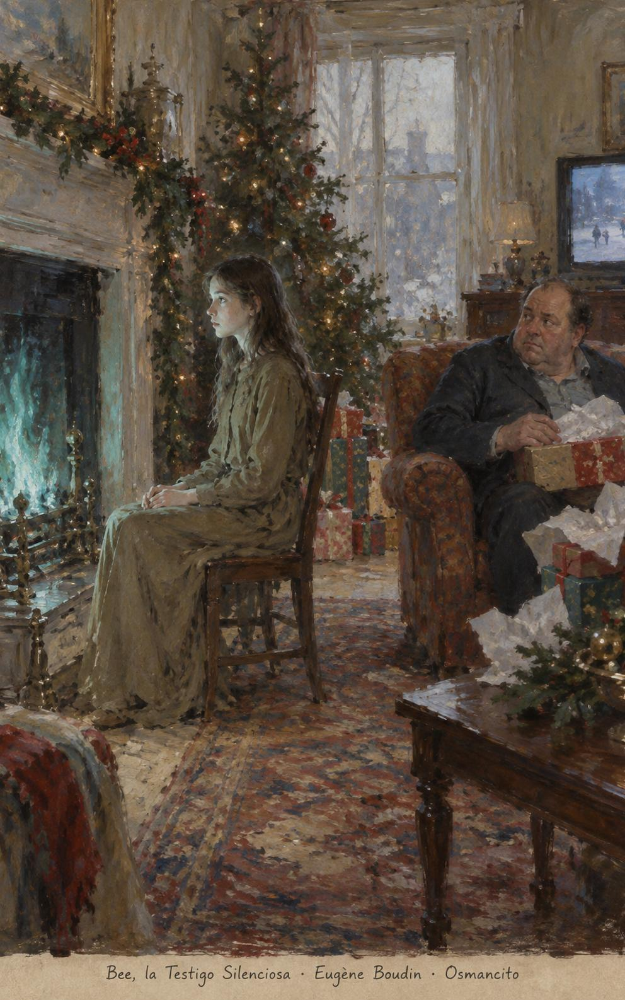](../img/261025_white-noise_bee-la-testigo-silenciosa.jpg)

Bee, la hija de doce años de Jack, ha llegado a la casa. Jack cuenta:

> Bee nos hacía sentir cohibidos de vez en cuando, un castigo que los visitantes infligen sin querer a sus anfitriones complacientes.
> [Frase 2435](#original-2435)

Todo lo que hacen parece necesitar explicación, y Babette está especialmente desconcertada. Jack dice:

> Si Denise era una comisaria de tamaño de bolsillo, que nos acosaba hacia una conciencia más alta, entonces Bee era una testigo silenciosa, que ponía en entredicho el sentido mismo de nuestras vidas.
> [Frase 2440](#original-2440)

Babette mira sus manos ahuecadas, horrorizada. Bee, un año mayor que Denise, es más alta, delgada y pálida, y desdeña los chistes familiares.

> Era dueña de sí y reflexiva, y nos había traído regalos tallados a mano de las selvas.
> [Frase 2445](#original-2445)

Toma taxis a la escuela y a la clase de baile, y habla un poco de chino.

> La admiraba de un modo distante e inquieto, percibiendo una amenaza sin nombre, como si no fuera hija mía en absoluto sino la amiga sofisticada y autosuficiente de uno de mis hijos.
> [Frase 2447](#original-2447)

Jack se pregunta si Murray tiene razón en que son una unidad frágil rodeada de hechos hostiles. En Navidad, Bee dice junto a la chimenea que su madre está tensa por culpa de Malcolm y que no sabe quién es. En sus ojos se mueve una vida secundaria. Jack se pregunta:

> ¿Qué significaba aquello, qué decía en realidad, por qué parecía esperar que yo respondiera de la misma manera?
> [Frase 2481](#original-2481)

Bee quiere comunicarse así y descubrir algo sobre él. Jack empieza a preocuparse.

> Mientras el olor a tostada quemada llenaba la casa, intenté que me hablara de la vida en séptimo grado.
> [Frase 2486](#original-2486)

Steffie quema tostadas, y Bee dice que podría haber preparado un kimchi. Jack dice:

> «Probablemente comeremos algo además de tostadas», dije.
> [Frase 2496](#original-2496)

Su leve reproche la hace feliz.

> Le gustaba más cuando yo era seco, burlón y cortante, un talento natural que creía que yo había perdido por tanto trato con niños.
> [Frase 2498](#original-2498)

Dos noches después Steffie se baña en agua sucia, porque es su suciedad, y Bee aparece en el pasillo con un quimono, distante. Por la mañana Jack la lleva al aeropuerto; ella lo mira con compasión solemne, que él reconoce como condescendencia adolescente. De regreso aparca junto a un cementerio y escucha.

---

### Capítulo 20: Babette en la Pantalla

*Jack, Babette, Murray, Heinrich y Denise.*

Jack lee obituarios y calcula cuántos años le quedan. Babette le dice en el desayuno que la vida es buena y que tiene sueños terribles. Luego discuten quién morirá primero. Jack cuenta:

> Desea sinceramente precederme.
> [Frase 2591](#original-2591)

> Discute el asunto con tal fuerza argumentativa que es evidente que cree que tenemos elección en la materia.
> [Frase 2592](#original-2592)

> Estamos a salvo mientras ellos estén cerca.
> [Frase 2595](#original-2595)

> Teme que yo muera inesperadamente, a hurtadillas, escabulléndome en la noche.
> [Frase 2598](#original-2598)

Jack responde:

> Le digo que quiero morir yo primero.
> [Frase 2602](#original-2602)

> Somos dos versiones de la misma persona.
> [Frase 2604](#original-2604)

Discuten quién dejaría el agujero más grande en la vida del otro.

> Tenemos discusiones serias en este nivel.
> [Frase 2610](#original-2610)

Babette sale a dar su clase de postura. Murray viene a hablar con los niños para su investigación sobre la sociedad de los niños. Jack cuenta:

> Parecía creer que éramos un grupo visionario, abierto a formas especiales de conciencia.
> [Frase 2621](#original-2621)

En la cocina, Jack discute con Heinrich sobre el café y el movimiento que la gente desperdicia. Jack piensa en Babette y en el cielo:

> No dejes que muramos, quiero gritarle a ese cielo del siglo V ardiente de misterio y luz en espiral.
> [Frase 2670](#original-2670)

> Que vivamos los dos para siempre, en la enfermedad y en la salud, seniles, chochos, desdentados, llenos de manchas de la edad, de vista débil, alucinando.
> [Frase 2671](#original-2671)

Jack mira el café subir por el tubo de la cafetera y sube con una taza para Murray a la habitación de Denise. Al pasar ve en la televisión el rostro de Babette. Jack cuenta:

> La había visto hacía apenas una hora, comiendo huevos, pero su aparición en la pantalla me hizo pensar en ella como una figura lejana del pasado, una ex esposa y madre ausente, una caminante en las nieblas de los muertos.
> [Frase 2708](#original-2708)

> Si ella no estaba muerta, ¿lo estaba yo?
> [Frase 2709](#original-2709)

> Solo cuando el tiempo siguió su curso, se normalizó, nos devolvió una noción de nuestro entorno, la habitación, la casa, la realidad en la que estaba el televisor, solo entonces entendimos qué ocurría.
> [Frase 2712](#original-2712)

> O bien no sabía que habría una cámara a mano, o prefirió no decírnoslo, por vergüenza, amor, superstición, lo que sea que lleva a una persona a querer ocultar su imagen a quienes la conocen.
> [Frase 2714](#original-2714)

> Con el sonido bajo no podíamos oír lo que decía.
> [Frase 2715](#original-2715)

> Estábamos siendo atravesados por Babette.
> [Frase 2723](#original-2723)

> Una Babette de electrones y fotones, de cualesquiera fuerzas que produjeran esa luz gris que tomamos por su rostro.
> [Frase 2725](#original-2725)

Wilder toca la pantalla y deja una huella de su mano. Denise gira el volumen y no hay sonido; Heinrich cambia de canal y el sonido vuelve. Jack cuenta:

> De vuelta en la estación de cable, él no lograba conseguir ni un zumbido, y mientras veíamos a Babette terminar la lección, nos invadía un estado de extraño recelo.
> [Frase 2738](#original-2738)

Cuando acaba el programa, las niñas bajan a esperar a Babette. Wilder se queda llorando ante el televisor, mientras Murray toma notas.

---

### Capítulo 21: El Evento Tóxico Aéreo

*Jack, Heinrich, Babette, Steffie, Denise y Wilder.*

Jack vuelve a casa tras una noche de nieve y ve a Heinrich, de catorce años, en una cornisa junto a la ventana del ático, mirando con binoculares el humo de un descarrilamiento en los patios de trenes. Jack sube y le dice que no debe estar en cornisas heladas, que eso preocupa a Baba, el apodo de Babette. Heinrich responde:

> «Crees que si me dices que a ella le preocupa, me sentiré culpable y no lo haré.»
> [Frase 2793](#original-2793)

Jack lo manda a quitar la nieve de la entrada. Más tarde Heinrich vuelve al ático con una radio y un mapa: la radio habla de una columna plumosa, pero él ve una cosa negra y creciente, y dice que el químico se llama Nyodene D. Abajo, Steffie pregunta:

> «¿Pero tendremos que dejar nuestras casas?»
> [Frase 2858](#original-2858)

Jack dice que no. Denise entra y cuenta que usan sopladores de nieve para echar nieve sobre el derrame. Pregunta:

> «¿Cuándo comemos?»
> [Frase 2873](#original-2873)

Babette atiende el teléfono: es de los Stover, conocidos de la familia, que hablaron con el centro meteorológico. Ya no dicen «columna plumosa» sino «nube negra y ondulante», y se espera que una masa de aire baje de Canadá. Jack comenta que eso siempre pasa. Babette dice:

> «Y como Canadá queda al norte, si la nube ondulante va derecho hacia el sur, nos pasará de largo con un margen cómodo.»
> [Frase 2896](#original-2896)

> «¿Cuándo comemos?», dije.
> [Frase 2897](#original-2897)

Suenan sirenas antiaéreas. Babette saca cosas del refrigerador y dice que quizá deberían preocuparse más por la nube. Jack responde que estas cosas les pasan a los pobres, no a un profesor universitario. Dice:

> «Vivimos en un pueblo ordenado y agradable, cerca de una universidad de nombre pintoresco.»
> [Frase 2915](#original-2915)

Jack sube al ático, sale a la cornisa con los binoculares y ve el descarrilamiento: helicópteros, bomberos y hombres con trajes amarillos Mylex y máscaras, que llevan instrumentos para medir la muerte. Vuelve a entrar. Heinrich le pregunta si la nube vendrá hacia ellos y dice que por su voz sabe que Jack sabe algo. Jack dice:

> «Quieres que diga que no vendrá hacia aquí ni en un millón de años.»
> [Frase 2979](#original-2979)

Jack cuenta que la radio ya no la llama «nube negra y ondulante» sino «evento tóxico aéreo». Heinrich lo mira buscando que lo tranquilicen. Jack le contesta:

> «Está allá, nosotros estamos aquí.»
> [Frase 2997](#original-2997)

Heinrich dice que una gran masa de aire baja de Canadá. Jack responde que ya lo sabía. Jack cuenta:

> Vimos a Wilder bajar de espaldas los escalones del ático, que eran más altos que los demás escalones de la casa.
> [Frase 3008](#original-3008)

Wilder, el niño pequeño, baja del ático. Denise se levanta varias veces durante la cena con la mano en la boca. Jack cuenta:

> Nos detuvimos, en medio de un bocado o de un salpimentar, para oír sus arcadas incompletas.
> [Frase 3010](#original-3010)

Heinrich le dice a Denise que sus síntomas están pasados de moda. Denise nota que cenan antes de lo habitual. Pregunta:

> «¿No estamos cenando un poco temprano esta noche?», dijo Denise.
> [Frase 3017](#original-3017)

Babette pregunta qué es temprano. Denise mira a Steffie y dice:

> «¿Es porque queremos quitárnoslo de encima?», dijo.
> [Frase 3020](#original-3020)

Babette pregunta:

> «¿Por qué queremos quitárnoslo de encima?»
> [Frase 3021](#original-3021)

Steffie contesta que es por si pasa algo. Babette pregunta qué podría pasar y las niñas se miran otra vez. Jack cuenta:

> Las sirenas antiaéreas volvieron a sonar, esta vez tan cerca de nosotros que nos afectaron de mala manera, sacudidos hasta el punto de evitar mirarnos a los ojos, como forma de negar que ocurría algo inusual.
> [Frase 3025](#original-3025)

> Seguimos comiendo, en silencio y con pulcritud, reduciendo el tamaño de los bocados, pidiendo con cortesía que nos pasaran las cosas.
> [Frase 3032](#original-3032)

> Nos volvimos meticulosos y parcos, redujimos el alcance de nuestros movimientos, untamos el pan como técnicos que restauran un fresco.
> [Frase 3033](#original-3033)

> Seguimos evitando el contacto visual y cuidamos de no hacer chocar los cubiertos.
> [Frase 3035](#original-3035)

> Creo que entre nosotros pasó la esperanza avergonzada de que solo así podríamos evitar que nos notaran.
> [Frase 3036](#original-3036)

> Era como si las sirenas anunciaran la presencia de algún mecanismo de control, algo que haríamos bien en no provocar con nuestra discusión y la comida derramada.
> [Frase 3037](#original-3037)

> No fue hasta que se hizo audible un segundo ruido en el pulso de las potentes sirenas que pensamos en hacer una pausa en nuestro pequeño episodio de histeria decorosa.
> [Frase 3038](#original-3038)

> Por primera vez en minutos nos miramos, sabiendo que el nuevo sonido era una voz amplificada pero sin saber qué decía.
> [Frase 3041](#original-3041)

Heinrich sale a escuchar a la puerta y vuelve con paso rígido. Dice:

> «Quieren que evacuemos», dijo, sin mirarnos a los ojos.
> [Frase 3044](#original-3044)

Babette pregunta si solo era una sugerencia o algo más obligatorio. Heinrich cuenta que era el auto de un capitán de bomberos con altavoz, que gritaba que se evacuara y hablaba de una nube de sustancias mortales. Babette dice que hay tiempo de sobra, porque si no les habrían dicho que se apuraran. Jack cuenta:

> Nos quedamos sentados ante el bizcocho y los duraznos en lata.
> [Frase 3052](#original-3052)

Steffie lee un cupón llorando bajito, Denise sube a hacer maletas, Heinrich busca los binoculares y Babette junta latas y frascos. Jack cuenta:

> Veinte minutos después estábamos en el auto.
> [Frase 3061](#original-3061)

La radio indica rutas de salida según el extremo del pueblo. Jack cuenta:

> Éramos de los rezagados del primer grupo y nos unimos al flujo de tráfico hacia la ruta principal de salida del pueblo, un sórdido corredor de autos usados, comida rápida, farmacias de descuento y cines cuádruples.
> [Frase 3064](#original-3064)

> Mientras esperábamos nuestro turno para entrar en la carretera de cuatro carriles, oímos la voz amplificada arriba y detrás de nosotros, llamando a casas a oscuras en una calle de sicomoros y setos altos.
> [Frase 3065](#original-3065)

La voz repite sin parar: «Abandonen todos los domicilios. Evento tóxico, nube química». Jack cuenta:

> Salimos a la carretera cuando empezaba a caer nieve.
> [Frase 3072](#original-3072)

> Teníamos poco que decirnos, con las mentes aún sin ajustarse a la realidad de las cosas, el hecho absurdo de la evacuación.
> [Frase 3073](#original-3073)

> Sobre todo mirábamos a la gente de otros autos, tratando de deducir por sus caras cuánto miedo debíamos tener.
> [Frase 3074](#original-3074)

> El tráfico avanzaba a paso de tortuga, pero pensábamos que el ritmo aumentaría unas millas más adelante, donde hay una abertura en la barrera divisoria que permitiría que nuestro flujo hacia el oeste usara los cuatro carriles.
> [Frase 3075](#original-3075)

En una tienda de muebles hay gente bien iluminada que los mira por un ventanal. Jack cuenta:

> Nos hacía sentir como tontos, como turistas que hacen todo mal.
> [Frase 3082](#original-3082)

> ¿Por qué se contentaban con comprar muebles mientras nosotros, asustados, estábamos en un tráfico lento bajo una nevada?
> [Frase 3083](#original-3083)

> Sabían algo que nosotros no.
> [Frase 3084](#original-3084)

Jack busca emisoras en la radio. Glassboro es un pueblo de la zona. Jack cuenta:

> En una emisora de Glassboro supimos que había información nueva e importante.
> [Frase 3090](#original-3090)

> Nos quedamos adivinando lo que significaba.
> [Frase 3092](#original-3092)

Una experta habla por la radio de las consecuencias: «Convulsiones, coma, aborto espontáneo». Babette y Jack se miran. Jack cuenta:

> Ella empezó de inmediato a hablar con las niñas mientras yo bajaba el volumen para que no se enteraran de lo que podían imaginar que les esperaba.
> [Frase 3098](#original-3098)

> Pasamos junto a un motel de tres pisos.
> [Frase 3100](#original-3100)

Cada ventana del motel está llena de gente que los mira. Jack cuenta:

> Éramos un desfile de tontos, expuestos no solo a los efectos de la lluvia de residuos químicos sino al juicio desdeñoso de otras personas.
> [Frase 3102](#original-3102)

> Parecía imperativo llegar al campamento de los Boy Scouts, meternos a toda prisa en el edificio principal, sellar las puertas, apretujarnos en catres con nuestro jugo y nuestro café, esperar la señal de que había pasado el peligro.
> [Frase 3104](#original-3104)

Los autos empiezan a subir por el talud de hierba al borde del camino. Jack cuenta:

> Situados en lo que antes había sido el carril derecho, no teníamos más remedio que ver pasar a esos autos a una altura algo mayor y con un impulso garboso, desviados de la horizontal.
> [Frase 3106](#original-3106)

> Nos acercamos despacio a un paso elevado, viendo gente a pie allá arriba.
> [Frase 3107](#original-3107)

Sobre el paso elevado cruza gente con cajas, maletas, bicicletas y trineos; una familia va envuelta en plástico. Jack cuenta:

> Pasamos despacio bajo el paso elevado, oyendo una ráfaga de bocinas y el lamento suplicante de una ambulancia atascada en el tráfico.
> [Frase 3122](#original-3122)

> Cincuenta yardas más adelante el tráfico se estrechaba a un solo carril y pronto vimos por qué.
> [Frase 3123](#original-3123)

Un auto resbaló por el talud y chocó con otro vehículo. Un helicóptero ilumina la masa; hay gente aturdida sobre la hierba y dos personas ensangrentadas. Jack cuenta:

> Pasamos en silencio, sintiendo una curiosa reverencia, incluso exaltados por la visión de los autos amontonados y las personas caídas.
> [Frase 3133](#original-3133)

Heinrich mira por la ventanilla trasera con los binoculares y describe con entusiasmo los cuerpos y los detalles del choque. Jack cuenta:

> Yo creía que todos habíamos ocupado el mismo estado mental, apagados, preocupados, confundidos.
> [Frase 3138](#original-3138)

Jack lo ve por el retrovisor, feliz entre el desastre, hablando de la nieve, del tráfico y de la gente que camina con esfuerzo. Jack cuenta:

> Especulaba sobre qué tan lejos estábamos del campamento abandonado, qué clase de alojamientos primitivos podría haber allí.
> [Frase 3143](#original-3143)

> Debía de saber que todos podíamos morir.
> [Frase 3146](#original-3146)

Los demás discuten dentro del auto. El Nyodene D. es el químico del derrame. Jack cuenta:

> Por la radio supimos que enviaban a la zona perros adiestrados para olfatear el Nyodene D., desde un centro de detección química en una región remota de Nuevo México.
> [Frase 3176](#original-3176)

Babette dice que a los perros no les pasa nada, porque solo afecta a humanos y ratas. Los niños discuten sobre ratas y cucarachas. Jack cuenta:

> Llegamos al punto donde la barrera de concreto cede el paso a un tramo de veinte yardas de mediana ajardinada, no más alta que un bordillo.
> [Frase 3203](#original-3203)

Los hombres de traje Mylex son como los que Jack vio desde la cornisa: trajes amarillos con máscara. Jack cuenta:

> Pero en lugar de un policía estatal que dirigiera el tráfico hacia dos carriles extra, vimos a un hombre con traje Mylex que nos alejaba con gestos de la abertura.
> [Frase 3204](#original-3204)

Más allá hay un montón de chatarra, una casa rodante sobre un quitanieves, y utensilios de plástico regados. Jack cuenta:

> No había señales de víctimas ni de sangre fresca, lo que nos llevaba a creer que había pasado algún tiempo desde que la casa rodante se montó sobre el quitanieves, probablemente en un momento en que el oportunismo parecía una falla fácilmente defendible, dadas las circunstancias.
> [Frase 3208](#original-3208)

Steffie dice que ya vio todo esto antes: el hombre del traje amarillo y la máscara, el gran choque en la nieve, todo exactamente igual. Dice:

> «Estábamos todos aquí, en el auto.»
> [Frase 3217](#original-3217)

Heinrich le había dicho a Jack que la exposición a los desechos químicos podía producir déjà vu. Steffie no estaba cuando lo dijo, pero pudo oírlo en la radio de la cocina. Jack cuenta:

> No creía que Steffie supiera lo que significaba déjà vu, pero era posible que Babette se lo hubiera dicho.
> [Frase 3222](#original-3222)

Jack se pregunta si hay un déjà vu verdadero y uno falso y si Steffie desarrolla síntomas reales por vías naturales. Apaga la radio. Heinrich dice que otra cosa ya pasó antes:

> «Nos estamos quedando sin gasolina.»
> [Frase 3252](#original-3252)

El indicador tiembla en la E. Babette dice que siempre hay gasolina extra, y Heinrich y ella discuten sobre el tanque. Heinrich pregunta cómo se sabe cuándo parar. Jack cuenta:

> «Cuando pases una gasolinera», le dije, y allí estaba, una plaza desierta y barrida por la lluvia, con surtidores orgullosos bajo una hilera de banderines multicolores.
> [Frase 3262](#original-3262)

Jack baja de un salto, corre a los surtidores, que no están cerrados con llave, y agarra la manguera. Jack cuenta:

> Unos minutos después, de vuelta en la carretera, vimos un espectáculo notable y sorprendente.
> [Frase 3267](#original-3267)

> Apareció en el cielo delante de nosotros y a la izquierda, haciéndonos bajar en los asientos, inclinar la cabeza para ver mejor, exclamar unos a otros con frases a medias.
> [Frase 3268](#original-3268)

Era la nube negra, el evento tóxico aéreo, iluminada por los helicópteros. En todos los autos la gente movía la cabeza y tocaba la bocina. Jack cuenta:

> No supimos cómo reaccionar.
> [Frase 3273](#original-3273)

Era terrible verla tan cerca y tan baja, pero también espectacular. Nuestro miedo se mezclaba con un asombro casi religioso. Jack cuenta:

> Era una muerte fabricada en un laboratorio, definida y medible, pero entonces la pensamos de manera simple y primitiva, como una perversidad estacional de la tierra, igual que una inundación o un tornado, algo que no se puede controlar.
> [Frase 3278](#original-3278)

Atrás los niños se pelean por los binoculares. Los helicópteros parecen iluminar la nube para nosotros. Jack cuenta:

> Pero esto no era historia lo que presenciábamos.
> [Frase 3283](#original-3283)

Los helicópteros lanzan bengalas. La carretera se aleja de la nube. Cerca del campamento de los Boy Scouts entran al camino dos autobuses escolares. Jack cuenta:

> Reconocimos a los conductores, vimos caras familiares en las ventanillas, gente que solíamos ver sentada en sillas de jardín tras los escasos setos del asilo o caminando en círculos cada vez más estrechos, con velocidad cada vez mayor, como masas que giran en un aparato de giro.
> [Frase 3289](#original-3289)

> Sentimos un extraño afecto por ellos y un alivio de que los cuidaran de manera diligente y profesional.
> [Frase 3290](#original-3290)

> Pasamos junto a un cartel del granero más fotografiado de Estados Unidos.
> [Frase 3292](#original-3292)

Tardan una hora en encauzar el tráfico hacia el acceso de un solo carril. Jack cuenta:

> Hombres con traje Mylex agitaban linternas y colocaban conos fluorescentes, dirigiéndonos hacia el estacionamiento y hacia campos deportivos y otras zonas abiertas.
> [Frase 3294](#original-3294)

> Avanzamos a sacudidas por caminos de tierra, sobre surcos y montículos.
> [Frase 3296](#original-3296)

> Cerca de los edificios principales vimos a un grupo de hombres y mujeres con sujetapapeles y walkie-talkies, funcionarios sin traje Mylex, expertos en la nueva ciencia de la evacuación.
> [Frase 3297](#original-3297)

La lluvia afloja y la gente apaga los faros. El largo y extraño viaje terminó. Jack cuenta:

> Esperamos que nos llegara una sensación de satisfacción, algún aire de logro tranquilo, el cansancio bien ganado que promete un sueño quieto y profundo.
> [Frase 3302](#original-3302)

Heinrich se come una barra de caramelo. Jack cuenta:

> Oímos el ruido de sus dientes pegándose a la masa de caramelo y glucosa.
> [Frase 3305](#original-3305)

Una familia de cinco baja de un Datsun con chalecos salvavidas y bengalas. Se forman grupos en torno a ciertos hombres, fuentes de información y de rumores. Jack cuenta:

> Se decía que nos permitirían volver a casa a primera hora de la mañana; que el gobierno estaba encubriendo algo; que un helicóptero había entrado en la nube tóxica y nunca había reaparecido; que habían llegado los perros desde Nuevo México, lanzados en paracaídas sobre un prado en un audaz salto nocturno; que el pueblo de Farmington sería inhabitable durante cuarenta años.
> [Frase 3312](#original-3312)

> Al salir la gente de golpe de la realidad, quedamos liberados de la necesidad de distinguir.
> [Frase 3315](#original-3315)

> Estábamos en un gran barracón, uno de los tres edificios así del campamento, y con el generador ya funcionando estábamos bastante cómodos.
> [Frase 3317](#original-3317)

La Cruz Roja repartió catres, calentadores portátiles, sándwiches y café, y hay lámparas de queroseno. Jack cuenta:

> El lugar estaba atestado, aún bastante frío, pero la visión de enfermeras y voluntarios nos hizo sentir que los niños estaban a salvo, y la presencia de otras almas varadas, mujeres jóvenes con bebés, ancianos y enfermos, nos dio cierta firmeza y voluntad, una inclinación desinteresada tan marcada que servía de identidad común.
> [Frase 3321](#original-3321)

Jack avanza entre la gente hasta el borde de un grupo grande y descubre que su hijo Heinrich, con binoculares al cuello, habla del evento tóxico de forma técnica, casi cantando de orgullo. La gente lo escucha con atención. Jack cuenta:

> Lo oí decir: «Lo que rociaron sobre el gran derrame en el patio de trenes era probablemente ceniza de sosa.»
> [Frase 3335](#original-3335)

Heinrich sigue hablando. Jack no quiere que lo vea ahí. Jack cuenta:

> Así que me escabullí, pasando junto a un hombre con botas de nieve envueltas en plástico, y me dirigí al extremo más lejano del barracón, donde habíamos acampado antes.
> [Frase 3369](#original-3369)

> Estábamos junto a una familia negra de testigos de Jehová.
> [Frase 3370](#original-3370)

Una mujer de la familia le dice a Babette que esto es algo, y ella responde que ya nada la sorprende. Babette revisa una bolsa de provisiones y dice:

> «Estamos prácticamente al borde.»
> [Frase 3394](#original-3394)

Más tarde Jack y Babette susurran. Jack le dice que Heinrich parece salir de su concha y que está allí en medio, contando a la gente lo que sabe. Babette susurra:

> «¿Por qué no nos lo dijo?», susurró ella.
> [Frase 3443](#original-3443)

Jack le dice que Heinrich debe de estar cansado de ellos. Después una mujer al frente del salón habla de la exposición a agentes tóxicos. Denise, con mirada dura, le dice a Jack que eso lo toca a él, que bajó del auto a cargar gasolina. Jack va al frente. Se forman dos filas por letras, de la A a la M y de la N a la Z, ante mesas plegables, con técnicos con credenciales. Jack cuenta:

> Los gruesos chalecos naranjas no parecían especialmente fuera de lugar, aunque estábamos más o menos en tierra seca, muy por encima del nivel del mar, a muchas millas del cuerpo de agua amenazante más cercano.
> [Frase 3585](#original-3585)

Un técnico de SIMUVAC, abreviatura de evacuación simulada, un programa estatal, teclea los datos de Jack y le habla de su perfil: el Nyodene D. dura treinta años en el cuerpo y «sabremos más en quince». Para Jack la muerte ha entrado. En el barracón hay ancianos ciegos, entre ellos el viejo Treadwell. Jack cuenta:

> Cuando volví al otro extremo del barracón, los tres niños menores dormían, Heinrich hacía anotaciones en un mapa de carreteras y Babette estaba sentada a cierta distancia con el viejo Treadwell y varios otros ciegos.
> [Frase 3721](#original-3721)

Babette lee a los ciegos titulares de tabloides de supermercado. Heinrich, despierto, dice que es como si los hubieran lanzado atrás en el tiempo, a la Edad de Piedra. Jack encuentra a Murray Jay Siskind hablando con unas prostitutas desde las ventanillas de un auto y habla con él del déjà vu y de la muerte. Una voz con megáfono ordena evacuar de nuevo: el evento tóxico se dirige hacia ellos. Todos se levantan; en la puerta, una mujer con brazalete reparte mascarillas quirúrgicas blancas. Jack cuenta:

> Tomamos seis y salimos.
> [Frase 4154](#original-4154)

Sigue oscuro y llueve fuerte. Hay desorden por todas partes: autos atascados en el barro, sirenas, gente que corre y carpas arrastradas por el viento. Jack cuenta:

> Desde lo hondo del bosque oímos motocicletas acelerando, voces que lanzaban gritos incoherentes.
> [Frase 4161](#original-4161)

> Nos pusimos las máscaras y corrimos bajo el aguacero hasta nuestro auto.
> [Frase 4164](#original-4164)

Un grupo de hombres, con pinta de instructores de guerra en la selva, sube a un Land-Rover y se mete en la maleza; su calcomanía dice EL CONTROL DE ARMAS ES CONTROL MENTAL. Jack cuenta:

> No parecía que nos acercáramos a las luces.
> [Frase 4175](#original-4175)

> Babette encendió la radio y nos dijeron que los evacuados del campamento de los Boy Scouts debían dirigirse a Iron City, donde se preparaban comida y refugio.
> [Frase 4176](#original-4176)

> Entonces oímos los rotores.
> [Frase 4178](#original-4178)

Entre los árboles pelados ven la inmensa nube tóxica, que parece generar sus propias tormentas; los helicópteros vibran como electrodomésticos gigantes. Jack cuenta:

> Nos sentamos en el auto, en el bosque nevado, sin decir nada.
> [Frase 4184](#original-4184)

Jack recuerda con horror la entrevista con el técnico de SIMUVAC: técnicamente está muerto. Empuja el auto entre los pinos. A través de su máscara, Heinrich pregunta si alguna vez miraron de verdad su propio ojo. Jack cuenta:

> Denise dijo, mostrando un interés inmediato, como si holgazaneáramos un día de pleno verano en el porche.
> [Frase 4199](#original-4199)

Hablan del ojo y de otras cosas mientras el auto cruza un arroyo y sale por fin del bosque. Jack cuenta:

> Pasamos junto a familias a pie, vimos una fila de luces rojas en pares serpenteando en la oscuridad.
> [Frase 4238](#original-4238)

> Cuando salimos con dificultad del bosque, la gente de otros autos nos miró con ojos soñolientos.
> [Frase 4239](#original-4239)

> Tardamos noventa minutos en llegar a la autopista, otros treinta hasta el trébol, donde giramos hacia Iron City.
> [Frase 4240](#original-4240)

El Palacio de Kung Fu es un restaurante de pagodas y estanques, otro de los centros de evacuación. Jack cuenta:

> Fue aquí donde nos encontramos con el grupo del Palacio de Kung Fu.
> [Frase 4241](#original-4241)

Los autos convergen como caravanas de carretas y la nube sigue en el retrovisor. Jack cuenta:

> Llegamos a Iron City al amanecer.
> [Frase 4246](#original-4246)

Hay controles en todas las salidas. Policías estatales y voluntarios de la Cruz Roja reparten instrucciones mimeografiadas. Jack cuenta:

> Media hora después nos encontramos, con otras cuarenta familias, en un estudio de karate abandonado, en el último piso de un edificio de cuatro plantas de la calle principal.
> [Frase 4249](#original-4249)

No hay camas ni sillas, y Steffie se niega a quitarse la máscara. Jack cuenta:

> A las nueve de la mañana teníamos una provisión de colchones de aire, algo de comida y café.
> [Frase 4252](#original-4252)

> Por las ventanas polvorientas vimos a un grupo de escolares con turbante, miembros de la comunidad sij local, de pie en la calle con un cartel escrito a mano: IRON CITY DA LA BIENVENIDA A LOS EVACUADOS DE LA ZONA.
> [Frase 4253](#original-4253)

> No se nos permitía salir del edificio.
> [Frase 4254](#original-4254)

Los evacuados hablan de microorganismos y del miedo. A las tres de la tarde Steffie sigue con la máscara y camina junto a las paredes, mirando a la gente como si no la vieran mirar. Jack cuenta:

> Sabía que simplemente tendríamos que esperar a que ella olvidara la voz amplificada, las sirenas, el viaje nocturno por el bosque.
> [Frase 4294](#original-4294)

Pasan los días en el estudio de karate. Jack cuenta:

> Pasaron nueve días antes de que nos dijeran que podíamos volver a casa.
> [Frase 4349](#original-4349)

---

### Capítulo 22: El Supermercado y el Atardecer

*Jack, Babette, Murray, Denise y Wilder.*

[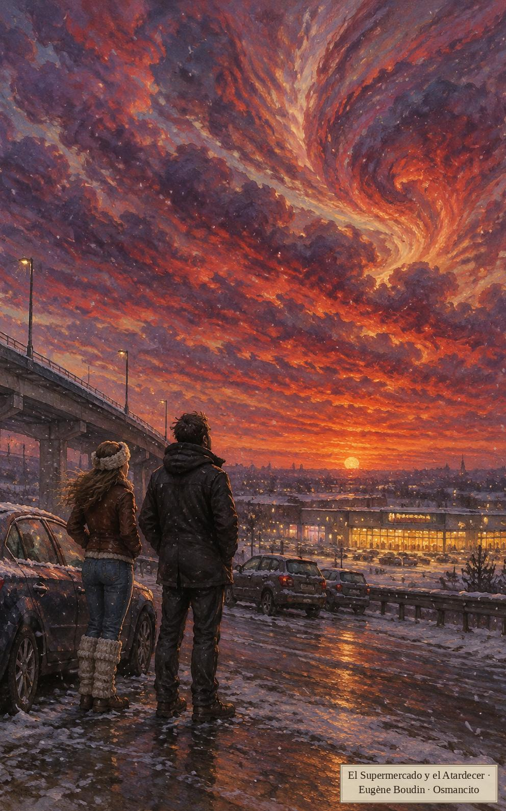](../img/261025_white-noise_el-supermercado-y-el-atardecer.jpg)

El supermercado está lleno de ancianos que parecen perdidos. Jack empuja el carro con Wilder sentado dentro. Se anuncia una gran nevada y los viejos compran con pánico, como acaparadores en una guerra. Jack cuenta:

> Vi a Murray en la zona de alimentos genéricos, con una sartén de teflón.
> [Frase 4385](#original-4385)

Murray anota en una libreta lo que le dice la gente. Le cuenta a Jack que su rival Cotsakis se perdió en el oleaje frente a Malibú. Hablan de lo enorme que era y de que ninguno lo conocía. Murray dice:

> «Es extraño, en cierto modo, ¿no?», dijo, «que podamos imaginar a los muertos.»
> [Frase 4455](#original-4455)

Jack lleva a Wilder por los puestos de fruta hacia la caja. Le gusta estar con él y envidia lo rápido que olvida. Piensa que el supermercado no cambia, salvo para mejor. Jack cuenta:

> Temprano esa noche llevé a Babette en el auto a su clase de postura.
> [Frase 4473](#original-4473)

> Nos detuvimos en el paso elevado de la autopista y bajamos a mirar el atardecer.
> [Frase 4474](#original-4474)

Desde el evento tóxico aéreo, los atardeceres son casi insoportablemente hermosos. Nadie ha podido probar que haya relación. Babette dice:

> «¿En qué otra cosa podemos creer?», dijo Babette.
> [Frase 4478](#original-4478)

> «¿De qué otra manera podemos explicarlo?»
> [Frase 4479](#original-4479)

Jack responde que no sabe. Babette sigue:

> «No estamos al borde del océano ni del desierto.
> [Frase 4481](#original-4481)

> Deberíamos tener atardeceres invernales tímidos.
> [Frase 4482](#original-4482)

Los atardeceres duraban cinco minutos y ahora duran una hora. En el paso elevado se juntan otros a mirar, y la policía no se atreve a hacer cumplir la prohibición de estacionar. Jack cuenta:

> Más tarde volví en el auto a la iglesia congregacional a recogerla.
> [Frase 4495](#original-4495)

Denise y Wilder lo acompañan. Babette sale de su clase y cuenta que quieren que dé otro curso, «Comer y beber: parámetros básicos». Dice que la gente necesita que alguien con autoridad le asegure cuál es la manera correcta de hacer las cosas. En la cama, Jack cuenta:

> En la cama yacíamos callados, mi cabeza entre sus pechos, amortiguada como contra algún golpe implacable.
> [Frase 4528](#original-4528)

> Yo estaba decidido a no contarle el veredicto de la computadora.
> [Frase 4529](#original-4529)

> Sabía que se destrozaría al enterarse de que mi muerte casi seguro precedería a la suya.
> [Frase 4530](#original-4530)

> Cuanto más leve el roce, más decidido estaba yo a impedir que lo supiera.
> [Frase 4534](#original-4534)

> Una vez casi le pedí que se pusiera los calentadores de piernas antes de hacer el amor.
> [Frase 4536](#original-4536)

> Pero me pareció una petición más hondamente arraigada en el patetismo que en una sexualidad aberrante, y pensé que podría hacerla sospechar que algo andaba mal.
> [Frase 4537](#original-4537)

---

### Capítulo 23: La Radiación y los Teoremas

*Jack, Heinrich y Babette.*

[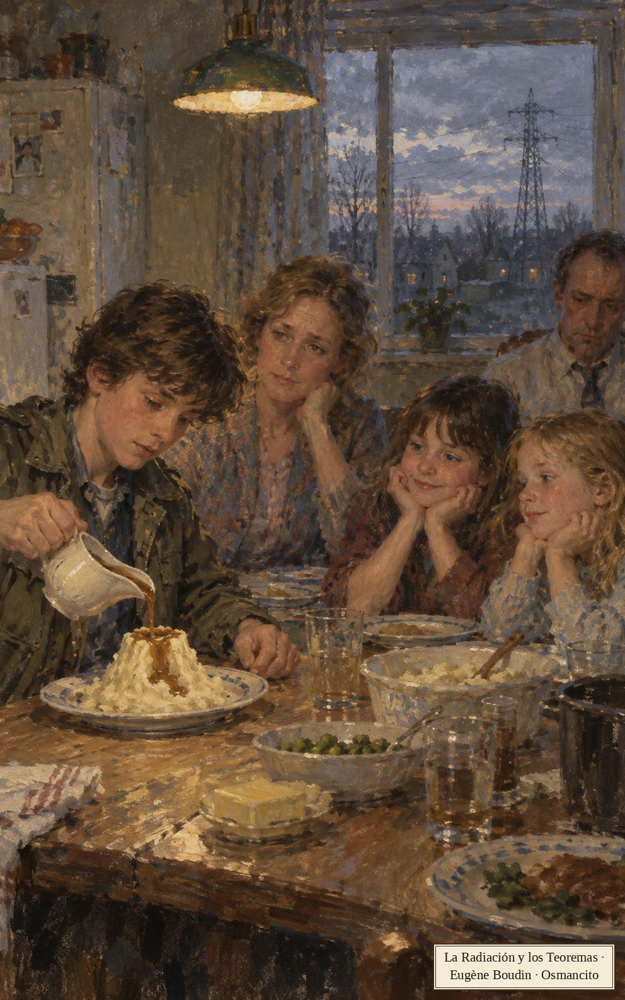](../img/261025_white-noise_la-radiacion-y-los-teoremas.jpg)

Jack le pide a Dunlop, su profesor de alemán, media hora más por lección. Dunlop apila muebles contra las ventanas. Jack domina el vocabulario, pero no logra pronunciar. Perros pastores alemanes patrullan el pueblo con hombres de traje Mylex. En la cena Denise pregunta por qué no se visten con ropa normal, y Babette dice que es lo que usan de servicio. Heinrich responde:

> «Eso es lo que se supone que debemos creer», dijo Heinrich.
> [Frase 4562](#original-4562)

Heinrich dice que publicar los resultados verdaderos traería demandas, pánico y desorden. Babette cree en los resultados publicados: un derrame diario no puede ser tan grave. Heinrich dice que esos derrames no son nada. Babette contesta:

> «No diría que no son nada», dijo ella con cautela.
> [Frase 4586](#original-4586)

Heinrich dice que el problema real es la radiación de cada día: radio, televisor, microondas, cables de alta tensión. Babette pregunta qué dicen ahora. Jack cuenta:

> Lo vimos usar la cuchara para moldear el puré de su plato con forma de montaña volcánica.
> [Frase 4598](#original-4598)

Heinrich habla de los campos eléctricos y magnéticos, y dice que los hallazgos científicos explican hasta los bebés deformes. Las niñas lo admiran. Jack cuenta:

> Quería discutir con él.
> [Frase 4619](#original-4619)

> Quería preguntarle por qué debía creer esos hallazgos científicos y no los resultados que indicaban que estábamos a salvo de la contaminación por Nyodene.
> [Frase 4620](#original-4620)

> Quería decirle que la evidencia estadística como la que citaba era por naturaleza no concluyente y engañosa.
> [Frase 4622](#original-4622)

> Quería decir que aprendería a considerar con ecuanimidad todos esos hallazgos catastróficos a medida que madurara, saliera de su literalismo asfixiante, desarrollara un espíritu de indagación informada y escéptica, avanzara en sabiduría y juicio equilibrado, envejeciera, decayera, muriera.
> [Frase 4623](#original-4623)

Jack solo dice que los datos aterradores ya son una industria. Heinrich cita un dato sobre ratas blancas. Babette se queja de que en la escuela ya no enseñan teoremas ni historia, y lanza preguntas. Jack responde:

> «¿Fue el Monitor o el Merrimac el que se hundió?», dije.
> [Frase 4637](#original-4637)

---

### Capítulo 24: El Frasco de Dylar

*Jack, Denise y Babette.*

[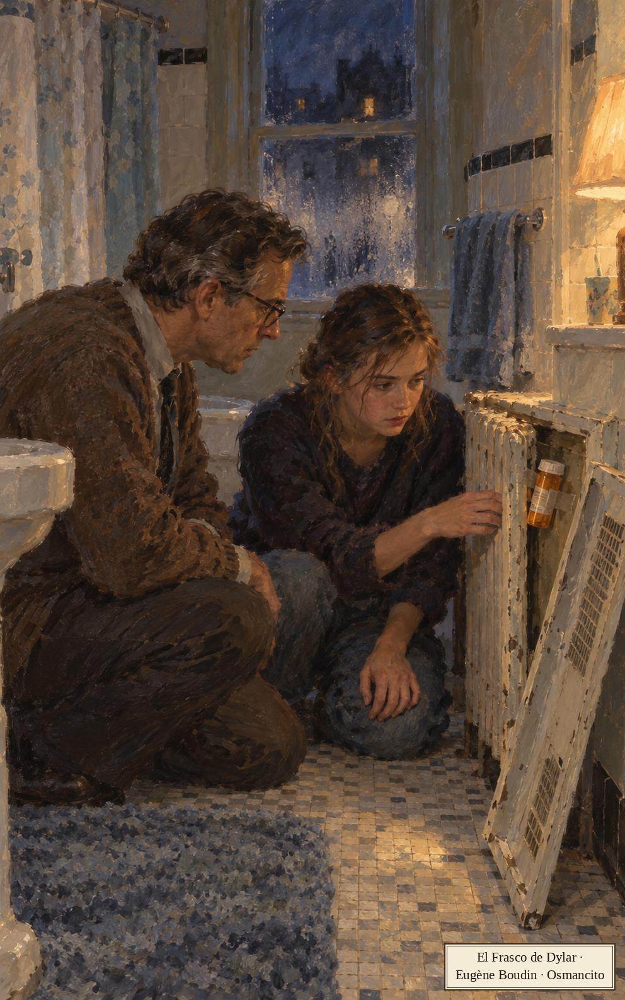](../img/261025_white-noise_el-frasco-de-dylar.jpg)

Jack encuentra un frasco ámbar de plástico, pegado con cinta bajo la tapa del radiador del baño. La cinta deja leer la palabra Dylar. Jack cuenta:

> Fue la noche siguiente cuando descubrí el Dylar.
> [Frase 4667](#original-4667)

> Lo encontré cuando el radiador empezó a golpear y quité la tapa para estudiar la válvula con seriedad y método, tratando de disimular ante mí mismo la impotencia que sentía.
> [Frase 4670](#original-4670)

Jack busca a Denise, que está en la cama viendo televisión. Miran el frasco juntos, sin tocarlo, y vuelven a su cuarto. Jack cuenta:

> Denise se sentó en la cama, mirando más allá de mí, más allá del televisor, más allá de los pósters y los recuerdos.
> [Frase 4680](#original-4680)

Baba es el apodo de Babette. Denise, con el ceño fruncido, dice:

> «No le decimos nada a Baba.»
> [Frase 4682](#original-4682)

Denise dice que Babette solo diría que no recuerda por qué lo puso ahí. Jack pregunta qué es el Dylar y dice:

> «Un farmacéutico puede decirnos para qué sirve eso.»
> [Frase 4688](#original-4688)

Denise ya fue a tres farmacias y nadie conocía el Dylar: no figura en ninguna lista. Jack dice:

> «Tendremos que llamar a su médico.»
> [Frase 4704](#original-4704)

Jack propone llamar al médico a su casa. Denise quiere que lo despierte. Dice:

> «Engáñalo para que nos diga lo que queremos saber.»
> [Frase 4712](#original-4712)

El único teléfono está en la cocina. Babette sigue en el cuarto planchando blusas. Jack marca el número del médico, que se llama Hookstratten. Jack cuenta:

> Le dije quién era y que estaba preocupado por Babette.
> [Frase 4722](#original-4722)

> Dije que estaba bastante seguro de que el medicamento que él le había recetado era lo que causaba el problema.
> [Frase 4724](#original-4724)

Hookstratten responde con ironía: nunca vio el Dylar ni se lo recetó a Babette. Jack cuenta:

> Le di las gracias, colgué y llamé a mi propio médico a su casa.
> [Frase 4754](#original-4754)

El médico de Jack dice que Dylar debe de ser una isla del golfo Pérsico. Jack le dice a Denise que hará analizar una tableta en el departamento de química. Jack cuenta:

> Esperé a que me dijera que ya lo había hecho.
> [Frase 4759](#original-4759)

> Pero ella solo asintió con gravedad y yo seguí por el pasillo, deteniéndome en el cuarto de Heinrich para darle las buenas noches.
> [Frase 4760](#original-4760)

Heinrich hace dominadas en el clóset con una barra de Mercator, un estudiante mayor que se entrena para sentarse en una jaula con serpientes venenosas. Más tarde Jack mira dormir a Steffie y a Wilder, y vuelve a la cama; Babette mira por la ventana.

---

### Capítulo 25: Winnie Richards, la Brillante

*Jack, Winnie y Babette.*

[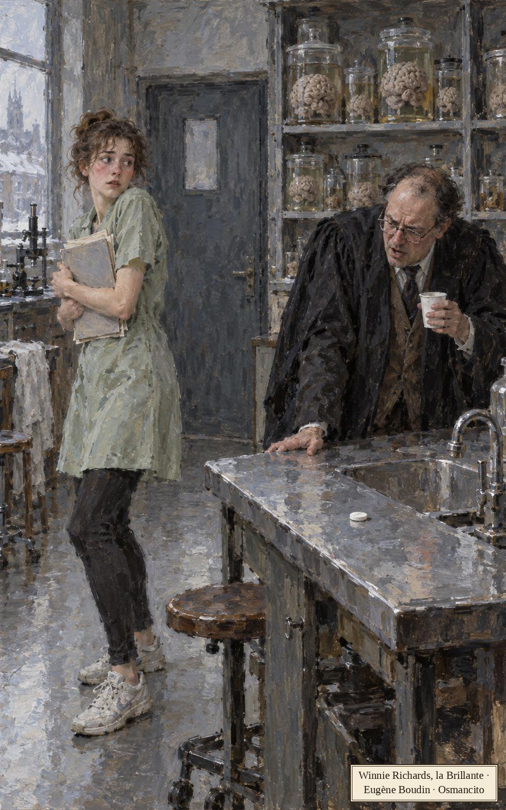](../img/261025_white-noise_winnie-richards-la-brillante.jpg)

Un iraní entrega el diario desde un Nissan Sentra. Jack mira la tableta blanca. Jack cuenta:

> Fui caminando hasta un pequeño edificio con cúpula, conocido como el Observatorio, y le di la tableta a Winnie Richards, una joven neuroquímica investigadora cuyo trabajo se decía que era brillante.
> [Frase 4841](#original-4841)

Winnie es alta, huidiza, y se ruboriza con facilidad. Jack cuenta:

> La vi sentarse en el escritorio atestado durante dos o tres minutos, haciendo girar despacio la tableta entre el pulgar y el índice.
> [Frase 4844](#original-4844)

Winnie lame la tableta y se encoge de hombros. Jack le pregunta cuánto tardará el análisis. Ella dice:

> «Tengo el cerebro de un delfín en mi bandeja de entrada, pero vuelve a verme dentro de cuarenta y ocho horas.»
> [Frase 4848](#original-4848)

Nadie sabe cómo ni por qué se mueve sin que la vean. Jack cuenta:

> De todos modos, me costó encontrarla durante el resto de esa semana.
> [Frase 4855](#original-4855)

Winnie no aparece. Denise evita hablar del Dylar y Babette mira por las ventanas. Jack le cuenta a Babette lo del Dylar. Jack cuenta:

> Esa tarde vi a Winnie Richards salir por una puerta lateral del Observatorio y bajar trotando, con zancadas largas, por un pequeño césped hacia los edificios nuevos.
> [Frase 4902](#original-4902)

Jack sale tras Winnie, que va pegada a las paredes; la alcanza en un pasillo vacío y ella lo lleva a una sala con cerebros embotellados. Jack cuenta:

> Me dio agua en un vaso de papel.
> [Frase 4919](#original-4919)

Jack le pregunta si se esconde de él. Winnie dice que la gente se esconde aunque nadie la busque. La tableta se llama Dylar, dice Jack, y pide:

> «¿Qué puedes decirme de eso?»
> [Frase 4935](#original-4935)

Winnie explica que el agua atraviesa una membrana, disuelve la medicina y esta sale por un agujero. Dice:

> «No soy experta en nada de esto, Jack, pero puedo decirte que es un sistema pequeño y maravilloso.»
> [Frase 4953](#original-4953)

Jack pregunta qué pasa con la tableta después. Ella dice que implosiona sola y añade:

> «Hemos entrado en el reino de la física.»
> [Frase 4966](#original-4966)

Winnie dice que el plástico se reduce a partículas y sale del cuerpo. Jack responde:

> «Ahora dime para qué está diseñado el medicamento.»
> [Frase 4969](#original-4969)

Jack pregunta qué es el Dylar y cuáles son sus componentes. Winnie no lo sabe. Jack insiste en que es brillante. Ella aprieta unos archivos y dice:

> «Jack, lo único que puedo decirte con certeza es que la sustancia contenida en el Dylar es algún tipo de psicofármaco.»
> [Frase 4996](#original-4996)

Winnie habla del cerebro humano y dice que ignora qué es el medicamento, pero:

> «Puedo decirte una cosa.»
> [Frase 5013](#original-5013)

Winnie dice que no está en el mercado. Jack replica que lo encontró en un frasco de receta. Ella dice:

> «No me importa dónde lo encontraste.»
> [Frase 5016](#original-5016)

Winnie reconocería cualquier droga conocida, y esta no. Mira la puerta con miedo: se oyen pasos. Sale corriendo por atrás.

---

### Capítulo 26: La Confesión de Babette

*Babette, Jack y Mr. Gray.*

[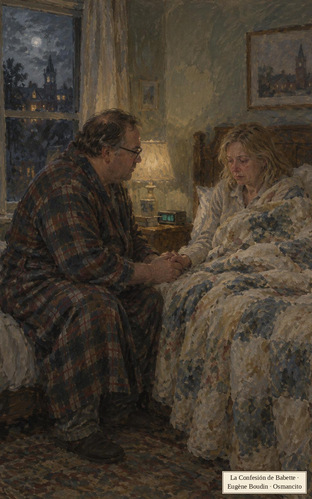](../img/261025_white-noise_la-confesion-de-babette.jpg)

Jack apaga la radio del programa de llamadas y le dice a Babette que es hora de un diálogo serio. Jack dice:

> «Tú lo sabes, yo lo sé.»
> [Frase 5042](#original-5042)

Jack dice que ella le contará todo sobre el Dylar, aunque sea por Denise. Dice:

> «Te hemos acorralado.»
> [Frase 5047](#original-5047)

Jack cuenta que encontró el frasco escondido y mandó analizar una tableta. Jack exige:

> «Solo dinos cuál es el problema de fondo.»
> [Frase 5058](#original-5058)

> «Como bien sabes, no tengo el temperamento para acosar a la gente.»
> [Frase 5059](#original-5059)

Jack agrega que Denise es distinta y que él la ha estado conteniendo. Jack amenaza:

> «Si no me cuentas lo que quiero saber, soltaré a tu niña.»
> [Frase 5062](#original-5062)

Pasan cinco minutos. Babette pide contarlo a su manera. Jack responde:

> «Tómate tu tiempo», dije.
> [Frase 5073](#original-5073)

Babette dice que su condición empezó quizá hace año y medio, y le pide a Jack que la deje contar. Babette dice:

> «Así es como puedo enseñar a mis alumnos a ponerse de pie, sentarse y caminar, aunque sé que tú piensas que esos temas son demasiado obvios, vagos y generales para reducirlos a sus partes.»
> [Frase 5103](#original-5103)

Babette cuenta que quiso entender la condición dividiéndola en partes. Dice:

> «Fui a bibliotecas y librerías, leí revistas y publicaciones técnicas, vi televisión por cable, hice listas y diagramas, hice gráficos multicolores, llamé por teléfono a redactores técnicos y a científicos, hablé con un santón sij en Iron City e incluso estudié lo oculto, escondiendo los libros en el desván para que tú y Denise no los encontraran ni se preguntaran qué pasaba.»
> [Frase 5111](#original-5111)

Un día, mientras le leía un tabloide al señor Treadwell, Babette vio un anuncio de voluntarios para una investigación secreta y una empresa de psicobiología la entrevistó. Babette dice:

> «Llamemos a la empresa Gray Research, aunque ese no es el nombre verdadero.»
> [Frase 5137](#original-5137)

> «Llamemos a mi contacto Mr. Gray.»
> [Frase 5138](#original-5138)

Mr. Gray es un compuesto. Babette fue una de tres finalistas para probar una droga secreta, el Dylar, pero la empresa lo juzgó demasiado riesgoso. Babette dice:

> «Si voy a contarte la historia, tengo que incluir este aspecto de ella, este sórdido rincón del corazón humano.»
> [Frase 5168](#original-5168)

Babette y Mr. Gray hacen un trato privado: probarán el Dylar ellos solos, y ella le ofrece su cuerpo. Era una sola persona, el jefe del proyecto. Jack dice:

> «De modo que ya no hablamos del Mr. Gray que es un compuesto.»
> [Frase 5194](#original-5194)

Jack describe la escena del motel. Babette dice:

> «Tú aprecias a la esposa que te lo cuenta todo.»
> [Frase 5223](#original-5223)

Ella llora. Jack dice que hay gelatina que hizo Steffie, y ella dice que es una buena niña. Jack dice:

> «Puedo traerte un poco sin problema.»
> [Frase 5238](#original-5238)

Babette confiesa que le teme a la muerte. Jack sugiere que quizá sea su peso. Ella dice que ha perdido peso. Jack dice:

> «Sé que has perdido peso.»
> [Frase 5315](#original-5315)

Babette pregunta qué puede ser más profundo que la muerte. Jack cuenta:

> Traté de convencerla de que no era tan grave como ella pensaba.
> [Frase 5322](#original-5322)

Jack dice que es él quien siempre ha estado obsesionado con la muerte y que se lo ocultó para protegerla. Jack dice:

> «Eso es lo que no puedo perdonarte.»
> [Frase 5355](#original-5355)

Ambos confiesan cuánto temen morir. Jack le dice que ella es su fuerza. Jack dice:

> «¿Cómo puedo convencerte de que esto es un error terrible?»
> [Frase 5415](#original-5415)

Babette dice que a veces el miedo le llega como un golpe. Jack dice con gravedad que todas las tramas van en una sola dirección. Jack cuenta:

> «¿Es por esto que me casé con Babette?»
> [Frase 5421](#original-5421)

> Nos abrazamos con fuerza durante largo rato, con los cuerpos apretados en un abrazo que incluía elementos de amor, dolor, ternura, sexo y lucha.
> [Frase 5424](#original-5424)

Hacen el amor. Ella pide agua y van los dos al baño en bata y vuelven a la cama. Jack cuenta:

> Ella se acurrucó enseguida para dormir, pero aún había cosas que yo quería saber, cosas que tenía que decir.
> [Frase 5442](#original-5442)

Babette dice que en Gray Research aislaron la zona del cerebro donde vive el miedo a la muerte. Jack dice que las teorías de Heinrich son ciertas. Jack dice:

> ¿Me estás diciendo que toda una tradición de debilidades humanas ha llegado a su fin, que cobardía, sadismo y abuso son términos sin sentido?
> [Frase 5462](#original-5462)

Babette dice que el Dylar no funciona. Mr. Gray le dio sesenta tabletas en dos frascos. Denise encontró el primero y Jack el segundo. Jack dice:

> «Te pregunto cuántas tabletas has tomado.»
> [Frase 5499](#original-5499)

Ella ha tomado cincuenta y cinco tabletas y cree que quedan cinco. Jack dice que quedan cuatro: mandó analizar una. Ella pregunta:

> «¿Te lo dije?»
> [Frase 5505](#original-5505)

Ella dice que al principio hubo mejoría, y que ahora no. Jack le recuerda una cena en casa de Murray, cuando dijo no recordar si tomaba medicación. Jack dice:

> «Denise y yo supusimos que tu falta de memoria era un efecto secundario de la droga que estabas tomando.»
> [Frase 5521](#original-5521)

Babette dice que el olvido fue un efecto de la condición, no de la droga. Mr. Gray le envió una cinta con sus disculpas. Ella apaga la lámpara y la radio. Jack dice:

> «Hay algo que me prometí que no te diría.»
> [Frase 5549](#original-5549)

Jack dice que está tentativamente programado para morir y le cuenta su exposición al Nyodene D. Jack cuenta:

> Le conté lo del técnico de computadoras, cómo había accedido a mi historial para producir un enorme cómputo pesimista.
> [Frase 5555](#original-5555)

> Somos la suma total de nuestros datos, le dije, igual que somos la suma total de nuestros impulsos químicos.
> [Frase 5556](#original-5556)

Jack dice que este es el secreto duro y pesado. Babette se sube encima de él, sollozando. Jack cuenta:

> Me golpeó el pecho, me agarró la mano izquierda y me mordió la carne entre el pulgar y el índice.
> [Frase 5565](#original-5565)

> Me tomó la cabeza entre las manos, con suavidad y a la vez con furia, y la meció de un lado a otro sobre la almohada, un acto que no pude conectar con nada que ella hubiera hecho jamás, con nada que ella pareciera ser.
> [Frase 5567](#original-5567)

Después ella se duerme inquieta. La radio se enciende. Jack va al baño, se lava, mueve el radiador y mete la mano detrás. El frasco de Dylar ya no está.

---

### Capítulo 27: El Simulacro

*Jack, Steffie, Orest y Babette.*

[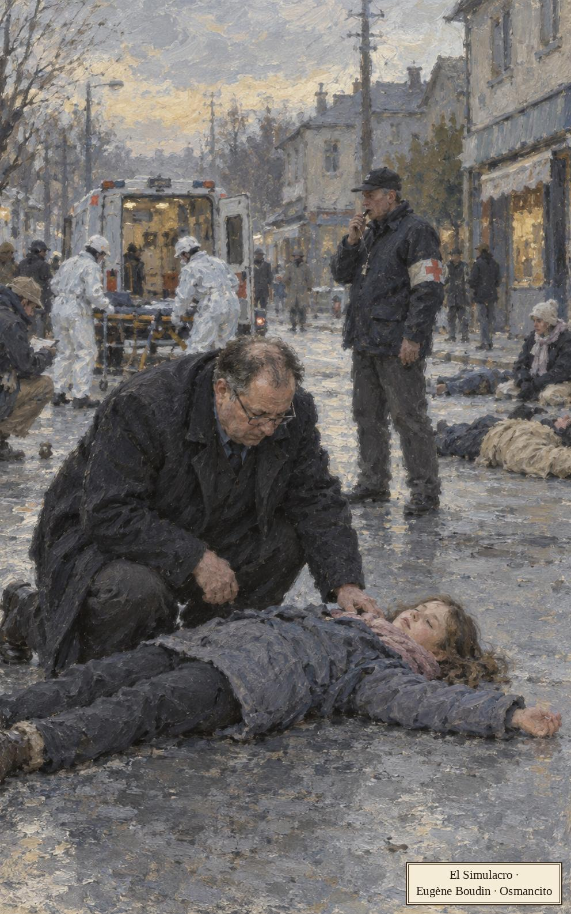](../img/261025_white-noise_el-simulacro.jpg)

Jack vuelve a casa por Elm y encuentra la calle cerrada por un simulacro. Un hombre con brazalete SIMUVAC le ordena retroceder. Jack pregunta qué significa estar en la franja de exposición. El hombre responde:

> «Significa que está muerto», me dijo.
> [Frase 5601](#original-5601)

Jack deja el auto, vuelve a pie y entre las víctimas voluntarias ve tendida a su hija Steffie. Ella abre los ojos y dice:

> «No se supone que estés aquí a menos que seas una víctima», dijo ella.
> [Frase 5619](#original-5619)

Jack dice:

> «Solo quiero asegurarme de que estás bien.»
> [Frase 5620](#original-5620)

Steffie dice:

> «Me meteré en problemas si te ven.»
> [Frase 5621](#original-5621)

Steffie cierra los ojos. Jack cuenta:

> Le hablé un rato más, pero no quiso contestar.
> [Frase 5628](#original-5628)

Heinrich es capitán de calle y presenta a Orest Mercator, que quiere sentarse sesenta y siete días en una jaula con serpientes mortales. Jack pregunta:

> «¿Puedes decirme por qué?»
> [Frase 5700](#original-5700)

Jack le pregunta si entiende que arriesga la muerte por un par de líneas en un libro. Jack insiste:

> «Te van a morder», continué.
> [Frase 5713](#original-5713)

Orest insiste en que a él no lo morderán. Jack cuenta:

> Me oí decir: «Sí te morderán, sí te morderán.»
> [Frase 5727](#original-5727)

Jack se sorprende al ver cómo lo mira Orest. Jack cuenta:

> Me sorprendió verlo mirarme con cierto interés, cierto respeto a regañadientes.
> [Frase 5732](#original-5732)

Jack no sabe de dónde es Orest. Orest le hace preguntas. Jack cuenta:

> Me dijo: «¿Cuántas libras puedes levantar en el press de banca?»
> [Frase 5748](#original-5748)

Dentro, Babette le da de comer a Wilder y dice que estar con él la anima. Jack dice:

> «Sé a qué te refieres.»
> [Frase 5768](#original-5768)

Jack dice que le molesta que los otros niños dejen escapar los momentos especiales. Babette dice que hay algo más grande en Wilder que no logra nombrar. Jack responde:

> «Recuérdame preguntarle a Murray», dije.
> [Frase 5778](#original-5778)

Jack pregunta dónde están las cuatro tabletas que quedan. Babette pregunta:

> «¿Me estás diciendo que no están detrás de la tapa del radiador?»
> [Frase 5790](#original-5790)

Jack dice que las quiere por exactitud histórica. Babette le advierte:

> «No te han hecho pruebas previas», dijo ella.
> [Frase 5797](#original-5797)

Jack pregunta por Mr. Gray. Babette prometió no revelar su identidad. Babette dice:

> Considerando lo que buscas, esa promesa vale el doble.
> [Frase 5809](#original-5809)

Babette dice que no lo dirá, y que es más por el bien de Jack que por el de él. Babette propone:

> Retomemos nuestras vidas, sin más.
> [Frase 5812](#original-5812)

> Digámonos que haremos lo mejor que podamos.
> [Frase 5813](#original-5813)

Jack recoge a Denise en la escuela. Jack cuenta:

> Era la primera vez que la recogía en la escuela, y al pasar frente al auto me lanzó una mirada recelosa y dura, una mirada que indicaba que no estaba de humor para noticias de una separación o un divorcio.
> [Frase 5820](#original-5820)

Jack le dice que el Dylar mejora la memoria de Babette. Denise dice que no le cree:

> «Porque no vendrías a buscarme a la escuela solo para decirme eso.»
> [Frase 5829](#original-5829)

Denise pregunta si su madre es una adicta. Jack dice:

> «Nos gustaría saber qué hiciste con el frasco.»
> [Frase 5838](#original-5838)

Denise pregunta:

> «¿Cómo sabes que me las llevé?»
> [Frase 5840](#original-5840)

Jack responde:

> Yo lo sé, tú lo sabes.
> [Frase 5841](#original-5841)

Denise dice:

> «Si alguien quiere decirme qué es realmente el Dylar, quizá lleguemos a algo.»
> [Frase 5842](#original-5842)

Denise no cede. Jack cuenta:

> Incluso recluté a Babette, convenciéndola de que el frasco debía estar en manos de adultos.
> [Frase 5850](#original-5850)

> Mantendría el objeto escondido hasta que le contáramos su secreto.
> [Frase 5853](#original-5853)

---

### Capítulo 28: El Almuerzo de los Neoyorquinos

*Jack, Steffie, Grappa y Murray.*

[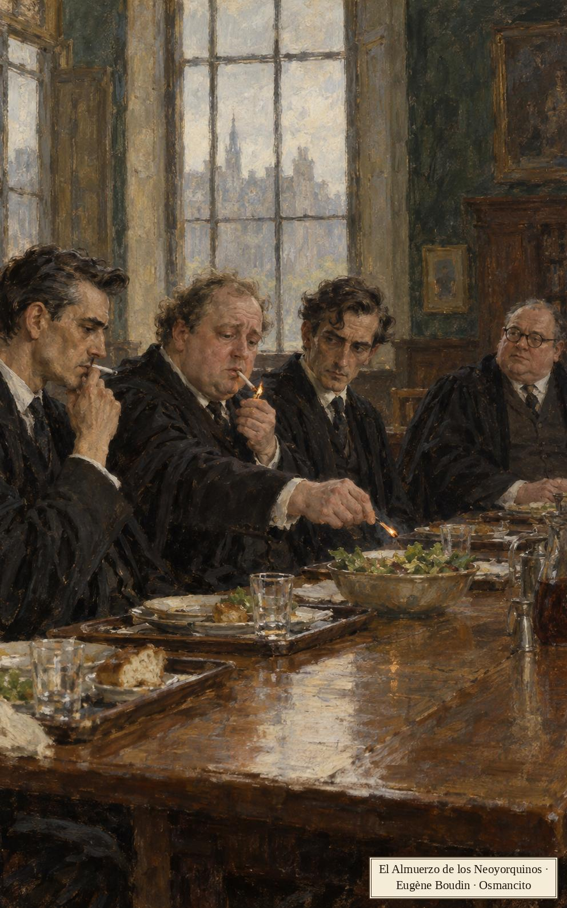](../img/261025_white-noise_el-almuerzo-de-los-neoyorquinos.jpg)

En la cocina, Wilder mira hervir el agua y Steffie cuenta que a la evacuación no se presentó mucha gente. Jack responde:

> «Se presentan para las de verdad», dije.
> [Frase 5876](#original-5876)

Steffie dice que su madre quiere que la visite en Pascua. Jack le dice:

> «Te llevaré al aeropuerto.»
> [Frase 5888](#original-5888)

Jack cuenta:

> Mirábamos hervir el agua.
> [Frase 5894](#original-5894)

Steffie dice que se anotó de nuevo como víctima, esta vez por un olor raro. Jack dice:

> «Estoy seguro de que no les importará disculparte solo por esta vez.»
> [Frase 5905](#original-5905)

Jack cuenta que su primer y su cuarto matrimonio fueron con Dana Breedlove, la madre de Steffie. Jack cuenta:

> El primer matrimonio funcionó lo bastante bien como para animarnos a intentarlo otra vez en cuanto fue conveniente para ambos.
> [Frase 5908](#original-5908)

> Cuando lo hicimos, después de las melancólicas épocas de Janet Savory y Tweedy Browner, las cosas empezaron a desmoronarse.
> [Frase 5909](#original-5909)

Dana trabaja a medias como espía. Jack cuenta:

> Me contó muy poco de su trabajo de inteligencia.
> [Frase 5912](#original-5912)

> Yo sabía que reseñaba ficción para la CIA, sobre todo novelas largas y serias con estructuras cifradas.
> [Frase 5913](#original-5913)

Jack se cruza con Babette. Jack cuenta:

> «¿Cómo te sientes?» Hacer la pregunta y oírla nos hacía sentir mejor a los dos.
> [Frase 5931](#original-5931)

Más tarde, en el almuerzo de Centenary Hall, Jack observa a Murray. Jack cuenta:

> En el comedor de Centenary Hall, vi a Murray olfatear sus cubiertos.
> [Frase 5934](#original-5934)

En la mesa, Lasher le pregunta a Grappa cuál fue la mayor influencia de su vida. Grappa dice que fue Richard Widmark en El beso de la muerte, por su risa sádica. Grappa dice:

> Me sacó de algunos períodos emocionales difíciles.
> [Frase 5951](#original-5951)

Grappa dice:

> «Me ayudó a convertirme en una persona.»
> [Frase 5957](#original-5957)

Lasher le hace preguntas raras a Grappa. Lasher pregunta:

> «Cuando te arrancas la piel muerta del pulgar con los dientes, ¿te la comes o la escupes?»
> [Frase 5972](#original-5972)

Grappa responde:

> «Mastícala un momento y luego lánzala con rapidez desde la punta de la lengua.»
> [Frase 5973](#original-5973)

Jack cuenta:

> Lo vi encender un cigarrillo, sacudir el fósforo y tirarlo a la ensalada de Murray.
> [Frase 5984](#original-5984)

Lasher le pregunta cuánto placer sentía de niño al imaginarse muerto. Grappa responde:

> «Todavía lo hago todo el tiempo.»
> [Frase 5987](#original-5987)

Grappa dice que imaginarse muerto es una forma infantil de autocompasión. Grappa concluye:

> «Es mi manera de castigar a la gente por pensar que sus propias vidas son más importantes que la mía.»
> [Frase 5999](#original-5999)

Jack no quiere oír eso. Alfonse Stompanato empieza a mover los hombros. Jack cuenta:

> Lo tomé como una señal de que se estaba preparando para hablar.
> [Frase 6011](#original-6011)

Jack sale a esperar a Murray y camina con él. Jack cuenta:

> Cuando salió, lo sostuve del brazo, justo encima del codo, y caminamos por el campus como un par de ancianos europeos, con las cabezas inclinadas en conversación.
> [Frase 6027](#original-6027)

Jack le pregunta a Murray por esa conversación. Jack dice:

> «¿Cómo soportas escuchar eso?», dije.
> [Frase 6028](#original-6028)

Siguen caminando. Jack cuenta:

> Caminamos junto a pequeños montones de nieve derretida.
> [Frase 6040](#original-6040)

---

### Capítulo 29: Los Pasillos

*Jack y Babette.*

[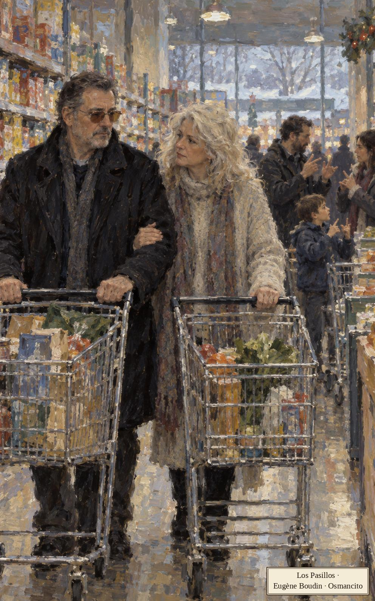](../img/261025_white-noise_los-pasillos.jpg)

Jack cuenta que va de compras al supermercado con Babette:

> Babette y yo avanzábamos por el ancho pasillo, cada uno con un carrito reluciente.
> [Frase 6087](#original-6087)

> Pasamos junto a una familia que compraba hablando en lengua de señas.
> [Frase 6088](#original-6088)

Jack ve luces de colores. Babette le pregunta:

> «¿Cómo te sientes?», dijo ella.
> [Frase 6090](#original-6090)

Jack dice que está bien y que ya se hizo dos chequeos. Babette elogia el inglés del doctor Chakravarty y Jack dice que al doctor le gusta hablar más de lo que a ella le gusta oírlo. Babette lo discute. Jack cambia de tema:

> «Necesitamos un poco de Class Plus.»
> [Frase 6110](#original-6110)

Jack se va hacia el pasillo cinco. Babette dice:

> «No me dejes sola», dijo ella.
> [Frase 6111](#original-6111)

Jack dice que solo va al pasillo cinco. Babette le dice:

> «Creo que sabes eso.»
> [Frase 6114](#original-6114)

Jack le responde:

> «Vamos a salir bien de esta», dije.
> [Frase 6115](#original-6115)

> Estamos decididos a estar bien.
> [Frase 6117](#original-6117)

Jack le habla a Babette y la describe como una persona fuerte, sana y afirmativa. Jack cuenta:

> Nos quedamos juntos en los pasillos y en la caja.
> [Frase 6122](#original-6122)

> Los leímos juntos mientras esperábamos en la fila.
> [Frase 6124](#original-6124)

> Luego fuimos juntos hasta el auto, cargamos la mercancía y me senté muy cerca de ella mientras yo manejaba a casa.
> [Frase 6125](#original-6125)

---

### Capítulo 30: La Puesta de Sol

*Jack, Babette y Winnie.*

Jack no puede dormir y despierta a Babette para exigirle acceso al señor Gray; ella se niega. Esa tarde Jack mira el Observatorio desde la ventana de su oficina y, al ver salir a Winnie Richards, corre tras ella. Jack cuenta:

> La vi doblar una esquina en un derrape controlado antes de que desapareciera detrás de un edificio de mantenimiento.
> [Frase 6290](#original-6290)

> Decidí rodear la biblioteca y alcanzarla en el largo tramo recto hacia los laboratorios de química.
> [Frase 6295](#original-6295)

Jack pierde de vista a Winnie y la busca por el campus. Jack cuenta:

> Volví a correr, sabiendo que estaba demasiado lejos, que desaparecería detrás de la cima de la colina, que no reaparecería en semanas.
> [Frase 6307](#original-6307)

> Qué sorpresa me llevé, al acercarme a la cima de la colina, al ver que se había detenido.
> [Frase 6309](#original-6309)

> Cuando pasé una hilera de casas particulares vi lo que la había hecho detenerse.
> [Frase 6312](#original-6312)

Jack la alcanza en lo alto de la colina, donde ella mira la puesta de sol. Winnie le dice:

> «No sabía que subías aquí.»
> [Frase 6321](#original-6321)

Hablan de los atardeceres y Jack le pregunta por la pastilla en forma de platillo. Jack cuenta:

> Nos quedamos allí mirando una oleada de luz chillona, como un corazón latiendo en un documental de televisión a color.
> [Frase 6342](#original-6342)

Jack le explica que el Dylar es contra el miedo a la muerte y que lo diseñó un grupo secreto. Jack dice:

> «Me pregunto si has oído rumores de un grupo que trabaja en secreto en el miedo a la muerte.»
> [Frase 6357](#original-6357)

Winnie dice que es puro chisme y le pregunta quiénes son. Jack responde:

> «Por eso te he estado persiguiendo.»
> [Frase 6365](#original-6365)

> Pensé que sabrías algo de ellos.
> [Frase 6366](#original-6366)

Winnie dice que psicobiólogo es una categoría muy amplia y que el verdadero trabajo está en los fosos. Jack pregunta:

> «¿No hay nada que puedas decirme?»
> [Frase 6371](#original-6371)

> Algo en mi voz la hizo volverse a mirarme.
> [Frase 6372](#original-6372)

Winnie explica que el miedo es conciencia de uno mismo. Jack pregunta qué hacer para que la muerte sea menos extraña y ella dice que no sabe. Winnie dice:

> «Creo que lo que haces, Jack, es olvidar la medicina de esa tableta.»
> [Frase 6418](#original-6418)

Jack piensa que ella tiene razón y que debe seguir con su vida, criar a sus hijos y dar clases. Jack dice:

> «Sigo triste, Winnie, pero le has dado a mi tristeza una riqueza y una profundidad que nunca había conocido.»
> [Frase 6424](#original-6424)

Winnie se da vuelta, sonrojada. Jack cuenta:

> Dije: «Eres más que una amiga de buen tiempo: eres una verdadera enemiga.»
> [Frase 6426](#original-6426)

> La vi sonrojarse.
> [Frase 6429](#original-6429)

> Echamos una última mirada al cielo y empezamos a bajar la colina.
> [Frase 6431](#original-6431)

---

### Capítulo 31: Comer en el Auto

*Jack, Babette, Denise, Steffie, Heinrich y Wilder.*

[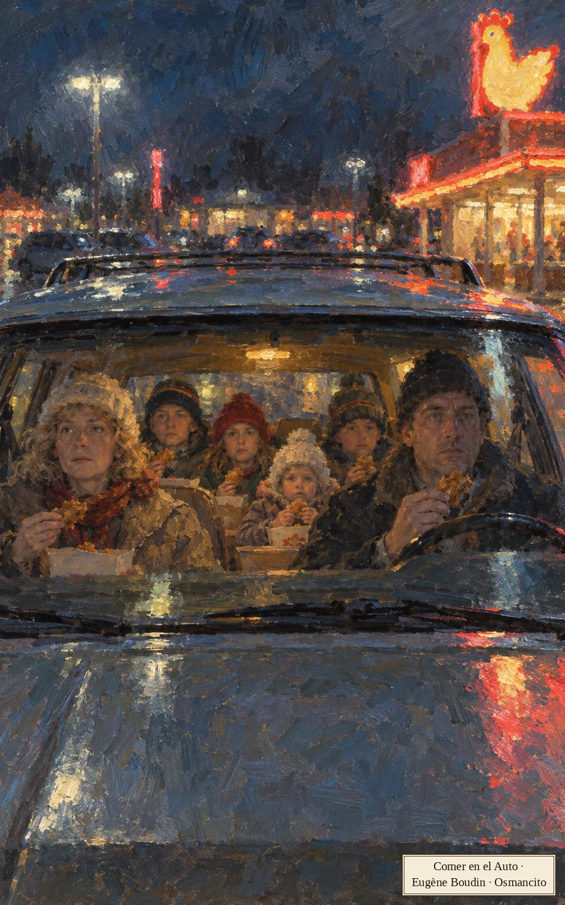](../img/261025_white-noise_comer-en-el-auto.jpg)

Nadie quiere cocinar esa noche. Jack cuenta:

> Todos subimos al auto y salimos a la zona comercial, en la tierra de nadie más allá del límite del pueblo.
> [Frase 6446](#original-6446)

Jack se detiene en un local de pollo y brownies. Jack cuenta:

> Decidimos comer en el auto.
> [Frase 6449](#original-6449)

> Queríamos comer, no mirar a otras personas.
> [Frase 6451](#original-6451)

> Queríamos llenarnos el estómago y acabar con eso.
> [Frase 6452](#original-6452)

> No necesitábamos luz ni espacio.
> [Frase 6453](#original-6453)

> Desde luego no necesitábamos mirarnos por encima de una mesa mientras comíamos, tejiendo una red sutil y compleja de señales y códigos.
> [Frase 6454](#original-6454)

> Nos conformábamos con comer mirando en la misma dirección, viendo solo unos centímetros más allá de nuestras manos.
> [Frase 6455](#original-6455)

Denise trae la comida al auto y reparte servilletas. Jack cuenta:

> Nos acomodamos para comer.
> [Frase 6458](#original-6458)

> Comimos completamente vestidos, con sombreros y abrigos gruesos, sin hablar, desgarrando las presas de pollo con las manos y los dientes.
> [Frase 6459](#original-6459)

Steffie le da la piel de una pechuga a Heinrich, Babette chupa un hueso y Jack aparta la imagen del señor Gray en el motel. Jack cuenta:

> Mandamos a Denise por más comida y la esperamos en silencio.
> [Frase 6472](#original-6472)

> Luego volvimos a empezar, medio aturdidos por las dimensiones de nuestro placer.
> [Frase 6473](#original-6473)

Steffie pregunta cómo flotan los astronautas y Denise dice que son más ligeros que el aire. Jack cuenta:

> Todos dejamos de comer.
> [Frase 6477](#original-6477)

Heinrich dice que no hay aire y Babette pregunta cómo puede hacer frío si no hay aire. Jack cuenta:

> Esperamos para saber si el diálogo había terminado.
> [Frase 6493](#original-6493)

> Luego nos pusimos a comer de nuevo.
> [Frase 6494](#original-6494)

> Intercambiamos en silencio las partes que no queríamos y metimos las manos en los cartones de papas fritas onduladas.
> [Frase 6495](#original-6495)

> Intercambiamos partes y roímos.
> [Frase 6499](#original-6499)

Steffie pregunta cuánto frío hace en el espacio. Jack cuenta:

> Todos esperamos una vez más.
> [Frase 6501](#original-6501)

Heinrich, Babette y Denise discuten del sol, de las estrellas gigantes y de los psíquicos rusos. Jack cuenta:

> Volvimos a comer durante el tiempo que se tarda en morder y masticar un solo bocado de comida.
> [Frase 6534](#original-6534)

Esa semana un policía dice que vio caer un cuerpo de un OVNI, y hay avistamientos por toda la zona. Jack cuenta:

> En el estacionamiento de la comida rápida nos comimos los brownies.
> [Frase 6557](#original-6557)

> Inhalamos las migas, nos lamimos los dedos.
> [Frase 6559](#original-6559)

> Al acercarnos al final, el alcance físico de nuestra conciencia empezó a expandirse.
> [Frase 6560](#original-6560)

> Miramos más allá de nuestras manos.
> [Frase 6562](#original-6562)

> Miramos por las ventanas, hacia los autos y las luces.
> [Frase 6563](#original-6563)

> Miramos a la gente que salía del restaurante, hombres, mujeres y niños que llevaban cartones de comida y se inclinaban contra el viento.
> [Frase 6564](#original-6564)

---

### Capítulo 32: El Incendio

*Jack, Murray, Heinrich y Howard.*

[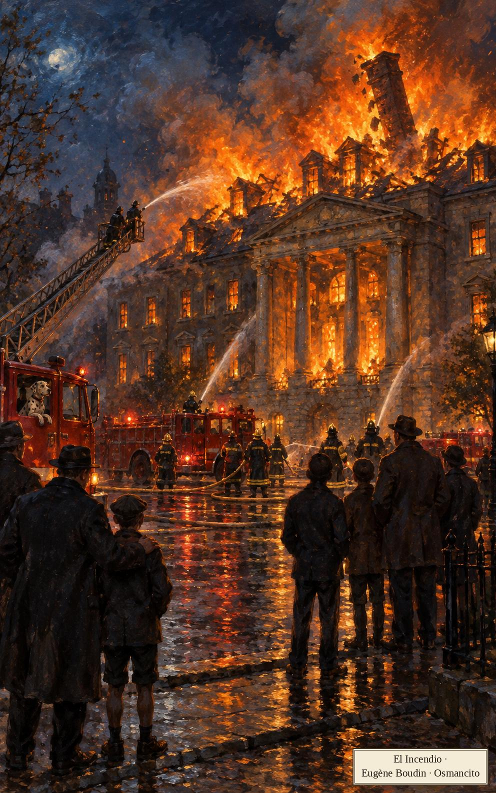](../img/261025_white-noise_el-incendio.jpg)

Jack camina por el campus con Murray y hablan de Howard Dunlop, el profesor de alemán. Jack cuenta:

> Murray y yo cruzábamos el campus a nuestra manera europea, a un paso serenamente reflexivo, con la cabeza gacha mientras conversábamos.
> [Frase 6626](#original-6626)

> Otras veces caminábamos algo separados, con las manos de Murray cruzadas a la espalda y las de Gladney dobladas como las de un monje sobre el abdomen, un toque algo preocupado.
> [Frase 6628](#original-6628)

Murray pregunta si Jack lo llama Howard, y Jack dice que no a la cara. Jack pregunta:

> ¿Lo ves siquiera?
> [Frase 6637](#original-6637)

Murray y Jack enumeran lo que inquieta de Howard: las manos blandas, la saliva seca, el modo de mirar por encima del hombro. Murray empieza a asentir. Jack cuenta:

> Yo le miraba la cara mientras caminábamos.
> [Frase 6674](#original-6674)

> Yo caminaba con él paso a paso, agarrándole el codo, mirándole la cara, esperando que hablara, sin interesarme en que me había sacado por completo de mi camino, y él seguía asintiendo cuando nos acercamos a la entrada de Wilmot Grange, un edificio restaurado del siglo XIX en el borde del campus.
> [Frase 6676](#original-6676)

Jack insiste en preguntar qué es lo que tiene Howard. Jack cuenta:

> No fue hasta cuatro días después que me llamó a casa, a la una de la madrugada, para susurrarme con amabilidad al oído: «Parece un hombre que encuentra eróticos los cadáveres.»
> [Frase 6679](#original-6679)

Jack y Heinrich van en el auto a ver arder el manicomio, y una mujer con camisón en llamas cruza el césped. Jack cuenta:

> Era de pelo blanco y menuda, bordeada de aire ardiente, y vimos que estaba loca, tan perdida entre sueños y furias que el fuego alrededor de su cabeza parecía casi incidental.
> [Frase 6717](#original-6717)

---

### Capítulo 33: La Pistola de Vernon

*Jack, Vernon, Babette y Denise.*

[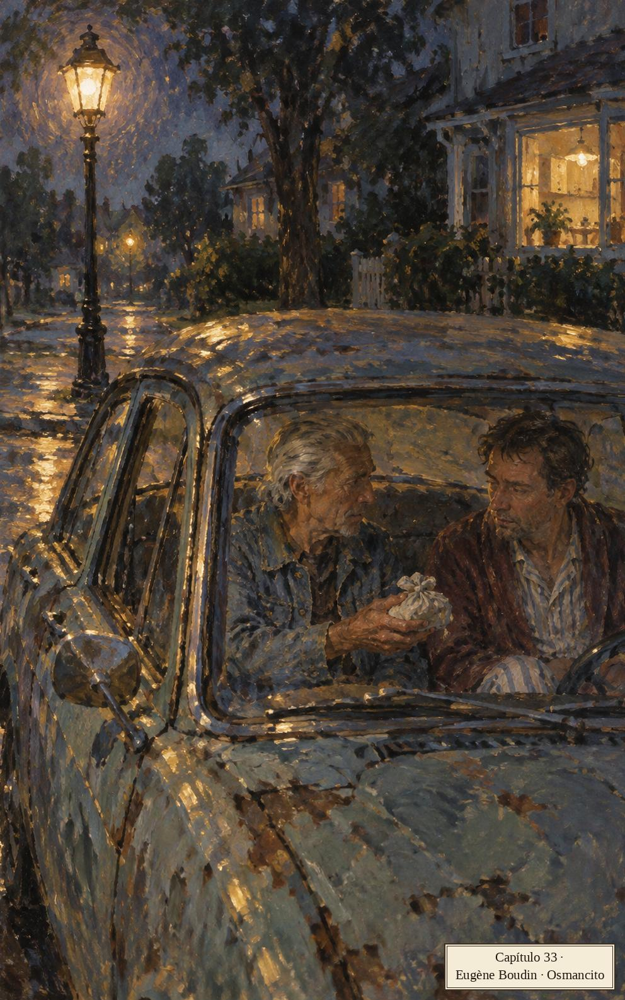](../img/261025_white-noise_la-pistola-de-vernon.jpg)

Jack despierta de madrugada y ve a Wilder de pie junto a su cama. Wilder lo lleva a la ventana, y en el jardín hay un hombre de pelo blanco sentado en una silla de mimbre. Jack se esconde en el baño. Jack cuenta:

> Pensé una cosa, que él había estado yo me puse en pie y volví a la ventana.
> [Frase 6805](#original-6805)

Jack vuelve a la ventana y observa al hombre mucho rato. Jack cuenta:

> ¿Era tan viejo como yo había pensado al principio, o el pelo blanco era puramente emblemático, parte de su fuerza alegórica?
> [Frase 6820](#original-6820)

> Sería un aforista de las últimas cosas, que me daría la más breve mirada, civilizada, irónica, mientras decía su frase hábil y elegante sobre mi partida.
> [Frase 6823](#original-6823)

> Miré durante mucho rato, esperando a que moviera una mano.
> [Frase 6824](#original-6824)

Jack decide salir a sacar al hombre de la casa, pero antes mira a los niños. Jack cuenta:

> Si quería mantenerlo fuera de la casa, lo que había que hacer era salir.
> [Frase 6849](#original-6849)

Jack sale al jardín con su ejemplar de Mein Kampf contra el estómago. El hombre se levanta. Jack cuenta:

> Una segunda figura empezó a surgir de las ruinas numinosas de la primera, empezó a adquirir una forma efectiva, a desarrollarse a la luz nítida como un conjunto de movimientos, líneas y rasgos, un contorno, una persona viva cuyos rasgos físicos distintivos parecían cada vez más familiares mientras yo los veía cobrar existencia, un poco asombrado.
> [Frase 6872](#original-6872)

El hombre es Vernon Dickey, el padre de Babette. Ha conducido catorce horas sin avisar. Jack cuenta:

> «¿Sabíamos que venías?»
> [Frase 6877](#original-6877)

Vernon, sentado a la mesa de la cocina, le habla a Jack de una mujer que quiere casarse con él. Jack cuenta:

> «Para que sepas dónde estoy, Jack, hay una mujer que quiere casarse con mi culo.»
> [Frase 6920](#original-6920)

Babette entra en la cocina y ve a su padre. Jack cuenta:

> Era la imagen misma del pasmo boquiabierto, el ideal luminoso, no menos confundida y alarmada de lo que yo había estado cuando lo vi sentado en el jardín, mortalmente quieto.
> [Frase 6964](#original-6964)

> «¿Sabíamos que venías?», dijo ella.
> [Frase 6966](#original-6966)

Vernon se queda unos días y Babette vuelve a ser la hija de su padre. Jack cuenta:

> Mientras preparábamos y comíamos el desayuno, mientras los niños bajaban y se acercaban con cautela a Vernon para recibir besos y despeinadas, mientras pasaban las horas y Babette se acostumbraba a la visión de la figura de andar cansino en vaqueros remendados, empecé a notar el placer que ella sentía al rondar cerca, haciendo pequeñas cosas por él, estando allí para escuchar.
> [Frase 6979](#original-6979)

> Y luego se volvía hacia ella y decía: «Jack sabe el problema que tengo con los parques estatales.»
> [Frase 6992](#original-6992)

Jack y Babette le dan a Vernon el cuarto de Heinrich. Jack cuenta:

> Pasamos a Heinrich al sofá de abajo y le dimos a Vernon su cuarto.
> [Frase 6994](#original-6994)

> Era inquietante encontrarlo en la cocina a las siete de la mañana, a las seis, a la hora grisácea que fuera en que Babette o yo bajábamos a hacer café.
> [Frase 6995](#original-6995)

> Daba la impresión de estar empeñado en burlarnos, en explotar nuestra culpa, en mostrarnos que por poco que durmiéramos nosotros, él dormía menos.
> [Frase 6996](#original-6996)

Vernon se pone a hablarle a Jack de la vejez y de la rutina. Jack cuenta:

> «Te voy a decir una cosa, Jack.»
> [Frase 6997](#original-6997)

Vernon mira la casa de Jack. Jack cuenta:

> «Se te hunde el canalón del tejado», me dijo.
> [Frase 7011](#original-7011)

Vernon le pide a Jack que le responda una cosa. Jack cuenta:

> «¿Que te diga qué?»
> [Frase 7027](#original-7027)

Una noche, Jack oye una voz. Jack cuenta:

> Una noche oí una voz y pensé que gemía en sueños.
> [Frase 7031](#original-7031)

Vernon lo lleva afuera para hablar de algo en privado. Jack cuenta:

> «Lo que tenemos aquí es una situación que deberíamos manejar en privado.»
> [Frase 7140](#original-7140)

> Salimos por la puerta de atrás para no despertar a Heinrich.
> [Frase 7146](#original-7146)

Vernon se sienta al volante y quiere darle algo a Jack. Jack cuenta:

> «Quiero que te quedes con esto, Jack.»
> [Frase 7153](#original-7153)

> Ahora quiero que te quedes con él.
> [Frase 7156](#original-7156)

> ¿Me das el coche?
> [Frase 7161](#original-7161)

Jack sostiene una pistola cargada y Vernon le habla del arma. Jack cuenta:

> «Odio decirte qué destrozo puede causar en la colocación de las facciones de un hombre.»
> [Frase 7214](#original-7214)

> Me dio una mirada astuta.
> [Frase 7215](#original-7215)

Una cuadrilla arregla la calle y la visita de Vernon parece acabar. Jack cuenta:

> Empezamos a ver un espacio en blanco donde Vernon estaba.
> [Frase 7244](#original-7244)

> Nos miraba desde una distancia prudente, como si fuéramos desconocidos con resentimientos secretos.
> [Frase 7245](#original-7245)

Babette despide a Vernon en la acera. Jack cuenta:

> «Es una buena chica», me dijo con gesto sombrío.
> [Frase 7253](#original-7253)

> Luego tosió un rato, regalándonos un episodio más de flema azotadora.
> [Frase 7255](#original-7255)

> Nos asomamos a la ventanilla del lado del pasajero, mirando cómo se encorvaba hasta su postura de conducir, acomodándose con desparpajo entre la puerta y el asiento, con el brazo izquierdo colgando por la ventanilla.
> [Frase 7257](#original-7257)

---

### Capítulo 34: Basura y Potasio

*Jack, Murray y el doctor Chakravarty.*

[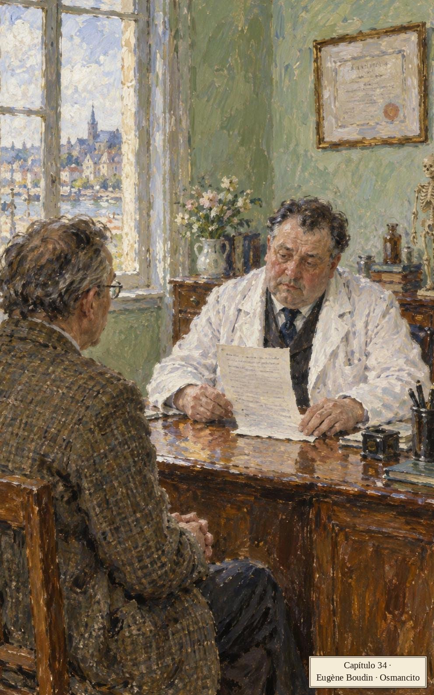](../img/261025_white-noise_basura-y-potasio.jpg)

Llega la época de las arañas. Denise le dice a Babette que Steffie se examina el pecho en busca de bultos. Jack cuenta:

> Babette me lo contó.
> [Frase 7318](#original-7318)

> Murray y yo ampliamos el alcance de nuestros paseos contemplativos.
> [Frase 7319](#original-7319)

Murray y Jack caminan por el pueblo y hablan de nostalgia y de ruinas. Jack cuenta:

> Le conté a Murray que Albert Speer quería construir estructuras que se deterioraran con gloria, de forma impresionante, como las ruinas romanas.
> [Frase 7328](#original-7328)

> La ruina está construida dentro de la creación, dije, lo cual muestra cierta nostalgia detrás del principio del poder, o una tendencia a organizar los anhelos de las generaciones futuras.
> [Frase 7332](#original-7332)

Jack revuelve la basura compactada de la casa, buscando las pastillas de Dylar que Denise tiró. Jack cuenta:

> ¿Lo habíamos creado nosotros?
> [Frase 7359](#original-7359)

Jack decide hacerse otro examen físico. Jack cuenta:

> Cuando llegaron los resultados, fui a ver al doctor Chakravarty a su pequeño consultorio del edificio médico.
> [Frase 7386](#original-7386)

El doctor Chakravarty le habla a Jack de su condición de paciente. Jack cuenta:

> Yo soy el médico, usted el paciente.
> [Frase 7396](#original-7396)

> «¿Sabe lo que esto significa?» «No.»
> [Frase 7413](#original-7413)

> «Esto es todo lo que tiene que saber.»
> [Frase 7416](#original-7416)

El doctor insiste en el potasio de Jack. Jack cuenta:

> «Ahora nos estamos metiendo en semántica», dijo.
> [Frase 7422](#original-7422)

> «Entonces estamos de acuerdo», dije.
> [Frase 7430](#original-7430)

> «Dígame esto, señor Gladney, con toda honestidad.»
> [Frase 7431](#original-7431)

> Parecía estar tratando de hacerme bajar la vista a fuerza de mirarme.
> [Frase 7439](#original-7439)

El doctor quiere mandarlo a Glassboro para más pruebas. Jack cuenta:

> Dije: «¿Cómo podemos saber si la elevación es verdadera o falsa?»
> [Frase 7442](#original-7442)

> «Voy a enviarlo a Glassboro para más pruebas.»
> [Frase 7443](#original-7443)

> «Pero ¿es el potasio lo único que tenemos que vigilar?»
> [Frase 7450](#original-7450)

El doctor le habla del centro de Glassboro y de la prevención. Jack cuenta:

> Tienen el know-how en Harvest Farms, los instrumentos más delicados, se lo prometo.
> [Frase 7458](#original-7458)

> «Juntos, como médico y paciente, podemos hacer cosas que ninguno de los dos podría hacer por separado.»
> [Frase 7461](#original-7461)

---

### Capítulo 35: La Jaula de Orest

*Jack, Babette, Heinrich y Orest Mercator.*

[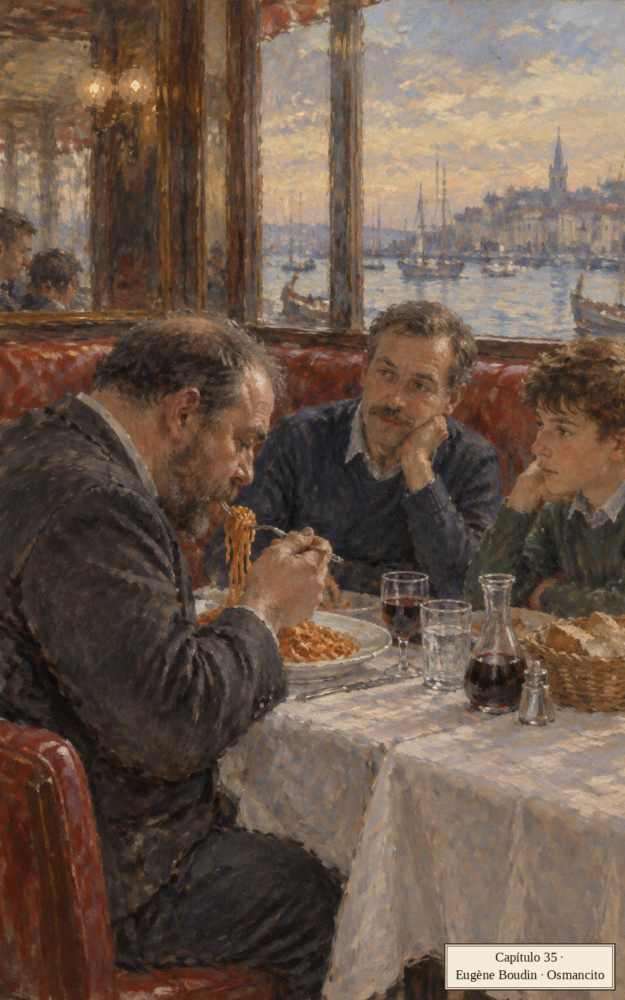](../img/261025_white-noise_la-jaula-de-orest.jpg)

Babette escucha la radio sin parar y se pasa los días con su sudadero gris. Denise le unta protector solar y discuten por los rayos. Jack cuenta:

> «Yo necesito esto tanto como tú, si no más.»
> [Frase 7512](#original-7512)

> Denise giró hacia mí, con los brazos extendidos, su cuerpo suplicándome que pusiera en su sitio a la mujer.
> [Frase 7539](#original-7539)

Jack lleva a Heinrich y a Orest a cenar y quiere saber si el domador de serpientes tiene miedo. Jack cuenta:

> Llevé a Heinrich y a su amigo domador de serpientes, Orest Mercator, a cenar a la zona comercial.
> [Frase 7546](#original-7546)

> A petición suya fuimos al Casa Mario de Vincent, una estructura de bloques con ventanas estrechas que parecía parte de algún sistema de defensa costera.
> [Frase 7548](#original-7548)

> Nos sentamos en un reservado rojo sangre.
> [Frase 7550](#original-7550)

> «Heinrich me dijo que duermes sentado, para prepararte para la jaula.»
> [Frase 7557](#original-7557)

> «Por eso hemos venido aquí», dijo Heinrich.
> [Frase 7562](#original-7562)

> Pedimos pasta y agua.
> [Frase 7565](#original-7565)

Jack interroga a Orest sobre el miedo a morir. Jack cuenta:

> «Dime, Orest.»
> [Frase 7566](#original-7566)

> «Le gusta ser positivo», dijo Heinrich.
> [Frase 7574](#original-7574)

> «Dime esto, entonces.»
> [Frase 7577](#original-7577)

> Me gustaba ver comer a Orest.
> [Frase 7585](#original-7585)

> Hablamos de eso la última vez.
> [Frase 7590](#original-7590)

> Déjame poner mis cartas sobre la mesa, Orest.
> [Frase 7596](#original-7596)

Orest habla de los muertos de hoy y Heinrich lo traduce. Jack cuenta:

> Dije: «¿Está tratando de decirnos que hay más gente muriendo en este período de veinticuatro horas que en el resto de la historia humana hasta ahora?»
> [Frase 7606](#original-7606)

> «Está diciendo gente ahora muerta.»
> [Frase 7610](#original-7610)

> «Está diciendo gente en tumbas.»
> [Frase 7613](#original-7613)

> Escuchaba con atención, tratando de entender lo que querían decir.
> [Frase 7616](#original-7616)

> «¿Está diciendo que hay más muertos en tumbas que en cualquier otro lugar?»
> [Frase 7619](#original-7619)

Jack le dice a Orest que busca la muerte. Jack cuenta:

> Te dispones a hacer exactamente lo que la gente pasa la vida tratando de no hacer.
> [Frase 7629](#original-7629)

> «Ahora tiene un entrenador», dijo Heinrich.
> [Frase 7633](#original-7633)

> Dije: «¿No quieres decir que los moonies son en su mayoría coreanos?»
> [Frase 7638](#original-7638)

> Pensaron en esto.
> [Frase 7643](#original-7643)

> Observé a Orest comer.
> [Frase 7644](#original-7644)

> Lo observé meter el espagueti garganta abajo como con una horquilla.
> [Frase 7645](#original-7645)

Jack lo ve comer y le habla de las serpientes. Jack cuenta:

> «No podrás defenderte», dije.
> [Frase 7654](#original-7654)

> Supongo que yo también lo admiraba.
> [Frase 7676](#original-7676)

> Como si ahora le creyeran.
> [Frase 7688](#original-7688)

---

### Capítulo 36: Cosecha de Otoño

*Jack, Janet y el joven técnico de Autumn Harvest Farms.*

[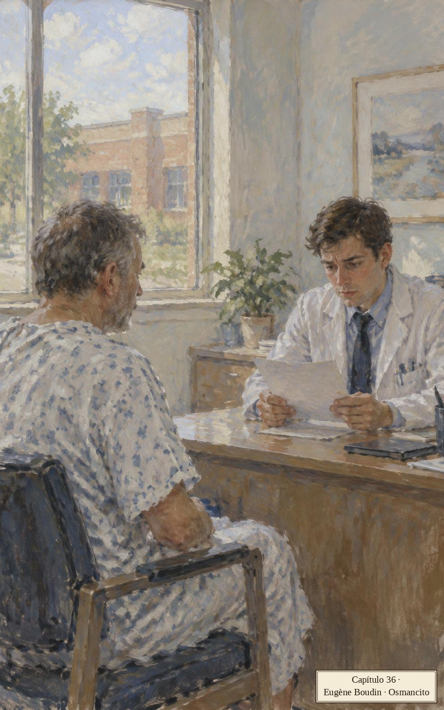](../img/261025_white-noise_cosecha-de-otono.jpg)

Janet llama a Jack por teléfono desde el ashram de Montana y dice que solo quiere saludarlo. Jack cuenta:

> «No hemos hablado en siglos.»
> [Frase 7806](#original-7806)

> «Solo para saludarte, Jack.»
> [Frase 7819](#original-7819)

> «Ahora dime qué quieres.»
> [Frase 7835](#original-7835)

> Solo quiero saludarte.
> [Frase 7839](#original-7839)

> Te saludo, Jack.
> [Frase 7840](#original-7840)

> Te extraño.
> [Frase 7841](#original-7841)

Llegan los delegados a la conferencia sobre Hitler y Jack los recibe. Jack cuenta:

> Resultaba interesante ver cuánto se parecían entre sí, a pesar de la gran diversidad de orígenes nacionales y regionales.
> [Frase 7857](#original-7857)

> Les di la bienvenida en la capilla de aspecto severamente moderno.
> [Frase 7860](#original-7860)

Jack se hace las pruebas en Autumn Harvest Farms y habla con un joven técnico. Jack cuenta:

> «Pensé que estábamos aquí para una discusión general.»
> [Frase 7939](#original-7939)

> Créame, lo he visto suceder.
> [Frase 7951](#original-7951)

> Era un tipo de ojos apacibles y mala piel, y me recordó a los chicos del supermercado que se paran al final del mostrador de la caja embolsando mercancía.
> [Frase 7955](#original-7955)

> «Así es como solemos empezar», dijo.
> [Frase 7956](#original-7956)

> «Yo hago preguntas basadas en la impresión y luego usted responde lo mejor que pueda.»
> [Frase 7957](#original-7957)

> «Cuando terminemos, le doy la impresión en un sobre cerrado y usted se la lleva a su médico para una visita de pago.»
> [Frase 7958](#original-7958)

> «Solemos empezar preguntando cómo se siente.»
> [Frase 7961](#original-7961)

> «Solo cómo se siente», dijo con voz suave.
> [Frase 7963](#original-7963)

> «Solemos pasar luego al cansancio.»
> [Frase 7965](#original-7965)

> «En otras palabras, está diciendo que a veces tengo refuerzo del apetito, a veces no.»
> [Frase 7974](#original-7974)

> «¿Me lo está diciendo o me lo está preguntando?»
> [Frase 7975](#original-7975)

> «Entonces estamos de acuerdo.»
> [Frase 7977](#original-7977)

> Rechacé su oferta de té, lo cual pareció complacerlo.
> [Frase 8001](#original-8001)

> Avanzábamos sin problemas.
> [Frase 8002](#original-8002)

> «Aquí es donde preguntamos por el tabaco.»
> [Frase 8003](#original-8003)

> «Vamos avanzando bien, ¿verdad?»
> [Frase 8012](#original-8012)

> Dame vida.
> [Frase 8022](#original-8022)

El joven le pregunta por contaminantes y le habla de una masa nebulosa. Jack cuenta:

> Esperé a que me dijera que estaba añadiendo años a mi vida.
> [Frase 8035](#original-8035)

> «Hablando de agua», dijo, «¿ha estado alguna vez expuesto a contaminantes industriales?»
> [Frase 8036](#original-8036)

> «¿Quiere decir si trabajo con una sustancia como el amianto?»
> [Frase 8041](#original-8041)

> ¿Qué había pasado con nuestro acuerdo tácito de avanzar con soltura por el programa, sin indagaciones largas y polémicas?
> [Frase 8056](#original-8056)

> «Usted acaba de decirme que nunca había oído hablar de eso.»
> [Frase 8061](#original-8061)

> Me tenía atrapado.
> [Frase 8063](#original-8063)

> Pasemos al siguiente tema.
> [Frase 8069](#original-8069)

> «Ahora es donde le digo que pague en la oficina de fuera.»
> [Frase 8090](#original-8090)

> Lo último que debo decirle es que lleve el sobre a su médico.
> [Frase 8096](#original-8096)

---

### Capítulo 37: El largo paseo

*Jack y Murray caminan por la ciudad hablando de la muerte.*

[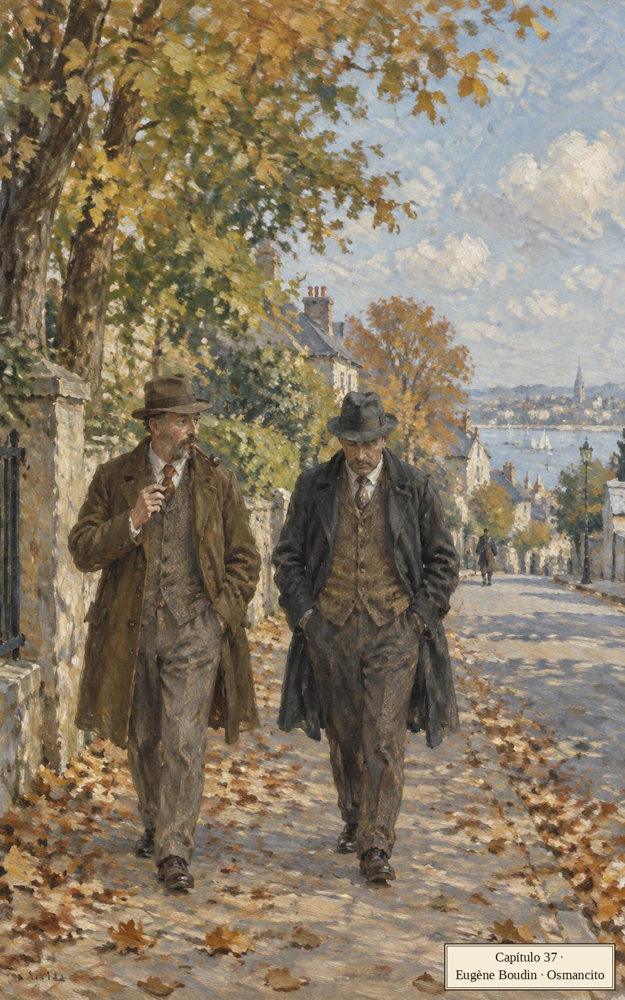](../img/261025_white-noise_el-largo-paseo.jpg)

Jack y Murray inician un largo paseo y Murray fuma pipa. Jack cuenta:

> Me encontré con Murray después de su seminario sobre accidentes de coche y paseamos por los márgenes del campus, junto a los condominios revestidos de tejas de cedro, encajados entre los árboles en su conocida postura defensiva: un conjunto de viviendas que se fundían tan bien con el entorno que los pájaros no dejaban de chocar contra los ventanales.
> [Frase 8134](#original-8134)

> «Estás fumando en pipa», dije.
> [Frase 8135](#original-8135)

> Me pregunté si la habría elegido para que combinara con su barbita de aspecto algo severo.
> [Frase 8143](#original-8143)

Jack habla de su muerte con Murray. Jack cuenta:

> Quería que discutiera conmigo, que elevara mi agonía a un nivel superior, que me hiciera sentir mejor.
> [Frase 8168](#original-8168)

> «¿Crees que es injusto?», dijo.
> [Frase 8169](#original-8169)

> «Mira cómo he vivido.»
> [Frase 8173](#original-8173)

> Caminamos en silencio durante un rato.
> [Frase 8180](#original-8180)

> «¿Crees que tu muerte es prematura?», dijo.
> [Frase 8181](#original-8181)

Murray dice que su muerte le da prestigio. Jack cuenta:

> Cuando se acerque el momento, creo que verás que la gente estará ansiosa por oír lo que tienes que decir.
> [Frase 8207](#original-8207)

> «¿Dices que esta es una oportunidad maravillosa para que yo gane amigos?»
> [Frase 8209](#original-8209)

> «Digo que no puedes fallarles a los vivos hundiéndote en la autocompasión y la desesperación.»
> [Frase 8210](#original-8210)

> Estás ganando prestigio incluso mientras hablamos.
> [Frase 8213](#original-8213)

> Bajamos por el medio de una calle empinada y sinuosa.
> [Frase 8216](#original-8216)

Siguen caminando por la ciudad. Jack cuenta:

> Cruzamos un viejo puente de carretera, cerrado con rejillas, cubierto de objetos tristes y desvaídos.
> [Frase 8253](#original-8253)

> Seguimos un sendero junto a un arroyo y nos acercamos al borde del campo de deportes del instituto.
> [Frase 8254](#original-8254)

Murray habla de creer en algo para escapar de la muerte. Jack cuenta:

> De nuevo pareció encogerse de hombros. «Piensa en la gran poesía, la música, la danza y el ritual que brotan de nuestra aspiración a una vida más allá de la muerte.»
> [Frase 8289](#original-8289)

> Me dio un codazo.
> [Frase 8291](#original-8291)

> Caminamos hacia la zona comercial de la ciudad.
> [Frase 8292](#original-8292)

> No. Te diré lo que es el más allá.
> [Frase 8301](#original-8301)

> «Dijiste antes que la muerte me hacía crecer en carisma.»
> [Frase 8307](#original-8307)

> Estuvimos un rato mirando escaparates y luego entramos en una zapatería.
> [Frase 8315](#original-8315)

> Salimos otra vez al sol, deambulando.
> [Frase 8317](#original-8317)

Murray atribuye a Hitler el miedo de Jack. Jack cuenta:

> «Estás hablando de Hitler, supongo.»
> [Frase 8339](#original-8339)

> «Así que no te estoy señalando a ti.» «La vasta y terrible profundidad.»
> [Frase 8356](#original-8356)

> «Sé exactamente a qué te refieres.»
> [Frase 8363](#original-8363)

> Lo seguí al supermercado.
> [Frase 8373](#original-8373)

> Pasamos bajo una pancarta brillante que anunciaba una rifa para recaudar dinero para una enfermedad incurable.
> [Frase 8375](#original-8375)

En el supermercado hablan de reprimir y de matar. Jack cuenta:

> «¿Crees que soy de algún modo más sano porque no sé reprimir?»
> [Frase 8394](#original-8394)

> Lo miré con atención.
> [Frase 8408](#original-8408)

> «No, no lo haces», dijo.
> [Frase 8411](#original-8411)

> Lo vi sortear con destreza una docena de huevos caídos que soltaban materia amarilla de una caja reventada.
> [Frase 8416](#original-8416)

> Salimos, pasando junto a la tintorería, la peluquería, el óptico.
> [Frase 8437](#original-8437)

> «Hemos hablado de maneras de sortear la muerte», dijo.
> [Frase 8439](#original-8439)

> «Hemos discutido cómo ya has probado dos de esas maneras, cada una anulando a la otra.»
> [Frase 8440](#original-8440)

> Hemos mencionado la tecnología, los accidentes de tren, la creencia en una vida después de la muerte.
> [Frase 8441](#original-8441)

> Cruzamos la calle.
> [Frase 8443](#original-8443)

Murray insiste en la teoría del asesino y del que muere. Jack cuenta:

> «Planear un asesinato, dices.»
> [Frase 8503](#original-8503)

> Lo miré.
> [Frase 8507](#original-8507)

> Nos movimos en un amplio arco de vuelta hacia el campus.
> [Frase 8526](#original-8526)

> Cruzamos el paso elevado del atardecer, deteniéndonos un momento a ver pasar los coches a toda velocidad.
> [Frase 8528](#original-8528)

> «Pensemos en eso.»
> [Frase 8536](#original-8536)

> Examinemos la naturaleza de la bestia, por así decirlo.
> [Frase 8537](#original-8537)

> «Estamos hablando de teoría.»
> [Frase 8541](#original-8541)

> Eso es exactamente de lo que estamos hablando.
> [Frase 8542](#original-8542)

> «Solo queremos saber si está ahí, enterrada en el alma más prudente y discreta.»
> [Frase 8560](#original-8560)

> «Solo quiero oírte decirlo.»
> [Frase 8567](#original-8567)

> «Solo quiero sacar verdades que ya posees, verdades que siempre has conocido en algún nivel básico.»
> [Frase 8569](#original-8569)

> Déjame advertirte, Jack.
> [Frase 8580](#original-8580)

> Pasamos mi calle y subimos la colina hacia el campus.
> [Frase 8582](#original-8582)

> «Sé cómo te sientes.»
> [Frase 8591](#original-8591)

> Caminamos junto al edificio de la administración.
> [Frase 8597](#original-8597)

> «Me sentiría fatal si no te dijera lo que estaba pensando, sobre todo en un momento como este.»
> [Frase 8604](#original-8604)

> «No estés tan seguro», dijo.
> [Frase 8612](#original-8612)

> Nos dimos la mano frente a la biblioteca.
> [Frase 8613](#original-8613)

> Le di las gracias por su honestidad.
> [Frase 8614](#original-8614)

---

### Capítulo 38: La pistola Zumwalt

*Jack, Babette y Winnie Richards, entre el miedo y la noche.*

[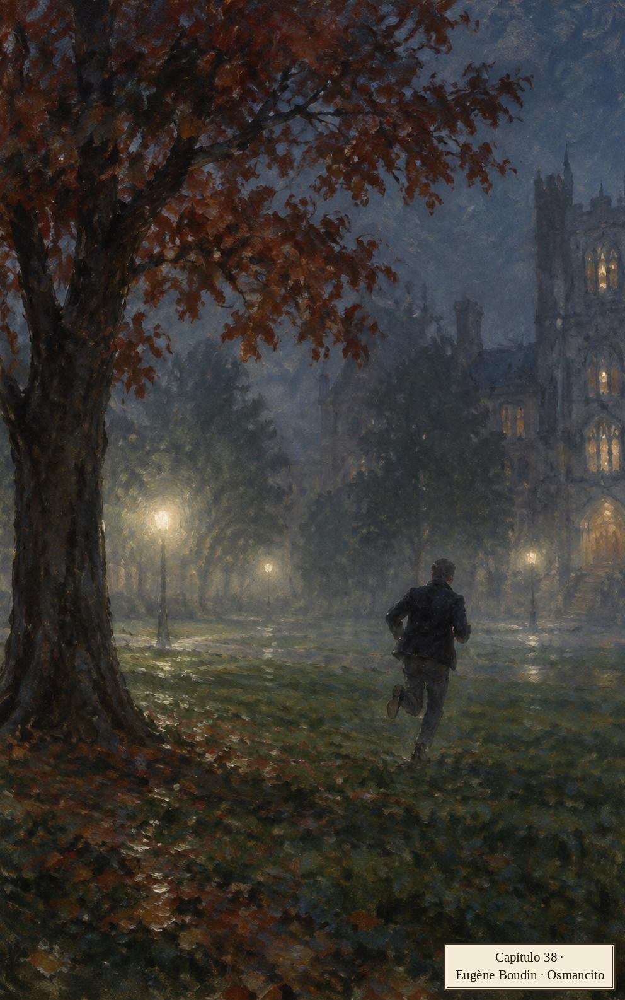](../img/261025_white-noise_la-pistola-zumwalt.jpg)

Jack está en la cama con Babette y habla de reprimir el miedo. Jack cuenta:

> No necesitaba imaginar a su compañera de motel.
> [Frase 8665](#original-8665)

Jack lleva la pistola a la universidad y camina de noche por el campus. Jack cuenta:

> Pasé a preguntar si Orest había entrado ya en la jaula.
> [Frase 8686](#original-8686)

> Al pasar junto a una hilera de árboles, creí notar que alguien se colaba detrás de mí, quizá a treinta yardas.
> [Frase 8725](#original-8725)

> Conté cinco pasos, miré rápido a la izquierda y vi una figura que se movía en paralelo al sendero, entrando y saliendo de la sombra espesa.
> [Frase 8734](#original-8734)

> Cuando volví a mirar, ya no estaba.
> [Frase 8736](#original-8736)

> Eché a correr en zigzag, esperando ser un blanco difícil para alguien que me disparara por la espalda.
> [Frase 8739](#original-8739)

> Extendí el brazo izquierdo, me deslicé alrededor del árbol en un contramovimiento frenético y de cabeza, usando a la vez la mano derecha para sacar la Zumwalt del bolsillo de la chaqueta, de modo que ahora me enfrentaba a la persona de la que huía, protegido por un tronco, con el arma lista.
> [Frase 8746](#original-8746)

> Miré hacia la espesa niebla mientras mi atacante se acercaba con pequeños pasos sordos.
> [Frase 8748](#original-8748)

> «Cuando me di cuenta de que eras tú, me dije que eras justo la persona a la que quería ver.»
> [Frase 8753](#original-8753)

> «¿Te acuerdas de aquella vez que me preguntaste por un grupo de investigación secreto?»
> [Frase 8755](#original-8755)

Winnie Richards le habla de Willie Mink y de Dylar. Jack cuenta:

> «Apuesto a que sé lo primero que hace.»
> [Frase 8774](#original-8774)

Jack vuelve a casa y Babette quiere salir a correr de noche. Jack cuenta:

> Encontré a Babette sentada junto a la cama de Wilder, leyéndole un cuento.
> [Frase 8810](#original-8810)

> Pero me gustaría que no te la pusieras cuando lees cuentos a Wilder o trenzas el pelo de Steffie.
> [Frase 8813](#original-8813)

> «Nadie va a convencerme de que la persona a quien conozco como Babette quiere de verdad subir corriendo las escaleras del estadio a las diez de la noche.»
> [Frase 8833](#original-8833)

> Esperé a que me preguntara qué misteriosa misión haría que yo subiera al coche y condujera por la noche lluviosa, sin hora de regreso.
> [Frase 8852](#original-8852)

> Puedes llevarme, esperarme y traerme de vuelta.
> [Frase 8854](#original-8854)

> «Ponte la máscara de esquí», le dije.
> [Frase 8866](#original-8866)

---

### Capítulo 39: Roadway Motel

*Jack, Willie Mink y las monjas de Germantown.*

[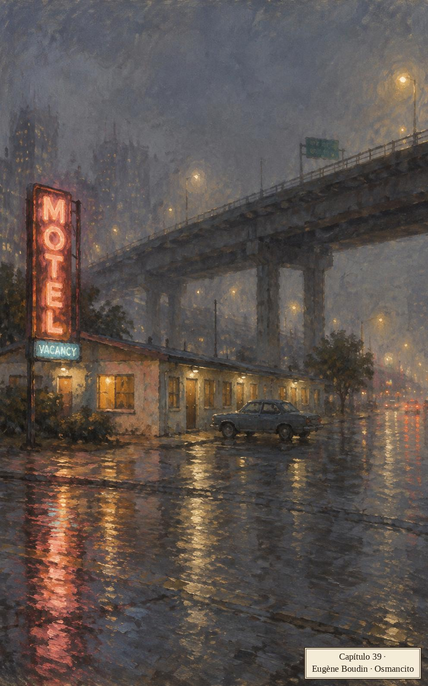](../img/261025_white-noise_roadway-motel.jpg)

Jack llega al motel con un plan en la cabeza. Jack cuenta:

> Pasar varias veces por delante del lugar, aparcar a cierta distancia, volver a pie, localizar al señor Gray bajo su nombre real o un alias, dispararle tres veces en las vísceras para el máximo dolor, limpiar el arma de huellas, poner el arma en la mano estática de la víctima, encontrar un lápiz de cera o un tubo de pintalabios y garabatear una críptica nota de suicidio en el espejo de cuerpo entero, llevarse las tabletas de Dylar de la víctima, volver al coche, ir hacia la entrada de la autopista, tomar rumbo este hacia Blacksmith, salir por la vieja carretera del río, aparcar el coche de Stover en el garaje del viejo Treadwell, cerrar la puerta del garaje, volver a casa caminando bajo la lluvia y la niebla.
> [Frase 8908](#original-8908)

Jack entra en el cuarto de Mink y repasa su plan mientras Mink habla y se traga pastillas. Jack cuenta:

> Entrar sin anunciarse, ganarse su confianza, esperar un momento de descuido, sacar la Zumwalt, dispararle tres veces en las vísceras para la máxima lentitud de agonía, poner el arma en su mano para sugerir el suicidio de un hombre solitario, escribir cosas semicoherentes en el espejo, dejar el coche de Stover en el garaje de Treadwell.
> [Frase 8972](#original-8972)

> «Al entrar aquí, usted acepta cierto comportamiento», dijo Mink.
> [Frase 8973](#original-8973)

> Girar la cabeza para mirar dentro de las habitaciones, ponerlo a gusto, esperar un momento de descuido, volarle las tripas tres veces para la máxima eficacia del dolor, llevarse su Dylar, salir por la carretera del río, cerrar la puerta del garaje, volver a casa caminando bajo la lluvia y la niebla.
> [Frase 9026](#original-9026)

> Vi a Mink tragar más pastillas, lanzándoselas a la cara, chupándolas como caramelos, con los ojos en la pantalla parpadeante.
> [Frase 9056](#original-9056)

> Pensé: Esta es la grisácea figura de mi tormento, el hombre que se llevó a mi esposa.
> [Frase 9072](#original-9072)

> Míralo ahora, brillando en la oscuridad, mostrando una sonrisa senil.
> [Frase 9076](#original-9076)

> «Sexo americano, déjame decirte, así fue como aprendí mi inglés.»
> [Frase 9079](#original-9079)

Jack avanza con su plan y Mink se arrastra hacia el baño. Jack cuenta:

> Mirar de reojo dentro de las habitaciones, entrar sin anunciarse, reducirlo a temblores, dispararle en las tripas tres veces al máximo, salir por la carretera del río, cerrar la puerta del garaje.
> [Frase 9105](#original-9105)

> Pasar varias veces por delante del lugar, acercarse al motel a pie, girar la cabeza para mirar de reojo dentro de las habitaciones, localizar al señor Gray bajo su nombre real, entrar sin anunciarse, ganarse su confianza, avanzar poco a poco, reducirlo a temblores, esperar un momento de descuido, sacar la Zumwalt automática del calibre .25, disparar tres balas en sus vísceras para la máxima lentitud, profundidad e intensidad del dolor, limpiar el arma de huellas, poner el arma en la mano de la víctima para sugerir el suicidio trillado y previsible de un ermitaño de motel, embadurnar las paredes con palabras toscas en la sangre de la propia víctima como prueba de su frenesí final relacionado con un culto, llevarse sus reservas de Dylar, volver al coche, tomar la autopista hacia Blacksmith, dejar el coche de Stover en el garaje de Treadwell, cerrar la puerta del garaje, volver a casa caminando bajo la lluvia y la niebla.
> [Frase 9149](#original-9149)

> Lo seguí al baño, pasando junto al espejo de cuerpo entero donde sin duda había posado con Babette, con su peludo miembro colgando como el de un rumiante.
> [Frase 9156](#original-9156)

> «Me dijo: ¿Alguna vez se ha preguntado por qué, de treinta y dos dientes, estos cuatro causan tantos problemas?»
> [Frase 9177](#original-9177)

Jack dispara a Mink, Mink dispara a Jack y Jack arrastra a Mink hasta la calle. Jack cuenta:

> Me acerqué a la figura sentada, cuidando de no pisar la sangre ni dejar huellas reveladoras.
> [Frase 9201](#original-9201)

> Levantó la mano y apretó el gatillo, disparándome en la muñeca.
> [Frase 9209](#original-9209)

> Pero antes de poder ayudar a Mink, tenía que hacerme yo mismo unas reparaciones básicas.
> [Frase 9228](#original-9228)

> Usando mi buena mano, agarré a Mink por su pie descalzo y lo arrastré por el suelo de baldosas manchado de sangre, con la pistola aún aferrada en su puño.
> [Frase 9232](#original-9232)

> Me sobresaltó la cantidad de sangre que íbamos dejando atrás.
> [Frase 9239](#original-9239)

Jack lleva a Mink a una clínica de monjas alemanas. Jack cuenta:

> Llegamos al coche.
> [Frase 9245](#original-9245)

> Tras unos minutos de esto, sentí que volvía en sí y respiraba con regularidad.
> [Frase 9263](#original-9263)

> Había una rampa para sillas de ruedas, lo que significaba que podía arrastrar a Mink hasta la puerta principal sin golpearle la cabeza contra los escalones de cemento.
> [Frase 9294](#original-9294)

> Lo saqué del coche, agarré su elegante pie y subí por la rampa.
> [Frase 9295](#original-9295)

> «Nos han disparado», dije, levantando la muñeca al aire.
> [Frase 9306](#original-9306)

> Seguimos a la vieja monja hasta la sala de traumatología.
> [Frase 9311](#original-9311)

---

### Capítulo 40: El triciclo y el paso elevado

*Wilder cruza la autopista, el cielo al atardecer y el supermercado reordenado.*

[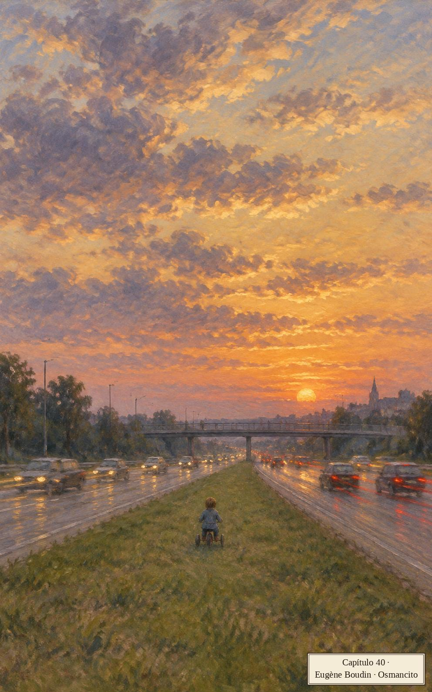](../img/261025_white-noise_triciclo-paso-elevado.jpg)

Jack cuenta lo que vieron dos ancianas desde un porche mientras Wilder cruza la autopista en su triciclo. Jack cuenta:

> Las mujeres solo podían mirar, con la boca vacía, cada una con un brazo en el aire, un ruego para que la escena se invirtiera, para que el niño pedaleara hacia atrás en su juguete desteñido, azul y amarillo, como un personaje de dibujos animados en la tele de la mañana.
> [Frase 9530](#original-9530)

> Tuvo que reducir la velocidad para subir al camellón elevado, encabritándose para que la rueda delantera pasara por encima, extremadamente deliberado en sus movimientos, siguiendo un esquema numerado, y los coches pasaban aullando, con las bocinas sonando tarde, con los ojos de los conductores buscando en el retrovisor.
> [Frase 9540](#original-9540)

Jack cuenta cómo las mujeres ven a Wilder llegar al camellón y le gritan que se quede. Jack cuenta:

> Las mujeres lo vieron recuperar un asiento firme en el sillín.
> [Frase 9542](#original-9542)

> Quédate, gritaron.
> [Frase 9543](#original-9543)

Jack cuenta cómo Wilder cae al arroyo y un automovilista lo rescata. Jack cuenta:

> Y él parecía, sentado en el arroyo, aullando con fuerza, haberlas oído por primera vez, mirando hacia arriba por encima del montículo de tierra y hacia los árboles al otro lado de la autopista.
> [Frase 9563](#original-9563)

> Gritaban y agitaban los brazos, se acercaban a las primeras fases de un terror incontrolable cuando un automovilista, como se llama a esas personas, se detuvo alerta, salió del coche, bajó resbalando por el terraplén y levantó al niño de las turbias aguas poco profundas, sosteniéndolo en alto para que lo vieran las ancianas, que clamaban.
> [Frase 9565](#original-9565)

Jack cuenta sus tardes en el paso elevado con Babette y Wilder. Jack cuenta:

> Babette, Wilder y yo. Llevamos un termo de té helado, aparcamos el coche, miramos cómo se pone el sol.
> [Frase 9567](#original-9567)

---

## Los Originales

Esta sección reúne, en el idioma del libro y por orden de aparición, las frases que arriba van en castellano. El número de cada una lleva de vuelta a su lugar.

### Capítulo 1: Las Camionetas

> [Frase 4](#lugar-4)
> As cars slowed to a crawl and stopped, students sprang out and raced to the rear doors to begin removing the objects inside; the stereo sets, radios, personal computers; small refrigerators and table ranges; the cartons of phonograph records and cassettes; the hairdryers and styling irons; the tennis rackets, soccer balls, hockey and lacrosse sticks, bows and arrows; the controlled substances, the birth control pills and devices; the jurik food still in shopping bags—onion-and-garlic chips, nacho thins, peanut creme patties, Waffelos and Kabooms, fruit chews and toffee popcorn; the Dum-Dum pops, the Mystic mints.

> [Frase 25](#lugar-25)
> When I suggested to the chancellor that we might build a whole department around Hitler's life and work, he was quick to see the possibilities.

---

### Capítulo 2: Babette en la Cocina

> [Frase 55](#lugar-55)
> I watch her all the time doing things in measured sequence, skillfully, with seeming ease, unlike my former wives, who had a tendency to feel estranged from the objective world— a self-absorbed and high-strung bunch, with ties to the intelligence community.

> [Frase 79](#lugar-79)
> Denise and Steffie came downstairs and we talked about the school supplies they would need.

> [Frase 81](#lugar-81)
> We entered a period of chaos and noise.

> [Frase 82](#lugar-82)
> We milled about, bickered a little, dropped utensils.

> [Frase 83](#lugar-83)
> Finally we were all satisfied with what we'd been able to snatch from the cupboards and refrigerator or swipe from each other and we began quietly plastering mustard or mayonnaise on our brightly colored food.

> [Frase 112](#lugar-112)
> The smoke alarm went off in the hallway upstairs, either to 'et us know the battery had just died or because the house was on fire.

> [Frase 113](#lugar-113)
> We finished our lunch in silence.

---

### Capítulo 3: El Granero Fotografiado

> [Frase 131](#lugar-131)
> An exception to some of the above is Murray Jay Siskind, an ex-sportswriter who asked me to have lunch with him in the dining room, where the institutional odor of vaguely defined food aroused in me an obscure and gloomy memory.

> [Frase 172](#lugar-172)
> I had the feeling that since the age of eleven in his crowded plot of concrete he'd associated this sturdy fabric with higher learning in some impossibly distant and tree-shaded place.

> [Frase 205](#lugar-205)
> Several days later Murray asked me about a tourist attraction known as the most photographed barn in America.

> [Frase 206](#lugar-206)
> We drove twenty-two miles into the country around Farmington.

> [Frase 211](#lugar-211)
> We counted five signs before we reached the site.

> [Frase 213](#lugar-213)
> We walked along a cowpath to the slightly elevated spot set aside for viewing and photographing.

> [Frase 216](#lugar-216)
> We stood near a grove of trees and watched the photographers.

> [Frase 238](#lugar-238)
> We listened to the incessant clicking of shutter release buttons, the rustling crank of levers that advanced the film.

---

### Capítulo 4: ¿Quién Morirá Primero?

> [Frase 259](#lugar-259)
> Her face was tilted up, catching the cool air, and she didn't see me.

> [Frase 266](#lugar-266)
> After the last descent I met her at the edge of the playing field and embraced her, putting my hands inside the sweatband of her gray cotton pants.

> [Frase 276](#lugar-276)
> She plans ski trips that we never take, her face bright with excitement.

> [Frase 288](#lugar-288)
> It cures us of our innocence of the future.

> [Frase 290](#lugar-290)
> We watched the girls come round again.

> [Frase 294](#lugar-294)
> We can put her in with Steffie."

> [Frase 308](#lugar-308)
> That night, a Friday, we ordered Chinese food and watched television together, the six of us.

> [Frase 320](#lugar-320)
> On one such night I got into bed next to Babette and told her how the chancellor had advised me, back in 1968, to do something about my name and appearance if I wanted to be taken seriously as a Hitler innovator.

---

### Capítulo 5: Envases Blancos

> [Frase 344](#lugar-344)
> We ran into Murray Jay Siskind at the supermarket.

> [Frase 349](#lugar-349)
> Murray kept nodding to Babette as I introduced them.

> [Frase 389](#lugar-389)
> "I hope you appreciate that woman."

> [Frase 411](#lugar-411)
> The three of us left together, trying to maneuver our shopping carts between the paperback books scattered across the entrance.

> [Frase 412](#lugar-412)
> Murray wheeled one of our carts into the parking lot and then helped us heave and push all our double-bagged merchandise into the back of the station wagon.

> [Frase 418](#lugar-418)
> "I'd ask you to visit my room but it's too small for two people unless they're prepared to be intimate."

> [Frase 427](#lugar-427)
> He thanked us for the lift.

> [Frase 428](#lugar-428)
> We watched him walk toward the lopsided porch, propped with cinder blocks, where a man in a rocker stared into space.

---

### Capítulo 6: ¿Llueve o No?

> [Frase 433](#lugar-433)
> Have I raised him, unwittingly, in the vicinity of a chemical dump site, in the path of air currents that carry industrial wastes capable of producing scalp degeneration, glorious sunsets?

> [Frase 442](#lugar-442)
> I drove him to school on his first day back after a sore throat and fever.

> [Frase 445](#lugar-445)
> "Look at the windshield," I said.

> [Frase 447](#lugar-447)
> "I'm only telling you what they said."

> [Frase 475](#lugar-475)
> Maybe if these people could see us through a telescope we might look like we were two feet two inches tall and it might be raining yesterday instead of today."

> [Frase 495](#lugar-495)
> "If you want to talk about this precise locality while you're in a vehicle that's obviously moving, then I think that's the trouble with this discussion."

> [Frase 496](#lugar-496)
> "Just give me an answer, okay, Heinrich?"

> [Frase 512](#lugar-512)
> How do I know that what you call rain is really rain?

> [Frase 520](#lugar-520)
> "First-rate," I told him.

> [Frase 525](#lugar-525)
> "Go ahead, be sarcastic, I don't care."

> [Frase 530](#lugar-530)
> I watched him walk through the downpour to the school entrance.

> [Frase 532](#lugar-532)
> At such moments I find I love him with an animal desperation, a need to take him under my coat and crush him to my chest, keep him there, protect him.

> [Frase 536](#lugar-536)
> We watch him at his desk, an unpainted table covered with books and magazines.

---

### Capítulo 7: Quién Complace a Quién

> [Frase 594](#lugar-594)
> We believed something lived in the basement.

> [Frase 612](#lugar-612)
> "I thought you liked it too."

> [Frase 617](#lugar-617)
> "If it pleases you, then I like to do it."

> [Frase 620](#lugar-620)
> "It pleases me that you enjoy my reading."

> [Frase 634](#lugar-634)
> We have incubi and succubi.

> [Frase 640](#lugar-640)
> Don't we want a balance, a sort of give-and-take?

> [Frase 646](#lugar-646)
> "But I don't want you to choose anything that has men inside women, quote-quote, or men entering women. 'I entered her.' 'He entered me.' We're not lobbies or elevators. 'I wanted him inside me,' as if he could crawl completely in, sign the register, sleep, eat, so forth.

> [Frase 669](#lugar-669)
> In these night recitations we create a space between things as we felt them at the time and as we speak them now.

> [Frase 672](#lugar-672)
> I put on my bathrobe and went down the hall to Heinrich's room to find a trashy magazine Babette might read from, the type that features letters from readers detailing their sexual experiences.

> [Frase 682](#lugar-682)
> We spent hours going through them, sitting up in bed.

---

### Capítulo 8: Lecciones de Alemán

> [Frase 706](#lugar-706)
> I contacted a man not affiliated with the college, someone Murray Jay Siskind had told me about.

> [Frase 712](#lugar-712)
> He said he was a former chiropractor but didn't offer a reason why he was no longer active and didn't say when he'd learned German, or why, and something in his manner kept me from asking.

> [Frase 731](#lugar-731)
> We stopped on the porch long enough for Murray to tell the landlord, who was sitting there, about a dripping faucet in the second-floor bathroom.

> [Frase 732](#lugar-732)
> The landlord was a large florid man of such robust and bursting health that he seemed to be having a heart attack even as we looked on.

> [Frase 733](#lugar-733)
> "He'll get around to fixing it," Murray said, as we set out on foot in the direction of Elm.

> [Frase 747](#lugar-747)
> He asked me why I'd chosen this year in particular to learn German, after so many years of slipping past the radar.

---

### Capítulo 9: La Invitación de Murray

> [Frase 785](#lugar-785)
> Minutes after we entered, we ran into Murray.

> [Frase 802](#lugar-802)
> We moved into the generic food area and Murray paused with his plastic basket to probe among the white cartons and jars.

> [Frase 841](#lugar-841)
> I heard Babette tell Murray she'd been wearing it fourteen hours a day for three weeks now.

> [Frase 909](#lugar-909)
> The three adults each stood at the head of an aisle and peered into the traffic of carts and gliding bodies.

> [Frase 910](#lugar-910)
> Then we did three more aisles, heads set forward, weaving slightly as we changed our sightlines.

> [Frase 921](#lugar-921)
> Before Murray went to the express line he invited us to dinner, a week from Saturday.

> [Frase 922](#lugar-922)
> "You don't have to let me know till the last minute."

> [Frase 924](#lugar-924)
> "I'm not preparing anything major, so just call beforehand and tell me if something else came up.

> [Frase 926](#lugar-926)
> If you don't show up, I'll know that something came up and you couldn't let me know."

> [Frase 932](#lugar-932)
> I don't want you to feel I'm holding you to something.

> [Frase 935](#lugar-935)
> I have to eat anyway, so there's no major catastrophe if something comes up and you have to cancel.

> [Frase 936](#lugar-936)
> I just want you to know I'll be there if you decide to drop by, with or without kids.

> [Frase 937](#lugar-937)
> We have till next May or June to do this thing so there's no special mystique about a week from Saturday."

---

### Capítulo 10: El Chicle y el Preso

> [Frase 966](#lugar-966)
> They put a warning, which I would have a hard time believing you didn't see."

> [Frase 974](#lugar-974)
> "Don't chew at all," she said.

> [Frase 977](#lugar-977)
> She gave me a look that wondered how the girl could talk on the phone and listen to us at the same time.

> [Frase 978](#lugar-978)
> I wanted to say because she finds us interesting.

> [Frase 979](#lugar-979)
> Babette said to the girls, "Look, either I chew gum or I smoke.

> [Frase 980](#lugar-980)
> If you want me to start smoking again, take away my chewing gum and my Mentho-Lyptus."

> [Frase 981](#lugar-981)
> "Why do you have to do one or the other?" Steffie said.

> [Frase 983](#lugar-983)
> "Why not do both?" Denise said, the face carefully emptying itself of expression.

> [Frase 1004](#lugar-1004)
> "We don't want them," Babette said.

> [Frase 1038](#lugar-1038)
> I think I got him cornered."

> [Frase 1045](#lugar-1045)
> What do you know about him except that he's in jail for life, for murder?

> [Frase 1048](#lugar-1048)
> "We send notes sometimes."

> [Frase 1101](#lugar-1101)
> "All right, he's told you all these things in the letters he sends.

> [Frase 1106](#lugar-1106)
> "You know what your mother would say about this chess by mail relationship."

> [Frase 1111](#lugar-1111)
> "She wants me to go out to the ashram this summer."

---

### Capítulo 11: El Cuarto de Murray

> [Frase 1149](#lugar-1149)
> Babette murmured in her sleep and I moved close, breathing her heat.

> [Frase 1161](#lugar-1161)
> I thought she was still in bed.

> [Frase 1179](#lugar-1179)
> "What exactly does she do?" Babette said.

> [Frase 1187](#lugar-1187)
> "Have I met her?" Babette said.

> [Frase 1217](#lugar-1217)
> That night, in Murray's off-white room, after a spectacular meal of Cornish hen in the shape of a frog, prepared on a two-burner hot plate, we moved from our metal folding chairs to the bunk bed for coffee.

> [Frase 1220](#lugar-1220)
> "You've done wonders," Babette said, her gaze sweeping desperately across the room.

> [Frase 1231](#lugar-1231)
> "I'm sorry you didn't bring the kids.

> [Frase 1241](#lugar-1241)
> Because we were seated on the bed, Murray had to lean well forward, looking past the coffee cup poised in my hand, in order to address Babette.

> [Frase 1262](#lugar-1262)
> A great and humbling experience, let me tell you.

> [Frase 1284](#lugar-1284)
> "How do you know so much?" Babette said.

> [Frase 1288](#lugar-1288)
> "Have you ever been married?" she said.

> [Frase 1292](#lugar-1292)
> Don't think I wouldn't appreciate a dramatic visit between two and three in the morning," he told her, "from an intelligent woman in spike heels and a slit skirt, with high-impact accessories."

> [Frase 1293](#lugar-1293)
> It was drizzling as we walked home, my arm around her waist.

> [Frase 1309](#lugar-1309)
> "I forget that Steffïe doesn't like to be called Stephanie.

> [Frase 1310](#lugar-1310)
> Sometimes I call her Denise.

> [Frase 1325](#lugar-1325)
> "I wanted to ask you before I asked her."

> [Frase 1329](#lugar-1329)
> "We can't rule it out."

---

### Capítulo 12: Dunlop y el Clima

> [Frase 1352](#lugar-1352)
> When it was time for me to repeat the noises I did likewise, if only to please the teacher, twisting my mouth, shutting my eyes completely, conscious of an overarticulation so tortured it must have sounded like a sudden bending of the natural law, a stone or tree struggling to speak.

> [Frase 1376](#lugar-1376)
> "Do you teach anything else?" I said.

> [Frase 1413](#lugar-1413)
> He said he was driving through town on his way to Glassboro to make a presentation and thought he'd take us all to dinner.

> [Frase 1438](#lugar-1438)
> Let's sneak up on some ribs, why don't we?

> [Frase 1472](#lugar-1472)
> I realized Babette was looking at him carefully, trying to grasp the meaning of the four careening years they'd spent as man and wife.

> [Frase 1477](#lugar-1477)
> Now she watched him with a tender sympathy, a reflectiveness that seemed deep and fond and generous enough to contain all the magical coun-terspells to his current run of woe, although I knew, of course, as I went back to my book, that it was only a passing affection, one of those kindnesses no one understands.

---

### Capítulo 13: La Vidente de la Policía

> [Frase 1488](#lugar-1488)
> She said Heinrich had been down at the river, wearing his camouflage cap and carrying an Instamatic, to watch them drag for the bodies, and while he was there word came that the Treadwells had been found alive but shaken in an abandoned cookie shack at the Mid-Village Mall, a vast shopping center out on the interstate.

> [Frase 1496](#lugar-1496)
> Possibly their grandniece had dropped them off in her car and then forgotten to pick them up.

---

### Capítulo 14: El Desvanecimiento Cerebral

> [Frase 1509](#lugar-1509)
> We crowded before the window in Steffie's small room, watching the spectacular sunset.

> [Frase 1517](#lugar-1517)
> "What are we going to do about Baba?" she said.

> [Frase 1539](#lugar-1539)
> Do you want me to double-check the book?"

> [Frase 1541](#lugar-1541)
> I looked" "We could always call her doctor.

> [Frase 1559](#lugar-1559)
> But now she shifted position, used an elbow to prop her upper body and watched me speculatively from the foot of the bed.

> [Frase 1560](#lugar-1560)
> "Can I ask you something?"

> [Frase 1583](#lugar-1583)
> She kept watching me.

> [Frase 1585](#lugar-1585)
> "Do you think I miscalculated?"

> [Frase 1607](#lugar-1607)
> She climbed up on the bed and all three of us went through my German-English dictionary, looking for words that sound about the same in both languages, like orgy and shoe.

> [Frase 1617](#lugar-1617)
> We had two closet doors that opened by themselves.

> [Frase 1618](#lugar-1618)
> That night, a Friday, we gathered in front of the set, as was the custom and the rule, with take-out Chinese.

> [Frase 1620](#lugar-1620)
> We'd never before been so attentive to our duty, our Friday assembly.

> [Frase 1625](#lugar-1625)
> We were otherwise silent, watching houses slide into the ocean, whole villages crackle and ignite in a mass of advancing lava.

> [Frase 1626](#lugar-1626)
> Every disaster made us wish for more, for something bigger, grander, more sweeping.

> [Frase 1641](#lugar-1641)
> He'd once told me that the art of getting ahead in New York was based on learning how to express dissatisfaction in an interesting way.

> [Frase 1650](#lugar-1650)
> I said to him, "Why is it, Alfonse, that decent, well-meaning and responsible people find themselves intrigued by catastrophe when they see it on television?"

> [Frase 1651](#lugar-1651)
> I told him about the recent evening of lava, mud and raging water that the children and I had found so entertaining.

> [Frase 1702](#lugar-1702)
> Grappa said to him, "Did you ever brush your teeth with your finger?"

> [Frase 1781](#lugar-1781)
> I watched Grappa throw a cracker at Murray.

---

### Capítulo 15: La Madre y la Multitud

> [Frase 1800](#lugar-1800)
> "Hitler adored his mother," I said.

> [Frase 1804](#lugar-1804)
> "Elvis and Gladys liked to nuzzle and pet," he said.

> [Frase 1805](#lugar-1805)
> "They slept in the same bed until he began to approach physical maturity.

> [Frase 1806](#lugar-1806)
> They talked baby talk to each other all the time."

> [Frase 1812](#lugar-1812)
> She defended him in little street rumbles, lashed out at any kid who tried to bully him."

> [Frase 1820](#lugar-1820)
> He brought his girlfriends around to meet her."

> [Frase 1831](#lugar-1831)
> "Elvis could hardly bear to let Gladys out of his sight when her condition grew worse.

> [Frase 1837](#lugar-1837)
> He talked baby talk to her until she was in the ground."

> [Frase 1865](#lugar-1865)
> Did he think of the small groups of tourists who visited the little settlement where his mother was born and where he'd spent summers with his cousins, riding in ox carts and making kites?

> [Frase 1872](#lugar-1872)
> Crowds came to his mountain villa, so many people he had to stay indoors.

> [Frase 1874](#lugar-1874)
> Crowds came to hear him speak, crowds erotically charged, the masses he once called his only bride.

---

### Capítulo 16: El Llanto de Wilder

> [Frase 1909](#lugar-1909)
> At six he was still crying, sitting on the kitchen floor and looking through the oven window, and we ate dinner quickly, moving around him or stepping over him to reach the stove and refrigerator.

> [Frase 1918](#lugar-1918)
> "We'll take him to the doctor," I said.

> [Frase 1928](#lugar-1928)
> But once we decided to visit the doctor, we began to hurry, to fret.

> [Frase 1929](#lugar-1929)
> We looked for Wilder's jacket and shoes, tried to remember what he'd eaten in the last twenty-four hours, anticipated questions the doctor would ask and rehearsed our answers carefully.

> [Frase 1933](#lugar-1933)
> I waited in the car while Babette and Wilder went into the medical building at the end of Elm.

> [Frase 1939](#lugar-1939)
> The boy walked next to his mother, holding her hand, still crying, and they seemed a picture of such amateurish sadness and calamity that I nearly started laughing—laughing not at the sadness but at the picture they made of it, at the disparity between their grief and its appearances.

> [Frase 1948](#lugar-1948)
> He said, 'Well, why didn't you do it?'"

> [Frase 1969](#lugar-1969)
> Let's take him to the hospital, to the emergency entrance.

> [Frase 2023](#lugar-2023)
> We were halfway home when the crying stopped.

---

### Capítulo 17: La Cuna de la Desinformación

> [Frase 2044](#lugar-2044)
> All six of us were jammed into the car on our way to the Mid-Village Mall and Denise simply waited for a natural break in the conversation, directing her question toward the back of Babette's head, in a voice drained of inference.

> [Frase 2134](#lugar-2134)
> I found the others and we walked across two parking lots to the main structure in the Mid-Village Mall, a ten-story building arranged around a center court of waterfalls, promenades and gardens.

> [Frase 2135](#lugar-2135)
> Babette and the kids followed me into the elevator, into the shops set along the tiers, through the emporiums and department stores, puzzled but excited by my desire to buy.

> [Frase 2136](#lugar-2136)
> When I could not decide between two shirt" they encouraged me to buy both.

> [Frase 2137](#lugar-2137)
> When I said I was hungry, they fed me pretzels, beer, souvlaki.

> [Frase 2142](#lugar-2142)
> We smelled chocolate, popcorn, cologne; we smelled rugs and furs, hanging salamis and deathly vinyl.

> [Frase 2145](#lugar-2145)
> They gave me advice, badgered clerks on my behalf.

> [Frase 2147](#lugar-2147)
> We moved from store to store, rejecting not only items in certain departments, not only entire departments but whole stores, mammoth corporations that did not strike our fancy for one reason or another.

> [Frase 2171](#lugar-2171)
> We ate another meal.

---

### Capítulo 18: Tweedy y el Aterrizaje Forzoso

> [Frase 2191](#lugar-2191)
> For a moment I thought Bee was dead and Tweedy had come to tell me in person.

> [Frase 2204](#lugar-2204)
> "Do you still love me, Tuck?" she said.

> [Frase 2205](#lugar-2205)
> She called me Tuck, which is what her mother used to call her father.

> [Frase 2222](#lugar-2222)
> Let's get out of here, Tuck, before children come swarming around to beg."

> [Frase 2231](#lugar-2231)
> We got Tweedy's luggage, went out to the car and drove through Iron City, past deserted factories, on mainly deserted avenues, a city of hills, occasional cobbled streets, fine old homes here and there, holiday wreaths in the windows.

> [Frase 2234](#lugar-2234)
> "I thought you'd love me forever, frankly.

> [Frase 2237](#lugar-2237)
> "We get a divorce, you take all my money, you marry a well-to-do, well-connected, welltailored diplomat who secretly runs agents in and out of sensitive and inaccessible areas."

> [Frase 2239](#lugar-2239)
> We were traveling parallel to railroad tracks.

> [Frase 2252](#lugar-2252)
> I've never known you to be bitter, Tuck."

> [Frase 2266](#lugar-2266)
> She wanted to incorporate us.

> [Frase 2275](#lugar-2275)
> "Isn't there somewhere we can get a civilized meal?" Tweedy said.

> [Frase 2280](#lugar-2280)
> We drove through a warehouse district, more deserted streets, a bleakness and anonymity that registered in the mind as a ghostly longing for something that was far beyond retrieval.

> [Frase 2283](#lugar-2283)
> "God, Tuck, we were good together."

> [Frase 2311](#lugar-2311)
> "We may as well go back to the airport."

> [Frase 2319](#lugar-2319)
> We loved each other, didn't we?

> [Frase 2320](#lugar-2320)
> We told each other everything, within the limits of one's preoccupation with breeding and tact.

> [Frase 2324](#lugar-2324)
> She sat with her legs tucked under her, facing me, and flicked ashes into her shoes, which sat on the rubber mat.

> [Frase 2329](#lugar-2329)
> At the airport we waited in a mist of plaster dust, among exposed wires, mounds of rubble.

> [Frase 2409](#lugar-2409)
> We found Tweedy and headed out to the car.

> [Frase 2410](#lugar-2410)
> There was a traffic jam on the outskirts of the city and we had to sit on a road outside an abandoned foundry.

> [Frase 2414](#lugar-2414)
> Now we sat waiting in the dark for a car to get towed or a drawbridge to close.

---

### Capítulo 19: Bee, la Testigo Silenciosa

> [Frase 2435](#lugar-2435)
> Bee made us feel self-conscious at times, a punishment that visitors will unintentionally inflict on their complacent hosts.

> [Frase 2440](#lugar-2440)
> If Denise was a pint-sized commissar, nagging us to higher conscience, then Bee was a silent witness, calling the very meaning of our lives into question.

> [Frase 2445](#lugar-2445)
> She was self-possessed and thoughtful, had brought us hand-carved gifts from the jungles.

> [Frase 2447](#lugar-2447)
> I admired her in a distant and uneasy way, sensing a nameless threat, as if she were not my child at all but the sophisticated and self-reliant friend of one of my children.

> [Frase 2481](#lugar-2481)
> What did it mean, what was she really saying, why did she seem to expect me to respond in kind?

> [Frase 2486](#lugar-2486)
> As the odor of burning toast filled the house, I tried to get her to talk about life in the seventh grade.

> [Frase 2496](#lugar-2496)
> "We're probably having something besides toast," I said.

> [Frase 2498](#lugar-2498)
> She liked me best when I was dry, derisive and cutting, a natural talent she believed I'd forfeited through long association with children.

---

### Capítulo 20: Babette en la Pantalla

> [Frase 2591](#lugar-2591)
> She sincerely wants to precede me.

> [Frase 2592](#lugar-2592)
> She discusses the subject with such argumentative force that it's obvious she thinks we have a choice in the matter.

> [Frase 2595](#lugar-2595)
> We're safe as long as they're around.

> [Frase 2598](#lugar-2598)
> She is afraid I will die unexpectedly, sneakily, slipping away in the night.

> [Frase 2602](#lugar-2602)
> I tell her I want to die first.

> [Frase 2604](#lugar-2604)
> We are two views of the same person.

> [Frase 2610](#lugar-2610)
> We have serious arguments on this level.

> [Frase 2621](#lugar-2621)
> He seemed to think we were a visionary group, open to special forms of consciousness.

> [Frase 2670](#lugar-2670)
> Don't let us die, I want to cry out to that fifth century sky ablaze with mystery and spiral light.

> [Frase 2671](#lugar-2671)
> Let us both live forever, in sickness and health, feebleminded, doddering, toothless, liver-spotted, dim-sighted, hallucinating.

> [Frase 2708](#lugar-2708)
> I'd seen her just an hour ago, eating eggs, but her appearance on the screen made me think of her as some distant figure from the past, some ex-wife and absentee mother, a walker in the mists of the dead.

> [Frase 2709](#lugar-2709)
> If she was not dead, was I?

> [Frase 2712](#lugar-2712)
> It was only as time drew on, normalized itself, returned to us a sense of our surroundings, the room, the house, the reality in which the TV set stood—it was only then that we understood what was going on.

> [Frase 2714](#lugar-2714)
> Either she hadn't known there would be a camera on hand or she preferred not to tell us, out of embarrassment, love, superstition, whatever causes a person to wish to withhold her image from those who know her.

> [Frase 2715](#lugar-2715)
> With the sound down low we couldn't hear what she was saying.

> [Frase 2723](#lugar-2723)
> We were being shot through with Babette.

> [Frase 2725](#lugar-2725)
> Babette of electrons and photons, of whatever forces produced that gray light we took to be her face.

> [Frase 2738](#lugar-2738)
> Back at the cable station, he couldn't raise a buzz and as we watched Babette finish the lesson, we were in a mood of odd misgiving.

---

### Capítulo 21: El Evento Tóxico Aéreo

> [Frase 2793](#lugar-2793)
> "You think if you tell me it worries her, I'll feel guilty and not do it.

> [Frase 2858](#lugar-2858)
> "But will we have to leave our homes?"

> [Frase 2873](#lugar-2873)
> "When do we eat?"

> [Frase 2896](#lugar-2896)
> And since Canada is to the north, if the billowing cloud is blown due south, it will miss us by a comfortable margin."

> [Frase 2897](#lugar-2897)
> "When do we eat?" I said.

> [Frase 2915](#lugar-2915)
> We live in a neat and pleasant town near a college with a quaint name.

> [Frase 2979](#lugar-2979)
> "You want me to say it won't come this way in a million years.

> [Frase 2997](#lugar-2997)
> It's there, we're here."

> [Frase 3008](#lugar-3008)
> We watched Wilder climb backwards down the attic steps, which were higher than the steps elsewhere in the house.

> [Frase 3010](#lugar-3010)
> We paused in odd moments of chewing or salt-sprinkling to hear her retch incompletely.

> [Frase 3017](#lugar-3017)
> "Aren't we eating a little early tonight?" Denise said.

> [Frase 3020](#lugar-3020)
> "Is it because we want to get it out of the way?" she said.

> [Frase 3021](#lugar-3021)
> "Why do we want to get it out of the way?"

> [Frase 3025](#lugar-3025)
> Air-raid sirens sounded again, this time so close to us that we were negatively affected, shaken to the point of avoiding each other's eyes as a way of denying that something unusual was going on.

> [Frase 3032](#lugar-3032)
> We went on eating, quietly and neatly, reducing the size of our bites, asking politely for things to be passed.

> [Frase 3033](#lugar-3033)
> We became meticulous and terse, diminished the scope of our movements, buttered our bread in the manner of technicians restoring a fresco.

> [Frase 3035](#lugar-3035)
> We continued to avoid eye contact, were careful not to clink utensils.

> [Frase 3036](#lugar-3036)
> I believe there passed among us the sheepish hope that only in this way could we avoid being noticed.

> [Frase 3037](#lugar-3037)
> It was as though the sirens heralded the presence of some controlling mechanism—a thing we would do well not to provoke with our contentiousness and spilled food.

> [Frase 3038](#lugar-3038)
> It wasn't until a second noise became audible in the pulse of the powerful sirens that we thought to effect a pause in our little episode of decorous hysteria.

> [Frase 3041](#lugar-3041)
> For the first time in minutes we looked at each other, knowing the new sound was an amplified voice but not sure what it was saying.

> [Frase 3044](#lugar-3044)
> "They want us to evacuate," he said, not meeting our eyes.

> [Frase 3052](#lugar-3052)
> We sat there over sponge cake and canned peaches.

> [Frase 3061](#lugar-3061)
> Twenty minutes later we were in the car.

> [Frase 3064](#lugar-3064)
> We were among the latecomers in the former group and joined the traffic flow into the main route out of town, a sordid gantlet of used cars, fast food, discount drugs and quad cinemas.

> [Frase 3065](#lugar-3065)
> As we waited our turn to edge onto the four-lane road we heard the amplified voice above and behind us calling out to darkened homes in a street of sycamores and tall hedges.

> [Frase 3072](#lugar-3072)
> We made it onto the road as snow began to fall.

> [Frase 3073](#lugar-3073)
> We had little to say to each other, our minds not yet adjusted to the actuality of things, the absurd fact of evacuation.

> [Frase 3074](#lugar-3074)
> Mainly we looked at people in other cars, trying to work out from their faces how frightened we should be.

> [Frase 3075](#lugar-3075)
> Traffic moved at a crawl but we thought the pace would pick up some miles down the road where there is a break in the barrier divide that would enable our westbound flow to utilize all four lanes.

> [Frase 3082](#lugar-3082)
> It made us feel like fools, like tourists doing all the wrong things.

> [Frase 3083](#lugar-3083)
> Why were they content to shop for furniture while we sat panicky in slowpoke traffic in a snowstorm?

> [Frase 3084](#lugar-3084)
> They knew something we didn't.

> [Frase 3090](#lugar-3090)
> On a Glassboro station we learned there was new and important information.

> [Frase 3092](#lugar-3092)
> We were left to guess the meaning of this.

> [Frase 3098](#lugar-3098)
> She immediately began talking to the girls while I turned the volume down to keep them from learning what they might imagine was in store for them.

> [Frase 3100](#lugar-3100)
> We passed a three-story motel.

> [Frase 3102](#lugar-3102)
> We were a parade of fools, open not only to the effects of chemical fallout but to the scornful judgment of other people.

> [Frase 3104](#lugar-3104)
> It seemed imperative that we get to the Boy Scout camp, scramble into the main building, seal the doors, huddle on camp beds with our juice and coffee, wait for the all-clear.

> [Frase 3106](#lugar-3106)
> Situated in what had formerly been the righthand lane, we didn't have any choice but to watch these cars pass us at a slightly higher elevation and with a rakish thrust, deviated from the horizontal.

> [Frase 3107](#lugar-3107)
> Slowly we approached an overpass, seeing people on foot up there.

> [Frase 3122](#lugar-3122)
> We moved slowly beneath the overpass, hearing a flurry of automobile horns and the imploring wail of an ambulance stuck in traffic.

> [Frase 3123](#lugar-3123)
> Fifty yards ahead the traffic narrowed to one lane and we soon saw why.

> [Frase 3133](#lugar-3133)
> We passed silently by, feeling curiously reverent, even uplifted by the sight of the heaped cars and fallen people.

> [Frase 3138](#lugar-3138)
> I thought we'd all occupied the same mental state, subdued, worried, confused.

> [Frase 3143](#lugar-3143)
> He speculated on how far we were from the abandoned camp, what sort of primitive accommodations might be available there.

> [Frase 3146](#lugar-3146)
> He must have known we could all die.

> [Frase 3176](#lugar-3176)
> From the radio we learned that dogs trained to sniff out Nyodene D. were being sent to the area from a chemical detection center in a remote part of New Mexico.

> [Frase 3203](#lugar-3203)
> We reached the point where the concrete barrier gives way to a twenty-yard stretch of landscaped median no higher than a curbstone.

> [Frase 3204](#lugar-3204)
> But instead of a state trooper directing traffic into two extra lanes, we saw a Mylex-suited man waving us away from the opening.

> [Frase 3208](#lugar-3208)
> There was no sign of victims or fresh blood, leading us to believe that some time had passed since the recreational vehicle mounted the plow, probably in a moment when opportunism seemed an easily defensible failing, given the situation.

> [Frase 3217](#lugar-3217)
> We were all here in the car.

> [Frase 3222](#lugar-3222)
> I didn't think Steffie knew what déjà vu meant, but it was possible Babette had told her.

> [Frase 3252](#lugar-3252)
> "We're running out of gas."

> [Frase 3262](#lugar-3262)
> "When you pass a gas station," I told him, and there it was, a deserted and rain-swept plaza with proud pumps standing beneath an array of multicolored banners.

> [Frase 3267](#lugar-3267)
> A few minutes later, back on the road, we saw a remarkable and startling sight.

> [Frase 3268](#lugar-3268)
> It appeared in the sky ahead of us and to the left, prompting us to lower ourselves in our seats, bend our heads for a clearer view, exclaim to each other in half finished phrases.

> [Frase 3273](#lugar-3273)
> We weren't sure how to react.

> [Frase 3278](#lugar-3278)
> This was a death made in the laboratory, defined and measurable, but we thought of it at the time in a simple and primitive way, as some seasonal perversity of the earth like a flood or tornado, something not subject to control.

> [Frase 3283](#lugar-3283)
> But this was not history we were witnessing.

> [Frase 3289](#lugar-3289)
> We recognized the drivers, spotted familiar faces in the windows, people we customarily saw sitting on lawn chairs behind the asylum's sparse hedges or walking in ever narrowing circles, with ever increasing speed, like spinning masses in a gyration device.

> [Frase 3290](#lugar-3290)
> We felt an odd affection for them and a sense of relief that they were being looked after in a diligent and professional manner.

> [Frase 3292](#lugar-3292)
> We passed a sign for the most photographed barn in America.

> [Frase 3294](#lugar-3294)
> Mylex-suited men waved flashlights and set out Day-Glo pylons, directing us toward the parking lot and onto athletic fields and other open areas.

> [Frase 3296](#lugar-3296)
> We bumped along dirt paths, over ruts and mounds.

> [Frase 3297](#lugar-3297)
> Near the main buildings we saw a group of men and women carrying clipboards and walkie-talkies, non-Mylex-suited officials, experts in the new science of evacuation.

> [Frase 3302](#lugar-3302)
> We waited for a sense of satisfaction to reach us, some mood in the air of quiet accomplishment, the well-earned fatigue that promises a still and deep-lying sleep.

> [Frase 3305](#lugar-3305)
> We listened to the sound of his teeth getting stuck in the caramel and glucose mass.

> [Frase 3312](#lugar-3312)
> It was said that we would be allowed to go home first thing in the morning; that the government was engaged in a cover-up; that a helicopter had entered the toxic cloud and never reappeared; that the dogs had arrived from New Mexico, parachuting into a meadow in a daring night drop; that the town of Farmington would be uninhabitable for forty years.

> [Frase 3315](#lugar-3315)
> As people jolted out of reality, we were released from the need to distinguish.

> [Frase 3317](#lugar-3317)
> We were in a large barracks, one of three such buildings at the camp, and with the generator now working we were fairly comfortable.

> [Frase 3321](#lugar-3321)
> The place was crowded, still quite cold, but the sight of nurses and volunteer workers made us feel the children were safe, and the presence of other stranded souls, young women with infants, old and infirm people, gave us a certain staunchness and will, a selfless bent that was pronounced enough to function as a common identity.

> [Frase 3335](#lugar-3335)
> I heard him say, "The stuff they sprayed on the big spill at the train yard was probably soda ash.

> [Frase 3369](#lugar-3369)
> So I slipped away, passing a man who wore snow boots wrapped in plastic, and headed for the far end of the barracks, where we'd, earlier made camp.

> [Frase 3370](#lugar-3370)
> We were next to a black family of Jehovah's Witnesses.

> [Frase 3394](#lugar-3394)
> We're practically at the edge."

> [Frase 3443](#lugar-3443)
> "Why didn't he tell us?" she whispered.

> [Frase 3585](#lugar-3585)
> The thick orange vests did not seem especially out of place even though we were on more or less dry land, well above sea level, many miles from the nearest ominous body of water.

> [Frase 3721](#lugar-3721)
> When I got back to the other end of the barracks, the three younger children were asleep, Heinrich was making notations on a road map and Babette was seated some distance away with Old Man Treadwell and a number of other blind people.

> [Frase 4154](#lugar-4154)
> We took six and went outside.

> [Frase 4161](#lugar-4161)
> From deep in the woods we heard motorcycles revving, voices raising incoherent cries.

> [Frase 4164](#lugar-4164)
> We put on our masks and ran through the downpour to our car.

> [Frase 4175](#lugar-4175)
> We did not seem to be getting closer to the lights.

> [Frase 4176](#lugar-4176)
> Babette turned on the radio and we were told that the Boy Scout camp evacuees were to head for Iron City, where arrangements were being made to provide food and shelter.

> [Frase 4178](#lugar-4178)
> Then we heard the rotors.

> [Frase 4184](#lugar-4184)
> We sat in the car, in the snowy woods, saying nothing.

> [Frase 4199](#lugar-4199)
> Denise said, showing immediate interest, as though we were lazing away a midsummer day on the front porch.

> [Frase 4238](#lugar-4238)
> We passed families on foot, saw a line of paired red lights winding through the dark.

> [Frase 4239](#lugar-4239)
> When we edged out of the woods, people in other cars gave us sleepy looks.

> [Frase 4240](#lugar-4240)
> It took ninety minutes to reach the parkway, another thirty to get to the cloverleaf, where we spun off toward Iron City.

> [Frase 4241](#lugar-4241)
> It was here that we met up with the group from the Kung Fu Palace.

> [Frase 4246](#lugar-4246)
> We reached Iron City at dawn.

> [Frase 4249](#lugar-4249)
> Half an hour later we found ourselves, with forty other families, in an abandoned karate studio on the top floor of a four-story building on the main street.

> [Frase 4252](#lugar-4252)
> By nine a.m. we had a supply of air mattresses, some food and coffee.

> [Frase 4253](#lugar-4253)
> Through the dusty windows we saw a group of turbaned schoolchildren, members of the local Sikh community, standing in the street with a hand-lettered sign: IRON CITY WELCOMES AREA EVACUEES.

> [Frase 4254](#lugar-4254)
> We were not allowed to leave the building.

> [Frase 4294](#lugar-4294)
> I knew we would simply have to wait for her to forget the amplified voice, the sirens, the night ride through the woods.

> [Frase 4349](#lugar-4349)
> It was nine days before they told us we could go back home.

---

### Capítulo 22: El Supermercado y el Atardecer

> [Frase 4385](#lugar-4385)
> I saw Murray in the generic food area, carrying a Teflon skillet.

> [Frase 4455](#lugar-4455)
> "It's strange in a way, isn't it," he said, "that we can picture the dead."

> [Frase 4473](#lugar-4473)
> Early that evening I drove Babette to her class in posture.

> [Frase 4474](#lugar-4474)
> We stopped on the parkway overpass and got out to look at the sunset.

> [Frase 4478](#lugar-4478)
> "What else can we believe?" Babette said.

> [Frase 4479](#lugar-4479)
> "How else can we explain?"

> [Frase 4481](#lugar-4481)
> "We're not at the edge of the ocean or desert.

> [Frase 4482](#lugar-4482)
> We ought to have timid winter sunsets.

> [Frase 4495](#lugar-4495)
> Later I drove back to the Congregational church to pick her up.

> [Frase 4528](#lugar-4528)
> In bed we lay quietly, my head between her breasts, cushioned as if against some remorseless blow.

> [Frase 4529](#lugar-4529)
> I was determined not to tell her about the computer verdict.

> [Frase 4530](#lugar-4530)
> I knew she would be devastated to learn that my death would almost surely precede hers.

> [Frase 4534](#lugar-4534)
> The lighter the touch, the more determined I was to keep her from knowing.

> [Frase 4536](#lugar-4536)
> Once I almost asked her to put on legwarmers before we made love.

> [Frase 4537](#lugar-4537)
> But it seemed a request more deeply rooted in pathos than in aberrant sexuality and I thought it might make her suspect that something was wrong.

---

### Capítulo 23: La Radiación y los Teoremas

> [Frase 4562](#lugar-4562)
> "That's what we're supposed to believe," Heinrich said.

> [Frase 4586](#lugar-4586)
> "I wouldn't say they were nothing," she said cautiously.

> [Frase 4598](#lugar-4598)
> We watched him use his spoon to mold the mashed potatoes on his plate into the shape of a volcanic mountain.

> [Frase 4619](#lugar-4619)
> I wanted to argue with him.

> [Frase 4620](#lugar-4620)
> I wanted to ask him why I should believe these scientific findings but not the results that indicated we were safe from Nyodene contamination.

> [Frase 4622](#lugar-4622)
> I wanted to tell him that statistical evidence of the kind he was quoting from was by nature inconclusive and misleading.

> [Frase 4623](#lugar-4623)
> I wanted to say that he would learn to regard all such catastrophic findings with equanimity as he matured, grew out of his confining literalism, developed a spirit of informed and skeptical inquiry, advanced in wisdom and rounded judgment, got old, declined, died.

> [Frase 4637](#lugar-4637)
> "Was it the Monitor or the Merrimac that got sunk?" I said.

---

### Capítulo 24: El Frasco de Dylar

> [Frase 4667](#lugar-4667)
> It was the following night that I discovered the Dylar.

> [Frase 4670](#lugar-4670)
> I found it when the radiator began knocking and I removed the cover to study the valve in an earnest and methodical way, trying to disguise to myself the helplessness I felt.

> [Frase 4680](#lugar-4680)
> Denise sat on the bed, looking past me, past the TV set, past the posters and souvenirs.

> [Frase 4682](#lugar-4682)
> "We say nothing to Baba."

> [Frase 4688](#lugar-4688)
> A pharmacist can tell us what the stuff is for.

> [Frase 4704](#lugar-4704)
> "We'll have to call her doctor."

> [Frase 4712](#lugar-4712)
> Trick him into telling us what we want to know."

> [Frase 4722](#lugar-4722)
> I told him who I was and said I was concerned about Babette.

> [Frase 4724](#lugar-4724)
> I said I was fairly sure it was the medication he'd prescribed for her that was causing the problem.

> [Frase 4754](#lugar-4754)
> I thanked him, hung up, called my own doctor at home.

> [Frase 4759](#lugar-4759)
> I waited for her to tell me she'd already done that.

> [Frase 4760](#lugar-4760)
> But she just nodded grimly and I headed down the hall, stopping in Heinrich's room to say goodnight.

---

### Capítulo 25: Winnie Richards, la Brillante

> [Frase 4841](#lugar-4841)
> I walked over to a small domed building known as the Observatory and gave the tablet to Winnie Richards, a" young research neurochemist whose work was said to be brilliant.

> [Frase 4844](#lugar-4844)
> I watched her sit at the cluttered desk for two or three minutes, slowly rotating the tablet between her thumb and index finger.

> [Frase 4848](#lugar-4848)
> "There's a dolphin's brain in my in-box but come see me in forty-eight hours."

> [Frase 4855](#lugar-4855)
> In any case I had trouble locating her all the rest of that week.

> [Frase 4902](#lugar-4902)
> That afternoon I saw Winnie Richards slip out a side door of the Observatory and go loping down a small lawn toward the new buildings.

> [Frase 4919](#lugar-4919)
> She gave me water in a paper cup.

> [Frase 4935](#lugar-4935)
> "What can you tell me about it?

> [Frase 4953](#lugar-4953)
> "I'm not an expert in any of this, Jack, but I can tell you it's a wonderful little system."

> [Frase 4966](#lugar-4966)
> We've entered the realm of physics.

> [Frase 4969](#lugar-4969)
> Now tell me what the medication is designed to do?

> [Frase 4996](#lugar-4996)
> "Jack, all I can tell you for certain is that the substance contained in Dylar is some kind of psychopharmaceutical.

> [Frase 5013](#lugar-5013)
> I can tell you one thing.

> [Frase 5016](#lugar-5016)
> "I don't care where you found it.

---

### Capítulo 26: La Confesión de Babette

> [Frase 5042](#lugar-5042)
> You know it, I know it.

> [Frase 5047](#lugar-5047)
> We've backed you against the wall.

> [Frase 5058](#lugar-5058)
> Just tell us the nature of the drag.

> [Frase 5059](#lugar-5059)
> As you well know, I don't have the temperament to hound people.

> [Frase 5062](#lugar-5062)
> If you don't tell me what I want to know, I'll unleash your little girl.

> [Frase 5073](#lugar-5073)
> "Take your time," I said.

> [Frase 5103](#lugar-5103)
> This is how I am able to teach my students how to stand, sit and walk, even though I know you think these subjects are too obvious and nebulous and generalized to be reduced to component parts.

> [Frase 5111](#lugar-5111)
> I went to libraries and bookstores, read magazines and technical journals, watched cable TV, made lists and diagrams, made multicolored charts, made phone calls to technical writers and scientists, talked to a Sikh holy man in Iron City and even studied the occult, hiding the books in the attic so you and Denise wouldn't find them and wonder what was going on."

> [Frase 5137](#lugar-5137)
> Let's call the company Gray Research, although that's not the true name.

> [Frase 5138](#lugar-5138)
> Let's call my contact Mr. Gray.

> [Frase 5168](#lugar-5168)
> If I'm going to tell you the story at all, I have to include this aspect of it, this grubby little corner of the human heart.

> [Frase 5194](#lugar-5194)
> "So we are no longer referring to the Mr. Gray who is a composite."

> [Frase 5223](#lugar-5223)
> You cherish the wife who tells you everything.

> [Frase 5238](#lugar-5238)
> "I can easily get you some."

> [Frase 5315](#lugar-5315)
> "I know you've lost weight.

> [Frase 5322](#lugar-5322)
> I tried to persuade her it was not as serious as she thought.

> [Frase 5355](#lugar-5355)
> That's what I can't forgive you for.

> [Frase 5415](#lugar-5415)
> How can I persuade you that this is a terrible mistake?

> [Frase 5421](#lugar-5421)
> "Is this why I married Babette?

> [Frase 5424](#lugar-5424)
> We held each other tightly for a long time, our bodies clenched in an embrace that included elements of love, grief, tenderness, sex and struggle.

> [Frase 5442](#lugar-5442)
> She curled up immediately for sleep but there were still things I wanted to know, things I had to say.

> [Frase 5462](#lugar-5462)
> Are you telling me that a whole tradition of human failings is now at an end, that cowardice, sadism, molestation are meaningless terms?

> [Frase 5499](#lugar-5499)
> I'm asking how many tablets you've taken."

> [Frase 5505](#lugar-5505)
> "Did you tell me that?"

> [Frase 5521](#lugar-5521)
> Denise and I assumed your forgetfulness was a side effect of whatever drug you were taking."

> [Frase 5549](#lugar-5549)
> 'There's something I promised myself I wouldn't tell you."

> [Frase 5555](#lugar-5555)
> I told her about the computer technician, the way he'd tapped into my history to produce a pessimistic massive tally.

> [Frase 5556](#lugar-5556)
> We are the sum total of our data, I told her, just as we are the sum total of our chemical impulses.

> [Frase 5565](#lugar-5565)
> She beat me on the chest, seized my left hand and bit the flesh between the thumb and index finger.

> [Frase 5567](#lugar-5567)
> She took my head in her hands, gently and yet fiercely, and rocked it to and fro on the pillow, an act I could not connect to anything she'd ever done, anything she seemed to be.

---

### Capítulo 27: El Simulacro

> [Frase 5601](#lugar-5601)
> "It means you're dead," he told me.

> [Frase 5619](#lugar-5619)
> "You're not supposed to be here unless you're a victim," she said.

> [Frase 5620](#lugar-5620)
> "I just want to be sure you're okay."

> [Frase 5621](#lugar-5621)
> "I'll get in trouble if they see you."

> [Frase 5628](#lugar-5628)
> I spoke to her a while longer but she wouldn't answer.

> [Frase 5700](#lugar-5700)
> Can you tell me why?"

> [Frase 5713](#lugar-5713)
> "They will bite you," I went on.

> [Frase 5727](#lugar-5727)
> I found myself saying, "You will, you will.

> [Frase 5732](#lugar-5732)
> I was surprised to see him look at me with a certain interest, a certain grudging respect.

> [Frase 5748](#lugar-5748)
> He said to me, "How many pounds can you bench-press?"

> [Frase 5768](#lugar-5768)
> "I know what you mean.

> [Frase 5778](#lugar-5778)
> "Remind me to ask Murray," I said.

> [Frase 5790](#lugar-5790)
> "Are you telling me they're not behind the radiator cover?"

> [Frase 5797](#lugar-5797)
> "You haven't been pretested," she said.

> [Frase 5809](#lugar-5809)
> Considering what you're after, that promise goes double.

> [Frase 5812](#lugar-5812)
> Let's just resume our lives.

> [Frase 5813](#lugar-5813)
> Let's tell each other we'll do the best we can.

> [Frase 5820](#lugar-5820)
> This was the first time I'd ever picked her up at school and she gave me a wary and hard-eyed look as she passed in front of the car— a look that indicated she was in no mood for news of a separation or divorce.

> [Frase 5829](#lugar-5829)
> "Because you wouldn't come and get me at school just to tell me that.

> [Frase 5838](#lugar-5838)
> "We'd like to know what you did with the bottle.

> [Frase 5840](#lugar-5840)
> "How do you know I took them?"

> [Frase 5841](#lugar-5841)
> 1 know it, you know it.

> [Frase 5842](#lugar-5842)
> "If somebody wants to tell me what Dylar really is, maybe we'll get somewhere."

> [Frase 5850](#lugar-5850)
> I even enlisted Babette, convincing her that the bottle belonged in adult hands.

> [Frase 5853](#lugar-5853)
> She would keep the object hidden until we told her its secret.

---

### Capítulo 28: El Almuerzo de los Neoyorquinos

> [Frase 5876](#lugar-5876)
> "They show up for the real ones," I said.

> [Frase 5888](#lugar-5888)
> "I'll take you to the airport.

> [Frase 5894](#lugar-5894)
> We watched the water boil.

> [Frase 5905](#lugar-5905)
> "I'm sure they won't mind excusing you just this once.

> [Frase 5908](#lugar-5908)
> The first marriage worked well enough to encourage us to try again as soon as it became mutually convenient.

> [Frase 5909](#lugar-5909)
> When we did, after the melancholy epochs of Janet Savory and Tweedy Browner, things proceeded to fall apart.

> [Frase 5912](#lugar-5912)
> She told me very little about her intelligence work.

> [Frase 5913](#lugar-5913)
> I knew she reviewed fiction for the CIA, mainly long serious novels with coded structures.

> [Frase 5931](#lugar-5931)
> "How do you feel?" Asking the question, hearing it asked, made us both feel better.

> [Frase 5934](#lugar-5934)
> In the lunchroom in Centenary Hall, I watched Murray sniff his utensils.

> [Frase 5951](#lugar-5951)
> It got me through some tough emotional periods.

> [Frase 5957](#lugar-5957)
> Helped me become a person."

> [Frase 5972](#lugar-5972)
> "When you bite dead skin off your thumb, do you eat it or spit it out?"

> [Frase 5973](#lugar-5973)
> "Chew it briefly, then propel it swiftly from the end of the tongue."

> [Frase 5984](#lugar-5984)
> I watched him light up a cigarette, shake out the match and toss it into Murray's salad.

> [Frase 5987](#lugar-5987)
> "I still do it all the time.

> [Frase 5999](#lugar-5999)
> It is my way of punishing people for thinking their own lives are more important than mine."

> [Frase 6011](#lugar-6011)
> I took this as a sign that he was wanning up to speak.

> [Frase 6027](#lugar-6027)
> When he emerged I held his arm just-above the elbow and we walked across campus like a pair of European senior citizens, heads bowed in conversation.

> [Frase 6028](#lugar-6028)
> "How do you listen to that?" I said.

> [Frase 6040](#lugar-6040)
> We walked past small mounds of melting snow.

---

### Capítulo 29: Los Pasillos

> [Frase 6087](#lugar-6087)
> Babette and I moved down the wide aisle, each with a gleaming cart.

> [Frase 6088](#lugar-6088)
> We passed a family shopping in sign language.

> [Frase 6090](#lugar-6090)
> "How do you feel?" she said.

> [Frase 6110](#lugar-6110)
> "We need some Class Plus."

> [Frase 6111](#lugar-6111)
> "Don't leave me alone," she said.

> [Frase 6114](#lugar-6114)
> I believe you know that."

> [Frase 6115](#lugar-6115)
> "We're going to come through this thing all right," I said.

> [Frase 6117](#lugar-6117)
> We're determined to be well.

> [Frase 6122](#lugar-6122)
> We stayed together in the aisles and at the checkout.

> [Frase 6124](#lugar-6124)
> We read them together as we waited on line.

> [Frase 6125](#lugar-6125)
> Then we went together to the car, loaded the merchandise, sat very close to each other as I drove home.

---

### Capítulo 30: La Puesta de Sol

> [Frase 6290](#lugar-6290)
> I saw her turn a corner in a controlled skid before she disappeared behind a maintenance building.

> [Frase 6295](#lugar-6295)
> I decided to cut behind the library and pick her up on the long straight approach to the chemistry labs.

> [Frase 6307](#lugar-6307)
> I started running again, knowing she was too far away, would disappear over the crest of the hill, would not resurface for weeks.

> [Frase 6309](#lugar-6309)
> How surprised I was, nearing the top of the hill, to see that she had stopped.

> [Frase 6312](#lugar-6312)
> When I cleared a row of private homes I saw what it was that had made her pause.

> [Frase 6321](#lugar-6321)
> I didn't know you came up here."

> [Frase 6342](#lugar-6342)
> We stood there watching a surge of florid light, like a heart pumping in a documentary on color TV.

> [Frase 6357](#lugar-6357)
> I wonder if you've heard rumors of a group working secretly on fear of death."

> [Frase 6365](#lugar-6365)
> "That's why I've been chasing you.

> [Frase 6366](#lugar-6366)
> I thought you'd know something about them.

> [Frase 6371](#lugar-6371)
> "Isn't there anything you can tell me?"

> [Frase 6372](#lugar-6372)
> Something in my voice made her turn to look at me.

> [Frase 6418](#lugar-6418)
> "I think what you do, Jack, is forget the medicine in that tablet.

> [Frase 6424](#lugar-6424)
> "I'm still sad, Winnie, but you've given my sadness a richness and depth it has never known before."

> [Frase 6426](#lugar-6426)
> I said, "You're more than a fair-weather friend—you're a true enemy."

> [Frase 6429](#lugar-6429)
> I watched her blush.

> [Frase 6431](#lugar-6431)
> We took a last look at the sky and started walking down the hill.

---

### Capítulo 31: Comer en el Auto

> [Frase 6446](#lugar-6446)
> We all got in the car and went out to the commercial strip in the no man's land beyond the town boundary.

> [Frase 6449](#lugar-6449)
> We decided to eat in the car.

> [Frase 6451](#lugar-6451)
> We wanted to eat, not look around at other people.

> [Frase 6452](#lugar-6452)
> We wanted to fill our stomachs and get it over with.

> [Frase 6453](#lugar-6453)
> We didn't need light and space.

> [Frase 6454](#lugar-6454)
> We certainly didn't need to face each other across a table as we ate, building a subtle and complex cross-network of signals and codes.

> [Frase 6455](#lugar-6455)
> We were content to eat facing in the same direction, looking only inches past our hands.

> [Frase 6458](#lugar-6458)
> We settled in to eat.

> [Frase 6459](#lugar-6459)
> We ate fully dressed, in hats and heavy coats, without speaking, ripping into chicken parts with our hands and teeth.

> [Frase 6472](#lugar-6472)
> We sent Denise to get more food, waiting for her in silence.

> [Frase 6473](#lugar-6473)
> Then we started in again, half stunned by the dimensions of our pleasure.

> [Frase 6477](#lugar-6477)
> We all stopped eating.

> [Frase 6493](#lugar-6493)
> We waited to learn if the dialogue was over.

> [Frase 6494](#lugar-6494)
> Then we set to eating again.

> [Frase 6495](#lugar-6495)
> We traded unwanted parts in silence, stuck our hands in cartons of rippled fries.

> [Frase 6499](#lugar-6499)
> We traded parts and gnawed.

> [Frase 6501](#lugar-6501)
> We all waited once more.

> [Frase 6534](#lugar-6534)
> We went back to eating for as long as it took to bite off and chew a single mouthful of food.

> [Frase 6557](#lugar-6557)
> In the fast food parking lot we ate our brownies.

> [Frase 6559](#lugar-6559)
> We inhaled the crumbs, we licked the fingers.

> [Frase 6560](#lugar-6560)
> As we got close to finishing, the physical extent of our awareness began to expand.

> [Frase 6562](#lugar-6562)
> We looked past our hands.

> [Frase 6563](#lugar-6563)
> We looked through the windows, at the cars and lights.

> [Frase 6564](#lugar-6564)
> We looked at the people leaving the restaurant, men, women and children carrying cartons of food, leaning into the wind.

---

### Capítulo 32: El Incendio

> [Frase 6626](#lugar-6626)
> Murray and I walked across campus in our European manner, a serenely reflective pace, heads lowered as we conversed.

> [Frase 6628](#lugar-6628)
> Other times we walked slightly apart, Murray's hands clasped behind his back, Gladney's folded monkishly at the abdomen, a somewhat worried touch.

> [Frase 6637](#lugar-6637)
> Do you see him at all?

> [Frase 6674](#lugar-6674)
> I watched his face as we walked.

> [Frase 6676](#lugar-6676)
> I walked with him step for step, clutching his elbow, watching his face, waiting for him to speak, not interested in the fact that he'd taken me completely out of my way, and he was still nodding as we approached the entrance to Wilmot Grange, a restored nineteenth-century building at the edge of the campus.

> [Frase 6679](#lugar-6679)
> It wasn't until four days later that he called me at home, at one in the morning, to whisper helpfully in my ear, "He looks like a man who finds dead bodies erotic."

> [Frase 6717](#lugar-6717)
> She was white-haired and slight, fringed in burning air, and we could see she was mad, so lost to dreams and furies that the fire around her head seemed almost incidental.

---

### Capítulo 33: La Pistola de Vernon

> [Frase 6805](#lugar-6805)
> I thought one thing, that he'd been I got to my feet and went back to the window.

> [Frase 6820](#lugar-6820)
> Was he as old as I'd first thought—or was the white hair purely emblematic, part of his allegorical force?

> [Frase 6823](#lugar-6823)
> He would be an aphorist of last things, giving me the barest glance—civilized, ironic—as he spoke his deft and stylish line about my journey out.

> [Frase 6824](#lugar-6824)
> I watched for a long time, waiting for him to move a hand.

> [Frase 6849](#lugar-6849)
> If I wanted to keep him out of the house, the thing to do was go outside.

> [Frase 6872](#lugar-6872)
> A second figure began to emerge from the numinous ruins of the first, began to assume effective form, develop in the crisp light as a set of movements, lines and features, a contour, a living person whose distinctive physical traits seemed more and more familiar as I watched them come into existence, a little amazed.

> [Frase 6877](#lugar-6877)
> "Did we know you were coming?"

> [Frase 6920](#lugar-6920)
> "Just so you know where I'm at, Jack, there's a woman that wants to marry my ass.

> [Frase 6964](#lugar-6964)
> She was the picture of gapingness, the bright ideal, no less confused and alarmed than I had been when I saw him sitting in the yard, deathly still.

> [Frase 6966](#lugar-6966)
> "Did we know you were coming?" she said.

> [Frase 6979](#lugar-6979)
> As we fixed and ate breakfast, as the kids came down and warily approached Vernon for kisses and hair-mussings, as the hours passed and Babette became accustomed to the sight of the ambling figure in patched jeans, I began to notice the pleasure she took in hovering nearby, doing little things for him, being there to listen.

> [Frase 6992](#lugar-6992)
> And then he'd turn to her and say, "Jack knows the problem I have with state parks.

> [Frase 6994](#lugar-6994)
> We moved Heinrich down to the sofa and gave Vernon his room.

> [Frase 6995](#lugar-6995)
> It was unnerving to find him in the kitchen at seven in the morning, at six, at whatever grayish hour Babette or I went down to make coffee.

> [Frase 6996](#lugar-6996)
> He gave the impression he was intent on outfoxing us, working on our guilt, showing us that no matter how little sleep we got, he got less.

> [Frase 6997](#lugar-6997)
> "Tell you what, Jack.

> [Frase 7011](#lugar-7011)
> "Your roof gutter's sagging," he told me.

> [Frase 7027](#lugar-7027)
> "Tell you what?"

> [Frase 7031](#lugar-7031)
> One night I heard a voice and thought he was moaning in his sleep.

> [Frase 7140](#lugar-7140)
> "What we have here is a situation we ought to conduct in private.

> [Frase 7146](#lugar-7146)
> We went out the back door to keep from waking Heinrich.

> [Frase 7153](#lugar-7153)
> "I want you to have this, Jack."

> [Frase 7156](#lugar-7156)
> Now I want you to have it.

> [Frase 7161](#lugar-7161)
> You're giving me the car?

> [Frase 7214](#lugar-7214)
> I hate to tell you what mischief it can cause with the placement of a man's features."

> [Frase 7215](#lugar-7215)
> He gave me a canny look.

> [Frase 7244](#lugar-7244)
> We began to see a blank space where Vernon stood.

> [Frase 7245](#lugar-7245)
> He regarded us from a prudent distance, as if we were strangers with secret resentments.

> [Frase 7253](#lugar-7253)
> ''She's a good girl," he told me grimly.

> [Frase 7255](#lugar-7255)
> Then he coughed a while, giving us one more episode of lashing phlegm.

> [Frase 7257](#lugar-7257)
> We leaned toward the window on the passenger's side, watching him hunch around into his driving posture, setting himself casually between the door and the seat, his left arm hanging out the window.

---

### Capítulo 34: Basura y Potasio

> [Frase 7318](#lugar-7318)
> Babette told me.

> [Frase 7319](#lugar-7319)
> Murray and I extended the range of our contemplative walks.

> [Frase 7328](#lugar-7328)
> I told Murray that Albert Speer wanted to build structures that would decay gloriously, impressively, like Roman ruins.

> [Frase 7332](#lugar-7332)
> The ruin is built into the creation, I said, which shows a certain nostalgia behind the power principle, or a tendency to organize the longings of future generations.

> [Frase 7359](#lugar-7359)
> Had we created it?

> [Frase 7386](#lugar-7386)
> When the results were in, I went to see Dr. Chakravarty in his little office in the medical building.

> [Frase 7396](#lugar-7396)
> I am the doctor, you the patient.

> [Frase 7413](#lugar-7413)
> Do you know what this means?" '"No."

> [Frase 7416](#lugar-7416)
> This is all you have to know."

> [Frase 7422](#lugar-7422)
> "Now we are getting into semantics," he said.

> [Frase 7430](#lugar-7430)
> 'Then we agree," I said.

> [Frase 7431](#lugar-7431)
> "Tell me this, Mr. Gladney, in all honesty.

> [Frase 7439](#lugar-7439)
> He seemed to be trying to stare me down.

> [Frase 7442](#lugar-7442)
> I said, "How can we tell whether the elevation is true or false?"

> [Frase 7443](#lugar-7443)
> "I will send you to Glassboro for further tests.

> [Frase 7450](#lugar-7450)
> But is potassium the only thing we have to watch?"

> [Frase 7458](#lugar-7458)
> They have the know-how at Harvest Farms, the most delicate of instruments, I promise you.

> [Frase 7461](#lugar-7461)
> "Together, as doctor and patient, we can do things that neither of us could do separately.

---

### Capítulo 35: La Jaula de Orest

> [Frase 7512](#lugar-7512)
> I need this as badly as you do, if not more."

> [Frase 7539](#lugar-7539)
> Denise spun in my direction, arms flung out, her body beseeching me to set the woman straight.

> [Frase 7546](#lugar-7546)
> I took Heinrich and his snake-handling buddy, Orest Mercator, out to the commercial strip for dinner.

> [Frase 7548](#lugar-7548)
> At his request we went to Vincent's Casa Mario, a blockhouse structure with slit windows that seemed part of some coastal defense system.

> [Frase 7550](#lugar-7550)
> We sat in a blood-red booth.

> [Frase 7557](#lugar-7557)
> "Heinrich told me you sleep sitting up, to prepare for the cage."

> [Frase 7562](#lugar-7562)
> "That's why we came here," Heinrich said.

> [Frase 7565](#lugar-7565)
> We ordered pasta and water.

> [Frase 7566](#lugar-7566)
> 'Tell me, Orest.

> [Frase 7574](#lugar-7574)
> "He likes to be positive," Heinrich said.

> [Frase 7577](#lugar-7577)
> "Tell me this, then.

> [Frase 7585](#lugar-7585)
> I liked to watch Orest eat.

> [Frase 7590](#lugar-7590)
> We talked about it last time.

> [Frase 7596](#lugar-7596)
> Let me put my cards on the table, Orest.

> [Frase 7606](#lugar-7606)
> I said, "Is he trying to tell us there are more people dying in this twentyfour-hour period than in the rest of human history up to now?"

> [Frase 7610](#lugar-7610)
> "He's saying people now dead."

> [Frase 7613](#lugar-7613)
> "He's saying people in graves.

> [Frase 7616](#lugar-7616)
> I was listening intently, trying to grasp what they meant.

> [Frase 7619](#lugar-7619)
> Is he saying there are more dead people in graves than anywhere else?"

> [Frase 7629](#lugar-7629)
> You are setting out to do exactly what people spend their lives trying not to do.

> [Frase 7633](#lugar-7633)
> "He has a trainer now," Heinrich said.

> [Frase 7638](#lugar-7638)
> I said, "Don't you mean the Moonies are mostly Korean?"

> [Frase 7643](#lugar-7643)
> They thought about this.

> [Frase 7644](#lugar-7644)
> I watched Orest eat.

> [Frase 7645](#lugar-7645)
> I watched him pitchfork the spaghetti down his gullet.

> [Frase 7654](#lugar-7654)
> "You will not be able to defend yourself," I said.

> [Frase 7676](#lugar-7676)
> I guess I admired him too.

> [Frase 7688](#lugar-7688)
> Like they believe him now.

---

### Capítulo 36: Cosecha de Otoño

> [Frase 7806](#lugar-7806)
> We haven't talked in ages."

> [Frase 7819](#lugar-7819)
> "Just to greet you, Jack.

> [Frase 7835](#lugar-7835)
> Now tell me what you want."

> [Frase 7839](#lugar-7839)
> I only wish to greet you.

> [Frase 7840](#lugar-7840)
> I greet you, Jack.

> [Frase 7841](#lugar-7841)
> I miss you.

> [Frase 7857](#lugar-7857)
> It was interesting to see how closely they resembled each other despite the wide diversity of national and regional backgrounds.

> [Frase 7860](#lugar-7860)
> I welcomed them in the starkly modern chapel.

> [Frase 7939](#lugar-7939)
> "I thought we were here for a general discussion.

> [Frase 7951](#lugar-7951)
> Believe me, I've seen it happen.

> [Frase 7955](#lugar-7955)
> He was a mild-eyed fellow with a poor complexion and reminded me of the boys at the supermarket who stand at the end of the checkout counter bagging merchandise.

> [Frase 7956](#lugar-7956)
> "Here's how we usually start," he said.

> [Frase 7957](#lugar-7957)
> "I ask questions based on the printout and then you answer to the best of your ability.

> [Frase 7958](#lugar-7958)
> When we're all finished, I give you the printout in a sealed envelope and you take it to your doctor for a paid visit."

> [Frase 7961](#lugar-7961)
> We usually start by asking how do you feel."

> [Frase 7963](#lugar-7963)
> "Just how do you feel," he said in a mild voice.

> [Frase 7965](#lugar-7965)
> "We usually go on to tired.

> [Frase 7974](#lugar-7974)
> "In other words you're saying sometimes I have appetitive reinforcement, sometimes I don't."

> [Frase 7975](#lugar-7975)
> "Are you telling me or asking me?"

> [Frase 7977](#lugar-7977)
> "Then we agree."

> [Frase 8001](#lugar-8001)
> I turned down his offer of tea, which seemed to please him.

> [Frase 8002](#lugar-8002)
> We were moving right along.

> [Frase 8003](#lugar-8003)
> "Here's where we ask about smoking."

> [Frase 8012](#lugar-8012)
> "We're moving right along, aren't we?"

> [Frase 8022](#lugar-8022)
> Give me life.

> [Frase 8035](#lugar-8035)
> I waited for him to tell me I was adding years to my life.

> [Frase 8036](#lugar-8036)
> "Speaking of water," he said, "have you ever been exposed to industrial contaminants?"

> [Frase 8041](#lugar-8041)
> "You mean do I work with a substance like asbestos?

> [Frase 8056](#lugar-8056)
> What had happened to our tacit agreement to advance smartly through the program without time-consuming and controversial delving?

> [Frase 8061](#lugar-8061)
> "You just told me you'd never heard of it.

> [Frase 8063](#lugar-8063)
> He had me there.

> [Frase 8069](#lugar-8069)
> Let's get on to the next topic.

> [Frase 8090](#lugar-8090)
> "Now is where I tell you to pay in the outer office."

> [Frase 8096](#lugar-8096)
> The last thing I'm supposed to tell you is take the envelope to your doctor.

---

### Capítulo 37: El largo paseo

> [Frase 8134](#lugar-8134)
> I met Murray after his car crash seminar and we wandered along the fringes of the campus, past the cedar-shingled condominiums set in the trees in their familiar defensive posture—a cluster of dwellings blending so well with the environment that birds kept flying into the plateglass windows.

> [Frase 8135](#lugar-8135)
> "You're smoking a pipe," I said.

> [Frase 8143](#lugar-8143)
> I wondered if he'd chosen it to match his somewhat severe chin whiskers.

> [Frase 8168](#lugar-8168)
> I vanted him to argue with me, raise my dying to a higher level, make me feel better.

> [Frase 8169](#lugar-8169)
> "Do you think it's unfair?" he said.

> [Frase 8173](#lugar-8173)
> "Look how I've lived.

> [Frase 8180](#lugar-8180)
> We walked in silence for a while.

> [Frase 8181](#lugar-8181)
> "Do you think your death is premature?" he said.

> [Frase 8207](#lugar-8207)
> As the time nears, I think you'll find that people will be eager to hear what you have to say.

> [Frase 8209](#lugar-8209)
> "Are you saying this is a wonderful opportunity for me to win friends?"

> [Frase 8210](#lugar-8210)
> "I'm saying you can't let down the living by slipping into self-pity and despair.

> [Frase 8213](#lugar-8213)
> You're growing in prestige even as we speak.

> [Frase 8216](#lugar-8216)
> We walked down the middle of a steep and winding street.

> [Frase 8253](#lugar-8253)
> We crossed an old highway bridge, screened in, littered with sad and faded objects.

> [Frase 8254](#lugar-8254)
> We followed a footpath along a creek, approached the edge of the high school playing field.

> [Frase 8289](#lugar-8289)
> Again he seemed to shrug. 'Think of the great poetry, the music and dance and ritual that spring forth from our aspiring to a life beyond death.

> [Frase 8291](#lugar-8291)
> He poked me with an elbow.

> [Frase 8292](#lugar-8292)
> We walked toward the commercial part of town.

> [Frase 8301](#lugar-8301)
> No. I'll tell you what the afterlife is.

> [Frase 8307](#lugar-8307)
> "You said earlier that death was making me grow in charisma.

> [Frase 8315](#lugar-8315)
> We window-shopped a while, then went into a shoe store.

> [Frase 8317](#lugar-8317)
> We wandered out into the sun.

> [Frase 8339](#lugar-8339)
> "You're talking about Hitler, I take it."

> [Frase 8356](#lugar-8356)
> So I'm not singling you out." 'The vast and terrible depth."

> [Frase 8363](#lugar-8363)
> "I know exactly what you mean."

> [Frase 8373](#lugar-8373)
> I followed him into the supermarket.

> [Frase 8375](#lugar-8375)
> We walked under a bright banner announcing a raffle to raise money for some incurable disease.

> [Frase 8394](#lugar-8394)
> "Do you think I'm somehow healthier because I don't know how to repress?

> [Frase 8408](#lugar-8408)
> I looked at him carefully.

> [Frase 8411](#lugar-8411)
> "No, you don't," he said.

> [Frase 8416](#lugar-8416)
> I watched him step deftly around a dozen fallen eggs oozing yolky matter from a busted carton.

> [Frase 8437](#lugar-8437)
> We went outside, walking past the dry cleaner, the hairstylist, the optician.

> [Frase 8439](#lugar-8439)
> "We have talked about ways to get around death," he said.

> [Frase 8440](#lugar-8440)
> "We have discussed how you've already tried two such ways, each cancelling the other.

> [Frase 8441](#lugar-8441)
> We have mentioned technology, train wrecks, belief in an afterlife.

> [Frase 8443](#lugar-8443)
> We crossed the street.

> [Frase 8503](#lugar-8503)
> "Plot a murder, you're saying.

> [Frase 8507](#lugar-8507)
> I looked at him.

> [Frase 8526](#lugar-8526)
> We moved in a wide arc back toward campus.

> [Frase 8528](#lugar-8528)
> We crossed the sunset overpass, pausing briefly to watch the cars shoot by.

> [Frase 8536](#lugar-8536)
> "Let's think about that.

> [Frase 8537](#lugar-8537)
> Let's examine the nature of the beast, so to speak.

> [Frase 8541](#lugar-8541)
> "We're talking theory.

> [Frase 8542](#lugar-8542)
> That's exactly what we're talking.

> [Frase 8560](#lugar-8560)
> We only want to know whether it is there, buried in the most prudent and unassuming soul."

> [Frase 8567](#lugar-8567)
> "I only want to hear you say it.

> [Frase 8569](#lugar-8569)
> I only want to elicit truths you already possess, truths you've always known at some basic level."

> [Frase 8580](#lugar-8580)
> Let me warn you, Jack.

> [Frase 8582](#lugar-8582)
> We passed my street and walked up the hill to the campus.

> [Frase 8591](#lugar-8591)
> "I know how you feel.

> [Frase 8597](#lugar-8597)
> We walked past the administration building.

> [Frase 8604](#lugar-8604)
> I'd feel terrible if I didn't tell you what I was thinking, especially at a time like this."

> [Frase 8612](#lugar-8612)
> "Don't be so sure," he said.

> [Frase 8613](#lugar-8613)
> We shook hands in front of the library.

> [Frase 8614](#lugar-8614)
> I thanked him for his honesty.

---

### Capítulo 38: La pistola Zumwalt

> [Frase 8665](#lugar-8665)
> I didn't have to imagine his motel companion.

> [Frase 8686](#lugar-8686)
> I stopped in to ask whether Orest had entered the cage yet.

> [Frase 8725](#lugar-8725)
> Passing a line of trees, I thought I sensed someone edge in behind me, maybe thirty yards away.

> [Frase 8734](#lugar-8734)
> I counted off five paces, looked quickly left, saw a figure moving parallel to the path, in and out of deep shadow.

> [Frase 8736](#lugar-8736)
> When I looked again, he wasn't there.

> [Frase 8739](#lugar-8739)
> I broke into a weaving run, hoping I'd make an elusive target for someone firing at my back.

> [Frase 8746](#lugar-8746)
> I stuck out my left arm, went skidding around the tree in a headlong cranking countermotion, simultaneously using my right hand to pluck the Zumwalt from my jacket pocket, so that I now faced the person I'd been fleeing, protected by a tree trunk, my gun at the ready.

> [Frase 8748](#lugar-8748)
> I looked into the heavy mist as my attacker approached in little thudding footfalls.

> [Frase 8753](#lugar-8753)
> When I realized it was you, I said to myself that's just the person I want to see."

> [Frase 8755](#lugar-8755)
> "Remember that time you asked me about a secret research group?

> [Frase 8774](#lugar-8774)
> "I'll bet I know the first thing he does.

> [Frase 8810](#lugar-8810)
> I found Babette sitting by Wilder's bed, reading him a story.

> [Frase 8813](#lugar-8813)
> But I wish you wouldn't wear it when you read bedtime stories to Wilder or braid Steffie's hair.

> [Frase 8833](#lugar-8833)
> "No one will convince me that the person I know as Babette actually wants to run up the stadium steps at ten o'clock at night."

> [Frase 8852](#lugar-8852)
> I waited for her to ask what mysterious mission would require me to get in the car and drive through the rain-streaked night, time of return unknown.

> [Frase 8854](#lugar-8854)
> You can drive me there, wait for me, drive me back.

> [Frase 8866](#lugar-8866)
> "Wear your ski mask," I told her.

---

### Capítulo 39: Roadway Motel

> [Frase 8908](#lugar-8908)
> Drive past the scene several times, park some distance from the scene, go back on foot, locate Mr. Gray under his real name or an alias, shoot him three times in the viscera for maximum pain, clear the weapon of prints, place the weapon in the victim's staticky hand, find a crayon or lipstick tube and scrawl a cryptic suicide note on the full-length mirror, take the victim's supply of Dylar tablets, slip back to the car, proceed to the expressway entrance, head east toward Blacksmith, get off at the old river road, park Stover's car in Old Man Treadwell's garage, shut the garage door, walk home in the rain and the fog.

> [Frase 8972](#lugar-8972)
> Enter unannounced, gain his confidence, wait for an unguarded moment, take out the Zumwalt, shoot him three times in the viscera for maximum slowness of agony, put the gun in his hand to suggest a lonely man's suicide, write semi-coherent things on the mirror, leave Stover's car in Treadwell's garage.

> [Frase 8973](#lugar-8973)
> "By coming in here, you agree to a certain behavior," Mink said.

> [Frase 9026](#lugar-9026)
> Swivel my head to look into rooms, put him at his ease, wait for an unguarded moment, blast him in the gut three times for maximum efficiency of pain, take his Dylar, get off at the river road, shut the garage door, walk home in the rain and the fog.

> [Frase 9056](#lugar-9056)
> I watched Mink ingest more pills, throwing them at his face, sucking them like sweets, his eyes on the flickering screen.

> [Frase 9072](#lugar-9072)
> I thought, This is the grayish figure of my torment, the man who took my wife.

> [Frase 9076](#lugar-9076)
> Look at him now, glowing in the dark, showing a senile grin.

> [Frase 9079](#lugar-9079)
> American sex, let me tell you, this is how I learned my English."

> [Frase 9105](#lugar-9105)
> Look peripherally into rooms, enter unannounced, reduce him to trembling, gut-shoot him maximally three times, get off at the river road, shut the garage door.

> [Frase 9149](#lugar-9149)
> Drive past the scene several times, approach the motel on foot, swivel my head to look peripherally into rooms, locate Mr. Gray under his real name, enter unannounced, gain his confidence, advance gradually, reduce him to trembling, wait for an unguarded moment, take out the .25-caliber Zumwalt automatic, fire three bullets into his viscera for maximum slowness, depth and intensity of pain, wipe the weapon clear of prints, place the weapon in the victim's hand to suggest the trite and predictable suicide of a motel recluse, smear crude words on the walls in the victim's own blood as evidence of his final cult-related frenzy, take his supply of Dylar, slip back to the car, take the expressway to Blacksmith, leave Stover's car in Treadwell's garage, shut the garage door, walk home in the rain and the fog.

> [Frase 9156](#lugar-9156)
> I followed him into the toilet, passing the full-length mirror where he'd undoubtedly posed with Babette, his shaggy member dangling like a ruminant's.

> [Frase 9177](#lugar-9177)
> He said to me, "Did you ever wonder why, out of thirty-two teeth, these four cause so much trouble?

> [Frase 9201](#lugar-9201)
> I approached the sitting figure, careful not to step in blood, leave revealing prints.

> [Frase 9209](#lugar-9209)
> He raised his hand and pulled the trigger, shooting me in the wrist.

> [Frase 9228](#lugar-9228)
> But before I could help Mink, I had to do some basic repair work on myself.

> [Frase 9232](#lugar-9232)
> Using my good hand, I grabbed Mink by his bare foot and dragged him across the blood-dappled tile, the gun still clutched in his fist.

> [Frase 9239](#lugar-9239)
> I was shocked at the amount of blood we were leaving behind.

> [Frase 9245](#lugar-9245)
> We reached the car.

> [Frase 9263](#lugar-9263)
> After some minutes of this, I felt him come around, take regular breaths.

> [Frase 9294](#lugar-9294)
> There was a wheelchair ramp, which meant I could drag Mink to the front door without banging his head on the concrete steps.

> [Frase 9295](#lugar-9295)
> I got him out of the car, clutched his sleek foot and moved up the ramp.

> [Frase 9306](#lugar-9306)
> "We're shot," I said, lifting my wrist in the air.

> [Frase 9311](#lugar-9311)
> We followed the old nun to the trauma room.

---

### Capítulo 40: El triciclo y el paso elevado

> [Frase 9530](#lugar-9530)
> The women could only look, empty-mouthed, each with an arm in the air, a plea for the scene to reverse, the boy to pedal backwards on his faded blue and yellow toy like a cartoon figure on morning TV.

> [Frase 9540](#lugar-9540)
> He had to slow down to get onto the raised median, rearing up to let the front wheel edge over, extremely deliberate in his movements, following some numbered scheme, and the cars went wailing past, horns blowing belatedly, drivers' eyes searching the rearview mirror.

> [Frase 9542](#lugar-9542)
> The women watched him regain a firm placement on the seat.

> [Frase 9543](#lugar-9543)
> Stay, they called.

> [Frase 9563](#lugar-9563)
> And he seemed, on his seat in the creek, profoundly howling, to have heard them for the first time, looking up over the earthen mound and into the trees across the expressway.

> [Frase 9565](#lugar-9565)
> They called and waved, were approaching the early phases of uncontrollable terror when a passing motorist, as such people are called, alertly pulled over, got out of the car, skidded down the embankment and lifted the boy from the murky shallows, holding him aloft for the clamoring elders to see.

> [Frase 9567](#lugar-9567)
> Babette, Wilder and I. We take a thermos of iced tea, park the car, watch the setting sun.

© 2026 Osmancito

[volver](../destileria.html)
