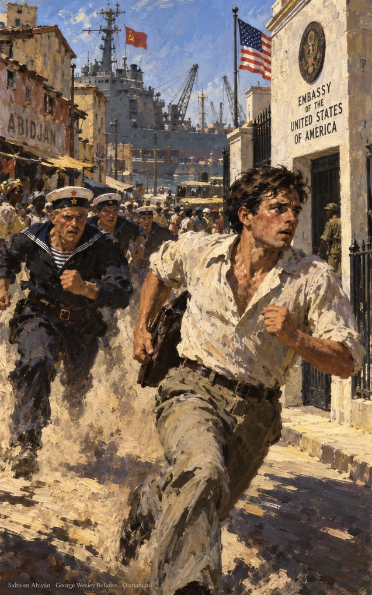

1 de noviembre de 2026

# El nuevo vivir del trading

*El nuevo vivir del trading* (*The New Trading for a Living*) es un libro del psiquiatra y *trader* estadounidense Alexander Elder (un trader es quien compra y vende en los mercados buscando ganancias), publicado en 2014 por la editorial Wiley. Elder nació y se formó como médico en la Unión Soviética, y en 1974 desertó de un barco soviético y pidió asilo en Estados Unidos. El libro actualiza su *Trading for a Living*, de 1993, un éxito de ventas internacional. Hay edición en castellano de Ediciones Obelisco.

El libro enseña a operar en los mercados como un oficio serio: la psicología propia y la de la masa, el análisis de gráficos, los sistemas, el control del riesgo y el registro de cada operación. Se divide en un prólogo, una introducción que reúne los tres primeros capítulos y once partes que suman cincuenta y nueve capítulos en total; cierran una conclusión y las fuentes.

---

## Introducción

### Capítulo 1: El trading, la última frontera

Abre con una promesa: se puede ser libre, vivir y trabajar donde quiera y no responder ante nadie; esa es la vida de un trader exitoso. Muchos aspiran y pocos llegan: el juego es duro y pierden por ignorancia o indisciplina.

> En el verano de 1976 conduje de Nueva York a California. Llevé unos libros de psiquiatría (era residente de primer año de psiquiatría), varias historias, y puse un ejemplar en rústica del *How to Buy Stocks* de Engel en el maletero de mi viejo Dodge. Poco sabía yo que un libro de bolsillo sobado, prestado por un amigo abogado, llegaría a su tiempo a cambiar el rumbo de mi vida. Ese amigo, dicho sea de paso, tenía un perfecto toque de oro al revés: toda inversión que tocaba se iba a pique. Pero esa es otra historia.
> [Párrafo 4](#original-trading-cap1-p4)

Un residente es un médico que se especializa ya trabajando en un hospital; Elder lo era de psiquiatría. El rey Midas de la leyenda convertía en oro cuanto tocaba; el amigo abogado tenía ese toque al revés. El libro del préstamo es *How to Buy Stocks* («Cómo comprar acciones»), la guía de iniciación a la bolsa que el estadounidense Louis Engel publicó por primera vez en 1953.

Devoró el libro: la idea de ganar dinero pensando. Médico de barco soviético, desertó en Abiyán y llegó a Nueva York con veinticinco dólares, sin saber qué era una acción. Ganó con su primera y tardó años en soltar la ilusión de que era fácil; la cuenta quebró repetidamente, hasta que entendió, desde la psiquiatría, que la clave estaba en su cabeza y no en un computador.

Sigue una advertencia: la esposa gorda de un amigo llevaba años a dieta y atracaba su cocina a escondidas; el placer inmediato podía más que la salud.

> *Solo puede tener éxito en el trading si lo toma como una empresa intelectual seria. El trading emocional es letal. Para ayudar a asegurar el éxito, practique una gestión defensiva del dinero. Un buen trader vigila su capital con el mismo cuidado con que un buzo profesional vigila su reserva de aire.*
> [Párrafo 18](#original-trading-cap1-p18)

El capítulo cierra con su condición: el libro da el conocimiento y solo el lector pone la motivación. La gestión defensiva del dinero es el conjunto de reglas que limitan cuánto se arriesga en cada operación; el capítulo la compara con las normas de seguridad que sigue un atleta en los deportes de riesgo. El buzo que vigila su aire no es un miedoso: es el que puede seguir bajo el agua.

---

## Los Originales

Esta sección reúne, en el idioma del libro y por orden de aparición, los párrafos que arriba van en castellano. El número de cada uno lleva de vuelta a su lugar.

### Capítulo 1: El trading, la última frontera

> [Párrafo 4](#lugar-trading-cap1-p4)
> In the summer of 1976, I drove from New York to California. I took along a few books on psychiatry (I was a first-year psychiatric resident), several histories, and put a paperback copy of Engel's *How to Buy Stocks* into the trunk of my old Dodge. Little did I know that a dog-eared paperback, borrowed from a lawyer friend, would in due time change the course of my life. That friend, incidentally, had a perfect reverse golden touch—any investment he touched went under water. But that's another story.

> [Párrafo 18](#lugar-trading-cap1-p18)
> *You can succeed in trading only if you handle it as a serious intellectual pursuit. Emotional trading is lethal. To help ensure success, practice defensive money management. A good trader watches his capital as carefully as a professional scuba diver watches his air supply.*

© 2026 Osmancito

[Volver](../destileria.html)
