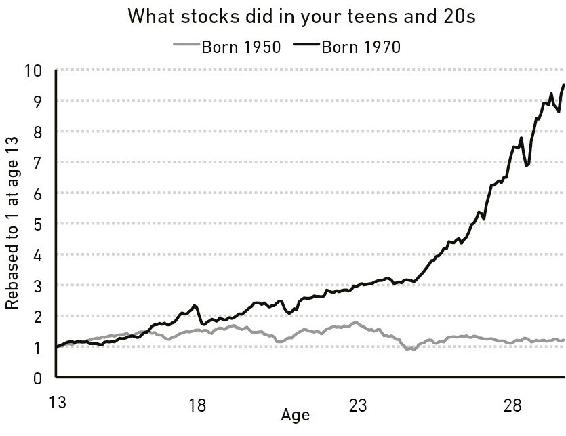
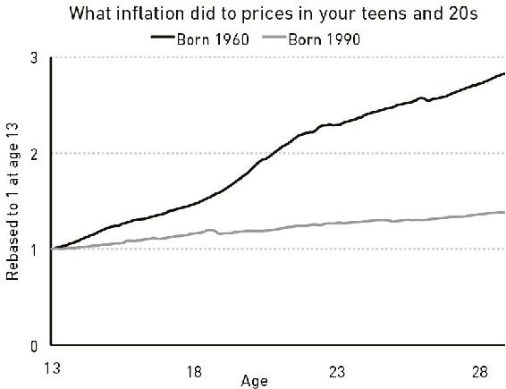
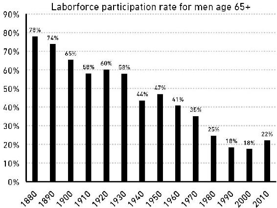

1 de noviembre de 2026

# La psicología del dinero

*La psicología del dinero* (*The Psychology of Money*) es un libro del escritor financiero estadounidense Morgan Housel, publicado por primera vez en 2020 por Harriman House, en Gran Bretaña. Housel escribe sobre finanzas desde 2008 y trabaja en Collaborative Fund, una firma de inversión. Hay edición en castellano de Editorial Planeta.

El libro no es un manual de fórmulas: defiende la idea de que salir bien con el dinero depende poco de la inteligencia y mucho de la conducta. Se divide en una introducción y veinte capítulos breves que giran sobre un mismo tema y pueden leerse por separado, seguidos de una posdata sobre la historia del consumidor estadounidense.

---

## Introducción: El mayor espectáculo del mundo

Abren el libro dos epígrafes, de Napoleón y de Sherlock Holmes, sobre la calma y la observación. Housel estacionaba carros en un hotel de Los Ángeles; un cliente era un genio de la tecnología que presumía borracho de su dinero y un día pidió monedas de oro.

> Una hora después, con las monedas de oro en la mano, el ejecutivo de tecnología y sus amigotes se reunieron junto a un muelle con vista al océano Pacífico. Luego se pusieron a lanzar las monedas al mar, haciéndolas rebotar como piedras, y reían a carcajadas mientras discutían cuál había llegado más lejos. Solo por diversión.
> [Párrafo 10](#original-psicologia-intro-p10)

Hacer cabrillas, rebotar una piedra sobre el agua para ver cuál llega más lejos, es un juego de niños; aquí las piedras son monedas de oro. Para este genio, el dinero es un juguete que se exhibe.

Rompió una lámpara de quinientos dólares y pagó cinco mil; años después se arruinó. La premisa: salir bien con el dinero depende poco de la inteligencia y mucho de la conducta.

> Un genio que pierde el control de sus emociones puede ser un desastre financiero. Lo contrario también es cierto. La gente corriente, sin educación financiera, puede ser rica si tiene un puñado de habilidades de conducta que nada tienen que ver con las medidas formales de la inteligencia.
> [Párrafo 16](#original-psicologia-intro-p16)

Las medidas formales de la inteligencia son los exámenes y los títulos; nada dicen de la calma, la paciencia o la sobriedad. Este párrafo es la tesis del libro en tres frases.

El caso contrario es Ronald Read, conserje y gasolinero de la zona rural de Vermont, el primero de su familia con bachillerato.

> Read arregló carros en una estación de gasolina durante 25 años y barrió pisos en JCPenney durante 17 años. Compró una casa de dos dormitorios por 12.000 dólares a los 38 años y vivió allí el resto de su vida. Envióudó a los 50 y no volvió a casarse. Un amigo recordaba que su principal pasatiempo era cortar leña.
> [Párrafo 20](#original-psicologia-intro-p20)

JCPenney es una cadena estadounidense de grandes almacenes. Treinta y cinco años de trabajos modestos y una casa de 12.000 dólares: hasta aquí, la vida de Read no anuncia ninguna fortuna.

Read murió en 2014: dejaba más de ocho millones de dólares, dos a sus hijastros y más de seis al hospital y la biblioteca locales. Sin lotería ni herencia: ahorró, compró acciones sólidas y esperó décadas.

> Richard Fuscone era todo lo que Ronald Read no era. Ejecutivo de Merrill Lynch formado en Harvard, con una maestría en administración de empresas, Fuscone tuvo una carrera financiera tan exitosa que se retiró en la década de sus cuarenta para dedicarse a la filantropía. David Komansky, ex primer ejecutivo de Merrill, elogió de Fuscone su «instinto para los negocios, dotes de liderazgo, buen juicio e integridad personal». La revista de negocios Crain's lo incluyó una vez en su lista «40 under 40» de empresarios exitosos.
> [Párrafo 28](#original-psicologia-intro-p28)

Merrill Lynch era uno de los bancos de inversión más grandes de Wall Street, y «40 under 40» es la lista anual de la revista Crain's con cuarenta empresarios menores de cuarenta años. Housel empareja a los dos hasta en el nombre: Ronald y Richard.

Todo se vino abajo: endeudado, la crisis de 2008 lo dejó en bancarrota y le remataron las casas. Read fue paciente; Fuscone, codicioso, y eso eclipsó la ventaja educativa: ningún conserje supera a un cirujano de Harvard; en finanzas, sí. El éxito financiero no es ciencia dura sino habilidad blanda: la psicología del dinero.

> La industria de la salud es un triunfo de la ciencia moderna, con una esperanza de vida en aumento en todo el mundo. Los descubrimientos científicos han reemplazado las viejas ideas de los médicos sobre cómo funciona el cuerpo humano, y prácticamente todo el mundo goza de mejor salud gracias a ello.
> [Párrafo 52](#original-psicologia-intro-p52)

La medicina muestra cómo aprende una ciencia: cada descubrimiento corrige una idea vieja y la esperanza de vida sube. La pregunta que deja el libro es si con el dinero pasa lo mismo.

La industria del dinero, en cambio, reclutó dos décadas a las mejores mentes sin hacernos mejores inversionistas.

> Por el ensayo y error colectivo de años aprendimos a ser mejores agricultores, fontaneros más hábiles y químicos más avanzados. ¿Pero nos ha enseñado el ensayo y error a ser mejores con nuestras finanzas personales? ¿Es menos probable que nos enterremos en deudas? ¿Más probable que ahorremos para los días difíciles? ¿Que nos preparemos para la jubilación? ¿Que tengamos ideas realistas sobre lo que el dinero hace, y no hace, por nuestra felicidad?
> [Párrafo 56](#original-psicologia-intro-p56)

El original dice «save for a rainy day», guardar para un día lluvioso: el refrán inglés de ahorrar para los tiempos difíciles. Las preguntas se responden solas: la deuda, el ahorro y la jubilación no mejoran de generación en generación como la cosecha o la fontanería.

Pensamos el dinero como la física y no como la psicología, cree. Es uno de los mayores espectáculos del mundo: está en todas partes y confunde a casi todos. Housel escribe de finanzas desde 2008 y, tras la crisis, vio que nadie lograba explicarla.

> Los ingenieros pueden determinar la causa del derrumbe de un puente porque hay acuerdo en que, si se aplica cierta cantidad de fuerza sobre cierta zona, esa zona cederá. La física no es objeto de controversia: se rige por leyes. Las finanzas son distintas: se rigen por la conducta de las personas. Y mi manera de comportarme puede tener sentido para mí y parecerte una locura a ti.
> [Párrafo 63](#original-psicologia-intro-p63)

Un puente caído tiene una causa que se puede encontrar, porque la física pone a todos de acuerdo. Con el dinero no hay ese acuerdo: la misma decisión es prudente para uno y temeraria para otro, según su historia.

La entendió mejor por la psicología y la historia: para explicar la deuda sirve más la historia de la codicia que las tasas de interés. Su informe de 2018 lo leyó más de un millón de personas; este libro lo profundiza en veinte capítulos. Cierra: «adelante».

---

## Capítulo 1: Nadie está loco

Déjame contarte un problema. Puede que te haga sentir mejor sobre lo que haces con tu dinero, y menos crítico con lo que otros hacen con el suyo.

La gente hace locuras con el dinero. Pero nadie está loco.

La cuestión es esta: personas de distintas generaciones, criadas por padres distintos que ganaban sueldos distintos y tenían valores distintos, en distintas partes del mundo, nacidas en distintas economías, enfrentando mercados de trabajo distintos con incentivos distintos y grados distintos de suerte, aprenden lecciones muy distintas.

Cada uno tiene su propia experiencia, única, de cómo funciona el mundo. Y lo que has vivido convence más que lo que aprendes de segunda mano. Así que todos, tú, yo, todo el mundo, vamos por la vida anclados a un conjunto de ideas sobre cómo funciona el dinero que varía enormemente de una persona a otra. Lo que a ti te parece una locura puede tener sentido para mí.

Quien creció en la pobreza piensa sobre el riesgo y la recompensa de maneras que el hijo de un banquero rico no puede imaginar ni aunque lo intente.

Quien creció con inflación alta vivió algo que quien creció con precios estables nunca tuvo que vivir.

El corredor de bolsa que lo perdió todo durante la Gran Depresión vivió algo que el trabajador de la tecnología bañado en la gloria de finales de los noventa no puede imaginar.

El australiano que no ha visto una recesión en treinta años ha vivido algo que ningún estadounidense ha vivido jamás.

Y así sucesivamente. La lista de experiencias no tiene fin.

Tú sabes cosas sobre el dinero que yo no sé, y viceversa. Vas por la vida con creencias, metas y pronósticos distintos de los míos. No es porque uno de los dos sea más listo que el otro ni tenga mejor información. Es porque hemos tenido vidas distintas, moldeadas por experiencias distintas e igual de persuasivas.

Tus experiencias personales con el dinero suman quizá el 0,00000001 % de lo que ha pasado en el mundo, pero quizá el 80 % de tu idea de cómo funciona el mundo. Por eso personas igual de inteligentes pueden discrepar sobre cómo y por qué ocurren las recesiones, cómo deberías invertir tu dinero, qué deberías priorizar, cuánto riesgo deberías tomar, y demás.

En su libro sobre la América de los años treinta, Frederick Lewis Allen escribió que la Gran Depresión «marcó a millones de estadounidenses, por dentro, para el resto de sus vidas». Pero hubo una gama de experiencias. Veinticinco años después, ya en campaña para la presidencia, un reportero le preguntó a John F. Kennedy qué recordaba de la Depresión. Dijo:

> No tengo conocimiento de primera mano de la Depresión. Mi familia tenía una de las grandes fortunas del mundo y por entonces valía más que nunca. Teníamos casas más grandes, más servidumbre, viajábamos más. Casi lo único que vi directamente fue a mi padre contratar jardineros de más solo para darles un trabajo con el que comer. En realidad no supe de la Depresión hasta que leí sobre ella en Harvard.

Ese fue un tema importante en la elección de 1960. ¿Cómo, pensaba la gente, se podía poner a cargo de la economía a alguien sin entender la mayor historia económica de la última generación? En muchos sentidos, solo quedó zanjado por la experiencia de JFK en la Segunda Guerra Mundial. Esa era la otra experiencia emocional más extendida de la generación anterior, y algo que su rival en las primarias, Hubert Humphrey, no tenía.

El reto para nosotros es que ninguna cantidad de estudio ni de apertura mental puede recrear de verdad el poder del miedo y la incertidumbre.

Puedo leer cómo era perderlo todo durante la Gran Depresión. Pero no tengo las cicatrices emocionales de quienes de verdad lo vivieron. Y quien lo vivió no alcanza a entender por qué alguien como yo puede parecer despreocupado ante cosas como tener acciones. Vemos el mundo con otro lente.

Las hojas de cálculo pueden modelar la frecuencia histórica de las grandes caídas de la bolsa.

Pero no pueden modelar lo que se siente al llegar a casa, mirar a tus hijos y preguntarte si cometiste un error que marcará sus vidas. Estudiar historia te hace sentir que entiendes algo. Pero hasta que no lo has vivido y has sentido sus consecuencias en carne propia, puede que no lo entiendas lo suficiente como para cambiar tu conducta.

Todos creemos saber cómo funciona el mundo. Pero todos hemos vivido apenas una rebanadita de él.

Como dice el inversor Michael Batnick, «algunas lecciones hay que experimentarlas antes de poder entenderlas». Todos somos víctimas, de distintas maneras, de esa verdad.

---

En 2006, los economistas Ulrike Malmendier y Stefan Nagel, de la Oficina Nacional de Investigación Económica, revisaron cincuenta años de la Encuesta de Finanzas del Consumidor: una mirada detallada a lo que hacen los estadounidenses con su dinero.

En teoría, la gente debería tomar sus decisiones de inversión según sus metas y las características de las opciones de inversión disponibles en ese momento.

Pero no es lo que la gente hace.

Los economistas encontraron que las decisiones de inversión de toda una vida están fuertemente ancladas a las experiencias que esos inversores tuvieron en su propia generación, sobre todo a experiencias tempranas de su vida adulta.

Si creciste con inflación alta, invertiste menos de tu dinero en bonos más adelante, en comparación con quienes crecieron con inflación baja. Si te tocó crecer con la bolsa fuerte, invertiste más de tu dinero en acciones más adelante, en comparación con quienes crecieron con la bolsa floja.

Los economistas escribieron: «Nuestros hallazgos sugieren que la disposición de cada inversor a asumir riesgos depende de su historia personal».

No de la inteligencia, ni de la educación, ni de la sofisticación. Solo de la pura suerte de cuándo y dónde naciste.

El Financial Times entrevistó en 2019 a Bill Gross, el célebre gestor de bonos. «Gross admite que probablemente no estaría donde está hoy de haber nacido una década antes o después», decía la pieza. La carrera de Gross coincidió casi a la perfección con un desplome generacional de las tasas de interés que dio viento a favor a los precios de los bonos. Eso no solo afecta las oportunidades con las que te cruzas; afecta lo que piensas de ellas cuando se te presentan. Para Gross, los bonos eran máquinas de generar riqueza. Para la generación de su padre, que creció y aguantó una inflación más alta, podían parecer incineradores de riqueza.

Las diferencias en cómo la gente ha vivido el dinero no son pequeñas, ni siquiera entre quienes podrías creer bastante parecidos.

Mira las acciones. Si naciste en 1970, el S&P 500 se multiplicó casi por diez, ajustado por inflación, durante tu adolescencia y tus veintes. Es un rendimiento asombroso. Si naciste en 1950, el mercado no fue literalmente a ninguna parte en tu adolescencia y tus veintes, ajustado por inflación. Dos grupos de personas, separados por el azar de su año de nacimiento, atraviesan la vida con una visión completamente distinta de cómo funciona la bolsa:

O la inflación. Si naciste en la América de los años sesenta, la inflación de tu adolescencia y tus veintes, tus años jóvenes e impresionables, cuando estás formándote una base de conocimiento sobre cómo funciona la economía, hizo que los precios se triplicaran con creces. Es mucho. Recuerdas las colas para la gasolina y los cheques de pago que rendían visiblemente menos que el anterior. Pero si naciste en 1990, la inflación ha sido tan baja toda tu vida que probablemente jamás se te ha cruzado por la mente.

El desempleo nacional en Estados Unidos en noviembre de 2009 rondaba el 10 %.

Pero la tasa de desempleo de los varones afroamericanos de 16 a 19 años sin diploma de bachillerato era del 49 %. Para las mujeres blancas mayores de 45 años con título universitario, era del 4 %.

Las bolsas de Alemania y Japón quedaron arrasadas durante la Segunda Guerra Mundial. Regiones enteras fueron bombardeadas. Al final de la guerra, las granjas alemanas apenas producían comida suficiente para dar a los ciudadanos del país 1.000 calorías al día. Compara eso con Estados Unidos, donde la bolsa se duplicó con creces entre 1941 y finales de 1945, y la economía era la más fuerte en casi dos décadas.

Nadie debería esperar que los miembros de estos grupos pasen el resto de sus vidas pensando lo mismo sobre la inflación. Ni sobre la bolsa. Ni sobre el desempleo. Ni sobre el dinero en general.

Nadie debería esperar que respondan a la información financiera de la misma manera. Nadie debería suponer que los influyen los mismos incentivos.

Nadie debería esperar que confíen en las mismas fuentes de consejo.

Nadie debería esperar que se pongan de acuerdo sobre qué importa, qué vale la pena, qué es probable que pase después y cuál es el mejor camino a seguir.

Su visión del dinero se formó en mundos distintos. Y cuando es así, una idea sobre el dinero que a un grupo le parece escandalosa puede tener perfecto sentido para otro.

Hace unos años, The New York Times publicó una historia sobre las condiciones laborales en Foxconn, el enorme fabricante taiwanés de electrónica. Las condiciones son a menudo atroces. Los lectores se indignaron con razón. Pero una respuesta fascinante a la historia vino del sobrino de una trabajadora china, que escribió en la sección de comentarios:

> Mi tía trabajó varios años en lo que los estadounidenses llaman "sweat shops". Era trabajo duro. Jornadas largas, salario "pequeño", condiciones "pobres". ¿Saben qué hacía mi tía antes de trabajar en una de esas fábricas? Era prostituta.
>
> La idea de trabajar en una "sweat shop", comparada con ese estilo de vida anterior, es una mejora, en mi opinión. Sé que mi tía preferiría ser "explotada" por un malvado jefe capitalista por un par de dólares a que varios hombres exploten su cuerpo por unos centavos.
>
> Por eso me molesta cómo piensan muchos estadounidenses. No tenemos las mismas oportunidades que Occidente. Nuestra infraestructura gubernamental es distinta.
>
> El país es distinto. Sí, la fábrica es trabajo duro. ¿Podría ser mejor? Sí, pero solo cuando se compara con los trabajos estadounidenses.

No sé qué hacer con esto. Una parte de mí quiere discutir, con furia. Otra parte quiere entender. Pero sobre todo es un ejemplo de cómo experiencias distintas pueden llevar a puntos de vista muy distintos dentro de temas que una parte cree, por intuición, de blanco y negro.

Cada decisión que la gente toma con el dinero se justifica tomando la información que tiene en ese momento y conectándola a su modelo mental único de cómo funciona el mundo.

Esas personas pueden estar mal informadas. Pueden tener información incompleta.

Pueden ser malas para las matemáticas. Puede convencerlas un marketing podrido. Pueden no tener idea de lo que hacen. Pueden calcular mal las consecuencias de sus actos. Y cómo si pueden.

Pero cada decisión financiera que una persona toma tiene sentido para ella en ese momento y cumple los requisitos que necesita cumplir. Se cuentan a sí mismos una historia sobre lo que hacen y por qué lo hacen, y esa historia ha sido moldeada por sus propias experiencias únicas.

Tomemos un ejemplo simple: los boletos de lotería.

Los estadounidenses gastan más en ellos que en cine, videojuegos, música, eventos deportivos y libros juntos.

¿Y quién los compra? Sobre todo, los pobres.

Los hogares de ingresos más bajos de Estados Unidos gastan en promedio 412 dólares al año en boletos de lotería, cuatro veces la cantidad de los hogares de ingresos más altos.

El cuarenta por ciento de los estadounidenses no puede reunir 400 dólares para una emergencia.

Es decir: quienes compran 400 dólares en boletos de lotería son, en general, las mismas personas que dicen no poder reunir 400 dólares para una emergencia.

Están volándose su red de seguridad en algo con una probabilidad entre millones de pegarle al gordo.

A mí me parece una locura. A ti probablemente también. Pero yo no estoy en el grupo de ingresos más bajos. Tú probablemente tampoco. Así que a muchos nos cuesta captar intuitivamente el razonamiento subconsciente de quienes compran lotería con bajos ingresos.

Pero haz un pequeño esfuerzo y puedes imaginar que va más o menos así:

> Vivimos al día y ahorrar parece fuera de nuestro alcance. Tener un salario mucho más alto parece fuera de nuestro alcance. No podemos pagar vacaciones bonitas, carros nuevos, seguro médico ni casas en vecindarios seguros. No podemos pagar la universidad de nuestros hijos sin una deuda aplastante. Muchas de las cosas que ustedes, los que leen libros de finanzas, ya tienen o tienen buena chance de conseguir, nosotros no las tenemos. Comprar un boleto de lotería es la única vez en la vida en que podemos sostener en la mano un sueño tangible de tener lo bueno que ustedes ya tienen y dan por sentado. Estamos pagando por un sueño, y quizá no lo entiendan porque ya están viviendo un sueño. Por eso compramos más boletos que ustedes.

No tienes que estar de acuerdo con este razonamiento. Comprar boletos de lotería estando quebrado sigue siendo una mala idea. Pero casi que alcanzo a entender por qué persisten las ventas de lotería.

Y esa idea, «lo que haces parece una locura, pero casi que entiendo por qué lo haces», descubre la raíz de muchas de nuestras decisiones financieras.

Poca gente toma decisiones financieras puramente con una hoja de cálculo. Las toman en la mesa del comedor o en una reunión de empresa. Lugares donde la historia personal, la visión única que uno tiene del mundo, el ego, el orgullo, el marketing y los incentivos extraños se revuelven en una narrativa que funciona para ti.

---

Otro punto importante que ayuda a explicar por qué las decisiones de dinero son tan difíciles, y por qué hay tanto mal comportamiento, es reconocer lo nuevo que es este tema.

El dinero existe desde hace mucho. Se cree que el rey Aliates de Lidia, hoy parte de Turquía, creó la primera moneda oficial en el 600 a. C. Pero la base moderna de las decisiones de dinero, ahorrar e invertir, se apoya en conceptos que son prácticamente unos bebés.

Mira el retiro. A finales de 2018 había 27 billones de dólares en las cuentas de retiro de Estados Unidos, el motor principal de las decisiones de ahorro e inversión del inversor común.

Pero el concepto entero de tener derecho al retiro tiene, a lo sumo, dos generaciones.

Antes de la Segunda Guerra Mundial, la mayoría de los estadounidenses trabajaba hasta morir. Esa era la expectativa y la realidad. La tasa de participación laboral de los hombres de 65 años o más superaba el 50 % hasta la década de 1940:

El Seguro Social buscaba cambiar esto. Pero sus beneficios iniciales no se parecían en nada a una pensión digna. Cuando Ida May Fuller cobró el primer cheque del Seguro Social en 1940, fue por 22,54 dólares, unos 416 dólares ajustados por inflación. No fue sino hasta los años ochenta que el cheque promedio del Seguro Social para los jubilados superó los 1.000 dólares al mes, ajustado por inflación. Más de una cuarta parte de los estadounidenses mayores de 65 años fueron clasificados por la Oficina del Censo como habitantes en pobreza hasta finales de los sesenta.

Hay una creencia extendida del estilo de «antes todos tenían una pensión privada». Pero está tremendamente exagerada. El Employee Benefit Research Institute explica: «Solo una cuarta parte de los mayores de 65 años tenía ingresos por pensión en 1975». Entre esa minoría afortunada, solo el 15 % del ingreso del hogar venía de una pensión.

The New York Times escribió en 1955 sobre el deseo creciente, pero la persistente imposibilidad, de retirarse: «Para reformular un viejo dicho: todo el mundo habla del retiro, pero al parecer muy pocos hacen algo al respecto».

No fue sino hasta los años ochenta que prendió la idea de que todo el mundo merece, y debería tener, un retiro digno. Y desde entonces, el camino hacia ese retiro digno ha sido la expectativa de que cada quien ahorrará e invertirá su propio dinero.

Déjame reiterar lo nueva que es esta idea: el 401(k), el vehículo de ahorro que es la espina dorsal del retiro estadounidense, no existía hasta 1978. El Roth IRA no nació sino hasta 1998. Si fuera una persona, apenas tendría edad para beber.

No debería sorprender a nadie que muchos seamos malos ahorrando e invirtiendo para el retiro. No estamos locos. Solo somos novatos.

Lo mismo con la universidad. La proporción de estadounidenses mayores de 25 años con licenciatura pasó de menos de 1 de cada 20 en 1940 a 1 de cada 4 en 2015.

La matrícula universitaria promedio se multiplicó por más de cuatro en ese tiempo, ajustada por inflación. Que algo tan grande y tan importante golpee a la sociedad tan rápido explica por qué, por ejemplo, tanta gente ha tomado malas decisiones con los préstamos estudiantiles en los últimos veinte años. No hay décadas de experiencia acumulada de las que siquiera intentar aprender. Estamos improvisando.

Lo mismo con los fondos indexados, que tienen menos de cincuenta años. Y los fondos de cobertura, que no despegaron hasta los últimos veinticinco. Incluso el uso extendido de la deuda de consumo, hipotecas, tarjetas de crédito y préstamos para carros, no despegó hasta después de la Segunda Guerra Mundial, cuando el GI Bill facilitó que millones de estadounidenses pidieran prestado.

Los perros fueron domesticados hace 10.000 años y aún conservan algunas conductas de sus ancestros salvajes. Y sin embargo aquí estamos, con entre veinte y cincuenta años de experiencia en el sistema financiero moderno, esperando estar perfectamente aclimatados.

Para un tema tan influido por la emoción frente al dato, esto es un problema.

Y ayuda a explicar por qué no siempre hacemos con el dinero lo que se supone que debemos hacer.

Todos hacemos locuras con el dinero, porque todos somos relativamente nuevos en este juego, y lo que a ti te parece una locura puede tener sentido para mí. Pero nadie está loco: todos tomamos decisiones a partir de nuestras propias experiencias únicas, que parecen tener sentido para nosotros en un momento dado.

Ahora déjame contarte una historia sobre cómo se hizo rico Bill Gates.

---

## Los Originales

Esta sección reúne, en el idioma del libro y por orden de aparición, los párrafos que arriba van en castellano. El número de cada uno lleva de vuelta a su lugar. El capítulo 1 va íntegro, sin números.

### Introducción: El mayor espectáculo del mundo

> [Párrafo 10](#lugar-psicologia-intro-p10)
> An hour later, gold coins in hand, the tech executive and his buddies gathered around by a dock overlooking the Pacific Ocean. They then proceeded to throw the coins into the sea, skipping them like rocks, cackling as they argued whose went furthest. Just for fun.

> [Párrafo 16](#lugar-psicologia-intro-p16)
> A genius who loses control of their emotions can be a financial disaster. The opposite is also true. Ordinary folks with no financial education can be wealthy if they have a handful of behavioral skills that have nothing to do with formal measures of intelligence.

> [Párrafo 20](#lugar-psicologia-intro-p20)
> Read fixed cars at a gas station for 25 years and swept floors at JCPenney for 17 years. He bought a two-bedroom house for $12,000 at age 38 and lived there for the rest of his life. He was widowed at age 50 and never remarried. A friend recalled that his main hobby was chopping firewood.

> [Párrafo 28](#lugar-psicologia-intro-p28)
> Richard Fuscone was everything Ronald Read was not. A Harvard-educated Merrill Lynch executive with an MBA, Fuscone had such a successful career in finance that he retired in his 40s to become a philanthropist. Former Merrill CEO David Komansky praised Fuscone’s “business savvy, leadership skills, sound judgment and personal integrity.”¹ Crain’s business magazine once included him in a “40 under 40” list of successful businesspeople.²

> [Párrafo 52](#lugar-psicologia-intro-p52)
> The health care industry is a triumph of modern science, with rising life expectancy across the world. Scientific discoveries have replaced doctors’ old ideas about how the human body works, and virtually everyone is healthier because of it.

> [Párrafo 56](#lugar-psicologia-intro-p56)
> Through collective trial and error over the years we learned how to become better farmers, skilled plumbers, and advanced chemists. But has trial and error taught us to become better with our personal finances? Are we less likely to bury ourselves in debt? More likely to save for a rainy day? Prepare for retirement? Have realistic views about what money does, and doesn’t do, to our happiness?

> [Párrafo 63](#lugar-psicologia-intro-p63)
> Engineers can determine the cause of a bridge collapse because there’s agreement that if a certain amount of force is applied to a certain area, that area will break. Physics isn’t controversial. It’s guided by laws. Finance is different. It’s guided by people’s behaviors. And how I behave might make sense to me but look crazy to you.

### Capítulo 1: Nadie está loco

Let me tell you about a problem. It might make you feel better about what you do with your money, and less judgmental about what other people do with theirs.

People do some crazy things with money. But no one is crazy.

Here’s the thing: People from different generations, raised by different parents who earned different incomes and held different values, in different parts of the world, born into different economies, experiencing different job markets with different incentives and different degrees of luck, learn very different lessons.

Everyone has their own unique experience with how the world works. And what you’ve experienced is more compelling than what you learn second-hand. So all of us—you, me, everyone—go through life anchored to a set of views about how money works that vary wildly from person to person. What seems crazy to you might make sense to me.

The person who grew up in poverty thinks about risk and reward in ways the child of a wealthy banker cannot fathom if he tried.

The person who grew up when inflation was high experienced something the person who grew up with stable prices never had to.

The stock broker who lost everything during the Great Depression experienced something the tech worker basking in the glory of the late 1990s can’t imagine.

The Australian who hasn’t seen a recession in 30 years has experienced something no American ever has.

On and on. The list of experiences is endless.

You know stuff about money that I don’t, and vice versa. You go through life with different beliefs, goals, and forecasts, than I do. That’s not because one of us is smarter than the other, or has better information. It’s because we’ve had different lives shaped by different and equally persuasive experiences.

Your personal experiences with money make up maybe 0.00000001% of what’s happened in the world, but maybe 80% of how you think the world works. So equally smart people can disagree about how and why recessions happen, how you should invest your money, what you should prioritize, how much risk you should take, and so on.

In his book on 1930s America, Frederick Lewis Allen wrote that the Great Depression “marked millions of Americans—inwardly—for the rest of their lives.” But there was a range of experiences. Twenty-five years later, as he was running for president, John F. Kennedy was asked by a reporter what he remembered from the Depression. He remarked:

I have no first-hand knowledge of the Depression. My family had one of the great fortunes of the world and it was worth more than ever then. We had bigger houses, more servants, we traveled more. About the only thing that I saw directly was when my father hired some extra gardeners just to give them a job so they could eat. I really did not learn about the Depression until I read about it at Harvard.

This was a major point in the 1960 election. How, people thought, could someone with no understanding of the biggest economic story of the last generation be put in charge of the economy? It was, in many ways, overcome only by JFK’s experience in World War II. That was the other most widespread emotional experience of the previous generation, and something his primary opponent, Hubert Humphrey, didn’t have.

The challenge for us is that no amount of studying or open-mindedness can genuinely recreate the power of fear and uncertainty.

I can read about what it was like to lose everything during the Great Depression. But I don’t have the emotional scars of those who actually experienced it. And the person who lived through it can’t fathom why someone like me could come across as complacent about things like owning stocks. We see the world through a different lens.

Spreadsheets can model the historic frequency of big stock market declines.

But they can’t model the feeling of coming home, looking at your kids, and wondering if you’ve made a mistake that will impact their lives. Studying history makes you feel like you understand something. But until you’ve lived through it and personally felt its consequences, you may not understand it enough to change your behavior.

We all think we know how the world works. But we’ve all only experienced a tiny sliver of it.

As investor Michael Batnick says, “some lessons have to be experienced before they can be understood.” We are all victims, in different ways, to that truth.

In 2006 economists Ulrike Malmendier and Stefan Nagel from the National Bureau of Economic Research dug through 50 years of the Survey of Consumer Finances—a detailed look at what Americans do with their money.⁴

In theory people should make investment decisions based on their goals and the characteristics of the investment options available to them at the time.

But that’s not what people do.

The economists found that people’s lifetime investment decisions are heavily anchored to the experiences those investors had in their own generation—especially experiences early in their adult life.

If you grew up when inflation was high, you invested less of your money in bonds later in life compared to those who grew up when inflation was low. If you happened to grow up when the stock market was strong, you invested more of your money in stocks later in life compared to those who grew up when stocks were weak.

The economists wrote: “Our findings suggest that individual investors’ willingness to bear risk depends on personal history.”

Not intelligence, or education, or sophistication. Just the dumb luck of when and where you were born.

The Financial Times interviewed Bill Gross, the famed bond manager, in 2019. “Gross admits that he would probably not be where he is today if he had been born a decade earlier or later,” the piece said. Gross’s career coincided almost perfectly with a generational collapse in interest rates that gave bond prices a tailwind. That kind of thing doesn’t just affect the opportunities you come across; it affects what you think about those opportunities when they’re presented to you. To Gross, bonds were wealth-generating machines. To his father’s generation, who grew up with and endured higher inflation, they might be seen as wealth incinerators.

The differences in how people have experienced money are not small, even among those you might think are pretty similar.

Take stocks. If you were born in 1970, the S&P 500 increased almost 10-fold, adjusted for inflation, during your teens and 20s. That’s an amazing return. If you were born in 1950, the market went literally nowhere in your teens and 20s adjusted for inflation. Two groups of people, separated by chance of their birth year, go through life with a completely different view on how the stock market works:

Or inflation. If you were born in 1960s America, inflation during your teens and 20s—your young, impressionable years when you’re developing a base of knowledge about how the economy works—sent prices up more than threefold. That’s a lot. You remember gas lines and getting paychecks that stretched noticeably less far than the ones before them. But if you were born in 1990, inflation has been so low for your whole life that it’s probably never crossed your mind.

America’s nationwide unemployment in November 2009 was around 10%.

But the unemployment rate for African American males age 16 to 19 without a high school diploma was 49%. For Caucasian females over age 45 with a college degree, it was 4%.

Local stock markets in Germany and Japan were wiped out during World War II. Entire regions were bombed out. At the end of the war German farms only produced enough food to provide the country’s citizens with 1,000 calories a day. Compare that to the U.S., where the stock market more than doubled from 1941 through the end of 1945, and the economy was the strongest it had been in almost two decades.

No one should expect members of these groups to go through the rest of their lives thinking the same thing about inflation. Or the stock market. Or unemployment. Or money in general.

No one should expect them to respond to financial information the same way. No one should assume they are influenced by the same incentives.

No one should expect them to trust the same sources of advice.

No one should expect them to agree on what matters, what’s worth it, what’s likely to happen next, and what the best path forward is.

Their view of money was formed in different worlds. And when that’s the case, a view about money that one group of people thinks is outrageous can make perfect sense to another.

A few years ago, The New York Times did a story on the working conditions of Foxconn, the massive Taiwanese electronics manufacturer. The conditions are often atrocious. Readers were rightly upset. But a fascinating response to the story came from the nephew of a Chinese worker, who wrote in the comment section:

My aunt worked several years in what Americans call “sweat shops.” It was hard work. Long hours, “small” wage, “poor” working conditions. Do you know what my aunt did before she worked in one of these factories? She was a prostitute.

The idea of working in a “sweat shop” compared to that old lifestyle is an improvement, in my opinion. I know that my aunt would rather be “exploited” by an evil capitalist boss for a couple of dollars than have her body be exploited by several men for pennies.

That is why I am upset by many Americans’ thinking. We do not have the same opportunities as the West. Our governmental infrastructure is different.

The country is different. Yes, factory is hard labor. Could it be better? Yes, but only when you compare such to American jobs.

I don’t know what to make of this. Part of me wants to argue, fiercely. Part of me wants to understand. But mostly it’s an example of how different experiences can lead to vastly different views within topics that one side intuitively thinks should be black and white.

Every decision people make with money is justified by taking the information they have at the moment and plugging it into their unique mental model of how the world works.

Those people can be misinformed. They can have incomplete information.

They can be bad at math. They can be persuaded by rotten marketing. They can have no idea what they’re doing. They can misjudge the consequences of their actions. Oh, can they ever.

But every financial decision a person makes, makes sense to them in that moment and checks the boxes they need to check. They tell themselves a story about what they’re doing and why they’re doing it, and that story has been shaped by their own unique experiences.

Take a simple example: lottery tickets.

Americans spend more on them than movies, video games, music, sporting events, and books combined.

And who buys them? Mostly poor people.

The lowest-income households in the U.S. on average spend $412 a year on lotto tickets, four times the amount of those in the highest income groups.

Forty percent of Americans cannot come up with $400 in an emergency.

Which is to say: Those buying $400 in lottery tickets are by and large the same people who say they couldn’t come up with $400 in an emergency.

They are blowing their safety nets on something with a one-in-millions chance of hitting it big.

That seems crazy to me. It probably seems crazy to you, too. But I’m not in the lowest income group. You’re likely not, either. So it’s hard for many of us to intuitively grasp the subconscious reasoning of low-income lottery ticket buyers.

But strain a little, and you can imagine it going something like this:

We live paycheck-to-paycheck and saving seems out of reach. Our prospects for much higher wages seem out of reach. We can’t afford nice vacations, new cars, health insurance, or homes in safe neighborhoods. We can’t put our kids through college without crippling debt. Much of the stuff you people who read finance books either have now, or have a good chance of getting, we don’t. Buying a lottery ticket is the only time in our lives we can hold a tangible dream of getting the good stuff that you already have and take for granted. We are paying for a dream, and you may not understand that because you are already living a dream. That’s why we buy more tickets than you do.

You don’t have to agree with this reasoning. Buying lotto tickets when you’re broke is still a bad idea. But I can kind of understand why lotto ticket sales persist.

And that idea—“What you’re doing seems crazy but I kind of understand why you’re doing it.”—uncovers the root of many of our financial decisions.

Few people make financial decisions purely with a spreadsheet. They make them at the dinner table, or in a company meeting. Places where personal history, your own unique view of the world, ego, pride, marketing, and odd incentives are scrambled together into a narrative that works for you.

Another important point that helps explain why money decisions are so difficult, and why there is so much misbehavior, is to recognize how new this topic is.

Money has been around a long time. King Alyattes of Lydia, now part of Turkey, is thought to have created the first official currency in 600 BC. But the modern foundation of money decisions—saving and investing—is based around concepts that are practically infants.

Take retirement. At the end of 2018 there was $27 trillion in U.S. retirement accounts, making it the main driver of the common investor’s saving and investing decisions.⁵

But the entire concept of being entitled to retirement is, at most, two generations old.

Before World War II most Americans worked until they died. That was the expectation and the reality. The labor force participation rate of men age 65 and over was above 50% until the 1940s:

Social Security aimed to change this. But its initial benefits were nothing close to a proper pension. When Ida May Fuller cashed the first Social Security check in 1940, it was for $22.54, or $416 adjusted for inflation. It was not until the 1980s that the average Social Security check for retirees exceeded $1,000 a month adjusted for inflation. More than a quarter of Americans over age 65 were classified by the Census Bureau as living in poverty until the late 1960s.

There is a widespread belief along the lines of, “everyone used to have a private pension.” But this is wildly exaggerated. The Employee Benefit Research Institute explains: “Only a quarter of those age 65 or older had pension income in 1975.” Among that lucky minority, only 15% of household income came from a pension.

The New York Times wrote in 1955 about the growing desire, but continued inability, to retire: “To rephrase an old saying: everyone talks about retirement, but apparently very few do anything about it.” ⁶

It was not until the 1980s that the idea that everyone deserves, and should have, a dignified retirement took hold. And the way to get that dignified retirement ever since has been an expectation that everyone will save and invest their own money.

Let me reiterate how new this idea is: The 401(k)—the backbone savings vehicle of American retirement—did not exist until 1978. The Roth IRA was not born until 1998. If it were a person it would be barely old enough to drink.

It should surprise no one that many of us are bad at saving and investing for retirement. We’re not crazy. We’re all just newbies.

Same goes for college. The share of Americans over age 25 with a bachelor’s degree has gone from less than 1 in 20 in 1940 to 1 in 4 by 2015.⁷

The average college tuition over that time rose more than fourfold adjusted for inflation.⁸ Something so big and so important hitting society so fast explains why, for example, so many people have made poor decisions with student loans over the last 20 years. There is not decades of accumulated experience to even attempt to learn from. We’re winging it.

Same for index funds, which are less than 50 years old. And hedge funds, which didn’t take off until the last 25 years. Even widespread use of consumer debt—mortgages, credit cards, and car loans—did not take off until after World War II, when the GI Bill made it easier for millions of Americans to borrow.

Dogs were domesticated 10,000 years ago and still retain some behaviors of their wild ancestors. Yet here we are, with between 20 and 50 years of experience in the modern financial system, hoping to be perfectly acclimated.

For a topic that is so influenced by emotion versus fact, this is a problem.

And it helps explain why we don’t always do what we’re supposed to with money.

We all do crazy stuff with money, because we’re all relatively new to this game and what looks crazy to you might make sense to me. But no one is crazy—we all make decisions based on our own unique experiences that seem to make sense to us in a given moment.

Now let me tell you a story about how Bill Gates got rich.

© 2026 Osmancito

[volver](../destileria.html)
