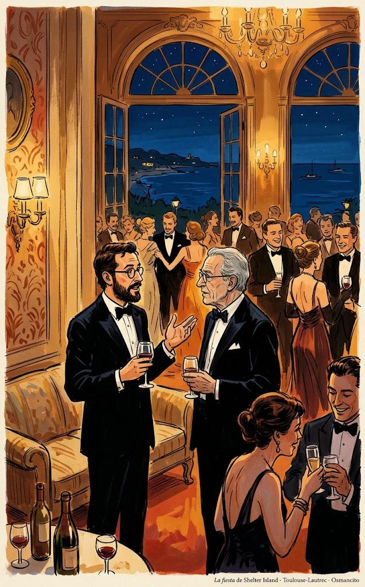
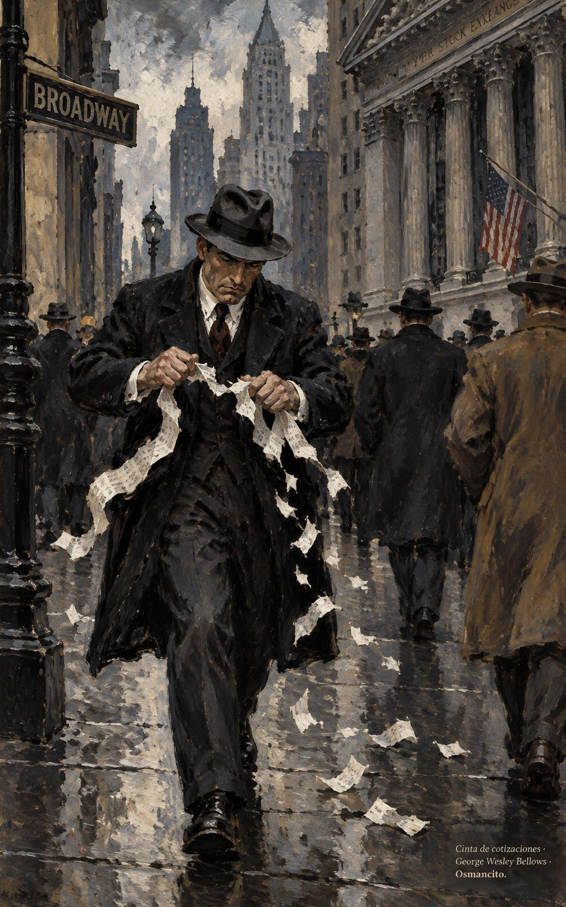

1 de noviembre de 2026

# La psicología del dinero

*La psicología del dinero* (*The Psychology of Money*) es un libro del escritor financiero estadounidense Morgan Housel, publicado por primera vez en 2020 por Harriman House, en Gran Bretaña. Housel escribe sobre finanzas desde 2008 y trabaja en Collaborative Fund, una firma de inversión. Hay edición en castellano de Editorial Planeta.

El libro no es un manual de fórmulas: defiende la idea de que salir bien con el dinero depende poco de la inteligencia y mucho de la conducta. Se divide en una introducción y veinte capítulos breves que giran sobre un mismo tema y pueden leerse por separado, seguidos de una posdata sobre la historia del consumidor estadounidense.

---

## Introducción: El mayor espectáculo del mundo

Abren el libro dos epígrafes, de Napoleón y de Sherlock Holmes, sobre la calma y la observación. Housel estacionaba carros en un hotel de Los Ángeles; un cliente era un genio de la tecnología que presumía borracho de su dinero y un día pidió monedas de oro.

> Una hora después, con las monedas de oro en la mano, el ejecutivo de tecnología y sus amigotes se reunieron junto a un muelle con vista al océano Pacífico. Luego se pusieron a lanzar las monedas al mar, haciéndolas rebotar como piedras, y reían a carcajadas mientras discutían cuál había llegado más lejos. Solo por diversión.
> [Párrafo 10](#original-psicologia-intro-p10)

Hacer cabrillas, rebotar una piedra sobre el agua para ver cuál llega más lejos, es un juego de niños; aquí las piedras son monedas de oro. Para este genio, el dinero es un juguete que se exhibe.

Rompió una lámpara de quinientos dólares y pagó cinco mil; años después se arruinó. La premisa: salir bien con el dinero depende poco de la inteligencia y mucho de la conducta.

> Un genio que pierde el control de sus emociones puede ser un desastre financiero. Lo contrario también es cierto. La gente corriente, sin educación financiera, puede ser rica si tiene un puñado de habilidades de conducta que nada tienen que ver con las medidas formales de la inteligencia.
> [Párrafo 16](#original-psicologia-intro-p16)

Las medidas formales de la inteligencia son los exámenes y los títulos; nada dicen de la calma, la paciencia o la sobriedad. Este párrafo es la tesis del libro en tres frases.

El caso contrario es Ronald Read, conserje y gasolinero de la zona rural de Vermont, el primero de su familia con bachillerato.

> Read arregló carros en una estación de gasolina durante 25 años y barrió pisos en JCPenney durante 17 años. Compró una casa de dos dormitorios por 12.000 dólares a los 38 años y vivió allí el resto de su vida. Envióudó a los 50 y no volvió a casarse. Un amigo recordaba que su principal pasatiempo era cortar leña.
> [Párrafo 20](#original-psicologia-intro-p20)

JCPenney es una cadena estadounidense de grandes almacenes. Treinta y cinco años de trabajos modestos y una casa de 12.000 dólares: hasta aquí, la vida de Read no anuncia ninguna fortuna.

Read murió en 2014: dejaba más de ocho millones de dólares, dos a sus hijastros y más de seis al hospital y la biblioteca locales. Sin lotería ni herencia: ahorró, compró acciones sólidas y esperó décadas.

> Richard Fuscone era todo lo que Ronald Read no era. Ejecutivo de Merrill Lynch formado en Harvard, con una maestría en administración de empresas, Fuscone tuvo una carrera financiera tan exitosa que se retiró en la década de sus cuarenta para dedicarse a la filantropía. David Komansky, ex primer ejecutivo de Merrill, elogió de Fuscone su «instinto para los negocios, dotes de liderazgo, buen juicio e integridad personal». La revista de negocios Crain's lo incluyó una vez en su lista «40 under 40» de empresarios exitosos.
> [Párrafo 28](#original-psicologia-intro-p28)

Merrill Lynch era uno de los bancos de inversión más grandes de Wall Street, y «40 under 40» es la lista anual de la revista Crain's con cuarenta empresarios menores de cuarenta años. Housel empareja a los dos hasta en el nombre: Ronald y Richard.

Todo se vino abajo: endeudado, la crisis de 2008 lo dejó en bancarrota y le remataron las casas. Read fue paciente; Fuscone, codicioso, y eso eclipsó la ventaja educativa: ningún conserje supera a un cirujano de Harvard; en finanzas, sí. El éxito financiero no es ciencia dura sino habilidad blanda: la psicología del dinero.

> La industria de la salud es un triunfo de la ciencia moderna, con una esperanza de vida en aumento en todo el mundo. Los descubrimientos científicos han reemplazado las viejas ideas de los médicos sobre cómo funciona el cuerpo humano, y prácticamente todo el mundo goza de mejor salud gracias a ello.
> [Párrafo 52](#original-psicologia-intro-p52)

La medicina muestra cómo aprende una ciencia: cada descubrimiento corrige una idea vieja y la esperanza de vida sube. La pregunta que deja el libro es si con el dinero pasa lo mismo.

La industria del dinero, en cambio, reclutó dos décadas a las mejores mentes sin hacernos mejores inversionistas.

> Por el ensayo y error colectivo de años aprendimos a ser mejores agricultores, fontaneros más hábiles y químicos más avanzados. ¿Pero nos ha enseñado el ensayo y error a ser mejores con nuestras finanzas personales? ¿Es menos probable que nos enterremos en deudas? ¿Más probable que ahorremos para los días difíciles? ¿Que nos preparemos para la jubilación? ¿Que tengamos ideas realistas sobre lo que el dinero hace, y no hace, por nuestra felicidad?
> [Párrafo 56](#original-psicologia-intro-p56)

El original dice «save for a rainy day», guardar para un día lluvioso: el refrán inglés de ahorrar para los tiempos difíciles. Las preguntas se responden solas: la deuda, el ahorro y la jubilación no mejoran de generación en generación como la cosecha o la fontanería.

Pensamos el dinero como la física y no como la psicología, cree. Es uno de los mayores espectáculos del mundo: está en todas partes y confunde a casi todos. Housel escribe de finanzas desde 2008 y, tras la crisis, vio que nadie lograba explicarla.

> Los ingenieros pueden determinar la causa del derrumbe de un puente porque hay acuerdo en que, si se aplica cierta cantidad de fuerza sobre cierta zona, esa zona cederá. La física no es objeto de controversia: se rige por leyes. Las finanzas son distintas: se rigen por la conducta de las personas. Y mi manera de comportarme puede tener sentido para mí y parecerte una locura a ti.
> [Párrafo 63](#original-psicologia-intro-p63)

Un puente caído tiene una causa que se puede encontrar, porque la física pone a todos de acuerdo. Con el dinero no hay ese acuerdo: la misma decisión es prudente para uno y temeraria para otro, según su historia.

La entendió mejor por la psicología y la historia: para explicar la deuda sirve más la historia de la codicia que las tasas de interés. Su informe de 2018 lo leyó más de un millón de personas; este libro lo profundiza en veinte capítulos. Cierra: «adelante».

---

## Capítulo 1: Nadie está loco

Abre con una promesa: la gente hace locuras con el dinero, pero nadie está loco. Cada generación y cada familia viven algo distinto, y lo vivido convence más que lo oído. Lo vivido es una fracción mínima del mundo, pero moldea casi todo tu modo de verlo. El historiador Frederick Lewis Allen escribió que la Depresión marcó a millones por dentro; veinticinco años después, John F. Kennedy, ya candidato a presidente, contó lo que recordaba.

> No tengo conocimiento de primera mano de la Depresión. Mi familia tenía una de las grandes fortunas del mundo y por entonces valía más que nunca. Teníamos casas más grandes, más servidumbre, viajábamos más. Casi lo único que vi directamente fue a mi padre contratar jardineros de más solo para darles un trabajo con el que comer. En realidad no supe de la Depresión hasta que leí sobre ella en Harvard.
> [Párrafo 13](#original-psicologia-cap1-p13)

Habla John F. Kennedy, entonces candidato y después presidente de Estados Unidos, criado en una de las grandes fortunas del país. La Gran Depresión fue la crisis que arrancó en 1929 y marcó los años treinta; Kennedy la conoció por los libros, no por la vida.

> Ese fue un tema importante en la elección de 1960. ¿Cómo, pensaba la gente, se podía poner a cargo de la economía a alguien sin entender la mayor historia económica de la última generación? En muchos sentidos, solo quedó zanjado por la experiencia de JFK en la Segunda Guerra Mundial. Esa era la otra experiencia emocional más extendida de la generación anterior, y algo que su rival en las primarias, Hubert Humphrey, no tenía.
> [Párrafo 14](#original-psicologia-cap1-p14)

La Segunda Guerra Mundial fue la otra gran experiencia compartida de esa generación: haber combatido daba a Kennedy una credencial emocional que su rival Hubert Humphrey no tenía. Las primarias son la votación interna con la que un partido escoge a su candidato.

Estudiar no recrea el miedo: una hoja de cálculo mide la frecuencia de las caídas, no el vértigo de llegar a casa y mirar a tus hijos. Como dice el inversionista Michael Batnick, algunas lecciones solo se entienden viviéndolas.

> En 2006, las economistas Ulrike Malmendier y Stefan Nagel, de la Oficina Nacional de Investigación Económica, revisaron cincuenta años de la Encuesta de Finanzas del Consumidor: una mirada detallada a lo que hacen los estadounidenses con su dinero.
> [Párrafo 21](#original-psicologia-cap1-p21)

La Oficina Nacional de Investigación Económica (NBER, por sus siglas en inglés) es el centro privado de investigación económica más influyente de Estados Unidos. Malmendier y Nagel buscaban saber si la época en que nace una persona marca sus decisiones de inversión de por vida.

En teoría uno decide según metas y opciones; los economistas hallaron otra cosa: las decisiones de inversión quedan ancladas a lo vivido por la propia generación, sobre todo al inicio de la vida adulta. Quien creció con inflación alta puso menos en bonos. No inteligencia ni educación: la suerte tonta de cuándo y dónde naciste.

> El Financial Times entrevistó en 2019 a Bill Gross, el célebre gestor de bonos. "Gross admite que probablemente no estaría donde está hoy de haber nacido una década antes o después", decía la pieza. La carrera de Gross coincidió casi a la perfección con un desplome generacional de las tasas de interés que dio viento a favor a los precios de los bonos. Eso no solo afecta las oportunidades con las que te cruzas; afecta lo que piensas de ellas cuando se te presentan. Para Gross, los bonos eran máquinas de generar riqueza. Para la generación de su padre, que creció y aguantó una inflación más alta, podían parecer incineradores de riqueza.
> [Párrafo 30](#original-psicologia-cap1-p30)

Un bono es un préstamo que paga intereses: su precio sube cuando bajan las tasas de interés. Bill Gross fundó PIMCO y llegó a ser el gestor de bonos más famoso del mundo; a la generación anterior, que vio la inflación comerse esos mismos papeles, los bonos le parecían lo contrario de un buen negocio.

Las diferencias no son pequeñas: quien nació en 1970 vio el S&P 500 multiplicarse por diez en su juventud. En 2009 el desempleo fue del 10 %; entre jóvenes negros sin diploma, del 49 %. Alemania y Japón salieron de la guerra arrasadas; la bolsa estadounidense se duplicó durante ella. Nadie puede pedirles que piensen igual.

> Hace unos años, The New York Times publicó una historia sobre las condiciones laborales en Foxconn, el enorme fabricante taiwanés de electrónica. Las condiciones son a menudo atroces. Los lectores se indignaron con razón. Pero una respuesta fascinante a la historia vino del sobrino de una trabajadora china, que escribió en la sección de comentarios:
> [Párrafo 43](#original-psicologia-cap1-p43)

Foxconn es la empresa taiwanesa que ensambla en China gran parte de los aparatos electrónicos del mundo, incluido el iPhone. La historia del Times denunciaba las condiciones de sus fábricas.

El comentario contaba que su tía trabajó años en esos talleres: duro y mal pagado, pero mejor que la vida anterior; prefería ser «explotada» por un patrón capitalista por dólares que por varios hombres por centavos. Housel no sabe qué hacer con eso: una parte quiere discutir, otra entender.

> No sé qué hacer con esto. Una parte de mí quiere discutir, con furia. Otra parte quiere entender. Pero sobre todo es un ejemplo de cómo experiencias distintas pueden llevar a puntos de vista muy distintos dentro de temas que una parte cree, por intuición, de blanco y negro.
> [Párrafo 49](#original-psicologia-cap1-p49)

Housel comenta la carta del sobrino y admite que lo que para un lector neoyorquino es blanco y negro puede verse de otro modo desde otra vida.

Toda decisión financiera tiene sentido para quien la toma en ese momento, con la información y el modelo mental que tiene. Ejemplo: la lotería. La compran sobre todo los pobres, 412 dólares al año por hogar, los mismos que dicen no poder reunir 400 en una emergencia. Parece una locura.

> Vivimos al día y ahorrar parece fuera de nuestro alcance. Tener un salario mucho más alto parece fuera de nuestro alcance. No podemos pagar vacaciones bonitas, carros nuevos, seguro médico ni casas en vecindarios seguros. No podemos pagar la universidad de nuestros hijos sin una deuda aplastante. Muchas de las cosas que ustedes, los que leen libros de finanzas, ya tienen o tienen buena chance de conseguir, nosotros no las tenemos. Comprar un boleto de lotería es la única vez en la vida en que podemos sostener en la mano un sueño tangible de tener lo bueno que ustedes ya tienen y dan por sentado. Estamos pagando por un sueño, y quizá no lo entiendan porque ya están viviendo un sueño. Por eso compramos más boletos que ustedes.
> [Párrafo 64](#original-psicologia-cap1-p64)

Housel imagina la voz de un hogar pobre; no es la suya. El boleto no compra una probabilidad de ganar: compra un rato de un sueño que los demás ya viven, y por eso la condena fácil no entiende qué se está comprando.

No hay que estar de acuerdo: entender por qué el otro lo hace desnuda la raíz. Otro punto: la moneda tiene 2.600 años; el retiro digno, dos generaciones: antes se trabajaba hasta morir, y el 401(k) es de 1978. No es locura: somos novatos. La universidad, igual: de 1 de cada 20 graduados en 1940 a 1 de cada 4 en 2015.

> La matrícula universitaria promedio se multiplicó por más de cuatro en ese tiempo, ajustada por inflación. Que algo tan grande y tan importante golpee a la sociedad tan rápido explica por qué, por ejemplo, tanta gente ha tomado malas decisiones con los préstamos estudiantiles en los últimos veinte años. No hay décadas de experiencia acumulada de las que siquiera intentar aprender. Estamos improvisando.
> [Párrafo 82](#original-psicologia-cap1-p82)

La matrícula es el precio de estudiar en la universidad. Su disparada convirtió los préstamos estudiantiles en una decisión masiva sin experiencia acumulada: por eso dice que se está improvisando.

Los fondos índice tienen menos de cincuenta años. Los perros, domesticados hace diez mil años, aún guardan conductas salvajes; nosotros llevamos veinte o cincuenta de práctica. Nadie está loco: todos somos nuevos. Cierra con el anzuelo del capítulo 2: cómo se hizo rico Bill Gates.

---

## Capítulo 2: Suerte y riesgo

La suerte y el riesgo son hermanos, abre el capítulo. El profesor Scott Galloway, de la Universidad de Nueva York, tiene la idea hermana: nada es tan bueno ni tan malo como parece. Housel lo cuenta con una historia. Bill Gates fue a uno de los pocos institutos del mundo que tenían una computadora, y cómo la consiguió la Escuela Lakeside, a las afueras de Seattle, es notable por sí mismo.

> Bill Dougall fue piloto de la marina en la Segunda Guerra Mundial y después profesor de matemáticas y ciencias en un instituto. "Creía que estudiar los libros no bastaba sin experiencia del mundo real. También se dio cuenta de que necesitaríamos saber algo de computadoras cuando llegáramos a la universidad", recordó Paul Allen, el difunto cofundador de Microsoft.
> [Párrafo 5](#original-psicologia-cap2-p5)

Bill Dougall daba clases en Lakeside, la escuela privada donde estudió Gates. El recuerdo es de Paul Allen, cofundador de Microsoft con Gates y compañero suyo en Lakeside.

> En 1968 Dougall pidió al Club de Madres de la Escuela Lakeside que usara lo recaudado en su venta benéfica anual, unos 3.000 dólares, para arrendar una computadora Teletype Model 30 conectada al terminal central de General Electric para trabajar en tiempo compartido. "La idea misma del tiempo compartido se acababa de inventar en 1965", dijo Gates años después. "Alguien fue bastante visionario".
> [Párrafo 6](#original-psicologia-cap2-p6)

El tiempo compartido permitía a varios usuarios trabajar a la vez sobre una misma computadora remota, cara y escasa entonces. El Club de Madres financiaba proyectos del colegio con una venta anual de objetos usados. Gates tenía trece años.

Con esa máquina, Gates y Allen se volvieron expertos. Su amigo Kent Evans tenía el mismo talento.

> Evans manejaba las computadoras tan bien como Gates y Allen. Lakeside tuvo una vez que armar a mano el horario de clases del colegio, un laberinto de complejidad para dar a cientos de estudiantes las materias que necesitan a horas que no choquen con otras materias. El colegio encargó a Bill y a Kent, niños por donde se mire, construir un programa de computadora que resolviera el problema. Funcionó.
> [Párrafo 26](#original-psicologia-cap2-p26)

Kent Evans era el mejor amigo de Gates en Lakeside; con él soñó sus primeras empresas. No llegó a la universidad: murió en un accidente de montañismo antes de graduarse, una probabilidad tan remota como la de estudiar con computadora en 1968.

De un millón de institutos, solo uno tenía computadora, y Gates cayó en él. Él mismo lo dice: sin Lakeside no habría Microsoft. Del lado contrario está Evans, con el mismo talento y la misma pasión, al que el azar le cerró todo. Por eso Housel pone los dos nombres uno al lado del otro.

> La suerte y el riesgo son una misma realidad: todo resultado en la vida lo guían fuerzas ajenas al esfuerzo individual. Se parecen tanto que no puedes creer en una sin respetar igual al otro. Ambos ocurren porque el mundo es demasiado complejo para que el 100 % de tus actos dicte el 100 % de tus resultados. Los mueve lo mismo: eres una persona en un juego con otros siete mil millones de personas y piezas en movimiento infinitas.
> [Párrafo 36](#original-psicologia-cap2-p36)

La tesis del capítulo. El esfuerzo cuenta, pero ningún resultado se explica solo con él, porque el mundo mete demasiadas variables en juego.

Aceptarlo cuesta. Cuando Housel sugiere cuánto del éxito financiero se debe a la suerte, la reacción suele ser a la defensiva.

> Me encanta esa respuesta, porque nadie piensa de verdad que la suerte no juegue un papel en el éxito financiero. Pero como es difícil cuantificar la suerte y de mala educación insinuar que el éxito ajeno se le debe a ella, la postura por defecto suele ser ignorarla en silencio como factor del éxito.
> [Párrafo 42](#original-psicologia-cap2-p42)

La respuesta defensiva le encanta a Housel porque delata un doble rasero: nadie niega la suerte en abstracto, pero nombrarla en un caso concreto suena a insulto.

Hay fuerzas que no dependen de ti y pesan desde la cuna.

> El economista Bhashkar Mazumder ha mostrado que los ingresos entre hermanos están más correlacionados que la estatura o el peso. Si eres rico y alto, es más probable que tu hermano también sea rico a que sea alto. Creo que la mayoría sabemos por intuición que es verdad: la calidad de tu educación y las puertas que se te abren están muy ligadas a la posición socioeconómica de tus padres.
> [Párrafo 46](#original-psicologia-cap2-p46)

Mazumder es economista e investiga cómo se transmiten los ingresos entre generaciones. La comparación con la estatura hace visible lo que la intuición ya sabe: el punto de partida familiar pesa más que muchos rasgos heredados.

Con el riesgo pasa lo mismo, y juzgarlo de frente incomoda. Vanderbilt y Rockefeller, dos gigantes del capitalismo, quebrantaban la ley con naturalidad.

> Cornelius Vanderbilt acababa de cerrar una serie de negocios para expandir su imperio ferroviario.
> [Párrafo 65](#original-psicologia-cap2-p65)

Cornelius Vanderbilt armó en el siglo XIX el mayor imperio ferroviario y naviero de Estados Unidos. Housel cuenta que su desprecio por la ley era notorio y parte de su éxito.

Los biógrafos leen esa despreocupación por la ley como audacia fundacional.

> Pero ¿qué tan peligroso es ese análisis? Nadie en su sano juicio recomendaría el delito flagrante como rasgo emprendedor. Es fácil imaginar la historia de Vanderbilt con un final muy distinto: un forajido cuya joven empresa se derrumbó por orden judicial.
> [Párrafo 71](#original-psicologia-cap2-p71)

El mismo Vanderbilt que desafiaba la ley pudo terminar en la ruina judicial. La lección cambia según el desenlace, aunque la conducta sea la misma.

Rockefeller sigue el mismo molde.

> John D. Rockefeller es parecido. Su frecuente burla de la ley, un juez llamó una vez a su empresa "no mejor que un ladrón común", suele ser retratada por los historiadores como astucia para los negocios. Quizá lo era. Pero ¿cuándo cambia el relato de "no dejaste que leyes anticuadas estorbaran la innovación" a "cometiste un delito"? ¿O qué poco tendría que cambiar la historia para que el relato pasara de "Rockefeller era un genio, aprende de sus aciertos" a "Rockefeller era un criminal, aprende de sus fracasos empresariales"? Muy poco.
> [Párrafo 74](#original-psicologia-cap2-p74)

John D. Rockefeller fundó Standard Oil y llegó a ser el hombre más rico de su época. Housel no niega su genio: pregunta dónde empieza el relato del delito.

El caso más incómodo es el de un maestro reconocido.

> Benjamin Graham es conocido como uno de los mayores inversores de todos los tiempos, el padre de la inversión en valor y el primer mentor de Warren Buffett. Pero la mayor parte de su éxito invirtiendo se debió a poseer un enorme paquete de acciones de GEICO que, según su propia admisión, rompía casi todas las reglas de diversificación que el propio Graham fijó en sus famosos textos. ¿Dónde cae aquí la delgada línea entre audaz y temerario? No lo sé. Graham escribió sobre su bonanza de GEICO: "¿Un golpe de suerte o una decisión supremamente astuta? ¿Podemos distinguirlas?". No fácilmente.
> [Párrafo 78](#original-psicologia-cap2-p78)

Benjamin Graham escribió el manual que formó a Buffett y predicaba la diversificación. GEICO es una aseguradora: aquella apuesta concentrada le dio a Graham la mayor parte de sus ganancias.

La salida no es adivinar cuánto fue suerte en cada caso, imposible, sino cambiar a quién se estudia: menos extremos y más patrones amplios.

> Mi historiador favorito, Frederick Lewis Allen, pasó su carrera retratando la vida del estadounidense medio: cómo vivía, cómo cambiaba, en qué trabajaba, qué cenaba, etcétera. Hay lecciones más útiles que sacar de esa clase de observación amplia que de estudiar a los personajes extremos que suelen dominar las noticias.
> [Párrafo 96](#original-psicologia-cap2-p96)

Frederick Lewis Allen escribió historia del estadounidense común, no de próceres. Es el mismo historiador del capítulo 1, el de la Depresión.

El consejo práctico: menos casos extremos y más patrones comunes, y perdonarse al juzgar los fracasos, propios y ajenos, porque nada es tan bueno ni tan malo como parece. Con eso Housel pasa a las historias de dos hombres que tentaron a la suerte.
---

## Capítulo 3: Nunca es suficiente

Abre el capítulo una anécdota de John Bogle sobre el dinero.

> John Bogle, el fundador de Vanguard fallecido en 2019, contaba una historia sobre el dinero que señala algo en lo que no pensamos bastante: en una fiesta que daba un multimillonario en Shelter Island, Kurt Vonnegut le dice a su amigo Joseph Heller que el anfitrión, un gestor de fondos de cobertura, había ganado más dinero en un solo día del que Heller había ganado con su popularísima novela Catch-22 en toda su historia. Heller responde: "Sí, pero yo tengo algo que él nunca tendrá: suficiente".
> [Párrafo 1](#original-psicologia-cap3-p1)

John Bogle fundó Vanguard, una gestora de fondos de inversión estadounidense que hoy está entre las mayores del mundo, y popularizó los fondos índice, que copian la marcha de todo un mercado en lugar de elegir unas pocas empresas. Kurt Vonnegut y Joseph Heller eran novelistas; Catch-22, de 1961, es la obra más famosa de Heller. Shelter Island es un refugio de verano de los ricos de Nueva York.

De la palabra de Heller salen dos ejemplos contrarios. El primero, Rajat Gupta: huérfano de adolescente en Calcuta; si los privilegiados nacen en tercera base, él ni veía el estadio.

> A los cuarenta y tantos Gupta era consejero delegado de McKinsey, la consultora más prestigiosa del mundo. Se retiró en 2007 para asumir cargos en las Naciones Unidas y el Foro Económico Mundial. Colaboró en obra filantrópica con Bill Gates. Fue miembro del consejo de administración de cinco empresas cotizadas. Desde los barrios bajos de Calcuta, Gupta se había convertido, literalmente, en uno de los hombres de negocios más exitosos del mundo.
> [Párrafo 8](#original-psicologia-cap3-p8)

McKinsey es la consultora de empresas más prestigiosa del mundo. Calcuta, hoy Kolkata, es una de las mayores ciudades de India; Gupta creció allí en la pobreza.

En 2008, en plena crisis, Buffett preparaba inyectar 5.000 millones en Goldman Sachs. Gupta, del consejo, lo supo antes que el público.

> Dieciséis segundos después de enterarse del acuerdo inminente, Gupta, que estaba conectado a la reunión del consejo de Goldman, colgó el teléfono y llamó a un gestor de fondos de cobertura llamado Raj Rajaratnam. La llamada no se grabó, pero Rajaratnam compró de inmediato 175.000 acciones de Goldman Sachs, así que puedes imaginar de qué hablaron. El acuerdo de Buffett con Goldman se anunció al público horas después. Las acciones de Goldman se dispararon. Rajaratnam ganó un millón de dólares en un santiamén.
> [Párrafo 18](#original-psicologia-cap3-p18)

Raj Rajaratnam fundó el fondo Galleon. Operar con información no pública es el delito de uso de información privilegiada: la SEC atribuyó a los avisos de Gupta 17 millones de dólares en ganancias, y ambos fueron a prisión.

El segundo, Bernie Madoff, el estafador Ponzi más célebre, tuvo antes un negocio legítimo y exitoso como creador de mercado. Así describió The Wall Street Journal su firma en 1992:

> Ha construido una firma de valores muy rentable, Bernard L. Madoff Investment Securities, que desvía un enorme volumen de operaciones bursátiles del Big Board. Los 740 millones de dólares de volumen diario medio de operaciones electrónicas que la firma Madoff ejecuta fuera de la bolsa equivalen al 9 % de las de la Bolsa de Nueva York. La firma del señor Madoff puede ejecutar operaciones tan rápido y tan barato que incluso paga a otras corredurías un centavo por acción por ejecutar las órdenes de sus clientes, y gana con el diferencial entre los precios de compra y de venta al que se negocian la mayoría de las acciones.
> [Párrafo 28](#original-psicologia-cap3-p28)

Un creador de mercado casa compradores y vendedores de acciones, y Big Board es el apodo de la Bolsa de Nueva York. La descripción es anterior al fraude conocido: la parte legítima del negocio de Madoff ganaba entre 25 y 50 millones de dólares al año, según un exempleado.

No hace falta llegar al delito: el fondo Long-Term Capital Management, con socios riquísimos apostando su propia fortuna, lo perdió todo buscando más. Regla obvia y olvidada: no arriesgar lo que tienes y necesitas por lo que no tienes y no necesitas. Si tienes lo suficiente, cuatro recordatorios. Primero: la habilidad más difícil es que el poste de la meta deje de moverse.

> Pero es una de las más importantes. Si las expectativas suben con los resultados, no hay lógica en esforzarse por más, porque te sentirás igual después del esfuerzo extra. Se vuelve peligroso cuando el gusto por tener más, más dinero, más poder, más prestigio, aumenta la ambición más rápido que la satisfacción. En ese caso, un paso adelante empuja el poste de la meta dos pasos más allá. Sientes que te quedas atrás, y la única forma de alcanzar es asumir riesgos cada vez mayores.
> [Párrafo 44](#original-psicologia-cap3-p44)

Mover los postes de la meta es cambiar el objetivo cuando ya casi lo alcanzas. La metáfora es deportiva: si la portería se aleja con cada avance, no hay marcador que se cierre.

Segundo: la comparación social. El novato de béisbol con medio millón de sueldo es rico hasta medirse con Mike Trout y sus 430 millones; el gestor de 340 millones, con los cinco de 770; esos, con Buffett; Buffett, con Bezos. El techo nadie lo toca: solo se gana no jugando. Un amigo de Housel preguntó en Las Vegas a un crupier a qué jugaba.

> El crupier, serio como una piedra, respondió: "La única forma de ganar en un casino de Las Vegas es salir en cuanto entras".
> [Párrafo 53](#original-psicologia-cap3-p53)

El crupier es el empleado del casino que reparte las cartas y cobra las apuestas; ve perder a miles cada año. Su respuesta es la regla de la comparación llevada al juego: entrar ya es perder.

Tercero: suficiente no es poco ni renuncia conservadora.

> La única forma de saber cuánta comida puedes comer es comer hasta enfermar. Casi nadie lo intenta, porque vomitar duele más de lo que sabe bien cualquier comida. Por alguna razón la misma lógica no se traslada a los negocios y la inversión, y muchos solo dejan de buscar más cuando se rompen y se ven forzados a ello.
> [Párrafo 60](#original-psicologia-cap3-p60)

En la mesa el exceso se paga al instante y el límite casi no se tienta; con el dinero el límite análogo solo se descubre al romperse.

Cuarto: hay cosas que nunca se arriesgan. Gupta, ya libre, dijo al Times que la lección era no apegarse a la reputación; Housel lo lee al revés: la reputación no tiene precio, ni la libertad, la familia y los amigos, el cariño, la felicidad. Conservarlas es saber cuándo dejar de arriesgarlas. La herramienta para construir suficiente es simple, y es el capítulo que sigue.
---

## Capítulo 4: La confusión del interés compuesto

El capítulo pide prestada una ciencia lejana: las edades de hielo. Solo en el siglo XIX se aceptaron cinco, y ninguna teoría grandiosa explicaba su repetición en ciclo.

> A comienzos del siglo XX, un científico serbio llamado Milutin Milanković estudió la posición de la Tierra respecto a otros planetas y llegó a la teoría de las edades de hielo que hoy sabemos acertada: la atracción gravitatoria del sol y la luna afecta con suavidad el movimiento de la Tierra y su inclinación hacia el sol. Durante partes de este ciclo, que puede durar decenas de miles de años, cada hemisferio de la Tierra recibe un poco más, o un poco menos, de radiación solar de la acostumbrada.
> [Párrafo 9](#original-psicologia-cap4-p9)

Milutin Milanković (1879-1958) fue un matemático y astrónomo serbio, profesor de la Universidad de Belgrado, y los ciclos de la órbita de la Tierra que describió llevan su nombre. Un hemisferio es cada mitad del planeta, y la radiación solar es la energía que llega del sol: de su reparto entre hemisferios dependen las estaciones.

Milanković culpaba a inviernos feroces; el meteorólogo Wladimir Köppen halló al culpable: el verano templado. La nieve que no se derrite acumula más nieve, que refleja más sol y enfría más, hasta volverse hielo continental.

> Lo asombroso aquí es cuán grande puede llegar a ser algo que nace de un cambio relativamente pequeño en las condiciones. Empiezas con una capa fina de nieve sobrante de un verano fresco, algo que a nadie le llamaría la atención, y luego, en un abrir y cerrar de ojos geológico, la Tierra entera queda cubierta de hielo de kilómetros de espesor. Como dijo la glacióloga Gwen Schultz: «No es necesariamente la cantidad de nieve lo que causa las capas de hielo, sino el hecho de que la nieve, por poca que sea, perdure».
> [Párrafo 15](#original-psicologia-cap4-p15)

Wladimir Köppen (1846-1940), nacido en San Petersburgo, creó la primera clasificación de los climas del mundo, aún en uso; Gwen Schultz es la glacióloga que el libro cita. La frase invierte lo intuitivo: no manda cuánta nieve cae, sino cuánta se queda.

Con el dinero pasa igual. Los más de dos mil libros sobre Warren Buffett pasan por alto lo simple: invirtió bien desde niño. De sus 84.500 millones de dólares, 84.200 los juntó después de los cincuenta; de haber empezado a los treinta y jubilado a los sesenta, tendría 11,9 millones: un 99,9 % menos. Jim Simons, de Renaissance Technologies, capitaliza al 66 % anual desde 1988 y aun así vale un 75 % menos.

> ¿Por qué la diferencia, si Simons es mucho mejor inversor? Porque Simons no encontró su ritmo de inversión hasta los cincuenta años. Ha tenido menos de la mitad de años que Buffett para capitalizar. Si James Simons hubiera mantenido sus rendimientos anuales del 66 % durante el lapso de setenta años en que Buffett ha construido su fortuna, valdría —contenga la respiración— sesenta y tres trillones novecientos mil billones setecientos ochenta y un billones setecientos ochenta mil millones setecientos cuarenta y ocho millones ciento sesenta mil dólares.
> [Párrafo 36](#original-psicologia-cap4-p36)

Jim Simons (1938-2024) fue un matemático estadounidense, y su fondo, Renaissance Technologies, es de los más rentables de la historia; un fondo de cobertura es un fondo privado de inversión que opera con estrategias libres y mucho riesgo. La cifra, escrita en números, es un 64 seguido de dieciocho ceros: la broma es que unos puntos más de rendimiento, sostenidos unas décadas más, producen un resultado que ya no significa nada para nadie.

Pequeños cambios de suposiciones producen números absurdos; el motor del éxito queda fuera de la mirada.

> He oído a muchas personas decir que la primera vez que vieron una tabla de interés compuesto —o una de esas historias sobre cuánto más tendrías para la jubilación si empezaras a ahorrar a los veinte en vez de a los treinta— les cambió la vida. Pero probablemente no fue así. Lo que probablemente hizo fue sorprenderlas, porque los resultados no parecían correctos a la intuición. El pensamiento lineal es mucho más intuitivo que el pensamiento exponencial. Si te pido calcular 8+8+8+8+8+8+8+8+8 de cabeza, lo haces en unos segundos (es 72).
> [Párrafo 38](#original-psicologia-cap4-p38)

El interés compuesto es el interés que se gana también sobre el interés ya ganado: la base crece y cada vuelta suma más que la anterior. Una tabla de interés compuesto muestra ese crecimiento año por año. Pensar en lineal es sumar lo mismo a cada paso; pensar en exponencial es multiplicar, y la cabeza humana suma con facilidad y multiplica mal.

El mismo ocho multiplicado nueve veces estalla: 134.217.728.

> IBM fabricó un disco duro de 3,5 megabytes en los años cincuenta. En los sesenta se manejaban unas cuantas decenas de megabytes. En los setenta, el disco Winchester de IBM alcanzó los 70 megabytes. Luego los discos se hicieron exponencialmente más pequeños y con más almacenamiento. Una PC típica de principios de los noventa guardaba de 200 a 500 megabytes.
> [Párrafo 40](#original-psicologia-cap4-p40)

El megabyte, el gigabyte y el terabyte miden almacenamiento digital, y cada uno es unas mil veces el anterior; una PC es una computadora personal. IBM dominaba entonces la informática, y sus 3,5 megabytes guardaban lo que hoy serían una o dos fotos de teléfono.

Después, la explosión: el iMac, la computadora de Apple, traía 6 gigabytes en 1999; en 2019, discos de 100 terabytes. Nadie predijo «treinta millones de veces más dentro de mi vida», y eso pasó.

> La naturaleza contraintuitiva del interés compuesto lleva incluso a los más listos de nosotros a pasar por alto su poder. En 2004, Bill Gates criticó el nuevo Gmail preguntándose por qué alguien necesitaría un gigabyte de almacenamiento. El autor Steven Levy escribió:
> [Párrafo 50](#original-psicologia-cap4-p50)

> «Pese a estar al día con las tecnologías de vanguardia, su mentalidad seguía anclada en el viejo paradigma de que el almacenamiento era un recurso que había que conservar». Uno nunca se acostumbra a lo rápido que pueden crecer las cosas.
> [Párrafo 51](#original-psicologia-cap4-p51)

Bill Gates cofundó Microsoft, la mayor empresa de software de su época; Gmail, el correo de Google, ofrecía en 2004 un gigabyte gratis, cientos de veces más que la competencia. Steven Levy, periodista de tecnología, escribió una historia de Google, y concluyó que la mentalidad de Gates seguía «anclada en el viejo paradigma» del almacenamiento como bien escaso: nadie se acostumbra a la rapidez con que crecen las cosas, ni siquiera quien las vio crecer de cerca.

De no verse el interés compuesto con intuición nace la mayoría de las operaciones decepcionantes. Ningún libro sobre Buffett se titula *Este tipo ha invertido con constancia durante tres cuartos de siglo*; el más importante debería llamarse *Cállate y espera*, una página con el gráfico del crecimiento a largo plazo. Lo que cuenta no es el mayor rendimiento, sino uno bastante bueno sostenido el mayor tiempo posible. Lo contrario trae las historias trágicas del capítulo que sigue.

---

## Capítulo 5: Hacerse rico frente a seguir siéndolo

Abre el capítulo una cuenta desigual: un millón de maneras de hacerse rico y una sola de seguir siéndolo, cierta mezcla de frugalidad y paranoia. La muestran dos inversionistas que nunca se conocieron: Jesse Livermore, el mayor especulador de bolsa de su época, y Abraham Germansky.

> Dorothy, la esposa de Livermore, temió lo peor cuando su marido volvió a casa el 29 de octubre. Corrían por Nueva York noticias de especuladores de Wall Street que se suicidaban. Ella y sus hijos recibieron a Jesse en la puerta entre lágrimas, mientras su madre, desconsolada, se escondía en otra habitación gritando.
> [Párrafo 8](#original-psicologia-cap5-p8)

La escena guarda un giro: la familia llora porque solo sabe que el mercado se desplomó; no sabe en qué dirección apostaba Jesse. Los especuladores que se suicidaban eran la noticia de la semana en Nueva York.

Jesse estaba en corto (apostó a la baja) y ese día ganó más de tres mil millones de dólares de hoy. Germansky, promotor inmobiliario multimillonario, apostó fuerte al mercado; el 26 de octubre, The New York Times publicó una nota: su esposa lo buscaba.

> Sandler dijo que la señora de Germansky le contó que un amigo vio a su marido el jueves por la tarde en Wall Street, cerca de la bolsa. Según su informante, su marido rompía en pedazos una tira de cinta de cotizaciones y la esparcía por la acera mientras caminaba hacia Broadway.
> [Párrafo 20](#original-psicologia-cap5-p20)

La cinta de cotizaciones era la tira de papel donde una máquina de telégrafo imprimía los precios de la bolsa casi en vivo; romperla era romper el instrumento que medía la ruina. La nota es un parte periodístico: quién busca, quién falta y qué hacía cuando lo vieron por última vez.

De Germansky no se volvió a saber. Cuatro años después Livermore se endeudó, apostó más alto y lo perdió todo. Ambos eran buenos para hacerse ricos e igual de malos para seguir siéndolo.

> Como veremos en el capítulo 6, el 40 % de las empresas con suficiente éxito para salir a bolsa perdieron con el tiempo prácticamente todo su valor. La lista Forbes 400 de los estadounidenses más ricos renueva en promedio alrededor de un 20 % de sus miembros por década, por causas que no tienen que ver con la muerte ni con traspasar el dinero a otro familiar.
> [Párrafo 33](#original-psicologia-cap5-p33)

Salir a bolsa es ofrecer las acciones de una empresa al público; Forbes 400 es la lista anual de la revista Forbes con los cuatrocientos estadounidenses más ricos. Que esa lista cambie un quinto cada década, sin contar muertes ni herencias, quiere decir que las fortunas se pierden por sí solas.

Hacer dinero y conservarlo son habilidades opuestas: ganarlo pide riesgo y optimismo; conservarlo, humildad, frugalidad y miedo a perderlo, aceptando que algo del éxito fue suerte. Lo mismo vive Michael Moritz.

> A Michael Moritz, el director multimillonario de Sequoia Capital, Charlie Rose le preguntó por qué Sequoia tenía tanto éxito. Moritz mencionó la longevidad y señaló que algunas firmas de capital de riesgo prosperan cinco o diez años, pero Sequoia lleva cuatro décadas. Rose le preguntó por qué. Moritz: Creo que siempre hemos tenido miedo de quebrar.
> [Párrafo 37](#original-psicologia-cap5-p37)

Sequoia Capital es una firma estadounidense de capital de riesgo, que invierte en empresas jóvenes a cambio de una parte de ellas; Charlie Rose es un entrevistador de televisión. Moritz no explica cuatro décadas de éxito por ver más lejos que los demás, sino por temer más que los demás.

Moritz añade: no podemos dar por hecho que el éxito de ayer se vuelva la fortuna de mañana. No es «crecimiento», ni «cerebro», ni «visión»: es durar: casi ninguna ganancia vale una ruina, y el interés compuesto solo funciona si el dinero tiene años para crecer.

> Es como plantar robles: un año de crecimiento nunca muestra mucho avance, diez años pueden marcar una diferencia significativa y cincuenta años pueden crear algo absolutamente extraordinario.
> [Párrafo 46](#original-psicologia-cap5-p46)

El roble crece despacio y puede vivir siglos: es la imagen del interés compuesto. La fuerza no está en lo que crece cada año, sino en los años que se le dejan al crecimiento; por eso sobrevivir a los altibajos es la condición de todo lo demás.

Buffett lo muestra: catorce recesiones sin endeudarse de más, sin vender en pánico ni manchar su nombre, sin quemarse ni retirarse; esa supervivencia dejó obrar al interés compuesto. Aquí entra Rick Guerin: hace cuarenta años, el dúo de Buffett y Charlie Munger era un trío.

> Warren, Charlie y Rick hacían inversiones juntos y entrevistaban juntos a los directivos de las empresas. Luego Rick desapareció de la escena, al menos en comparación con el éxito de Buffett y Munger. El inversionista Mohnish Pabrai le preguntó una vez a Buffett qué había pasado con Rick. Mohnish recordó:
> [Párrafo 58](#original-psicologia-cap5-p58)

Charlie Munger es el socio de Buffett en Berkshire Hathaway, la empresa que dirigen; Mohnish Pabrai es un inversionista que estudia sus métodos. La pregunta es buena porque al tercero no le faltó talento: le faltó otra cosa.

Rick era igual de inteligente, «pero tenía prisa», contó Buffett: con dinero prestado, la caída de 1973 y 1974 lo obligó a venderle a Warren sus acciones de Berkshire a menos de 40 dólares. En la práctica son tres cosas: ser inquebrantable, planear para el fracaso del plan y mezclar optimismo con paranoia.

> ¿Cómo es el dicho? Uno planea y Dios se ríe. La planificación financiera y de inversiones es esencial, porque permite saber si lo que uno hace ahora está dentro de lo razonable. Pero pocos planes de cualquier clase sobreviven a su primer encuentro con el mundo real. Si estás proyectando tus ingresos, tu tasa de ahorro y los rendimientos del mercado para los próximos veinte años, piensa en todo lo grande que ha pasado en los últimos veinte sin que nadie pudiera preverlo: el 11 de septiembre, un auge y una caída de la vivienda que dejó a casi diez millones de estadounidenses sin su casa, una crisis financiera que dejó sin empleo a casi nueve millones, una subida de la bolsa que batió récords después y un coronavirus que sacude al mundo mientras escribo esto.
> [Párrafo 71](#original-psicologia-cap5-p71)

El 11 de septiembre es el atentado de 2001 contra las torres de Nueva York, y el coronavirus es la pandemia que cerraba el mundo en 2020, cuando se publicó el libro. La lista es la prueba: nadie que proyectara en el año 2000 llevaba en sus cuentas ninguna de esas catástrofes.

El buen plan abraza el margen de error: «sería estupendo un 8 % anual, pero con un 4 % estaré bien». La tercera pieza es una personalidad de barbell: optimista sobre el futuro, paranoica sobre lo que puede impedirlo.

> El optimismo suele definirse como la creencia de que las cosas saldrán bien. Pero esa definición es incompleta. El optimismo sensato es la creencia de que las probabilidades están a tu favor y de que, con el tiempo, las cosas se equilibrarán hacia un buen resultado, aunque lo que pase entretanto esté lleno de penurias. Y de hecho sabes que estará lleno de penurias. Puedes ser optimista sobre la trayectoria de crecimiento a largo plazo, que sube hacia la derecha, y estar igual de seguro de que el camino de aquí a allá está lleno de minas, y lo estará siempre. Esas dos cosas no se excluyen.
> [Párrafo 77](#original-psicologia-cap5-p77)

Barbell es la barra con pesas del gimnasio: la imagen de poner todo el peso en los dos extremos y nada en el medio. El optimismo sensato no niega las caídas del camino: las incluye en el precio del crecimiento.

> La idea de que algo pueda ganar a largo plazo mientras es un desastre a corto plazo no es intuitiva, pero así funcionan muchas cosas en la vida. A los veinte años, la persona promedio puede perder cerca de la mitad de las conexiones sinápticas que su cerebro tenía a los dos, conforme se limpian las vías neuronales ineficientes y redundantes. Pero la persona promedio de veinte años es mucho más inteligente que la de dos. La destrucción frente al progreso no solo es posible: es una manera eficiente de deshacerse del exceso.
> [Párrafo 78](#original-psicologia-cap5-p78)

Las conexiones sinápticas son los puentes entre las neuronas; el cerebro del niño las poda para volverse más eficiente, no más pobre. Una economía hace algo parecido: pierde empresas, empleos y costumbres mientras mejora.

Así creció la economía estadounidense en 170 años (guerras, recesiones y más de cien caídas de bolsa) mientras el nivel de vida se multiplicaba por veinte. La paranoia de corto plazo mantiene a uno vivo para cobrar el optimismo de largo plazo. Livermore confundió la buena fortuna con la invencibilidad. El capítulo que sigue muestra otra forma en que cuesta entender el progreso en la adversidad.
---

## Los Originales

Esta sección reúne, en el idioma del libro y por orden de aparición, los párrafos que arriba van en castellano. El número de cada uno lleva de vuelta a su lugar.

### Introducción: El mayor espectáculo del mundo

> [Párrafo 10](#lugar-psicologia-intro-p10)
> An hour later, gold coins in hand, the tech executive and his buddies gathered around by a dock overlooking the Pacific Ocean. They then proceeded to throw the coins into the sea, skipping them like rocks, cackling as they argued whose went furthest. Just for fun.

> [Párrafo 16](#lugar-psicologia-intro-p16)
> A genius who loses control of their emotions can be a financial disaster. The opposite is also true. Ordinary folks with no financial education can be wealthy if they have a handful of behavioral skills that have nothing to do with formal measures of intelligence.

> [Párrafo 20](#lugar-psicologia-intro-p20)
> Read fixed cars at a gas station for 25 years and swept floors at JCPenney for 17 years. He bought a two-bedroom house for $12,000 at age 38 and lived there for the rest of his life. He was widowed at age 50 and never remarried. A friend recalled that his main hobby was chopping firewood.

> [Párrafo 28](#lugar-psicologia-intro-p28)
> Richard Fuscone was everything Ronald Read was not. A Harvard-educated Merrill Lynch executive with an MBA, Fuscone had such a successful career in finance that he retired in his 40s to become a philanthropist. Former Merrill CEO David Komansky praised Fuscone’s “business savvy, leadership skills, sound judgment and personal integrity.”¹ Crain’s business magazine once included him in a “40 under 40” list of successful businesspeople.²

> [Párrafo 52](#lugar-psicologia-intro-p52)
> The health care industry is a triumph of modern science, with rising life expectancy across the world. Scientific discoveries have replaced doctors’ old ideas about how the human body works, and virtually everyone is healthier because of it.

> [Párrafo 56](#lugar-psicologia-intro-p56)
> Through collective trial and error over the years we learned how to become better farmers, skilled plumbers, and advanced chemists. But has trial and error taught us to become better with our personal finances? Are we less likely to bury ourselves in debt? More likely to save for a rainy day? Prepare for retirement? Have realistic views about what money does, and doesn’t do, to our happiness?

> [Párrafo 63](#lugar-psicologia-intro-p63)
> Engineers can determine the cause of a bridge collapse because there’s agreement that if a certain amount of force is applied to a certain area, that area will break. Physics isn’t controversial. It’s guided by laws. Finance is different. It’s guided by people’s behaviors. And how I behave might make sense to me but look crazy to you.

### Capítulo 1: Nadie está loco

> [Párrafo 13](#lugar-psicologia-cap1-p13)
> I have no first-hand knowledge of the Depression. My family had one of the great fortunes of the world and it was worth more than ever then. We had bigger houses, more servants, we traveled more. About the only thing that I saw directly was when my father hired some extra gardeners just to give them a job so they could eat. I really did not learn about the Depression until I read about it at Harvard.

> [Párrafo 14](#lugar-psicologia-cap1-p14)
> This was a major point in the 1960 election. How, people thought, could someone with no understanding of the biggest economic story of the last generation be put in charge of the economy? It was, in many ways, overcome only by JFK’s experience in World War II. That was the other most widespread emotional experience of the previous generation, and something his primary opponent, Hubert Humphrey, didn’t have.

> [Párrafo 21](#lugar-psicologia-cap1-p21)
> In 2006 economists Ulrike Malmendier and Stefan Nagel from the National Bureau of Economic Research dug through 50 years of the Survey of Consumer Finances—a detailed look at what Americans do with their money.⁴

> [Párrafo 30](#lugar-psicologia-cap1-p30)
> The Financial Times interviewed Bill Gross, the famed bond manager, in 2019. “Gross admits that he would probably not be where he is today if he had been born a decade earlier or later,” the piece said. Gross’s career coincided almost perfectly with a generational collapse in interest rates that gave bond prices a tailwind. That kind of thing doesn’t just affect the opportunities you come across; it affects what you think about those opportunities when they’re presented to you. To Gross, bonds were wealth-generating machines. To his father’s generation, who grew up with and endured higher inflation, they might be seen as wealth incinerators.

> [Párrafo 43](#lugar-psicologia-cap1-p43)
> A few years ago, The New York Times did a story on the working conditions of Foxconn, the massive Taiwanese electronics manufacturer. The conditions are often atrocious. Readers were rightly upset. But a fascinating response to the story came from the nephew of a Chinese worker, who wrote in the comment section:

> [Párrafo 49](#lugar-psicologia-cap1-p49)
> I don’t know what to make of this. Part of me wants to argue, fiercely. Part of me wants to understand. But mostly it’s an example of how different experiences can lead to vastly different views within topics that one side intuitively thinks should be black and white.

> [Párrafo 64](#lugar-psicologia-cap1-p64)
> We live paycheck-to-paycheck and saving seems out of reach. Our prospects for much higher wages seem out of reach. We can’t afford nice vacations, new cars, health insurance, or homes in safe neighborhoods. We can’t put our kids through college without crippling debt. Much of the stuff you people who read finance books either have now, or have a good chance of getting, we don’t. Buying a lottery ticket is the only time in our lives we can hold a tangible dream of getting the good stuff that you already have and take for granted. We are paying for a dream, and you may not understand that because you are already living a dream. That’s why we buy more tickets than you do.

> [Párrafo 82](#lugar-psicologia-cap1-p82)
> The average college tuition over that time rose more than fourfold adjusted for inflation.⁸ Something so big and so important hitting society so fast explains why, for example, so many people have made poor decisions with student loans over the last 20 years. There is not decades of accumulated experience to even attempt to learn from. We’re winging it.
### Capítulo 2: Suerte y riesgo

> [Párrafo 5](#lugar-psicologia-cap2-p5)
> Bill Dougall was a World War II navy pilot turned high school math and science teacher. “He believed that book study wasn’t enough without real-world experience. He also realized that we’d need to know something about computers when we got to college,” recalled late Microsoft co-founder Paul Allen.

> [Párrafo 6](#lugar-psicologia-cap2-p6)
> In 1968 Dougall petitioned the Lakeside School Mothers’ Club to use the proceeds from its annual rummage sale—about $3,000—to lease a Teletype Model 30 computer hooked up to the General Electric mainframe terminal for computer time-sharing. “The whole idea of time-sharing only got invented in 1965,” Gates later said. “Someone was pretty forwardlooking.”

> [Párrafo 26](#lugar-psicologia-cap2-p26)
> Evans was as skilled with computers as Gates and Allen. Lakeside once struggled to manually put together the school’s class schedule—a maze of complexity to get hundreds of students the classes they need at times that don’t conflict with other courses. The school tasked Bill and Kent—children, by any measure—to build a computer program to solve the problem. It worked.

> [Párrafo 36](#lugar-psicologia-cap2-p36)
> Luck and risk are both the reality that every outcome in life is guided by forces other than individual effort. They are so similar that you can’t believe in one without equally respecting the other. They both happen because the world is too complex to allow 100% of your actions to dictate 100% of your outcomes. They are driven by the same thing: You are one person in a game with seven billion other people and infinite moving parts.

> [Párrafo 42](#lugar-psicologia-cap2-p42)
> I love that response, because no one actually thinks luck doesn’t play a role in financial success. But since it’s hard to quantify luck and rude to suggest people’s success is owed to it, the default stance is often to implicitly ignore luck as a factor of success.

> [Párrafo 46](#lugar-psicologia-cap2-p46)
> Economist Bhashkar Mazumder has shown that incomes among brothers are more correlated than height or weight. If you are rich and tall, your brother is more likely to also be rich than he is tall. I think most of us intuitively know this is true—the quality of your education and the doors that open for you are heavily linked to your parents’ socioeconomic status.

> [Párrafo 65](#lugar-psicologia-cap2-p65)
> Cornelius Vanderbilt had just finished a series of business deals to expand his railroad empire.

> [Párrafo 71](#lugar-psicologia-cap2-p71)
> But how dangerous is that analysis? No sane person would recommend flagrant crime as an entrepreneurial trait. You can easily imagine Vanderbilt’s story turning out much different—an outlaw whose young company collapsed under court order.

> [Párrafo 74](#lugar-psicologia-cap2-p74)
> John D. Rockefeller is similar. His frequent circumventing of the law—a judge once called his company “no better than a common thief”—is often portrayed by historians as cunning business smarts. Maybe it was. But when does the narrative shift from, “You didn’t let outdated laws get in the way of innovation,” to “You committed a crime?” Or how little would the story have to shift for the narrative to have turned from “Rockefeller was a genius, try to learn from his successes,” to “Rockefeller was a criminal, try to learn from his business failures.” Very little.

> [Párrafo 78](#lugar-psicologia-cap2-p78)
> Benjamin Graham is known as one of the greatest investors of all time, the father of value investing and the early mentor of Warren Buffett. But the majority of Benjamin Graham’s investing success was due to owning an enormous chunk of GEICO stock which, by his own admission, broke nearly every diversification rule that Graham himself laid out in his famous texts. Where does the thin line between bold and reckless fall here? I don’t know. Graham wrote about his GEICO bonanza: “One lucky break, or one supremely shrewd decision—can we tell them apart?” Not easily.

> [Párrafo 96](#lugar-psicologia-cap2-p96)
> My favorite historian, Frederick Lewis Allen, spent his career depicting the life of the average, median American—how they lived, how they changed, what they did for work, what they ate for dinner, etc. There are more relevant lessons to take away from this kind of broad observation than there are in studying the extreme characters that tend to dominate the news.
### Capítulo 3: Nunca es suficiente

> [Párrafo 1](#lugar-psicologia-cap3-p1)
> John Bogle, the Vanguard founder who passed away in 2019, once told a story about money that highlights something we don’t think about enough: At a party given by a billionaire on Shelter Island, Kurt Vonnegut informs his pal, Joseph Heller, that their host, a hedge fund manager, had made more money in a single day than Heller had earned from his wildly popular novel Catch-22 over its whole history. Heller responds, “Yes, but I have something he will never have … enough.”

> [Párrafo 8](#lugar-psicologia-cap3-p8)
> By his mid 40s Gupta was CEO of McKinsey, the world’s most prestigious consulting firm. He retired in 2007 to take on roles with the United Nations and the World Economic Forum. He partnered on philanthropic work with Bill Gates. He sat on the board of directors of five public companies. From the slums of Kolkata, Gupta had quite literally become one of the most successful businessmen alive.

> [Párrafo 18](#lugar-psicologia-cap3-p18)
> Sixteen seconds after learning of the pending deal Gupta, who was dialed into the Goldman board meeting, hung up the phone and called a hedge fund manager named Raj Rajaratnam. The call wasn’t recorded, but Rajaratnam immediately bought 175,000 shares of Goldman Sachs, so you can guess what was discussed. The Buffett-Goldman deal was announced to the public hours later. Goldman stock surged. Rajaratnam made a quick $1 million.

> [Párrafo 28](#lugar-psicologia-cap3-p28)
> He has built a highly profitable securities firm, Bernard L. Madoff Investment Securities, which siphons a huge volume of stock trades away from the Big Board. The $740 million average daily volume of trades executed electronically by the Madoff firm off the exchange equals 9% of the New York exchange’s. Mr. Madoff’s firm can execute trades so quickly and cheaply that it actually pays other brokerage firms a penny a share to execute their customers’ orders, profiting from the spread between bid and ask prices that most stocks trade for.

> [Párrafo 44](#lugar-psicologia-cap3-p44)
> But it’s one of the most important. If expectations rise with results there is no logic in striving for more because you’ll feel the same after putting in extra effort. It gets dangerous when the taste of having more—more money, more power, more prestige—increases ambition faster than satisfaction. In that case one step forward pushes the goalpost two steps ahead. You feel as if you’re falling behind, and the only way to catch up is to take greater and greater amounts of risk.

> [Párrafo 53](#lugar-psicologia-cap3-p53)
> The dealer, stone-cold serious, replied: “The only way to win in a Las Vegas casino is to exit as soon as you enter.”

> [Párrafo 60](#lugar-psicologia-cap3-p60)
> The only way to know how much food you can eat is to eat until you’re sick. Few try this because vomiting hurts more than any meal is good. For some reason the same logic doesn’t translate to business and investing, and many will only stop reaching for more when they break and are forced to.

### Capítulo 4: La confusión del interés compuesto

> [Párrafo 9](#lugar-psicologia-cap4-p9)
> In the early 1900s a Serbian scientist named Milutin Milanković studied the Earth’s position relative to other planets and came up with the theory of ice ages that we now know is accurate: The gravitational pull of the sun and moon gently affect the Earth’s motion and tilt toward the sun. During parts of this cycle—which can last tens of thousands of years—each of the Earth’s hemispheres gets a little more, or a little less, solar radiation than they’re used to.

> [Párrafo 15](#lugar-psicologia-cap4-p15)
> The amazing thing here is how big something can grow from a relatively small change in conditions. You start with a thin layer of snow left over from a cool summer that no one would think anything of and then, in a geological blink of an eye, the entire Earth is covered in miles-thick ice. As glaciologist Gwen Schultz put it: “It is not necessarily the amount of snow that causes ice sheets but the fact that snow, however little, lasts.”

> [Párrafo 36](#lugar-psicologia-cap4-p36)
> Why the difference, if Simons is such a better investor? Because Simons did not find his investment stride until he was 50 years old. He’s had less than half as many years to compound as Buffett. If James Simons had earned his 66% annual returns for the 70-year span Buffett has built his wealth he would be worth—please hold your breath—sixty-three quintillion nine hundred quadrillion seven hundred eighty-one trillion seven hundred eighty billion seven hundred forty-eight million one hundred sixty thousand dollars.

> [Párrafo 38](#lugar-psicologia-cap4-p38)
> I have heard many people say the first time they saw a compound interest table—or one of those stories about how much more you’d have for retirement if you began saving in your 20s versus your 30s—changed their life. But it probably didn’t. What it likely did was surprise them, because the results intuitively didn’t seem right. Linear thinking is so much more intuitive than exponential thinking. If I ask you to calculate 8+8+8+8+8+8+8+8+8 in your head, you can do it in a few seconds (it’s 72).

> [Párrafo 40](#lugar-psicologia-cap4-p40)
> IBM made a 3.5 megabyte hard drive in the 1950s. By the 1960s things were moving into a few dozen megabytes. By the 1970s, IBM’s Winchester drive held 70 megabytes. Then drives got exponentially smaller in size with more storage. A typical PC in the early 1990s held 200–500 megabytes.

> [Párrafo 50](#lugar-psicologia-cap4-p50)
> The counterintuitive nature of compounding leads even the smartest of us to overlook its power. In 2004 Bill Gates criticized the new Gmail, wondering why anyone would need a gigabyte of storage. Author Steven Levy wrote,

> [Párrafo 51](#lugar-psicologia-cap4-p51)
> “Despite his currency with cutting-edge technologies, his mentality was anchored in the old paradigm of storage being a commodity that must be conserved.” You never get accustomed to how quickly things can grow.
### Capítulo 5: Hacerse rico frente a seguir siéndolo

> [Párrafo 8](#lugar-psicologia-cap5-p8)
> Livermore’s wife Dorothy feared the worst when her husband returned home on October 29th. Reports of Wall Street speculators committing suicide were spreading across New York. She and her children greeted Jesse at the door in tears, while her mother was so distraught she hid in another room, screaming.

> [Párrafo 20](#lugar-psicologia-cap5-p20)
> Sandler said he was told by Mrs. Germansky that a friend saw her husband late Thursday on Wall Street near the stock exchange. According to her informant, her husband was tearing a strip of ticker tape into bits and scattering it on the sidewalk as he walked toward Broadway.

> [Párrafo 33](#lugar-psicologia-cap5-p33)
> As we’ll see in chapter 6, 40% of companies successful enough to become publicly traded lost effectively all of their value over time. The Forbes 400 list of richest Americans has, on average, roughly 20% turnover per decade for causes that don’t have to do with death or transferring money to another family member.¹⁷

> [Párrafo 37](#lugar-psicologia-cap5-p37)
> Michael Moritz, the billionaire head of Sequoia Capital, was asked by Charlie Rose why Sequoia was so successful. Moritz mentioned longevity, noting that some VC firms succeed for five or ten years, but Sequoia has prospered for four decades. Rose asked why that was: Moritz: I think we’ve always been afraid of going out of business.

> [Párrafo 46](#lugar-psicologia-cap5-p46)
> It’s like planting oak trees: A year of growth will never show much progress, 10 years can make a meaningful difference, and 50 years can create something absolutely extraordinary.

> [Párrafo 58](#lugar-psicologia-cap5-p58)
> Warren, Charlie, and Rick made investments together and interviewed business managers together. Then Rick kind of disappeared, at least relative to Buffett and Munger’s success. Investor Mohnish Pabrai once asked Buffett what happened to Rick. Mohnish recalled:

> [Párrafo 71](#lugar-psicologia-cap5-p71)
> What’s the saying? You plan, God laughs. Financial and investment planning are critical, because they let you know whether your current actions are within the realm of reasonable. But few plans of any kind survive their first encounter with the real world. If you’re projecting your income, savings rate, and market returns over the next 20 years, think about all the big stuff that’s happened in the last 20 years that no one could have foreseen: September 11th, a housing boom and bust that caused nearly 10 million Americans to lose their homes, a financial crisis that caused almost nine million to lose their jobs, a record-breaking stock-market rally that ensued, and a coronavirus that shakes the world as I write this.

> [Párrafo 77](#lugar-psicologia-cap5-p77)
> Optimism is usually defined as a belief that things will go well. But that’s incomplete. Sensible optimism is a belief that the odds are in your favor, and over time things will balance out to a good outcome even if what happens in between is filled with misery. And in fact you know it will be filled with misery. You can be optimistic that the long-term growth trajectory is up and to the right, but equally sure that the road between now and then is filled with landmines, and always will be. Those two things are not mutually exclusive.

> [Párrafo 78](#lugar-psicologia-cap5-p78)
> The idea that something can gain over the long run while being a basketcase in the short run is not intuitive, but it’s how a lot of things work in life. By age 20 the average person can lose roughly half the synaptic connections they had in their brain at age two, as inefficient and redundant neural pathways are cleared out. But the average 20-year-old is much smarter than the average two-year-old. Destruction in the face of progress is not only possible, but an efficient way to get rid of excess.
© 2026 Osmancito

[Volver](../destileria.html)
