9 de octubre de 2026

# Macbeth

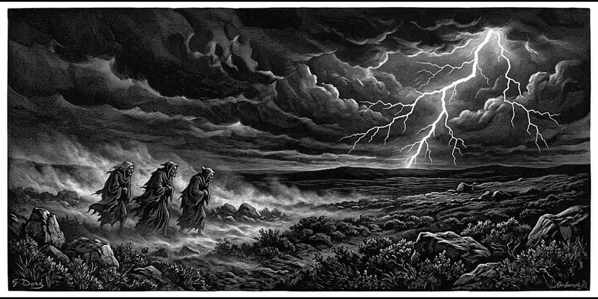

William Shakespeare

Macbeth, el mejor general del rey Duncan, oye de tres brujas que será rey de Escocia, y la profecía le prende la ambición: empujado por su esposa, asesina al rey bajo su propio techo y ocupa el trono; de ahí en adelante solo puede sostenerlo con más crímenes, entre la culpa y el miedo, hasta que la misma profecía se cumple al revés. Es la tragedia más breve de Shakespeare y una de las más oscuras.

## Acto I, escena 1

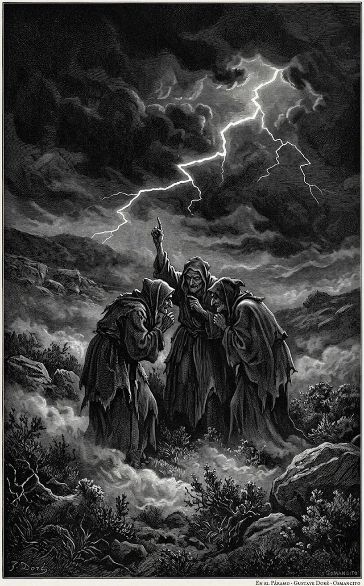

*Trueno y relámpago. Tres brujas se citan para cuando acabe la batalla: «¿Cuándo volveremos a encontrarnos las tres?», pregunta la primera, y esa es la primera frase de la obra. Ya tienen el dónde (el páramo) y les falta decir con quién:*

> There to meet with Macbeth.

Allí, a encontrarnos con Macbeth.

Tercera bruja

*Es la primera vez que suena el nombre de Macbeth, y suena en boca de una bruja. Las llaman sus espíritus (un gato, un sapo) y se van entre la niebla, cantando el mundo al revés:*

> Fair is foul, and foul is fair: Hover through the fog and filthy air.

Lo bello es feo, y lo feo es bello: volemos entre la niebla y el aire inmundo.

Las tres

---

## Acto I, escena 2

*El rey Duncan, acampado junto a la batalla, ve llegar a un capitán herido: «¿Quién es ese hombre ensangrentado?», la primera frase de la escena. Por su estado, dice el rey, podrá dar las últimas noticias de la rebelión. El capitán empieza: la cosa estaba pareja, el rebelde Macdonwald recibía refuerzos de las islas, pero Macbeth lo abrió del ombligo a las quijadas y clavó su cabeza en las almenas. El rey lo oye maravillado:*

> So well thy words become thee as thy wounds: They smack of honour both.

Tus palabras te sientan tan bien como tus heridas: ambas saben a honor.

Duncan

*Apenas contada esa hazaña, el capitán trae la mala: ganada la primera pelea, vino otra:*

> Mark, King of Scotland, mark: No sooner justice had, with valour arm’d, Compell’d these skipping kerns to trust their heels, But the Norweyan lord, surveying vantage, With furbish’d arms and new supplies of men, Began a fresh assault.

Atienda, rey de Escocia, atienda. Apenas la justicia, armada de valor, obligó a esos kernos saltarines a fiar en sus talones, el señor noruego, viendo su ocasión, con armas bruñidas y nuevos refuerzos de hombres, lanzó un nuevo asalto.

Capitán

*¿Se acobardaron Macbeth y Banquo? Al contrario, dice el capitán: como cañones cargados al doble. Entra Ross con la prisa en los ojos («Así ha de mirar quien viene a contar cosas extrañas», anota Lennox) y confirma la victoria: Noruega pide la paz y pagará diez mil dólares por enterrar a sus muertos. Queda el thane de Cawdor, el señor que resultó traidor, y de él se ocupa el rey:*

> No more that Thane of Cawdor shall deceive Our bosom interest.

Ese thane de Cawdor no volverá a engañar nuestra más íntima confianza.

Duncan

*Sentenciado el traidor, su título viaja hacia Macbeth sin que él lo sepa todavía: «Lo que él ha perdido, el noble Macbeth lo ha ganado». Es la última frase de la escena, y suena a profecía.*

---

## Acto I, escena 3

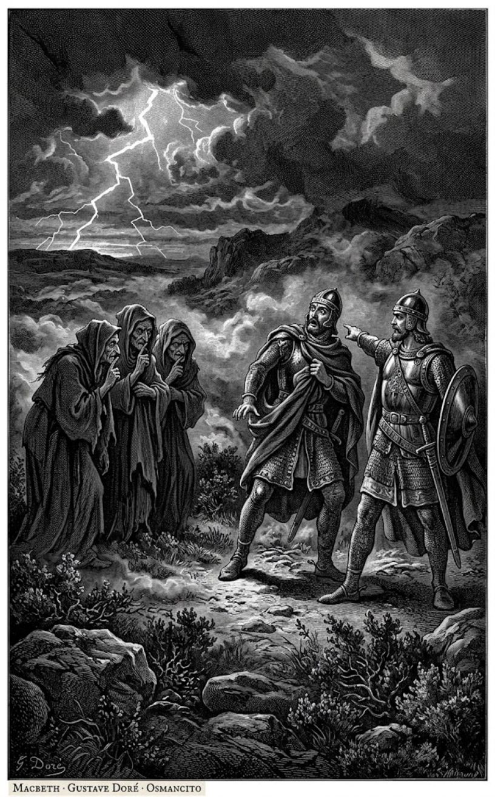

*Las tres brujas vuelven a encontrarse («¿Dónde has estado, hermana?», se preguntan, y esa es la primera frase de la escena) y se cuentan sus travesuras. Una le pidió castañas a la mujer de un marinero, la mujer la despachó a gritos, y la bruja juró vengarse del marido, que zarpó rumbo a Alepo: lo perseguirá navegando en un colador, lo secará como heno, no lo dejará dormir. Enseña un trofeo: el pulgar de un piloto naufragado. Suena un tambor:*

> Macbeth doth come.

Llega Macbeth.

Tercera bruja

*Entran Macbeth y Banquo, de vuelta de la batalla, y la primera frase de Macbeth las imita sin saberlo: «Nunca vi un día tan feo y tan bello». Banquo descubre a las tres (marchitas, vestidas raro, con barba: «Deberíais ser mujeres, y sin embargo vuestras barbas me impiden afirmar que lo sois») y Macbeth les ordena hablar. Ellas saludan: «Salve, Macbeth, thane de Glamis», que ya es; «salve, Macbeth, thane de Cawdor», que no sabe que es; y la tercera remata:*

> that shalt be king hereafter!

¡Tú que serás rey después!

Tercera bruja

*Macbeth se estremece («Mi buen señor, ¿por qué os sobresaltáis y parecéis temer cosas que suenan tan bien?», le dice Banquo). Banquo les pide su parte: si pueden mirar las semillas del tiempo y decir cuál grano crecerá y cuál no, que hablen para él, que ni mendiga ni teme sus favores ni su odio. Ellas responden con acertijos: «No tan feliz, y mucho más feliz», «Engendrarás reyes, aunque no lo seas». Y la primera:*

> Lesser than Macbeth, and greater.

Menor que Macbeth, y mayor.

Primera bruja

*Macbeth quiere más («Hablad, os lo ordeno») y se disuelven en el aire. «La tierra tiene burbujas, como el agua», dice Banquo: ¿existieron de verdad, o comieron la raíz loca que aprisiona la razón? Se repiten uno al otro lo oído («Tus hijos serán reyes», «Tú serás rey»), y llegan Ross y Angus con el agradecimiento del rey y un título nuevo:*

> And, for an earnest of a greater honour, He bade me, from him, call thee Thane of Cawdor: In which addition, hail, most worthy thane, For it is thine.

Y como prenda de un honor mayor, me mandó que de su parte te llame thane de Cawdor. Con ese título, salve, digno thane, pues es tuyo.

Ross

*«¿Puede el diablo decir verdad?», se asombra Banquo. El thane de Cawdor vive todavía, pero confesó su traición y la pagará. Macbeth se mira el título como un traje prestado («¿Por qué me vestís con ropas prestadas?»), y luego, a solas, se le escapa lo que la profecía le está haciendo por dentro:*

> I am Thane of Cawdor: If good, why do I yield to that suggestion Whose horrid image doth unfix my hair, And make my seated heart knock at my ribs, Against the use of nature?

Soy thane de Cawdor. Si es bueno, ¿por qué cedo a esa sugestión cuya imagen horrible me eriza el cabello y hace que mi corazón sentado golpee contra mis costillas, contra el uso de la naturaleza?

Macbeth

*Dos verdades se cumplieron ya, y lo mayor «viene detrás». Decide no mover un dedo: «Si el azar quiere que yo sea rey, el azar podrá coronarme sin que yo me mueva». Banquo advierte en voz baja que los instrumentos de la oscuridad suelen decir verdades pequeñas para traicionar en lo hondo. Macbeth corta: «Vayamos hacia el Rey», y la última frase es suya: «Venid, amigos».*

---

## Acto I, escena 4

*En el palacio de Forres, el rey pregunta: «¿Se ha hecho la ejecución de Cawdor?», la primera frase de la escena. Malcolm responde con lo que le contó un testigo: el traidor confesó, pidió perdón y murió muy entero:*

> Nothing in his life Became him like the leaving it; he died As one that had been studied in his death, To throw away the dearest thing he ow’d As ’twere a careless trifle.

Nada en su vida le sentó tan bien como dejarla; murió como quien hubiera estudiado su muerte, para arrojar lo más caro que poseía como una bagatela sin importancia.

Malcolm

*Duncan suspira: «No hay arte que permita hallar en el rostro la construcción del alma: era un caballero en quien yo puse una confianza absoluta». En eso entra Macbeth, el nuevo Cawdor, y el rey se le echa encima de gratitud: no alcanzan las alas del premio para cogerlo; ha plantado a Macbeth y Banquo y piensa hacerlos crecer. Y entonces anuncia que el reino quedará fundado sobre su primogénito, Malcolm, «a quien llamaremos desde ahora príncipe de Cumberland». La corte aplaude. Macbeth, a solas, ve el obstáculo:*

> —That is a step On which I must fall down, or else o’erleap, For in my way it lies.

Ese es un escalón en el que he de caer, o bien saltar por encima, pues está en mi camino.

Macbeth

*«Estrellas, esconded vuestros fuegos; que la luz no vea mis negros y profundos deseos». Cierra la escena el rey, sin sospechar nada: «Sigámoslo, que su cuidado se ha adelantado para darnos la bienvenida. Es un pariente sin igual». Van todos a dormir a casa de Macbeth.*

---

## Acto I, escena 5

*En Inverness, Lady Macbeth lee la carta de su marido (la primera frase de la escena es de la carta: «Me encontraron el día del éxito»): las brujas lo saludaron thane de Cawdor y «salve, rey que serás». Ella lo celebra y lo teme: «Pero temo tu naturaleza: está demasiado llena de la leche de la bondad humana para tomar el camino más corto». Quiere tenerlo ya al lado:*

> Hie thee hither, That I may pour my spirits in thine ear, And chastise with the valour of my tongue All that impedes thee from the golden round, Which fate and metaphysical aid doth seem To have thee crown’d withal.

Date prisa en venir, para que vierta mis espíritus en tu oído y castigue con el valor de mi lengua todo cuanto te aparta del círculo de oro con que el destino y la ayuda sobrenatural parecen querer coronarte.

Lady Macbeth

*Llega un mensajero: el rey viene esta noche («¡Estás loco de decirlo!», responde ella). Sola, oye graznar al cuervo la entrada fatal de Duncan bajo sus almenas y pide a los espíritus que la dessexen («quitadme aquí el sexo»), que le cambien la leche por hiel, que la noche cubra el cuchillo para que el cielo no grite «¡Detente!». Llega Macbeth. Ella lo recibe ya coronado («¡Grande Glamis, digno Cawdor, mayor que ambos por el salve del porvenir!»), él dice que Duncan se va mañana, y ella: «¡Oh, nunca verá el sol ese mañana!». Y le da su primera lección de hipocresía:*

> Your face, my thane, is as a book where men May read strange matters.

Tu rostro, mi thane, es como un libro donde los hombres pueden leer cosas extrañas.

Lady Macbeth

*«Parece la flor inocente, pero sé la serpiente que hay debajo», y toma el mando de la noche:*

> He that’s coming Must be provided for; and you shall put This night’s great business into my dispatch; Which shall to all our nights and days to come Give solely sovereign sway and masterdom.

Al que viene hay que proveerlo; y tú pondrás el gran asunto de esta noche en mis manos, que a todas nuestras noches y días por venir dará solo soberanía y señorío.

Lady Macbeth

*Macbeth balbucea «hablaremos después». La última frase es de ella: «Déjame todo lo demás a mí».*

---

## Acto I, escena 6

*Ante el castillo. «Este castillo tiene un asiento agradable», dice el rey, la primera frase de la escena, y Banquo le señala los vencejos que anidan en cada saliente y alero: donde ese pájaro cría, el aire es delicado. Todo lo que ven es dulce, y todo es trampa. Sale a recibirlos la anfitriona, con reverencias dobles y palabras de casa honrada. El rey le da la mano:*

> Fair and noble hostess, We are your guest tonight.

Bella y noble anfitriona, esta noche somos vuestro huésped.

Duncan

*Ella responde que todo lo que tienen, y ellos mismos, es del rey y se lo devuelven en cuenta. Duncan pide que lo lleve con su anfitrión, al que quiere mucho, y la escena cierra con su despedida: «Con vuestro permiso, anfitriona».*

---

## Acto I, escena 7

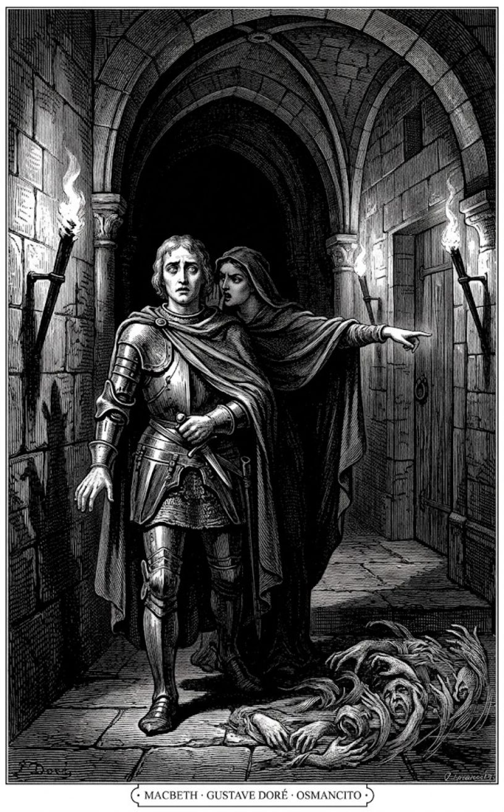

*Mientras dentro se cena, Macbeth se queda solo sopesando el golpe: «Si estuviera hecho cuando está hecho, entonces estaría bien que se hiciera pronto», la primera frase de la escena. Pero no hay golpe sin consecuencia: quien enseña el crimen aprende de vuelta. Duncan está bajo su techo en doble confianza, la de pariente y la de anfitrión. Y encima:*

> Besides, this Duncan Hath borne his faculties so meek, hath been So clear in his great office, that his virtues Will plead like angels, trumpet-tongued, against The deep damnation of his taking-off; And pity, like a naked new-born babe, Striding the blast, or heaven’s cherubin, hors’d Upon the sightless couriers of the air, Shall blow the horrid deed in every eye, That tears shall drown the wind.

Además, este Duncan ha llevado su poder con tanta mansedumbre, ha sido tan limpio en su alto oficio, que sus virtudes abogarán como ángeles, con lenguas de trompeta, contra la honda condenación de su muerte; y la piedad, como un niño recién nacido y desnudo, cabalgando la ráfaga, o como querubines del cielo montados en los corceles invisibles del aire, soplará el horrendo acto en todos los ojos, hasta que las lágrimas ahoguen el viento.

Macbeth

*«No tengo espuela que pique los costados de mi intención, solo la ambición trepadora, que salta demasiado alto y cae del otro lado». Llega ella: el rey ya casi ha cenado. Él se retira: «No iremos más lejos en este asunto», y ella empieza a molerlo: ¿era la esperanza borracha? ¿así es su amor? ¿dejará «no me atrevo» esperando sobre «yo quisiera», como el pobre gato del refrán? Él pide paz: «Me atrevo a todo lo que le cabe a un hombre». Ella contesta:*

> When you durst do it, then you were a man; And, to be more than what you were, you would Be so much more the man.

Cuando te atrevías a hacerlo, entonces eras un hombre; y para ser más de lo que eras, serías tanto más hombre.

Lady Macbeth

*Y remata: ella ha amamantado, y aun así le arrancaría el pezón de las encías a su bebé sonriente y le estrellaría los sesos, si lo hubiera jurado como él juró esto. «¿Y si fallamos?», pregunta él. «Atornilla tu valor hasta el punto justo, y no fallaremos»: el plan es emborrachar a los dos camareros del rey, dejarlo solo y echarles la culpa con sus propias dagas. Macbeth queda rendido («Trae al mundo solo hijos varones, pues tu temple intrépido no debe engendrar sino hombres») y resuelto:*

> I am settled, and bend up Each corporal agent to this terrible feat.

Estoy decidido, y tenso cada agente de mi cuerpo para esta terrible hazaña.

Macbeth

*Y salen a cenar. La última frase es suya: «Vamos, y burlemos al tiempo con la apariencia más bella: un rostro falso ha de ocultar lo que sabe el corazón falso».*

---

## Acto II, escena 1

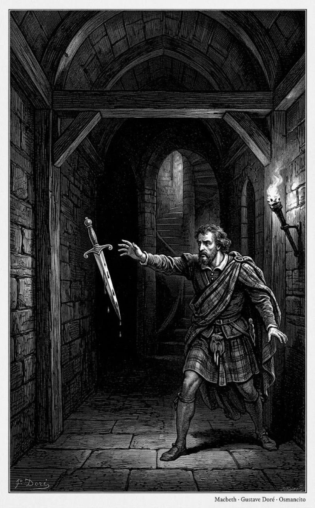

*Medianoche en el castillo. Banquo y su hijo Fleance cruzan el patio («¿Cómo va la noche, muchacho?», la primera frase de la escena): la luna ya cayó, «hay economía en el cielo: todas sus velas están apagadas». Banquo entrega la espada al muchacho: le pesa el sueño como plomo, y no quiere dormir, y dice por qué:*

> Merciful powers, Restrain in me the cursed thoughts that nature Gives way to in repose!

Poderes misericordiosos, contened en mí los pensamientos malditos a los que la naturaleza cede en el reposo.

Banquo

*Sobró decirlo: «Anoche soñé con las tres Hermanas Fatídicas: a vos os han mostrado algo de verdad». Aparece Macbeth, de ronda. Banquo le cuenta que el rey se recogió feliz y le manda un diamante a la anfitriona; Macbeth tienta a Banquo: «Si os mantenéis de mi parte cuando llegue el momento, os traerá honor». La respuesta de Banquo es limpia:*

> So I lose none In seeking to augment it, but still keep My bosom franchis’d, and allegiance clear, I shall be counsell’d.

Mientras no pierda ninguno al buscar aumentarlo, y conserve libre mi pecho y limpia mi lealtad, aceptaré consejo.

Banquo

*Se despiden. Solo, esperando la campana convenida, Macbeth la ve: una daga en el aire, el mango hacia su mano:*

> Come, let me clutch thee:— I have thee not, and yet I see thee still.

Ven, déjame aferrarte. No te tengo, y aun así te sigo viendo.

Macbeth

*«¿No eres sino una daga de la mente, una falsa criatura nacida de un cerebro oprimido por el calor?»; la ve con gotas de sangre en la hoja, y no hay tal cosa: es el negocio sangriento el que así informa a sus ojos. La noche está muerta, la brujería celebra sus ofrendas, el asesinato marcha con paso de fantasma. «Mientras yo amenazo, él vive»: las palabras enfrían los actos. Suena la campana. «La campana me invita», y la última frase de la escena es para el que duerme: «No la oigas, Duncan, pues es un toque de difuntos que te llama al cielo o al infierno».*

---

## Acto II, escena 2

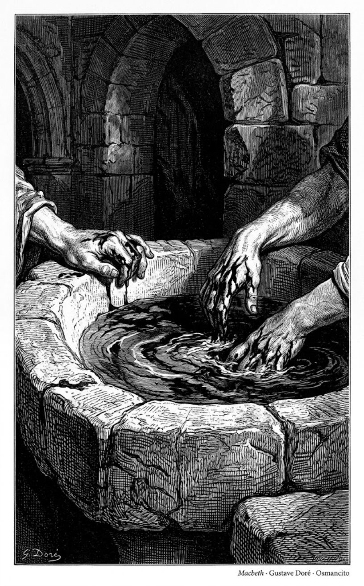

*Lady Macbeth espera en la oscuridad, y la primera frase de la escena es su brindis feroz: lo que emborrachó a los camareros la ha hecho a ella valiente; lo que los apagó a ellos, a ella le dio fuego. Chilla un búho («el fatal sereno, que da las buenas noches más severas»). Las puertas están abiertas, los criados roncan con sus bebidas drogadas. Ella dejó las dagas listas. Y confiesa lo único que la detuvo:*

> I am afraid they have awak’d, And ’tis not done.

Temo que se hayan despertado y no esté hecho.

Lady Macbeth

*Nada de eso: «Si no se hubiera parecido a mi padre mientras dormía, yo lo habría hecho». Sale Macbeth del cuarto del rey: «He hecho la fechoría». Está deshecho: cree haber oído un ruido (¿quién duerme en la segunda alcoba? Donalbain), se mira las manos («Esto es un triste espectáculo»), y cuenta que uno de los durmientes rió, otro gritó «¡Asesinato!», dijeron sus oraciones, y él:*

> Methought I heard a voice cry, “Sleep no more!

Me pareció oír una voz que gritaba: «¡No dormiréis más!

Macbeth

*«Pero ¿por qué no pude pronunciar «Amén»? Yo tenía más necesidad que nadie de bendición, y el «Amén» se me atascó en la garganta». Ella lo corta: pensar estas cosas así volverá locos a los dos. Pero él siguió oyendo la voz por toda la casa: «Glamis ha asesinado el sueño, y por eso Cawdor no dormirá más. ¡Macbeth no dormirá más!». Ella lo manda a lavarse «ese sucio testigo» y a devolver las dagas para untar de sangre a los camareros. Él no vuelve ahí ni muerto («Me da miedo pensar lo que he hecho; volver a mirarlo, no me atrevo»), así que va ella («Los dormidos y los muertos no son más que pinturas»). Llaman a la puerta del sur. Macbeth se mira las manos como si fueran ajenas:*

> Ha, they pluck out mine eyes!

¡Ah, me arrancan los ojos!

Macbeth

*«¿Lavará todo el océano del gran Neptuno esta sangre de mi mano hasta dejarla limpia? No: esta mano mía más bien enrojecerá los mares multitudinarios, volviendo roja la verde inmensidad». Ella vuelve con las manos del mismo color («Mis manos son de tu color, pero me da vergüenza llevar un corazón tan blanco») y lo arrastra a acostarse: «Un poco de agua nos limpia de este acto. ¡Qué fácil es, entonces!». Más golpes en la puerta. Macbeth se queda atrás un instante:*

> To know my deed, ’twere best not know myself.

Para conocer mi acto, lo mejor sería no conocerme.

Macbeth

*Y cierra la escena con el aldabonazo y su deseo: «¡Despierta a Duncan con tus golpes! ¡Ojalá pudieras!».*

---

## Acto II, escena 3

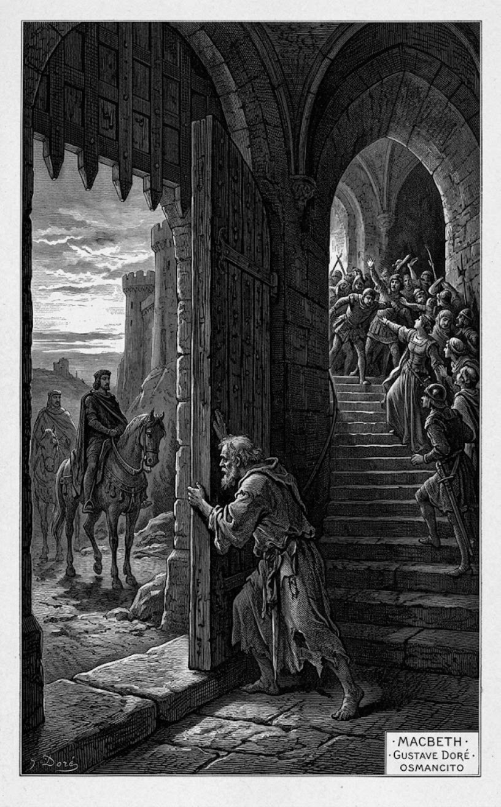

*«¡Esto sí que es un llamar!»: la primera frase de la escena es del portero, que abre la puerta del castillo medio dormido y jugando a ser el portero del infierno. Va dejando pasar a sus condenados: un labrador que se ahorcó esperando abundancia, un sastre inglés ladrón de paño, y este:*

> Faith, here’s an equivocator, that could swear in both the scales against either scale, who committed treason enough for God’s sake, yet could not equivocate to heaven: O, come in, equivocator.

Pues aquí hay un equivocador, que juraría en ambos platos de la balanza contra cualquiera de ellos; que cometió traición de sobra por amor de Dios, y aun así no pudo llegar al cielo con sus equívocos. Oh, entra, equivocador.

Portero

*(El equivocador: el que jura por ambos platillos de la balanza; alusión a los jesuitas de la pólvora, que mentían con verdad a medias, y eso no equivoca el camino al cielo.) «No hago más de portero del diablo», se cansa, y abre: son Macduff y Lennox. Entre chistes de taberna (la bebida provoca tres cosas: la nariz roja, el sueño y la orina; y con la lujuria, provoca el deseo y quita la ejecución), Macduff pregunta por el rey, que le mandó llamarlo temprano. Macbeth, ya vestido, lo guía: «Esta es la puerta». Lennox cuenta que la noche fue revuelta: chimeneas caídas, lamentos en el aire, gritos extraños de muerte, el pájaro oscuro clamando toda la noche; dicen que la tierra tenía fiebre y tembló. Sale Macduff del cuarto: «¡Oh horror, horror, horror!»:*

> Confusion now hath made his masterpiece!

¡La Confusión ha hecho ahora su obra maestra!

Macduff

*«¡Despertad, despertad! Tocad la campana de alarma. ¡Asesinato y traición!». Sale Lady Macbeth preguntando qué negocio es ese, y Macduff: «Oh, gentil señora, no es para vos oír lo que puedo decir». Sale Banquo («Querido Duff, te ruego que te desdigas y digas que no es así»). Y sale Macbeth, de luto perfecto:*

> Had I but died an hour before this chance, I had liv’d a blessed time; for, from this instant There’s nothing serious in mortality.

Si yo hubiera muerto una hora antes de este suceso, habría vivido un tiempo bendito; pues desde este instante no hay nada serio en lo mortal.

Macbeth

*Los hijos del rey, Malcolm y Donalbain, llegan al enterarse: los camareros aparecieron manchados de sangre, con las dagas sin limpiar sobre las almohadas. Y Macbeth suelta que los mató él, en un arrebato: «Oh, aún me arrepiento de mi furia, por haberlos matado». ¿Quién puede ser a la vez sabio, asombrado, templado y furioso, leal y neutral? Lady Macbeth se desvanece («¡Sacadme de aquí, oh!») y la apartan. Banquo convoca a juntarse y averiguar la obra sangrienta; todos juran contra la malicia traidora. Los dos hermanos se quedan atrás, hablando bajo: aquí «hay dagas en las sonrisas de los hombres: cuanto más cercano en sangre, más cercano a la sangre». Malcolm irá a Inglaterra, Donalbain a Irlanda:*

> This murderous shaft that’s shot Hath not yet lighted; and our safest way Is to avoid the aim.

Esta flecha asesina que se ha disparado aún no ha caído; y nuestro camino más seguro es evitar la puntería.

Malcolm

*«Por tanto, a caballo», sin despedidas. La última frase es de Malcolm: «Hay licencia en el hurto que se roba a sí mismo cuando no queda misericordia».*

---

## Acto II, escena 4

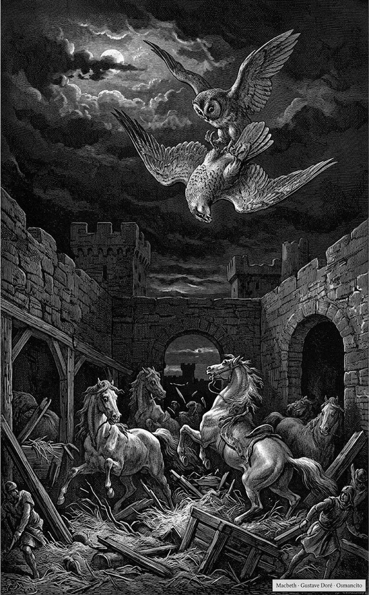

*Fuera del castillo, un viejo y Ross hablan de los presagios. «Recuerdo bien setenta años», dice el viejo en la primera frase de la escena, «pero esta noche dolorosa ha hecho bagatela de lo que sabía»: es de día y la noche oscura estrangula la lámpara viajera; el martes un búho ratonero mató a un halcón en su altura; los caballos de Duncan se volvieron salvajes, rompieron las caballerizas y, dicen, se comieron entre sí. El viejo lo resume:*

> ’Tis unnatural, Even like the deed that’s done.

Es antinatural, igual que el acto cometido.

Viejo

*Llega Macduff con las noticias: los culpables fueron «los que ha matado Macbeth», sobornados, dicen; y Malcolm y Donalbain huyeron, lo que hace caer la sospecha sobre ellos («¡Ambición pródiga, que devoras los medios de tu propia vida!»). La corona: Macbeth ya está nombrado y ha ido a Scone a ser investido; el cuerpo de Duncan va a Colmekill, la tumba sagrada de sus antepasados. Macduff no va a la coronación: se vuelve a Fife, no sin antes desearle a Ross, en la despedida, una frase con doble filo: «Bien, ojalá veáis allí las cosas bien hechas»; «¡no sea que nuestras ropas viejas nos sienten mejor que las nuevas!». Cierra la escena la bendición del viejo:*

> God’s benison go with you; and with those That would make good of bad, and friends of foes!

Que la bendición de Dios vaya con vos, y con los que quieran hacer bien del mal y amigos de enemigos.

Viejo

---

## Acto III, escena 1

*Banquo abre el acto a solas, haciendo cuentas: «Ya lo tienes todo, Rey, Cawdor, Glamis, como prometieron las Hermanas Fatídicas; y temo que jugaste muy sucio para lograrlo». Y si sus palabras relucieron en Macbeth, ¿por qué no serían también sus oráculos, si a él lo saludaron padre de reyes? «Pero silencio; no más». Entran los nuevos reyes. Cortesía de anfitriones: esta noche hay cena solemne y su presencia se requiere; Banquo promete no faltar. Macbeth le saca la tarde con preguntas amables (¿cabalgas hoy?, ¿lejos?, ¿vuelve Fleance contigo?):*

> Tonight we hold a solemn supper, sir, And I’ll request your presence.

Esta noche damos una cena solemne, señor, y os pediré vuestra presencia.

Macbeth

*«Que vuestras monturas sean veloces y seguras». Se va Banquo, se va la corte («que cada uno sea dueño de su tiempo hasta las siete»), y se queda Macbeth con la verdad: «Ser así no es nada si no se es así con seguridad». Sus miedos a Banquo se clavan hondo: en su realeza natural reina lo que hay que temer. Las hermanas pusieron sobre su cabeza «una corona infecunda» y en su puño «un cetro estéril»: por la descendencia de Banquo manchó su mente, por ellos asesinó al benigno Duncan, y su joya eterna se la dio al enemigo común del hombre, ¡para hacer reyes a la semilla de Banquo! Antes que eso:*

> Rather than so, come, fate, into the list, And champion me to th’ utterance!—Who’s there?—

Antes que eso, ven, destino, a la liza y sé mi campeón hasta el extremo. ¿Quién va?

Macbeth

*Entran los dos hombres que esperaban a la puerta: asesinos pobres a quienes Macbeth convenció ayer de que su desgracia la causó Banquo. ¿Van a tragar eso? ¿Tan evangelizados están que rezarán por el hombre bueno cuya mano pesada los hundió? «Somos hombres, mi señor». Macbeth los provoca: sí, en el catálogo van por hombres, como los perros van todos por perros; pero la lista distingue al veloz, al sutil, al cazador:*

> Are you so gospell’d, To pray for this good man and for his issue, Whose heavy hand hath bow’d you to the grave, And beggar’d yours forever?

¿Estáis tan evangelizados que rezáis por este buen hombre y su descendencia, cuya mano pesada os ha doblado hacia la tumba y ha empobrecido a los vuestros para siempre?

Macbeth

*La oferta viene enseguida: quien tenga un lugar en la lista que no sea el último, que lo diga, y recibirá un encargo que quita de en medio a su enemigo y lo une al corazón del rey, cuya salud enferma sería perfecta con la muerte de aquel:*

> Now, if you have a station in the file, Not i’ th’ worst rank of manhood, say’t; And I will put that business in your bosoms, Whose execution takes your enemy off, Grapples you to the heart and love of us, Who wear our health but sickly in his life, Which in his death were perfect.

Ahora, si tenéis un puesto en la lista, no en la peor fila de la hombría, decidlo; y pondré en vuestros pechos ese negocio cuya ejecución elimina a vuestro enemigo y os ata al corazón y al afecto de nosotros, que llevamos nuestra salud enfermiza mientras él vive, y sería perfecta con su muerte.

Macbeth

*Basta: uno responde que los golpes del mundo lo han irritado tanto que no le importa lo que haga por despecho; el otro, que pondría su vida a cualquier suerte por remediarla o salir de ella. Macbeth les señala la obra: Banquo, y con él Fleance, su hijo, cuya ausencia le importa tanto como la del padre; esta noche, lejos del palacio. «Estamos decididos, mi señor». Y cierra la escena, a solas: «Banquo, el vuelo de tu alma, si halla el cielo, ha de hallarlo esta noche».*

---

## Acto III, escena 2

*«¿Se ha ido Banquo de la corte?», pregunta Lady Macbeth en la primera frase de la escena, y se queda sola con el balance: «Nada se tiene, todo se gasta, donde se logra el deseo sin contento. Es más seguro ser lo que destruimos que habitar, por la destrucción, una dicha dudosa». Llega Macbeth, solo con sus fantasías más miserables; ella le dice que lo hecho, hecho está, que lo que no tiene remedio no debe tener recuerdo. Él responde que no: «Hemos chamuscado a la serpiente, no la hemos matado»; sanará y su antiguo colmillo seguirá amenazando. Mejor estar con los muertos, a quienes enviaron a la paz para ganar la suya, que yacer sobre el tormento de la mente:*

> Duncan is in his grave; After life’s fitful fever he sleeps well; Treason has done his worst: nor steel, nor poison, Malice domestic, foreign levy, nothing Can touch him further.

Duncan está en su tumba; tras la fiebre intermitente de la vida duerme bien. La traición ha hecho lo peor: ni acero, ni veneno, ni malicia doméstica, ni leva extranjera, nada puede tocarlo más.

Macbeth

*Ella le pide que alise su rostro arrugado y esté brillante con los invitados. Él le pide lo mismo: honren a Banquo con ojos y lengua, porque mientras no estén seguros hay que lavar los honores en esos arroyos de adulación y hacer de la cara una máscara del corazón. Y entonces se le sale: «¡Oh, llena de escorpiones está mi mente, querida esposa! Tú sabes que Banquo, y su Fleance, viven». Ella: «Pero en ellos la copia de la naturaleza no es eterna».*

> There’s comfort yet; they are assailable.

Aún hay consuelo: son vulnerables.

Macbeth

*Antes de que el murciélago vuele y el escarabajo toque el bostezante toque de la noche, se hará «una acción de terrible fama». «¿Qué se hará?», pregunta ella. «Sé inocente del conocimiento, queridísima pichona, hasta que aplaudas el acto». (Ya no lo consulta: lo manda.) Y la noche viene: «Ven, noche que cierras los ojos, venda el ojo tierno del día compasivo»; «la luz se espesa; y el cuervo se echa a volar hacia el bosque de grajos». Las cosas buenas del día dormitan, los agentes negros se desperezan hacia sus presas. Ella se maravilla de sus palabras; él la cierra, y la escena, con esto:*

> Thou marvell’st at my words: but hold thee still; Things bad begun make strong themselves by ill.

Te asombras de mis palabras; pero quédate quieta: las cosas malas empezadas se afirman con mal.

Macbeth

*«Así que, te lo ruego, ven conmigo».*

---

## Acto III, escena 3

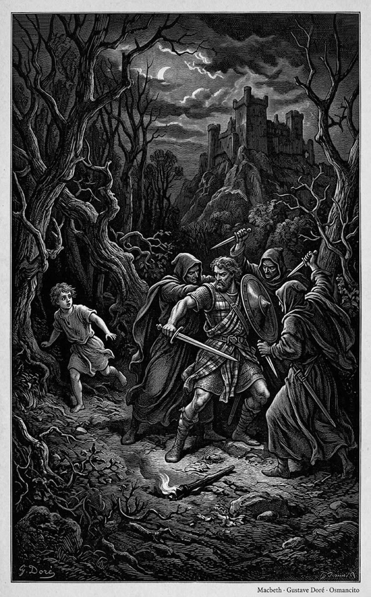

*En un parque junto al palacio esperan dos asesinos; llega un tercero, y la primera frase de la escena es la sospecha del primero:*

> But who did bid thee join with us?

¿Pero quién te mandó unirte a nosotros?

Primer asesino

*«Macbeth», responde el tercero, y basta: viene con las órdenes justas. Anochece («el oeste aún reluce con algunas vetas de día»; «ahora el viajero rezagado espolea a prisa para ganar la posada a tiempo»). Se oyen caballos, una voz pide luz: es Banquo, que como todos se baja a una milla y hace a pie el trecho hasta la puerta del palacio. «Esta noche lloverá», dice Banquo. «Que caiga», dice el asesino, y cae el golpe. «¡Oh, traición! ¡Huye, buen Fleance, huye, huye, huye! ¡Podrás vengarme...!». Alguien apagó la luz. En la oscuridad:*

> There’s but one down: the son is fled.

Solo uno ha caído; el hijo ha huido.

Tercer asesino

*«Hemos perdido la mejor mitad de nuestro asunto». Última frase, del primer asesino: «Bueno, vámonos y digamos cuánto está hecho».*

---

## Acto III, escena 4

*El banquete. «Conocéis vuestros propios rangos; sentaos», abre Macbeth, anfitrión humilde que se mezclará con la concurrencia. Pero en la puerta lo espera uno de los asesinos: «Hay sangre en tu cara». ¿Es de Banquo? Sí: degollado, «a salvo en una zanja», con veinte heridas en la cabeza. ¿Y Fleance? «Real señor, Fleance se ha escapado». El ajuste de cuentas de Macbeth:*

> Then comes my fit again: I had else been perfect; Whole as the marble, founded as the rock, As broad and general as the casing air: But now I am cabin’d, cribb’d, confin’d, bound in To saucy doubts and fears.

Entonces vuelve mi acceso: si no, habría estado perfecto, entero como el mármol, firme como la roca, tan amplio y general como el aire que nos envuelve. Pero ahora estoy encerrado, apretado, confinado, atado a dudas y miedos insolentes.

Macbeth

*Consuelo frío: «Allí yace la serpiente adulta; el gusano que ha huido tiene una naturaleza que con el tiempo criará veneno, pero por ahora no tiene dientes». Lady Macbeth lo llama al banquete (la fiesta sin bienvenida es fiesta vendida, no dada). Macbeth brinda y lamenta en público la ausencia de Banquo, «a quien prefiero reprochar por descortesía que lamentar por desgracia». Lennox le ofrece el sitio reservado. Y el sitio está ocupado. «¿Quién de vosotros ha hecho esto?»:*

> Thou canst not say I did it.

No puedes decir que yo lo hice.

Macbeth

*Ross quiere levantarse; Lady Macbeth cubre: «Mi señor suele estar así, y lo ha estado desde su juventud... el acceso es momentáneo». Y en privado, el látigo de siempre: «¿Eres un hombre?», «esto es la pintura misma de tu miedo: es la daga dibujada en el aire que dijiste que te llevó hasta Duncan», «miras solo un taburete». Pero él lo ve: «¡Mira ahí! ¡Observa! ¡Mira! ¡Ves! ¿Qué dices? ¿Qué me importa?»:*

> If thou canst nod, speak too.

Si puedes asentir, habla también.

Macbeth

*«Si los osarios y las tumbas devuelven a los que enterramos, nuestros monumentos serán los buches de los milanos». Se recompone, disculpa ante los nobles:*

> — Do not muse at me, my most worthy friends.

No os asombréis de mí, mis dignísimos amigos.

Macbeth

*Pide vino, llena la copa: «Bebo por la alegría general de toda la mesa y por nuestro querido amigo Banquo, a quien echamos de menos: ojalá estuviera aquí». Y vuelve. «¡Apartaos! ¡Quitaos de mi vista! ¡Que la tierra te esconda! ¡Tus huesos no tienen tuétano, tu sangre está fría; no hay mirada en esos ojos con que me fulminas!». Oso ruso, rinoceronte armado, tigre de Hircania: cualquier forma menos esa. Se va la sombra: «Pues bien: ido él, vuelvo a ser un hombre». Lady Macbeth despide a los invitados sin ceremonias: «Buenas noches a la vez; no os detengáis en el orden de vuestra salida, id todos a la vez». A solas, el veredicto: «Querrá sangre, dicen; la sangre querrá sangre». Macduff faltó a la cita; Macbeth tiene un criado pagado en cada casa. Mañana, a las Hermanas Fatídicas: saber lo peor por los peores medios. «Me he metido en la sangre tan adentro que, si no vadeara más, volver sería tan penoso como seguir». Y las dos últimas frases antes de la coda:*

> I will tomorrow (And betimes I will) to the Weird Sisters: More shall they speak; for now I am bent to know, By the worst means, the worst.

Mañana, y muy temprano, iré a las Hermanas Fatídicas: más deben decir; pues ahora estoy resuelto a saber, por los peores medios, lo peor.

Macbeth

*Y con lo que ya trama, ni siquiera se da tiempo de mirarlo:*

> Strange things I have in head, that will to hand, Which must be acted ere they may be scann’d.

Tengo en la cabeza cosas extrañas que pasarán a la mano, y que han de hacerse antes de poder examinarse.

Macbeth

*«Te falta el aderezo de todas las naturalezas: el sueño», dice ella. «Vamos, a dormir», dice él, y cierra la escena: «Todavía somos jóvenes en el obrar».*

---

## Acto III, escena 5

*«¿Pues qué pasa, Hécate?»: la diosa de la brujería llega furiosa con sus hermanas. ¿Cómo se atrevieron a traficar con Macbeth en acertijos y asuntos de muerte sin llamarla a ella, la maestra de sus encantos? Y peor:*

> And, which is worse, all you have done Hath been but for a wayward son, Spiteful and wrathful; who, as others do, Loves for his own ends, not for you.

Y lo que es peor, todo lo que habéis hecho ha sido por un hijo díscolo, rencoroso e iracundo, que, como otros, ama por sus propios fines, no por vosotras.

Hécate

*Enmienda: mañana, en el pozo del Aqueronte, él vendrá a conocer su destino. Hécate pasará la noche hacia un fin funesto:*

> Great business must be wrought ere noon.

Antes del mediodía debe hacerse un gran negocio.

Hécate

*Del cuerno de la luna cuelga una gota vaporosa que ella cogerá antes de que toque suelo; destilada con artes mágicas, alzará espíritus tan artificiales que, por la fuerza de su ilusión, lo arrastrarán a su perdición: «Despreciará el destino, burlará la muerte, y pondrá sus esperanzas por encima de la sabiduría, la gracia y el miedo. Y todas sabéis que la seguridad es el principal enemigo de los mortales». La llaman; su espiritillo la espera en una nube de niebla. Cierra la primera bruja: «Vamos, démonos prisa; pronto estará de vuelta».*

---

## Acto III, escena 6

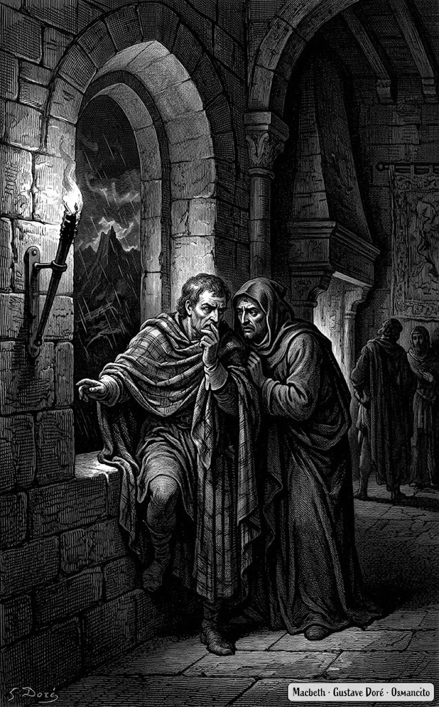

*Lennox y un Lord conversan, y Lennox abre con sarcasmo fino — la primera frase es también la primera cita:*

> My former speeches have but hit your thoughts, Which can interpret farther: only, I say, Thing’s have been strangely borne.

Mis palabras anteriores solo han dado en vuestros pensamientos, que pueden interpretar más lejos. Solo digo que las cosas se han llevado de modo extraño.

Lennox

*El bondadoso Duncan fue compadecido por Macbeth; claro: estaba muerto. El valerosísimo Banquo caminó demasiado tarde; a quien, si os place, mató Fleance, pues Fleance huyó. Los hombres no deben caminar tan tarde. ¡Y cómo le dolió a Macbeth! ¿No desgarró en piadosa furia a los dos delincuentes? ¿No fue noblemente hecho? Si tuviera a los hijos de Duncan bajo su llave —que el cielo no lo quiera— aprenderían lo que es matar a un padre. Y Macduff, por faltar a la fiesta del tirano, vive en desgracia. ¿Dónde se refugia? En la corte inglesa, donde vive el hijo de Duncan, recibido por el piadoso Eduardo. Allá fue Macduff a rogar ayuda: Northumberland, el belicoso Siward, y Aquel de arriba para ratificar la obra, «para que podamos dar de nuevo carne a nuestras mesas y sueño a nuestras noches». Macbeth se prepara para la guerra. ¿Llamó a Macduff? Sí:*

> He did: and with an absolute “Sir, not I,” The cloudy messenger turns me his back, And hums, as who should say, “You’ll rue the time That clogs me with this answer.

Sí; y con un rotundo: «Señor, yo no», el mensajero sombrío me vuelve la espalda y murmura, como diciendo: «Os arrepentiréis del tiempo que me carga con esta respuesta».

Un lord

*Que algún ángel santo vuele a Inglaterra con el mensaje, para que una bendición veloz regrese a este sufrido país bajo una mano maldita. Última frase, del Lord: «Enviaré mis oraciones con él».*

---

## Acto IV, escena 1

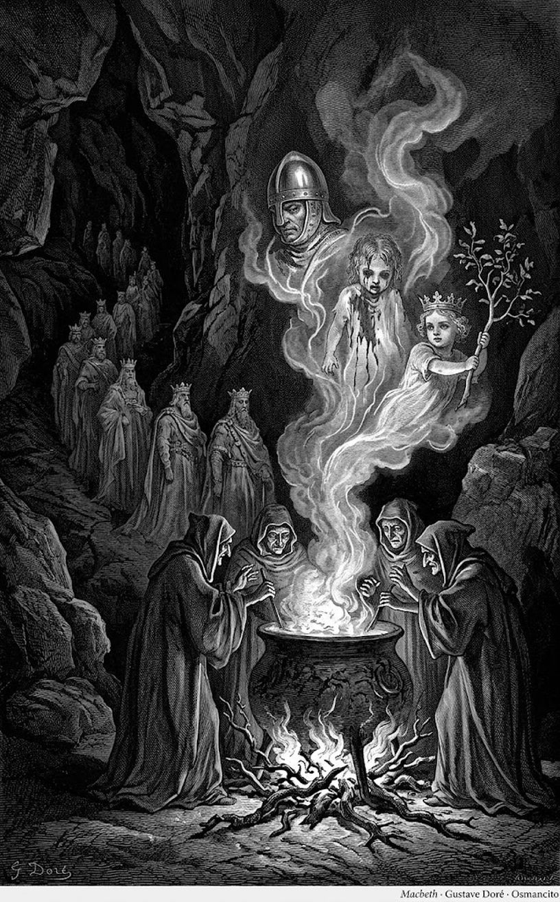

*«Tres veces ha maullado el gato atigrado»: la primera frase abre el aquelarre. Alrededor del caldero: «Dad vueltas al caldero y echad las entrañas envenenadas»; sapo venenoso, ojo de tritón, pata de rana, lengua de perro, escama de dragón, hígado de judío blasfemo, nariz de turco, dedo de niño estrangulado al nacer. Y el estribillo: «Doble, doble, afán y desgracia; arde, fuego; burbujea, caldero». Hécate elogia el trabajo y se une al corro. Entonces: «Por el picor de mis pulgares, algo malvado viene hacia aquí». Es Macbeth: «¿Qué hacéis, brujas secretas, negras y de medianoche?». «Una acción sin nombre». Él las conjura: aunque desaten los vientos contra las iglesias, aunque el mar trague la navegación, respóndanle. ¿De sus bocas o de sus maestros? «Llámalos; déjame verlos». Primera aparición, una cabeza armada: «Guárdate de Macduff; guárdate del thane de Fife». Macbeth:*

> Whate’er thou art, for thy good caution, thanks; Thou hast harp’d my fear aright.

Seas lo que seas, gracias por tu buena advertencia; has tocado bien mi miedo.

Macbeth

*Segunda aparición, un niño sangriento:*

> Be bloody, bold, and resolute.

Sé sanguinario, audaz y resuelto.

Aparición

*«Ríete con desprecio del poder del hombre, pues ninguno nacido de mujer dañará a Macbeth». Entonces viva Macduff, ¿qué ha de temerle? «Pero aun así haré doblemente segura la seguridad y tomaré fianza al destino: no vivirás; para poder decirle al miedo de corazón pálido que miente, y dormir a pesar del trueno». Tercera aparición, un niño coronado con un árbol en la mano: «Macbeth nunca será vencido hasta que el gran bosque de Birnam venga contra él hasta la alta colina de Dunsinane». ¿Quién puede alistar al bosque, desclavar la raíz del árbol? Dulces augurios:*

> Rebellious head, rise never till the wood Of Birnam rise, and our high-plac’d Macbeth Shall live the lease of nature, pay his breath To time and mortal custom.

Cabeza rebelde, no te alces nunca hasta que se alce el bosque de Birnam; y nuestro altamente colocado Macbeth vivirá el plazo de la naturaleza y pagará su aliento al tiempo y a la costumbre mortal.

Macbeth

*«Y sin embargo, mi corazón late por saber una cosa: ¿reinará alguna vez en este reino la descendencia de Banquo?». «No busques saber más». Él insiste con maldiciones; el caldero se hunde; suena música; las brujas dicen «¡Muéstrenle!»: «Mostrad sus ojos y afligid su corazón; venid como sombras, y como sombras marchad». Ocho reyes desfilan, el último con un espejo que muestra muchos más, y algunos con globos dobles y cetros triples; «¿Cómo, se alargará la línea hasta el estallido del juicio final?». Y al final:*

> —Now I see ’tis true; For the blood-bolter’d Banquo smiles upon me, And points at them for his.

Ahora veo que es verdad; pues Banquo, apelmazado de sangre, me sonríe y los señala como suyos.

Macbeth

*Las brujas bailan su ronda grotesca y se desvanecen. «¡Que esta hora perniciosa quede siempre maldita en el calendario! ¡Infectado sea el aire en que cabalgan, y condenados todos los que se fían de ellas!». Entra Lennox con la noticia: Macduff ha huido a Inglaterra. Macbeth:*

> Time, thou anticipat’st my dread exploits: The flighty purpose never is o’ertook Unless the deed go with it.

Tiempo, tú te adelantas a mis hazañas terribles: el propósito fugaz nunca se alcanza si el acto no va con él.

Macbeth

*«Desde este momento, las primicias mismas de mi corazón serán las primicias de mi mano»: sorprenderá el castillo de Macduff, pasará a filo de espada a su esposa, a sus niños y a todas las almas de su linaje. Sin jactancias de tonto: lo hará antes de que se enfríe el propósito. Última frase: «Venid, llevadme adonde están».*

---

## Acto IV, escena 2

*En el castillo de Macduff, su mujer pregunta a Ross en la primera frase: «¿Qué había hecho para huir del país?». Ross pide paciencia. «Él no la tuvo: su huida fue locura; cuando nuestros actos no lo hacen, nuestros miedos nos vuelven traidores». ¿Sabiduría?*

> to leave his wife, to leave his babes, His mansion, and his titles, in a place From whence himself does fly?

¿Dejar a su esposa, dejar a sus hijos, su mansión y sus títulos en un lugar de donde él mismo huye?

Lady Macduff

*«No nos quiere: le falta el sentimiento natural; pues el pobre chochín, el más diminuto de los pájaros, peleará, con sus polluelos en el nido, contra el búho». Ross no puede quedarse: «crueles son los tiempos en que somos traidores y no nos conocemos; en que damos crédito al rumor por lo que tememos, sin saber qué tememos». Se va. Y viene el dúo más dulce y más frágil de la obra, la madre y su hijo:*

> Sirrah, your father’s dead.

Muchacho, tu padre ha muerto.

Lady Macduff

*«¿Y qué harás ahora? ¿Cómo vivirás?». «Como los pájaros, madre». «¿Qué harás tú por un marido?», devuelve el niño. «Pues puedo comprarme veinte en cualquier mercado». «Entonces los comprarás para venderlos otra vez». ¿Era su padre un traidor? Uno que jura y miente, dice ella; y todos los que juran y mienten deben ser ahorcados por los hombres honrados. El niño concluye: «Entonces los mentirosos y los que juran son necios, pues hay mentirosos y perjuros de sobra para vencer a los hombres honrados y ahorcarlos». Llega un mensajero, temblando:*

> I doubt some danger does approach you nearly: If you will take a homely man’s advice, Be not found here; hence, with your little ones.

Temo que algún peligro se os acerca mucho. Si queréis el consejo de un hombre sencillo, no os encontréis aquí; salid con vuestros pequeños.

Mensajero

*No se atreve a quedarse. «¿Adónde habría de huir?», dice ella; «no he hecho daño». «Pero recuerdo ahora que estoy en este mundo terrenal, donde hacer daño es a menudo laudable y hacer el bien se tiene a veces por necedad peligrosa». Entran los asesinos: ¿dónde está su marido? Traidor, dicen. El niño: «¡Mientes, villano de orejas peludas!». «¡Cómo, tú, huevo! ¡Renacuajo de la traición!». Y la última frase es del niño: «Me ha matado, madre. ¡Huye, te lo ruego!».*

---

## Acto IV, escena 3

*En Inglaterra. «Busquemos alguna sombra desolada y allí vaciemos llorando nuestros pechos tristes», propone Malcolm en la primera frase. «Mejor empuñemos firme la espada mortal y, como hombres de bien, defendamos nuestra patria caída», responde Macduff:*

> Each new morn New widows howl, new orphans cry; new sorrows Strike heaven on the face, that it resounds As if it felt with Scotland, and yell’d out Like syllable of dolour.

Cada nueva mañana aúllan nuevas viudas, gritan nuevos huérfanos; nuevos dolores golpean al cielo en la cara, y este resuena como si sintiera con Escocia y aullara la misma sílaba de dolor.

Macduff

*Pero Malcolm desconfía: este tirano fue tenido por honrado, Macduff lo quiso bien y aún no lo ha tocado; «soy joven; pero algo podríais ganar de él por medio mío; y es sabiduría ofrecer un cordero débil, pobre e inocente para aplacar a un dios airado». «No soy traicionero», dice Macduff. «He perdido mis esperanzas». Entonces Malcolm monta la prueba terrible: se declara peor que Macbeth —sin fondo en su lujuria, su avaricia pegaría más hondo que esa lujuria veraniega, y de las gracias regias (justicia, verdad, templanza, misericordia) no tiene ni el gusto: «No, si tuviera poder, derramaría la dulce leche de la concordia en el infierno, alborotaría la paz universal, confundiría toda unidad en la tierra». Y la sentencia:*

> If such a one be fit to govern, speak: I am as I have spoken.

Si uno así es apto para gobernar, hablad: soy como he dicho.

Malcolm

*«¿Apto para gobernar? No, ni para vivir». Y Macduff llora a su país:*

> —O nation miserable, With an untitled tyrant bloody-scepter’d, When shalt thou see thy wholesome days again, Since that the truest issue of thy throne By his own interdiction stands accus’d, And does blaspheme his breed?

Oh nación miserable, con un tirano sin título y de cetro sangriento, ¿cuándo volverás a ver tus días sanos, si el heredero más legítimo de tu trono se declara acusado por su propia boca y blasfema contra su estirpe?

Macduff

*Ahí termina la prueba: «Macduff, esta noble pasión, hija de la integridad, ha borrado de mi alma los negros escrúpulos». Todo era mentira sobre sí mismo: es virgen, nunca perjuró, no traicionaría ni al diablo con su compañero; «mi primer falso decir fue este contra mí mismo».*

> What I am truly, Is thine and my poor country’s to command: Whither, indeed, before thy here-approach, Old Siward, with ten thousand warlike men, Already at a point, was setting forth.

Lo que soy en verdad es tuyo y de mi pobre país para mandar; adonde, de hecho, antes de que tú llegaras, el viejo Siward, con diez mil hombres de guerra, ya a punto, se disponía a partir.

Malcolm

*«Cosas tan bienvenidas y tan mal venidas a la vez es difícil reconciliar», dice Macduff. Interludio: el rey de Inglaterra cura con el tacto la enfermedad llamada «el mal», «una obra muy milagrosa en este buen rey», y cuelga sobre su trono bendiciones que lo hablan lleno de gracia — el contrarretrato del tirano. Llega Ross. ¿Cómo va Escocia? «Ay, pobre país, casi con miedo de conocerse a sí mismo. No puede llamarse nuestra madre, sino nuestra tumba, donde nada, salvo quien nada sabe, se ve sonreír una vez». ¿Y su mujer? «Pues bien». ¿Y sus hijos? Bien también. «No seas avaro de tu habla: ¿cómo va?». Y Ross lo suelta: «Vuestro castillo ha sido sorprendido; vuestra esposa y vuestros hijos, salvajemente degollados».*

> To relate the manner Were, on the quarry of these murder’d deer, To add the death of you.

Contar el modo sería, sobre el montón de estos ciervos abatidos, añadir vuestra muerte.

Ross

*Malcolm: «Da palabras al dolor; la pena que no habla susurra al corazón sobrecargado y le manda romperse». Macduff: «¿Todos mis pequeños? ¿Cómo, todos mis lindos polluelos y su madre de un solo golpe feroz? ¡Oh, milano del infierno! ¿Todos?». «Disputa como un hombre», dice Malcolm. «Lo haré; pero también debo sentirlo como un hombre». «Consuélate: hagamos medicinas de nuestra gran venganza». «Él no tiene hijos». «Que el dolor se convierta en ira». Macduff:*

> —But, gentle heavens, Cut short all intermission; front to front, Bring thou this fiend of Scotland and myself; Within my sword’s length set him; if he ’scape, Heaven forgive him too!

Pero, gentiles cielos, cortad toda demora; frente a frente, traed a este demonio de Escocia y a mí; ponedlo a la distancia de mi espada; si escapa, ¡que el cielo lo perdone también!

Macduff

*«Esta música suena viril», dice Malcolm, y cierra la escena y el acto:*

> Receive what cheer you may; The night is long that never finds the day.

Recibid el ánimo que podáis: es larga la noche que nunca encuentra el día.

Malcolm

Osmancito, con la asistencia de Instinct
