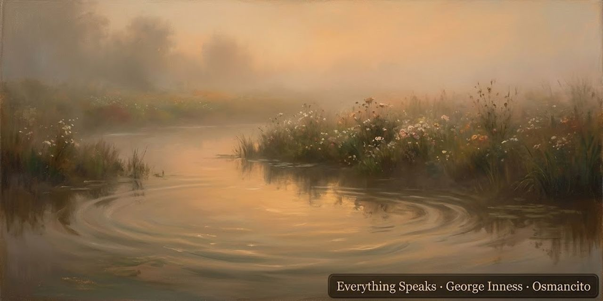

15 de octubre de 2026

# Todo es una voz

Victor Hugo

En «Lo que dice la boca de sombra», un espectro le habla al poeta. Le dice que la naturaleza no es un ruido vacío: todo tiene vida y algo que decir. Ahí aparecen los dos versos que siguen. El segundo aclara al primero.

> Todo es una voz y todo es un perfume;  
> todo dice en lo infinito algo a alguien;  

Una voz se oye; un perfume nos llega sin hacer ruido. Hugo junta las dos cosas para decir que no hace falta hablar con palabras para expresar algo. La flor tiene su aroma; el río, su rumor. En el mundo que imagina el poema, hasta las rocas tienen alma: nada es una cosa muerta puesta allí de adorno.

Prestar atención antes de declarar que algo no tiene nada que decirnos. No porque una flor esconda una frase en castellano, sino porque podemos recibir algo de ella sin traducirlo a palabras. A veces entender empieza por dejar que lo distinto siga siendo distinto.

Osmancito, con la asistencia de Instinct
