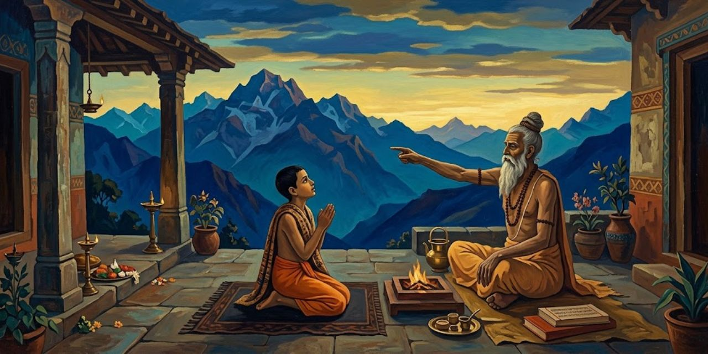
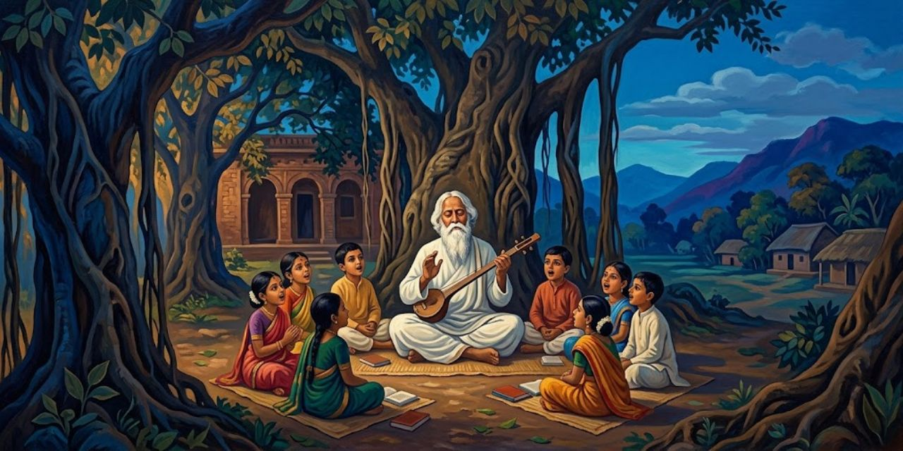
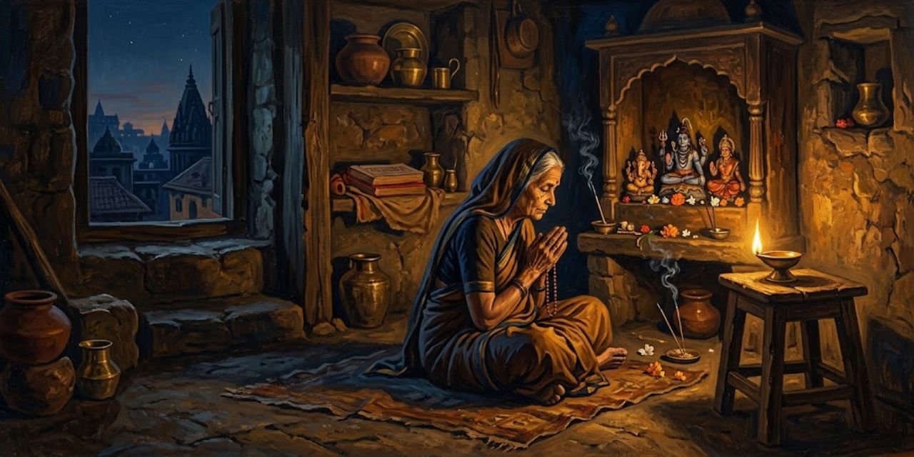
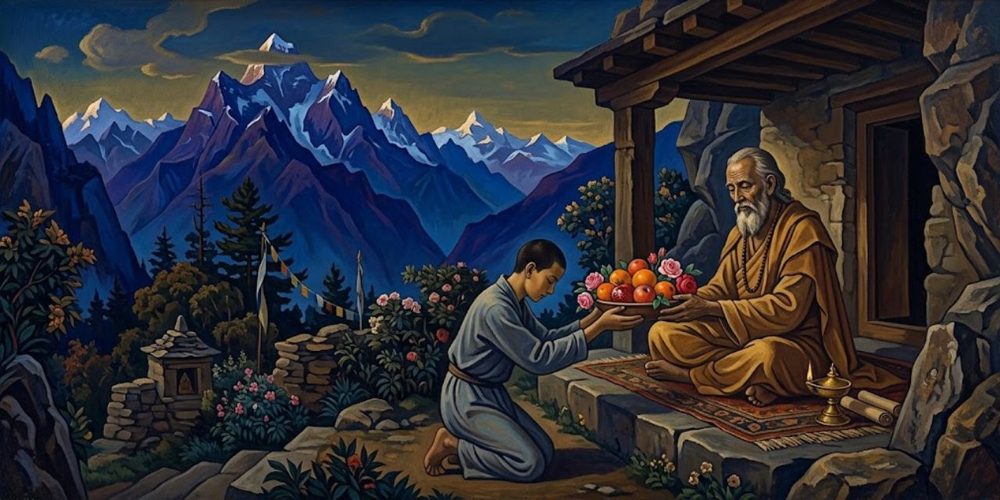
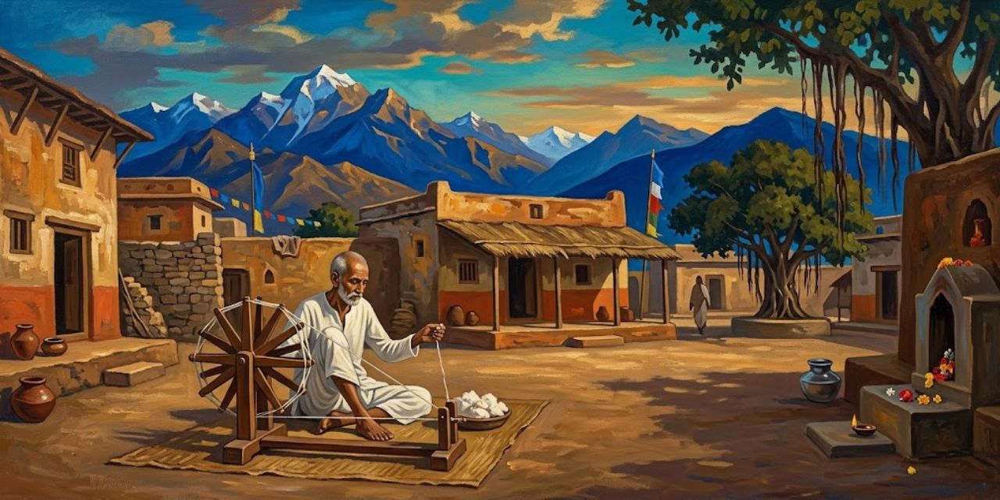
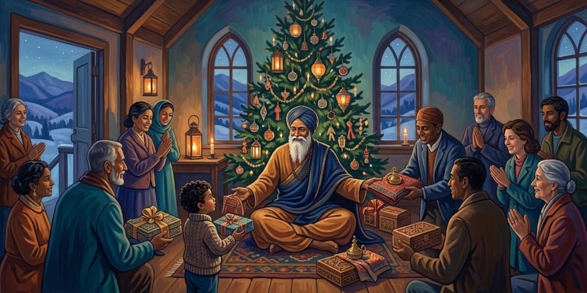

17 de octubre de 2026

# Autobiografía de un yogui

Paramhansa Yogananda

Yogananda nació en la India de finales del siglo diecinueve y llegó a ser el gran introductor del yoga en Occidente. En esta autobiografía, publicada en 1946, cuenta su vida en primera persona: la infancia en Gorakhpur, la búsqueda del maestro, los años de disciplina y el largo viaje a América. Es a la vez una memoria de santos, yoguis y milagros y el libro que abrió las enseñanzas de la India a millones de lectores del mundo occidental.

## Capítulo 1: Mis padres y mi primera infancia

*El libro empieza con una confesión asombrosa: el autor dice que recuerda su vida anterior. De niño ya sabía que había sido un yogui del Himalaya.*

> Clear recollections came to me of a distant life, a yogi amidst the Himalayan snows.

Me venían recuerdos nítidos de una vida lejana: un yogui entre las nieves del Himalaya.

Yogananda

*También recuerda la rabia de ser un bebé: lo entendía todo y no podía ni caminar ni hablar. Esa impotencia lo ponía a orar.*

> Prayerful surges arose within me as I realized my bodily impotence.

Me subían oleadas de oración al reconocer mi impotencia corporal.

Yogananda

*Su padre, Bhagabati, era un matemático serio y austero; su madre, una reina de corazones, enseñaba solo con amor. Cuando ella murió, el padre cambió:*

> I noticed then that his gaze often metamorphosed into my mother’s.

Noté entonces que su mirada se metamorfoseaba a menudo en la de mi madre.

Yogananda

*Abinash, un empleado del ferrocarril, le contó al niño cómo su padre se hizo discípulo del gran maestro Lahiri Mahasaya. Abinash había pedido permiso para visitarlo en Benarés y el padre se burló de él. Camino a casa, el corazón de Abinash repetía:*

> My heart was repeating: ‘Lahiri Mahasaya! I cannot live without seeing you!’

Mi corazón repetía: «¡Lahiri Mahasaya! ¡No puedo vivir sin verte!».

Abinash

*En ese instante, en medio del campo, el maestro se apareció y regañó al padre:*

> ‘Bhagabati, you are too hard on your employee!’

«¡Bhagabati, eres demasiado duro con tu empleado!».

Lahiri Mahasaya

*El padre no solo dio el permiso: partió él mismo a Benarés con su esposa. Al entrar en la casita del maestro, este lo recibió con una frase que lo dejó helado:*

> His words were the same as those he had used two days before in the Gorakhpur field.

Sus palabras fueron las mismas que había usado dos días antes en el campo de Gorakhpur.

Yogananda

*El maestro inició a los padres en la práctica del kriya yoga y les dejó una profecía sobre el hijo que vendría, según recuerda Abinash:*

> Lahiri Mahasaya took a definite interest in your own birth. Your life shall surely be linked with his own: the master’s blessing never fails.

«Lahiri Mahasaya se interesó de modo especial en tu propio nacimiento. Tu vida estará sin duda unida a la suya: la bendición del maestro nunca falla».

Abinash

*Lahiri Mahasaya murió poco después de que Yogananda naciera, pero su retrato presidía el altar de la casa, y el niño fue descubriendo que el maestro seguía presente:*

> As I began to discover his secret omnipresence, I lamented no more.

Cuando empecé a descubrir su secreta omnipresencia, dejé de lamentarme.

Yogananda

*A los ocho años, enfermo de cólera y ya sin esperanza de los médicos, su madre le señaló el retrato: «Inclínate ante él por dentro». El niño miró la foto:*

> I gazed at his photograph and saw there a blinding light, enveloping my body and the entire room.

Miré fijo su fotografía y vi allí una luz cegadora, que envolvía mi cuerpo y la habitación entera.

Yogananda

*El cólera desapareció al instante. Esa foto tenía su propia historia milagrosa: el maestro odiaba que lo fotografiaran y en las placas salía borrado. Un fotógrafo presumió de que lograría retratarlo, fracasó doce veces y fue llorando a verlo. Lahiri Mahasaya le explicó:*

> “I am Spirit. Can your camera reflect the omnipresent Invisible?”

«Yo soy Espíritu. ¿Puede tu cámara reflejar al Invisible omnipresente?».

Lahiri Mahasaya

*Al día siguiente el maestro posó por única vez: esa es la foto que sanó al niño y que se reproduce en el libro. Poco después de sanar, el niño tuvo una visión: cerró los ojos y vio sabios meditando en cuevas de montaña. Preguntó quiénes eran:*

> “We are the Himalayan yogis.”

«Somos los yoguis del Himalaya».

Los yoguis de la visión

*El niño gritó que quería ir al Himalaya y ser como ellos. La visión se disolvió en una luz que crecía y crecía, y una voz habló desde la luz. Iswara es el Señor, Dios hecho persona:*

> “I am Iswara. I am Light.”

«Yo soy Iswara. Yo soy Luz».

La voz en la luz

*El niño pidió fundirse en Él, y del éxtasis le quedó una frase para toda la vida:*

> “He is eternal, ever-new Joy!”

«¡Él es Gozo eterno, siempre nuevo!».

Yogananda

*Otro recuerdo de esa época: en Lahore, el niño tenía un altar casero a la Madre Divina y una certeza absoluta:*

> An unequivocal conviction came over me that fulfillment would crown any of my prayers uttered in that sacred spot.

Una convicción inequívoca se apoderó de mí: toda oración hecha en ese rincón sagrado se cumpliría.

Yogananda

*Su hermana Uma se burló: que pidiera entonces las dos cometas que volaban enfrente. El niño oró; una cometa cayó a sus pies y luego la otra. Uma salió corriendo, espantada:*

> “Indeed, Divine Mother listens to you! This is all too uncanny for me!”

«¡Es verdad, la Madre Divina te escucha! ¡Esto es demasiado raro para mí!».

Uma, su hermana

## Capítulo 2: La muerte de mi madre y el amuleto místico

*El deseo más grande de la madre era ver casado a Ananta, el hijo mayor. Todo estaba listo en Calcuta para la boda cuando el niño, en Bareilly, tuvo una visión a medianoche: su madre se le apareció junto a la cama y le pidió despertar al padre:*

> “It is I who have watched over thee, life after life, in the tenderness of many mothers! See in My gaze the two black eyes, the lost beautiful eyes, thou seekest!”

«Soy yo quien te ha cuidado, vida tras vida, en la ternura de muchas madres. ¡Mira en mi mirada los dos ojos negros, los hermosos ojos perdidos que buscas!».

La Madre Divina

*El padre no volvió a casarse en casi cuarenta años: «el servicio hacia mí terminó con tu madre», dijo cuando le ofrecieron una enfermera. Catorce meses después de la muerte, Ananta llamó al niño a su lado. Había acompañado a la madre en su lecho de muerte y guardaba un mensaje suyo:*

> “Mukunda, I have been reluctant to give you strange tidings.”

«Mukunda, me he resistido a darte noticias extrañas».

Ananta, su hermano mayor

*La madre había pedido que el mensaje se entregara al cumplirse un año. Así empezaba:*

> “Let these words be my final blessing, my beloved son Mukunda!”

«Que estas palabras sean mi bendición final, mi amado hijo Mukunda».

La madre, en su lecho de muerte

*Contaba que, siendo él un bebé, lo había llevado a Benarés, a casa de su gurú Lahiri Mahasaya. Casi escondida entre los discípulos, oraba para que el maestro se fijara en el niño:*

> While I patted you, I was praying that the great guru take notice and bestow a blessing. As my silent devotional demand grew in intensity, he opened his eyes and beckoned me to approach.

«Mientras te acariciaba, oraba para que el gran gurú se fijara en ti y te diera su bendición. A medida que crecía mi silenciosa demanda de devoción, él abrió los ojos y me hizo señas de acercarme».

La madre

*El maestro sentó al bebé en su regazo y profetizó que sería un yogui que llevaría muchas almas a Dios. Pero el suceso más singular de su vida fue otro: un sadhu, un asceta errante, apareció un día en Lahore pidiendo ver «a la madre de Mukunda»:*

> ‘Mother,’ he said, ‘the great masters wish you to know that your stay on earth will not be long.

«Madre, dijo, los grandes maestros desean que sepas que tu estancia en la tierra no será larga».

El sadhu

*El sadhu anunció un amuleto de plata que se materializaría en las manos de ella al meditar; debía legarlo a Mukunda y, cumplido su propósito, desaparecería. A la tarde siguiente apareció entre sus palmas:*

> Do not grieve for me, as I shall have been ushered by my great guru into the arms of the Infinite.

«No te aflijas por mí, pues mi gran gurú me habrá llevado ya a los brazos del Infinito».

La madre

*Con el amuleto, el niño sintió despertar memorias de maestros de vidas pasadas; el que no lograba escaparse al Himalaya viajaba cada día en las alas de su amuleto.*

## Capítulo 3: El santo de los dos cuerpos

*El padre le permitió un viaje a Benarés con dos cartas, una de presentación para el swami Pranabananda, discípulo de Lahiri Mahasaya, que lo recibió como a un viejo amigo y le contó algo asombroso:*

> The swami has spoken to no one but myself since my arrival!

«¡El swami no ha hablado con nadie más que conmigo desde que llegué!».

Yogananda

*Bajó las escaleras y se topó con Kedar Nath Babu, que subía apurado: el swami lo había encontrado bañándose en el Ganges una hora antes y lo había invitado a su casa, donde, le dijo, lo esperaba el hijo de Bhagabati. El niño se quedó helado:*

> “Why, that man, Swami Pranabananda, has not left my sight a moment since I first came about an hour ago.”

«Pero si ese hombre, el swami Pranabananda, no se ha apartado de mi vista ni un momento desde que llegué, hace una hora».

Yogananda

*Subieron juntos. El visitante susurró, señalando las sandalias de madera del santo:*

> “He was clad only in a loincloth, just as I see him now.”

«Iba vestido solo con el taparrabo, tal como lo veo ahora».

Kedar Nath Babu

*El swami sonrió y explicó que para los yoguis verdaderos la unidad del mundo no es un misterio: pueden verse y conversar a distancia y atravesar a voluntad la materia. Luego habló de su maestro:*

> He was Divinity Itself in the form of flesh.

«Era la Divinidad misma en forma de carne».

Swami Pranabananda

*Y contó su propia historia: ocho años meditando media noche después del trabajo en el ferrocarril, con percepciones luminosas, pero:*

> But a little veil always remained between me and the Infinite.

«Pero siempre quedaba un velo sutil entre el Infinito y yo».

Swami Pranabananda

*Una noche entera suplicó a Lahiri Mahasaya que intercediera por él. La respuesta del maestro fue escueta:*

> You must meditate more profoundly.

«Debes meditar más profundamente».

Lahiri Mahasaya

*El discípulo insistió hasta el alba; al fin el maestro extendió la mano: «Ya intercedí por ti ante Brahma; ve a meditar».*

> Immeasurably uplifted, I returned to my home. In meditation that night, the burning Goal of my life was achieved.

«Inmensamente elevado, volví a mi casa. En la meditación de esa noche, la meta ardiente de mi vida se cumplió».

Swami Pranabananda

*Desde entonces:*

> Never from that day has the Blissful Creator remained hidden from my eyes behind any screen of delusion.

«Desde ese día, el Creador bienaventurado jamás ha vuelto a esconderse de mis ojos tras ninguna pantalla de ilusión».

Swami Pranabananda

*Pidió al maestro que lo librara del empleo; este le mandó pedir la pensión diciendo la verdad de lo que sentía, y el médico se la concedió sin más preguntas:*

> Automatically they obeyed the great guru’s spiritual direction, and freed me for a life of unbroken communion with the Beloved.

«Obedecieron automáticamente la dirección espiritual del gran gurú, y me liberaron para una vida de comunión ininterrumpida con el Amado».

Swami Pranabananda

*Al despedirse, el swami bendijo al niño y le profetizó que su vida pertenecía al camino de la renunciación y el yoga, y que volverían a verse, con su padre, más adelante. Los años cumplieron ambas predicciones.*

## Capítulo 4: Mi fuga frustrada hacia el Himalaya

*La fuga se planeó como una operación de guerra: un amigo de la escuela, Amar, recogería en un carruaje el bulto lanzado desde la ventana (una manta, sandalias, la foto de Lahiri Mahasaya, el Bhagavad Gita y dos taparrabos) y ambos partirían al Himalaya vestidos de europeos para despistar a Ananta, el hermano detective. En el camino se sumó el primo Jatinda, que desertó en la primera estación (confesó después que lo espantó la promesa de Mukunda de que los tigres se sentarían a recibir caricias: él ya se veía entrando en el estómago de uno «por entregas»). En un andén, un inspector con un telegrama de Ananta interrogó a los muchachos; Amar le advirtió antes a Mukunda:*

> All I ask of you, Mukunda, is to keep still.

«Lo único que te pido, Mukunda, es que te quedes quieto».

Amar

*Amar se inventó que eran «Thomas» y «Thompson», dos muchachos medio ingleses, y el inspector, desarmado, los acomodó en el vagón de europeos. Llegaron a Hardwar al amanecer, pero allí los esperaba un policía: Ananta había telegrafiado a toda la línea. Mientras los custodiaba, el oficial les contó que él sí había conocido a un santo de verdad, días antes, junto al Ganges. Creyendo que era un asesino prófugo, le había hundido el hacha en el brazo; el santo siguió caminando sin quejarse, se recompuso el brazo colgante ante sus ojos y le dijo:*

> The Beloved Mother is taking care of me.

«La Madre Amada me está cuidando».

El sadhu, según el oficial

*Tres días después no tenía ni cicatriz. Los muchachos lamentaron su suerte: el policía había encontrado a un santo sin buscarlo, y ellos, que lo buscaban con ahínco, terminaron en una estación de policía. Ananta llegó a recogerlos y propuso un trato: visitar a un sabio en Benarés, ver al padre afligido en Calcuta, y luego Mukunda podría volver a buscar a su maestro. Amar desertó, ablandado por el calor de familia:*

> But I knew I would never abandon the quest for my guru.

«Pero yo sabía que jamás abandonaría la búsqueda de mi gurú».

Yogananda

*En Benarés, el sabio y su hijo, contratados en secreto por Ananta, le pronosticaron desgracias si abandonaba sus deberes mundanos. Sacudido, el muchacho oró pidiendo una señal inmediata, y un sadhu de noble porte que escuchaba desde fuera lo llamó aparte:*

> In response to your prayer, the Lord tells me to assure you that your sole path in this life is that of the renunciate.

«En respuesta a tu oración, el Señor me dice que te asegure que tu único camino en esta vida es el del renunciante».

El sadhu

*El sabio oficial de la casa no quedó muy contento con la intromisión:*

> “That sadhu is just as crazy as you are.”

«Ese sadhu está tan loco como tú».

El pundit

*De vuelta en Calcuta, el padre le pidió que al menos terminara la escuela y le puso un tutor de sánscrito, el swami Kebalananda, esperando calmar su inquietud con filosofía:*

> But the tables were subtly turned: my new teacher, far from offering intellectual aridities, fanned the embers of my God-aspiration.

«Pero la situación se invirtió sutilmente: mi nuevo maestro, lejos de ofrecer áridas disquisiciones intelectuales, avivó las brasas de mi anhelo de Dios».

Yogananda

*El padre no sabía que Kebalananda era un discípulo exaltado de Lahiri Mahasaya. Entre lección y lección, el tutor le contaba cómo era estar cerca del maestro:*

> An indescribable peace blossomed within me at the master’s glance. I was permeated with his fragrance, as though from a lotus of infinity.

«Una paz indescriptible florecía en mí ante la mirada del maestro. Me impregnaba de su fragancia, como la de un loto del infinito».

Swami Kebalananda

> The master was a living temple of God whose secret doors were open to all disciples through devotion.

«El maestro era un templo vivo de Dios, cuyas puertas secretas se abrían a todos los discípulos por la devoción».

Swami Kebalananda

*No era un intérprete libresco: sumergía sin esfuerzo la mente en la «biblioteca divina» y de allí salían espuma de palabras y rocío de pensamientos:*

> Lahiri Mahasaya was no bookish interpreter of the scriptures. Effortlessly he dipped into the ‘divine library.’

«Lahiri Mahasaya no era un intérprete libresco de las escrituras. Se sumergía sin esfuerzo en la “biblioteca divina”».

Swami Kebalananda

*Cuando le pedían explicar los estados de conciencia de los textos antiguos, sonreía y decía que primero los atravesaría él mismo, y mandaba a un discípulo cercano exponer las estrofas mientras él guiaba sus pensamientos:*

> ‘Please expound the holy stanzas as the meaning occurs to you.’

«Expongan por favor las santas estrofas según les vaya ocurriendo el significado».

Lahiri Mahasaya

*Nunca aconsejaba la fe servil:*

> ‘Words are only shells,’ he said.

«Las palabras son solo cáscaras, decía; la convicción de la presencia de Dios se gana en el contacto gozoso de la meditación».

Kebalananda, citando a Lahiri Mahasaya

*Y a cada problema de cada discípulo, la misma receta: la práctica del kriya yoga:*

> The yogic key will not lose its efficiency when I am no longer present in the body to guide you.

«La llave yóguica no perderá su eficacia cuando yo ya no esté presente en el cuerpo para guiarlos».

Lahiri Mahasaya

*Kebalananda presenció también el milagro de Ramu, un discípulo ciego de nacimiento que abanicaba al maestro por horas. Animado por el tutor, Ramu pidió luz para sus ojos; el maestro protestó que él no tenía poder de curar, y Ramu respondió con lógica de devoto:*

> ‘Sir, the Infinite One within you can certainly heal.’

«Señor, el Infinito que está en ti ciertamente puede curar».

Ramu

*«Eso sí es distinto», concedió el maestro: le tocó el punto entre las cejas y le mandó cantar el nombre de Rama siete días; a la semana, Ramu vio por primera vez el rostro de la naturaleza. Los cuerpos que el maestro curó espectacularmente acabaron un día en las llamas de la cremación, cierra Kebalananda:*

> But the silent spiritual awakenings he effected, the Christlike disciples he fashioned, are his imperishable miracles.

«Pero los silenciosos despertares espirituales que obró, los discípulos semejantes a Cristo que formó, son sus milagros imperecederos».

Swami Kebalananda

## Capítulo 5: Un «santo de los perfumes» exhibe sus maravillas

*El encuentro con el Santo de los Perfumes tuvo dos prólogos. El primero, en el templo de Kalighat, ante la imagen de Kali: un sadhu errante leyó en voz alta la confusión de sus pensamientos sobre los aspectos benignos y terribles de la naturaleza:*

> “You have indeed penetrated the bewilderment of my thoughts!”

«¡De veras ha penetrado usted la confusión de mis pensamientos!».

Yogananda

*El sadhu disertó sobre el enigma del bien y del mal, sobre el autoescrutinio que pulveriza el ego y produce videntes, y sobre la compasión que madura cuando uno descubre la unidad de todas las mentes:*

> “The saints of every age, sir, have felt like yourself for the sorrows of the world.”

«Los santos de todas las épocas, señor, han sentido como usted por los dolores del mundo».

Yogananda

> By ignoble whips of pain, man is driven at last into the Infinite Presence, whose beauty alone should lure him.

«Con ignominiosos latigazos de dolor, el hombre es empujado al fin a la Presencia Infinita, cuya belleza por sí sola debería atraerlo».

El sadhu de Kalighat

*Al despedirse, el sadhu le profetizó: «Después de que salgas de aquí hoy, te llegará una experiencia inusual». A la vuelta de una esquina lo atrapó un viejo conocido conversador, de esos que ignoran el tiempo:*

> Inwardly I petitioned the Goddess Kali to devise a graceful means of escape.

«En mi interior le pedí a la diosa Kali que ideara un medio elegante de escape».

Yogananda

*El hombre lo soltó por fin, pero volvió corriendo solo para decirle que en esa casa estaba Gandha Baba, el Santo de los Perfumes: «Puedes tener una experiencia inusual». La profecía repetida lo decidió a entrar. Sobre una piel de leopardo, el yogi regordete le ofreció un perfume. Siguió un duelo verbal: ¿esclavizar a Dios para hacer olores?, ¿doce años de práctica para fabricar lo que cuesta unas rupias en la floristería? El santo, divertido, capituló:*

> Mr. Philosopher, you please my mind.

«Señor Filósofo, me complace su mente».

Gandha Baba

*«Extiende la mano derecha», le ordenó. Sin tocarlo, le preguntó qué perfume quería: «Rosa». Y de la palma de la mano brotó con fuerza una fragancia de rosa; luego, a pedido del muchacho, una flor blanca sin olor se llenó al instante de jazmín. En casa, su hermana Uma olió ambas maravillas, lo que descartó la autosugestión. Un discípulo le contó que el maestro de Gandha Baba era un yogi tibetano de más de mil años; años después entendería que estos prodigios eran materializaciones reales de vibraciones, no hipnosis. Espectaculares, pero espiritualmente inútiles, concluye: desvíos de la búsqueda seria de Dios, como el fakir que se enorgullece de dominar el agua (¡una rana también se mueve en el agua!, se burlaba el místico persa Abu Said). Ni el sabio de Kalighat ni el yogi entrenado en el Tíbet colmaron su anhelo:*

> A guru too literally “marvelous” was not to my liking.

«Un gurú demasiado literalmente “maravilloso” no era de mi gusto».

Yogananda

## Capítulo 6: El Swami Tigre

*Un amigo de la escuela, Chandi, consiguió la dirección del famoso Sohong Swami, que antes de ser monje peleaba tigres a puño limpio. Tras una larga espera, entraron en su cuarto y lo hallaron en posición de loto:*

> My will was mighty, but my body was feeble.

«Mi voluntad era poderosa, pero mi cuerpo era débil».

El Swami Tigre

> I have every reason to extol the compelling mental vigor which I found to be the real subduer of royal Bengals.

«Tengo sobradas razones para ensalzar el vigor mental arrollador que resultó ser el verdadero domador de los bengalíes reales».

El Swami Tigre

*Cuando el muchacho preguntó si él también podría pelear tigres, el swami sonrió: sí, pero hay muchas clases de tigres, y algunos rondan las junglas de los deseos humanos; mejor vencer a esos merodeadores internos. Y contó su conversión. En la cumbre de la fama, la embriaguez del orgullo lo llevó a exhibirse en funciones públicas. Su padre le advirtió entonces que en la familia de la jungla había resentimiento contra él, y que un santo le había dejado una predicción ominosa: su próximo encuentro con un tigre le causaría heridas graves y seis meses de enfermedad mortal. El joven domador se rebeló:*

> I beg you not to impose any command that I change my way of life.

«Le ruego que no me imponga ninguna orden de cambiar mi modo de vida».

El Swami Tigre, a su padre

*La predicción, sin embargo, era explícita sobre lo que vendría después del castigo:*

> He shall then forsake his former ways and become a monk.

«Abandonará entonces su antigua vida y se hará monje».

El santo, según el padre

> I considered that Father had been the credulous victim of a deluded fanatic.

«Pensé que mi padre había sido la víctima crédula de un fanático engañado».

El Swami Tigre

*Poco después viajó a Cooch Behar, donde la ciudad entera se alborotó con su visita:*

> He must be an incarnation of the king of tigers himself!

«¡Debe ser una encarnación del mismísimo rey de los tigres!».

Los murmullos de la calle

*El príncipe de Cooch Behar lo mandó buscar con carruaje y sombrilla, lo recibió en persona y le escupió la duda sarcástica: un bengalí de ciudad, criado a arroz blanco, solo pudo haber peleado con animales drogados de opio. Ante la pregunta de si era cierto que peleaba tigres salvajes a mano desnuda, la respuesta fue seca:*

> It is quite true.

«Es completamente cierto».

El Swami Tigre

*El príncipe lo desafió a pelear con Raja Begum, su tigre recién capturado: si lo aturdía, lo encadenaba y salía de la jaula por su pie, se lo regalaba con miles de rupias; si se negaba, lo proclamaría impostor en todo el estado. La semana previa, los aldeanos corrían versiones fantásticas: que Raja Begum era un espíritu maligno reencarnado, o la respuesta del Cielo Tigre a las plegarias de los animales humillados. El swami, filosófico sobre la cautela del príncipe, que no le permitió ver al tigre antes del combate:*

> Whether the prince feared I might seek to hypnotize the beast, or secretly feed him opium, I know not!

«Si el príncipe temía que yo intentara hipnotizar a la bestia o darle opio en secreto, ¡no lo sé!».

El Swami Tigre

*El día del combate, ante miles de espectadores aterrados, entró en la jaula semidesnudo. El tigre le destrozó la mano derecha de un zarpazo; escondió los dedos sangrantes bajo la ropa y peleó con la izquierda hasta derrumbar a la bestia de un golpe final:*

> A spiritual change had entered my heart.

«Un cambio espiritual había entrado en mi corazón».

El Swami Tigre

*Siguieron seis meses al borde de la muerte por envenenamiento de la sangre, como había predicho el santo. Al sanar, se lo confesó a su padre:*

> I know now that my teacher is the holy man who gave the wise warning.

«Ahora sé que mi maestro es el santo que dio la sabia advertencia».

El Swami Tigre

*Y un día el santo llegó sin anunciarse: «Basta de domar tigres; ven conmigo, te enseñaré a someter las bestias de la ignorancia que rondan las junglas de la mente humana. Estás acostumbrado a tener público: que sea una galaxia de ángeles». Lo inició en el camino espiritual:*

> Hand in hand, we soon set out for my training in the Himalayas.

«De la mano, partimos pronto hacia mi entrenamiento en los Himalayas».

El Swami Tigre

## Capítulo 7: El santo levitante

*Un amigo le contó haber visto a un yogi flotar en el aire durante una reunión nocturna; el muchacho adivinó el nombre: Bhaduri Mahasaya, que vivía cerca de su casa y al que visitaba a menudo. El santo llevaba veinte años sin salir de su clausura, dominaba los pranayamas con tal fuerza que una vez pareció levantar una tormenta en la habitación, y luego quedaba en la calma vívida de la superconciencia. Bhaduri lo recibía con libertad («que Mukunda venga cuando quiera»), porque los mundanos no aprecian la franqueza que rompe sus ilusiones:*

> His own face was always serious, yet touched with an ecstatic smile.

«Su rostro era siempre serio, aunque tocado por una sonrisa extática».

Yogananda

*Le dio un consejo que llevaba una profecía escondida: le habló de sus corresponsales de la lejana América, que redescubrían la India «con mejor sentido de la orientación que Colón», y le dijo que lo esencial para la salvación humana no debía diluirse para Occidente:*

> I did not realize that his speech was a veiled prophetic guidance.

«No me di cuenta de que sus palabras eran una guía profética velada».

Yogananda

*Solo al escribir estas líneas, años después, entiende que el santo le anunciaba que llevaría las enseñanzas de la India a América. En las reuniones vespertinas, Bhaduri hablaba de la princesa Mirabai, que abandonó su corte por los sadhus y respondió al sannyasi que la rechazaba por mujer: «Dile al maestro que yo no sabía que hubiera otro Macho en el universo fuera de Dios; ¿no somos todos hembras ante Él?». Un estudiante, despediéndose, se arrodilló admirado:*

> “Master, you are wonderful!”

«¡Maestro, usted es maravilloso!».

Un estudiante

*Le alababa haber renunciado a las riquezas y comodidades por buscar a Dios. El santo lo corrigió con una sonrisa: estaba invirtiendo los términos.*

> I have left a few paltry rupees, a few petty pleasures, for a cosmic empire of endless bliss.

«He dejado unas pocas rupias miserables, unos pocos placeres mezquinos, por un imperio cósmico de dicha infinita».

Bhaduri Mahasaya

*¿Qué sacrificio hay en eso? Los verdaderos renunciantes, cerró, son los mundanos: cambian una posesión divina sin par por un puñado de juguetes terrenales. Años después, antes de embarcar a América, el joven se arrodilló ante él por la bendición de despedida: «Hijo, ve a América; toma por escudo la dignidad de la antiquísima India; la victoria está escrita en tu frente».*

## Capítulo 8: El gran científico de la India, J. C. Bose

*En una acera oyó a unos profesores decir que las invenciones inalámbricas de Jagadis Chandra Bose eran anteriores a las de Marconi, y al día siguiente visitó al sabio en su casa de Gurpar Road. Bose, formado en Cambridge, unía la verificación experimental occidental con la introspección oriental; su crescógrafo alcanzaba diez millones de aumentos y demostraba que las plantas tienen un sistema nervioso sensible y una vida emocional variada:*

> “You have done much, sir, to hasten the embrace of East and West in the impersonal arms of science.”

«Usted ha hecho mucho, señor, por apresurar el abrazo de Oriente y Occidente en los brazos impersonales de la ciencia».

Yogananda

> The unique throb of life in all creation could seem only poetic imagery before your advent, Professor!

«¡El latido único de la vida en toda la creación solo podía parecer imaginería poética antes de su llegada, profesor!».

Yogananda

*Le contó que un santo que conoció jamás cortaba flores («¿voy a robarle al rosal su orgullo de belleza?»), y remató:*

> His sympathetic words are verified literally through your discoveries!

«¡Sus palabras compasivas se verifican literalmente en sus descubrimientos!».

Yogananda

*En la inauguración del Instituto Bose, entre una puerta centenaria rescatada de un santuario y un templo dedicado al Noúmeno sin imagen alguna, el discurso del científico sonó a rishi antiguo: dedicaba el instituto no como laboratorio sino como templo; narró cómo los fisiólogos de la Royal Society le aconsejaron no invadir sus predios («había caído sin saberlo en el dominio de un sistema de castas desconocido»); prometió que jamás se tomarían patentes y que las puertas estarían abiertas a investigadores de todos los países, como en Nalanda y Taxila veinticinco siglos atrás:*

> Tears stood in my eyes at the scientist’s concluding words.

«Las palabras finales del científico me llenaron los ojos de lágrimas».

Yogananda

*En el laboratorio, el crescógrafo mostró al muchacho un helecho creciendo ante sus ojos, deteniéndose al roce de una varilla, reanimándose con el antídoto tras el cloroformo y agitándose en espasmos de dolor ante la navaja, hasta la inmovilidad final de la muerte. Un trozo de estaño registró fatiga y recuperación como un ser vivo. Y la predicción mayor de Bose:*

> Everything in man has been foreshadowed in the plant.

«Todo lo que hay en el hombre ha sido prefigurado en la planta».

J. C. Bose

*Años después, en 1938, investigadores de la Universidad de Columbia confirmaron que las fibras de la planta nitella propagan ondas eléctricas idénticas a las de las fibras nerviosas de animales y hombres: la «piedra Rosetta» entre la mente y la materia que Bose ya había anunciado.*

## Capítulo 9: El devoto dichoso y su romance cósmico

*Entró en silencio en la habitación y el santo lo recibió sin volverse: «Siéntate, señorcito; estoy hablando con mi Madre Divina»:*

> The angelic appearance of Master Mahasaya fairly dazzled me.

«El aspecto angélico de Master Mahasaya me deslumbró por completo».

Yogananda

*El saludo del santo le produjo el efecto más violento de su vida: una agonía de separación de la Madre Divina peor que la muerte de su madre. Cayó al suelo gimiendo y se aferró a los pies del maestro pidiendo su intercesión:*

> Beyond reach of doubt, I was convinced that Master Mahasaya was in intimate converse with the Universal Mother.

«Estaba convencido, fuera de toda duda, de que Master Mahasaya conversaba íntimamente con la Madre Universal».

Yogananda

*El santo accedió a transmitir su ruego. Esa noche, meditando en su buhardilla, el muchacho tuvo la visión: la Madre Divina ante él, en esplendor: «Siempre te he amado. Siempre te amaré». A la mañana siguiente volvió muy temprano por la respuesta, y el maestro, que no había salido de su cuarto, sonrió: «¿Podría yo añadir una sola palabra a la seguridad que recibiste anoche a las diez de la Madre Hermosa en persona?». Y añadió:*

> Think you that your devotion did not touch the Infinite Mercy? The Motherhood of God, that you have worshiped in forms both human and divine, could never fail to answer your forsaken cry.

«¿Crees que tu devoción no conmovió la Misericordia Infinita? La Maternidad de Dios, a la que has adorado en formas humanas y divinas, jamás podría dejar sin respuesta tu grito desamparado».

Master Mahasaya

*La casa de Amherst Street donde el santo dirigía una pequeña escuela era, por añadidura, el antiguo hogar del muchacho, la escena de la muerte de su madre: paredes sagradas, testigos de sus heridas y de su sanación. Allí no había reglas ni castigos: se enseñaban matemáticas superiores y una química del amor ausente de los libros. Cuando le llevó una guirnalda de champak, el santo la aceptó solo como ofrenda a la Madre que habitaba en su cuerpo. Y le anunció:*

> “I am not your guru; he shall come a little later,” he told me.

«Yo no soy tu gurú; él llegará un poco después».

Master Mahasaya

*Discípulo de Sri Ramakrishna, lo llevó en barca por el Ganges al templo de Dakshineswar, donde cantaba el nombre de la Madre hasta romperle el corazón. Una tarde, acorralados por un tormentón, llegaron secos a casa por su intercesión:*

> “He can serve as an earthly prototype for the very angels of heaven!”

«¡Puede servir de prototipo terrenal a los mismísimos ángeles del cielo!».

Yogananda

*Un día le ofreció ir a ver «bioscopos»: el primero, una conferencia mortalmente aburrida de la que la Madre Divina los rescató apagando las luces; el segundo, un golpecito suave en el pecho que le abrió la visión cósmica:*

> But ever enshrined in memory is the seraphic son of Divine Mother-Master Mahasaya!

«¡Pero para siempre consagrado en la memoria queda el hijo seráfico de la Madre Divina, Master Mahasaya!».

Yogananda

## Capítulo 10: Encuentro a mi maestro, Sri Yukteswar

*Aprobó el bachillerato por la vía de la Ingenuidad Infinita: su amigo Nantu le adelantó las preguntas trampa de los exámenes, y unas hojas sueltas de versos sánscritos encontradas en un solar le resolvieron la prueba de sánscrito al día siguiente. Libre de su promesa al padre, decidió partir a un ermitaño en Benarés con su amigo Jitendra. La despedida:*

> Let me go, that I someday return with a more divine understanding.

«Déjame ir, para volver un día con un entendimiento más divino».

Yogananda, a su padre

*En la ermita de Mahamandal, los compañeros no veían con buenos ojos que se encerrara a meditar en la buhardilla en vez de dedicarse a las tareas de la organización:*

> “Don’t try to catch God so soon!”

«¡No intentes atrapar a Dios tan pronto!».

Un compañero de la ermita

*Dyananda, el joven swami director, le ordenó devolver el dinero que su padre le enviaba y no mencionar jamás el hambre. El muchacho ayunó veinticuatro horas de prueba, y justo ese día el tren de Dyanandaji se retrasó y nadie comería hasta su llegada:*

> “The next Benares death from starvation is due at once in this hermitage,” I thought.

«La próxima muerte por inanición en Benarés está a punto de ocurrir en esta ermita», pensé.

Yogananda

*Cuando por fin cenó a las nueve, descubrió que Dyananda llevaba cuatro días sin comer ni beber por regla de su orden. Avergonzado, objetó que seguir esa disciplina a rajatabla podía llevarlo a morir de hambre. «¡Muere, entonces!», estalló el swami: nunca admitas que vives del poder de la comida y no del poder de Dios; el arroz, el dinero y los hombres son solo sus instrumentos indirectos:*

> There and then I tasted the Spirit’s all-sufficiency.

«Allí y entonces gusté la suficiencia absoluta del Espíritu».

Yogananda

*Esos días el amuleto de plata desapareció de su caja cerrada, cumpliendo la predicción del sadhu: había vuelto al éter del que vino, pues su propósito estaba cumplido. Aislado y hostilizado en la ermita, una madrugada oró hasta la respuesta: «¡Tu Maestro llega hoy!», oyó una voz de mujer que venía de todas partes y de ninguna:*

> Suddenly I felt lifted as though bodily to a sphere uncircumscribed.

«De pronto me sentí elevado, como en cuerpo, a una esfera sin límites».

Yogananda

*Esa mañana, en un mercado de Benarés, vio al final de un callejón a un swami de túnica ocre, inmóvil, que le resultó instantánea y antiguamente familiar. Pero la duda pudo más:*

> “You are confusing this wandering monk with someone known to you,” I thought.

«Estás confundiendo a este monje errante con alguien conocido», pensé.

Yogananda

*Siguió caminando, y a los diez minutos sus pies se volvieron de piedra: no podían alejarse; al darse la vuelta, recobraban la ligereza:*

> “The saint is magnetically drawing me to him!”

«¡El santo me está atrayendo magnéticamente hacia él!».

Yogananda

*Voló de regreso al callejón. La figura quieta seguía mirando en su dirección:*

> The divine face was none other than he of my thousand visions.

«El rostro divino no era otro que el de mis mil visiones».

Yogananda

> “O my own, you have come to me!”

«¡Oh, mío propio, has venido a mí!».

Sri Yukteswar

*Cuántos años te he esperado, repitió el gurú en bengalí, trémulo de gozo. Entraron en una unidad de silencio; el pasado, el presente y el futuro giraron como escenas de un solo tiempo:*

> This was not the first sun to find me at these holy feet!

«¡No era éste el primer sol que me encontraba a estos santos pies!».

Yogananda

*En el balcón de piedra sobre el Ganges, el maestro le ofreció sus ermitas y todo lo que poseía; el muchacho respondió que venía por sabiduría y contacto con Dios. Entonces Sri Yukteswar le dio su amor incondicional y le pidió lo mismo: el amor ordinario es egoísta, enraizado en deseos:*

> The flux of the human heart is gone forever at the transfixing touch of pure love.

«El fluir del corazón humano desaparece para siempre al toque trascendente del amor puro».

Sri Yukteswar

*Sin que el muchacho hubiera contado nada, el gurú le habló del amuleto perdido («no lo lamentes; cumplió su propósito») y de su situación infeliz en la ermita:*

> Like a divine mirror, my guru apparently had caught a reflection of my whole life.

«Como un espejo divino, mi gurú había captado al parecer el reflejo de toda mi vida».

Yogananda

> “The living reality of your presence, Master, is joy beyond any symbol.”

«La realidad viva de tu presencia, Maestro, es un gozo superior a cualquier símbolo».

Yogananda

*Le dio nombre y dirección (Swami Sri Yukteswar Giri, ermita de Serampore, a solo doce millas de Calcuta) y una orden que aguó el milagro: «Vendrás a mí en cuatro semanas», es decir, volver a casa, justo lo que el muchacho había jurado no hacer. Se despidió en tensión. En la ermita la hostilidad creció hasta que, tres semanas después, él y Jitendra partieron juntos a Serampore: el «pájaro joven» se disponía a «abatirse» peligrosamente cerca de Calcuta.*

## Capítulo 11: Dos muchachos sin un céntimo en Brindaban

*En Agra, su hermano Ananta lo sermoneó: el padre haría bien en desheredarlo por tirar la vida. «Dios primero; el dinero es su esclavo», respondió el muchacho. Y como seguía declarándose independiente de la fortuna paterna, Ananta le propuso poner su filosofía a prueba en el mundo tangible. Los términos: ir con Jitendra a Brindaban esa misma mañana sin una rupia, sin mendigar, sin revelar su apuro a nadie, sin faltar a ninguna comida y sin quedarse varados; si volvía antes de medianoche, sería el hombre más asombrado de Agra:*

> “You well know, Ananta, I seek my inheritance from the Heavenly Father.”

«Bien sabes, Ananta, que busco mi herencia del Padre Celestial».

Yogananda

> “I am conscious of my dependence on God.”

«Soy consciente de mi dependencia de Dios».

Yogananda

*En la estación, Ananta los cacheó en busca de tesoros ocultos. Jitendra pidió un par de rupias de seguridad («hay algo reconfortante en el tintineo de las monedas») y Mukunda se negó en firme. Al despedirlos, al hermano escéptico le tembló la certidumbre:*

> “If by any chance or grace you pass successfully through the Brindaban ordeal, I shall ask you to initiate me as your disciple.”

«Si por casualidad o por gracia superas con éxito la prueba de Brindaban, te pediré que me inicies como tu discípulo».

Ananta

*En el tren, Jitendra lo pellizcó: no veía señales de que Dios fuera a proveer la próxima comida. Pero en el último tramo dos desconocidos se interesaron por los muchachos, los montaron en un coche de caballos y los dejaron en una imponente ermita. Su explicación a la anfitriona:*

> As soon as we met on the train, I felt drawn to them as devotees of Lord Krishna.

«En cuanto nos conocimos en el tren, me sentí atraído por ellos como devotos del Señor Krishna».

Un desconocido del tren

*La anfitriona, Gauri Ma, esperaba ese día a dos príncipes que habían cancelado a última hora: el banquete de treinta platos fue para los dos muchachos. Jitendra rompió a llorar; Mukunda le devolvió el pellizco: «Tomás el incrédulo: el Señor no abandona»:*

> “You are my guru.”

«Tú eres mi gurú».

Pratap Chatterji

> One face was yours, my master! Often have I seen it in meditation!

«¡Uno de los rostros era el tuyo, maestro mío! ¡Muchas veces lo he visto en meditación!».

Pratap Chatterji

*Pratap, que había visto a los dos muchachos en una visión del Señor Krishna durante sus oraciones del mediodía, los llevó en carruaje por los templos de Krishna, los colmó de dulces y les compró los billetes de vuelta a Agra y un fajo de rupias. En un rincón apartado de la estación, Mukunda lo inició en el kriya de Lahiri Mahasaya, el chintamani que abrevia el millón de años de la evolución espiritual:*

> Be faithful in your practice; you will approach the Guru of all gurus.

«Sé fiel a tu práctica; te acercarás al Gurú de todos los gurús».

Yogananda, a Pratap

*Jitendra lloró en el tren de vuelta, esta vez contra sí mismo: «¡Qué superficial mi confianza! ¡Nunca volveré a dudar de la protección de Dios!». Antes de medianoche, los dos «cenicientos» derramaron las rupias sobre la mesa de Ananta, que pasó de la broma a la solemnidad: la ley de la oferta y la demanda, concluyó, alcanza reinos más sutiles de lo que suponía:*

> “I understand for the first time your indifference to the vaults and vulgar accumulations of the world.”

«Comprendo por primera vez tu indiferencia ante las bóvedas y las vulgares acumulaciones del mundo».

Ananta

*Esa misma noche Ananta recibió la iniciación. Tras una visita al Taj Mahal, el muchacho llegó solo a Serampore: habían pasado veintiocho días.*

> Here I was, heart pounding, standing within his courtyard on quiet Rai Ghat Lane.

«Allí estaba yo, con el corazón desbocado, de pie en su patio de la apacible Rai Ghat Lane».

Yogananda

> I entered for the first time the hermitage where I was to spend the best part of the next ten years with India’s Jyanavatar, “incarnation of wisdom.”

«Entré por primera vez en la ermita donde pasaría la mejor parte de los diez años siguientes con el Jyanavatar de la India, la “encarnación de la sabiduría”».

Yogananda

## Capítulo 12: Años en la ermita de mi maestro

*Sri Yukteswar lo recibió en su ermita de Serampore con frialdad deliberada: le reclamó la obediencia que le había negado en su primer encuentro, le ordenó volver con su familia y matricularse en la universidad de Calcuta, y le anunció que un día iría a Occidente, donde escucharían mejor a un maestro hindú con título. El muchacho aceptó su autoridad en cada detalle de su vida con una sola condición: «¡Prométame revelarme a Dios!». Tras una hora de forcejeo verbal, la palabra del maestro cayó con finalidad compasiva: «Que tu deseo sea mi deseo».*

> I had found eternal shelter in a true guru.

«Había encontrado refugio eterno en un verdadero gurú».

Yogananda

*Al mostrarle la ermita, una casona antigua de patios con columnas, palomas en el tejado y un jardín de mangos y plátanos, la mirada del muchacho se clavó en un retrato de la pared engalanado con jazmines: Lahiri Mahasaya. El tono de Sri Yukteswar vibró de reverencia:*

> “Greater he was, as man and yogi, than any other teacher whose life came within the range of my investigations.”

«Más grande fue, como hombre y como yogui, que cualquier otro maestro cuya vida llegó al alcance de mis investigaciones».

Sri Yukteswar

*A petición del muchacho, el maestro contó tres recuerdos de infancia, cada uno con su moraleja: el fantasma de la habitación oscura al que salió a buscar («mira el miedo a la cara y dejará de molestarte»), el perro feo del vecino que deseó con obstinación («el apego ciega y presta un halo imaginario al objeto del deseo») y la frase oída a su madre que lo alejó para siempre de todo empleo («las ideas tempranas quedan grabadas en la mente sensible del niño»). A la mañana siguiente le concedió la iniciación del kriya yoga, que ya había recibido de su padre y de su tutor, pero que en presencia del maestro fue otra cosa:*

> At his touch, a great light broke upon my being, like glory of countless suns blazing together.

«A su contacto, una gran luz irrumpió en mi ser, como la gloria de incontables soles ardiendo a la vez».

Yogananda

*Volvió a Calcuta con orden de regresar en treinta días. Ningún pariente hizo los comentarios punzantes que temía sobre el regreso del «ave en vuelo». Subió a su buhardilla y la saludó como a una presencia viva: «Has presenciado mis meditaciones y las lágrimas y tempestades de mi sadhana; ahora he llegado al puerto de mi maestro divino». Su padre, discípulo también de Lahiri Mahasaya, se alegró por los dos:*

> Your master has proved no inaccessible Himalayan saint, but one near-by.

«Tu maestro no ha resultado ser un santo himalayo inaccesible, sino uno cercano».

> My prayers have been answered: you have not in your search for God been permanently removed from my sight.”

«Mis plegarias han sido respondidas: no has sido apartado de mi vista para siempre en tu búsqueda de Dios».

Su padre

*Se matriculó al día siguiente en el Scottish Church College, aunque sus lectores ya imaginarán que se le vio poco por las aulas: la ermita de Serampore ejercía un imán irresistible. La vida allí tenía un ritmo sereno: samadhi antes del alba (se sabía que el maestro había despertado cuando cesaban sus estupendos ronquidos), paseo junto al Ganges, baño, comida de mediodía, visitas por la tarde y discursos al caer la noche:*

> Those morning strolls with my guru—how real and vivid still!

«Aquellos paseos matutinos con mi gurú, ¡cuán reales y vivos todavía!».

Yogananda

*En esas veladas, cada palabra suya parecía medida y cincelada por la sabiduría:*

> I was conscious always that I was in the presence of a living manifestation of God.

«Siempre fui consciente de estar en presencia de una manifestación viviente de Dios».

Yogananda

*Una noche de mosquitos especialmente virulenta, el maestro no dio la orden habitual de colocar las cortinas. Picado de pies a cabeza y medio loco con el zumbido, el discípulo se acercó cautelosamente a su gurú y lo encontró sin respiración, frío e inmóvil; le puso un espejo bajo la nariz y hasta le tapó la boca y las fosas nasales para cerciorarse:*

> This was my first observation of him in the yogic trance; it filled me with fright.

«Era la primera vez que lo observaba en trance yóguico; me llenó de espanto».

Yogananda

*«¡Conque un experimentador en ciernes! ¡Mi pobre nariz!», se rio el maestro al volver en sí. «¿Por qué no te acuestas? ¿Es que el mundo entero va a cambiar por ti? Cámbiate tú: líbrate de la conciencia de mosquito». El muchacho volvió sumiso a su cama y ni un insecto se atrevió a acercarse. Otra tarde, al alzar la mano vengadora contra un mosquito que le clavaba el aguijón, se detuvo recordando el aforismo de Patanjali sobre la ahimsa. «¿Por qué no terminaste la tarea?», le preguntó el maestro, que leía sus procesos mentales como un libro abierto: el golpe mortal ya se había dado en su mente. Y en Puri, un discípulo llamado Prafulla vio al maestro recibir con palmadas rítmicas y risa de bienvenida a una cobra de metro y veinte que se abalanzaba con la capucha desplegada:*

> The serpent, very close to my guru, was now motionless, seemingly magnetized by his caressing attitude.

«La serpiente, muy cerca de mi gurú, quedó entonces inmóvil, como magnetizada por su actitud acariciante».

Prafulla

*La capucha se contrajo poco a poco y la cobra se deslizó entre los pies del maestro hasta perderse en los matorrales. Cuando el joven Yogananda se consumía de dispepsia crónica, flaco y de ojos hundidos, el maestro le dijo: «Las medicinas tienen límites; la fuerza creadora de la vida, ninguno. Cree esto: estarás bien y fuerte». En dos semanas ganó el peso que lo había eludido toda la vida. El propio Sri Yukteswar había pasado por lo mismo: convaleciente en Benarés, Lahiri Mahasaya lo hizo oscilar entre fuerza y debilidad según sus propias expectativas, hasta demostrarle que el pensamiento es una fuerza como la electricidad o la gravitación. «Maestro, si pienso que estoy bien y he recuperado mi peso, ¿sucederá?»:*

> ‘It is so, even at this moment.’

«Así es, en este mismo momento».

Lahiri Mahasaya

*En un solo día ganó veintitrés kilos que lo acompañaron para siempre. Su gurú, despierto en Dios, sabía que este mundo no es sino el sueño objetivado del Creador. Los milagros, en todo caso, no se hacen por capricho:*

> “A man of realization does not perform any miracle until he receives an inward sanction,” Master explained.

«Un hombre de realización no realiza ningún milagro hasta recibir una sanción interior», explicó el maestro.

Sri Yukteswar

*La disciplina de la ermita era drástica: perfeccionista, el gurú no dejaba pasar ni un descuido de etiqueta ni un matiz de conducta, y reprendía con la misma llaneza delante de extraños que a solas. «Si no te gustan mis palabras, eres libre de irte en cualquier momento; no quiero nada de ti salvo tu propia mejora». Y a quienes desdeñaban los deberes mundanos:*

> “Those who are too good for this world are adorning some other,” Sri Yukteswar remarked.

«Quienes son demasiado buenos para este mundo están adornando algún otro», observó Sri Yukteswar.

Sri Yukteswar

*Solo una vez vio el discípulo manso al león divino: cuando su padre salió despavorido de una visita («¡por los comentarios de tu gurú creí encontrarte hecho un completo desastre!») y el hijo fue a reclamar, el maestro, con los ojos bajos, se limitó a decir: «No volveré a hacerlo». Con los años, la relación entre ambos se hizo silenciosa y exacta:*

> My relationship with Sri Yukteswar, somewhat inarticulate, nonetheless possessed all eloquence.

«Mi relación con Sri Yukteswar, algo inarticulada, poseía sin embargo toda la elocuencia».

Yogananda

*Kumar, un muchacho campesino de Bengala oriental de inteligencia brillante, llegó a ser el favorito del maestro, que un día lo puso a cargo de la ermita y degradó a Yogananda a escoba y cocina. La pequeña tiranía duró tres semanas: «Por eso te puse a ti en el salón y a él en la cocina: para que comprendieras que un líder digno desea servir y no dominar». Un año después, Kumar volvió de una visita a su aldea convertido en otro, cargado de malos hábitos, y el maestro, con lágrimas que dominó al instante, encargó a Yogananda comunicarle la expulsión:*

> He has rejected my protection; the callous world must be his guru still.”

«Ha rechazado mi protección; el mundo insensible tendrá que ser su gurú todavía».

Sri Yukteswar

*Alegre sin frivolidad, el maestro recordaba a menudo que la santidad no exige cara larga:*

> “To seek the Lord, one need not disfigure his face,” he would remark.

«Para buscar al Señor no hace falta desfigurarse la cara», solía decir.

Sri Yukteswar

*A los eruditos de pacotilla los despachaba con una sola pregunta. A un pundit que sacudía las vigas del ashram con citas del Mahabharata, las Upanishads y Shankara, le dijo: «Sigo esperando oírte a ti. ¿Qué comentario original puedes aportar desde tu propia vida? ¿Te contentas con ser una vitrola hueca que repite las palabras de otros hombres?». Su método de estudio era el del antiguo maestro Dabru Ballav: un solo pasaje del Bhagavad Gita, media hora de lectura y horas de meditación en silencio:*

> “Wisdom is not assimilated with the eyes, but with the atoms,” he said.

«La sabiduría no se asimila con los ojos, sino con los átomos», decía.

Sri Yukteswar

*Ni los poderosos lo impresionaban. Un magistrado local de fama despótica, con poder de sobra para expulsarlos del ashram de Puri, se jactó entre gritos de haber salido primero en los exámenes de maestría: «Señor magistrado, olvida que esto no es su tribunal. Un título universitario no guarda relación alguna con la realización védica; los santos no se producen en serie cada semestre como los contables». Tras un silencio atónito, el visitante rompió a reír de buena gana:*

> “This is my first encounter with a heavenly magistrate,” he said.

«Es mi primer encuentro con un magistrado celestial», dijo.

El magistrado

## Capítulo 13: El santo que no dormía

*A los seis meses de ermita, la impaciencia lo asaltó: pidió permiso al maestro para irse a los Himalayas:*

> I hope in unbroken solitude to achieve continuous divine communion.”

«Espero alcanzar, en soledad ininterrumpida, la comunión divina continua».

Yogananda

*«La sabiduría se busca mejor en un hombre de realización que en una montaña inerte», respondió el maestro. El muchacho insistió en su ruego:*

> Sri Yukteswar vouchsafed no reply.

«Sri Yukteswar no se dignó responder».

Yogananda

*Tomó el silencio por consentimiento y salió a buscar a Ram Gopal Muzumdar, el «santo que no duerme», discípulo de Lahiri Mahasaya, esperando una sanción para la meditación solitaria. En el camino vio curar a un hombre por la fe:*

> His disease vanished at once, and has never reappeared.”

«Su enfermedad desapareció al instante y nunca ha vuelto a aparecer».

Su tía

*Salió del templo de Tarakeswar sin inclinarse ante la piedra del altar: Dios, pensaba, solo debe buscarse dentro del alma. Erró el camino, pasó la noche en la choza de un campesino y al alba cruzó campos de arroz:*

> Sleep was inconsiderable that night; I prayed deeply to be directed to the secret yogi, Ram Gopal.

«Dormí poco aquella noche; oré profundamente para ser guiado hasta el yogui secreto, Ram Gopal».

Yogananda

*A media tarde, un hombre de ojos oscuros y penetrantes se detuvo a su lado: «tu propósito era bueno, así que te esperé». Y le echó en cara su orgullo: ¿por qué no te inclinaste ayer ante el Infinito en la piedra?*

> But discovering the Lord within, we soon perceive Him without.

«Pero al descubrir al Señor dentro, pronto lo percibimos fuera».

Ram Gopal

*La actitud censora del santo se desvaneció; le palmeó el hombro:*

> “Young yogi, I see you are running away from your master.

«Joven yogui, veo que huyes de tu maestro».

Ram Gopal

*«Él tiene todo lo que necesitas; debes volver con él. Las montañas no pueden ser tu gurú». Y como el muchacho tenía en casa un cuarto donde estar solo: «esa es tu cueva»:*

> The yogi bestowed on me a gaze of illumination which I have never forgotten.

«El yogui me dirigió una mirada de iluminación que nunca he olvidado».

Yogananda

> “That is your sacred mountain.

«Esa es tu montaña sagrada».

Ram Gopal

*«Ahí es donde encontrarás el reino de Dios». En un campo de arroz despertó de sus sueños de nieves eternas:*

> His simple words instantaneously banished my lifelong obsession for the Himalayas.

«Sus sencillas palabras disiparon al instante mi obsesión de toda la vida por los Himalayas».

Yogananda

*En su choza, bajo la luna, Ram Gopal le contó sus cuarenta y cinco años de cuevas: veinte meditando dieciocho horas al día, veinticinco meditando veinte, sin necesidad de dormir:*

> “Your master will bestow that experience shortly.

«Tu maestro te concederá esa experiencia en breve».

Ram Gopal

*«Tu cuerpo aún no está afinado: una lámpara pequeña no resiste un voltaje excesivo». Aquella noche vio relámpagos con los ojos abiertos y cerrados; al alba, el santo lo despidió curándole al instante un viejo dolor de espalda:*

> My travels ended, not in the lofty mountains, but in the Himalayan presence of my Master.

«Mis viajes terminaron, no en las altivas montañas, sino en la himalaya presencia de mi maestro».

Yogananda

## Capítulo 14: Una experiencia de conciencia cósmica

*Avergonzado tras la escapada frustrada a los Himalayas, regresó a la ermita de Serampore:*

> “I AM HERE, Guruji.”

«Aquí estoy, Guruji».

Yogananda

*El maestro lo recibió sin reproche: «la ira solo brota de deseos frustrados. Yo no espero nada de los demás; no te usaría para mis propios fines: solo soy feliz con tu felicidad verdadera»:*

> Sri Yukteswar’s manner was as natural as if hours and not days had separated us.

«El modo de Sri Yukteswar era tan natural como si horas, y no días, nos hubieran separado».

Yogananda

*Se miraron a los ojos, con lágrimas brillando en ambos. Una ola de dicha envolvió al discípulo: el Señor, en la forma de su gurú, expandía los pequeños ardores de su corazón hasta el amor cósmico:*

> “Sir, one hears of divine love in a vague way, but for the first time I am having a concrete example in your angelic self!

«Señor, uno oye hablar del amor divino de manera vaga, pero por primera vez tengo un ejemplo concreto en tu angélica persona».

Yogananda

*Unas mañanas después se encerró en la sala vacía del maestro para meditar, pero sus pensamientos se dispersaban como pájaros ante el cazador. «¡Mukunda!», lo llamó Sri Yukteswar desde un balcón interior; el muchacho guardó silencio obstinado dos veces y a la tercera gritó: «¡Señor, estoy meditando!».*

> “I know how you are meditating,” my guru called out, “with your mind distributed like leaves in a storm! Come here to me.”

«Ya sé cómo estás meditando: ¡con la mente repartida como hojas en una tormenta! Ven aquí conmigo».

Sri Yukteswar

*Avergonzado y descubierto, se acercó con tristeza. «Pobre muchacho: las montañas no podían darte lo que buscabas», le dijo el maestro con voz cariñosa. «El deseo de tu corazón será cumplido».*

> Sri Yukteswar seldom indulged in riddles; I was bewildered.

«Sri Yukteswar rara vez se daba a las adivinanzas; yo estaba desconcertado».

Yogananda

*Le dio un golpe suave en el pecho. El cuerpo quedó inmóvil; el aliento salió de los pulmones como atraído por un imán, y el alma se derramó por cada poro como una luz fluida. La visión se volvió esférica: veía por la nuca a los hombres que paseaban por Rai Ghat Road. El cosmos, luminoso como una ciudad vista de noche, vibraba dentro de su omnipresencia: era la dicha inefable del samadhi cósmico. Cuando el maestro le habló, volvió a su constitución limitada con un estremecimiento:*

> One day, however, I took a problem to Master.

«Un día, sin embargo, llevé un problema al maestro».

Yogananda

*«¿Cuándo encontraré a Dios?». «Ya lo has encontrado». «¡Oh, no, señor, no lo creo!». El gurú sonreía: «confundes los poderes milagrosos con el conocimiento de Dios: uno podría poseer el universo entero y seguir encontrándolo esquivo»:*

> “I understand now, sir, why saints call the Lord unfathomable. Even everlasting life could not suffice to appraise Him.”

«Ahora entiendo, señor, por qué los santos llaman insondable al Señor. Ni la vida eterna bastaría para aquilatarlo».

Yogananda

> “That is true; but He is also near and dear.

«Es cierto; pero también está cerca y es querido».

Sri Yukteswar

## Capítulo 15: El robo de la coliflor

*Para las vacaciones de verano se instaló con su gurú en la ermita de Puri y le llevó un regalo: seis enormes coliflores plantadas y cuidadas con sus propias manos. En la caminata por la playa, el maestro le dijo algo inquietante:*

> Sri Yukteswar was silent for a few minutes, a half-suppressed smile on his lips.

«Sri Yukteswar se quedó en silencio unos minutos, con una sonrisa a medias contenida en los labios».

Yogananda

*«La contemplación divina no es excusa para el descuido: faltaste a tu deber de custodiar el ashram y serás castigado. Tus seis coliflores pronto serán solo cinco». El maestro lo mandó observar el camino: un campesino apareció bailando grotescamente:*

> I had left it unlocked, even as my guru had said.

«La había dejado sin llave, tal como mi gurú había dicho».

Yogananda

*El hombre salió con una de las coliflores, ya respetable, investido de la dignidad de la posesión. Yogananda salió en persecución, pero el maestro lo llamó de vuelta, sacudido de risa: «ese pobre loco anhelaba una coliflor; me pareció buena idea que consiguiera una de las tuyas»:*

> My guru shook his head slowly. “You will understand it someday.

«Mi gurú negó lentamente con la cabeza. "Lo entenderás algún día"».

Yogananda

*«La ciencia pronto descubrirá algunas de estas leyes ocultas». Años después, cuando la radio asombró al mundo, recordó la predicción: los pensamientos son vibraciones suavísimas que viajan por el éter, y su gurú era una radio humana perfecta:*

> I realized that Master would never display his powers when challenged, or for a triviality.

«Comprendí que el maestro jamás exhibiría sus poderes ante un desafío, ni por una trivialidad».

Yogananda

*«No soy un adivino», se rio el maestro sin compunción. Para la procesión religiosa por la playa, en uno de los días más calurosos, el discípulo protestó: «¿cómo llevar a los estudiantes descalzos bajo este sol?»:*

> “I will tell you a secret,” Master responded.

«Te diré un secreto», respondió el maestro.

Yogananda

*«El Señor enviará un paraguas de nubes». Apenas salieron, el cielo sobre sus cabezas se llenó de nubes y cayó una llovizna leve durante las dos horas del desfile; al regresar al ashram, pasó sin dejar rastro:*

> “You see how God feels for us,” Master replied after I had expressed my gratitude.

«Ya ves cómo Dios siente por nosotros», respondió el maestro después de que le expresé mi gratitud.

Sri Yukteswar

*En el festival de invierno en Serampore hubo procesión, flores y khichuri humeante; el maestro, de oído perfecto, dejaba a los cocineros para corregir a los cantores: «¡están desafinados!». A medianoche compartió por primera vez su habitación con el discípulo:*

> I felt a tinge of unreality in the unexpected joy of sleeping beside my guru.

«Sentí un dejo de irrealidad en la inesperada dicha de dormir junto a mi gurú».

Yogananda

*Diez minutos después se levantó y empezó a vestirse: «cualquier estudiante que perdió su tren llegará pronto; tengamos comida lista». Ante el tono resuelto, el discípulo lo siguió a la cocinita:*

> As he uttered these words of lifelong blessing, footsteps sounded in the courtyard.

«Mientras pronunciaba estas palabras de bendición para toda la vida, sonaron pasos en el patio».

Yogananda

*Bajó corriendo y abrió a un grupo de estudiantes:*

> “We made a mistake about train schedules, but felt we could not return home without a glimpse of our guru.”

«Nos equivocamos con los horarios del tren, pero sentimos que no podíamos volver a casa sin un atisbo de nuestro gurú».

Un estudiante

*«Los ha estado esperando», resonó la voz de Sri Yukteswar. Y añadió con ojos chispeantes: «¡sin duda quedaste satisfecho de que nuestros invitados sí perdieron su tren!».*

> I followed him to his bedroom a half hour later, realizing fully that I was about to sleep beside a godlike guru.

«Lo seguí a su dormitorio media hora después, comprendiendo plenamente que estaba a punto de dormir junto a un gurú semejante a un dios».

Yogananda

## Capítulo 16: Cómo burlar a los astros

*«Mukunda, ¿por qué no te consigues un brazalete astrológico?». «¿Debería, maestro? No creo en la astrología». La respuesta fue una lección: la actitud científica ante cualquier tema es preguntarse si es verdadero; la gravitación funcionaba igual antes de Newton que después:*

> The balanced rhythm of the universe is rooted in reciprocity,” my guru continued.

«El ritmo equilibrado del universo se enraíza en la reciprocidad», prosiguió mi gurú.

Sri Yukteswar

*La astrología estudia la respuesta del hombre a los estímulos planetarios: las estrellas solo envían radiaciones que sirven de cauce al equilibrio de causa y efecto que cada quien puso en marcha. Un niño nace cuando los rayos celestes están en armonía matemática con su karma:*

> I ventured this question after a long silence, during which I had tried to assimilate Sri Yukteswar’s noble exposition.

«Aventuré esta pregunta tras un largo silencio, durante el cual había intentado asimilar la noble exposición de Sri Yukteswar».

Yogananda

*La respuesta: solo el viajero que ha llegado a la meta puede desechar sus mapas. Los rishis descubrieron que las joyas sin defecto, pegadas a la piel, contrarrestan los tirones negativos de los planetas:*

> “The stars are about to take an unfriendly interest in you, Mukunda.

«Los astros están a punto de tomar un interés hostil en ti, Mukunda».

Sri Yukteswar

*«No temas; estarás protegido. En un mes tu hígado te causará problemas: la enfermedad duraría seis meses, pero el brazalete la reducirá a veinticuatro días»:*

> My health was excellent; Master’s prediction slipped from my mind.

«Mi salud era excelente; la predicción del maestro se me borró de la mente».

Yogananda

*Treinta días después, un dolor súbito en el hígado. A los veintitrés días de tortura flaqueó y tomó el tren a Benarés; el maestro no le dio ocasión de quejarse y le pidió un masaje en el pecho:*

> No longer could I feel the continuous torment that had kept me nearly sleepless for weeks; at Sri Yukteswar’s words the agony vanished as though it had never been.

«Ya no podía sentir el tormento continuo que me había tenido casi sin dormir durante semanas; a las palabras de Sri Yukteswar, la agonía se desvaneció como si nunca hubiera existido».

Yogananda

*Quiso arrodillarse agradecido a sus pies, pero el maestro se lo impidió: «no seas infantil; levántate y disfruta de la belleza de la luna sobre el Ganges»:*

> But Master’s eyes were twinkling happily as I stood in silence beside him. I understood by his attitude that he wanted me to feel that not he, but God, had been the Healer.

«Pero los ojos del maestro chispeaban alegres mientras yo permanecía en silencio a su lado. Comprendí por su actitud que quería que sintiera que no él, sino Dios, había sido el Sanador».

Yogananda

*Su prejuicio venía de la infancia: el astrólogo de la familia había predicho «te casarás tres veces y serás dos veces viudo»:*

> “You may as well be resigned to your fate,” my brother Ananta had remarked.

«Más te vale resignarte a tu destino», había comentado mi hermano Ananta.

Ananta

*Una noche prendió fuego al horóscopo y guardó las cenizas con una inscripción: «las semillas del karma pasado no germinan si se tuestan en los fuegos divinos de la sabiduría». Tres veces su familia intentó concertar su matrimonio y las tres se negó:*

> “The path of a yogi is singular enough as it is,” he remarked.

«El sendero de un yogui ya es bastante singular de por sí», observó.

Sri Yukteswar

*«Nasikagram significa "origen de la nariz", no "punta": la nariz comienza entre las cejas, sede de la visión espiritual». Otro día se exasperó con la historia de Adán y Eva: ¿por qué castigó Dios también a las generaciones inocentes?*

> Master was more amused by my vehemence than my ignorance.

«El maestro se divertía más con mi vehemencia que con mi ignorancia».

Yogananda

*«El Génesis es hondamente simbólico: el "árbol de la vida" es el cuerpo humano; la "serpiente", la energía espinal enroscada; "Adán", la razón; "Eva", el sentimiento»:*

> As Sri Yukteswar ended his discourse, I glanced with new respect at the pages of Genesis.

«Cuando Sri Yukteswar terminó su discurso, miré con nuevo respeto las páginas del Génesis».

Yogananda

*«Querido maestro, le dije: ¡por primera vez siento una debida obligación filial hacia Adán y Eva!».*

## Capítulo 17: Sasi y los tres zafiros

*El doctor Roy, agnóstico empedernido, acompañó a su hijo a la ermita y se marchó bruscamente. «¿Por qué traes un muerto al ashram?», preguntó el maestro. «¡El doctor está bien vivo!». «Pero en poco tiempo estará muerto». Ante el ruego del discípulo, accedió a curarlo, con una advertencia:*

> Your guru must indeed be a healing prophet!”

«¡Tu gurú debe ser en verdad un profeta sanador!».

El médico

*Que no comiera carne. Seis meses después, cuando alardeaba de no haberse dejado influenciar por las ideas dietéticas del gurú, el doctor cayó muerto. Sasi, otro amigo, llevaba una vida salvaje y desordenada: «si no te reformas, dentro de un año estarás gravemente enfermo»:*

> Sri Yukteswar gazed at my friend with affectionate exasperation.

«Sri Yukteswar miraba a mi amigo con exasperación cariñosa».

Yogananda

*Sasi se reía: «mi espíritu está dispuesto, pero mi voluntad es débil»:*

> You are my only savior on earth; I believe in nothing else.”

«Eres mi único salvador en la tierra; no creo en nada más».

Sasi

*«Al menos deberías llevar un zafiro azul de dos quilates; te ayudará». «No puedo pagarlo»:*

> Anyhow, dear guruji, if trouble comes, I fully believe you will protect me.”

«De todos modos, querido guruji, si vienen problemas, creo plenamente que me protegerás».

Sasi

*«Dentro de un año traerás tres zafiros; entonces ya no servirán», respondió crípticamente el maestro. Un año después, en la casa calcuteña de un discípulo, oyeron abrirse la puerta:*

> Master straightened stiffly.
> “It is that Sasi,” he remarked gravely.

«El maestro se irguió rígido. "Es ese Sasi", comentó grave».

Yogananda

*«Ha perdido ambos pulmones; dile que no quiero verlo». Sasi subió llorando con tres zafiros: «los médicos no me dan más de tres meses». «¿No es un poco tarde? Llévate tus joyas». Tras una hora de silencio, la mirada del maestro se ablandó:*

> Sri Yukteswar said no parting word, but sank into silence, his unwinking eyes half-open, their vision fled to another world.

«Sri Yukteswar no dijo palabra de despedida, sino que se hundió en el silencio, con los ojos entrecerrados y fijos, la visión huida a otro mundo».

Yogananda

*De regreso en Calcuta, halló a su amigo incorporado: había sentido la presencia del maestro y los síntomas desaparecieron:*

> I feel that through his grace I am entirely well.”

«Siento que por su gracia estoy completamente sano».

Sasi

*Sasi sanó, aunque casi no volvió al ashram. Y el maestro, al volver de Puri, le dio a Yogananda una sorpresa:*

> On his return from Puri, Sri Yukteswar gave me a pleasant surprise. “Your Calcutta studies are now over.

«A su regreso de Puri, Sri Yukteswar me dio una grata sorpresa. "Tus estudios en Calcuta han terminado"».

Yogananda

*«Cursarás aquí en Serampore tus dos últimos años». «Pero señor, en esta ciudad no hay carrera de grado». Dos meses después, el Serampore College anunció el curso completo de cuatro años: «así no perderás tantas horas en trenes», sonrió el maestro.*

## Capítulo 18: Un hacedor de milagros mahometano

*El maestro le contó que, en esa misma habitación de la pensión Panthi, un hacedor de milagros mahometano llamado Afzal Khan había realizado cuatro prodigios ante él. Sus poderes venían de un yogui hindú que un día de su infancia le pidió agua:*

> ‘Master, I am a Mohammedan. How could you, a Hindu, accept a drink from my hands?’

«Maestro, soy mahometano. ¿Cómo podrías tú, un hindú, aceptar un trago de mis manos?».

Afzal

> ‘Your truthfulness pleases me, my child. I do not observe the ostracizing rules of ungodly sectarianism.

«Tu veracidad me complace, hijo mío. Yo no observo las reglas excluyentes del sectarismo sin dios».

El sannyasi

*La obediencia del muchacho fue recompensada con un método de yoga y una advertencia solemne:*

> ‘You possess good karma from former lives,’ he observed solemnly.

«Posees un buen karma de vidas anteriores», observó solemne.

El sannyasi

*«Nunca emplees esos poderes con egoísmo: percibo en ti semillas de tendencias destructivas». Afzal abusó: lo acompañaba un espíritu llamado Hazrat que cumplía su menor deseo:*

*El dueño de Panthi invitó al notorio fakir con una veintena de vecinos. Afzal le ordenó al joven Yukteswar escribir su nombre en una piedra y arrojarla al Ganges; «¡Hazrat, pon la piedra en la vasija!», y apareció al instante. Siguieron tres prodigios más, incluido el reloj de oro del anfitrión:*

*Años después, Babu le mostró al maestro la confesión pública de Afzal: un día abordó con codicia a un viejo que cojeaba llevando una bola que parecía de oro, y la tocó. De pronto, una voz estentórea surgió de aquel cuerpo frágil: «¿es que no me reconoces?»:*

> I stood speechless, aghast at the belated discovery that this unimpressive old cripple was none other than the great saint who, long, long ago, had initiated me into yoga.

«Me quedé sin habla, espantado ante el descubrimiento tardío de que aquel viejo lisiado y desgarbado no era otro que el gran santo que, mucho, mucho tiempo atrás, me había iniciado en el yoga».

Afzal

*El anciano, su gurú, se irguió fuerte y juvenil: «retiro tus dones ocultos; Hazrat queda ahora libre de ti»:*

> I called on Hazrat in anguished tones; for the first time, he did not appear to my inner sight. But some dark veil suddenly lifted within me; I saw clearly the blasphemy of my life.

«Llamé a Hazrat con tonos angustiados; por primera vez, no apareció a mi vista interior. Pero un velo oscuro se levantó de pronto dentro de mí; vi con claridad la blasfemia de mi vida».

Afzal

> ‘My guru, I thank you for coming to banish my long delusion.’

«Mi gurú, te agradezco haber venido a disipar mi largo engaño».

Afzal

*Sollozando a sus pies, prometió retirarse a las montañas a meditar sobre Dios:*

> My master regarded me with silent compassion. ‘I feel your sincerity,’ he said finally.

«Mi maestro me miró con compasión silenciosa. "Siento tu sinceridad", dijo finalmente».

Afzal

*«Por tu arrepentimiento te concederé una gracia: cuando necesites comida y ropa, aún podrás llamar a Hazrat. Dedícate al entendimiento divino»:*

> My guru then vanished; I was left to my tears and reflections.

«Mi gurú se desvaneció entonces; yo quedé a solas con mis lágrimas y mis reflexiones».

Afzal

*«Adiós, mundo: voy en busca del perdón del Amado Cósmico».*

## Capítulo 19: Mi maestro, estando en Calcuta, aparece en Serampore

*Dijen, su compañero de cuarto, se burló del mensaje telepático («me he retrasado; no reciban el tren de las nueve») y se fue dando un portazo; entonces la luz creció en la ventana enrejada:*

> Against this dazzling background appeared the clearly materialized figure of Sri Yukteswar!

¡Contra este fondo deslumbrante apareció la figura claramente materializada de Sri Yukteswar!.

Yogananda

*Atónito, se arrodilló y le tocó los zapatos: lona teñida de naranja, suela de cuerda; sintió la presión de los dedos dentro. «Ya terminé mis asuntos en Calcuta y llegaré en el tren de las diez»:*

> Master’s voice was calm, entirely normal.

«La voz del maestro era calmada, enteramente normal».

Yogananda

> As I still stared mutely, Sri Yukteswar went on, “This is not an apparition, but my flesh and blood form. I have been divinely commanded to give you this experience, rare to achieve on earth.

«Como yo seguía mirándolo mudo, Sri Yukteswar prosiguió: "Esto no es una aparición, sino mi forma de carne y hueso. He recibido el mandato divino de darte esta experiencia, rara de lograr en la tierra"».

Yogananda

*«Espérame en la estación: tú y Dijen me verán venir, vestido como ahora, tras un niño con una jarra de plata»:*

> My guru placed both hands on my head, with a murmured blessing.

«Mi gurú puso ambas manos sobre mi cabeza, con una bendición murmurada».

Yogananda

*Su cuerpo se fundió en la luz como un pergamino que se enrolla. Cuando Dijen volvió («el maestro no venía en los trenes de las nueve ni de las nueve y media»), lo arrastró a la estación; el tren resoplaba detenido:*

> He is there!”

¡Allí está!.

Yogananda

*«¿Lo sueñas?», se rió Dijen; pero el maestro apareció como en la visión, tras el niño de la jarra de plata: «yo también te envié un mensaje, pero no pudiste captarlo». Dijen concluyó que, junto a esto, cualquier universidad es apenas un jardín de infancia.*

## Capítulo 20: No visitamos Cachemira

*Tercer verano con el mismo plan: llevar al maestro al Himalaya. El padre se rió («es la tercera vez con el mismo cuento»), pero le entregó seis pases y un rollo de billetes. El maestro solo dijo «me gustaría ir; ya veremos»:*

> Rajendra met me at the hermitage door.

«Rajendra me salió al encuentro en la puerta de la ermita».

Yogananda

*«El maestro se ha negado a ir». Kanai no viajaría sin él; salió a buscar a Behari, antiguo sirviente de la familia, pero el gurú lo avisó: «no creo que Behari esté dispuesto». Y en efecto, Behari murmuró una disculpa y desapareció:*

> “See your uncle if you want to,” Sri Yukteswar replied with a chuckle.

«"Ve a ver a tu tío si quieres", respondió Sri Yukteswar con una risita».

Yogananda

*El tío saltó con tal violencia que la silla volcó: «¿quién me cuidará a mí si te llevas a mi sirviente?». La retirada fue más veloz que digna. De vuelta en la ermita, entendió que había un motivo tras la actitud del maestro:*

> Remorse seized me that I had been trying to thwart my guru’s will.

«El remordimiento me embargó al darme cuenta de que había intentado frustrar la voluntad de mi gurú».

Yogananda

*«Mukunda, quédate un rato más; los demás pueden esperarte en Calcuta». Los amigos partieron con el equipaje. Media hora después lo derribaron unas náuseas atroces: todos los síntomas del cólera. «Maestro, le entrego mi vida», gritó:*

> “Master,” I protested, “only you can heal me.

«"Maestro, protesté, solo usted puede sanarme"».

Yogananda

*El maestro le acarició la frente: «ya ves lo que habría pasado en la estación; tenía que cuidarte de este modo, porque dudaste de mi juicio»:*

> You are already healed.”
> With my guru’s words, the excruciating suffering left me.

«Ya estás sanado. Con las palabras de mi gurú, el sufrimiento insoportable me abandonó».

Yogananda

*Se sentó débilmente. El médico lo examinó:*

> “You appear to have passed through the worst,” he said.

«"Parece que ha pasado lo peor", dijo».

Yogananda

*A la mañana siguiente lo encontró charlando: «eres afortunado, joven, de tener un gurú con poderes divinos de curación»:*

> I am convinced of it!”

«Estoy convencido de ello».

Yogananda

*Los amigos volvieron con el equipaje al rincón de la víspera; él citó el refrán del barco que fue y regresó, y le tomó la mano al maestro: «sin tus bendiciones, la diosa Parvati no me recibirá en el Himalaya».*

## Capítulo 21: Visitamos Cachemira

*Dos días después de curarse, el maestro lo sorprendió: «te acompañaré a Cachemira». En el mercado de Simla compró una cesta de fresas y le hizo una predicción que solo años después saldría de la cueva insondable de la memoria:*

> At once my guru’s prediction in Simla emerged from the fathomless cave of memory.

«Al instante, la predicción de mi gurú en Simla emergió de la cueva insondable de la memoria».

Yogananda

*De Simla a Rawalpindi, y en landó hasta Srinagar, capital de Cachemira; iban embelesados con la grandeza montañosa:*

> “Sir,” Auddy said to Master, “I am greatly enjoying these glorious scenes in your holy company.”

«"Señor, le dijo Auddy al maestro, disfruto enormemente de estas escenas gloriosas en su santa compañía"».

Yogananda

*Mukunda sintió una punzada de placer ante el cumplido, pues hacía de anfitrión en aquel viaje:*

> Sri Yukteswar caught my thought; he turned to me and whispered:

«Sri Yukteswar captó mi pensamiento; se volvió hacia mí y me susurró:».

Yogananda

*«No te hagas ilusiones: Auddy no está tan embelesado con el paisaje como con la perspectiva de fumarse un cigarrillo». Y en efecto: al detenerse el landó, Auddy pidió permiso para ir un rato con el cochero, «a tomar el aire»:*

*Noches en posadas rústicas y jugo de lima en todas las comidas, por cuidado del maestro. En Srinagar peregrinaron al antiguo templo de Swami Shankara, y ante la ermita de la cima Mukunda cayó en un trance extático:*

*Semanas después le tocó volver a Bengala; el maestro se quedó en Srinagar con Kanai y Auddy:*

> Before I departed, Master hinted that his body would be subject to suffering in Kashmir.

«Antes de partir, el maestro insinuó que su cuerpo sufriría en Cachemira».

Yogananda

*«Señor, usted parece la imagen de la salud». «Existe la posibilidad de que incluso abandone esta tierra». «¡Prométame que no dejará su cuerpo ahora!»:*

> Sri Yukteswar was silent, but smiled at me so compassionately that I felt reassured.

«Sri Yukteswar calló, pero me sonrió con tanta compasión que me sentí tranquilo».

Yogananda

*Se fue a regañadientes. Poco después le llegó un telegrama de Auddy: «maestro gravemente enfermo»:*

> “Sir,” I wired my guru frantically, “I asked for your promise not to leave me. Please keep your body; otherwise, I also shall die.”

«"Señor, telegrafié desesperado a mi gurú, le pedí su promesa de no dejarme. Por favor, conserve su cuerpo; de lo contrario, yo también moriré"».

Yogananda

> “Be it as you wish.” This was Sri Yukteswar’s reply from Kashmir.

«"Sea como deseas". Esa fue la respuesta de Sri Yukteswar desde Cachemira».

Yogananda

*El maestro se recuperó, pero volvió a Serampore con la mitad de su peso: había quemado en aquella fiebre muchos pecados de sus discípulos. La transferencia física de la enfermedad es conocida de los yoguis avanzados; él mismo la había practicado años atrás:*

> “And,” he told me, “at the end of three years, I found the Infinite Light blazing within my shattered form. Rejoicing in the joyful splendour, I forgot the body. Later I saw that it had become whole through the Divine Mercy.”

«"Y, me contó, al cabo de tres años encontré la Luz Infinita ardiendo dentro de mi forma destrozada. Regocijado en el esplendor gozoso, olvidé el cuerpo. Más tarde vi que había quedado entero por la Misericordia Divina"».

Yogananda

*La historia registra el caso del rey Baber: oró por recibir la enfermedad de su hijo Humayun; el príncipe sanó y Baber murió del mismo mal. Cuando Mukunda se atrevió a compadecer la figura demacrada de su gurú:*

> Listening to Master’s jovial laugh, I remembered the words of St. Francis de Sales: “A saint that is sad is a sad saint!”

«Al escuchar la risa jovial del maestro, recordé las palabras de san Francisco de Sales: "¡un santo triste es un triste santo!"».

Yogananda

## Capítulo 22: El corazón de una imagen de piedra

*Su hermana Roma le pidió ayuda: «quiero ver a mi marido apartarse de sus puntos de vista materialistas». Él oró y tuvo una inspiración: llevaría al cuñado Satish al templo de Kali en Dakshineswar, donde Ramakrishna había conversado con la imagen viva:*

> In answer to his anguished demands, the stone image of this very temple had often taken a living form and conversed with him.

«En respuesta a sus angustiadas demandas, la imagen de piedra de este mismo templo había tomado muchas veces forma viviente y conversado con él».

Yogananda

*«Madre silenciosa, tú te llenaste de vida ante tu devoto Ramakrishna; ¿por qué no atiendes los lamentos de este hijo tuyo?». Cinco horas sin respuesta; un sacerdote cerraba el templo y el suelo le abrasaba los pies descalzos:*

> “Divine Mother,” I silently remonstrated, “Thou didst not come to me in vision, and now Thou art hidden in the temple behind closed doors.

«"Madre Divina, reproché en silencio, no viniste a mí en visión, y ahora estás oculta en el templo tras las puertas cerradas"».

Yogananda

*Al instante una ola fría le descendió por la espalda; el templo se magnificó y la figura de Kali se trocó en una forma viviente que asentía sonriente:*

> An ecstatic enlargement of consciousness followed.

«Siguió un extático ensanchamiento de la conciencia».

Yogananda

*Divisó a Satish bajo un árbol bel y pudo leer sus pensamientos. «Madre Divina, ¿no cambiarás espiritualmente al esposo de mi hermana?»:*

> The beautiful figure, hitherto silent, spoke at last: “Thy wish is granted!”

«La hermosa figura, hasta entonces silenciosa, habló al fin: "¡tu deseo está concedido!"».

Yogananda

*Satish se levantó resentido y vino corriendo agitando el puño; la visión desapareció y el cuerpo volvió a sofocarse:*

> It was one o’clock; the divine vision had lasted an hour.

«Era la una; la visión divina había durado una hora».

Yogananda

*«Pequeño tonto, llevas seis horas ahí sentado; ¿dónde está mi comida?», le soltó el cuñado:*

> I was emboldened to exclaim, “Divine Mother will feed us!”

«Me envalentoné para exclamar: "¡la Madre Divina nos alimentará!"».

Yogananda

*«¡Quiero ver a tu Madre Divina darnos de comer aquí sin arreglos previos!». Apenas dichas esas palabras, un sacerdote se les unió:*

> “Son,” he addressed me, “I have been observing your face serenely glowing during hours of meditation.

«"Hijo, me dijo, he estado observando tu rostro serenamente radiante durante horas de meditación"».

Yogananda

*El sacerdote había reservado comida para ellos, contra las reglas del templo. Satish enrojeció de arrepentimiento; a la tarde siguiente lloró ante Roma y abrazó la fe:*

> Deeply I will seek the Divine Mother from now on; someday I must surely find Her!”’

«Buscaré profundamente a la Madre Divina desde ahora; ¡algún día debo encontrarla!».

Yogananda

*Años después, visitando a su cuñado en Delhi:*

> I was overjoyed to perceive that he had developed highly in self-realization, and had been blessed by the vision of Divine Mother.

«Me llenó de alegría comprobar que había alcanzado un alto grado de autorrealización y había sido bendecido con la visión de la Madre Divina».

Yogananda

*Satish pasaba en secreto las noches en meditación. Roma le leyó el pensamiento: «como devota esposa hindú, yo seré la primera en morir»:*

> It won’t be long now before I pass on.”

«No pasará mucho tiempo antes de que yo parta».

Yogananda

*Roma murió un año después, tal como predijo: se vistió con su atavío nupcial («este es mi último día de servicio a ti en la tierra») y abandonó conscientemente su cuerpo, feliz y sin sufrimiento. Satish, muy recluso desde entonces, meditaba con ella en un altar común.*

## Capítulo 23: Recibo mi título universitario

*El profesor Ghoshal lo amenazó: si no se aplicaba de modo más académico, no aprobaría. Suspender significaba repetir todos los exámenes al año siguiente. Los profesores solían tratarlo con amable tolerancia:*

> “Mukunda is a bit over-drunk with religion.”

«Mukunda está un poco demasiado borracho de religión».

Yogananda

*Para anular la amenaza, pidió a un compañero que lo acompañara como testigo al despacho del profesor y preguntó por su nota:*

> “You are not among those who have passed,” he said in triumph.

«"Usted no está entre los aprobados", dijo triunfante».

Yogananda

*«Su examen ni siquiera está aquí». Él revisó la pila y encontró su trabajo, identificado solo por su número: sin la «bandera roja» de su nombre, el profesor le había puesto nota alta. Tronó «¡pura suerte!». En los finales, el maestro le dijo la verdad de su caso:*

> “Not laziness but burning zeal for God has prevented you from seeking college honors,” my guru said kindly. After a silence, he quoted, “‘Seek ye first the kingdom of God, and His righteousness; and all these things shall be added unto you.’”
> For the thousandth time, I felt my burdens lifted in Master’s presence.

«"No es la pereza sino el ardiente celo por Dios lo que te ha impedido buscar honores universitarios", dijo mi gurú con amabilidad. Tras un silencio, citó: "Buscad primero el reino de Dios y su justicia, y todas estas cosas os serán añadidas". Por milésima vez sentí que mis cargas se aligeraban en presencia del maestro».

Yogananda

*«Ponte en contacto con Romesh; el Señor lo inspirará para ayudarte», le dijo el maestro. Romesh, el alumno de honor, lo preparó marcando la ruta del Childe Harold; al ver las preguntas del examen, lloró de gratitud:*

> “My guru foretold that Romesh would help me,” I explained.

«"Mi gurú predijo que Romesh me ayudaría", expliqué».

Yogananda

*«¡Las mismísimas preguntas que me dictó Romesh están aquí!». Día tras día se repitió el milagro; pero una mañana comprendió que había cometido un grave error en la distribución de las preguntas:*

> I don’t deserve the divine blessings through Romesh; I am quite unworthy.”

«No merezco las bendiciones divinas a través de Romesh; soy del todo indigno».

Yogananda

> “Cheer up, Mukunda.” Sri Yukteswar’s tones were light and unconcerned.

«"Anímate, Mukunda". Los tonos de Sri Yukteswar eran ligeros y despreocupados».

Yogananda

*Señalando el cielo, sentenció: «es más posible que el sol y la luna intercambien sus posiciones que tú quedarte sin tu título». Ese año, la nota mínima en literatura inglesa acababa de bajarse a 33 puntos:*

> Every day I thrilled with the consciousness of a spiritual presence that I clearly felt to be guiding me through Romesh.

«Cada día vibraba con la conciencia de una presencia espiritual que claramente sentía guiándome a través de Romesh».

Yogananda

*En el examen de bengalí, Romesh tuvo la corazonada de que preguntarían por Vidyasagar, el filántropo, y le resumió dos historias de su vida. La primera instrucción de la hoja: «escriba dos ejemplos de las caridades de Vidyasagar»:*

> “I hardly thought you would pass, Mukunda,” he confessed. “You spend so much time with your guru.”

«"Apenas creí que aprobaras, Mukunda", confesó. "Pasas demasiado tiempo con tu gurú"».

Yogananda

*Al recibir su título, se arrodilló a los pies de su gurú y le agradeció todas sus bendiciones:*

> “Get up, Mukunda,” he said indulgently.

«"Levántate, Mukunda", dijo con indulgencia».

Yogananda

*Y el maestro añadió, benévolo: «al Señor le resultó más conveniente hacer de ti un graduado que reordenar el sol y la luna».*

## Capítulo 24: Me hago monje de la Orden de los Swamis

*«Maestro, mi padre ha estado ansioso por que acepte un puesto ejecutivo en el ferrocarril Bengal-Nagpur, pero lo he rechazado definitivamente»:*

> I added hopefully, “Sir, will you not make me a monk of the Swami Order?” I looked pleadingly at my guru.

«Y añadí esperanzado: "Señor, ¿no me hará monje de la Orden de los Swamis?". Miré suplicante a mi gurú».

Yogananda

*Durante los años anteriores, para probar la profundidad de su determinación, el maestro había rechazado esa misma petición. Hoy, sin embargo, sonrió con agrado: «muy bien; mañana te iniciaré en el swamiship»:*

> He went on quietly, “I am happy that you have persisted in your desire to be a monk.

«Y prosiguió tranquilo: "Me alegra que hayas persistido en tu deseo de ser monje"».

Yogananda

*«Lahiri Mahasaya solía decir: si no invitas a Dios a ser tu Huésped de verano, no vendrá en el invierno de tu vida»:*

> “Dear master, I could never falter in my goal to belong to the Swami Order like your revered self.” I smiled at him with measureless affection.

«"Querido maestro, jamás podría flaquear en mi meta de pertenecer a la Orden de los Swamis, como su reverencia". Le sonreí con un afecto inmenso».

Yogananda

*Aunque Dios es el único Dueño del cosmos, queda una cosa que no posee y que cada corazón puede negarle u otorgarle: el amor del hombre. El día de la iniciación, tiñó de ocre la tela:*

> After the cloth had dried, my guru draped it around me as a renunciate’s robe.

«Cuando la tela se secó, mi gurú la ciñó a mi alrededor como túnica de renunciante».

Yogananda

*«Algún día irás a Occidente, donde se prefiere la seda; como símbolo, he elegido para ti esta seda en lugar del algodón acostumbrado»:*

> “I am averse to ceremonies,” Sri Yukteswar remarked.

«"Soy contrario a las ceremonias", observó Sri Yukteswar».

Yogananda

*«Te haré swami a la manera bidwat, sin ceremonias»: solo le pidió elegir un nombre nuevo. «Yogananda»: dicha (ananda) mediante la unión divina (yoga). «En adelante serás Yogananda, de la rama Giri de la Orden de los Swamis»:*

> As I knelt before Sri Yukteswar, and for the first time heard him pronounce my new name, my heart overflowed with gratitude. How lovingly and tirelessly had he labored, that the boy Mukunda be someday transformed into the monk Yogananda!

«Mientras me arrodillaba ante Sri Yukteswar y por primera vez lo oía pronunciar mi nuevo nombre, el corazón se me desbordó de gratitud. ¡Con cuánto amor y tesón había trabajado para que el muchacho Mukunda se transformara un día en el monje Yogananda!».

Yogananda

*Cantó gozoso unos versos del largo canto sánscrito del señor Shankara: «ni mente, ni intelecto, ni ego, ni sentimiento; ni cielo, ni tierra, ni metales soy. Sin nacimiento, sin muerte, sin casta; padre y madre, no tengo ninguno»:*

> I am He, I am He, Blessed Spirit, I am He!

«Yo soy Él, yo soy Él, ¡Espíritu Bendito, yo soy Él!».

Yogananda

*Todo swami recibe su título de otro swami, en un linaje que sube hasta Shankara: al nombre, que suele terminar en ananda, se añade el título de la subdivisión: Giri (montaña), Sagar (mar), Bharati (tierra), Puri (ciudad), y otras.*

## Capítulo 25: El hermano Ananta y la hermana Nalini

*«Ananta no puede vivir; las arenas de su karma para esta vida se han agotado»:*

> These inexorable words reached my inner consciousness as I sat one morning in deep meditation.

«Estas palabras inexorables llegaron a mi conciencia interior mientras meditaba profundamente una mañana».

Yogananda

*Huésped de Ananta en Gorakhpur, lo cuidaba de una enfermedad; incapaz de verlo morir, partió en el primer barco. A la vuelta, en Shanghái, compró para él un bambú tallado y, apenas en la mano, lo dejó caer: «¡lo compré para mi hermano muerto!»:*

> A clear realization had swept over me that his soul was just being freed in the Infinite.

«Una clara comprensión me había invadido: su alma acababa de liberarse en el Infinito».

Yogananda

*El bambú quedó rajado, como el recuerdo; el doctor Misra sonreía escéptico. Al atracar en Calcuta, Bishnu esperaba en el muelle:*

> “I know Ananta has departed this life,” I said to Bishnu, before he had had time to speak.

«"Sé que Ananta ha partido de esta vida", dije a Bishnu, antes de que tuviera tiempo de hablar».

Yogananda

*Bishnu dio la fecha: el mismo día. En casa, su padre, hombre reservado, lo abrazó con dos grandes lágrimas:*

> “You have come,” he said tenderly.

«"Has venido", dijo con ternura».

Yogananda

*Su hermana Nalini, esquelética de niña, se casó con el doctor Bose, que no la había visto hasta la boda; esa noche señaló su angularidad:*

> Feeling my sympathy, Dr. Bose pointed unobtrusively to Nalini, and whispered in my ear, “Say, what’s this?”

«Sintiendo mi simpatía, el doctor Bose señaló discretamente a Nalini y me susurró al oído: "Oye, ¿qué es esto?"».

Yogananda

*«Es un esqueleto para su observación», respondió él. Años después Nalini quiso ser su discípula: arrojó las medicinas y puso su confianza en Dios; él le pidió suprimir pescado, carne y huevos:*

> But I long to be as stout as you are.”
> I replied solemnly.

«"Pero yo anhelo estar tan robusta como tú". Respondí solemnemente:».

Yogananda

*Le profetizó que en un mes pesaría lo que él, y así fue. A la vuelta de Japón la halló en coma por la tifoidea: «se recuperará; en siete días la fiebre habrá desaparecido», y se cumplió. Las piernas quedaron paralizadas; agotado, fue a Serampore:*

> His eyes expressed deep sympathy as I told him of Nalini’s plight.

«Sus ojos expresaron profunda simpatía mientras le contaba la difícil situación de Nalini».

Yogananda

*El maestro prescribió una banda con una perla de dos quilates sin perforar junto a la piel: «las piernas de tu hermana estarán normales al cabo de un mes»; y añadió que daría a luz dos hijas. Así fue:*

> “Your master has blessed our home, our entire family,” my sister said.

«"Tu maestro ha bendecido nuestro hogar, a toda nuestra familia", dijo mi hermana».

Yogananda

*«La presencia de un hombre así es una santificación sobre toda la India; dile que me cuento humildemente entre sus discípulas de Kriya Yoga».*

## Capítulo 26: La ciencia del Kriya Yoga

*La ciencia de Kriya Yoga se dio a conocer por Lahiri Mahasaya, el gurú de su gurú. Kriya viene de la raíz sánscrita kri, hacer: unión con el Infinito mediante cierta acción; por antiguas prescripciones yoguis, no puede explicarla aquí por completo:*

> Thus neutralizing decay and growth, by quieting the heart, the yogi learns life control.”

«Así, neutralizando la decadencia y el crecimiento, al aquietar el corazón, el yogui aprende el control de la vida».

Yogananda

*Patanjali, el máximo exponente del yoga, la menciona dos veces y habla de Dios como el auténtico Sonido Cósmico de Aum que se oye en la meditación:*

> Even the yoga-beginner soon inwardly hears the wondrous sound of Aum. Receiving this blissful spiritual encouragement, the devotee becomes assured that he is in actual touch with divine realms.

«Hasta el principiante de yoga oye pronto, hacia adentro, el maravilloso sonido de Aum. Al recibir este gozoso estímulo espiritual, el devoto se convence de que está en contacto real con los reinos divinos».

Yogananda

*San Pablo conocía Kriya Yoga, o una técnica muy similar, con la que podía conectar y desconectar a voluntad las corrientes vitales de los sentidos:*

> He was therefore able to say: “Verily, I protest by our rejoicing which I have in Christ , I die daily. ” By daily withdrawing his bodily life force, he united it by yoga union with the rejoicing (eternal bliss) of the Christ consciousness. In that felicitous state, he was consciously aware of being dead to the delusive sensory world of maya.

«Por eso pudo decir: "Os lo juro por el gozo que tengo en Cristo: muero cada día". Retirando a diario la fuerza vital de su cuerpo, la unía por la unión del yoga con el gozo (la dicha eterna) de la conciencia de Cristo. En ese estado feliz era plenamente consciente de estar muerto al engañoso mundo sensorial de maya».

Yogananda

*El cuerpo del hombre medio es como una lámpara de cincuenta vatios, incapaz de alojar los mil millones que despertaría una práctica excesiva: el principiante emplea su ejercicio solo de catorce a veintiocho veces, dos veces al día. El durmiente, sin saberlo, se recarga:*

> The sleeper thus dips unknowingly into the reservoir of cosmic energy which sustains all life.

«El durmiente se sumerge así, sin saberlo, en el depósito de energía cósmica que sostiene toda vida».

Yogananda

*El yogui realiza consciente ese proceso: satura sus células con luz imperecedera y hace innecesaria la respiración. Desatando el cordón del aliento que liga el alma al cuerpo, Kriya prolonga la vida:*

> He knows his real nature is bound neither by physical encasement nor by breath, symbol of the mortal enslavement to air, to nature’s elemental compulsions.

«Sabe que su verdadera naturaleza no está ligada ni por el encasillamiento físico ni por el aliento, símbolo de la esclavitud mortal al aire, a las compulsiones elementales de la naturaleza».

Yogananda

*Frente al lento «carromato de bueyes» del camino teológico, Kriya, que controla la mente a través de la fuerza vital, es la ruta del «aeroplano»:*

> No longer is he unwillingly brought back by the life force to the mundane sphere of rowdy sensations and restless thoughts.

«Ya no es traído de vuelta a la fuerza por la corriente vital a la esfera mundana de las sensaciones alborotadas y los pensamientos inquietos».

Yogananda

*Amo de su cuerpo, el Kriya Yogui vence al «último enemigo», la muerte. «El ritual exterior no puede destruir la ignorancia», escribió Shankara:*

> “Realized knowledge alone destroys ignorance....

«Solo el conocimiento realizado destruye la ignorancia...».

Yogananda

*El intelecto no tiene respuesta a las preguntas últimas; por eso los rishis elaboraron el yoga como técnica de indagación espiritual. Kriya Yoga es el verdadero «rito del fuego» de la Bhagavad Gita:*

> The Ultimate Flame receives the sacrifice of all human madness, and man is pure of dross. His bones stripped of all desirous flesh, his karmic skeleton bleached in the antiseptic suns of wisdom, he is clean at last, inoffensive before man and Maker.

«La Llama Última recibe el sacrificio de toda locura humana, y el hombre queda puro de escoria. Con sus huesos despojados de toda carne de deseo, su esqueleto kármico blanqueado en los soles antisépticos de la sabiduría, está limpio por fin, inofensivo ante el hombre y ante su Hacedor».

Yogananda

## Capítulo 27: Fundación de una escuela de yoga en Ranchi

*«¿Por qué te repugna el trabajo de organización?», le preguntó el maestro. «Es una tarea ingrata, señor». «Dios es la Miel; las organizaciones son las colmenas; ambas son necesarias». Y él oró: «que tu Amor brille por siempre en el santuario de mi devoción».*

*Fundó la escuela de Ranchi en 1918, en el palacio cedido por el maharajá de Kasimbazar: materias agrícolas y académicas, meditación yoga y su sistema físico «Yogoda». Un día su padre llegó a darle la bendición largamente retenida:*

> “Son,” he said, “I am now reconciled to your choice in life.

«"Hijo, dijo, ahora estoy reconciliado con tu elección en la vida"».

Yogananda

*«Perteneces aquí más que entre las cifras sin vida de los horarios de ferrocarril», añadió el padre. La cervatilla mascota, sobrealimentada por un muchacho, se moría; él oró horas por su vida y se salvó, pero esa noche soñó que el ciervo le pedía «déjame ir», y despertó para hallarlo muerto a sus pies:*

> But by my deep attachment, which I later realized was selfish, and by my fervent prayers, I had been able to hold it in the limitations of the animal form from which the soul was struggling for release.

«Pero por mi profundo apego, que luego comprendí egoísta, y por mis fervientes oraciones, había podido retenerlo en las limitaciones de la forma animal, de la que el alma luchaba por liberarse».

Yogananda

*El alma del animal solo pedía permiso para partir. La escuela creció con filiales y un dispensario gratuito; Swami Pranabananda, el «santo de los dos cuerpos», la visitó y se conmovió: «llega alegría a mi corazón al ver los ideales de Lahiri Mahasaya llevados adelante aquí».*

*Tiempo después acompañó a su padre a la casa de Calcuta donde el yogui se hospedaba:*

> Pranabananda’s prediction, made to me so many years before, came rushing to my mind: “I shall see you, with your father, later on.”

«La predicción de Pranabananda, hecha tantos años antes, me vino de golpe a la mente: "Te veré, con tu padre, más adelante"».

Yogananda

*Al entrar, el yogui abrazó a su padre: «Bhagabati, ¿qué haces contigo mismo?»:*

> Don’t you see your son racing to the Infinite?”

«¿No ves a tu hijo corriendo hacia el Infinito?».

Yogananda

*«¿No siente el avance de la edad? ¿Sufren sus percepciones de Dios alguna disminución?», inquirió. El santo sonrió angélicamente:*

> “The Beloved is more than ever with me now.”

«El Amado está conmigo ahora más que nunca».

Yogananda

*«Sigo disfrutando de dos pensiones: una de tu padre y otra de arriba». Iba al Himalaya a despojarse de su forma mortal, como Lahiri Mahasaya le había predicho. Meses después, su discípulo Sanandan le contó:*

> “My adorable guru is gone,” he told me, amidst sobs.

«"Mi adorable gurú se ha ido", me dijo entre sollozos».

Yogananda

*Pranabananda cocinó para dos mil invitados («esta es mi última ceremonia de festival»), dio un sermón sobre el Infinito y le dijo: «Sanandan, prepárate; voy a patear el armazón». «¡Maestro, no lo haga!»:*

> My guru smiled at me, but his solemn gaze was already fixed on Eternity.
> “‘Be not selfish,’ he said, ‘nor grieve for me.

«Mi gurú me sonrió, pero su mirada solemne ya estaba fija en la Eternidad. "No seas egoísta, dijo, ni te aflijas por mí"».

Yogananda

*«Llevo mucho tiempo sirviéndoles a todos; ahora deséenme un buen viaje a Dios. Voy al encuentro de mi Amado Cósmico»:*

> In a whisper, Pranabanandaji added, ‘I shall be reborn shortly.

«Y en un susurro, Pranabanandaji añadió: "Renaceré en breve"».

Yogananda

*«Renaceré en breve y me uniré a Babaji. Sanandan, aquí pateo el armazón por el segundo Kriya Yoga»:*

> “He looked at the sea of faces before us, and gave a blessing.

«Miró el mar de rostros que teníamos delante y dio una bendición».

Yogananda

*Dirigiendo la mirada al ojo espiritual, quedó inmóvil: la multitud creía que meditaba, pero el inquilino ya había huido a la orilla inmortal. Cuando le preguntó a Sanandan dónde renacería:*

> “That’s a sacred trust I cannot divulge to anyone,” Sanandan replied.

«"Eso es un encargo sagrado que no puedo divulgar a nadie", respondió Sanandan».

Yogananda

*«Quizá lo descubras por otro camino». Años después supo que Pranabananda, renacido, se había ido a Badrinath, en el Himalaya.*

## Capítulo 28: Kashi, renacido y reencontrado

*Un alumno le pregunta si seguirá siempre el camino de la renuncia; Kashi, un niño brillante de doce años, pregunta por su destino y oye: «Pronto estarás muerto». El niño le pide que lo busque cuando renazca:*

> “Yes,” I promised. “If the Heavenly Father lends His aid, I will try to find you.”

«Sí, prometí. Si el Padre Celestial presta su ayuda, intentaré encontrarte.»

Yogananda

*El cólera se lo llevó en Calcuta. Yogananda lo buscó seis meses emitiendo su amor por el ojo espiritual (el punto entre las cejas), con las manos alzadas como antena; un día, en Bowbazar, llegó la respuesta:*

> “I am Kashi; I am Kashi; come to me!”

«¡Soy Kashi; soy Kashi; ven a mí!»

El alma de Kashi

*Los impulsos venían de Serpentine Lane, donde una pareja esperaba un hijo desde hacía seis meses. Yogananda le anunció al asombrado dueño:*

> “A male child of fair complexion will be born to you,” I told him. “He will have a broad face, with a cowlick atop his forehead. His disposition will be notably spiritual.”

«Te nacerá un niño varón, de tez clara, le dije: tendrá la cara ancha y un remolino en la frente. Su carácter será notablemente espiritual.»

Yogananda

*El niño nació con esos rasgos y se llamó Kashi; de adolescente pidió seguir la renuncia:*

> I directed him to a Himalayan master who, to this day, guides the reborn Kashi.

Lo dirigí a un maestro del Himalaya que, hasta el día de hoy, guía al Kashi renacido.

Yogananda

## Capítulo 29: Rabindranath Tagore y yo comparamos escuelas

*Bhola Nath, alumno de Ranchi que estudió antes en Santiniketan, la escuela de Tagore, canta a todas horas: el poeta les enseñaba a cantar como a los pájaros. Yogananda le responde:*

> “The songs of Rabindranath have been on my lips since early youth,” I told my companion. “All Bengal, even the unlettered peasants, delights in his lofty verse.”

«Las canciones de Rabindranath han estado en mis labios desde mi juventud, le dije a mi compañero: todo Bengala, hasta los campesinos iletrados, se deleita en sus versos elevados.»

Yogananda

*Los eruditos lo desollaban por mezclar lo coloquial con lo clásico; un crítico lo llamó «poeta-paloma que vende sus arrullos por una rupia». Pero el Gitanjali («Ofrendas de canciones») le ganó el Nobel, y un tren de pundits fue a felicitarlo; él oyó sus alabanzas en silencio estoico y les echó en cara su desprecio pasado:*

> “The newspapers published an account of the bold chastisement given by Tagore. I admired the outspoken words of a man unhypnotized by flattery,” I went on.

«Los periódicos publicaron un relato del audaz castigo dado por Tagore. Admiré las palabras francas de un hombre no hipnotizado por la adulación, proseguí.»

Yogananda

*Invitado a Santiniketan, comparan sus escuelas no ortodoxas: clases al aire libre, sencillez, margen al espíritu creador del niño. Tagore cuenta su propia historia escolar:*

> Tagore told me of his own early educational struggles. “I fled from school after the fifth grade,” he said, laughing.

Tagore me contó sus propios tropiezos educativos de juventud: «Me escapé de la escuela después del quinto grado», dijo riendo.

Tagore

*Por eso abrió Santiniketan bajo los árboles: la verdadera educación no se embute desde fuera, sino que saca a la superficie la sabiduría de dentro. Esa noche, en el patio, les leyó poemas nuevos, con ese arte suyo de referir a Dios en casi cada estrofa sin nombrarlo:*

> “Drunk with the bliss of singing,” he wrote, “I forget myself and call thee friend who art my lord.”

«Ebrio de la dicha de cantar, escribió, me olvido de mí y te llamo amigo a ti que eres mi señor.»

Rabindranath Tagore

*Al día siguiente se despidieron; la escuelita creció hasta ser la universidad Viswa-Bharati, y cierra con su poema del país que despierta «a ese cielo de libertad».*

## Capítulo 30: La ley de los milagros

*Un cuento de Tolstoi, Los tres ermitaños: tres viejos tan simples que su única oración es «Somos tres; Tú eres Tres; ten misericordia de nosotros», y con ella ocurren grandes milagros. El obispo les enseña las oraciones canónicas y se va en barco; entonces ve una luz que sigue la nave: son los tres, corriendo sobre las olas porque han olvidado lo aprendido:*

> “‘Dear ones,’ he replied humbly, ‘continue to live with your old prayer!’”

«Queridos míos, respondió humildemente, sigan viviendo con su oración de siempre.»

El obispo, en el cuento de Tolstoi

*¿Cómo caminaron sobre el agua? ¿Cómo resucitó Cristo su cuerpo? La respuesta védica: el mundo físico opera bajo la ley de maya, el principio de relatividad y dualidad; la física entera se mueve por polaridades, como confirman Newton y Einstein. Los maestros que se mueven a la velocidad de la luz cumplen la condición einsteiniana de masa infinita: su conciencia ya es una con la estructura universal, y los límites del cuerpo ceden ante un disolvente:*

> Their imprisoning “rings-pass-not” have yielded to the solvent: “I am He.”

Sus anillos carcelarios, esos «anillos que no se traspasan», han cedido al disolvente: «Yo soy Él».

Yogananda

*La clave está en la luz: su velocidad es la única constante del universo, y la materia, luz condensada. ¿Cómo rearranja un yogi sus átomos? La respuesta se ve cada noche en nosotros: en el sueño, suelto el ego, la mente resucita amigos muertos y continentes remotos:*

> With that free and unconditioned consciousness, known to all men in the phenomena of dreams, the God-tuned master has forged a never-severed link.

Con esa conciencia libre e incondicionada, que todos los hombres conocen en los fenómenos del sueño, el maestro sintonizado con Dios ha forjado un vínculo que nunca se rompe.

Yogananda

*En 1915, meditando sobre los muertos de la Primera Guerra Mundial, su conciencia pasó al cuerpo de un capitán de acorazado: un obús partió el barco en dos, saltó al agua, llegó a la orilla, y una bala perdida terminó su vuelo en su pecho:*

> “At last the mysterious footstep of Death has caught up with me,” I thought.

«Por fin el misterioso paso de la Muerte me ha alcanzado», pensé.

Yogananda

*A punto de hundirse en la inconsciencia, se halló sentado en su cuarto, llorando de alegría sobre un cuerpo sin agujero de bala; y otra vez fue transferido al cadáver del capitán. La confusión fue total:*

> “Lord,” I prayed, “am I dead or alive?”

«Señor, oré: ¿estoy muerto o vivo?»

Yogananda

*Un juego deslumbrante de luz llenó el horizonte y un suave retumbo se hizo palabras:*

> “What has life or death to do with Light? In the image of My Light I have made you. The relativities of life and death belong to the cosmic dream. Behold your dreamless being! Awake, my child, awake!”

«¿Qué tienen que ver la vida o la muerte con la Luz? A imagen de Mi Luz te he hecho. Las relatividades de la vida y la muerte pertenecen al sueño cósmico. ¡Contempla tu ser sin sueños! ¡Despierta, hijo mío, despierta!»

La Luz

*El cine le sirve de parábola: el Director Cósmico proyecta el espectáculo de los siglos desde la cabina oscura de la eternidad. Un día, turbado por un noticiario de la carnicería europea, oró: «¿Por qué permites semejante sufrimiento?», y la respuesta fue una visión de los campos de batalla reales:*

> “Look intently!” A gentle voice spoke to my inner consciousness. “You will see that these scenes now being enacted in France are nothing but a play of chiaroscuro. They are the cosmic motion picture, as real and as unreal as the theater newsreel you have just seen—a play within a play.”

«¡Mira con atención!, una voz suave habló a mi conciencia interior: verás que estas escenas que se representan ahora en Francia no son más que un juego de claroscuro. Son la película cósmica, tan real y tan irreal como el noticiario que acabas de ver: una obra dentro de otra obra.»

La voz interior

*Su corazón seguía sin consuelo, y la voz divina continuó: la creación es luz y sombra a la vez; sin el sufrimiento, el hombre apenas se acuerda de que ha abandonado su hogar eterno:*

> The tragedy of death is unreal; those who shudder at it are like an ignorant actor who dies of fright on the stage when nothing more is fired at him than a blank cartridge. My sons are the children of light; they will not sleep forever in delusion.”

La tragedia de la muerte es irreal; quienes se estremecen ante ella son como un actor ignorante que muere de miedo en el escenario cuando no se le ha disparado más que un cartucho de fogueo. Mis hijos son hijos de la luz; no dormirán para siempre en el engaño.

La voz divina

*Al terminar de escribir este mismo capítulo, sentado en su cama, vio el techo salpicado de luces color mostaza; miríadas de rayos finos se juntaron en un eje transparente que se derramó en silencio sobre él:*

> At once my physical body lost its grossness and became metamorphosed into astral texture.

Al instante mi cuerpo físico perdió su densidad y se metamorfoseó en textura astral.

Yogananda

*Flotaba, ingrávido; la luz se multiplicó hasta borrar el techo. Entonces:*

> “This is the cosmic motion picture mechanism.” A voice spoke as though from within the light. “Shedding its beam on the white screen of your bed sheets, it is producing the picture of your body. Behold, your form is nothing but light!”

«Este es el mecanismo de la película cósmica, habló una voz como desde dentro de la luz: derramando su haz sobre la pantalla blanca de tus sábanas, está produciendo la imagen de tu cuerpo. ¡Mira: tu forma no es más que luz!»

La voz

*Con un gozo extático, miró la corriente de «lifetrons», átomos de vida, y habló suplicante: «Luz divina, retira esta humilde imagen corporal mía dentro de Ti, como Elías fue elevado al cielo en una llama»:*

> This prayer was evidently startling; the beam disappeared. My body resumed its normal weight and sank on the bed; the swarm of dazzling ceiling lights flickered and vanished. My time to leave this earth had apparently not arrived.

La oración fue evidentemente sorprendente; el haz desapareció. Mi cuerpo recuperó su peso normal y se hundió en la cama; el enjambre de luces deslumbrantes del techo parpadeó y se desvaneció. Mi hora de dejar esta tierra, aparentemente, no había llegado.

Yogananda

*«Además, pensó filosóficamente, bien podría el profeta Elías estar disgustado por mi presunción».*

## Capítulo 31: Una entrevista con la Madre Sagrada

*Kashi Moni, la compañera de Lahiri Mahasaya, lo recibe en la vieja casa de Benarés y lo lleva al cuartito donde vivió con su marido:*

> “It was years before I came to realize the divine stature of my husband,” she began. “One night, in this very room, I had a vivid dream.

«Pasaron años antes de que llegara a comprender la estatura divina de mi marido, empezó: una noche, en este mismo cuarto, tuve un sueño vívido.»

Kashi Moni

*Despertó con el cuarto envuelto en luz: su marido levitaba en postura de loto, rodeado de ángeles que lo adoraban. Creyó seguir soñando:*

> “‘Woman,’ Lahiri Mahasaya said, ‘you are not dreaming. Forsake your sleep forever and forever.’

«Mujer, dijo Lahiri Mahasaya, no estás soñando. Abandona tu sueño para siempre jamás.»

Lahiri Mahasaya

*Mientras él descendía, ella se postró a sus pies:*

> “‘Master,’ I cried, ‘again and again I bow before you! Will you pardon me for having considered you as my husband?

«Maestro, exclamé, una y otra vez me inclino ante ti. ¿Me perdonarás por haberte considerado mi marido?»

Kashi Moni

*Desde esa noche sería ya no su marido sino su guru («alma sagrada, levántate: quedas aceptada»); los ángeles la saludaron: «Consorte del Divino, eres bendita». Él le pidió recibir la iniciación en el Kriya Yoga, y ella lamentó no haberla tenido antes: «aún no era el tiempo», sonrió él; «gran parte de tu karma te he ayudado en silencio a resolverlo»:*

Lahiri Mahasaya

*Le tocó la frente: la luz giratoria formó el ojo espiritual azul ópalo, anillado de oro; visión tras visión se fundió en un mar de dicha:*

> “From that night on, Lahiri Mahasaya never slept in my room again. Nor, thereafter, did he ever sleep.

«Desde aquella noche, Lahiri Mahasaya no volvió a dormir en mi cuarto. Ni tampoco, desde entonces, volvió a dormir jamás.»

Kashi Moni

*Meses después, vencida por la ilusión, le reprochó que no proveyera dinero para la familia:*

> “The master glanced at me for a moment, then lo! he was gone. Awed and frightened, I heard a voice resounding from every part of the room:
>
> “‘It is all nothing, don’t you see? How could a nothing like me produce riches for you?’

«El maestro me miró un momento y, mirad, desapareció. Temerosa y asombrada, oí una voz que resonaba desde cada rincón del cuarto: Todo es nada, ¿no lo ves? ¿Cómo podría una nada como yo producir riquezas para ti?»

Kashi Moni

*Reapareció en el aire, con los ojos como llamas, y le enseñó: busca la riqueza divina, que la exterior siempre llega. Otra discípula, Abhoya, detuvo un tren con su oración silenciosa: las ruedas giraban sin avanzar hasta que ella subió. Al llegar se postró ante el maestro:*

> “Compose yourself, Abhoya,” he remarked. “How you love to bother me! As if you could not have come here by the next train!”

«Compórtate, Abhoya, observó él: ¡cuánto te gusta molestarme! ¿Como si no hubieras podido venir en el tren siguiente!»

Lahiri Mahasaya

*A su noveno hijo le prometió vida con una condición: la lámpara de aceite debía arder hasta el alba. Las mujeres se durmieron; la luz parpadeaba; la puerta se abrió de golpe:*

> Their astonished eyes beheld the form of Lahiri Mahasaya.
>
> “Abhoya, behold, the light is almost gone!”

Sus ojos asombrados contemplaron la forma de Lahiri Mahasaya: «¡Abhoya, mira: la luz casi se apaga!»

Lahiri Mahasaya

*La niña vivió. Kali Kumar Roy, huésped asiduo de la casa, contó que muchos swamis santos llegaban en la quietud de la noche a sentarse a los pies del guru, y que jamás lo vio acostarse a dormir.*

*Su empleador materialista irrumpió una noche a increpar al «charlatán»; el maestro apagó la luz y les propuso ver «una película», manos sobre los ojos del de enfrente:*

> In a few minutes Lahiri Mahasaya asked us what we were seeing.
>
> “‘Sir,’ I replied, ‘a beautiful woman appears. She wears a red-bordered sari, and stands near an elephant-ear plant.’ All the other disciples gave the same description.

A los pocos minutos, Lahiri Mahasaya nos preguntó qué estábamos viendo. «Señor, respondí: aparece una mujer hermosa; lleva un sari de borde rojo y está junto a una planta oreja de elefante.» Todos los demás discípulos dieron la misma descripción.

Kali Kumar Roy

*El hombre la reconoció avergonzado: era en quien malgastaba su dinero. «Seis meses de vida moral y te acepto; si no, no tendré que iniciarte». A los tres meses recayó; a los dos, murió:*

> Thus I came to understand my guru’s veiled prophecy about the improbability of the man’s initiation.”

Así llegué a comprender la profecía velada de mi guru sobre la improbabilidad de la iniciación de aquel hombre.

Kali Kumar Roy

*Cierra Trailanga Swami, el amigo de más de trescientos años: flotaba en el Ganges, y su cuerpo enorme aparecía en el techo de la cárcel con la celda cerrada. Un escéptico le ofreció cal apagada por leche cortada; él la apuró, y el bromista cayó en agonía:*

> The great yogi broke his habitual silence. “Scoffer,” he said, “you did not realize when you offered me poison that my life is one with your own.

El gran yogui rompió su silencio habitual: «Burlón, dijo, no te diste cuenta, al ofrecerme veneno, de que mi vida es una con la tuya.»

Trailanga Swami

*No fue venganza sino la ley de justicia: «Mía es la venganza, dice el Señor». Cuando le objetaron que honrara a un casado, Trailanga respondió que Lahiri era un gatito divino que, cumpliendo su papel de hombre de mundo, había logrado esa realización para la que él había renunciado hasta a su taparrabos.*

## Capítulo 32: Rama es resucitado de entre los muertos

*En el balcón de la ermita de Serampore, Sri Yukteswar expone el pasaje de Lázaro («esta enfermedad no es para muerte, sino para la gloria de Dios»):*

> “In this passage Jesus calls himself the Son of God. Though he was truly united with God, his reference here has a deep impersonal significance,” my guru explained.

«En este pasaje Jesús se llama a sí mismo Hijo de Dios. Aunque estaba verdaderamente unido con Dios, su referencia aquí tiene un profundo significado impersonal, explicó mi guru.»

Sri Yukteswar

*El Hijo de Dios es la Conciencia Crística en el hombre; ningún mortal puede glorificar a una Abstracción que no conoce. Tras leer la resurrección de Lázaro, cayó en un largo silencio:*

> “I too was privileged to behold a similar miracle.” My guru finally spoke with solemn unction. “Lahiri Mahasaya resurrected one of my friends from the dead.”

«Yo también fui privilegiado de contemplar un milagro semejante: mi guru habló al fin con solemne unción: Lahiri Mahasaya resucitó de entre los muertos a uno de mis amigos.»

Sri Yukteswar

*Rama, su amigo inseparable, tímido y recluso, contrajo el cólera asiático. Dos veces corrió Yukteswar a Lahiri Mahasaya, y dos veces oyó lo mismo: «los doctores están viendo a Rama; se pondrá bien». Pero los médicos dejaron una nota: «caso sin esperanza». Rama se incorporó con un último esfuerzo:*

> “‘Yukteswar., run to Master and tell him I am gone. Ask him to bless my body before its last rites.’

«Yukteswar, corre adonde el Maestro y dile que me he ido. Pídele que bendiga mi cuerpo antes de sus últimos ritos.»

Rama

*Espiró. Yukteswar lloró una hora junto a la forma amada y volvió medio aturdido con su guru:*

> “‘How is Rama now?’ Lahiri Mahasaya’s face was wreathed in smiles.
>
> “‘Sir, you will soon see how he is,’ I blurted out emotionally.

«¿Cómo está Rama ahora?: el rostro de Lahiri Mahasaya estaba coronado de sonrisas. «Señor, pronto verá cómo está, solté con emoción.»

Sri Yukteswar

*«Contrólate; siéntate y medita»: el guru se retiró a samadhi y la noche pasó en silencio:*

> “At dawn Lahiri Mahasaya glanced at me consolingly. ‘I see you are still disturbed. Why didn’t you explain yesterday that you expected me to give Rama tangible aid in the form of some medicine?’

«Al alba, Lahiri Mahasaya me miró con consuelo: veo que sigues perturbado. ¿Por qué no explicaste ayer que esperabas que le diera a Rama una ayuda tangible en forma de medicina?»

Lahiri Mahasaya

*Le señaló una lámpara con aceite de ricino: «siete gotas en la boca de Rama». Sobre los dientes apretados del cuerpo rígido fue cayendo el aceite; a la séptima gota, Rama se estremeció y se incorporó:*

> “‘I saw Lahiri Mahasaya in a blaze of light,’ he cried. ‘He shone like the sun. ”Arise; forsake your sleep,” he commanded me. ”Come with Yukteswar to see me.’”

«Vi a Lahiri Mahasaya en un resplandor de luz, exclamó: brillaba como el sol. «Levántate; abandona tu sueño», me ordenó; «ven con Yukteswar a verme».»

Rama

*Rama caminó hasta la casa del guru. El maestro, entre risas, le señaló a Yukteswar su error: dos veces le había dicho que sanaría y él había dudado; no quiso interferir con los médicos, que también tienen que vivir; pero lo dicho, dicho estaba:*

> ‘I know now that your simple word is binding on the whole cosmos.’”

«Ahora sé que tu simple palabra obliga al cosmos entero.»

Sri Yukteswar

*¿Por qué el aceite?, preguntó un muchacho. «Yo esperaba algo material; el maestro eligió el aceite cercano como símbolo para despertar mi fe mayor; dejó morir a Rama porque dudé, pero habiendo dicho que sanaría, la cura debía ocurrir, ¡aunque tuviera que curarlo de la muerte!». Despedido el grupo, sentó a Yogananda a sus pies:*

> “Yogananda,” he said with unusual gravity, “you have been surrounded from birth by direct disciples of Lahiri Mahasaya. The great master lived his sublime life in partial seclusion, and steadfastly refused to permit his followers to build any organization around his teachings. He made, nevertheless, a significant prediction.

«Yogananda, dijo con inusual gravedad, has estado rodeado desde tu nacimiento por discípulos directos de Lahiri Mahasaya. El gran maestro vivió su vida sublime en parcial reclusión y se negó con firmeza a permitir que sus seguidores construyeran organización alguna alrededor de sus enseñanzas. Hizo, sin embargo, una predicción significativa.»

Sri Yukteswar

*La predicción se cumplió: cincuenta años después de su muerte, en 1945, año de este libro, su vida se escribió por el interés de Occidente en el yoga. Cierra su breve biografía: nacido en 1828 en Ghurni, casado con Kashi Moni, contable; a los treinta y tres, Babaji lo inició en el Kriya Yoga cerca de Ranikhet, y el arte perdido del yoga volvió a la luz.*

## Capítulo 33: Babaji, el yogui-Cristo de la India moderna

*Cerca de Badrinarayan, en el Himalaya, aún bendice el mundo la presencia viva de Babaji, el guru de Lahiri Mahasaya, que conserva su forma física desde hace siglos: es un avatara, «descenso» de la Divinidad a la carne:*

> “Babaji’s spiritual state is beyond human comprehension,” Sri Yukteswar explained to me. “The dwarfed vision of men cannot pierce to his transcendental star.

«El estado espiritual de Babaji está más allá de la comprensión humana, me explicó Sri Yukteswar: la visión enana de los hombres no puede penetrar hasta su estrella trascendental.»

Sri Yukteswar

*Un avatar no proyecta sombra ni deja huella; inició a Shankara y a Kabir y está en comunión constante con Cristo; como el Creador, trabaja en humilde oscuridad. Aparenta veinticinco años y se parece asombrosamente a Lahiri. Kebalananda, el tutor de sánscrito de Yogananda, pasó un tiempo con él: «el maestro sin par se mueve con su grupo de un lugar a otro, y cuando quiere mudarse dice: Dera danda uthao (levantemos el campamento y el bastón), y el grupo se traslada al instante»:*

Kebalananda

*Dos incidentes contó. Uno: golpeó con un leño ardiendo el hombro de un chela; ante la protesta de Lahiri: ¿preferirías verlo reducido a cenizas según su karma? Y lo sanó: «la ley kármica quedó satisfecha con tu leve sufrimiento por el fuego». Otro: un desconocido escaló hasta la repisa del campamento:*

> “‘Sir, you must be the great Babaji.’ The man’s face was lit with inexpressible reverence. ‘For months I have pursued a ceaseless search for you among these forbidding crags. I implore you to accept me as a disciple.’

«Señor, usted debe de ser el gran Babaji: el rostro del hombre se iluminó de reverencia inexpresable: durante meses lo he buscado sin cesar entre estas peñas formidables. Le imploro que me acepte como discípulo.»

El desconocido

*«Salta, pues, dijo Babaji sin emoción: no puedo aceptarte en tu actual estado». El hombre se arrojó al abismo; trajeron el cuerpo destrozado y el maestro posó su mano sobre el muerto:*

> “‘You are now ready for discipleship.’ Babaji beamed lovingly on his resurrected chela. ‘You have courageously passed a difficult test. Death shall not touch you again; now you are one of our immortal flock.’

«Ahora estás listo para el discipulado: Babaji sonrió amorosamente a su chela resucitado: has pasado con coraje una prueba difícil. La muerte no volverá a tocarte; ahora eres de nuestra grey inmortal.»

Babaji

*Solo una razón lo mueve a conservar su forma: dar a la humanidad un ejemplo concreto de sus posibilidades. Ram Gopal, «el santo insomne», contó su encuentro: en el ghat de Dasasamedh una losa se alzó sola y de una cueva salió levitando Mataji, la hermana de Babaji; una luz se condensó en Lahiri y un remolino flamígero se hizo Babaji, idéntico a Lahiri pero más joven:*

> “‘Blessed sister,’ Babaji said, ‘I am intending to shed my form and plunge into the Infinite Current.’

«Hermana bendita, dijo Babaji, estoy pensando en despojarme de mi forma y sumergirme en la Corriente Infinita.»

Babaji

*Mataji ya había vislumbrado su plan: «¿por qué habrías de dejar tu cuerpo?». «¿Qué diferencia hay entre una ola visible o invisible sobre el océano de mi Espíritu?», respondió él; y ella, ingeniosa: «si no hay diferencia, no renuncies nunca a tu forma»:*

> “‘Be it so,’ Babaji said solemnly. ‘I will never leave my physical body. It will always remain visible to at least a small number of people on this earth. The Lord has spoken His own wish through your lips.’

«Así sea, dijo Babaji solemnemente: nunca dejaré mi cuerpo físico; permanecerá siempre visible al menos para un pequeño número de personas en esta tierra. El Señor ha hablado su propio deseo por tus labios.»

Babaji

*Las formas se elevaron aureoladas sobre el Ganges; la losa se cerró sola. De regreso al alba, Lahiri, que no se había movido de su estrado en toda la noche, le sonrió: «me alegro por ti; tu deseo de conocer a Babaji y a Mataji se ha cumplido al fin»:*

*El autorrealizado puede estar en dos lugares a la vez. Conclusión: Babaji fue elegido por Dios para permanecer en su cuerpo durante este ciclo del mundo; las edades pasarán y el maestro inmortal seguirá presente.*

## Capítulo 34: Materialización de un palacio en el Himalaya

*El encuentro, oído de sus propios labios: en 1861 un telegrama lleva al contable Lahiri a Ranikhet, en el Himalaya; en el monte Drongiri una voz lo llama y llega a una cueva donde un joven idéntico a él lo esperaba: «La oficina fue traída para ti, no tú para la oficina»; fue Babaji quien sugirió su traslado a la mente de su superior. Un toque magnético en la frente le devuelve las memorias de su vida pasada:*

> “‘I remember!’ My voice was half-choked with joyous sobs. ‘You are my guru Babaji, who has belonged to me always! Scenes of the past arise vividly in my mind; here in this cave I spent many years of my last incarnation!’

«¡Recuerdo!: mi voz se ahogó a medias en sollozos de gozo: ¡eres mi guru Babaji, que me has pertenecido siempre! Escenas del pasado surgen vívidas en mi mente; ¡aquí, en esta cueva, pasé muchos años de mi última encarnación!»

Lahiri Mahasaya

*Babaji llevaba más de tres décadas esperándolo en esa cueva (lo había seguido por el mar astral «como un ave que guarda a sus polluelos»), con su asana y su cuenco listos. Y pasa a la acción:*

> “‘Lahiri, you need purification. Drink the oil in this bowl and lie down by the river.’

«Lahiri, necesitas purificación. Bebe el aceite de este cuenco y túmbate junto al río.»

Babaji

*Horas después, a medianoche, un compañero lo guía por el bosque hacia una luminosidad lejana que no puede ser el alba:*

> ‘Yonder light is the glow of a golden palace, materialized here tonight by the peerless Babaji. In the dim past, you once expressed a desire to enjoy the beauties of a palace. Our master is now satisfying your wish, thus freeing you from the bonds of karma.’

«Esa luz es el resplandor de un palacio de oro, materializado aquí esta noche por el incomparable Babaji. En un pasado lejano expresaste una vez el deseo de gozar de las bellezas de un palacio. Nuestro maestro está satisfaciendo ahora tu deseo, liberándote así de las ataduras del karma.»

El guía

*El palacio es el escenario de su iniciación en el Kriya Yoga esa misma noche, ante un fuego de homa. El guía le explica el misterio: el cosmos es un pensamiento materializado del Creador, sostenido por su voluntad, y Babaji, uno con esa Voluntad, convoca los átomos a la forma que quiera; cumplido su propósito, lo desmaterializa. Al alba, «cierra los ojos»: el palacio ha desaparecido; de un cuenco vacío sale la comida que desee, y luego agua clara:*

> “‘Few mortals know that the kingdom of God includes the kingdom of mundane fulfillments,’ Babaji observed. ‘The divine realm extends to the earthly, but the latter, being illusory, cannot include the essence of reality.’

«Pocos mortales saben que el reino de Dios incluye el reino de los cumplimientos mundanos, observó Babaji: el reino divino se extiende a lo terrenal, pero este, siendo ilusorio, no puede incluir la esencia de la realidad.»

Babaji

*Siete días pasó Lahiri en nirbikalpa samadhi, el éxtasis sin semilla; al octavo imploró a su guru quedarse para siempre a su lado en la selva sagrada:*

> “‘My son,’ Babaji said, embracing me, ‘your role in this incarnation must be played on an outward stage.

«Hijo mío, dijo Babaji abrazándome, tu papel en esta encarnación debe representarse en un escenario exterior.»

Babaji

*Debe ser yogui-casado en los mercados concurridos: la liberación depende de renuncias internas, no externas. Lahiri le pide relajar los requisitos rigurosos que durante edades escondieron el Kriya del mundo:*

> “‘Be it so. The divine wish has been expressed through you.’ With these simple words, the merciful guru banished the rigorous safeguards that for ages had hidden Kriya from the world. ‘Give Kriya freely to all who humbly ask for help.’

«Así sea: el deseo divino ha sido expresado a través de ti. Da el Kriya libremente a todo el que pida ayuda con humildad.»

Babaji

*Con la promesa del Gita («incluso un poco de esta práctica te salvará de temores atroces») y la de la despedida («dondequiera que estés, cuando me llames estaré contigo al instante»), bajó de la montaña; una carta avisaba que su traslado había sido «un error». En Moradabad, ante amigos escépticos, habló sin pensarlo:*

> ‘If I call him, my guru will appear right in this house.’

«Si lo llamo, mi guru aparecerá aquí mismo, en esta casa.»

Lahiri Mahasaya

*El cuarto oscuro se llenó de una luz como de luna y Babaji emergió: «¿Lahiri, me llamas por una bagatela? La verdad es para buscadores serios; de ahora en adelante vendré cuando me necesites, no siempre que me llames». Se quedó un rato por no desacreditar la palabra de su discípulo: hizo que cada uno tocara su carne cálida y sólida, pidió halua, charló afable, los bendijo y se desvaneció. Los Tomases dudantes quedaron convertidos en Paulos devotos.*

## Capítulo 35: La vida de Lahiri Mahasaya, semejante a la de Cristo

*El capítulo empieza lejos de Benarés, en el Jordán: Yogananda sostiene que Juan el Bautista fue, en vidas pasadas, el gurú de Jesús; Elías, y Jesús su discípulo Eliseo. Al pedir el bautismo a Juan, Jesús reconoce los derechos divinos de su maestro. El mismo lazo eterno unió a Babaji con Lahiri Mahasaya, a quien guió vida tras vida hasta reencontrarlo en Ranikhet. Y luego, desconocido para el mundo, desde un rincón de Benarés empezó a fluir una gran renovación espiritual. El jefe inglés de la oficina donde trabajaba el maestro fue de los primeros en notar algo:*

> The English office superintendent was one of the first to notice a strange transcendental change in his employee, whom he endearingly called “Ecstatic Babu.”

El superintendente inglés de la oficina fue de los primeros en notar un cambio trascendental y extraño en su empleado, a quien llamaba con cariño «Babu Extático».

Yogananda

*Una mañana el jefe le confiesa su angustia: su mujer está grave en Inglaterra. Lahiri Mahasaya se ausenta un rato, se sienta a solas y vuelve sonriendo: su esposa está mejorando y en este momento le escribe una carta:*

> The omniscient yogi quoted some parts of the missive.

El yogui omnisciente citó algunos pasajes de la misiva.

Yogananda

*El inglés no sale de su asombro:*

> “Ecstatic Babu, I already know that you are no ordinary man. Yet I am unable to believe that, at will, you can banish time and space!”

«Babu Extático, ya sé que no es usted un hombre corriente. ¡Y sin embargo no puedo creer que, a voluntad, pueda abolir el tiempo y el espacio!»

El superintendente

*La carta llegó semanas después, con las mismas frases que él había repetido. Y cuando la esposa viajó a la India y entró en la oficina, se acercó a su escritorio con reverencia:*

> “Sir,” she said, “it was your form, haloed in glorious light, that I beheld months ago by my sickbed in London. At that moment I was completely healed!

«Señor, dijo, fue su forma, rodeada de luz gloriosa, la que contemplé meses atrás junto a mi lecho de enferma en Londres. ¡En aquel momento quedé completamente curada!»

La esposa

*A su casa llegan cada día buscadores; él sostiene que no hace falta renunciar al mundo para hallar a Dios, y su propia vida de padre de familia, empleado modesto y maestro es la prueba. A sus discípulos les repite:*

> Reflect that some day you will suddenly have to leave everything in this world—so make the acquaintanceship of God now,” the great guru told his disciples.

Reflexionad en que algún día tendréis que dejarlo todo en este mundo de repente: haceos, pues, desde ahora, con el conocimiento de Dios, decía el gran gurú a sus discípulos.

Lahiri Mahasaya

*Y también:*

> “He only is wise who devotes himself to realizing, not reading only, the ancient revelations,” he said.

«Solo es sabio quien se dedica a realizar, y no solo a leer, las antiguas revelaciones», dijo.

Lahiri Mahasaya

*A quienes no podían vivir cerca de él les dejó una promesa:*

> “I am ever with those who practice Kriya,” he said consolingly to chelas who could not remain near him. “I will guide you to the Cosmic Home through your enlarging perceptions.”

«Siempre estoy con los que practican kriya, decía consolador a los discípulos que no podían permanecer a su lado: os guiaré al Hogar Cósmico a través de vuestras percepciones en expansión.»

Lahiri Mahasaya

*Su trato, eso sí, no era blando; años después, un discípulo suyo se lo recordaría a Yogananda:*

> He added ruefully, “No disciple ever fled from our master’s barbs.”

Y añadió con pesar: «Ningún discípulo escapó jamás a las pullas de nuestro maestro.»

Un discípulo

*La anécdota del cartero lo muestra: un discípulo que se ganaba la vida repartiendo cartas pidió la segunda iniciación:*

> “Master,” he said, “surely I am ready now for the second initiation.”

«Maestro, dijo, seguro que ya estoy listo para la segunda iniciación.»

El cartero

*La recibió. Poco después volvió, alarmado:*

> “Gurudeva,” he said in alarm, “no more initiations, please! How can I assimilate any higher teachings? I have come today to ask your blessings, because the first divine Kriya has filled me with such intoxication that I cannot deliver my letters!”

«Gurudeva, dijo alarmado, ¡no más iniciaciones, por favor! Hoy vengo a pedir sus bendiciones, porque el primer kriya divino me ha llenado de tal embriaguez que no puedo repartir mis cartas.»

El cartero

*El maestro prohibía también todo exhibicionismo:*

> “Let the fragrance of the Kriya flower be wafted naturally, without any display,” he said.

«Que la fragancia de la flor del kriya se propague naturalmente, sin exhibición», decía.

Lahiri Mahasaya

*La casita de Benarés no dejaba salir a nadie como había entrado:*

> No visitors departed without upliftment of spirit; all knew they had received the silent blessing of a true man of God.

Ningún visitante se marchaba sin una elevación del espíritu; todos sabían que habían recibido la bendición silenciosa de un verdadero hombre de Dios.

Yogananda

*De sus prodigios serenos, Yogananda anota:*

> This effortless command over nature is called ‘miraculous’ by the uncomprehending materialist.

Este dominio sin esfuerzo sobre la naturaleza es llamado «milagroso» por el materialista que no lo comprende.

Yogananda

## Capítulo 36: El interés de Babaji por Occidente

*Noche de verano en Serampore: Yogananda le pregunta a su maestro si conoció alguna vez a Babaji:*

> “Yes.” Master smiled at my direct question; his eyes lit with reverence. “Three times I have been blessed by the sight of the deathless guru.

«Sí.» El maestro sonrió ante mi pregunta directa; sus ojos se encendieron de reverencia. «Tres veces he sido bendecido con la visión del gurú inmortal.»

Sri Yukteswar

*Enero de 1894, en un Kumbha Mela de Allahabad; aún no era swami. Un sannyasi alto se detuvo ante él: «un santo lo llama». Lo recibió con afecto; Yukteswar protesta: no es swami. «A quienes yo confiero ese título, jamás lo abandonan». Babaji le pregunta por el mela; el joven se sincera: tantos sadhus pidiendo limosna lo decepcionan:*

> ‘Child,’ the master said, though apparently I was nearly twice his own age, ‘for the faults of the many, judge not the whole. Everything on earth is of mixed character, like a mingling of sand and sugar. Be like the wise ant which seizes only the sugar, and leaves the sand untouched.

«Hijo, dijo el maestro, aunque aparentemente yo tenía casi el doble de su edad, no juzgues al todo por las faltas de muchos. Todo en la tierra es de carácter mixto, como una mezcla de arena y azúcar. Sé como la hormiga sabia, que toma solo el azúcar y deja la arena intacta.»

Babaji

*Y entonces viene el encargo que lo cambiaría todo: Babaji ha sentido las punzadas de su corazón, amplio para orientales y occidentales:*

> ‘East and West must establish a golden middle path of activity and spirituality combined,’ he continued. ‘India has much to learn from the West in material development; in return, India can teach the universal methods by which the West will be able to base its religious beliefs on the unshakable foundations of yogic science.

«Oriente y Occidente deben establecer un sendero dorado intermedio que combine actividad y espiritualidad, prosiguió: la India tiene mucho que aprender de Occidente en desarrollo material; a cambio, la India puede enseñar los métodos universales con los que Occidente podrá basar sus creencias religiosas en los cimientos inconmovibles de la ciencia yóguica.»

Babaji

*Y le anuncia su parte:*

> ‘You, Swamiji, have a part to play in the coming harmonious exchange between Orient and Occident. Some years hence I shall send you a disciple whom you can train for yoga dissemination in the West.

«Tú, Swamiji, tienes un papel que jugar en el próximo intercambio armonioso entre Oriente y Occidente. Dentro de algunos años te enviaré un discípulo al que podrás formar para difundir el yoga en Occidente.»

Babaji

*Sri Yukteswar detiene el relato y mira de lleno a Yogananda:*

> “My son,” he said, smiling in the moonlight, “you are the disciple that, years ago, Babaji promised to send me.”

«Hijo mío, dijo, sonriendo a la luz de la luna, tú eres el discípulo que, hace años, Babaji prometió enviarme.»

Sri Yukteswar

*Babaji le encargó también un libro: la unidad de la Biblia y las escrituras hindúes. «¿Por qué dudas, hijo mío? ¿De quién es esta obra?». El libro se escribió y Babaji cumplió su promesa; meses después, Lahiri Mahasaya le mostró al gurú celestial en el umbral de su propio cuarto:*

> ‘Child, you must meditate more,’ he said. ‘Your gaze is not yet faultless—you could not see me hiding behind the sunlight.’

«Hijo, debes meditar más, dijo: tu mirada aún no es intachable; no pudiste verme escondido detrás de la luz del sol.»

Babaji

*El mensaje que Yukteswar llevó a Lahiri Mahasaya era enigmático: «dile que el poder almacenado para esta vida casi se ha agotado». La figura del maestro tembló como tocada por un rayo; tres horas de silencio absoluto: la señal de que aquel cuerpo pronto quedaría vacío:*

> Babaji’s remark had been his way of saying: ‘I shall be ever with you.’

La observación de Babaji había sido su manera de decir: «estaré siempre contigo».

Sri Yukteswar

*Al año siguiente, 1895, Lahiri Mahasaya entregó el cuerpo; a la mañana siguiente de la cremación, el cuarto de Keshabananda se llenó de luz:*

> Lo! before me stood the flesh and blood form of Lahiri Mahasaya!

¡He aquí que ante mí estaba la forma de carne y hueso de Lahiri Mahasaya!

Keshabananda

*El maestro resucitado le habló: de los átomos de su cuerpo cremado había levantado una forma remodelada; pasaría un tiempo con Babaji en el Himalaya y en el cosmos. Con unas palabras de bendición se desvaneció; Keshabananda llevó las cenizas a Hardwar. Y no fue el único: Panchanon Bhattacharya lo vio en Calcuta y Pranabananda de camino a Benarés:*

> ‘Here, touch my flesh,’ he said. ‘I am living, as always. Do not lament; am I not with you forever?’

«Aquí, toca mi carne, dijo: estoy vivo, como siempre. No te lamentes; ¿no estoy contigo para siempre?»

Lahiri Mahasaya

*De tres grandes discípulos, en tres ciudades, a la misma hora, salió la misma historia: el maestro resucitado. Cierra san Pablo: «¿Dónde está, oh muerte, tu aguijón?»*

## Capítulo 37: Parto hacia América

*Año 1920. En el almacén de la escuela de Ranchi tiene una visión: una multitud de caras occidentales. «Voy a descubrir América, como Colón», le dice al niño Bimal. Al día siguiente llega la confirmación: una invitación a un Congreso de Liberales Religiosos en Boston. Corre a Serampore y el maestro lo despacha: todas las puertas están abiertas; es ahora o nunca:*

> “I give you this money,” he said, “not in my capacity as a father, but as a faithful disciple of Lahiri Mahasaya.

«Te doy este dinero, dijo, no como padre, sino como fiel discípulo de Lahiri Mahasaya.»

El padre

*La despedida es dura; el padre tiene sesenta y siete años:*

> “Perhaps we shall not meet again in this life.”

«Quizá no volvamos a vernos en esta vida.»

El padre

*Yogananda responde de una manera que ni él mismo esperaba: «el Señor nos juntará una vez más». Antes de partir quiere el permiso divino: ora toda una mañana decidido a no moverse hasta oír la voz de Dios. Al mediodía llaman a la puerta: un renunciante con los rasgos de un Lahiri Mahasaya joven:*

> “He must be Babaji!” I thought, dazed, because the man before me had the features of a younger Lahiri Mahasaya.
>
> He answered my thought. “Yes, I am Babaji.”

«¡Debe de ser Babaji!», pensé, aturdido, porque el hombre que tenía ante mí tenía los rasgos de un Lahiri Mahasaya joven. Él respondió a mi pensamiento. «Sí, soy Babaji.»

Yogananda

*El maestro inmortal le trae la respuesta del cielo: que siga las órdenes de su gurú y vaya a América sin miedo; será protegido:*

> After a vibrant pause, Babaji addressed me again. “You are the one I have chosen to spread the message of Kriya Yoga in the West. Long ago I met your guru Yukteswar at a Kumbha Mela; I told him then I would send you to him for training.”

Tras una pausa vibrante, Babaji se dirigió a mí de nuevo. «Tú eres el que he elegido para difundir el mensaje del kriya yoga en Occidente. Hace tiempo me encontré con tu gurú Yukteswar en un Kumbha Mela; le dije entonces que te enviaría a él para formarte.»

Babaji

*Cuando se marcha, Yogananda intenta seguirlo y descubre que tiene los pies clavados al suelo:*

> “Do not try to follow me,” he said. “You will not be able to do so.”

«No intentes seguirme, dijo. No podrás hacerlo.»

Babaji

*Desde la puerta, Babaji le regala una última mirada afectuosa y una bendición que lo deja santificado. La víspera de la partida, la bendición de Sri Yukteswar:*

> Then he blessed me: “All those who come to you with faith, seeking God, will be helped. As you look at them, the spiritual current emanating from your eyes will enter into their brains and change their material habits, making them more God-conscious.”

Entonces me bendijo: «Todos los que vengan a ti con fe, buscando a Dios, serán ayudados. Al mirarlos, la corriente espiritual que emane de tus ojos entrará en sus cerebros y cambiará sus hábitos materiales, haciéndolos más conscientes de Dios.»

Sri Yukteswar

*Y una promesa más:*

> He went on, “Your lot to attract sincere souls is very good. Everywhere you go, even in a wilderness, you will find friends.”

Y siguió: «Tu suerte para atraer almas sinceras es muy buena. Dondequiera que vayas, incluso en un desierto, encontrarás amigos.»

Sri Yukteswar

*En agosto de 1920 zarpa en el City of Sparta. Cuando le toca hablar en inglés ante los pasajeros, se bloquea; indignado, envía una oración silenciosa al maestro. Entonces las palabras empiezan a fluir solas, en un inglés correcto, durante cuarenta y cinco minutos:*

> Child of my heart, O Yogananda!
>
> Seeing the photos of your school and students, what joy comes in my life I cannot express in words.

¡Hijo de mi corazón, oh Yogananda! Al ver las fotos de tu escuela y de tus alumnos, la alegría que entra en mi vida no puedo expresarla con palabras.

Sri Yukteswar

*Los años pasan: conferencias, miles de iniciados, la sede de Mt. Washington, la colina vista años atrás en una visión. Manda fotos a Serampore y el maestro responde con una postal:*

## Capítulo 38: Luther Burbank, un santo entre las rosas

*Santa Rosa, California: visita a Luther Burbank, el gran horticultor. Su secreto no es solo la ciencia, sino el amor: hablaba a los cactus para que soltaran las espinas:*

> “While I was conducting experiments to make ‘spineless’ cacti,” he continued, “I often talked to the plants to create a vibration of love. ‘You have nothing to fear,’ I would tell them. ‘You don’t need your defensive thorns. I will protect you.’

«Mientras hacía experimentos para obtener cactus sin espinas, prosiguió, solía hablar a las plantas para crear una vibración de amor. No tienen nada que temer, les decía: no necesitan sus espinas defensivas; yo las protegeré.»

Luther Burbank

*Le pide unas hojas de cactus para Mt. Washington; un obrero se adelanta a cortarlas y Burbank lo detiene: «yo mismo las cortaré para el swami»:*

> “Swamiji,” he said finally, “schools like yours are the only hope of a future millennium.

«Swamiji, dijo al fin, las escuelas como la suya son la única esperanza de un milenio futuro.»

Luther Burbank

*Hablan de la escuela de Ranchi: es el tema que más le llega, en rebeldía contra la educación de su tiempo:*

> “See,” he said, “this is how I do my traveling.

«Mire, dijo, así es como yo viajo.»

Luther Burbank

*Atado a sus plantas y a mil cartas, no puede viajar; abre un cajón lleno de folletos: «así es como yo viajo». Como su amigo Henry Ford, cree en la reencarnación. Iniciado en el kriya yoga en una visita anterior, Burbank le confía tímidamente:*

> “Sometimes I feel very close to the Infinite Power,” he confided shyly.

«A veces me siento muy cerca del Poder Infinito», me confió tímidamente.

Luther Burbank

*Yogananda lo llama su «santo americano» y le aplica una frase del Evangelio:*

> “Behold a man,” I quoted, “in whom there is no guile!” His heart was fathomlessly deep, long acquainted with humility, patience, sacrifice.

«He aquí un hombre, cité, en quien no hay engaño.» Su corazón era insondablemente profundo, curtido en la humildad, la paciencia, el sacrificio.

Yogananda

*En 1926 le llega la muerte del amigo: se encierra veinticuatro horas y celebra un rito védico en su memoria. Los cactus sin espinas siguen creciendo en Mt. Washington.*

## Capítulo 39: Therese Neumann, la estigmatizada católica

*1935. Quince años después de llegar a América, meditando en Mt. Washington, oye en el oído interior la voz de su maestro, que lo llama de vuelta a la India:*

> I have waited for you patiently for fifteen years. Soon I shall swim out of the body and on to the Shining Abode. Yogananda, come!

Te he esperado pacientemente durante quince años. Pronto saldré nadando de este cuerpo hacia la Morada Luminosa. ¡Yogananda, ven!

Sri Yukteswar

*Quince años: es 1935. Resuelto el dinero gracias a la generosidad de los discípulos, zarpa en junio vía Europa con su secretario, el señor Wright, y la señorita Bletch. En Baviera quiere conocer a la gran mística católica Therese Neumann: ciega y paralítica a los veinte años, curada por milagro, lleva doce años sin comer ni beber más que una oblea consagrada cada mañana, y cada viernes revive la Pasión de Cristo en su propio cuerpo. En Konnersreuth la encuentran ausente; dos horas bajo la lluvia después, una pista los lleva a Eichstatt, donde ella, pese a la orden del obispo de no recibir a nadie, acepta ver «al hombre de Dios venido de la India»:*

> Therese greeted me with a very gentle handshaking. We both beamed in silent communion, each knowing the other to be a lover of God.

Therese me saludó con un apretón de manos muy suave. Ambos radiamos en comunión silenciosa, sabiendo cada uno que el otro era un amante de Dios.

Yogananda

*Él quiere oír de sus propios labios cómo ha vivido doce años sin comer:*

> “I live by God’s light.”

«Vivo de la luz de Dios.»

Therese Neumann

*Yogananda asiente:*

> “I see you realize that energy flows to your body from the ether, sun, and air.”

«Veo que comprende que la energía fluye a su cuerpo desde el éter, el sol y el aire.»

Yogananda

*Ella se alegra de que la entienda:*

> “It is indeed so. One of the reasons I am here on earth today is to prove that man can live by God’s invisible light, and not by food only.”

«Así es, en verdad. Una de las razones por las que estoy hoy en la tierra es para demostrar que el hombre puede vivir de la luz invisible de Dios, y no solo de alimento.»

Therese Neumann

*¿Puede enseñar a otros a vivir sin comer?*

> “I cannot do that; God does not wish it.”

«No puedo hacerlo; Dios no lo quiere.»

Therese Neumann

*Le muestra las palmas: en cada mano, una herida cuadrada como de clavo que la atraviesa; cada viernes se abren y sangran, y ella espera esas horas con alegría. Antes de despedirse:*

> At the time of parting, I expressed to Therese my desire to be present at her trance.

Al despedirnos, le expresé a Therese mi deseo de estar presente en su trance.

Yogananda

*El viernes siguiente la encuentra postrada: la mirada clavada en el entrecejo, la tela de la cabeza empapada por las heridas de la corona de espinas. Y entonces:*

> As I was in attunement with her, I began to see the scenes of her vision. She was watching Jesus as he carried the cross amidst the jeering multitude.

Como estaba en sintonía con ella, empecé a ver las escenas de su visión. Estaba viendo a Jesús cargando la cruz entre la multitud burlona.

Yogananda

*De pronto, Therese levanta la cabeza consternada: el Señor ha caído bajo el peso; la visión se apaga. Detrás suena un golpe seco: el señor Wright se ha desmayado. Cuando vuelve en sí:*

> “Well,” I said consolingly, “you are brave to return and look upon the sight again.”

«Bueno, le dije consolándolo, eres valiente al volver para mirar la escena otra vez.»

Yogananda

*Se despiden en silencio. La gira sigue por Alemania, Francia y los Alpes; en Asís honran a san Francisco; en Palestina recorre Belén, Getsemaní y el Calvario. Y por fin, por el mar Rojo: la India.*

## Capítulo 40: Regreso a la India

*22 de agosto de 1935: el Rajputana atraca en Bombay. Guirnaldas en el muelle, reporteros, y luego Calcuta, donde una multitud inmensa los espera en la estación de Howrah, encabezada por el joven maharajá de Kasimbazar y su hermano Bishnu. Su anciano padre lo abraza como a un resucitado. Y luego viene el reencuentro que de verdad importa:*

> As for my meeting with Sri Yukteswar, words fail me; let the following description from my secretary suffice.

En cuanto a mi encuentro con Sri Yukteswar, las palabras me fallan; baste la siguiente descripción de mi secretario.

Yogananda

*El señor Wright lo anota en su diario de viaje: el carril estrecho y amurallado, la ermita de dos pisos, y la aparición silenciosa del maestro al pie de la escalera. Yogananda cae de rodillas y toca sus pies:*

> No words passed at the beginning, but the most intense feeling was expressed in the mute phrases of the soul.

Al principio no pasaron palabras, pero el sentimiento más intenso se expresó en las frases mudas del alma.

Sr. Wright

*Después le toca a él:*

> On bended knee before the master I gave my own unexpressed love and thanks, touching his feet, calloused by time and service, and receiving his blessing.

De rodillas ante el maestro di mi propio amor y mi gratitud no expresados, tocando sus pies, callosos por el tiempo y el servicio, y recibiendo su bendición.

Sr. Wright

*El americano no entiende el bengalí de la conversación, pero no le hace falta; se dedica a estudiar al maestro:*

> Studying him reverently from time to time, I noted that he is of large, athletic stature, hardened by the trials and sacrifices of renunciation.

Estudiándolo con reverencia de cuando en cuando, noté que es de talla grande y atlética, endurecida por las pruebas y los sacrificios de la renuncia.

Sr. Wright

*Todo en la ermita lo maravilla:*

> It is interesting to observe that the master has merely to clap his hands together and, before finishing, he is served or attended by some small disciple.

Es curioso observar que al maestro le basta juntar las manos en una palmada y, antes de terminar, ya algún pequeño discípulo lo está sirviendo o atendiendo.

Sr. Wright

*Y nota lo que el maestro no dice:*

> Swami Sri Yukteswarji’s joy is obviously intense at the return of his ‘product’ (and he seems to be somewhat inquisitive about the ‘product’s product’).

La alegría de Swami Sri Yukteswarji es evidentemente intensa ante el regreso de su «producto» (y parece algo curioso por conocer «el producto del producto»).

Sr. Wright

*Se despiden con el pronam, la reverencia ritual, y Wright cierra su página:*

> I felt his power, and shall carry that feeling as my divine blessing.

Sentí su poder, y llevaré esa sensación como mi bendición divina.

Sr. Wright

*De todos los regalos traídos de América, Europa y Palestina, el maestro sonríe sin comentarios; solo uno arranca una frase: un bastón-paraguas comprado en Alemania, que desde entonces exhibe a las visitas:*

> “This gift I appreciate indeed!” My guru’s eyes were turned on me with affectionate understanding as he made the unwonted comment.

«Este regalo sí lo aprecio de veras.» Los ojos de mi gurú se posaron en mí con afectuosa comprensión al hacer el insólito comentario.

Sri Yukteswar

*Cuando Yogananda se ofrece a comprarle una alfombra nueva para el salón, la respuesta es otra lección:*

> “Do so if it pleases you.” My guru’s voice was not enthusiastic. “Behold, my tiger mat is nice and clean; I am monarch in my own little kingdom. Beyond it is the vast world, interested only in externals.”

«Hazlo si te place.» La voz de mi gurú no era entusiasta. «Mira: mi estera de tigre está bonita y limpia; soy monarca en mi propio pequeño reino. Más allá está el vasto mundo, interesado solo en lo externo.»

Sri Yukteswar

*Ante esas palabras, el tiempo se borra:*

> As he uttered these words I felt the years roll back; once again I am a young disciple, purified in the daily fires of chastisement!

Al pronunciar esas palabras sentí retroceder los años: una vez más soy un joven discípulo, ¡purificado en los fuegos cotidianos del regaño!

Yogananda

*Después, Ranchi: la escuela florece con sus huertos, su hospital, su templo de Shiva entre los mangos y sus niños capaces de meditar una hora sin moverse; y el señor Wright, vestido con un sencillo dhoti, hace amistad con todos los muchachos. Una tarde, Yogananda le hace una pregunta:*

> One evening I asked him a question.
>
> “Dick, what is your impression of India?”
>
> “Peace,” he said thoughtfully. “The racial aura is peace.”

«Dick, ¿qué impresión te causa la India?»

«Paz, dijo pensativo. El aura de la raza es paz.»

Yogananda y el señor Wright

## Capítulo 41: Un idilio en el sur de la India

*Noviembre de 1935. Yogananda y su secretario, el señor Wright, pasan un mes como invitados del Estado de Mysore, en el sur de la India: tierra de palacios, templos y bosques con elefantes. En el templo de Chamundi, sobre la colina, Yogananda le da una noticia a su compañero: es el primer occidental que entra en ese santuario; muchos lo han intentado en vano:*

> At my words Mr. Wright looked startled, then pleased.

Ante mis palabras, el señor Wright se mostró primero sorprendido y luego complacido.

Yogananda

*Wright guarda como recuerdo unos pétalos bendecidos por el sacerdote y sigue anotando sus impresiones en el diario; del cielo de la India escribe:*

> Many rapturous moments have been spent in gazing, almost absent-mindedly, at the ever-changing canvas of God stretched across the firmament, for His touch alone is able to produce colors that vibrate with the freshness of life.

Muchos momentos de arrobo he pasado contemplando, casi distraído, el lienzo siempre cambiante de Dios extendido por el firmamento, pues solo su toque puede producir colores que vibran con la frescura de la vida.

Sr. Wright

*Y de otra novedad de aquellos días, cortesía del Yuvaraja, el heredero del maharajá:*

> Another rare privilege—my first elephant ride.

Otro raro privilegio: mi primer paseo en elefante.

Sr. Wright

*La India del sur es también un libro de historia: las cuevas excavadas de Ellora y Ajanta, el templo de Belur, las columnas del rey Asoka. Y una historia vieja: cuando Alejandro Magno llegó a la India, quiso conocer a un yogui desnudo que yacía sobre un lecho de hojas, y lo saludó con honores:*

> “Hail to thee, O teacher of Brahmins!”

«¡Salve a ti, maestro de brahmanes!»

Alejandro

*El yogui recibió con calma aquella invitación casi compulsiva:*

> The yogi received this fairly compulsive invitation calmly, and “did not so much as lift up his head from his couch of leaves.”

El yogui recibió esta invitación bastante compulsiva con calma, y «ni siquiera levantó la cabeza de su lecho de hojas».

Yogananda

*Y habló sin moverse:*

> “Alexander is no god, since he must taste of death,” continued the sage in quiet scorn.

«Alejandro no es ningún dios, pues ha de gustar la muerte», prosiguió el sabio con tranquilo desprecio.

El yogui

*Y aún siguió:*

> “How can such as he be the world’s master, when he has not yet seated himself on a throne of inner universal dominion? Neither as yet has he entered living into Hades, nor does he know the course of the sun through the central regions of the earth, while the nations on its boundaries have not so much as heard his name!”

«¿Cómo puede uno así ser el amo del mundo, cuando aún no se ha sentado en un trono de dominio interior y universal? Todavía no ha entrado vivo en el Hades, ni conoce el curso del sol por las regiones centrales de la tierra, ¡mientras las naciones de sus confines ni siquiera han oído su nombre!»

El yogui

*El diálogo siguió; a una de las respuestas del brahmán:*

> This reply caused Alexander to betray surprise; the Brahmin added: “Impossible questions require impossible answers.”

La respuesta hizo traicionar la sorpresa de Alejandro; el brahmán añadió: «Las preguntas imposibles requieren respuestas imposibles.»

Yogananda

*Alejandro no se fue de la India con las manos vacías:*

> Alexander succeeded in taking out of India, as his teacher, a true yogi.

Alejandro consiguió sacar de la India, como maestro suyo, a un yogui verdadero.

Yogananda

*Aquel maestro, Kalanos, lo acompañó años; ya anciano y enfermo en Persia, pidió ser quemado en la pira y se consumió en las llamas sin moverse. A Alejandro no le dijo adiós; solo:*

> “I shall see you shortly in Babylon.”
>
> Alexander left Persia, and died a year later in Babylon. His Indian guru’s words had been his way of saying he would be present with Alexander in life and death.

«Te veré pronto en Babilonia.»

Alejandro salió de Persia y murió un año después en Babilonia. Las palabras de su gurú indio habían sido su manera de decir que estaría con Alejandro en la vida y en la muerte.

Kalanos

*De vuelta hacia el norte, la pareja se detiene ante el santuario de Sadasiva Brahman, un maestro del siglo XVIII que nunca hablaba ni se vestía. Un día entró desnudo en la tienda de un jefe mahometano; el guerrero, furioso, le cercenó un brazo de un tajo:*

> The master departed unconcernedly.

El maestro se marchó como si nada.

Yogananda

*El guerrero, arrepentido, recogió el brazo y lo siguió; el yogui se lo reinsertó en el muñón y le escribió con el dedo en la arena una enseñanza que el hombre entendió como guía hacia la libertad del alma. También los niños del pueblo conocían sus prodigios: un día los llevó, con solo tocarlos, a la fiesta religiosa de Madura, a ciento cincuenta millas. Un joven incrédulo se burló de la historia y a la mañana siguiente le pidió lo mismo:*

> Sadasiva complied; the boy immediately found himself among the distant city throng.

Sadasiva accedió; el muchacho se encontró al instante en medio de la multitud de la ciudad lejana.

Yogananda

*El regreso fue otra cosa:*

> But alas! where was the saint when the youth wanted to leave?

¡Pero, ay!, ¿dónde estaba el santo cuando el joven quiso marcharse?

Yogananda

*El cansado muchacho llegó a su casa por el método antiguo y prosaico de caminar a pie. Wright y Yogananda siguen hacia Calcuta, donde lo espera el Congreso Filosófico de la India.*

## Capítulo 42: Los últimos días con mi gurú

*Año 1936. Llega a Serampore con frutas y rosas y le reclama al maestro que nunca le ha dicho «te amo»:*

> Master lowered his gaze. “Yogananda, must I bring out into the cold realms of speech the warm sentiments best guarded by the wordless heart?”

El maestro bajó la mirada. «Yogananda, ¿tengo que sacar a los fríos reinos de la palabra los sentimientos cálidos que mejor guarda el corazón sin palabras?»

Sri Yukteswar

*Y entonces llegó la respuesta:*

> Two clear teardrops stood in Sri Yukteswar’s eyes. “Yogananda, I love you always.”

Dos claras lágrimas se detuvieron en los ojos de Sri Yukteswar. «Yogananda, te amo siempre.»

Sri Yukteswar

*Aquella misma visita, el maestro le concedió el título monástico de paramhansa, el que distingue a quien ya ha alcanzado la unión con Dios:*

> “It now formally supersedes your former title of swami,” he said as I knelt before him.

«Ahora reemplaza formalmente a tu antiguo título de swami», dijo mientras me arrodillaba ante él.

Sri Yukteswar

*Y añadió, sin darle más peso del que el discípulo quiso oír:*

> “My task on earth is now finished; you must carry on.”

«Mi tarea en la tierra está cumplida; ahora te toca continuar.»

Sri Yukteswar

*Meses después, en febrero de 1936, un hermano discípulo le habló en Calcuta de Kidderpore, el retiro entre jardines donde el maestro pasaba ya sus días:*

> Amulaya Babu, a brother disciple, made this remark to me one afternoon; I felt a cold wave of premonition.

Amulaya Babu, un hermano discípulo, me hizo ese comentario una tarde; sentí una ola fría de presentimiento.

Yogananda

*Yogananda no quiso entender las señales:*

> Basking day by day in the sunshine of my guru’s love, unspoken but keenly felt, I banished from my conscious mind the various hints he had given of his approaching passing.

Viviendo día a día al sol del amor de mi gurú, callado pero bien sentido, expulsé de mi mente consciente las señales que había dado de su partida próxima.

Yogananda

*Cuando le pidió permiso para ir al Kumbha Mela de Allahabad, la gran congregación religiosa en la confluencia de los ríos sagrados, todavía no percibía la desgana del maestro:*

> Not sensing Sri Yukteswar’s reluctance to have me leave him, I went on, “Once you beheld the blessed sight of Babaji at an Allahabad kumbha. Perhaps this time I shall be fortunate enough to see him.”

Sin percibir la desgana de Sri Yukteswar por dejarme ir, insistí: «Una vez contemplaste la bendita visión de Babaji en una kumbha de Allahabad; quizá esta vez yo sea lo bastante afortunado de verlo.»

Yogananda

*El maestro solo respondió que no creía que fuera a encontrarlo allí, y se sumió en silencio. En el mela, entre la multitud, Yogananda ansiaba la vida solitaria del río:*

> “No, Yogananda,” I thought, sadly for a moment, “in this life roaming by the Ganges is not for you.”

«No, Yogananda, pensé, triste por un momento, en esta vida no te toca vagar junto al Ganges.»

Yogananda

*Años atrás, el anciano Panchanon Bhattacharya, discípulo como él de Lahiri Mahasaya, le había explicado por qué casi nada se escribía sobre aquel maestro de maestros:*

> “One can hardly do justice in cold words to the life of a divine incarnation,” Panchanon Bhattacharya had once remarked to me.

«Apenas se puede hacer justicia en palabras frías a la vida de una encarnación divina», me había dicho una vez Panchanon Bhattacharya.

Yogananda

*En Allahabad llegó por fin a la cueva de Keshabananda, el gran yogui de la región, que le contó entre risas cómo era la vida allí arriba:*

> “In those high spiritual altitudes,” he said, “wild beasts seldom molest the yogis.

«En esas altitudes espirituales tan elevadas, dijo, las fieras rara vez molestan a los yoguis.»

Keshabananda

*Y lo recibió como si lo estuviera esperando:*

> “Your arrival is not unexpected,” he said. “I have a message for you.”

«Tu llegada no es inesperada», dijo. «Tengo un mensaje para ti.»

Keshabananda

*Lo llevó al piso alto de su ashram y lo dejó solo ante la habitación cerrada donde meditaba; al darse la vuelta:*

> I turned, startled, and was dazzled to behold Babaji!

Me di la vuelta, sobresaltado, y me deslumbró la visión de Babaji.

Yogananda

*El maestro inmortal, el mismo que años atrás había librado a un hermano de Keshabananda de la amenaza de muerte en una cárcel británica, lo reconoció al instante:*

> ‘I called you here,’ Babaji went on. ‘That is why you lost your way and were led to my temporary abode in this cave. It is a long time since our last meeting; I am pleased to greet you once more.’

«Te llamé aquí, prosiguió Babaji: por eso perdiste el camino y fuiste guiado hasta mi morada temporal en esta cueva; ha pasado mucho tiempo desde nuestro último encuentro; me alegra saludarte una vez más.»

Babaji

*Y le dejó un encargo que Keshabananda transmitió con reverencia:*

> “The deathless master blessed me with some words of spiritual help, then added: ‘I give you a message for Yogananda. He will pay you a visit on his return to India. Many matters connected with his guru and with the surviving disciples of Lahiri will keep Yogananda fully occupied. Tell him, then, that I won’t see him this time, as he is eagerly hoping; but I shall see him on some other occasion.’”

«El maestro inmortal me bendijo con unas palabras de ayuda espiritual y añadió: te doy un mensaje para Yogananda; te visitará a su regreso a la India; muchos asuntos relacionados con su gurú y con los discípulos supervivientes de Lahiri lo mantendrán muy ocupado; dile, pues, que no lo veré esta vez, como él ansía, pero que lo veré en otra ocasión.»

Keshabananda

*Yogananda recibió la promesa entre lágrimas:*

> I was deeply touched to receive from Keshabananda’s lips this consoling promise from Babaji.

Me conmovió profundamente recibir de labios de Keshabananda esta promesa consoladora de Babaji.

Yogananda

*Días después, en Calcuta, la noche del 9 de marzo, cuando se disponía a tomar el tren de Puri para implorar a Dios por la vida de su maestro, una voz lo detuvo:*

> As I was about to leave Father’s home for the train, a divine voice spoke within.
>
> “Do not go to Puri tonight. Thy prayer cannot be granted.”

Cuando estaba a punto de salir de casa de mi padre hacia el tren, una voz divina habló en mi interior. «No vayas a Puri esta noche. Tu oración no puede ser concedida.»

Yogananda

*Obedeció y no viajó. A la noche siguiente, ya en el tren, vio al maestro sentado con una luz a cada lado; levantó los brazos suplicante, el maestro asintió y desapareció. A la mañana siguiente, en Puri:*

> I entered the ashram room where Master’s body, unimaginably lifelike, was sitting in the lotus posture—a picture of health and loveliness.

Entré en el cuarto del ashram donde el cuerpo del maestro, increíblemente vivo, estaba sentado en la postura del loto: una imagen de salud y hermosura.

Yogananda

*No había muerto por enfermedad ni por accidente:*

> He had consciously relinquished his body at the hour of mystic summoning.

Había abandonado conscientemente su cuerpo a la hora del llamado místico.

Yogananda

*El 10 de marzo dirigió los ritos solemnes y el maestro fue enterrado en el jardín de su ashram de Puri. Dos semanas después llegó la carta de Prafulla, el discípulo que pasó con él aquella noche:*

> ‘Yogananda is gone!’ he cried.

«¡Yogananda se ha ido!», gritó.

Prafulla

*Y añadía la carta:*

> He sat then for hours in silence.

Luego permaneció horas en silencio.

Prafulla

*La mente de Yogananda aceptaba lo que el corazón no podía:*

> “It is best that Master has completed his union with the Cosmic Beloved,” my mind assured me.

«Es mejor que el maestro haya completado su unión con el Amado Cósmico», me aseguraba mi mente.

Yogananda

*Pero el corazón tenía su propia cuenta:*

> “Never again may you see him in the old Serampore mansion,” my heart lamented.

«Nunca más lo verás en la vieja casa de Serampore», se lamentaba mi corazón.

Yogananda

*Cada año, de vuelta a la India, Yogananda regresaba al jardín de Puri a saludar al maestro, y al marcharse:*

> I silently added, “Let my tears once again water the grave of my guru.”

Añadía en silencio: «Que mis lágrimas rieguen una vez más la tumba de mi gurú.»

Yogananda

## Capítulo 43: La resurrección de Sri Yukteswar

*Bombay, junio de 1936. Yogananda viaja con su secretario, el señor Wright, recorriendo las maravillas de la India antes de volver a América. Una tarde, solo en su cuarto del hotel Regent, entregado a la meditación, la habitación se transforma en un mundo extraño y ante él aparece, de carne y hueso, el maestro muerto tres meses atrás:*

> Waves of rapture engulfed me as I beheld the flesh and blood form of Sri Yukteswar!

Olas de arrobo me inundaron al contemplar la forma de carne y hueso de Sri Yukteswar.

Yogananda

*Por primera vez en su vida no se arrodilló a sus pies: corrió a abrazarlo:*

> “My son!” Master spoke tenderly, on his face an angel-bewitching smile.

«¡Hijo mío!», habló el maestro con ternura, una sonrisa de ángel en el rostro.

Sri Yukteswar

*Incrédulo todavía, le preguntó si era de verdad él:*

> “But is it you, Master, the same Lion of God? Are you wearing a body like the one I buried beneath the cruel Puri sands?”

«¿Pero eres tú, maestro, el mismo León de Dios? ¿Llevas un cuerpo como el que enterré bajo las crueles arenas de Puri?»

Yogananda

*Sí, era él: un cuerpo nuevo creado de los átomos cósmicos, igual al que había enterrado. Y no se soltaban:*

> Though I had slightly relaxed my embrace at Sri Yukteswar’s request, my arms were still around him. Treasure beyond all treasures, my guru who had laughed at death to reach me!

Aunque había aflojado un poco el abrazo a petición de Sri Yukteswar, mis brazos seguían alrededor de él. Tesoro por encima de todos los tesoros: mi gurú, que se había reído de la muerte para venir a mí.

Yogananda

*El maestro le explicó por qué no le había avisado de su muerte:*

> “I did not want to interfere with your happy anticipation of seeing the pilgrimage spot where first I met Babaji. I left you only for a little while; am I not with you again?”

«No quise interferir en tu feliz espera de ver el lugar de peregrinación donde conocí a Babaji. Te dejé solo por un rato; ¿no estoy contigo otra vez?»

Sri Yukteswar

*Después, durante horas, respondió a todas sus preguntas sobre Hiranyaloka, el mundo astral donde ahora vivía, y le explicó que el hombre es, en el fondo, un alma hecha de ideas:*

> “Man as an individualized soul is essentially causal-bodied,” my guru explained.

«El hombre, como alma individualizada, es esencialmente un cuerpo causal», explicó mi gurú.

Sri Yukteswar

*Ese mundo causal, el más sutil de los tres, apenas cabe en palabras:*

> “The causal world is indescribably subtle,” he replied.

«El mundo causal es indescriptiblemente sutil», respondió.

Sri Yukteswar

*En Hiranyaloka, le contó, viven maestros de todos los tiempos, liberados ya de casi todas sus ataduras; él mismo trabajaba allí por elevarlos a la libertad final. Ante la descripción de un alma del todo libre, Yogananda no pudo contenerse:*

> “A free soul!” I ejaculated in awe.

«¡Un alma libre!», exclamé asombrado.

Yogananda

*Nunca, ni en vida, lo había escuchado tanto:*

> I could listen forever, I thought, to my omniscient Master. Never in his earth-life had I been able at one time to assimilate so much of his wisdom.

Podría escucharlo eternamente, pensé, a mi maestro omnisciente. Nunca en su vida terrenal había podido asimilar tanta sabiduría suya de una sola vez.

Yogananda

*Mientras hablaba, Yogananda no dejaba de mirarlo; tocó sus pies, sus manos: eran de carne tibia:*

> I had been lovingly observing Sri Yukteswar while he gave his wondrous exposition.
>
> “Angelic guru,” I said, “your body looks exactly as it did when last I wept over it in the Puri ashram.”

Había estado observando con amor a Sri Yukteswar mientras daba su portentosa exposición. «Gurú angelical, dije, tu cuerpo se ve exactamente igual que cuando lloré sobre él por última vez en el ashram de Puri.»

Yogananda

*El maestro sonrió: el nuevo cuerpo era una copia perfecta del viejo, que materializaba y desmaterializaba a voluntad. Y le dejó la enseñanza central de la visita, la que resume la filosofía vedanta: la tierra misma es un sueño de Dios:*

> “You were only dreaming on earth; on that earth you saw my dream-body,” he went on. “Later you buried that dream-image. Now my finer fleshly body—which you behold and are even now embracing rather closely!—is resurrected on another finer dream-planet of God. Someday that finer dream-body and finer dream-planet will pass away; they too are not forever. All dream-bubbles must eventually burst at a final wakeful touch. Differentiate, my son Yogananda, between dreams and Reality!”

«En la tierra solo soñabas; en esa tierra viste mi cuerpo de sueño, prosiguió; luego enterraste esa imagen soñada. Ahora mi cuerpo de carne más sutil, que contemplas y hasta abrazas con demasiada fuerza, ha resucitado en otro planeta de sueño, más sutil, de Dios. Algún día ese cuerpo y ese planeta más sutiles también pasarán; tampoco son eternos. Todas las burbujas del sueño deben estallar al final ante el toque de la vigilia. Distingue, hijo mío Yogananda, entre los sueños y la Realidad.»

Sri Yukteswar

*La idea lo dejó maravillado:*

> This idea of Vedantic resurrection struck me with wonder.

Esta idea de la resurrección vedántica me golpeó de asombro.

Yogananda

*Y un poco avergonzado:*

> I was ashamed that I had pitied Master when I had seen his lifeless body at Puri.

Me daba vergüenza haber compadecido al maestro cuando vi su cuerpo sin vida en Puri.

Yogananda

*Antes de partir, Sri Yukteswar le pidió que no lo llorara más:*

> “I have now told you, Yogananda, the truths of my life, death, and resurrection. Grieve not for me; rather broadcast everywhere the story of my resurrection from the God-dreamed earth of men to another God-dreamed planet of astrally garbed souls! New hope will be infused into the hearts of misery-mad, death-fearing dreamers of the world.”

«Ya te he contado, Yogananda, las verdades de mi vida, mi muerte y mi resurrección. No me lamentes; difunde más bien por todas partes la historia de mi resurrección de la tierra de los hombres, soñada por Dios, a otro planeta soñado por Dios, de almas vestidas de astral. Una esperanza nueva se infundirá en los corazones de los soñadores del mundo, enloquecidos de pena y medrosos de la muerte.»

Sri Yukteswar

*Y confesó algo que nunca había dicho en vida:*

> “On earth my standards were uncomfortably high, unsuited to the natures of most men. Often I scolded you more than I should have. You passed my test; your love shone through the clouds of all reprimands.”

«En la tierra mis exigencias eran incómodamente altas, poco hechas a la naturaleza de la mayoría de los hombres. A menudo te regañé más de lo debido. Pasaste mi prueba: tu amor brilló a través de las nubes de todos los reproches.»

Sri Yukteswar

*Yogananda, que tanto había temido aquellos regaños, supo entonces cuánto los había echado de menos:*

> How much I had missed the chastisements of my great guru!

¡Cuánto había echado de menos los castigos de mi gran gurú!

Yogananda

*Llegó la despedida:*

> “I leave you now, beloved one!” At these words I felt Master melting away within my encircling arms.

«Ahora te dejo, amado mío.» Ante estas palabras sentí al maestro disolverse entre mis brazos enlazados.

Sri Yukteswar

*Y su voz resonó aún cuando el abrazo quedó vacío:*

> “My child,” his voice rang out, vibrating into my very soul-firmament, “whenever you enter the door of nirbikalpa samadhi and call on me, I shall come to you in flesh and blood, even as today.”

«Hijo mío, resonó su voz, vibrando en el firmamento mismo de mi alma: cada vez que cruces la puerta del nirbikalpa samadhi y me llames, vendré a ti en carne y hueso, como hoy.»

Sri Yukteswar

*Al desaparecer, una voz de nube repitió como un trueno musical el encargo final: díselo a todos; quien sepa por la realización del nirbikalpa que vuestra tierra es un sueño de Dios puede venir a Hiranyaloka y encontrarme allí resucitado en un cuerpo igual al terrenal. Escribirlo era obedecer:*

> In this chapter of my autobiography I have obeyed my guru’s behest and spread the glad tiding, though it confound once more an incurious generation.

En este capítulo de mi autobiografía he obedecido el mandato de mi gurú y he difundido la buena nueva, aunque vuelva a desconcertar a una generación sin curiosidad.

Yogananda

*Semanas después, Yogananda supo que no había sido el único:*

> I was not the only one privileged to behold the Resurrected Guru.

Yo no fui el único que tuvo el privilegio de contemplar al gurú resucitado.

Yogananda

*Sebananda, un discípulo enviado a Puri, se encontró con Ma, una anciana devota que vivía junto a la ermita; cuando le habló de la tumba del maestro, ella negó con la cabeza:*

> “There is no grave for him! This morning at ten o’clock he passed in his usual walk before my door! I talked to him for several minutes in the bright outdoors.

«¡No hay tumba para él! ¡Esta mañana, a las diez, pasó en su paseo de siempre ante mi puerta! ¡Hablé con él varios minutos, a plena luz!»

Ma

*El maestro la había citado esa misma tarde en el ashram. Sebananda, pasmado, se arrodilló ante ella, y la anciana cerró la historia:*

> The deathless guru wanted me to understand in what transcendent body he had visited me this morning!

¡El gurú inmortal quiso hacerme entender en qué cuerpo trascendente me había visitado esta mañana!

Ma

## Capítulo 44: Con Mahatma Gandhi en Wardha

*Wardha, agosto de 1935. Yogananda pasa unos días en el ashram de Mahatma Gandhi (los indios lo llaman así: «gran alma»), el hombre cuya resistencia sin armas tiene en jaque al imperio británico. En la comunidad conoce a Madeleine Slade, hija de un almirante inglés, que vive allí como una monja hindú y hace los trabajos más humildes:*

> “I came to India in 1925,” she told me. “In this land I feel that I have ‘come back home.’ Now I would never be willing to return to my old life and old interests.”

«Vine a la India en 1925, me contó. En esta tierra siento que he vuelto a casa. Ahora jamás querría regresar a mi vida y a mis intereses de antes.»

Madeleine Slade

*En la mesa austera del ashram, Yogananda traga con agua la porción de hojas amargas de neem que Gandhi le sirve; el Mahatma, en cambio, va comiendo la pasta amarga como si fuera un dulce:*

> In this trifling incident I noted the Mahatma’s ability to detach his mind from the senses at will.

En este incidente sin importancia noté la capacidad del Mahatma de despegar su mente de los sentidos a voluntad.

Yogananda

*La primera tarde, en la azotea, la comunidad reza al caer el sol, con cánticos y lecturas del Gita; al final:*

> The Mahatma motioned to me to give the concluding prayer. Such divine unison of thought and aspiration! A memory forever: the Wardha roof top meditation under the early stars.

El Mahatma me indicó que diera la oración final. ¡Qué unión divina de pensamiento y de anhelo! Un recuerdo para siempre: la meditación en la azotea de Wardha bajo las primeras estrellas.

Yogananda

*El primer día, un lunes, era su día de silencio, y lo había saludado con una nota escrita; la mañana siguiente ya fue distinto:*

> The Mahatma’s greeting this time was not via paper. We had just descended from the roof to his writing room, simply furnished with square mats (no chairs), a low desk with books, papers, and a few ordinary pens (not fountain pens); a nondescript clock ticked in a corner. An all-pervasive aura of peace and devotion. Gandhi was bestowing one of his captivating, cavernous, almost toothless smiles.

El saludo del Mahatma esta vez no fue sobre papel. Gandhi me regalaba una de sus sonrisas cautivadoras, cavernosas, casi desdentadas.

Yogananda

*Al despedirse esa noche, Gandhi le tiende un frasco de aceite de citronela, con una broma sobre la ahimsa, la no violencia:*

> As I was bidding the Mahatma good night, he considerately handed me a bottle of citronella oil.
>
> “The Wardha mosquitoes don’t know a thing about ahimsa, Swamiji!” he said, laughing.

Al despedirme del Mahatma aquella noche, me entregó atento un frasco de aceite de citronela. «¡Los mosquitos de Wardha no saben nada de la ahimsa, Swamiji!», dijo riendo.

Gandhi

*A la mañana siguiente, en el paseo veloz con el séquito, hablan de la no violencia; Yogananda le plantea la objeción de siempre:*

> “Beautiful ideal! But the world will always ask: May one not kill a cobra to protect a child, or one’s self?”

«¡Bello ideal! Pero el mundo siempre preguntará: ¿no se puede matar a una cobra para proteger a un niño, o a uno mismo?»

Yogananda

*Gandhi responde que no podría matar a la cobra sin violar dos de sus votos, la intrepidez y el no matar, y que preferiría calmarla con vibraciones de amor; no piensa bajar sus principios para ajustarlos a las circunstancias. Su defensa de los animales empieza por la vaca:*

> The cow is a poem of pity; one reads pity in the gentle animal. She is the second mother to millions of mankind. Protection of the cow means protection of the whole dumb creation of God. The appeal of the lower order of creation is all the more forceful because it is speechless.”

La vaca es un poema de piedad; se lee la piedad en el animal apacible. Es la segunda madre de millones de seres humanos. Proteger a la vaca es proteger a toda la creación muda de Dios. El llamado del orden inferior de la creación es tanto más fuerte cuanto que no tiene palabras.

Gandhi

*Hablando de la renuncia verdadera, Yogananda recuerda la ironía de su propio maestro:*

> “A beggar cannot renounce wealth,” Master would say. “If a man laments: ‘My business has failed; my wife has left me; I will renounce all and enter a monastery,’ to what worldly sacrifice is he referring? He did not renounce wealth and love; they renounced him!”

«Un mendigo no puede renunciar a la riqueza, solía decir el maestro. Si un hombre se lamenta: mi negocio ha quebrado, mi mujer me ha dejado, renunciaré a todo y entraré en un monasterio, ¿a qué sacrificio mundano se refiere? Él no renunció a la riqueza y al amor: ellos renunciaron a él.»

Sri Yukteswar

*Gandhi, casado a los trece años con Kasturba, hizo después el voto de brahmacharya, la castidad dentro del matrimonio; ella le rindió este homenaje:*

> I thank you for having had the privilege of being your lifelong companion and helpmate. I thank you for the most perfect marriage in the world, based on brahmacharya (self-control) and not on sex. I thank you for having considered me your equal in your life work for India.

Te doy las gracias por el privilegio de haber sido tu compañera y tu ayuda de toda la vida. Te doy las gracias por el matrimonio más perfecto del mundo, basado en el brahmacharya, el autocontrol, y no en el sexo. Te doy las gracias por haberme tenido por tu igual en tu obra por la India.

Kasturba Gandhi

*Gandhi quiere saberlo todo de su visitante: su infancia, su maestro, el kriya yoga; y pregunta con una franqueza que desarma:*

> He is childlike in his divine quest, revealing that pure receptivity which Jesus praised in children, “...of such is the kingdom of heaven.”

Es como un niño en su búsqueda divina, con esa receptividad pura que Jesús alababa en los niños: «de los tales es el reino de los cielos».

Yogananda

*Su credo religioso lo tiene escrito; del hinduismo dice:*

> I can no more describe my feeling for Hinduism than for my own wife.

No puedo describir mi sentimiento por el hinduismo más de lo que puedo describirlo por mi propia esposa.

Gandhi

*Y de Jesús:*

> I believe that He belongs not solely to Christianity, but to the entire world, to all lands and races.

Creo que no pertenece solo al cristianismo, sino al mundo entero, a todas las tierras y a todas las razas.

Gandhi

*De la no violencia dice que es la primera virtud del hombre, y la respalda con un texto antiguo:*

> “It hath been said that the continuation of species is due to man’s being forgiving. Forgiveness is holiness; by forgiveness the universe is held together. Forgiveness is the might of the mighty; forgiveness is sacrifice; forgiveness is quiet of mind. Forgiveness and gentleness are the qualities of the self-possessed. They represent eternal virtue.”

«Se ha dicho que la continuación de las especies se debe a que el hombre perdona. El perdón es santidad; por el perdón se sostiene el universo. El perdón es la fuerza del fuerte; el perdón es sacrificio; el perdón es quietud de la mente. El perdón y la dulzura son las cualidades de quien se posee a sí mismo. Representan la virtud eterna.»

Texto hindú citado por Gandhi

*Gandhi vuelve una y otra vez a la misma advertencia, la que también hizo un presidente de Estados Unidos después de la Gran Guerra:*

> “Resort to force in the Great War (I) failed to bring tranquillity,” Franklin D. Roosevelt has pointed out. “Victory and defeat were alike sterile. That lesson the world should have learned.”

«Recurrir a la fuerza en la Gran Guerra no trajo la tranquilidad, ha señalado Franklin D. Roosevelt: victoria y derrota fueron igual de estériles. Esa lección el mundo debió haberla aprendido.»

Franklin D. Roosevelt

*La despedida es sencilla y solemne:*

> I knelt to touch his feet.

Me arrodillé para tocar sus pies.

Yogananda

*Del hombre al que acaba de dejar atrás, Yogananda escribe una frase que desmiente el viejo refrán:*

> This gentle prophet is honored in his own land.

Este profeta apacible sí es honrado en su propia tierra.

Yogananda

## Capítulo 45: La bengalí «Madre Impregnada de Gozo»

*Calcuta, 1935. La sobrina de Yogananda, Amiyo Bose, le habla de una mujer santa venerada en toda la India: Ananda Moyi Ma, la «Madre Impregnada de Alegría». Él ya sabía de ella:*

> “I have read of her advanced state of God-realization. A little article about her appeared years ago in East-West.”

«He leído sobre su avanzado estado de realización de Dios. Hace años apareció un pequeño artículo sobre ella en East-West.»

Yogananda

*Van a verla a casa de un discípulo. En un salón lleno de gente, ella lo reconoce antes de que nadie los presente:*

> “Father, you have come!”

«¡Padre, has venido!»

Ananda Moyi Ma

*Yogananda entiende al instante en qué estado está:*

> I had instantly seen that the saint was in a high state of samadhi.

Había visto al instante que la santa estaba en un estado elevado de samadhi.

Yogananda

*Ella sale de viaje esa misma tarde y él teme entretenerla:*

> “Ananda Moyi Ma, I am delaying your journey!”

«¡Ananda Moyi Ma, estoy retrasando tu viaje!»

Yogananda

*Alrededor, los discípulos cantan bajito:*

> The disciples chanted gently: “Victory to Mother Divine!”

Los discípulos cantaban suavemente: «¡Victoria a la Madre Divina!»

Yogananda

*Con ella viaja su marido, Bholanath, silencioso como una sombra:*

> Many years ago, soon after their marriage, he took the vow of silence.

Muchos años atrás, poco después de la boda, había hecho voto de silencio.

Yogananda

*Yogananda le pide que le hable de su vida; la respuesta es una declaración asombrosa:*

> “My consciousness has never associated itself with this temporary body. Before I came on this earth, Father, ‘I was the same.’

«Mi conciencia jamás se ha identificado con este cuerpo temporal. Antes de venir a esta tierra, padre, yo era la misma.»

Ananda Moyi Ma

*Y siguió, serena:*

> And, Father, in front of you now, ‘I am the same.’ Ever afterward, though the dance of creation change around me in the hall of eternity, ‘I shall be the same.’”

«Y, padre, ahora, frente a ti, soy la misma. Y siempre, aunque la danza de la creación cambie a mi alrededor en el salón de la eternidad, seré la misma.»

Ananda Moyi Ma

*Hablan un rato; luego ella entra en éxtasis y pasa una hora ausente del cuerpo. Al volver, él la invita al jardín para una foto:*

> “Of course, Father. Your will is my will.”

«Por supuesto, padre. Tu voluntad es mi voluntad.»

Ananda Moyi Ma

*Antes de partir le cuenta adónde va:*

> “Father, I am going to the Himalayas,” she told me. “Generous disciples have built me a hermitage in Dehra Dun.”

«Padre, me voy al Himalaya, me dijo. Unos discípulos generosos me han construido una ermita en Dehra Dun.»

Ananda Moyi Ma

*Al subir al tren, Yogananda se maravilla: entre la multitud, en el tren, en un banquete o en silencio, sus ojos no se apartaban nunca de Dios. Y dentro de él sigue sonando su voz:*

> Behold, now and always one with the Eternal, ‘I am ever the same.’”

«He aquí: ahora y siempre una con lo Eterno, soy siempre la misma.»

Ananda Moyi Ma

## Capítulo 46: La yoguina que nunca come

*Con el señor Wright y dos estudiantes bengalíes, Yogananda viaja a Burighat, en el Bengala, para conocer a Giri Bala, una mujer yogui de la que se dice que no ha comido nada en cincuenta y seis años; dos veces ha pasado semanas observada a puerta cerrada por escépticos, sin probar bocado. Los recibe un vecino anciano, Lambadar Babu:*

> “Giri Bala has never sought an inaccessible solitude for her yoga practices,” Lambadar Babu went on. “She has lived her entire life surrounded by her family and friends.

«Giri Bala nunca ha buscado una soledad inaccesible para sus prácticas de yoga, prosiguió Lambadar Babu: ha vivido toda su vida rodeada de su familia y de sus amigos.»

Lambadar Babu

*De camino, uno de los estudiantes no puede contener la broma:*

> “Nothing like this in America, Swamiji, eh?” laughed Sailesh Mazumdar, one of my Bengali students.

«Nada de esto en América, ¿eh, Swamiji?», rio Sailesh Mazumdar, uno de mis estudiantes bengalíes.

Sailesh Mazumdar

*Giri Bala, una mujer menuda de sesenta y ocho años, sana y de mirada clara, los recibe en su casa; Yogananda le habla en bengalí:*

> “Mother,” I said in Bengali, “for over twenty-five years I have thought eagerly of this very pilgrimage! I heard about your sacred life from Sthiti Lal Nundy Babu.”

«Madre, dije en bengalí, ¡hace más de veinticinco años que pienso con ilusión en esta misma peregrinación! Supe de su vida santa por Sthiti Lal Nundy Babu.»

Yogananda

*Y le pide que su ejemplo no se quede escondido:*

> “During those years I have crossed the oceans, but I never forgot my early plan to someday see you. The sublime drama that you are here playing so inconspicuously should be blazoned before a world that has long forgotten the inner food divine.”

«Durante esos años crucé los océanos, pero nunca olvidé mi viejo plan de verla algún día. El drama sublime que usted representa aquí, tan discretamente, debería pregonarse ante un mundo que hace tiempo olvidó el alimento interior divino.»

Yogananda

*Ella acepta contar su historia. De niña comía con un apetito enorme y la familia se burlaba; cuando le dijo a su suegra que quería aprender a vivir sin comer, la respuesta fue una carcajada: ¿cómo vas a vivir sin comer, tú, que no puedes vivir sin comer de más?*

> This remark was unanswerable! Yet an iron resolution scaffolded my spirit. In a secluded spot I sought my Heavenly Father.

¡Aquella observación no tenía respuesta! Pero una resolución de hierro sostuvo mi espíritu. En un lugar apartado busqué a mi Padre Celestial.

Giri Bala

*Oró sin cesar pidiendo un maestro que le enseñara a vivir de la luz de Dios y no de la comida, y la respuesta llegó:*

> A divine ecstasy fell over me. Led by a beatific spell, I set out for the Nawabganj ghat on the Ganges.

Un éxtasis divino cayó sobre mí. Guiada por un hechizo beatífico, me encaminé al ghat de Nawabganj, en el Ganges.

Giri Bala

*En el camino preguntó al sacerdote de la familia, que la despachó prometiéndole una ceremonia; ella siguió hasta el río, se bañó como para una iniciación sagrada, y al salir del agua:*

> As I left the river bank, my wet cloth around me, in the broad glare of day my master materialized himself before me!

Al salir yo de la orilla del río, con la ropa mojada, a plena luz del día, ¡mi maestro se materializó ante mí!

Giri Bala

*Y le habló:*

> “‘Dear little one,’ he said in a voice of loving compassion, ‘I am the guru sent here by God to fulfill your urgent prayer. He was deeply touched by its very unusual nature! From today you shall live by the astral light, your bodily atoms fed from the infinite current.’”

«Querida pequeña, dijo con voz de amorosa compasión, yo soy el gurú enviado aquí por Dios para cumplir tu urgente oración; le ha conmovido lo insólito de su naturaleza. Desde hoy vivirás de la luz astral, con los átomos de tu cuerpo alimentados por la corriente infinita.»

Giri Bala

*Así fue:*

> The ghat was deserted, but my guru cast round us an aura of guarding light, that no stray bathers later disturb us. He initiated me into a kria technique which frees the body from dependence on the gross food of mortals.

El ghat estaba desierto, pero mi gurú proyectó a nuestro alrededor un aura de luz protectora, para que ningún bañista extraviado nos interrumpiera. Me inició en una técnica de kria que libera al cuerpo de la dependencia del alimento burdo de los mortales.

Giri Bala

*Desde entonces no ha vuelto a comer. Yogananda le pregunta por su salud:*

> I have never been sick or experienced any disease. I feel only slight pain when accidentally injured. I have no bodily excretions. I can control my heart and breathing. I often see my guru as well as other great souls, in vision.

Nunca he estado enferma ni he padecido enfermedad alguna. Siento solo un leve dolor cuando me hiero por accidente. No tengo excreciones corporales. Puedo controlar mi corazón y mi respiración. A menudo veo a mi gurú y a otras grandes almas, en visión.

Giri Bala

*¿Y por qué no enseñar a otros el método?*

> I was strictly commanded by my guru not to divulge the secret. It is not his wish to tamper with God’s drama of creation. The farmers would not thank me if I taught many people to live without eating!

Mi gurú me ordenó terminantemente no divulgar el secreto. No es su deseo alterar el drama de la creación de Dios. ¡Los agricultores no me lo agradecerían si enseñara a mucha gente a vivir sin comer!

Giri Bala

*¿Para qué está, entonces, el hombre en la tierra?*

> Her face lit with wisdom. “To demonstrate that by divine advancement he can gradually learn to live by the Eternal Light and not by food.”

Su rostro se iluminó de sabiduría. «Para demostrar que, mediante el avance divino, puede aprender poco a poco a vivir de la Luz Eterna y no del alimento.»

Giri Bala

## Capítulo 47: Regreso a Occidente

*Septiembre de 1936: da clases en Londres y regresa a Los Ángeles para la fiesta de Navidad del centro, con regalos de la India para los discípulos:*

> “Thank you, sir; it brings the pageant of India before my eyes.”

«Gracias, señor; me trae ante los ojos todo el espectáculo de la India.»

La discípula

*Al señor Dickinson, su querido discípulo, presente en cada Navidad desde 1925, le toca un paquete comprado en un bazar de Calcuta: una copa de plata. Días después, Dickinson le pide palabra:*

> “Sir,” he said, “please let me thank you now for the silver cup. I could not find any words on Christmas night.”

«Señor, dijo, permítame agradecerle ahora la copa de plata. La noche de Navidad no encontré palabras.»

Sr. Dickinson

*Y le cuenta una historia guardada cuarenta y tres años: de joven conoció al gran swami Vivekananda y deseó, sin atreverse a decirlo, que fuera su maestro:*

> ‘neo, my son, I am not your guru.’ Vivekananda gazed with his beautiful, piercing eyes deep into my own. ‘Your teacher will come later. He will give you a silver cup.’

«No, hijo mío, yo no soy tu gurú. Vivekananda clavó en los míos sus ojos hermosos y penetrantes. Tu maestro vendrá más tarde. Te dará una copa de plata.»

Vivekananda

*Dickinson no volvió a verlo; pasaron los años sin que apareciera maestro alguno, hasta que una noche de 1925 oró pidiendo un gurú y un coro de seres celestiales lo despertó con una música suave:*

> “The next evening I attended, for the first time, one of your lectures here in Los Angeles, and knew then that my prayer had been granted.”

«A la noche siguiente asistí, por primera vez, a una de sus conferencias aquí en Los Ángeles, y supe entonces que mi oración había sido concedida.»

Sr. Dickinson

*Once años de discípulo después, la Navidad de 1936 cerró el círculo:*

> Sometimes I wondered about the silver cup; I had almost persuaded myself that Vivekananda’s words were only metaphorical.

«A veces me preguntaba por la copa de plata; casi me había persuadido de que las palabras de Vivekananda eran solo metafóricas.»

Sr. Dickinson

*Hasta que abrió el paquete junto al árbol:*

> In another minute I was gazing on my guru’s gift which Vivekananda had foreseen for me forty-three years earlier—a silver cup!

Un minuto después contemplaba el regalo de mi gurú que Vivekananda había previsto para mí cuarenta y tres años antes: ¡una copa de plata!

Sr. Dickinson

## Capítulo 48: En Encinitas, California

*El último capítulo vuelve a California, a Encinitas, la colonia junto al mar que la Self-Realization Fellowship ha levantado en pocos años. Antes, un recuerdo de los comienzos: en 1920, en Filadelfia, un amigo le advierte que no cante himnos orientales, no vaya el público a responder con tomates maduros:*

> I had laughingly disagreed. “Music is a universal language. Americans will not fail to feel the soul-aspiration in this lofty chant.”

Yo había discrepado riendo. «La música es un lenguaje universal. Los americanos no dejarán de sentir el anhelo del alma en este canto elevado.»

Yogananda

*Los tomates nunca volaron. Años después, en Washington, visita el templo de piedra levantado por Premananda, un discípulo de la primera hora:*

> “Premananda,” I told him during a visit to his new temple, “this Eastern headquarters is a memorial in stone to your tireless devotion. Here in the nation’s capital you have held aloft the light of Lahiri Mahasaya’s ideals.”

«Premananda, le dije durante una visita a su nuevo templo, esta sede del Este es un monumento en piedra a tu devoción incansable. Aquí, en la capital de la nación, has mantenido en alto la luz de los ideales de Lahiri Mahasaya.»

Yogananda

*En Boston reencuentra a los fieles de siempre:*

> What joy to see again the Kriya Yoga band who had remained steadfast since 1920!

¡Qué alegría volver a ver a la banda del kriya yoga que se había mantenido firme desde 1920!

Yogananda

*Desde la Inglaterra en guerra le llegan cartas; un soldado raso le manda un saludo para toda la hermandad:*

> “Perhaps in the body I shall never reach your golden shores nor worship in your temple. But it is something and more, to have had the vision and know that in the midst of war there is still a peace that abides in your harbors and among your hills.

«Quizá en este cuerpo no llegue nunca a vuestras costas doradas ni adore en vuestro templo. Pero es algo, y más que algo, haber tenido la visión y saber que en medio de la guerra aún hay una paz que mora en vuestras bahías y entre vuestras colinas.»

Un soldado lector

*En la capilla de Encinitas, cantando con el doctor Kennell, el dirigente del centro de San Diego, este le hace de pronto una pregunta seria:*

> “Tell me truly, Paramhansaji, has it been worth it?”

«Dígame la verdad, Paramhansaji: ¿ha valido la pena?»

Dr. Kennell

*La pregunta lo pregunta todo: ¿has sido feliz en América, con las desilusiones, los sinsabores, los dirigentes que no supieron dirigir? Yogananda responde primero con una broma:*

> “Blessed is the man whom the Lord doth test, Doctor! He has remembered now and then to put a burden on me!”

«¡Bendito el hombre a quien el Señor pone a prueba, doctor! Ha recordado, de vez en cuando, ponerme una carga encima.»

Yogananda

*Y después, despacio:*

> But my answer is: Yes, a thousand times yes! It has been worth-while; it has been a constant inspiration, more than ever I dreamed, to see West and East brought closer in the only lasting bond, the spiritual!

Pero mi respuesta es: sí, mil veces sí. Ha valido la pena; ha sido una inspiración constante, más de lo que jamás soñé, ver a Occidente y Oriente unirse en el único lazo duradero, el espiritual.

Yogananda

*Y en silencio, cierra el libro con una oración a sus maestros:*

> Silently I added a prayer: “May Babaji and Sri Yukteswarji feel that I have done my part, not disappointing the high hope in which they sent me forth.”

En silencio añadí una oración: «Que Babaji y Sri Yukteswarji sientan que he cumplido mi parte, sin defraudar la alta esperanza con que me enviaron.»

Yogananda

*La guerra termina en agosto de 1945; en la ermita de Encinitas, reunidos para una oración de acción de gracias, Yogananda mira a sus camaradas americanos:*

> “Lord,” I thought gratefully, “Thou hast given this monk a large family!”

«Señor, pensé agradecido, ¡le has dado a este monje una familia numerosa!»

Yogananda

© 2026 Osmancito

[volver](../destileria.html)
