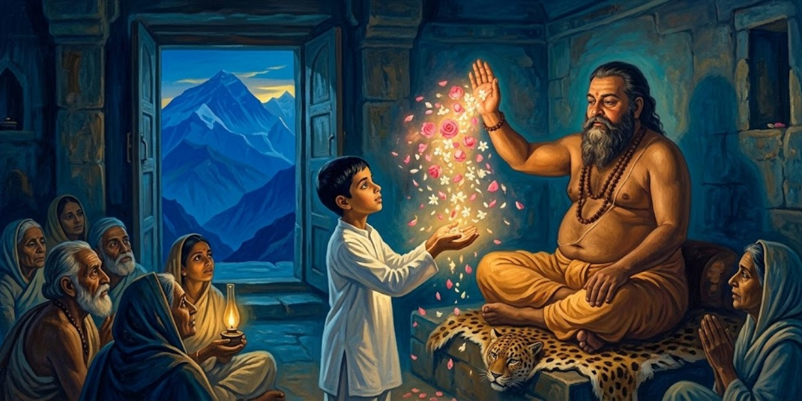
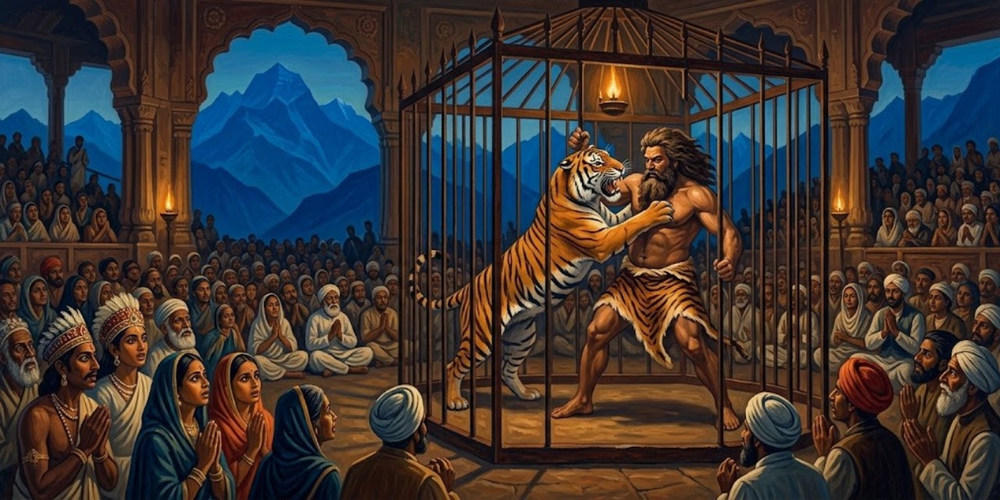
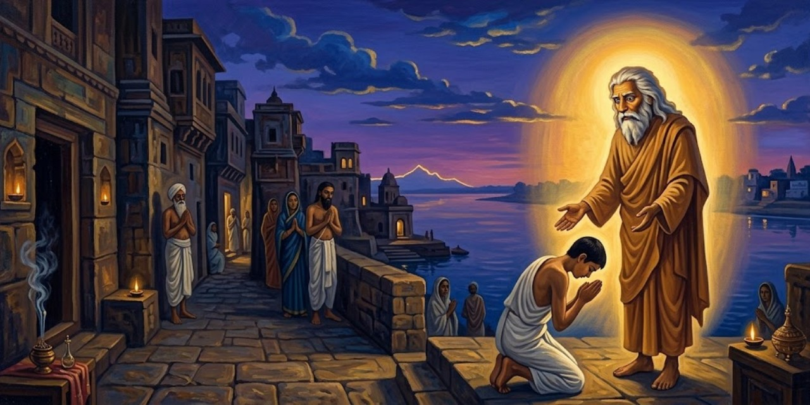
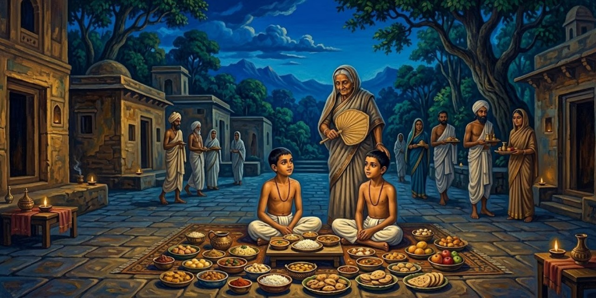
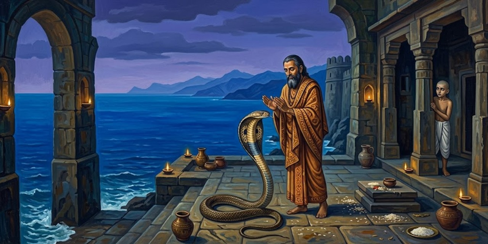
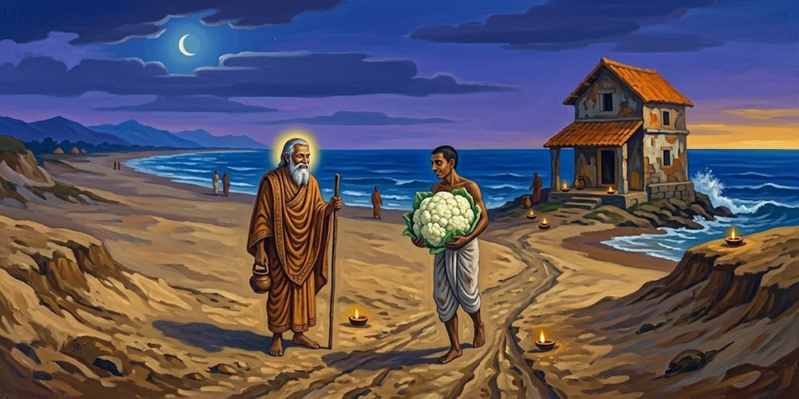
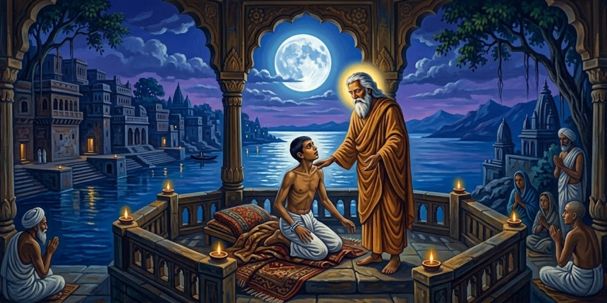
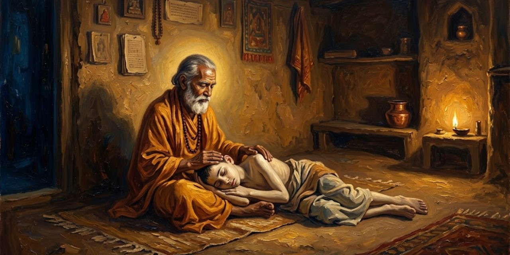
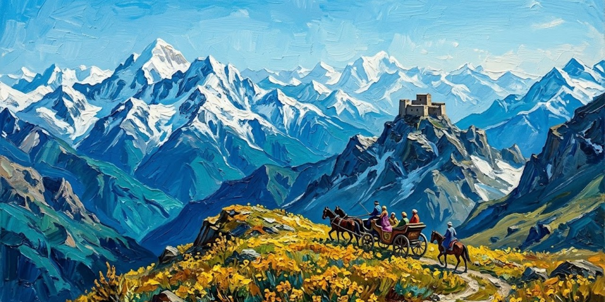
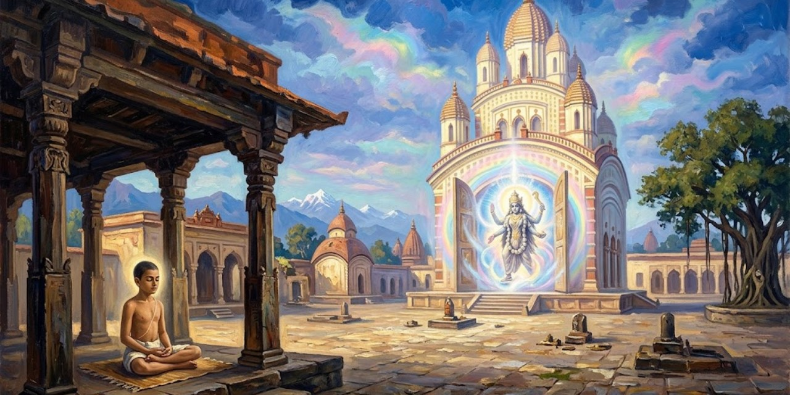

17 de octubre de 2026

# Autobiografía de un yogui

Paramhansa Yogananda

Yogananda nació en la India de finales del siglo diecinueve y llegó a ser el gran introductor del yoga en Occidente. En esta autobiografía, publicada en 1946, cuenta su vida en primera persona: la infancia en Gorakhpur, la búsqueda del maestro, los años de disciplina y el largo viaje a América. Es a la vez una memoria de santos, yoguis y milagros y el libro que abrió las enseñanzas de la India a millones de lectores del mundo occidental.

## Capítulo 1: Mis padres y mi primera infancia

*El libro empieza con una confesión asombrosa: el autor dice que recuerda su vida anterior. De niño ya sabía que había sido un yogui del Himalaya.*

> Clear recollections came to me of a distant life, a yogi amidst the Himalayan snows.

Me venían recuerdos nítidos de una vida lejana: un yogui entre las nieves del Himalaya.

Yogananda

*También recuerda la rabia de ser un bebé: lo entendía todo y no podía ni caminar ni hablar. Esa impotencia lo ponía a orar.*

> Prayerful surges arose within me as I realized my bodily impotence.

Me subían oleadas de oración al reconocer mi impotencia corporal.

Yogananda

*Su padre, Bhagabati, era un matemático serio y austero; su madre, una reina de corazones, enseñaba solo con amor. Cuando ella murió, el padre cambió:*

> I noticed then that his gaze often metamorphosed into my mother’s.

Noté entonces que su mirada se metamorfoseaba a menudo en la de mi madre.

Yogananda

*Abinash, un empleado del ferrocarril, le contó al niño cómo su padre se hizo discípulo del gran maestro Lahiri Mahasaya. Abinash había pedido permiso para visitarlo en Benarés y el padre se burló de él. Camino a casa, el corazón de Abinash repetía:*

> My heart was repeating: ‘Lahiri Mahasaya! I cannot live without seeing you!’

Mi corazón repetía: «¡Lahiri Mahasaya! ¡No puedo vivir sin verte!».

Abinash

*En ese instante, en medio del campo, el maestro se apareció y regañó al padre:*

> ‘Bhagabati, you are too hard on your employee!’

«¡Bhagabati, eres demasiado duro con tu empleado!».

Lahiri Mahasaya

*El padre no solo dio el permiso: partió él mismo a Benarés con su esposa. Al entrar en la casita del maestro, este lo recibió con una frase que lo dejó helado:*

> His words were the same as those he had used two days before in the Gorakhpur field.

Sus palabras fueron las mismas que había usado dos días antes en el campo de Gorakhpur.

Yogananda

*El maestro inició a los padres en la práctica del kriya yoga y les dejó una profecía sobre el hijo que vendría, según recuerda Abinash:*

> Lahiri Mahasaya took a definite interest in your own birth. Your life shall surely be linked with his own: the master’s blessing never fails.

«Lahiri Mahasaya se interesó de modo especial en tu propio nacimiento. Tu vida estará sin duda unida a la suya: la bendición del maestro nunca falla».

Abinash

*Lahiri Mahasaya murió poco después de que Yogananda naciera, pero su retrato presidía el altar de la casa, y el niño fue descubriendo que el maestro seguía presente:*

> As I began to discover his secret omnipresence, I lamented no more.

Cuando empecé a descubrir su secreta omnipresencia, dejé de lamentarme.

Yogananda

*A los ocho años, enfermo de cólera y ya sin esperanza de los médicos, su madre le señaló el retrato: «Inclínate ante él por dentro». El niño miró la foto:*

> I gazed at his photograph and saw there a blinding light, enveloping my body and the entire room.

Miré fijo su fotografía y vi allí una luz cegadora, que envolvía mi cuerpo y la habitación entera.

Yogananda

*El cólera desapareció al instante. Esa foto tenía su propia historia milagrosa: el maestro odiaba que lo fotografiaran y en las placas salía borrado. Un fotógrafo presumió de que lograría retratarlo, fracasó doce veces y fue llorando a verlo. Lahiri Mahasaya le explicó:*

> “I am Spirit. Can your camera reflect the omnipresent Invisible?”

«Yo soy Espíritu. ¿Puede tu cámara reflejar al Invisible omnipresente?».

Lahiri Mahasaya

*Al día siguiente el maestro posó por única vez: esa es la foto que sanó al niño y que se reproduce en el libro. Poco después de sanar, el niño tuvo una visión: cerró los ojos y vio sabios meditando en cuevas de montaña. Preguntó quiénes eran:*

> “We are the Himalayan yogis.”

«Somos los yoguis del Himalaya».

Los yoguis de la visión

*El niño gritó que quería ir al Himalaya y ser como ellos. La visión se disolvió en una luz que crecía y crecía, y una voz habló desde la luz. Iswara es el Señor, Dios hecho persona:*

> “I am Iswara. I am Light.”

«Yo soy Iswara. Yo soy Luz».

La voz en la luz

*El niño pidió fundirse en Él, y del éxtasis le quedó una frase para toda la vida:*

> “He is eternal, ever-new Joy!”

«¡Él es Gozo eterno, siempre nuevo!».

Yogananda

*Otro recuerdo de esa época: en Lahore, el niño tenía un altar casero a la Madre Divina y una certeza absoluta:*

> An unequivocal conviction came over me that fulfillment would crown any of my prayers uttered in that sacred spot.

Una convicción inequívoca se apoderó de mí: toda oración hecha en ese rincón sagrado se cumpliría.

Yogananda

*Su hermana Uma se burló: que pidiera entonces las dos cometas que volaban enfrente. El niño oró; una cometa cayó a sus pies y luego la otra. Uma salió corriendo, espantada:*

> “Indeed, Divine Mother listens to you! This is all too uncanny for me!”

«¡Es verdad, la Madre Divina te escucha! ¡Esto es demasiado raro para mí!».

Uma, su hermana

## Capítulo 2: La muerte de mi madre y el amuleto místico

*El deseo más grande de la madre era ver casado a Ananta, el hijo mayor. Todo estaba listo en Calcuta para la boda cuando el niño, de unos once años, tuvo una visión a medianoche en Bareilly: su madre se le apareció junto a la cama y le pidió que despertara al padre y tomara el primer tren si querían verla con vida. El padre no creyó. Por la mañana llegó el telegrama: madre grave, boda pospuesta, vengan de inmediato. Llegaron tarde. Años pasaron antes de que el dolor cediera, y la sanación llegó como respuesta a sus gritos:*

> “It is I who have watched over thee, life after life, in the tenderness of many mothers! See in My gaze the two black eyes, the lost beautiful eyes, thou seekest!”

«Soy yo quien te ha cuidado, vida tras vida, en la ternura de muchas madres. ¡Mira en mi mirada los dos ojos negros, los hermosos ojos perdidos que buscas!».

La Madre Divina

*El padre no volvió a casarse en casi cuarenta años: «el servicio hacia mí terminó con tu madre», dijo cuando le ofrecieron una enfermera. Catorce meses después de la muerte, Ananta llamó al niño a su lado. Había acompañado a la madre en su lecho de muerte y guardaba un mensaje suyo:*

> “Mukunda, I have been reluctant to give you strange tidings.”

«Mukunda, me he resistido a darte noticias extrañas».

Ananta, su hermano mayor

*La madre había pedido que el mensaje se entregara al cumplirse un año. Así empezaba:*

> “Let these words be my final blessing, my beloved son Mukunda!”

«Que estas palabras sean mi bendición final, mi amado hijo Mukunda».

La madre, en su lecho de muerte

*Contaba que, siendo él un bebé, lo había llevado a Benarés, a casa de su gurú Lahiri Mahasaya. Casi escondida entre los discípulos, oraba para que el maestro se fijara en el niño:*

> While I patted you, I was praying that the great guru take notice and bestow a blessing. As my silent devotional demand grew in intensity, he opened his eyes and beckoned me to approach.

«Mientras te acariciaba, oraba para que el gran gurú se fijara en ti y te diera su bendición. A medida que crecía mi silenciosa demanda de devoción, él abrió los ojos y me hizo señas de acercarme».

La madre

*El maestro sentó al bebé en su regazo y profetizó que sería un yogui que llevaría muchas almas a Dios. Pero el suceso más singular de su vida fue otro: un sadhu, un asceta errante, apareció un día en Lahore pidiendo ver «a la madre de Mukunda»:*

> ‘Mother,’ he said, ‘the great masters wish you to know that your stay on earth will not be long.’

«Madre —dijo—, los grandes maestros desean que sepas que tu estancia en la tierra no será larga».

El sadhu

*El sadhu anunció un amuleto de plata que se materializaría en las manos de ella al meditar; debía legarlo a Mukunda cuando estuviera listo para buscar a Dios, y, cumplido su propósito, desaparecería. A la tarde siguiente, el amuleto apareció entre sus palmas, frío y liso. Lo guardó más de dos años. Su despedida:*

> Do not grieve for me, as I shall have been ushered by my great guru into the arms of the Infinite.

«No te aflijas por mí, pues mi gran gurú me habrá llevado ya a los brazos del Infinito».

La madre

*Con el amuleto en su poder, el niño sintió despertar memorias dormidas: venía de maestros de vidas pasadas que guiaban sus pasos. Mientras tanto, el muchacho que no lograba escaparse al Himalaya viajaba lejos cada día en las alas de su amuleto.*

## Capítulo 3: El santo de los dos cuerpos

*El padre le permitió un viaje a Benarés con dos cartas: una para un amigo suyo cuya dirección había perdido, y otra de presentación para el swami Pranabananda, discípulo de Lahiri Mahasaya, que sabría encontrarlo. El swami lo recibió como a un viejo amigo, adivinó quién era antes de leer la carta y bromeó: gozaba de dos pensiones, una del ferrocarril por recomendación del padre y otra «del Padre Celestial», una pensión de paz insondable. Luego cayó en un silencio de esfinge, del que salió solo para anunciar que el hombre buscado llegaría en media hora. El niño no entendía nada:*

> The swami has spoken to no one but myself since my arrival!

«¡El swami no ha hablado con nadie más que conmigo desde que llegué!».

Yogananda

*Bajó las escaleras y se topó con Kedar Nath Babu, que subía apurado: el swami lo había encontrado bañándose en el Ganges una hora antes y lo había invitado a su casa, donde, le dijo, lo esperaba el hijo de Bhagabati. El niño se quedó helado:*

> “Why, that man, Swami Pranabananda, has not left my sight a moment since I first came about an hour ago.”

«Pero si ese hombre, el swami Pranabananda, no se ha apartado de mi vista ni un momento desde que llegué, hace una hora».

Yogananda

*Subieron juntos. El visitante susurró, señalando las sandalias de madera del santo:*

> “He was clad only in a loincloth, just as I see him now.”

«Iba vestido solo con el taparrabo, tal como lo veo ahora».

Kedar Nath Babu

*El swami sonrió y explicó que para los yoguis verdaderos la unidad del mundo no es un misterio: pueden verse y conversar a distancia y atravesar a voluntad la materia. Luego habló de su maestro:*

> He was Divinity Itself in the form of flesh.

«Era la Divinidad misma en forma de carne».

Swami Pranabananda

*Y contó su propia historia: ocho años meditando media noche después del trabajo en el ferrocarril, con percepciones luminosas, pero:*

> But a little veil always remained between me and the Infinite.

«Pero siempre quedaba un velo sutil entre el Infinito y yo».

Swami Pranabananda

*Una noche entera suplicó a Lahiri Mahasaya que intercediera por él. La respuesta del maestro fue escueta:*

> You must meditate more profoundly.

«Debes meditar más profundamente».

Lahiri Mahasaya

*El discípulo insistió hasta el alba; al fin el maestro extendió la mano: «Ya intercedí por ti ante Brahma; ve a meditar».*

> Immeasurably uplifted, I returned to my home. In meditation that night, the burning Goal of my life was achieved.

«Inmensamente elevado, volví a mi casa. En la meditación de esa noche, la meta ardiente de mi vida se cumplió».

Swami Pranabananda

*Desde entonces:*

> Never from that day has the Blissful Creator remained hidden from my eyes behind any screen of delusion.

«Desde ese día, el Creador bienaventurado jamás ha vuelto a esconderse de mis ojos tras ninguna pantalla de ilusión».

Swami Pranabananda

*Pidió entonces al maestro que lo librara del empleo; este le mandó pedir la pensión y decir lo que sentía: que una sensación arrolladora le subía por la columna y lo inutilizaba para el trabajo. El médico se la concedió sin más preguntas:*

> Automatically they obeyed the great guru’s spiritual direction, and freed me for a life of unbroken communion with the Beloved.

«Obedecieron automáticamente la dirección espiritual del gran gurú, y me liberaron para una vida de comunión ininterrumpida con el Amado».

Swami Pranabananda

*Al despedirse, el swami bendijo al niño y le profetizó que su vida pertenecía al camino de la renunciación y el yoga, y que volverían a verse, con su padre, más adelante. Los años cumplieron ambas predicciones.*

## Capítulo 4: Mi fuga frustrada hacia el Himalaya

*La fuga se planeó como una operación de guerra: un amigo de la escuela, Amar, recogería en un carruaje el bulto lanzado desde la ventana (una manta, sandalias, la foto de Lahiri Mahasaya, el Bhagavad Gita y dos taparrabos) y ambos partirían al Himalaya vestidos de europeos para despistar a Ananta, el hermano detective. En el camino se sumó el primo Jatinda, que desertó en la primera estación (confesó después que lo espantó la promesa de Mukunda de que los tigres se sentarían a recibir caricias: él ya se veía entrando en el estómago de uno «por entregas»). En un andén, un inspector con un telegrama de Ananta interrogó a los muchachos; Amar le advirtió antes a Mukunda:*

> All I ask of you, Mukunda, is to keep still.

«Lo único que te pido, Mukunda, es que te quedes quieto».

Amar

*Amar se inventó que eran «Thomas» y «Thompson», dos muchachos medio ingleses, y el inspector, desarmado, los acomodó en el vagón de europeos. Llegaron a Hardwar al amanecer, pero allí los esperaba un policía: Ananta había telegrafiado a toda la línea. Mientras los custodiaba, el oficial les contó que él sí había conocido a un santo de verdad, días antes, junto al Ganges. Creyendo que era un asesino prófugo, le había hundido el hacha en el brazo; el santo siguió caminando sin quejarse, se recompuso el brazo colgante ante sus ojos y le dijo:*

> The Beloved Mother is taking care of me.

«La Madre Amada me está cuidando».

El sadhu, según el oficial

*Tres días después no tenía ni cicatriz. Los muchachos lamentaron su suerte: el policía había encontrado a un santo sin buscarlo, y ellos, que lo buscaban con ahínco, terminaron en una estación de policía. Ananta llegó a recogerlos y propuso un trato: visitar a un sabio en Benarés, ver al padre afligido en Calcuta, y luego Mukunda podría volver a buscar a su maestro. Amar desertó, ablandado por el calor de familia:*

> But I knew I would never abandon the quest for my guru.

«Pero yo sabía que jamás abandonaría la búsqueda de mi gurú».

Yogananda

*En Benarés, el sabio y su hijo, contratados en secreto por Ananta, le pronosticaron desgracias si abandonaba sus deberes mundanos. Sacudido, el muchacho oró pidiendo una señal inmediata, y un sadhu de noble porte que escuchaba desde fuera lo llamó aparte:*

> In response to your prayer, the Lord tells me to assure you that your sole path in this life is that of the renunciate.

«En respuesta a tu oración, el Señor me dice que te asegure que tu único camino en esta vida es el del renunciante».

El sadhu

*El sabio oficial de la casa no quedó muy contento con la intromisión:*

> “That sadhu is just as crazy as you are.”

«Ese sadhu está tan loco como tú».

El pundit

*De vuelta en Calcuta, el padre le pidió que al menos terminara la escuela y le puso un tutor de sánscrito, el swami Kebalananda, esperando calmar su inquietud con filosofía:*

> But the tables were subtly turned: my new teacher, far from offering intellectual aridities, fanned the embers of my God-aspiration.

«Pero la situación se invirtió sutilmente: mi nuevo maestro, lejos de ofrecer áridas disquisiciones intelectuales, avivó las brasas de mi anhelo de Dios».

Yogananda

*El padre no sabía que Kebalananda era un discípulo exaltado de Lahiri Mahasaya. Entre lección y lección, el tutor le contaba cómo era estar cerca del maestro:*

> An indescribable peace blossomed within me at the master’s glance. I was permeated with his fragrance, as though from a lotus of infinity.

«Una paz indescriptible florecía en mí ante la mirada del maestro. Me impregnaba de su fragancia, como la de un loto del infinito».

Swami Kebalananda

> The master was a living temple of God whose secret doors were open to all disciples through devotion.

«El maestro era un templo vivo de Dios, cuyas puertas secretas se abrían a todos los discípulos por la devoción».

Swami Kebalananda

*No era un intérprete libresco: sumergía sin esfuerzo la mente en la «biblioteca divina» y de allí salían espuma de palabras y rocío de pensamientos:*

> Lahiri Mahasaya was no bookish interpreter of the scriptures. Effortlessly he dipped into the ‘divine library.’

«Lahiri Mahasaya no era un intérprete libresco de las escrituras. Se sumergía sin esfuerzo en la “biblioteca divina”».

Swami Kebalananda

*Cuando le pedían explicar los estados de conciencia de los textos antiguos, sonreía y decía que primero los atravesaría él mismo, y mandaba a un discípulo cercano exponer las estrofas mientras él guiaba sus pensamientos:*

> ‘Please expound the holy stanzas as the meaning occurs to you.’

«Expongan por favor las santas estrofas según les vaya ocurriendo el significado».

Lahiri Mahasaya

*Nunca aconsejaba la fe servil:*

> ‘Words are only shells,’ he said.

«Las palabras son solo cáscaras, decía; la convicción de la presencia de Dios se gana en el contacto gozoso de la meditación».

Kebalananda, citando a Lahiri Mahasaya

*Y a cada problema de cada discípulo, la misma receta: la práctica del kriya yoga:*

> The yogic key will not lose its efficiency when I am no longer present in the body to guide you.

«La llave yóguica no perderá su eficacia cuando yo ya no esté presente en el cuerpo para guiarlos».

Lahiri Mahasaya

*Kebalananda presenció también el milagro de Ramu, un discípulo ciego de nacimiento que abanicaba al maestro por horas. Animado por el tutor, Ramu pidió luz para sus ojos; el maestro protestó que él no tenía poder de curar, y Ramu respondió con lógica de devoto:*

> ‘Sir, the Infinite One within you can certainly heal.’

«Señor, el Infinito que está en ti ciertamente puede curar».

Ramu

*«Eso sí es distinto», concedió el maestro: le tocó el punto entre las cejas y le mandó cantar el nombre de Rama siete días; a la semana, Ramu vio por primera vez el rostro de la naturaleza. Los cuerpos que el maestro curó espectacularmente acabaron un día en las llamas de la cremación, cierra Kebalananda:*

> But the silent spiritual awakenings he effected, the Christlike disciples he fashioned, are his imperishable miracles.

«Pero los silenciosos despertares espirituales que obró, los discípulos semejantes a Cristo que formó, son sus milagros imperecederos».

Swami Kebalananda

## Capítulo 5: Un «santo de los perfumes» exhibe sus maravillas

*El encuentro con el Santo de los Perfumes tuvo dos prólogos. El primero, en el templo de Kalighat, ante la imagen de Kali: un sadhu errante leyó en voz alta la confusión de sus pensamientos sobre los aspectos benignos y terribles de la naturaleza:*

> “You have indeed penetrated the bewilderment of my thoughts!”

«¡De veras ha penetrado usted la confusión de mis pensamientos!».

Yogananda

*El sadhu disertó sobre el enigma del bien y del mal, sobre el autoescrutinio que pulveriza el ego y produce videntes, y sobre la compasión que madura cuando uno descubre la unidad de todas las mentes:*

> “The saints of every age, sir, have felt like yourself for the sorrows of the world.”

«Los santos de todas las épocas, señor, han sentido como usted por los dolores del mundo».

Yogananda

> By ignoble whips of pain, man is driven at last into the Infinite Presence, whose beauty alone should lure him.

«Con ignominiosos latigazos de dolor, el hombre es empujado al fin a la Presencia Infinita, cuya belleza por sí sola debería atraerlo».

El sadhu de Kalighat

*Al despedirse, el sadhu le profetizó: «Después de que salgas de aquí hoy, te llegará una experiencia inusual». A la vuelta de una esquina lo atrapó un viejo conocido conversador, de esos que ignoran el tiempo:*

> Inwardly I petitioned the Goddess Kali to devise a graceful means of escape.

«En mi interior le pedí a la diosa Kali que ideara un medio elegante de escape».

Yogananda

*El hombre lo soltó por fin, pero volvió corriendo solo para decirle que en esa casa estaba Gandha Baba, el Santo de los Perfumes: «Puedes tener una experiencia inusual». La profecía repetida lo decidió a entrar. Sobre una piel de leopardo, el yogi regordete le ofreció un perfume. Siguió un duelo verbal: ¿esclavizar a Dios para hacer olores?, ¿doce años de práctica para fabricar lo que cuesta unas rupias en la floristería? El santo, divertido, capituló:*

> Mr. Philosopher, you please my mind.

«Señor Filósofo, me complace su mente».

Gandha Baba

*«Extiende la mano derecha», le ordenó. Sin tocarlo, le preguntó qué perfume quería: «Rosa». Y de la palma de la mano brotó con fuerza una fragancia de rosa; luego, a pedido del muchacho, una flor blanca sin olor se llenó al instante de jazmín. En casa, su hermana Uma olió ambas maravillas, lo que descartó la autosugestión. Un discípulo le contó que el maestro de Gandha Baba era un yogi tibetano de más de mil años; años después entendería que estos prodigios eran materializaciones reales de vibraciones, no hipnosis. Espectaculares, pero espiritualmente inútiles, concluye: desvíos de la búsqueda seria de Dios, como el fakir que se enorgullece de dominar el agua (¡una rana también se mueve en el agua!, se burlaba el místico persa Abu Said). Ni el sabio de Kalighat ni el yogi entrenado en el Tíbet colmaron su anhelo:*

> A guru too literally “marvelous” was not to my liking.

«Un gurú demasiado literalmente “maravilloso” no era de mi gusto».

Yogananda

## Capítulo 6: El Swami Tigre

*Un amigo de la escuela, Chandi, consiguió la dirección del famoso Sohong Swami, que antes de ser monje peleaba tigres a puño limpio. Tras una larga espera (la ley no escrita de la India: el buscador de la verdad debe tener paciencia), entraron en su cuarto y se quedaron mudos ante su cuerpo titánico: bíceps como balones, ojos con algo de paloma y de tigre, y por toda ropa una piel de tigre en la cintura. ¿Cómo se somete a puñetazos a un bengalí real? «Ustedes ven tigres; yo veo gatitos», se rio él. El muchacho objetó que podría convencer a su subconsciente, pero no al tigre. La clave, explicó el swami, es que la mente empuña los músculos: el cuerpo lo fabrica y lo sostiene la mente. Y confesó su propio comienzo:*

> My will was mighty, but my body was feeble.

«Mi voluntad era poderosa, pero mi cuerpo era débil».

El Swami Tigre

> I have every reason to extol the compelling mental vigor which I found to be the real subduer of royal Bengals.

«Tengo sobradas razones para ensalzar el vigor mental arrollador que resultó ser el verdadero domador de los bengalíes reales».

El Swami Tigre

*Cuando el muchacho preguntó si él también podría pelear tigres, el swami sonrió: sí, pero hay muchas clases de tigres, y algunos rondan las junglas de los deseos humanos; mejor vencer a esos merodeadores internos. Y contó su conversión. En la cumbre de la fama, la embriaguez del orgullo lo llevó a exhibirse en funciones públicas. Su padre le advirtió entonces que en la familia de la jungla había resentimiento contra él, y que un santo le había dejado una predicción ominosa: su próximo encuentro con un tigre le causaría heridas graves y seis meses de enfermedad mortal. El joven domador se rebeló:*

> I beg you not to impose any command that I change my way of life.

«Le ruego que no me imponga ninguna orden de cambiar mi modo de vida».

El Swami Tigre, a su padre

*La predicción, sin embargo, era explícita sobre lo que vendría después del castigo:*

> He shall then forsake his former ways and become a monk.

«Abandonará entonces su antigua vida y se hará monje».

El santo, según el padre

> I considered that Father had been the credulous victim of a deluded fanatic.

«Pensé que mi padre había sido la víctima crédula de un fanático engañado».

El Swami Tigre

*Poco después viajó a Cooch Behar, donde la ciudad entera se alborotó con su visita:*

> He must be an incarnation of the king of tigers himself!

«¡Debe ser una encarnación del mismísimo rey de los tigres!».

Los murmullos de la calle

*El príncipe de Cooch Behar lo mandó buscar con carruaje y sombrilla, lo recibió en persona y le escupió la duda sarcástica: un bengalí de ciudad, criado a arroz blanco, solo pudo haber peleado con animales drogados de opio. Ante la pregunta de si era cierto que peleaba tigres salvajes a mano desnuda, la respuesta fue seca:*

> It is quite true.

«Es completamente cierto».

El Swami Tigre

*El príncipe lo desafió a pelear con Raja Begum, su tigre recién capturado: si lo aturdía, lo encadenaba y salía de la jaula por su pie, se lo regalaba con miles de rupias; si se negaba, lo proclamaría impostor en todo el estado. La semana previa, los aldeanos corrían versiones fantásticas: que Raja Begum era un espíritu maligno reencarnado, o la respuesta del Cielo Tigre a las plegarias de los animales humillados. El swami, filosófico sobre la cautela del príncipe, que no le permitió ver al tigre antes del combate:*

> Whether the prince feared I might seek to hypnotize the beast, or secretly feed him opium, I know not!

«Si el príncipe temía que yo intentara hipnotizar a la bestia o darle opio en secreto, ¡no lo sé!».

El Swami Tigre

*El día del combate, ante miles de espectadores aterrados, entró en la jaula semidesnudo. El tigre le destrozó la mano derecha de un zarpazo; él escondió los dedos sangrantes bajo la ropa y peleó con la izquierda hasta derrumbar a la bestia de un golpe final. «¡Como un gatito!», interpuso el muchacho, y el swami rio de gusto. Aún le abrió las fauces y metió la cabeza dentro, lo encadenó, y cuando el tigre traicionero rompió la cadena y se le echó encima, lo volvió a inmovilizar. La ciudad entró en fiesta, le llovieron monedas de oro y le regalaron a Raja Begum, pero:*

> A spiritual change had entered my heart.

«Un cambio espiritual había entrado en mi corazón».

El Swami Tigre

*Siguieron seis meses al borde de la muerte por envenenamiento de la sangre, como había predicho el santo. Al sanar, se lo confesó a su padre:*

> I know now that my teacher is the holy man who gave the wise warning.

«Ahora sé que mi maestro es el santo que dio la sabia advertencia».

El Swami Tigre

*Y un día el santo llegó sin anunciarse: «Basta de domar tigres; ven conmigo, te enseñaré a someter las bestias de la ignorancia que rondan las junglas de la mente humana. Estás acostumbrado a tener público: que sea una galaxia de ángeles». Lo inició en el camino espiritual:*

> Hand in hand, we soon set out for my training in the Himalayas.

«De la mano, partimos pronto hacia mi entrenamiento en los Himalayas».

El Swami Tigre

## Capítulo 7: El santo levitante

*Un amigo le contó haber visto a un yogi flotar en el aire durante una reunión nocturna; el muchacho adivinó el nombre: Bhaduri Mahasaya, que vivía cerca de su casa y al que visitaba a menudo. El santo llevaba veinte años sin salir de su clausura, dominaba los pranayamas con tal fuerza que una vez pareció levantar una tormenta en la habitación, y luego quedaba en la calma vívida de la superconciencia. Bhaduri lo recibía con libertad («que Mukunda venga cuando quiera»), porque los mundanos no aprecian la franqueza que rompe sus ilusiones:*

> His own face was always serious, yet touched with an ecstatic smile.

«Su rostro era siempre serio, aunque tocado por una sonrisa extática».

Yogananda

*Le dio un consejo que llevaba una profecía escondida: le habló de sus corresponsales de la lejana América, que redescubrían la India «con mejor sentido de la orientación que Colón», y le dijo que lo esencial para la salvación humana no debía diluirse para Occidente:*

> I did not realize that his speech was a veiled prophetic guidance.

«No me di cuenta de que sus palabras eran una guía profética velada».

Yogananda

*Solo al escribir estas líneas, años después, entiende que el santo le anunciaba que llevaría las enseñanzas de la India a América. En las reuniones vespertinas, Bhaduri hablaba de la princesa Mirabai, que abandonó su corte por los sadhus y respondió al sannyasi que la rechazaba por mujer: «Dile al maestro que yo no sabía que hubiera otro Macho en el universo fuera de Dios; ¿no somos todos hembras ante Él?». Un estudiante, despediéndose, se arrodilló admirado:*

> “Master, you are wonderful!”

«¡Maestro, usted es maravilloso!».

Un estudiante

*Le alababa haber renunciado a las riquezas y comodidades por buscar a Dios. El santo lo corrigió con una sonrisa: estaba invirtiendo los términos.*

> I have left a few paltry rupees, a few petty pleasures, for a cosmic empire of endless bliss.

«He dejado unas pocas rupias miserables, unos pocos placeres mezquinos, por un imperio cósmico de dicha infinita».

Bhaduri Mahasaya

*¿Qué sacrificio hay en eso? Los verdaderos renunciantes, cerró, son los mundanos: cambian una posesión divina sin par por un puñado de juguetes terrenales. Años después, antes de embarcar a América, el joven se arrodilló ante él por la bendición de despedida: «Hijo, ve a América; toma por escudo la dignidad de la antiquísima India; la victoria está escrita en tu frente».*

## Capítulo 8: El gran científico de la India, J. C. Bose

*En una acera oyó a unos profesores decir que las invenciones inalámbricas de Jagadis Chandra Bose eran anteriores a las de Marconi, y al día siguiente visitó al sabio en su casa de Gurpar Road. Bose, formado en Cambridge, unía la verificación experimental occidental con la introspección oriental; su crescógrafo alcanzaba diez millones de aumentos y demostraba que las plantas tienen un sistema nervioso sensible y una vida emocional variada:*

> “You have done much, sir, to hasten the embrace of East and West in the impersonal arms of science.”

«Usted ha hecho mucho, señor, por apresurar el abrazo de Oriente y Occidente en los brazos impersonales de la ciencia».

Yogananda

> The unique throb of life in all creation could seem only poetic imagery before your advent, Professor!

«¡El latido único de la vida en toda la creación solo podía parecer imaginería poética antes de su llegada, profesor!».

Yogananda

*Le contó que un santo que conoció jamás cortaba flores («¿voy a robarle al rosal su orgullo de belleza?»), y remató:*

> His sympathetic words are verified literally through your discoveries!

«¡Sus palabras compasivas se verifican literalmente en sus descubrimientos!».

Yogananda

*En la inauguración del Instituto Bose, entre una puerta centenaria rescatada de un santuario y un templo dedicado al Noúmeno sin imagen alguna, el discurso del científico sonó a rishi antiguo: dedicaba el instituto no como laboratorio sino como templo; narró cómo los fisiólogos de la Royal Society le aconsejaron no invadir sus predios («había caído sin saberlo en el dominio de un sistema de castas desconocido»); prometió que jamás se tomarían patentes y que las puertas estarían abiertas a investigadores de todos los países, como en Nalanda y Taxila veinticinco siglos atrás:*

> Tears stood in my eyes at the scientist’s concluding words.

«Las palabras finales del científico me llenaron los ojos de lágrimas».

Yogananda

*En el laboratorio, el crescógrafo mostró al muchacho un helecho creciendo ante sus ojos, deteniéndose al roce de una varilla, reanimándose con el antídoto tras el cloroformo y agitándose en espasmos de dolor ante la navaja, hasta la inmovilidad final de la muerte. Un trozo de estaño registró fatiga y recuperación como un ser vivo. Y la predicción mayor de Bose:*

> Everything in man has been foreshadowed in the plant.

«Todo lo que hay en el hombre ha sido prefigurado en la planta».

J. C. Bose

*Años después, en 1938, investigadores de la Universidad de Columbia confirmaron que las fibras de la planta nitella propagan ondas eléctricas idénticas a las de las fibras nerviosas de animales y hombres: la «piedra Rosetta» entre la mente y la materia que Bose ya había anunciado.*

## Capítulo 9: El devoto dichoso y su romance cósmico

*Entró en silencio en la habitación y el santo lo recibió sin volverse: «Siéntate, señorcito; estoy hablando con mi Madre Divina»:*

> The angelic appearance of Master Mahasaya fairly dazzled me.

«El aspecto angélico de Master Mahasaya me deslumbró por completo».

Yogananda

*El saludo del santo le produjo el efecto más violento de su vida: una agonía de separación de la Madre Divina peor que la muerte de su madre. Cayó al suelo gimiendo y se aferró a los pies del maestro pidiendo su intercesión:*

> Beyond reach of doubt, I was convinced that Master Mahasaya was in intimate converse with the Universal Mother.

«Estaba convencido, fuera de toda duda, de que Master Mahasaya conversaba íntimamente con la Madre Universal».

Yogananda

*El santo accedió a transmitir su ruego. Esa noche, meditando en su buhardilla, el muchacho tuvo la visión: la Madre Divina ante él, en esplendor: «Siempre te he amado. Siempre te amaré». A la mañana siguiente volvió muy temprano por la respuesta, y el maestro, que no había salido de su cuarto, sonrió: «¿Podría yo añadir una sola palabra a la seguridad que recibiste anoche a las diez de la Madre Hermosa en persona?». Y añadió:*

> Think you that your devotion did not touch the Infinite Mercy? The Motherhood of God, that you have worshiped in forms both human and divine, could never fail to answer your forsaken cry.

«¿Crees que tu devoción no conmovió la Misericordia Infinita? La Maternidad de Dios, a la que has adorado en formas humanas y divinas, jamás podría dejar sin respuesta tu grito desamparado».

Master Mahasaya

*La casa de Amherst Street donde el santo dirigía una pequeña escuela era, por añadidura, el antiguo hogar del muchacho, la escena de la muerte de su madre: paredes sagradas, testigos de sus heridas y de su sanación. Allí no había reglas ni castigos: se enseñaban matemáticas superiores y una química del amor ausente de los libros. Cuando le llevó una guirnalda de champak, el santo la aceptó solo como ofrenda a la Madre que habitaba en su cuerpo. Y le anunció:*

> “I am not your guru; he shall come a little later,” he told me.

«Yo no soy tu gurú; él llegará un poco después».

Master Mahasaya

*Discípulo de Sri Ramakrishna, Master Mahasaya lo llevó en barca por el Ganges al templo de Dakshineswar, donde cantaba el nombre de la Madre hasta romperle el corazón en mil pedazos. Su romance con la Beloved era inagotable y práctico: una tarde, acorralados por un conocido vanidoso que no paraba de hablar, le susurró al muchacho que la Madre había prometido recordarle al pesado «asuntos más urgentes» al llegar a la casa roja de la esquina; y así ocurrió, a mitad de frase. Otra vez lo sorprendió criticando en silencio a unos devotos que cantaban mecánicamente: «¿No es verdad, señorcito, que el nombre de la Amada suena dulce en todos los labios, ignorantes o sabios?»:*

> “He can serve as an earthly prototype for the very angels of heaven!”

«¡Puede servir de prototipo terrenal a los mismísimos ángeles del cielo!».

Yogananda

*Un día le ofreció ir a ver «bioscopos». El primero fue una conferencia universitaria mortalmente aburrida, de la que la Madre Divina los rescató apagando las luces de la sala hasta que salieron. El segundo fue mejor: un golpecito suave en el pecho, y la Calcuta entera pasó ante sus ojos en silencio absoluto y omnipresente, como una película muda bañada en una luz apacible, hasta que otro golpecito devolvió el estrépito del mundo. De ese hijo seráfico de la Madre Divina cierra el capítulo:*

> But ever enshrined in memory is the seraphic son of Divine Mother-Master Mahasaya!

«¡Pero para siempre consagrado en la memoria queda el hijo seráfico de la Madre Divina, Master Mahasaya!».

Yogananda

## Capítulo 10: Encuentro a mi maestro, Sri Yukteswar

*Aprobó el bachillerato por la vía de la Ingenuidad Infinita: su amigo Nantu le adelantó las preguntas trampa de los exámenes, y unas hojas sueltas de versos sánscritos encontradas en un solar le resolvieron la prueba de sánscrito al día siguiente. Libre de su promesa al padre, decidió partir a un ermitaño en Benarés con su amigo Jitendra. La despedida:*

> Let me go, that I someday return with a more divine understanding.

«Déjame ir, para volver un día con un entendimiento más divino».

Yogananda, a su padre

*En la ermita de Mahamandal, los compañeros no veían con buenos ojos que se encerrara a meditar en la buhardilla en vez de dedicarse a las tareas de la organización:*

> “Don’t try to catch God so soon!”

«¡No intentes atrapar a Dios tan pronto!».

Un compañero de la ermita

*Dyananda, el joven swami director, le ordenó devolver el dinero que su padre le enviaba y no mencionar jamás el hambre. El muchacho ayunó veinticuatro horas de prueba, y justo ese día el tren de Dyanandaji se retrasó y nadie comería hasta su llegada:*

> “The next Benares death from starvation is due at once in this hermitage,” I thought.

«La próxima muerte por inanición en Benarés está a punto de ocurrir en esta ermita», pensé.

Yogananda

*Cuando por fin cenó a las nueve, descubrió que Dyananda llevaba cuatro días sin comer ni beber por regla de su orden. Avergonzado, objetó que seguir esa disciplina a rajatabla podía llevarlo a morir de hambre. «¡Muere, entonces!», estalló el swami: nunca admitas que vives del poder de la comida y no del poder de Dios; el arroz, el dinero y los hombres son solo sus instrumentos indirectos:*

> There and then I tasted the Spirit’s all-sufficiency.

«Allí y entonces gusté la suficiencia absoluta del Espíritu».

Yogananda

*Esos días el amuleto de plata desapareció de su caja cerrada, cumpliendo la predicción del sadhu: había vuelto al éter del que vino, pues su propósito estaba cumplido. Aislado y hostilizado en la ermita, una madrugada oró hasta la respuesta: «¡Tu Maestro llega hoy!», oyó una voz de mujer que venía de todas partes y de ninguna:*

> Suddenly I felt lifted as though bodily to a sphere uncircumscribed.

«De pronto me sentí elevado, como en cuerpo, a una esfera sin límites».

Yogananda

*Esa mañana, en un mercado de Benarés, vio al final de un callejón a un swami de túnica ocre, inmóvil, que le resultó instantánea y antiguamente familiar. Pero la duda pudo más:*

> “You are confusing this wandering monk with someone known to you,” I thought.

«Estás confundiendo a este monje errante con alguien conocido», pensé.

Yogananda

*Siguió caminando, y a los diez minutos sus pies se volvieron de piedra: no podían alejarse; al darse la vuelta, recobraban la ligereza:*

> “The saint is magnetically drawing me to him!”

«¡El santo me está atrayendo magnéticamente hacia él!».

Yogananda

*Voló de regreso al callejón. La figura quieta seguía mirando en su dirección:*

> The divine face was none other than he of my thousand visions.

«El rostro divino no era otro que el de mis mil visiones».

Yogananda

> “O my own, you have come to me!”

«¡Oh, mío propio, has venido a mí!».

Sri Yukteswar

*Cuántos años te he esperado, repitió el gurú en bengalí, trémulo de gozo. Entraron en una unidad de silencio; el pasado, el presente y el futuro giraron como escenas de un solo tiempo:*

> This was not the first sun to find me at these holy feet!

«¡No era éste el primer sol que me encontraba a estos santos pies!».

Yogananda

*En el balcón de piedra sobre el Ganges, el maestro le ofreció sus ermitas y todo lo que poseía; el muchacho respondió que venía por sabiduría y contacto con Dios. Entonces Sri Yukteswar le dio su amor incondicional y le pidió lo mismo: el amor ordinario es egoísta, enraizado en deseos:*

> The flux of the human heart is gone forever at the transfixing touch of pure love.

«El fluir del corazón humano desaparece para siempre al toque trascendente del amor puro».

Sri Yukteswar

*Sin que el muchacho hubiera contado nada, el gurú le habló del amuleto perdido («no lo lamentes; cumplió su propósito») y de su situación infeliz en la ermita:*

> Like a divine mirror, my guru apparently had caught a reflection of my whole life.

«Como un espejo divino, mi gurú había captado al parecer el reflejo de toda mi vida».

Yogananda

> “The living reality of your presence, Master, is joy beyond any symbol.”

«La realidad viva de tu presencia, Maestro, es un gozo superior a cualquier símbolo».

Yogananda

*Le dio nombre y dirección (Swami Sri Yukteswar Giri, ermita de Serampore, a solo doce millas de Calcuta) y una orden que aguó el milagro: «Vendrás a mí en cuatro semanas», es decir, volver a casa, justo lo que el muchacho había jurado no hacer. Se despidió en tensión. En la ermita la hostilidad creció hasta que, tres semanas después, él y Jitendra partieron juntos a Serampore: el «pájaro joven» se disponía a «abatirse» peligrosamente cerca de Calcuta.*

## Capítulo 11: Dos muchachos sin un céntimo en Brindaban

*En Agra, su hermano Ananta lo sermoneó: el padre haría bien en desheredarlo por tirar la vida. «Dios primero; el dinero es su esclavo», respondió el muchacho. Y como seguía declarándose independiente de la fortuna paterna, Ananta le propuso poner su filosofía a prueba en el mundo tangible. Los términos: ir con Jitendra a Brindaban esa misma mañana sin una rupia, sin mendigar, sin revelar su apuro a nadie, sin faltar a ninguna comida y sin quedarse varados; si volvía antes de medianoche, sería el hombre más asombrado de Agra:*

> “You well know, Ananta, I seek my inheritance from the Heavenly Father.”

«Bien sabes, Ananta, que busco mi herencia del Padre Celestial».

Yogananda

> “I am conscious of my dependence on God.”

«Soy consciente de mi dependencia de Dios».

Yogananda

*En la estación, Ananta los cacheó en busca de tesoros ocultos. Jitendra pidió un par de rupias de seguridad («hay algo reconfortante en el tintineo de las monedas») y Mukunda se negó en firme. Al despedirlos, al hermano escéptico le tembló la certidumbre:*

> “If by any chance or grace you pass successfully through the Brindaban ordeal, I shall ask you to initiate me as your disciple.”

«Si por casualidad o por gracia superas con éxito la prueba de Brindaban, te pediré que me inicies como tu discípulo».

Ananta

*En el tren, Jitendra lo pellizcó: no veía señales de que Dios fuera a proveer la próxima comida. Pero en el último tramo dos desconocidos se interesaron por los muchachos, los montaron en un coche de caballos y los dejaron en una imponente ermita. Su explicación a la anfitriona:*

> As soon as we met on the train, I felt drawn to them as devotees of Lord Krishna.

«En cuanto nos conocimos en el tren, me sentí atraído por ellos como devotos del Señor Krishna».

Un desconocido del tren

*La anfitriona, Gauri Ma, esperaba ese día a dos príncipes que habían cancelado a última hora: el banquete de treinta platos, digno de príncipes, fue para los dos muchachos. Jitendra rompió a llorar; Mukunda le devolvió el pellizco: «Tomás el incrédulo: el Señor trabaja, y con prisa». Después, bajo un árbol cadamba, Jitendra recayó en la duda («¿cómo vamos a ver la ciudad sin una pice?»), y un joven de agradable semblante se acercó a ofrecerse de guía. Ante el extraño honor, Mukunda preguntó por qué:*

> “You are my guru.”

«Tú eres mi gurú».

Pratap Chatterji

> One face was yours, my master! Often have I seen it in meditation!

«¡Uno de los rostros era el tuyo, maestro mío! ¡Muchas veces lo he visto en meditación!».

Pratap Chatterji

*Pratap, que había visto a los dos muchachos en una visión del Señor Krishna durante sus oraciones del mediodía, los llevó en carruaje por los templos de Krishna, los colmó de dulces y les compró los billetes de vuelta a Agra y un fajo de rupias. En un rincón apartado de la estación, Mukunda lo inició en el kriya de Lahiri Mahasaya, el chintamani que abrevia el millón de años de la evolución espiritual:*

> Be faithful in your practice; you will approach the Guru of all gurus.

«Sé fiel a tu práctica; te acercarás al Gurú de todos los gurús».

Yogananda, a Pratap

*Jitendra lloró en el tren de vuelta, esta vez contra sí mismo: «¡Qué superficial mi confianza! ¡Nunca volveré a dudar de la protección de Dios!». Antes de medianoche, los dos «cenicientos» derramaron las rupias sobre la mesa de Ananta, que pasó de la broma a la solemnidad: la ley de la oferta y la demanda, concluyó, alcanza reinos más sutiles de lo que suponía:*

> “I understand for the first time your indifference to the vaults and vulgar accumulations of the world.”

«Comprendo por primera vez tu indiferencia ante las bóvedas y las vulgares acumulaciones del mundo».

Ananta

*Esa misma noche Ananta recibió la iniciación: el «gurú» Mukunda cargó con dos discípulos no buscados en un solo día. Tras una visita al Taj Mahal, Jitendra se quedó en Calcuta con su familia, y el muchacho llegó solo a Serampore: habían pasado veintiocho días desde Benarés. «Vendrás a mí en cuatro semanas»:*

> Here I was, heart pounding, standing within his courtyard on quiet Rai Ghat Lane.

«Allí estaba yo, con el corazón desbocado, de pie en su patio de la apacible Rai Ghat Lane».

Yogananda

> I entered for the first time the hermitage where I was to spend the best part of the next ten years with India’s Jyanavatar, “incarnation of wisdom.”

«Entré por primera vez en la ermita donde pasaría la mejor parte de los diez años siguientes con el Jyanavatar de la India, la “encarnación de la sabiduría”».

Yogananda

## Capítulo 12: Años en la ermita de mi maestro

*Sri Yukteswar lo recibió en su ermita de Serampore con frialdad deliberada: le reclamó la obediencia que le había negado en su primer encuentro, le ordenó volver con su familia y matricularse en la universidad de Calcuta, y le anunció que un día iría a Occidente, donde escucharían mejor a un maestro hindú con título. El muchacho aceptó su autoridad en cada detalle de su vida con una sola condición: «¡Prométame revelarme a Dios!». Tras una hora de forcejeo verbal, la palabra del maestro cayó con finalidad compasiva: «Que tu deseo sea mi deseo».*

> I had found eternal shelter in a true guru.

«Había encontrado refugio eterno en un verdadero gurú».

Yogananda

*Al mostrarle la ermita, una casona antigua de patios con columnas, palomas en el tejado y un jardín de mangos y plátanos, la mirada del muchacho se clavó en un retrato de la pared engalanado con jazmines: Lahiri Mahasaya. El tono de Sri Yukteswar vibró de reverencia:*

> “Greater he was, as man and yogi, than any other teacher whose life came within the range of my investigations.”

«Más grande fue, como hombre y como yogui, que cualquier otro maestro cuya vida llegó al alcance de mis investigaciones».

Sri Yukteswar

*A petición del muchacho, el maestro contó tres recuerdos de infancia, cada uno con su moraleja: el fantasma de la habitación oscura al que salió a buscar («mira el miedo a la cara y dejará de molestarte»), el perro feo del vecino que deseó con obstinación («el apego ciega y presta un halo imaginario al objeto del deseo») y la frase oída a su madre que lo alejó para siempre de todo empleo («las ideas tempranas quedan grabadas en la mente sensible del niño»). A la mañana siguiente le concedió la iniciación del kriya yoga, que ya había recibido de su padre y de su tutor, pero que en presencia del maestro fue otra cosa:*

> At his touch, a great light broke upon my being, like glory of countless suns blazing together.

«A su contacto, una gran luz irrumpió en mi ser, como la gloria de incontables soles ardiendo a la vez».

Yogananda

*Volvió a Calcuta con orden de regresar en treinta días. Ningún pariente hizo los comentarios punzantes que temía sobre el regreso del «ave en vuelo». Subió a su buhardilla y la saludó como a una presencia viva: «Has presenciado mis meditaciones y las lágrimas y tempestades de mi sadhana; ahora he llegado al puerto de mi maestro divino». Su padre, discípulo también de Lahiri Mahasaya, se alegró por los dos:*

> Your master has proved no inaccessible Himalayan saint, but one near-by.

«Tu maestro no ha resultado ser un santo himalayo inaccesible, sino uno cercano».

> My prayers have been answered: you have not in your search for God been permanently removed from my sight.”

«Mis plegarias han sido respondidas: no has sido apartado de mi vista para siempre en tu búsqueda de Dios».

Su padre

*Se matriculó al día siguiente en el Scottish Church College, aunque sus lectores ya imaginarán que se le vio poco por las aulas: la ermita de Serampore ejercía un imán irresistible. La vida allí tenía un ritmo sereno: samadhi antes del alba (se sabía que el maestro había despertado cuando cesaban sus estupendos ronquidos), paseo junto al Ganges, baño, comida de mediodía, visitas por la tarde y discursos al caer la noche:*

> Those morning strolls with my guru—how real and vivid still!

«Aquellos paseos matutinos con mi gurú, ¡cuán reales y vivos todavía!».

Yogananda

*En esas veladas, cada palabra suya parecía medida y cincelada por la sabiduría:*

> I was conscious always that I was in the presence of a living manifestation of God.

«Siempre fui consciente de estar en presencia de una manifestación viviente de Dios».

Yogananda

*Una noche de mosquitos especialmente virulenta, el maestro no dio la orden habitual de colocar las cortinas. Picado de pies a cabeza y medio loco con el zumbido, el discípulo se acercó cautelosamente a su gurú y lo encontró sin respiración, frío e inmóvil; le puso un espejo bajo la nariz y hasta le tapó la boca y las fosas nasales para cerciorarse:*

> This was my first observation of him in the yogic trance; it filled me with fright.

«Era la primera vez que lo observaba en trance yóguico; me llenó de espanto».

Yogananda

*«¡Conque un experimentador en ciernes! ¡Mi pobre nariz!», se rio el maestro al volver en sí. «¿Por qué no te acuestas? ¿Es que el mundo entero va a cambiar por ti? Cámbiate tú: líbrate de la conciencia de mosquito». El muchacho volvió sumiso a su cama y ni un insecto se atrevió a acercarse. Otra tarde, al alzar la mano vengadora contra un mosquito que le clavaba el aguijón, se detuvo recordando el aforismo de Patanjali sobre la ahimsa. «¿Por qué no terminaste la tarea?», le preguntó el maestro, que leía sus procesos mentales como un libro abierto: el golpe mortal ya se había dado en su mente. Y en Puri, un discípulo llamado Prafulla vio al maestro recibir con palmadas rítmicas y risa de bienvenida a una cobra de metro y veinte que se abalanzaba con la capucha desplegada:*

> The serpent, very close to my guru, was now motionless, seemingly magnetized by his caressing attitude.

«La serpiente, muy cerca de mi gurú, quedó entonces inmóvil, como magnetizada por su actitud acariciante».

Prafulla

*La capucha se contrajo poco a poco y la cobra se deslizó entre los pies del maestro hasta perderse en los matorrales. Cuando el joven Yogananda se consumía de dispepsia crónica, flaco y de ojos hundidos, el maestro le dijo: «Las medicinas tienen límites; la fuerza creadora de la vida, ninguno. Cree esto: estarás bien y fuerte». En dos semanas ganó el peso que lo había eludido toda la vida. El propio Sri Yukteswar había pasado por lo mismo: convaleciente en Benarés, Lahiri Mahasaya lo hizo oscilar entre fuerza y debilidad según sus propias expectativas, hasta demostrarle que el pensamiento es una fuerza como la electricidad o la gravitación. «Maestro, si pienso que estoy bien y he recuperado mi peso, ¿sucederá?»:*

> ‘It is so, even at this moment.’

«Así es, en este mismo momento».

Lahiri Mahasaya

*En un solo día ganó veintitrés kilos que lo acompañaron para siempre. Su gurú, despierto en Dios, sabía que este mundo no es sino el sueño objetivado del Creador. Los milagros, en todo caso, no se hacen por capricho:*

> “A man of realization does not perform any miracle until he receives an inward sanction,” Master explained.

«Un hombre de realización no realiza ningún milagro hasta recibir una sanción interior», explicó el maestro.

Sri Yukteswar

*La disciplina de la ermita era drástica: perfeccionista, el gurú no dejaba pasar ni un descuido de etiqueta ni un matiz de conducta, y reprendía con la misma llaneza delante de extraños que a solas. «Si no te gustan mis palabras, eres libre de irte en cualquier momento; no quiero nada de ti salvo tu propia mejora». Y a quienes desdeñaban los deberes mundanos:*

> “Those who are too good for this world are adorning some other,” Sri Yukteswar remarked.

«Quienes son demasiado buenos para este mundo están adornando algún otro», observó Sri Yukteswar.

Sri Yukteswar

*Solo una vez vio el discípulo manso al león divino: cuando su padre salió despavorido de una visita («¡por los comentarios de tu gurú creí encontrarte hecho un completo desastre!») y el hijo fue a reclamar, el maestro, con los ojos bajos, se limitó a decir: «No volveré a hacerlo». Con los años, la relación entre ambos se hizo silenciosa y exacta:*

> My relationship with Sri Yukteswar, somewhat inarticulate, nonetheless possessed all eloquence.

«Mi relación con Sri Yukteswar, algo inarticulada, poseía sin embargo toda la elocuencia».

Yogananda

*Kumar, un muchacho campesino de Bengala oriental de inteligencia brillante, llegó a ser el favorito del maestro, que un día lo puso a cargo de la ermita y degradó a Yogananda a escoba y cocina. La pequeña tiranía duró tres semanas: «Por eso te puse a ti en el salón y a él en la cocina: para que comprendieras que un líder digno desea servir y no dominar». Un año después, Kumar volvió de una visita a su aldea convertido en otro, cargado de malos hábitos, y el maestro, con lágrimas que dominó al instante, encargó a Yogananda comunicarle la expulsión:*

> He has rejected my protection; the callous world must be his guru still.”

«Ha rechazado mi protección; el mundo insensible tendrá que ser su gurú todavía».

Sri Yukteswar

*Alegre sin frivolidad, el maestro recordaba a menudo que la santidad no exige cara larga:*

> “To seek the Lord, one need not disfigure his face,” he would remark.

«Para buscar al Señor no hace falta desfigurarse la cara», solía decir.

Sri Yukteswar

*A los eruditos de pacotilla los despachaba con una sola pregunta. A un pundit que sacudía las vigas del ashram con citas del Mahabharata, las Upanishads y Shankara, le dijo: «Sigo esperando oírte a ti. ¿Qué comentario original puedes aportar desde tu propia vida? ¿Te contentas con ser una vitrola hueca que repite las palabras de otros hombres?». Su método de estudio era el del antiguo maestro Dabru Ballav: un solo pasaje del Bhagavad Gita, media hora de lectura y horas de meditación en silencio:*

> “Wisdom is not assimilated with the eyes, but with the atoms,” he said.

«La sabiduría no se asimila con los ojos, sino con los átomos», decía.

Sri Yukteswar

*Ni los poderosos lo impresionaban. Un magistrado local de fama despótica, con poder de sobra para expulsarlos del ashram de Puri, se jactó entre gritos de haber salido primero en los exámenes de maestría: «Señor magistrado, olvida que esto no es su tribunal. Un título universitario no guarda relación alguna con la realización védica; los santos no se producen en serie cada semestre como los contables». Tras un silencio atónito, el visitante rompió a reír de buena gana:*

> “This is my first encounter with a heavenly magistrate,” he said.

«Es mi primer encuentro con un magistrado celestial», dijo.

El magistrado

## Capítulo 13: El santo que no dormía

*A los seis meses de vida en la ermita, una de esas ilusiones imprevisibles que asaltan al devoto le hizo sentir una impaciencia creciente por los deberes de la ermita y los estudios: pidió permiso a su maestro para irse a los Himalayas:*

> I hope in unbroken solitude to achieve continuous divine communion.”

«Espero alcanzar, en soledad ininterrumpida, la comunión divina continua».

Yogananda

*La respuesta del maestro llegó lenta y sencilla: «muchos montañeses viven en los Himalayas y no poseen percepción de Dios; la sabiduría se busca mejor en un hombre de realización que en una montaña inerte». El muchacho ignoró la alusión clara e insistió en su ruego:*

> Sri Yukteswar vouchsafed no reply.

«Sri Yukteswar no se dignó responder».

Yogananda

*Tomó el silencio por consentimiento, una interpretación precaria que siempre resulta cómoda, y a la mañana siguiente pidió a su profesor de sánscrito, Behari Pundit, la dirección de un gran discípulo de Lahiri Mahasaya: Ram Gopal Muzumdar, el «santo que no duerme», siempre despierto en una conciencia extática. Esperaba arrancarle una sanción para la meditación solitaria en el Himalaya. En el camino se detuvo ante el famoso santuario de Tarakeswar, venerado como el Lourdes de la India, donde su propia tía había obtenido un milagro para su tío Sarada: tras una semana de ayuno y oración en el templo, halló una hierba materializada en su mano, hizo un cocimiento y se lo dio a beber:*

> His disease vanished at once, and has never reappeared.”

«Su enfermedad desapareció al instante y nunca ha vuelto a aparecer».

Su tía

*El ánimo austero del momento lo llevó a salir del templo sin inclinarse ante la piedra redonda del altar: Dios, reflexionaba, solo debe buscarse dentro del alma. Después erró el camino (un transeúnte oracular le indicó ªba la derecha» donde debía ser a la izquierda), pasó la noche en la choza de un campesino que al principio lo tomó por detective mentiroso, y al alba cruzó campos de arroz bajo un sol abrasador mientras cada campesino le juraba que Ranbajpur quedaba «a solo dos millas»:*

> Sleep was inconsiderable that night; I prayed deeply to be directed to the secret yogi, Ram Gopal.

«Dormí poco aquella noche; oré profundamente para ser guiado hasta el yogui secreto, Ram Gopal».

Yogananda

*A media tarde, un hombre menudo y ligero, de un extraordinario par de ojos oscuros y penetrantes, se detuvo a su lado: «pensaba irme de Ranbajpur, pero tu propósito era bueno, así que te esperé». Y le echó en cara su orgullo: si Dios lo impregna todo, ¿por qué no te inclinaste ayer ante el Infinito en la piedra de Tarakeswar? Por eso el transeúnte te extravió, y por eso hoy lo has pasado tan mal. Maravillado, y de golpe refrescado en pleno campo ardiente, el muchacho escuchó la lección: el yoga es el camino más alto, nos dijo Lahiri Mahasaya, pero:*

> But discovering the Lord within, we soon perceive Him without.

«Pero al descubrir al Señor dentro, pronto lo percibimos fuera».

Ram Gopal

*La actitud censora del santo se desvaneció; sus ojos se volvieron compasivamente suaves y le palmeó el hombro:*

> “Young yogi, I see you are running away from your master.

«Joven yogui, veo que huyes de tu maestro».

Ram Gopal

*«Él tiene todo lo que necesitas; debes volver con él. Las montañas no pueden ser tu gurú». Y cuando el muchacho admitió que en casa tenía un cuarto donde cerrar la puerta y estar solo, el santo sentenció: «esa es tu cueva»:*

> The yogi bestowed on me a gaze of illumination which I have never forgotten.

«El yogui me dirigió una mirada de iluminación que nunca he olvidado».

Yogananda

> “That is your sacred mountain.

«Esa es tu montaña sagrada».

Ram Gopal

*«Ahí es donde encontrarás el reino de Dios». En un campo de arroz en llamas, el muchacho despertó de sus sueños de nieves eternas:*

> His simple words instantaneously banished my lifelong obsession for the Himalayas.

«Sus sencillas palabras disiparon al instante mi obsesión de toda la vida por los Himalayas».

Yogananda

*En su choza de adobe, sentado en postura de loto bajo la luna, Ram Gopal le contó sus cuarenta y cinco años de cuevas: veinte en una gruta secreta meditando dieciocho horas al día, veinticinco en otra más inaccesible meditando veinte, sin necesidad de dormir, porque en la supraconciencia los órganos internos quedan en animación suspendida, electrificados por la energía cósmica. El muchacho, abrumado por su magnetismo espiritual, se atrevió a pedirle un samadhi:*

> “Your master will bestow that experience shortly.

«Tu maestro te concederá esa experiencia en breve».

Ram Gopal

*«Tu cuerpo aún no está afinado: como una lámpara pequeña no resiste un voltaje excesivo, tus nervios no están listos para la corriente cósmica». Aquella noche el muchacho vio relámpagos con los ojos abiertos y cerrados, la habitación fundida en una bóveda de luz infinita; al alba, el santo lo despidió con un último regalo: la curación instantánea de un dolor de espalda que lo aquejaba desde hacía años. De regreso en Tarakeswar, esta vez se postró por completo ante la piedra redonda, que ante su visión interior se agrandó hasta volverse las esferas cósmicas, anillo dentro de anillo, zona tras zona:*

> My travels ended, not in the lofty mountains, but in the Himalayan presence of my Master.

«Mis viajes terminaron, no en las altivas montañas, sino en la himalaya presencia de mi maestro».

Yogananda

## Capítulo 14: Una experiencia de conciencia cósmica

*Avergonzado tras la escapada frustrada a los Himalayas, regresó a la ermita de Serampore:*

> “I AM HERE, Guruji.”

«Aquí estoy, Guruji».

Yogananda

*El maestro lo recibió sin el menor reproche: vamos a la cocina a buscar algo de comer. «Debo haberte decepcionado con mi partida abrupta; pensé que estarías enojado». «Claro que no: la ira solo brota de deseos frustrados. Yo no espero nada de los demás, así que sus actos no pueden oponerse a mis deseos; no te usaría para mis propios fines: solo soy feliz con tu felicidad verdadera».*

> Sri Yukteswar’s manner was as natural as if hours and not days had separated us.

«El modo de Sri Yukteswar era tan natural como si horas, y no días, nos hubieran separado».

Yogananda

*Se miraron a los ojos, con lágrimas brillando en ambos. Una ola de dicha envolvió al discípulo: el Señor, en la forma de su gurú, expandía los pequeños ardores de su corazón hasta los alcances incompresibles del amor cósmico:*

> “Sir, one hears of divine love in a vague way, but for the first time I am having a concrete example in your angelic self!

«Señor, uno oye hablar del amor divino de manera vaga, pero por primera vez tengo un ejemplo concreto en tu angélica persona».

Yogananda

*Unas mañanas después se encerró en la sala vacía del maestro para meditar, pero sus pensamientos desobedientes se dispersaban como pájaros ante el cazador. «¡Mukunda!», lo llamó Sri Yukteswar desde un balcón interior; el muchacho, tan rebelde como sus pensamientos, guardó silencio obstinado dos veces. A la tercera gritó, protestando: «¡Señor, estoy meditando!».*

> “I know how you are meditating,” my guru called out, “with your mind distributed like leaves in a storm! Come here to me.”

«Ya sé cómo estás meditando: ¡con la mente repartida como hojas en una tormenta! Ven aquí conmigo».

Sri Yukteswar

*Avergonzado y descubierto, se acercó con tristeza. «Pobre muchacho: las montañas no podían darte lo que buscabas», le dijo el maestro con voz cariñosa. «El deseo de tu corazón será cumplido».*

> Sri Yukteswar seldom indulged in riddles; I was bewildered.

«Sri Yukteswar rara vez se daba a las adivinanzas; yo estaba desconcertado».

Yogananda

*Le dio un golpe suave en el pecho, sobre el corazón. El cuerpo quedó enraizado e inmóvil; el aliento salió de los pulmones como atraído por un imán inmenso, y el alma y la mente se derramaron por cada poro como una luz fluida y penetrante. La visión frontal se volvió una vista esférica y total: veía por la nuca a los hombres que paseaban muy abajo por Rai Ghat Road, y a una vaca blanca que seguía viendo con claridad incluso cuando pasó tras la pared de ladrillos. Los objetos temblaban como una película acelerada y luego se fundían en un mar luminiscente, como cristales de azúcar en un vaso de agua agitada; una gloria creciente envolvió pueblos, continentes, sistemas solares y estelares, y el cosmos entero brillaba dentro de la infinidad de su ser mientras la voz creadora de Dios resonaba como Aum. Cuando el aliento volvió de golpe a sus pulmones, la inmensidad infinita se había perdido y el cuerpo era otra vez una jaula humillante. Cayó a los santos pies del maestro, que lo sostuvo en pie y habló con calma: «no debes embriagarte de éxtasis; aún te queda mucho trabajo en el mundo. Ven: barreremos el balcón y luego pasearemos junto al Ganges». Esa era la lección de la vida equilibrada: el alma se extiende sobre los abismos cosmogónicos mientras el cuerpo cumple sus tareas diarias. De esa experiencia nacería años después su poema «Samadhi».*

> One day, however, I took a problem to Master.

«Un día, sin embargo, llevé un problema al maestro».

Yogananda

*«Quiero saber, señor: ¿cuándo encontraré a Dios?». «Ya lo has encontrado». «¡Oh, no, señor, no lo creo!». El gurú sonreía: «imagino que no esperas a un Personaje venerable adornando un trono en algún rincón aséptico del cosmos. Ves, sin embargo, que confundes los poderes milagrosos con el conocimiento de Dios: uno podría poseer el universo entero y seguir encontrando esquivo al Señor. El avance espiritual no se mide por los poderes externos, sino solo por la profundidad de la dicha en la meditación. El Gozo Siempre Nuevo es Dios».*

> “I understand now, sir, why saints call the Lord unfathomable. Even everlasting life could not suffice to appraise Him.”

«Ahora entiendo, señor, por qué los santos llaman insondable al Señor. Ni la vida eterna bastaría para aquilatarlo».

Yogananda

> “That is true; but He is also near and dear.

«Es cierto; pero también está cerca y es querido».

Sri Yukteswar

## Capítulo 15: El robo de la coliflor

*Para las vacaciones de verano se instaló con su gurú en la ermita de Puri, frente a la bahía de Bengala, y le llevó un regalo ceremonial: seis enormes coliflores plantadas con sus propias manos y cuidadas con la ternura de una madre que amamanta a su criatura. A la mañana siguiente, en la caminata por la playa, el maestro hizo marchar a los discípulos en dos filas al compás de una cancioncilla, y de pronto se detuvo: «¿te acordaste de cerrar con llave la puerta trasera de la ermita?». «Creo que sí, señor»:*

> Sri Yukteswar was silent for a few minutes, a half-suppressed smile on his lips.

«Sri Yukteswar se quedó en silencio unos minutos, con una sonrisa a medias contenida en los labios».

Yogananda

*«No, lo olvidaste. La contemplación divina no debe ser excusa para el descuido material: has faltado a tu deber de custodiar el ashram y serás castigado. Tus seis coliflores pronto serán solo cinco». Ya de regreso, el maestro lo mandó observar el camino: un campesino apareció bailando grotescamente y agitando los brazos, y al llegar al punto donde se perdería de vista, Sri Yukteswar dijo «ahora volverá». El hombre giró en el acto hacia la parte trasera del ashram:*

> I had left it unlocked, even as my guru had said.

«La había dejado sin llave, tal como mi gurú había dicho».

Yogananda

*El hombre salió al poco rato con una de las preciadas coliflores, caminando ya respetablemente, investido de la dignidad de la posesión. Yogananda salió en persecución indignada, pero el maestro lo llamó de vuelta, sacudido de risa de pies a cabeza: «ese pobre loco llevaba tiempo anhelando una coliflor; me pareció buena idea que consiguiera una de las tuyas, ¡tan mal guardadas!». El ladrón, de fijación vegetal, no había tocado los anillos de oro, el reloj ni el dinero que estaban a la vista sobre la manta. Esa noche le pidió una explicación:*

> My guru shook his head slowly. “You will understand it someday.

«Mi gurú negó lentamente con la cabeza. "Lo entenderás algún día"».

Yogananda

*«La ciencia pronto descubrirá algunas de estas leyes ocultas». Años después, cuando la radio asombró al mundo, recordó la predicción: los pensamientos no son más que vibraciones suavísimas que viajan por el éter, y su gurú era una radio humana perfecta, capaz de captar entre millones de voluntades la de un hombrecillo que ansiaba una coliflor, y de emitir la orden de retroceder y buscarla. Pocos días después desapareció una lámpara de queroseno. Convencido de la omnisciencia recién presenciada, esperó que el maestro la localizara como un juego de niños. Con gravedad exagerada, Sri Yukteswar interrogó a todos los residentes, recibió la confesión de un discípulo que la había usado para ir al pozo, y sentenció solemne: «buscad la lámpara cerca del pozo». Corrió allá: ¡nada!*

> I realized that Master would never display his powers when challenged, or for a triviality.

«Comprendí que el maestro jamás exhibiría sus poderes ante un desafío, ni por una trivialidad».

Yogananda

*¡Qué lástima no haberte guiado hasta la lámpara desaparecida: no soy un adivino!, se rio el maestro sin compunsión. ¡Ni siquiera un Sherlock Holmes satisfactorio! Semanas deliciosas siguieron. Para la procesión religiosa por el pueblo y la playa de Puri, en uno de los días más calurosos del verano, el discípulo protestó desesperado: «Guruji, ¿cómo llevar a los estudiantes descalzos sobre las arenas ardientes?».*

> “I will tell you a secret,” Master responded.

«Te diré un secreto», respondió el maestro.

Yogananda

*«El Señor enviará un paraguas de nubes; caminarán cómodos». Apenas salieron de la ermita con el estandarte de Sat-Sanga, la parte del cielo sobre sus cabezas se llenó de nubes como por magia y cayó una llovizna leve que refrescó las calles y el arenal durante las dos horas del desfile; en el instante exacto del regreso al ashram, nubes y lluvia pasaron sin dejar rastro:*

> “You see how God feels for us,” Master replied after I had expressed my gratitude.

«Ya ves cómo Dios siente por nosotros», respondió el maestro después de que le expresé mi gratitud.

Sri Yukteswar

*El capítulo prosigue con el festival del solsticio de invierno en Serampore: procesión descalza con cien voces y flautas, calles sembradas de flores, calderos humeantes de khichuri bajo el patio, sankirtan con armonio en el piso alto y el maestro, de oído perfecto, dejando a los cocineros para corregir a los cantores: «¡están desafinados!». A medianoche, lavados ya los calderos, el gurú lo llamó a su lado: «estoy complacido con tus alegres labores; te quiero conmigo: esta noche dormirás en mi cama»:*

> I felt a tinge of unreality in the unexpected joy of sleeping beside my guru.

«Sentí un dejo de irrealidad en la inesperada dicha de dormir junto a mi gurú».

Yogananda

*Apenas diez minutos después de acostarse, el maestro se levantó y empezó a vestirse: «cualquier estudiante que perdió su tren llegará pronto; tengamos comida lista». «¡Guruji, nadie vendría a la una de la mañana!». «Quédate en cama, que has trabajado muy duro. Pero yo voy a cocinar». Ante el tono resuelto, el discípulo saltó de la cama y lo siguió a la cocinita. El arroz y el dhal ya hervían cuando el maestro sonrió afectuoso: «esta noche has vencido la fatiga y el miedo al trabajo duro; nunca volverán a molestarte»:*

> As he uttered these words of lifelong blessing, footsteps sounded in the courtyard.

«Mientras pronunciaba estas palabras de bendición para toda la vida, sonaron pasos en el patio».

Yogananda

*Bajó corriendo y abrió a un grupo de estudiantes:*

> “We made a mistake about train schedules, but felt we could not return home without a glimpse of our guru.”

«Nos equivocamos con los horarios del tren, pero sentimos que no podíamos volver a casa sin un atisbo de nuestro gurú».

Un estudiante

*«Los ha estado esperando y en este momento les prepara la comida», resonó la voz acogedora de Sri Yukteswar. Y cuando los visitantes atónitos estuvieron en la cocina, el maestro se volvió hacia él con ojos chispeantes: «ahora que han terminado de cotejar notas, ¡sin duda quedaste satisfecho de que nuestros invitados sí perdieron su tren!».*

> I followed him to his bedroom a half hour later, realizing fully that I was about to sleep beside a godlike guru.

«Lo seguí a su dormitorio media hora después, comprendiendo plenamente que estaba a punto de dormir junto a un gurú semejante a un dios».

Yogananda

## Capítulo 16: Cómo burlar a los astros

*«Mukunda, ¿por qué no te consigues un brazalete astrológico?». «¿Debería, maestro? No creo en la astrología». La respuesta fue toda una lección: no se trata de creer; la única actitud científica ante cualquier tema es preguntarse si es verdadero. La ley de la gravitación funcionaba con la misma eficiencia antes de Newton que después de él; el cosmos sería un caos si sus leyes necesitaran la sanción de la creencia humana. Los charlatanes han desacreditado la ciencia estelar, pero no hay que desechar la sabiduría por culpa de los «sabios»:*

> The balanced rhythm of the universe is rooted in reciprocity,” my guru continued.

«El ritmo equilibrado del universo se enraíza en la reciprocidad», prosiguió mi gurú.

Sri Yukteswar

*El hombre combate dos fuerzas: los tumultos internos de los elementos y los poderes desintegradores de la naturaleza. La astrología estudia la respuesta del hombre a los estímulos planetarios: las estrellas no tienen benevolencia ni animosidad, solo envían radiaciones que sirven de cauce al equilibrio de causa y efecto que cada quien puso en marcha en el pasado. Un niño nace el día y la hora en que los rayos celestes están en armonía matemática con su karma; el mensaje de los cielos no enfatiza el destino, sino que incita a la voluntad a escapar de la servidumbre: lo que él ha hecho, puede deshacerlo. El sabio derrota a sus planetas, es decir a su pasado, trasladando su lealtad de la creación al Creador.*

> I ventured this question after a long silence, during which I had tried to assimilate Sri Yukteswar’s noble exposition.

«Aventuré esta pregunta tras un largo silencio, durante el cual había intentado asimilar la noble exposición de Sri Yukteswar».

Yogananda

*La respuesta: solo el viajero que ha llegado a la meta puede desechar sus mapas; durante el viaje aprovecha cualquier atajo conveniente. Los antiguos rishis descubrieron que los metales puros, ciertas plantas y sobre todo las joyas sin defecto de dos quilates o más emiten una luz astral que contrarresta los tirones negativos de los planetas, siempre que se lleven pegadas a la piel. Para fines generales aconsejaba un brazalete de oro, plata y cobre; pero para él, uno de plata y plomo:*

> “The stars are about to take an unfriendly interest in you, Mukunda.

«Los astros están a punto de tomar un interés hostil en ti, Mukunda».

Sri Yukteswar

*«No temas; estarás protegido. En un mes tu hígado te causará muchos problemas. La enfermedad está prevista para seis meses, pero tu brazalete astrológico reducirá el período a veinticuatro días». Buscó un joyero al día siguiente:*

> My health was excellent; Master’s prediction slipped from my mind.

«Mi salud era excelente; la predicción del maestro se me borró de la mente».

Yogananda

*Treinta días después de la conversación, un dolor súbito en la región del hígado. Las semanas siguientes fueron una pesadilla de dolor atroz; decidió soportar la prueba solo, sin molestar al gurú, que había ido a Benarés, pero a los veintitrés días de tortura flaqueó y tomó el tren. El maestro lo recibió con calidez inusual, pero no le dio ocasión de contarle sus penas a solas; enfermo y desatendido, esperó en un rincón hasta que el último visitante se marchó. Entonces el gurú lo llamó al balcón octogonal: «habrás venido por tu trastorno del hígado. Veamos: ¿llevas veinticuatro días enfermo, no?». «Sí, señor». «Haz el ejercicio estomacal que te enseñé». «Si supieras la magnitud de mi sufrimiento, no me lo pedirías». «Tú dices que tienes dolor; yo digo que no lo tienes. ¿Cómo pueden existir tales contradicciones?»:*

> No longer could I feel the continuous torment that had kept me nearly sleepless for weeks; at Sri Yukteswar’s words the agony vanished as though it had never been.

«Ya no podía sentir el tormento continuo que me había tenido casi sin dormir durante semanas; a las palabras de Sri Yukteswar, la agonía se desvaneció como si nunca hubiera existido».

Yogananda

*Quiso arrodillarse agradecido a sus pies, pero el maestro se lo impidió de inmediato: «no seas infantil; levántate y disfruta de la belleza de la luna sobre el Ganges»:*

> But Master’s eyes were twinkling happily as I stood in silence beside him. I understood by his attitude that he wanted me to feel that not he, but God, had been the Healer.

«Pero los ojos del maestro chispeaban alegres mientras yo permanecía en silencio a su lado. Comprendí por su actitud que quería que sintiera que no él, sino Dios, había sido el Sanador».

Yogananda

*Su prejuicio contra la astrología venía de la infancia, en parte por ver a tanta gente adherida a ella con servilismo y en parte por una predicción del astrólogo de la familia: «te casarás tres veces y serás dos veces viudo». El muchacho rumiaba el asunto sintiéndose como una cabra en espera del sacrificio ante el templo del triple matrimonio:*

> “You may as well be resigned to your fate,” my brother Ananta had remarked.

«Más te vale resignarte a tu destino», había comentado mi hermano Ananta.

Ananta

*Una noche le llegó la intuición clara de que la profecía era del todo falsa: prendío fuego al rollo del horóscopo y puso las cenizas en una bolsa de papel con una inscripción desafiante: «Las semillas del karma pasado no germinan si se tuestan en los fuegos divinos de la sabiduría». Tres veces su familia intentó concertar su matrimonio antes de su mayoría de edad y las tres se negó. El maestro ampliaba además su comprensión de las escrituras: ponía los textos sagrados sobre la mesa inmaculada de su mente y los disecaba con el bisturí del razonamiento intuitivo, separando errores e interpolaciones de eruditos de las verdades originales de los profetas. De una estrofa del Bhagavad Gita mal traducida por pundits orientales y traductores occidentales («fija la vista en la punta de la nariz»):*

> “The path of a yogi is singular enough as it is,” he remarked.

«El sendero de un yogui ya es bastante singular de por sí», observó.

Sri Yukteswar

*«¿Para qué aconsejarle que además se ponga bizco? Nasikagram significa "origen de la nariz", no "punta de la nariz": la nariz comienza en el punto entre las dos cejas, sede de la visión espiritual». Otro día, el muchacho se exasperó con la alegoría bíblica: ¡la historia de Adán y Eva me es incomprensible! ¿Por qué castigó Dios no solo a la pareja culpable, sino a las generaciones inocentes aún no nacidas?:*

> Master was more amused by my vehemence than my ignorance.

«El maestro se divertía más con mi vehemencia que con mi ignorancia».

Yogananda

*«El Génesis es hondamente simbólico y no puede captarse con una interpretación literal: su "árbol de la vida" es el cuerpo humano; la médula espinal es un árbol invertido con el cabello como raíces y los nervios como ramas; la "serpiente" es la energía espinal enroscada; "Adán" es la razón y "Eva" el sentimiento. Cuando el sentimiento sucumbe al impulso, la razón también cae». Y al terminar el discurso:*

> As Sri Yukteswar ended his discourse, I glanced with new respect at the pages of Genesis.

«Cuando Sri Yukteswar terminó su discurso, miré con nuevo respeto las páginas del Génesis».

Yogananda

*«Querido maestro, le dije: ¡por primera vez siento una debida obligación filial hacia Adán y Eva!».*

## Capítulo 17: Sasi y los tres zafiros

*Santosh, hijo del veterinario Narayan Chunder Roy, rogó a Yogananda que se interesara por su padre, un agnóstico empedernido. El doctor acompañó al muchacho a la ermita de Serampore, toleró una breve entrevista de silencios estoicos y se marchó bruscamente. «¿Por qué traes un muerto al ashram?», preguntó el maestro apenas se cerró la puerta. «¡Señor, el doctor está bien vivo!». «Pero en poco tiempo estará muerto». Ante el ruego del discípulo, el gurú accedió: el orgulloso doctor sufría una diabetes avanzada sin saberlo; en quince días caería en cama, los médicos lo darían por perdido y su plazo natural sobre la tierra era de seis semanas; por la intercesión del muchacho, en esa fecha sanaría, con una condición: que llevara un brazalete astrológico. El doctor se negó con beligerancia («estoy en la mejor de las saludes; nunca me impresionarán estas supersticiones astrológicas») hasta que, súbitamente enfermo, consintió mansamente. El médico tratante dio el caso por desahuciado; quince días después volvió a buscar al muchacho con aire de disculpa: «¡el doctor Roy se ha recuperado por completo! ¡Es el caso más asombroso de mi experiencia!»:*

> Your guru must indeed be a healing prophet!”

«¡Tu gurú debe ser en verdad un profeta sanador!».

El médico

*El maestro había añadido una advertencia: que no comiera carne. Seis meses después, justo cuando se sentía en su mejor forma y alardeaba de que las ideas dietéticas poco científicas del gurú no lo habían influenciado, el doctor Roy cayó muerto una mañana. Sasi, otro amigo de la universidad, pasaba felices fines de semana en Serampore; el maestro le tenía inmenso cariño y lamentaba que su vida privada fuera salvaje y desordenada: «Sasi, si no te reformas, dentro de un año estarás gravemente enfermo. Mukunda es testigo: no digas luego que no te lo advertí»:*

> Sri Yukteswar gazed at my friend with affectionate exasperation.

«Sri Yukteswar miraba a mi amigo con exasperación cariñosa».

Yogananda

*Sasi se reía: «maestro, te dejo a ti interesar una dulce caridad del cosmos en mi triste caso; mi espíritu está dispuesto, pero mi voluntad es débil»:*

> You are my only savior on earth; I believe in nothing else.”

«Eres mi único salvador en la tierra; no creo en nada más».

Sasi

*«Al menos deberías llevar un zafiro azul de dos quilates; te ayudará». «No puedo pagarlo»:*

> Anyhow, dear guruji, if trouble comes, I fully believe you will protect me.”

«De todos modos, querido guruji, si vienen problemas, creo plenamente que me protegerás».

Sasi

*«Dentro de un año traerás tres zafiros, respondió crípticamente Sri Yukteswar. Entonces ya no servirán». Un año después, visitando al maestro en la casa calcuteña de un discípulo, Yogananda oyó abrirse la puerta de la calle:*

> Master straightened stiffly.
> “It is that Sasi,” he remarked gravely.

«El maestro se irguió rígido. "Es ese Sasi", comentó grave».

Yogananda

*«El año se ha cumplido: ha perdido ambos pulmones. Ignoró mi consejo; dile que no quiero verlo». Sasi subió llorando la escalera, se arrojó a los pies del gurú y depositó allí tres hermosos zafiros: «¡gurú omnisciente, los médicos dicen que tengo tuberculosis galopante y no me dan más de tres meses!». «¿No es un poco tarde para preocuparte por tu vida? Llévate tus joyas; pasó su tiempo de utilidad». Tras una hora de silencio de esfinge, la mirada del maestro se ablandó: «levántate, Sasi, ¡qué alboroto armas en casa ajena! Devuelve los zafiros al joyero, ya son un gasto innecesario; consigue un brazalete astrológico y no temas: es más posible que el sol y la luna intercambien sus posiciones que el que tú mueras de tuberculosis». Semanas después, sin embargo, el médico sentenció: «Sasi no pasa de esta noche». Yogananda voló a Serampore con el informe lloroso, y el gurú lo escuchó con frialdad: «¿a qué vienes a molestarme? Ya me oíste asegurarle a Sasi su recuperación»:*

> Sri Yukteswar said no parting word, but sank into silence, his unwinking eyes half-open, their vision fled to another world.

«Sri Yukteswar no dijo palabra de despedida, sino que se hundió en el silencio, con los ojos entrecerrados y fijos, la visión huida a otro mundo».

Yogananda

*De regreso en Calcuta, encontró con asombro a su amigo incorporado, bebiendo leche: cuatro horas antes había sentido la presencia del maestro en la habitación, y los terribles síntomas desaparecieron de inmediato:*

> I feel that through his grace I am entirely well.”

«Siento que por su gracia estoy completamente sano».

Sasi

*En pocas semanas Sasi estaba más rollizo y sano que nunca, aunque su reacción tuvo un dejo ingrato: casi no volvió a visitar al gurú, avergonzado de su vida anterior. Mientras tanto se acercaban ominosos los exámenes finales de Intermediate Arts, y Yogananda, de asistencia escolar irregularísima, huyó a Puri con la vaga esperanza de que el maestro sancionara su ausencia. «Te has dedicado de lleno a tus deberes espirituales; aplica diligencia a tus libros la próxima semana y saldrás del trance sin fracaso». Una meditación le trajo la inspiración: abrir cada libro al azar y estudiar solo las páginas así expuestas, dieciocho horas al día durante una semana. Aprobó todo por un pelo:*

> On his return from Puri, Sri Yukteswar gave me a pleasant surprise. “Your Calcutta studies are now over.

«A su regreso de Puri, Sri Yukteswar me dio una grata sorpresa. "Tus estudios en Calcuta han terminado"».

Yogananda

*«Veré que cursen aquí mismo en Serampore tus dos últimos años de universidad». «Pero señor, en esta ciudad no hay carrera de grado». Dos meses después, el presidente del Serampore College anunció públicamente que había reunido los fondos para ofrecer el curso completo de cuatro años. ¡El profesor Howells ni sueña cuánto debe a tu ayuda silenciosa! «Así no perderás tantas horas en trenes; quizá te vuelvas menos empollón de última hora y más estudioso, respondió el maestro con falsa severidad. Aunque, por algún motivo, su tono carecía de convicción».*

## Capítulo 18: Un hacedor de milagros mahometano

*Apenas instalado en Panthi, la pensión de ladrillo frente al Ganges donde viviría sus años en el Serampore College, recibió la primera visita del maestro, que soltó una frase sorprendente: «años atrás, en esta misma habitación que ahora ocupas, un hacedor de milagros mahometano realizó cuatro prodigios ante mí». Se llamaba Afzal Khan, y había adquirido sus poderes extraordinarios por un encuentro casual con un yogui hindú: un día de su infancia, en una aldea de Bengala oriental, un sannyasi cubierto de polvo le pidió agua:*

> ‘Master, I am a Mohammedan. How could you, a Hindu, accept a drink from my hands?’

«Maestro, soy mahometano. ¿Cómo podrías tú, un hindú, aceptar un trago de mis manos?».

Afzal

> ‘Your truthfulness pleases me, my child. I do not observe the ostracizing rules of ungodly sectarianism.

«Tu veracidad me complace, hijo mío. Yo no observo las reglas excluyentes del sectarismo sin dios».

El sannyasi

*La obediencia reverente del muchacho fue recompensada con una mirada amorosa, con la enseñanza de un método de yoga y con una advertencia solemne:*

> ‘You possess good karma from former lives,’ he observed solemnly.

«Posees un buen karma de vidas anteriores», observó solemne.

El sannyasi

*«Voy a enseñarte un método que te dará dominio sobre uno de los reinos invisibles; nunca emplees esos poderes con egoísmo: percibo, ay, que traes del pasado semillas de tendencias destructivas. No las dejes brotar regándolas con nuevas malas acciones». Tras instruir al muchacho asombrado, el maestro se desvaneció. Afzal siguió fielmente el ejercicio durante veinte años, y sus hazañas milagrosas llamaron la atención de todos: lo acompañaba siempre un espíritu desencarnado al que llamaba Hazrat, capaz de cumplir su menor deseo. Ignorando la advertencia, empezó a abusar: cualquier objeto que tocaba y devolvía desaparecía después sin rastro, fuera una joya de las grandes tiendas de Calcuta o un rollo de billetes de tren. La policía no podía arrestarlo: bastaba que dijera «Hazrat, llévate esto» para que la prueba incriminatoria se esfumara.*

*El dueño de la casa Panthi, amigo de Sri Yukteswar, invitó un día al notorio fakir y con él a una veintena de vecinos. El joven Yukteswar tomó la precaución de no llevar nada de valor. Afzal lo miró con curiosidad: «tienes manos poderosas: baja al jardín, toma una piedra lisa, escribe tu nombre con tiza y arrójala lo más lejos posible al Ganges». Obedeció. «Llena ahora una vasija con agua del río, junto a la casa». Y cuando volvió: «¡Hazrat, pon la piedra en la vasija!». La piedra apareció al instante, con la firma tan legible como cuando la escribió. Segundo prodigio: el reloj de oro antiguo del amigo Babu, que el fakir examinó con ominosa admiración y que pronto faltaba de su cadena; costó quinientas rupias de rescate y una invocación a Hazrat en el puente cercano para que cayera del aire en su mano derecha. Tercero: las bebidas pedidas por cada invitado (leche, jugos de fruta y un whisky para el desencajado Babu) llegaron en envases sellados, surcando el aire hasta golpear el suelo. Cuarto: un almuerzo instantáneo servido en platos de oro que aterrizaron de la nada a sus pies, con curries elaborados, luchis calientes y frutas fuera de temporada; al retirarse, un estruendo de vajilla apilada los hizo volverse: ni rastro de los platos relucientes ni de los restos del banquete. «Guruji, si Afzal conseguía platos de oro con tanta facilidad, ¿por qué codiciaba lo ajeno?». El fakir no estaba espiritualmente desarrollado, explicó el maestro: su técnica le daba acceso a un plano astral donde todo deseo se materializa al instante, pero los objetos producidos astralmente son evanescentes; Afzal seguía anhelando la riqueza mundana, de duración más confiable.*

*Años después, Babu le mostró al maestro un recorte de periódico con la confesión pública del mahometano, escrita como acto de penitencia y advertencia. Afzal contaba que un día, en un camino a las afueras de Calcuta, abordó con codicia a un viejo que cojeaba penosamente llevando una bola brillante que parecía de oro; la tocó y siguió de largo sin responder, sordo al llanto del anciano que le reclamaba su única riqueza. De pronto, una voz estentórea surgió de aquel cuerpo frágil: «¿es que no me reconoces?»:*

> I stood speechless, aghast at the belated discovery that this unimpressive old cripple was none other than the great saint who, long, long ago, had initiated me into yoga.

«Me quedé sin habla, espantado ante el descubrimiento tardío de que aquel viejo lisiado y desgarbado no era otro que el gran santo que, mucho, mucho tiempo atrás, me había iniciado en el yoga».

Afzal

*El anciano se irguió y su cuerpo se volvió al instante fuerte y juvenil: «veo con mis propios ojos que usas tus poderes no para ayudar a la humanidad sufriente, sino para depredarla como un ladrón vulgar. Retiro tus dones ocultos; Hazrat queda ahora libre de ti»:*

> I called on Hazrat in anguished tones; for the first time, he did not appear to my inner sight. But some dark veil suddenly lifted within me; I saw clearly the blasphemy of my life.

«Llamé a Hazrat con tonos angustiados; por primera vez, no apareció a mi vista interior. Pero un velo oscuro se levantó de pronto dentro de mí; vi con claridad la blasfemia de mi vida».

Afzal

> ‘My guru, I thank you for coming to banish my long delusion.’

«Mi gurú, te agradezco haber venido a disipar mi largo engaño».

Afzal

*Sollozando a sus pies, prometió renunciar a sus ambiciones mundanas y retirarse a las montañas a meditar en soledad sobre Dios, para expiar su mal pasado:*

> My master regarded me with silent compassion. ‘I feel your sincerity,’ he said finally.

«Mi maestro me miró con compasión silenciosa. "Siento tu sinceridad", dijo finalmente».

Afzal

*«Por tus primeros años de obediencia estricta y por tu arrepentimiento presente, te concederé una gracia: tus demás poderes se han ido, pero cuando necesites comida y ropa, aún podrás llamar con éxito a Hazrat. Dedícate de lleno al entendimiento divino en las soledades de la montaña»:*

> My guru then vanished; I was left to my tears and reflections.

«Mi gurú se desvaneció entonces; yo quedé a solas con mis lágrimas y mis reflexiones».

Afzal

*«Adiós, mundo: voy en busca del perdón del Amado Cósmico».*

## Capítulo 19: Mi maestro, estando en Calcuta, aparece en Serampore

*Dijen Babu, su compañero de cuarto en la pensión Panthi, se confesaba asediado por dudas ateísticas, aunque lo atormentaba una sospecha: ¿no existirán posibilidades inexploradas del alma? ¿No pierde el hombre su destino verdadero si no las explora? Una tarde Yogananda lo llevó a la ermita, y en presencia del maestro recibió tal paz espiritual que pronto fue visitante constante. Ambos cursaban juntos la carrera en el Serampore College y caminaban al ashram al terminar las clases. Una tarde, Kanai les salió al paso con malas noticias: el maestro había sido llamado a Calcuta por una nota urgente. Al día siguiente llegó una postal: «saldré de Calcuta el miércoles por la mañana; recíbanme con Dijen en el tren de las nueve». El miércoles, a eso de las ocho y media, un mensaje telepático de Sri Yukteswar destelló insistente en la mente de Yogananda: «me he retrasado; no reciban el tren de las nueve». «¡Tú y tu intuición!, se burló Dijen, ya vestido para salir. Yo prefiero fiarme de la palabra escrita del maestro». Y se fue dando un portazo. El cuarto estaba algo oscuro; Yogananda se acercó a la ventana enrejada que daba a la calle. La escasa luz del sol creció de pronto hasta una brillantez intensa en la que la ventana se desvaneció por completo:*

> Against this dazzling background appeared the clearly materialized figure of Sri Yukteswar!

¡Contra este fondo deslumbrante apareció la figura claramente materializada de Sri Yukteswar!.

Yogananda

*Atónito hasta el choque, se levantó de la silla y se arrodilló ante él; con su gesto acostumbrado le tocó los zapatos: un par familiar, de lona teñida de naranja con suela de cuerda. Sintió con claridad no solo la textura de la tela ocre, sino la superficie áspera del calzado y la presión de los dedos dentro. «Me alegro de que recibieras mi mensaje telepático: ya terminé mis asuntos en Calcuta y llegaré a Serampore en el tren de las diez»:*

> Master’s voice was calm, entirely normal.

«La voz del maestro era calmada, enteramente normal».

Yogananda

> As I still stared mutely, Sri Yukteswar went on, “This is not an apparition, but my flesh and blood form. I have been divinely commanded to give you this experience, rare to achieve on earth.

«Como yo seguía mirándolo mudo, Sri Yukteswar prosiguió: "Esto no es una aparición, sino mi forma de carne y hueso. He recibido el mandato divino de darte esta experiencia, rara de lograr en la tierra"».

Yogananda

*«Espérame en la estación: tú y Dijen me verán venir hacia ustedes, vestido como ahora. Iré precedido de un compañero de viaje: un niño que lleva una jarra de plata»:*

> My guru placed both hands on my head, with a murmured blessing.

«Mi gurú puso ambas manos sobre mi cabeza, con una bendición murmurada».

Yogananda

*Al concluir con las palabras «taba asi», se oyó un peculiar retumbar y su cuerpo empezó a fundirse gradualmente dentro de la luz punzante: primero los pies y las piernas, luego el torso y la cabeza, como un pergamino que se enrolla; hasta el último instante pudo sentir sus dedos reposando leves sobre el cabello. La efulgencia se apagó y solo quedó la ventana enrejada con un pálido hilo de sol. Cuando Dijen volvió cabizbajo («el maestro no venía en el tren de las nueve, ni siquiera en el de las nueve y media»), lo tomó de la mano y lo arrastró a la estación sin oír protestas. El tren ya resoplaba detenido: ¡todo el tren está lleno de la luz del aura del maestro!:*

> He is there!”

¡Allí está!.

Yogananda

*«¿Lo sueñas?», se rió Dijen con sorna. Pero al terminar Yogananda su descripción, Sri Yukteswar apareció a la vista, con la misma ropa vista esa mañana, caminando despacio a la zaga de un niño que llevaba una jarra de plata. Una ola de frío temor recorrió al muchacho: ¿había vuelto a los días antiguos en que Jesús se apareció a Pedro sobre el mar? El maestro sonrió a Dijen: «yo también te envié un mensaje, pero no pudiste captarlo». Más tarde, ya en la calle, Dijen se detuvo con la indignación manando de cada poro: «¡el maestro me envió un mensaje y tú me lo ocultaste! ¡Exijo una explicación!». «¿Puedo yo evitar que tu espejo mental oscile con tanta inquietud que no registra las instrucciones de nuestro gurú?». La ira se desvaneció del rostro de Dijen: «el relato que acabo de oír de los poderes de nuestro gurú, dijo al llegar al college, me hace sentir que cualquier universidad del mundo es apenas un jardín de infancia».*

## Capítulo 20: No visitamos Cachemira

*Tercer verano con el mismo plan: llevar al maestro y a cuatro amigos a las faldas del Himalaya durante las vacaciones. El padre soltó una carcajada: «es la tercera vez que me vienes con el mismo cuento; a última hora, Sri Yukteswarji se niega a ir». Aun así, al día siguiente, entre bromas de buen humor, le entregó seis pases de tren y un rollo de billetes de diez rupias: «apenas creo que tu viaje teórico necesite apoyos tan prácticos, pero aquí los tienes». Aquella tarde Mukunda exhibió su botín ante Sri Yukteswar, que sonrió ante su entusiasmo sin comprometerse: «me gustaría ir; ya veremos». La salida quedó fijada para el lunes siguiente, y el lunes temprano el muchacho llegó a Serampore con su equipaje:*

> Rajendra met me at the hermitage door.

«Rajendra me salió al encuentro en la puerta de la ermita».

Yogananda

*«El maestro salió a caminar; se ha negado a ir». Igual de afligido que obstinado, Mukunda decidió no dar a su padre una tercera ocasión de ridiculizar sus planes quiméricos: los demás irían de todos modos. Kanai no viajaría sin el maestro, así que salió a buscar a Behari, antiguo sirviente de la familia, para que cuidara el equipaje. En el camino se cruzó con su gurú frente a la iglesia cristiana, junto al juzgado de Serampore: «no creo que Behari esté dispuesto a ir», le dijo con el rostro serio. Y en efecto: la cordialidad de Behari se evaporó al oír la palabra Cachemira; murmuró una disculpa, entró en la casa de su patrón y, tras media hora de espera nerviosa, un hombre informó en la puerta: «Behari se fue por la escalera de atrás hace unos treinta minutos». De vuelta, junto a la misma iglesia, el maestro seguía allí: «¡así que Behari no quiso ir! ¿Y ahora, cuáles son tus planes?». «Pediré a mi tío que me preste a su sirviente, Lal Dhari»:*

> “See your uncle if you want to,” Sri Yukteswar replied with a chuckle.

«"Ve a ver a tu tío si quieres", respondió Sri Yukteswar con una risita».

Yogananda

*El tío Sarada Ghosh, abogado del gobierno, lo recibió con cariño y se alegró del viaje; pero la sencilla petición del sirviente tuvo el efecto de un terremoto: el tío saltó con tal violencia que la silla volcó, los papeles del escritorio volaron en todas direcciones y su pipa de coco cayó al suelo con gran estrépito. «Joven egoísta, gritó temblando de ira, ¿quién me cuidará a mí si te llevas a mi sirviente a una de tus excursiones de placer?». La retirada del juzgado fue más veloz que digna. De vuelta en la ermita, donde los amigos esperaban expectantes, crecía en él la convicción de que había algún motivo suficiente, aunque sumamente recóndito, tras la actitud del maestro:*

> Remorse seized me that I had been trying to thwart my guru’s will.

«El remordimiento me embargó al darme cuenta de que había intentado frustrar la voluntad de mi gurú».

Yogananda

*«Mukunda, ¿no te gustaría quedarte un rato más conmigo? Rajendra y los demás pueden ir por delante y esperarte en Calcuta; habrá tiempo de sobra para tomar el último tren de la noche». «Señor, no me interesa ir sin usted», respondió con tristeza. Los amigos no le prestaron la menor atención: llamaron un coche de alquiler y partieron con todo el equipaje. Kanai y él se sentaron en silencio a los pies del gurú. Media hora después, al levantarse de su asiento, lo derribaron de pronto unas náuseas atroces y un dolor punzante tan intenso que se sintió arrojado a un infierno violento: todos los síntomas del temido cólera asiático. «Maestro, le entrego mi vida», gritó retorcido de dolor, convencido de que esta se le escapaba del cuerpo:*

> “Master,” I protested, “only you can heal me.

«"Maestro, protesté, solo usted puede sanarme"».

Yogananda

*Sri Yukteswar le puso la cabeza sobre el regazo y le acarició la frente con ternura angélica: «ya ves lo que habría pasado si estuvieras en la estación con tus amigos; tenía que cuidarte de este modo extraño, porque elegiste dudar de mi juicio sobre hacer el viaje en este momento». «Hijo, te protege la Misericordia Divina; no te preocupes por el médico, no te encontrará en este estado»:*

> You are already healed.”
> With my guru’s words, the excruciating suffering left me.

«Ya estás sanado. Con las palabras de mi gurú, el sufrimiento insoportable me abandonó».

Yogananda

*Se sentó débilmente. El médico llegó pronto y lo examinó con cuidado:*

> “You appear to have passed through the worst,” he said.

«"Parece que ha pasado lo peor", dijo».

Yogananda

*A la mañana siguiente el facultativo llegó apresurado y lo encontró sentado, sonriendo y charlando como si no hubiera estado al borde de la muerte: «apenas esperaba encontrarte vivo después de descubrir en las muestras que tu enfermedad era el cólera asiático. Eres afortunado, joven, de tener un gurú con poderes divinos de curación»:*

> I am convinced of it!”

«Estoy convencido de ello».

Yogananda

*Rajendra y Auddy aparecieron en la puerta, y el resentimiento de sus caras se trocó en simpatía al ver al médico y el semblante algo demacrado del enfermo. Mukunda no pudo evitar reírse cuando colocaron el equipaje en el mismo rincón que había ocupado la víspera, y citó el viejo refrán: «había un barco que fue a España; cuando llegó, ¡regresó de nuevo!». Cuando el maestro entró en la habitación, se permitió la libertad de un convaleciente y le tomó la mano con cariño: «Guruji, desde mis doce años he hecho muchos intentos fallidos de llegar al Himalaya; por fin estoy convencido de que sin tus bendiciones la diosa Parvati no me recibirá».*

## Capítulo 21: Visitamos Cachemira

*Dos días después de la curación milagrosa, el maestro lo sorprendió: «ya estás fuerte para viajar; te acompañaré a Cachemira». Esa noche el grupo de seis tomó el tren hacia el norte. Primera parada pausada en Simla, ciudad reina reposando sobre el trono de las colinas del Himalaya. En un pintoresco mercado al aire libre, una vieja gritaba «fresas inglesas»; el maestro, curioso ante aquellas frutillas rojas, compró una cesta y la ofreció a Kanai y a Mukunda, que probó una y la escupió con prisa: «¡qué fruta tan agria; jamás me gustarán las fresas!». El maestro rió: «te gustarán en América. En una cena allá, tu anfitriona te las servirá con azúcar y crema; después de machacarlas con un tenedor, las probarás y dirás: ¡qué fresas tan deliciosas! Entonces recordarás este día en Simla». Muchos años después, recién llegado a América, cenaba en casa de la señora Alice T. Hasey en West Somerville, Massachusetts, cuando sirvieron un postre de fresas: la anfitriona tomó su tenedor, machacó las bayas y añadió crema y azúcar. «La fruta es algo ácida; creo que te gustará así». Mukunda probó un bocado y exclamó ¡qué fresas tan deliciosas!:*

> At once my guru’s prediction in Simla emerged from the fathomless cave of memory.

«Al instante, la predicción de mi gurú en Simla emergió de la cueva insondable de la memoria».

Yogananda

*De Simla a Rawalpindi, y allí alquilaron un gran landó tirado por dos caballos para el viaje de siete días hasta Srinagar, capital de Cachemira. El segundo día asomó la verdadera inmensidad del Himalaya; mientras las ruedas de hierro chirriaban por los caminos calurosos y pedregosos, iban embelesados con las vistas cambiantes de grandeza montañosa:*

> “Sir,” Auddy said to Master, “I am greatly enjoying these glorious scenes in your holy company.”

«"Señor, le dijo Auddy al maestro, disfruto enormemente de estas escenas gloriosas en su santa compañía"».

Yogananda

*Mukunda sintió una punzada de placer ante el cumplido, pues hacía de anfitrión en aquel viaje:*

> Sri Yukteswar caught my thought; he turned to me and whispered:

«Sri Yukteswar captó mi pensamiento; se volvió hacia mí y me susurró:».

Yogananda

*«No te hagas ilusiones: Auddy no está tan embelesado con el paisaje como con la perspectiva de dejarnos el tiempo suficiente para fumarse un cigarrillo». Horrorizado, Mukunda pidió en voz baja que no rompiera la armonía con palabras desagradables; apenas podía creer que Auddy ansiara fumar. Al detenerse el landó en un pequeño caravansar, mientras abrevaban los caballos, Auddy pidió permiso para ir un rato con el cochero, «a tomar un poco de aire». «Quiere humo fresco, no aire fresco», comentó el maestro, y al reanudar la marcha le indicó con los ojos chispeantes: «asoma el cuello por la portezuela y mira lo que Auddy hace con el aire». Obedeció, y se quedó atónito al ver a Auddy exhalando anillos de humo de cigarrillo. «Tiene razón, como siempre, señor: Auddy disfruta de una fumada junto con la panorámica».*

*Noches en posadas rústicas, comida preparada por ellos mismos y jugo de lima en todas las comidas, por cuidado especial del maestro. En Srinagar ocuparon habitaciones en una posada de dos pisos con vista a las colinas nobles, con agua sacada de un pozo cercano, y peregrinaron al antiguo templo de Swami Shankara: ante la ermita de la cima, recortada audaz contra el cielo, Mukunda cayó en un trance extático y tuvo la visión de una mansión en la cumbre de una colina, en una tierra lejana; años después, al visitar por primera vez Los Ángeles y ver el gran edificio de la cresta del Monte Washington, lo reconoció de inmediato como la futura sede de la Self-Realization Fellowship. Siguieron a Gulmarg, «senderos montañosos de flores», seis mil pies más arriba: su primera monta en un caballo grande, una carrera disparatada tras el trotón incansable de Rajendra por el escarpado Khilanmarg, y por primera vez en esta vida los Himalayas nevados en todas direcciones, tendidos fila tras fila como siluetas de enormes osos polares; rodó alegre con sus jóvenes compañeros, todos de abrigo, por las laderas blancas y chispeantes. Después, los famosos jardines reales del emperador Jehangir en Shalimar y Nishat Bagh, con el palacio construido sobre una cascada natural, y paseos en shikaras de toldos bordados de rojo por los canales del lago Dal, entre jardines flotantes de troncos y tierra. «La Dama de Cachemira está coronada de montañas, enguirnaldada de lagos y calzada de flores».*

*Tras semanas felices, le tocó volver a Bengala para el trimestre de otoño del Serampore College; Sri Yukteswar se quedó en Srinagar con Kanai y Auddy:*

> Before I departed, Master hinted that his body would be subject to suffering in Kashmir.

«Antes de partir, el maestro insinuó que su cuerpo sufriría en Cachemira».

Yogananda

*«Señor, usted parece la imagen de la salud», protestó. «Existe la posibilidad de que incluso abandone esta tierra». «¡Guruji!, exclamó, cayendo a sus pies en gesto implorante. Prométame que no dejará su cuerpo ahora; no estoy en absoluto preparado para seguir sin usted»:*

> Sri Yukteswar was silent, but smiled at me so compassionately that I felt reassured.

«Sri Yukteswar calló, pero me sonrió con tanta compasión que me sentí tranquilo».

Yogananda

*Se fue a regañadientes. Poco después de su regreso a Serampore le llegó un telegrama de Auddy: «maestro gravemente enfermo»:*

> “Sir,” I wired my guru frantically, “I asked for your promise not to leave me. Please keep your body; otherwise, I also shall die.”

«"Señor, telegrafié desesperado a mi gurú, le pedí su promesa de no dejarme. Por favor, conserve su cuerpo; de lo contrario, yo también moriré"».

Yogananda

> “Be it as you wish.” This was Sri Yukteswar’s reply from Kashmir.

«"Sea como deseas". Esa fue la respuesta de Sri Yukteswar desde Cachemira».

Yogananda

*Una carta de Auddy informó días después que el maestro se había recuperado, pero a su vuelta a Serampore Mukunda lo halló con el cuerpo reducido a la mitad de su peso habitual: Sri Yukteswar había quemado en el fuego de aquella fiebre muchos pecados de sus discípulos. El método metafísico de la transferencia física de la enfermedad es conocido de los yoguis más avanzados: como un hombre fuerte ayuda a uno más débil cargando su pesado fardo, un superhombre espiritual puede aligerar las cargas físicas o mentales de sus discípulos compartiendo el karma de sus acciones pasadas; por un método secreto, el yogui une su mente y su vehículo astral a los del que sufre, y la enfermedad pasa, total o parcialmente, al cuerpo del santo. Jesús se significó a sí mismo como rescate por los pecados de muchos: con sus poderes divinos, su cuerpo jamás habría podido morir en la cruz de no cooperar él voluntariamente con la sutil ley cósmica de causa y efecto. Mukunda conoció a un santo indio con medio cuerpo ulcerado por una diabetes tan aguda que no podía estar sentado más de quince minutos seguidos; «Señor, oraba, ¿vendrás a mi templo roto?». Con dominio incesante de la voluntad llegó a sentarse dieciocho horas diarias en postura de loto, absorto en el trance extático:*

> “And,” he told me, “at the end of three years, I found the Infinite Light blazing within my shattered form. Rejoicing in the joyful splendour, I forgot the body. Later I saw that it had become whole through the Divine Mercy.”

«"Y, me contó, al cabo de tres años encontré la Luz Infinita ardiendo dentro de mi forma destrozada. Regocijado en el esplendor gozoso, olvidé el cuerpo. Más tarde vi que había quedado entero por la Misericordia Divina"».

Yogananda

*La historia registra el caso del rey Baber, fundador del imperio mogol en la India: su hijo, el príncipe Humayun, yacía enfermo de muerte, y el padre oró con determinación angustiada para recibir él la enfermedad y salvar al hijo; cuando los médicos ya no daban esperanza, Humayun sanó y Baber cayó enfermo y murió del mismo mal. Cuando Mukunda se atrevió a decir unas palabras de compasión por la figura demacrada de su gurú, este replicó alegremente: «tiene sus ventajas: ¡ahora puedo meterme en algunos ganjis que no me ponía desde hacía años!»:*

> Listening to Master’s jovial laugh, I remembered the words of St. Francis de Sales: “A saint that is sad is a sad saint!”

«Al escuchar la risa jovial del maestro, recordé las palabras de san Francisco de Sales: "¡un santo triste es un triste santo!"».

Yogananda

## Capítulo 22: El corazón de una imagen de piedra

*Su hermana mayor Roma lo miraba suplicante en su casa de Calcuta: «como leal esposa hindú no quiero quejarme de mi marido, pero anhelo verlo apartarse de sus puntos de vista materialistas; se deleita ridiculizando las imágenes de los santos en mi cuarto de meditación. Querido hermano, tengo la profunda fe de que puedes ayudarlo. ¿Lo harás?». La súplica lo conmovió: Roma había ejercido una profunda influencia espiritual sobre su vida temprana y había intentado llenar con amor el vacío que dejó la muerte de la madre. Tras un rato de oración silenciosa, una inspiración lo tomó: «mañana voy al templo de Dakshineswar; ven conmigo y persuade a tu marido de acompañarnos, pero no le reveles nuestro propósito». Muy temprano a la mañana siguiente, mientras el coche de alquiler traqueteaba hacia Dakshineswar, su cuñado Satish Chandra Bose se divertía ridiculizando a los gurús espirituales del pasado, del presente y del futuro; Roma lloraba en silencio. «Hermana, ¡anímate!, le susurró. No le des a tu marido la satisfacción de creer que tomamos en serio sus burlas». Ya en el recinto, Satish le exigió con tono amenazante ocuparse del almuerzo: «voy a meditar ahora; no te preocupes por tu comida, respondió él tajante. La Madre Divina se ocupará de ella». Solo, en el pórtico de columnas frente al gran templo de Kali, dispuso su cuerpo en postura de loto y concentró su mente en la diosa cuya imagen de Dakshineswar había sido el objeto especial de adoración del gran maestro Sri Ramakrishna Paramhansa:*

> In answer to his anguished demands, the stone image of this very temple had often taken a living form and conversed with him.

«En respuesta a sus angustiadas demandas, la imagen de piedra de este mismo templo había tomado muchas veces forma viviente y conversado con él».

Yogananda

*«Madre silenciosa de corazón pétreo, oró, tú te llenaste de vida ante la petición de tu amado devoto Ramakrishna; ¿por qué no atiendes también los lamentos de este hijo tuyo que anhela?». Pasaron cinco horas sin respuesta y se sintió algo descorazonado: a veces Dios demora el cumplimiento de las plegarias como prueba, pero al final aparece al devoto persistente en la forma que este aprecia. Cuando por fin abrió los ojos, un sacerdote cerraba las puertas del templo según la costumbre del mediodía, y el suelo de piedra del patio abrasaba sus pies descalzos bajo el sol:*

> “Divine Mother,” I silently remonstrated, “Thou didst not come to me in vision, and now Thou art hidden in the temple behind closed doors.

«"Madre Divina, reproché en silencio, no viniste a mí en visión, y ahora estás oculta en el templo tras las puertas cerradas"».

Yogananda

*Su petición interior fue reconocida al instante: primero una deliciosa ola fría le descendió por la espalda y bajo los pies, desterrando toda incomodidad; luego, para su asombro, el templo se magnificó enormemente y su gran puerta se abrió despacio, revelando la figura de piedra de la diosa Kali, que se trocó gradualmente en una forma viviente que asentía sonriente en saludo, colmándolo de un gozo indescriptible. Como por una jeringa mística, el aliento le fue retirado de los pulmones; podía ver con claridad varias millas sobre el Ganges y, a través de las paredes de todos los edificios, que brillaban transparentes, a la gente caminando por acres distantes:*

> An ecstatic enlargement of consciousness followed.

«Siguió un extático ensanchamiento de la conciencia».

Yogananda

*Tras los muros del templo divisó de pronto a su cuñado, sentado bajo las ramas espinosas de un árbol bel sagrado, y pudo discernir sin esfuerzo el curso de sus pensamientos. Se volvió directamente hacia la forma bondadosa de la diosa: «Madre Divina, ¿no cambiarás espiritualmente al esposo de mi hermana?»:*

> The beautiful figure, hitherto silent, spoke at last: “Thy wish is granted!”

«La hermosa figura, hasta entonces silenciosa, habló al fin: "¡tu deseo está concedido!"».

Yogananda

*Miró feliz a Satish, que, como si intuyera instintivamente que algún poder espiritual actuaba, se levantó resentido de su asiento en el suelo y vino corriendo por detrás del templo agitando el puño. La visión abarcadora desapareció; el cuerpo volvió a sofocarse bajo los rayos feroces del sol:*

> It was one o’clock; the divine vision had lasted an hour.

«Era la una; la visión divina había durado una hora».

Yogananda

*«Pequeño tonto, le soltó el cuñado, llevas seis horas ahí sentado, con las piernas cruzadas y los ojos bizcos; he ido y venido observándote. ¿Dónde está mi comida? El templo está cerrado y nos hemos quedado sin almuerzo». La exaltación por la presencia de la diosa aún vibraba en su corazón:*

> I was emboldened to exclaim, “Divine Mother will feed us!”

«Me envalentoné para exclamar: "¡la Madre Divina nos alimentará!"».

Yogananda

*Satish, fuera de sí de rabia, gritó: «¡de una vez por todas, quiero ver a tu Madre Divina darnos de comer aquí sin arreglos previos!». Apenas pronunciadas esas palabras, un sacerdote del templo cruzó el patio y se les unió:*

> “Son,” he addressed me, “I have been observing your face serenely glowing during hours of meditation.

«"Hijo, me dijo, he estado observando tu rostro serenamente radiante durante horas de meditación"».

Yogananda

*«Vi la llegada de tu grupo esta mañana y sentí el deseo de reservar comida abundante para su almuerzo; va contra las reglas del templo alimentar a quien no lo pide de antemano, pero he hecho una excepción por ti». Satish enrojeció de emoción y bajó la mirada en silencioso arrepentimiento; ante el opulento banquete, con mangos fuera de temporada, su apetito fue escaso. En el regreso a Calcuta no pronunció una sola palabra. A la tarde siguiente, Roma recibió a su hermano con un milagro que contar: la noche anterior su marido había llorado abiertamente ante ella, feliz de que aquel «plan reformador» hubiera obrado una transformación; desde esa noche usarían el dormitorio grande solo como lugar de culto, y él se castigaría no hablándole a Mukunda hasta haber progresado en el camino espiritual:*

> Deeply I will seek the Divine Mother from now on; someday I must surely find Her!”’

«Buscaré profundamente a la Madre Divina desde ahora; ¡algún día debo encontrarla!».

Yogananda

*Años después, visitando a su cuñado en Delhi:*

> I was overjoyed to perceive that he had developed highly in self-realization, and had been blessed by the vision of Divine Mother.

«Me llenó de alegría comprobar que había alcanzado un alto grado de autorrealización y había sido bendecido con la visión de la Madre Divina».

Yogananda

*Satish pasaba en secreto la mayor parte de cada noche en meditación divina, aunque sufría una afección seria y trabajaba de día en su oficina. Un día Roma leyó el pensamiento de su hermano: «yo estoy bien y mi marido está enfermo; sin embargo, quiero que sepas que, como devota esposa hindú, yo seré la primera en morir»:*

> It won’t be long now before I pass on.”

«No pasará mucho tiempo antes de que yo parta».

Yogananda

*Estaba en América cuando su hermana murió, como un año después de su predicción. Su hermano menor Bishnu le contó los detalles: aquella mañana Roma se vistió con su atavío nupcial («este es mi último día de servicio a ti en la tierra») y, poco después, presa de un ataque al corazón, detuvo a su hijo, que corría en busca de ayuda: «hijo, no me dejes; es inútil: me habré ido antes de que llegue un médico». Diez minutos después, sosteniendo los pies de su esposo en reverencia, Roma abandonó conscientemente su cuerpo, feliz y sin sufrimiento. Satish se volvió muy recluido tras la muerte de su esposa; un día, mirando con Bishnu una gran fotografía sonriente de Roma, exclamó como si ella estuviera presente: «¿de qué te ríes? ¿Crees que fuiste astuta al arreglar irte antes que yo? Probaré que no puedes permanecer lejos de mí por mucho tiempo; pronto me reuniré contigo». Aunque por entonces gozaba de excelente salud, murió sin causa aparente poco después de aquella extraña frase. Así, proféticamente, pasaron la querida hermana Roma y su esposo Satish, el que cambió en Dakshineswar de hombre mundano ordinario a santo silencioso.*

## Capítulo 23: Recibo mi título universitario

*El profesor D. C. Ghoshal de Serampore College se lo dijo con severidad: ignoraba las tareas de los libros de filosofía y confiaba sin duda en una «intuición» nada laboriosa para salir airoso de los exámenes; si no se aplicaba de modo más académico, se encargaría de que no aprobara el curso. Suspender aquella prueba final escrita lo dejaría fuera de los exámenes conclusivos que fijaba la Universidad de Calcuta, y un suspenso en una sola materia obligaba a examinarse de nuevo de todas al año siguiente. Los profesores solían tratarlo con una amabilidad no exenta de tolerancia divertida y se ahorraban con tacto hacerle preguntas en clase, confiando en que las pruebas escritas lo eliminaran de la lista de candidatos:*

> “Mukunda is a bit over-drunk with religion.”

«Mukunda está un poco demasiado borracho de religión».

Yogananda

*El apodo entre sus compañeros era «el Monje Loco». Para anular la amenaza del profesor Ghoshal tomó una medida ingeniosa: cuando los resultados estaban a punto de anunciarse, pidió a un compañero que lo acompañara como testigo al despacho del profesor y preguntó qué nota había recibido su examen:*

> “You are not among those who have passed,” he said in triumph.

«"Usted no está entre los aprobados", dijo triunfante».

Yogananda

*«Su examen ni siquiera está aquí; en todo caso, ha suspendido por no presentarse». Mukunda se rió: «señor, yo estuve allí; ¿puedo revisar la pila?». Encontró en seguida su trabajo, donde había omitido con cuidado toda marca de identificación salvo su número de lista: sin la «bandera roja» de su nombre, el profesor había puesto una nota alta a unas respuestas sin adornos de citas de los libros. Al descubrir el truco, tronó «¡pura suerte descarada!», y añadió con esperanza: «seguro que suspende en los exámenes finales». Con algo de preparación de su querido amigo y primo Prabhas Chandra Ghose, pasó dolorosamente, con las notas mínimas posibles, todas las pruebas finales del college. Su rutina de aquellos años era salir en bicicleta a eso de las nueve y media con unas flores del jardín de la pensión para su gurú, aceptar con presteza el almuerzo en la ermita y volver hacia medianoche, a veces quedándose toda la noche, tan felizmente absorto en la conversación que apenas notaba cuando la oscuridad se trocaba en aurora. Una noche, a eso de las once, mientras se ponía los zapatos para volver a la pensión, el maestro le preguntó gravemente cuándo empezaban los exámenes. «Dentro de cinco días, señor». «Usted debe presentarse», ordenó con tono fríamente perentorio: no convenía dar motivos al padre para criticar su preferencia por la vida del ashram. Con lágrimas incontenibles, prometió presentarse, murmurando entre dientes: «¡llenaré las hojas con tus enseñanzas!». Al día siguiente entró en la ermita con su ramo y cierta solemne solemnidad de afligido:*

> “Not laziness but burning zeal for God has prevented you from seeking college honors,” my guru said kindly. After a silence, he quoted, “‘Seek ye first the kingdom of God, and His righteousness; and all these things shall be added unto you.’”
> For the thousandth time, I felt my burdens lifted in Master’s presence.

«"No es la pereza sino el ardiente celo por Dios lo que te ha impedido buscar honores universitarios", dijo mi gurú con amabilidad. Tras un silencio, citó: "Buscad primero el reino de Dios y su justicia, y todas estas cosas os serán añadidas". Por milésima vez sentí que mis cargas se aligeraban en presencia del maestro».

Yogananda

*El maestro le preguntó si su amigo Romesh Chandra Dutt seguía viviendo en la pensión: «ponte en contacto con él; el Señor lo inspirará para ayudarte». Romesh, el alumno de honor de la clase, dedicó horas de aquella tarde y de los días siguientes a prepararlo, marcando en un atlas la ruta del Childe Harold de Byron. Al examinarse de literatura inglesa, el primer vistazo a las preguntas le arrancó lágrimas de gratitud que mojaron el papel:*

> “My guru foretold that Romesh would help me,” I explained.

«"Mi gurú predijo que Romesh me ayudaría", expliqué».

Yogananda

*«Mira: ¡las mismísimas preguntas que me dictó Romesh están aquí, en la hoja del examen!». La pensión era un alboroto a su regreso; los que se habían burlado del método de Romesh lo miraban con asombro. Día tras día, las preguntas de Romesh aparecían casi en la misma forma en los exámenes, y por el college corrió la noticia de que algo parecido a un milagro ocurría con el distraído Monje Loco. Pero al repasar el examen de literatura inglesa comprendió una mañana que había cometido un grave error: había respondido las dos preguntas del grupo I y ninguna del grupo II, y la mejor nota posible era 33, tres puntos bajo el mínimo de 36. Corrió a la ermita a desahogar sus penas: «señor, he cometido un error imperdonable»:*

> I don’t deserve the divine blessings through Romesh; I am quite unworthy.”

«No merezco las bendiciones divinas a través de Romesh; soy del todo indigno».

Yogananda

> “Cheer up, Mukunda.” Sri Yukteswar’s tones were light and unconcerned.

«"Anímate, Mukunda". Los tonos de Sri Yukteswar eran ligeros y despreocupados».

Yogananda

*Señalando la bóveda azul del cielo, sentenció: «¡es más posible que el sol y la luna intercambien sus posiciones en el espacio que tú quedarte sin tu título!». Dejó la ermita más tranquilo, aunque miró una o dos veces el cielo con aprensión: el Señor del Día parecía firmemente anclado en su órbita habitual. Al llegar a la pensión oyó a un compañero: ese año, por primera vez, la nota mínima exigida en literatura inglesa acababa de bajarse a 33 puntos. De unos cuantos saltos gozosos llegó a su cuarto, se hincó de rodillas y alabó las perfecciones matemáticas de su Padre Divino:*

> Every day I thrilled with the consciousness of a spiritual presence that I clearly felt to be guiding me through Romesh.

«Cada día vibraba con la conciencia de una presencia espiritual que claramente sentía guiándome a través de Romesh».

Yogananda

*En el examen de bengalí, Romesh lo llamó a gritos a último momento, cuando ya salía hacia el aula: acababa de tener la corazonada de que ese año los profesores planeaban masacrar a los alumnos con preguntas de la literatura antigua, y le resumió dos historias de la vida de Vidyasagar, el célebre filántropo. La primera instrucción de la hoja decía: «escriba dos ejemplos de las caridades de Vidyasagar». La segunda pedía un ensayo sobre la vida del hombre que más lo hubiera inspirado: no hace falta decir qué hombre eligió, y al cubrir página tras página de elogios a su gurú sonrió al ver cumplida su predicción murmurada. La nota más alta de todos sus trabajos fue la de filosofía; en las demás materias quedó apenas dentro del mínimo. Su desinteresado amigo Romesh recibió su propio título cum laude. El padre estaba radiante en la graduación:*

> “I hardly thought you would pass, Mukunda,” he confessed. “You spend so much time with your guru.”

«"Apenas creí que aprobaras, Mukunda", confesó. "Pasas demasiado tiempo con tu gurú"».

Yogananda

*El día en que recibió su título de la Universidad de Calcuta, se arrodilló a los pies de su gurú y le agradeció todas las bendiciones que fluían de la vida de este a la suya:*

> “Get up, Mukunda,” he said indulgently.

«"Levántate, Mukunda", dijo con indulgencia».

Yogananda

*Y el maestro añadió, benévolo: «al Señor le resultó más conveniente hacer de ti un graduado que reordenar el sol y la luna».*

## Capítulo 24: Me hago monje de la Orden de los Swamis

*«Maestro, mi padre ha estado ansioso por que acepte un puesto ejecutivo en el ferrocarril Bengal-Nagpur, pero lo he rechazado definitivamente»:*

> I added hopefully, “Sir, will you not make me a monk of the Swami Order?” I looked pleadingly at my guru.

«Y añadí esperanzado: "Señor, ¿no me hará monje de la Orden de los Swamis?". Miré suplicante a mi gurú».

Yogananda

*Durante los años anteriores, para probar la profundidad de su determinación, el maestro había rechazado esa misma petición. Hoy, sin embargo, sonrió con agrado: «muy bien; mañana te iniciaré en el swamiship»:*

> He went on quietly, “I am happy that you have persisted in your desire to be a monk.

«Y prosiguió tranquilo: "Me alegra que hayas persistido en tu deseo de ser monje"».

Yogananda

*«Lahiri Mahasaya solía decir: si no invitas a Dios a ser tu Huésped de verano, no vendrá en el invierno de tu vida»:*

> “Dear master, I could never falter in my goal to belong to the Swami Order like your revered self.” I smiled at him with measureless affection.

«"Querido maestro, jamás podría flaquear en mi meta de pertenecer a la Orden de los Swamis, como su reverencia". Le sonreí con un afecto inmenso».

Yogananda

*Había analizado la vida de muchos amigos que, tras cierta disciplina espiritual, se habían casado: lanzados al mar de las responsabilidades mundanas, olvidaron sus resoluciones de meditar profundamente. Aunque Dios es el único Dueño del cosmos, colmándonos en silencio de dones vida tras vida, queda una cosa que no posee y que cada corazón humano puede negarle u otorgarle: el amor del hombre. El día siguiente fue uno de los más memorables de su vida: un jueves soleado de julio de 1914, pocas semanas después de su graduación. En el balcón interior de la ermita de Serampore, el maestro sumergió una pieza nueva de seda blanca en un tinte ocre, el color tradicional de la Orden:*

> After the cloth had dried, my guru draped it around me as a renunciate’s robe.

«Cuando la tela se secó, mi gurú la ciñó a mi alrededor como túnica de renunciante».

Yogananda

*«Algún día irás a Occidente, donde se prefiere la seda; como símbolo, he elegido para ti esta seda en lugar del algodón acostumbrado»:*

> “I am averse to ceremonies,” Sri Yukteswar remarked.

«"Soy contrario a las ceremonias", observó Sri Yukteswar».

Yogananda

*«Te haré swami a la manera bidwat, sin ceremonias»: nada de ritos funerarios simbólicos en el fuego; solo le pidió elegir un nombre nuevo. «Yogananda», respondió tras un instante de reflexión: dicha (ananda) mediante la unión divina (yoga). «Así sea: abandonando tu nombre familiar de Mukunda Lal Ghosh, en adelante serás llamado Yogananda, de la rama Giri de la Orden de los Swamis»:*

> As I knelt before Sri Yukteswar, and for the first time heard him pronounce my new name, my heart overflowed with gratitude. How lovingly and tirelessly had he labored, that the boy Mukunda be someday transformed into the monk Yogananda!

«Mientras me arrodillaba ante Sri Yukteswar y por primera vez lo oía pronunciar mi nuevo nombre, el corazón se me desbordó de gratitud. ¡Con cuánto amor y tesón había trabajado para que el muchacho Mukunda se transformara un día en el monje Yogananda!».

Yogananda

*Cantó gozoso unos versos del largo canto sánscrito del señor Shankara: «ni mente, ni intelecto, ni ego, ni sentimiento; ni cielo, ni tierra, ni metales soy. Sin nacimiento, sin muerte, sin casta; padre y madre, no tengo ninguno»:*

> I am He, I am He, Blessed Spirit, I am He!

«Yo soy Él, yo soy Él, ¡Espíritu Bendito, yo soy Él!».

Yogananda

*Todo swami pertenece a la antigua orden monástica organizada en su forma actual por Shankara: nadie puede darse a sí mismo el título, lo recibe de otro swami, y así todos los monjes trazan su linaje espiritual hasta un gurú común. Al nuevo nombre, que suele terminar en ananda, se añade un título que indica la subdivisión de la Orden: Giri (montaña), Sagar (mar), Bharati (tierra), Aranya (bosque), Puri, Tirtha, Saraswati y otras hasta diez. Un swami no es siempre un yogui: cualquiera que practique una técnica científica de contacto con Dios es un yogui, casado o no, y la Senda Óctuple de Patanjali (yama, niyama, asana, pranayama, pratyahara, dharana, dhyana y samadhi) conduce a la meta final de Kaivalya, la Absolutud. El yoga no puede conocer barreras de Oriente y Occidente, como tampoco las conoce la luz sanadora y equitativa del sol; el doctor C. G. Jung lo escribió con claridad: «el yoga ofrece la posibilidad de una experiencia controlable, y satisface así la necesidad científica de hechos». Se acerca el día occidental en que la ciencia interior del autodominio resultará tan necesaria como la conquista exterior de la naturaleza: las fuerzas más finas de la mente humana pueden y deben liberar energías mayores que las encerradas en piedras y metales, no sea que el gigante atómico recién desencadenado se vuelva contra el mundo en destrucción sin mente.*

Osmancito, con la asistencia de Instinct

[volver](../destileria.html)
