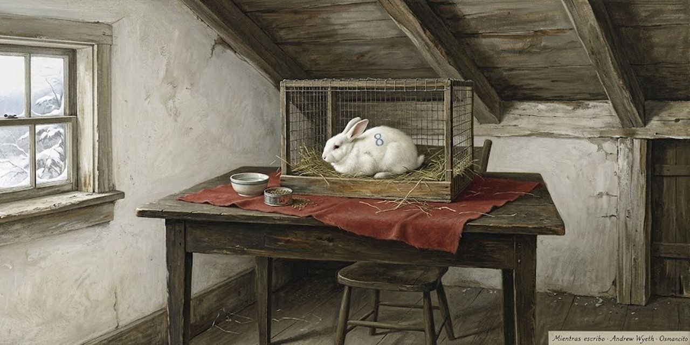

17 de octubre de 2026

# Mientras escribo

Stephen King

En el año 2000, Stephen King publicó *On Writing* («mientras escribo»), un libro raro: mitad memoria de cómo se hizo escritor, mitad manual del oficio.

El destilado ya suma treinta y cinco páginas y crece unidad a unidad.

Osmancito buscó las mejores frases del libro y, con Instinct, les dio una nueva forma.

## Prólogos

*A comienzos de los noventa, King entró en una banda de rock compuesta sobre todo por escritores, los Rock Bottom Remainders: Dave Barry, Ridley Pearson, Barbara Kingsolver, Amy Tan y él mismo a la guitarra rítmica. Una noche, cenando comida china antes de un bolo en Miami Beach, le preguntó a Amy Tan cuál era la pregunta que nadie le hacía nunca en la ronda de preguntas de cada charla de escritor. Ella lo pensó con cuidado y respondió: «nadie pregunta nunca por el lenguaje». A los DeLillo, a los Updike, a los Styron sí les preguntan; a los novelistas populares, no:*

> Yet many of us proles also care about the language, in our humble way, and care passionately about the art and craft of telling stories on paper.

Sin embargo, muchos de nosotros, los plebeyos, también nos preocupamos por el lenguaje, a nuestro modo humilde, y nos apasionan el arte y el oficio de contar historias en papel.

*«Plebeyos»: King usa la palabra de 1984, de George Orwell, para los escritores de éxito popular, a los que la crítica no toma en serio. Él mismo dudó antes de escribir este libro: el coronel Sanders vendió un montón de pollo frito, y nadie quiere saber cómo lo hacía. Hacía falta una razón mejor que el éxito:*

> Put another way, I didn’t want to write a book, even a short one like this, that would leave me feeling like either a literary gas-bag or a transcendental asshole.

Dicho de otro modo, no quería escribir un libro, ni siquiera uno breve como este, que me dejara sintiéndome un charlatán de letras o un idiota en estado puro.

*De esos libros, y de esos escritores, ya hay bastantes en el mercado. Así que éste sale corto por principio: cuanto más corto, menos tonterías; la excepción honrosa es The Elements of Style, de Strunk y White, el manualito que todo aspirante a escritor debería leer. La confesión de método:*

> Fiction writers, present company included, don’t understand very much about what they do—not why it works when it’s good, not why it doesn’t when it’s bad.

Los escritores de ficción, el que habla incluido, no entienden muy bien lo que hacen: ni por qué funciona cuando sale bien, ni por qué no cuando sale mal.

*Queda la declaración de propósitos, que es también el índice del libro:*

> What follows is an attempt to put down, briefly and simply, how I came to the craft, what I know about it now, and how it’s done.

Lo que sigue es un intento de poner por escrito, de forma breve y sencilla, cómo llegué al oficio, qué sé de él ahora y cómo se hace.

*Del segundo prólogo sale la ley de la carretera: «escribir es humano, editar es divino». Y la dedicatoria final es para Chuck Verrill, su editor de tantas novelas: «como siempre, Chuck, fuiste divino».*

## C.V.

### El paisaje con niebla

*King se quedó pasmado con The Liars' Club, las memorias de Mary Karr: no solo por su ferocidad y su belleza, sino por su totalidad, porque ella lo recuerda todo de su infancia. Él no. El suyo es un paisaje con niebla del que asoman recuerdos como árboles aislados, de los que parecen querer agarrarte y comerte. Lo que sigue no es una autobiografía, advierte, sino una especie de curriculum vitae: el intento de mostrar cómo se formó un escritor:*

> Not how one writer was *made;* I don’t believe writers *can* be made, either by circumstances or by self-will (although I did believe those things once).

No cómo se fabrica un escritor; no creo que los escritores puedan fabricarse, ni por las circunstancias ni por la propia voluntad (aunque una vez creí esas cosas).

*El equipo viene con el paquete original, dice: el talento no es raro, mucha gente tiene algo, y se puede afilar; si no lo creyera, escribir este libro sería perder el tiempo. Y pide no buscar líneas entre líneas: no hay líneas, solo instantáneas, la mayoría desenfocadas:*

> This is how it was for me, that’s all—a disjointed growth process in which ambition, desire, luck, and a little talent all played a part.

Así fue para mí, eso es todo: un proceso de crecimiento desordenado en el que la ambición, el deseo, la suerte y un poco de talento jugaron su papel.

### El hombre fuerte del circo

*Su primer recuerdo es de imaginación pura: a los dos años y medio, en casa de sus tíos Ethelyn y Oren, en Durham, Maine, el niño King era el Hombre Fuerte del circo Ringling Brothers, el circo más famoso de Estados Unidos. Había encontrado un bloque de cemento en un rincón del garaje y había conseguido levantarlo:*

> I carried it slowly across the garage’s smooth cement floor, except in my mind I was dressed in an animal skin singlet (probably a leopard skin) and carrying the cinderblock across the center ring.

Lo llevé despacio por el suelo liso de cemento del garaje, salvo que en mi mente iba vestido con una malla de piel de animal (probablemente de leopardo) y cargaba el bloque por la pista central.

*El público en silencio, el foco azul y blanco, la hazaña: «y solo tiene dos años», murmuraba alguien. Lo que él no sabía: unas avispas habían hecho un nido en la mitad de abajo del bloque. Una salió y le picó en la oreja, un dolor brillante, como una inspiración venenosa. Fue el peor dolor de su corta vida durante unos segundos: cuando el bloque le cayó sobre el pie descalzo y le machacó los cinco dedos, se olvidó por completo de la avispa. Su tía lo recuerda bien: «Cómo aullabas, Stephen. Ese día sí que estabas en plena voz».*

### Eula-Beulah

*Un año después, madre e hijos en West De Pere, Wisconsin; King no sabe por qué. Hubo una ristra de niñeras, y de todas solo recuerda con claridad a una: Eula, o quizá Beulah. Era adolescente, grande como una casa, y se reía mucho:*

> Eula-Beulah had a wonderful sense of humor, even at four I could recognize that, but it was a *dangerous* sense of humor—there seemed to be a potential thunderclap hidden inside each hand-patting, butt-rocking, head-tossing outburst of glee.

Eula-Beulah tenía un sentido del humor maravilloso; incluso a los cuatro años yo sabía reconocerlo, pero era un sentido del humor peligroso: parecía haber un trueno en potencia escondido dentro de cada arranque de risa con palmaditas, balanceo de caderas y cabeza echada atrás.

*Eula-Beulah era propensa a los gases, de los ruidosos y los apestosos: lo tumbaba en el sofá, le plantaba el trasero enfundado en lana sobre la cara y se soltaba, gritando «¡Pow!» de pura alegría. Como ser enterrado en fuegos artificiales de gas de pantano. Horrible y divertido a la vez. «En muchos sentidos», escribe King, «Eula-Beulah me preparó para la crítica literaria»: después de que una niñera de cien kilos se te eche un gas en la cara gritando «Pow!», The Village Voice, el semanario neoyorquino de la crítica cultural, da poco miedo. La despidieron por culpa de los huevos. Una mañana le frió un huevo, y él pidió otro, y otro, con la mirada de ella clavada: «no te atrevas a comerte otro, Stevie»:*

> I stopped after seven, I think—seven is the number that sticks in my mind, and quite clearly.

Paré después de siete, creo; siete es el número que se me quedó grabado, y con toda claridad.

*Siete huevos son muchos para un niño de cuatro años. Se sintió bien un rato y luego lo dejó todo en el suelo; Eula-Beulah rio, le cruzó la cara y lo encerró en el armario. Si lo hubiera encerrado en el baño, habría salvado el empleo. A él el armario no le molestaba:*

> It was dark, but it smelled of my mother’s Coty perfume, and there was a comforting line of light under the door.

Estaba oscuro, pero olía al perfume Coty de mi madre, y bajo la puerta entraba una línea de luz reconfortante.

*Se arrastró hasta el fondo, entre los abrigos, y empezó a eructar, eructos largos que quemaban como fuego, hasta que abrió la boca para soltar otro y en su lugar vomitó de nuevo: sobre los zapatos de su madre. Cuando ella volvió del trabajo, la niñera dormía en el sofá y el pequeño Stevie seguía encerrado, dormido, con restos de huevo frito a medio digerir secándose en el pelo.*

### El tejado

*La estancia en West De Pere no fue larga ni exitosa: los echaron del apartamento del tercer piso cuando una vecina vio al hermano de King, de seis años, gateando por el tejado, y llamó a la policía. Él no sabe dónde estaba su madre, ni la niñera de turno:*

> I only know that I was in the bathroom, standing with my bare feet on the heater, watching to see if my brother would fall off the roof or make it back into the bathroom okay.

Solo sé que yo estaba en el baño, de pie con los pies descalzos sobre el radiador, mirando a ver si mi hermano se caía del tejado o volvía entero al baño.

*Volvió entero. Ahora tiene cincuenta y cinco años y vive en New Hampshire.*

### Ver morir

*A los cinco o seis años, King le preguntó a su madre si había visto morir a alguien. Sí, dijo ella: a una persona la había visto morir y a otra la había oído. La que oyó fue una muchacha que se ahogó frente a Prout's Neck en los años veinte: nadó más allá de la resaca, la corriente que devuelve al mar, y no pudo volver. Los hombres que intentaron alcanzarla se vieron rechazados por la corriente, y turistas y lugareños solo pudieron quedarse escuchando sus gritos hasta que se le acabaron las fuerzas. Tenía catorce años. Luego su madre le leyó un tebeo y lo mandó a la cama:*

> On some other day she told me about the one she saw—a sailor who jumped off the roof of the Graymore Hotel in Portland, Maine, and landed in the street.

Otro día me contó la que vio: un marinero que saltó del tejado del hotel Graymore de Portland, Maine, y cayó en la calle.

*«Se estampó», dijo su madre con su tono más práctico, y añadió: «Lo que salió de él era verde. Nunca lo he olvidado». Y King cierra: «Ya somos dos, mamá».*

### Esto no va a doler

*De los nueve meses que debía pasar en primer grado, King pasó la mayoría en la cama. Empezó con un sarampión corriente y siguió a peor: anginas una tras otra (él creía que se decía «garganta a rayas» y la imaginaba en franjas rojas y blancas), hasta que un día el asunto le llegó a los oídos y su madre pidió un taxi —ella no manejaba— para llevarlo a un especialista demasiado importante para hacer visitas a domicilio. Cuarenta grados de fiebre; cada vez que tragaba, el dolor le encendía los lados de la cara como una máquina de discos. La enfermera le puso bajo la cabeza un paño absorbente —pudo haber sido un pañal— y tendría que haber sospechado algo. Olor a alcohol, el traqueteo del esterilizador, una aguja larga como la regla de su cartuchera:*

> The ear doctor smiled reassuringly and spoke the lie for which doctors should be immediately jailed (time of incarceration to be doubled when the lie is told to a child): “Relax, Stevie, this won’t hurt.”

El otorrino sonrió con tranquilidad y dijo la mentira por la que los médicos deberían ir directos a la cárcel (con la condena doblada cuando la mentira se le dice a un niño): «Relájate, Stevie, esto no va a doler».

*Le creyó. La aguja le atravesó el tímpano y el dolor fue más allá del mundo; salió líquido caliente, como si llorara por el agujero equivocado. «Fuiste muy valiente, Stevie, y ya pasó todo». Pasó todo tres veces: la semana siguiente otro taxi, la misma mentira, y él volvió a creerla, no del todo, pero lo suficiente para quedarse quieto. Sí que dolió, casi igual que la primera:*

> The smooching sound in my head was louder, too; this time it was giants kissing (“suckin’ face and rotatin’ tongues,” as we used to say).

El sonido de besos dentro de mi cabeza también fue más fuerte; esta vez eran gigantes besándose («comiéndose la boca y enroscando lenguas», como decíamos entonces).

*A la tercera, el taxista amenazó con parar y dejarlos si su madre no hacía callar a ese niño. Desde aquellas punciones repetidas a los seis años, uno de los principios más firmes de su vida: «Engáñame una vez, culpa tuya; engáñame dos, culpa mía; engáñame tres, culpa de los dos». La tercera vez forcejeó, gritó y apartó la aguja a manotazos hasta que la enfermera llamó a su madre y entre las dos lo sujetaron. Gritó tan fuerte y tanto tiempo que todavía lo oye: en algún valle profundo de su cabeza, aquel último grito sigue resonando.*

### El helado prometido

*En un mes frío y gris poco después —enero o febrero de 1954— volvió el taxi, esta vez al médico de la garganta:*

> Once again my mother sat in the waiting room, once again I sat on the examining table with a nurse hovering nearby, and once again there was that sharp smell of alcohol, an aroma that still has the power to double my heartbeat in the space of five seconds.

Una vez más mi madre se sentó en la sala de espera, una vez más yo me senté en la mesa de exploración con una enfermera revoloteando cerca, y una vez más estaba ese olor fuerte a alcohol, un aroma que todavía tiene el poder de doblarme los latidos en cinco segundos.

*Esta vez solo apareció un hisopo: picaba y sabía horrible, pero después de la aguja larga del oído era un paseo por el parque. El médico se puso un aparato con un espejo en medio y una luz fiera como un tercer ojo:*

> He looked down my gullet for a long time, urging me to open wider until my jaws creaked, but he did not put needles into me and so I loved him.

Me miró garganta abajo durante un buen rato, pidiéndome que abriera más hasta que me crujían las mandíbulas, pero no me clavó agujas, y por eso lo quise.

*El diagnóstico: las amígdalas. «Parece que las hubiera arañado un gato. Habrá que sacarlas». Lo último que recuerda es un hombre con mascarilla blanca inclinado sobre él, cabeza abajo desde su camilla —1953 y 1954 fueron sus años de estar tumbado en mesas—: «Cuando despiertes, podrás comer todo el helado que quieras». Al despertar, en efecto, le permitieron todo el helado que quisiera, una broma excelente, porque no quería nada. Pero mejor que el viejo truco de la aguja en el oído: «Quítenme las amígdalas si hace falta, pónganme una jaula de acero en la pierna si es preciso, pero Dios me libre del otiólogo».*

### Escribe una tuya

*Aquél año su hermano David saltó a cuarto grado y a King lo sacaron del colegio del todo: había perdido demasiado de primero. Entre la cama y la casa se leyó unas seis toneladas de tebeos, pasó a Tom Swift y a Jack London, y en algún momento empezó a escribir sus propias historias. La imitación precedió a la creación: copiaba tebeos de Combat Casey palabra por palabra en su cuaderno, añadiendo a veces descripciones propias:*

> “They were camped in a big dratty farmhouse room,” I might write; it was another year or two before I discovered that *drat* and *draft* were different words.

«They were camped in a big dratty farmhouse room», podía escribir yo; tardé todavía un año o dos en descubrir que *drat* y *draft* eran palabras distintas.

*O sea: quería decir «con corrientes de aire» (drafty) y escribía «maldita» (dratty). Por la misma época creía que details («detalles») eran dentals («dentales») y que una bitch era una mujer extremadamente alta: un son of a bitch venía a ser un jugador de baloncesto. Cuando se tienen seis años, la mayoría de las bolas del bingo todavía flotan en el bombo. Un día le enseñó a su madre uno de esos híbridos copiados:*

> Eventually I showed one of these copycat hybrids to my mother, and she was charmed—I remember her slightly amazed smile, as if she was unable to believe a kid of hers could be so smart—practically a damned prodigy, for God’s sake.

Quedó encantada: recuerdo su sonrisa levemente asombrada, como si no pudiera creer que un hijo suyo fuera tan listo; prácticamente un maldito prodigio, por el amor de Dios.

*Nunca le había visto esa cara, al menos no por él, y le encantó. Pero tuvo que admitir que había copiado casi todo de un tebeo, y la decepción de ella le aguó buena parte del gusto. Al final le devolvió el cuaderno: «Escribe una tuya, Stevie. Esos tebeos de Combat Casey son pura porquería; siempre le está rompiendo los dientes a alguien. Apuesto a que tú puedes hacerlo mejor. Escribe una tuya».*

### Mr. Rabbit Trick

*La idea le produjo una inmensa sensación de posibilidad, como si lo hubieran dejado entrar en un edificio enorme lleno de puertas cerradas con permiso para abrir las que quisiera. Escribió una historia de cuatro animales mágicos que recorrían el mundo en un carro viejo ayudando a niños pequeños; el jefe era un conejo blanco y grande llamado Mr. Rabbit Trick, y el que manejaba. Cuatro páginas, impresas a lápiz con esfuerzo. Nadie saltaba del tejado del Graymore:*

> When I finished, I gave it to my mother, who sat down in the living room, put her pocketbook on the floor beside her, and read it all at once.

Cuando lo terminé, se lo di a mi madre, que se sentó en la sala, puso el bolso en el suelo a su lado y lo leyó de una sentada.

> I could tell she liked it—she laughed in all the right places—but I couldn’t tell if that was because she liked me and wanted me to feel good or because it really *was* good.

Yo notaba que le gustaba (se reía en los sitios correctos), pero no sabía si era porque me quería y quería hacerme sentir bien o porque de verdad era bueno.

*«¿Ésta no la copiaste?». No. Dijo que era lo bastante buena para estar en un libro, y nada de lo que nadie le ha dicho desde entonces lo ha hecho más feliz. Escribió cuatro historias más de Mr. Rabbit Trick; su madre le pagó un cuarto de dólar por cada una y las mandó a sus cuatro hermanas, que la compadecían un poco —ellas seguían casadas, sus hombres no se habían largado—: quería que vieran que, al menos, su bebé tenía talento. Cuatro historias, un cuarto cada una: «Ese fue el primer dólar que gané en este oficio».*

### La jungla

*Mudanza a Stratford, Connecticut: segundo grado y un amor de piedra por la muchacha guapa de al lado:*

> She never looked twice at me in the daytime, but at night, as I lay in bed and drifted toward sleep, we ran away from the cruel world of reality again and again.

Ella no me miraba dos veces durante el día, pero por la noche, mientras yo me quedaba dormido en la cama, huíamos juntos del cruel mundo de la realidad una y otra vez.

*La maestra nueva, la señora Taylor, tenía el pelo gris de Elsa Lanchester en La novia de Frankenstein y los ojos saltones. Y a una cuadra cuesta abajo se extendía un enorme terreno enmarañado con un deshuesadero al fondo y una vía de tren en medio, uno de esos lugares a los que King vuelve siempre en la imaginación: los chicos de It lo llamaban los Barrens; ellos lo llamaban la jungla. Explorándola con Dave el primer verano, a King le entró una necesidad urgente de mover el vientre. «Llévame a casa, tengo que empujar». A Dave no le iba a arruinar media hora de tarde brillante por eso: «Hazlo en el monte. Límpiate con hojas, como hacían los vaqueros y los indios». La idea de hacerlo como un vaquero lo conquistó:*

> I pretended I was Hopalong Cassidy, squatting in the underbrush with my gun drawn, not to be caught unawares even at such a personal moment.

Me imaginé que era Hopalong Cassidy, en cuclillas en la maleza con la pistola desenfundada, decidido a que no me pillaran desprevenido ni en un momento tan personal.

*Hopalong Cassidy: el vaquero más limpio del cine y la tele de los cincuenta. Las hojas verdes y brillantes resultaron ser hiedra venenosa. Dos días después estaba rojo vivo de las corvas a los omóplatos; los testículos se le pusieron como semáforos, y lo peor fue la mano con que se limpió, hinchada como la de Mickey Mouse después de un martillazo del pato Donald, con ampollas gigantes entre los dedos que al reventar dejaron hoyos de carne viva:*

> For six weeks I sat in lukewarm starch baths, feeling miserable and humiliated and stupid, listening through the open door as my mother and brother laughed and listened to Peter Tripp’s countdown on the radio and played Crazy Eights.

Durante seis semanas me senté en baños tibios de almidón, sintiéndome miserable, humillado y estúpido, oyendo a través de la puerta abierta cómo mi madre y mi hermano se reían, escuchaban la cuenta atrás de Peter Tripp en la radio y jugaban a las cartas.

### El electroimán de Dave

*Dave era un hermano estupendo, pero demasiado listo para un niño de diez años: sus sesos siempre lo metían en líos, y aprendió pronto que el hermanito Stevie podía acompañarlo en la primera línea cuando se avecinaba tormenta:*

> Dave never asked me to shoulder *all* the blame for his often brilliant fuck-ups—he was neither a sneak nor a coward—but on several occasions I was asked to share it.

Dave nunca me pidió que cargara con toda la culpa de sus meteduras de pata, a menudo brillantes (no era ni un rastrero ni un cobarde), pero en varias ocasiones se me pidió compartirla.

*Así que los dos se buscaron el lío cuando Dave represó el arroyo de la jungla e inundó buena parte de West Broad Street, y los dos corrieron riesgo de morir con su proyecto de feria de ciencias de 1958: el Súper Electroimán de Dave. Nada de dibujos de ranas ni casas del futuro con rollos de papel higiénico: Dave apuntaba a las estrellas. El primer intento no fue muy súper que digamos —salió de un libro de verdad: imantar un clavo frotándolo con un imán y reforzarlo con un hilo de cobre y una pila—, pero Dave no quería levantar limaduras de hierro; Dave quería levantar Buicks, vagones de tren, quizá aviones de transporte del ejército. La nueva versión prescindió de la pila vieja y se conectó directamente a la corriente de la pared, con el cable pelado de una lámpara rescatada de la basura. El papel de Dave era construirlo; el de King, probarlo: el Chuck Yeager de Stratford:*

> Then, sitting on the floor in the kitchen of our West Broad Street apartment, he offered me the Super Duper Electromagnet and bade me do my part and plug it in.

Entonces, sentado en el suelo de la cocina de nuestro apartamento de West Broad Street, me ofreció el Súper Electroimán y me instó a hacer mi parte: enchufarlo.

*Dudó —que conste—, pero el entusiasmo maníaco de Dave era demasiado. Lo enchufó. No hubo magnetismo apreciable, pero el aparato fundió todas las luces y electrodomésticos del apartamento, del edificio y del edificio de al lado, donde vivía su chica soñada. Algo estalló en el transformador y vinieron policías:*

> Dave and I spent a horrible hour watching from our mother’s bedroom window, the only one that looked out on the street (all the others had a good view of the grassless, turd-studded yard behind us, where the only living thing was a mangy canine named Roop-Roop).

Dave y yo pasamos una hora horrible mirando desde la ventana del cuarto de nuestra madre, la única que daba a la calle (las demás tenían una buena vista del patio trasero, sin hierba y sembrado de cacas, donde el único ser vivo era un perro sarnoso llamado Roop-Roop).

*Ese día solo cabía preguntarse si su madre iría a visitarlos al reformatorio. Al final las luces volvieron, no los descubrieron, y Dave decidió que quizá construiría un Súper Planeador en vez de un Súper Electroimán. King, le informó, haría el primer vuelo. ¿No sería estupendo?*

### La tele

*King nació en 1947 y en casa no hubo televisor hasta 1958. Lo primero que recuerda haber visto es Robot Monster: un tipo disfrazado de mono con una pecera en la cabeza intentando matar a los últimos supervivientes de una guerra nuclear. Le pareció arte de muy alta naturaleza. Había todo un mundo de aventura ajenas empaquetado en blanco y negro, catorce pulgadas, patrocinado por marcas que todavía le suenan a poesía. Lo amó todo, pero la tele llegó tarde a casa de los King, y se alegra: pertenece al grupo selecto de los últimos novelistas americanos que aprendieron a leer y escribir antes de aprender a tragarse la ración diaria de tonterías en vídeo. Y de ahí, un consejo práctico:*

> On the other hand, if you’re just starting out as a writer, you could do worse than strip your television’s electric plug-wire, wrap a spike around it, and then stick it back into the wall.

Por otro lado, si estás empezando como escritor, no hay nada malo en pelar el cable del enchufe de tu televisor, enrollarle un clavo y volver a meterlo en la pared.

*«A ver qué salta, y hasta dónde. Solo una idea».*

### El Ackermonster

*A finales de los cincuenta, Forrest J. Ackerman, agente literario y coleccionista compulsivo de memorabilia de ciencia ficción, cambió la vida de miles de niños —King fue uno— con su revista Famous Monsters of Filmland. Hacia 1960, King mandó un cuento a Spacemen, su revista hermana: el primero que enviaba a publicar, muy deudor del mono asesino con pecera de Robot Monster. Se lo rechazaron, pero Forry se lo quedó (Forry lo guarda todo, como sabe cualquiera que haya visitado su casa, la Ackermansión):*

> About twenty years later, while I was signing autographs at a Los Angeles bookstore, Forry turned up in line … with my story, single-spaced and typed with the long-vanished Royal typewriter my mom gave me for Christmas the year I was eleven.

Unos veinte años después, mientras yo firmaba autógrafos en una librería de Los Ángeles, apareció Forry en la cola... con mi cuento, a un solo espacio y mecanografiado con la Royal desaparecida hacía años que mi madre me había regalado la Navidad de mis once años.

*Quería que se lo firmara, y King cree que lo hizo, aunque el encuentro fue tan surrealista que no puede jurarlo. «Hablando de fantasmas. Madre mía».*

### Profanador de tumbas adolescente

*El primer cuento que publicó de verdad salió en un fanzine de terror de Mike Garrett, de Birmingham, Alabama:*

> He published this novella under the title “In a Half-World of Terror,” but I still like my title much better.

Publicó la novelita con el título «In a Half-World of Terror», pero el mío me sigue gustando mucho más.

*El suyo era «I Was a Teen-Age Grave-robber»: yo fui un profanador de tumbas adolescente. «Súper. ¡Pow!».*

### Durham

*De vuelta a Maine, llega el recuerdo que ordena la memoria: la primera idea propia de un cuento.*

> My first really original story idea—you always know the first one, I think—came near the end of Ike’s eight-year reign of benignity.

Mi primera idea realmente original para un cuento (la primera siempre se reconoce, creo) llegó cerca del final de los ocho años de reinado benévolo de Ike.

*Ike: el presidente Eisenhower. La familia se había vuelto a Maine para que su madre cuidara de sus padres ancianos: Mama, unos ochenta años, obesa, hipertensa y casi ciega; Daddy Guy —su madre lo llamaba «Fazza»—, ochenta y dos, flaco, hosco y propenso a arranques a lo pato Donald que solo ella entendía:*

> I was sitting at the kitchen table of our house in Durham, Maine, and watching my mother stick sheets of S&H Green Stamps into a book.

Estaba sentado a la mesa de la cocina de nuestra casa de Durham, Maine, mirando a mi madre pegar hojas de cupones S&H Green Stamps en una libreta.

*Los Green Stamps eran cupones de compra que se cambiaban por mercancía; para más historias sabrosas sobre ellos, remite a The Liars' Club. Las hermanas le habían conseguido a su madre aquel arreglo pensando quizá en matar dos pájaros de un tiro: los viejos cuidados en casa por una hija amorosa, y resuelto El Problema Fastidioso de Ruth. Pero King cree que ella odiaba aquel trabajo: de mujer autosuficiente, graciosa y un poco loca pasó a una especie de aparcera con existencia casi sin dinero. La casa era de los tíos Ethelyn y Oren; una vez allí, quedó atrapada. Consiguió otro trabajo de verdad cuando los viejos murieron, pero vivió en esa casa hasta que la alcanzó el cáncer, y cuando salió de Durham por última vez, King intuye que probablemente estaba más que lista para irse.*

### Happy Stamps

*Que quede claro, dice King: no existe un vertedero de ideas ni una Central de Cuentos; las buenas ideas llegan literalmente de la nada, navegando hacia ti desde el cielo vacío: dos ideas sin relación se juntan y hacen algo nuevo bajo el sol. El trabajo del escritor no es encontrarlas, sino reconocerlas cuando aparecen. Aquel día, su madre comentó que le faltaban seis libretas de cupones para la lámpara que quería regalarle a su hermana Molly por Navidad; cruzó los ojos, le sacó la lengua, y King vio que la tenía verde S&H. Qué bien sería fabricar esos malditos cupones en el sótano, pensó, y en ese instante nació «Happy Stamps»: el concepto de falsificar cupones de descuento más la lengua verde de su madre. El héroe: Roger, un pobre diablo con dos condenas por falsificar dinero, que descubre que el diseño de los Happy Stamps es tan idiotamente simple que no está falsificando: está creando el artículo auténtico, por resmas:*

> In a funny scene—probably the first really competent scene I ever wrote—Roger sits in the living room with his old mom, the two of them mooning over the Happy Stamps catalogue while the printing press runs downstairs, ejecting bale after bale of those same trading stamps.

En una escena divertida —probablemente la primera escena realmente competente que escribí—, Roger está sentado en la sala con su vieja madre, los dos babeando sobre el catálogo de Happy Stamps mientras la imprenta funciona abajo, escupiendo fardo tras fardo de esos mismos cupones.

*«Por seis o siete millones de libretas podríamos tener una casa Happy Stamps en las afueras», dice la madre. El problema: los cupones son perfectos, pero la goma es defectuosa; si pasan por la humedecedora mecánica, los cupones rosas se vuelven azules. El cuento termina con Roger frente al espejo, los labios rosas, la lengua más rosa todavía, abriendo otra libreta para seguir lamiendo: solo quedan once millones quinientas noventa mil para la casa Tudor de mamá:*

> There were things wrong with this story (the biggest hole was probably Roger’s failure simply to start over with a different glue), but it was cute, it was fairly original, and I knew I had done some pretty good writing.

El cuento tenía sus fallos (el mayor agujero era, probablemente, que a Roger no se le ocurriera simplemente empezar de nuevo con otra goma), pero era gracioso, era bastante original, y yo sabía que había escrito algunas cosas buenas.

*Tras estudiar los mercados en su ajado Writer's Digest, lo mandó a Alfred Hitchcock's Mystery Magazine. Volvió a las tres semanas con el resbalón de rechazo impreso —el perfil inconfundible de Hitchcock en tinta roja— y algo más:*

> At the bottom was an unsigned jotted message, the only personal response I got from *AHMM* over eight years of periodic submissions.

Al pie había un mensajito garabateado sin firma, la única respuesta personal que recibí de AHMM en ocho años de envíos periódicos.

*La posdata decía: «No engrape los manuscritos. Hojas sueltas más clip igual a la forma correcta de enviar originales». Consejo frío, pensó, pero útil a su manera: nunca ha vuelto a engrapar un manuscrito.*

### El clavo de los rechazos

*Su cuarto en la casa de Durham quedaba arriba, bajo los aleros; de noche leía en la cama con una lámpara de cuello de cisne que proyectaba en el techo una sombra como una boa constrictora, entre el ruido de la caldera, el correteo de las ratas del desván y los gritos de medianoche de su abuela pidiendo que alguien revisara a Dick, un caballo muerto hacía cuarenta años:*

> I had a desk beneath the room’s other eave, my old Royal typewriter, and a hundred or so paperback books, mostly science fiction, which I lined up along the baseboard.

Tenía un escritorio bajo el otro alero de la habitación, mi vieja máquina de escribir Royal y un centenar de libros de bolsillo, sobre todo de ciencia ficción, que alineaba a lo largo del zócalo.

*Cuando llegó el resbalón de rechazo de AHMM, clavó un clavo en la pared, escribió «Happy Stamps» en el resbalón y lo empalmó en el clavo. Después se sentó en la cama a oír a Fats Domino cantar «I'm Ready», y se sintió bastante bien: cuando aún eres muy joven para afeitarte, el optimismo es una respuesta perfectamente legítima al fracaso. A los catorce, el clavo ya no soportaba el peso de los resbalones ensartados; lo cambió por un clavón y siguió escribiendo. A los dieciséis llegaron notas escritas a mano, más alentadoras que el consejo del clip: Algis Budrys, entonces editor de Fantasy and Science Fiction, le escribió de un cuento suyo: «Esto es bueno. No para nosotros, pero bueno. Tienes talento. Vuelve a intentarlo». Cuatro frases breves que le iluminaron el pésimo invierno de sus dieciséis años:*

> Ten years or so later, after I’d sold a couple of novels, I discovered “The Night of the Tiger” in a box of old manuscripts and thought it was still a perfectly respectable tale, albeit one obviously written by a guy who had only begun to learn his chops.

Unos diez años después, cuando ya había vendido un par de novelas, descubrí «The Night of the Tiger» en una caja de manuscritos viejos y me siguió pareciendo un cuento perfectamente respetable, aunque escrito a todas luces por un tipo que apenas empezaba a aprender el oficio.

*Lo reescribió y, por un capricho, lo reenvió a la misma revista. Esta vez lo compraron. Algo que ha notado: cuando has tenido un poco de éxito, las revistas usan mucho menos la frase «no para nosotros».*

### Dave's Rag

*Dave, un año menor que sus compañeros y con un coeficiente entre 150 y 160, se aburría en el instituto: no era bastante súper, no tenía pow, no tenía wham, no tenía gracia. Lo resolvió, por un tiempo, creando un periódico: Dave's Rag, con redacción en una mesa del sótano, al norte de la caldera y al este de la despensa. Mezcla rara de boletín familiar y bisemanario de pueblo:*

> Sometimes it was a monthly, if Dave got sidetracked by other interests (maple-sugaring, cider-making, rocket-building, and car-customizing, just to name a few), and then there would be jokes I didn’t understand about how Dave’s *Rag* was a little late this month or how we shouldn’t bother Dave, because he was down in the basement, on the *Rag.*

A veces era mensual, si Dave se despistaba con otros intereses (hacer azúcar de arce, hacer sidra, construir cohetes, tunear carros, por nombrar unos pocos), y entonces corrían chistes que yo no entendía sobre que el Rag de Dave ese mes venía con retraso o sobre que no había que molestar a Dave, que estaba abajo en el sótano, con el Rag.

*El chiste que King no entendía: on the rag significa en inglés «con la regla». Chistes o no, la tirada subió de cinco ejemplares a unos sesenta: noticias de la pierna rota de Charley Harrington, los invitados de la iglesia metodista, chistes de castores («it was nice gnawing you») y una historia por entregas que escribía King. El primer año se imprimía en morado, con un hectógrafo, una placa de gelatina que a Dave se le quedó corta pronto; a Dave, incluso en pantalón corto, lo volvía loco que lo frenaran. Cuando el novio de su madre se atascaba en un semáforo, Dave gritaba desde el asiento de atrás: «¡Pásales por encima, tío Milt!»:*

> As a teenager, waiting for the hectograph to “freshen” between pages printed (while “freshening,” the print would melt into a vague purple membrane which hung in the jelly like a manatee’s shadow) drove David all but insane with impatience.

Ya adolescente, esperar a que el hectógrafo se «refrescara» entre página y página (mientras se «refrescaba», la impresión se derretía en una vaga membrana morada que colgaba en la gelatina como la sombra de un manatí) volvía a David medio loco de impaciencia.

*Además quería poner fotos; hacía buenas, y a los dieciséis también las revelaba:*

> He rigged a darkroom in a closet and from its tiny, chemical-stinking confines produced pictures which were often startling in their clarity and composition (the photo on the back of *The Regulators,* showing me with a copy of the magazine containing my first published story, was taken by Dave with an old Kodak and developed in his closet darkroom).

Se montó un cuarto oscuro en un armario, y desde ese cubículo diminuto y apestoso a químicos sacaba fotos a menudo asombrosas de nitidez y composición (la foto de la contraportada de The Regulators, donde salgo con un ejemplar de la revista que publicó mi primer cuento, la tomó Dave con una vieja Kodak y la reveló en su cuarto oscuro del armario).

*La gelatina, por lo demás, tendía a incubar colonias de crecimientos extraños en el sótano húmedo: lo que el lunes parecía normal, el fin de semana parecía salido de un relato de Lovecraft. En Brunswick encontró una pequeña imprenta de tambor de segunda mano: esténciles de diecinueve centavos, la tinta más apestosa del mundo, y a darle a la manivela hasta que se te caiga el brazo. Lo que antes tomaba una semana salía en dos noches: Dave's Rag entró en su breve edad de oro.*

### El péndulo

*Entre 1958 y 1966, lo que de verdad le importaba a King era el cine: no el Empire, con sus musicales de gente pulcra —aburridamente sanos, previsibles—, sino el Ritz, calle abajo entre las casas de empeño: monstruos que se comían ciudades enteras, cadáveres radiactivos que salían del océano a comerse a los surfistas, chicas de sostén negro con pinta de basura de caravana. Catorce millas que hacía a dedo casi cada fin de semana, ocho años seguidos. Su género favorito, bautizado por él y su amigo Chris: las Poepictures, la serie de películas de Roger Corman con títulos tomados de Poe que de Poe tenían poco. La que más los marcó fue The Pit and the Pendulum, con su cadáver enterrado en vida filmado a través de un filtro rojo, la cara estirada en un grito silencioso y enorme:*

> On the long hitch home that night (if rides were slow in coming, you might end up walking four or five miles and not get home until well after dark) I had a wonderful idea: I would turn *The Pit and the Pendulum* into a book!

En el largo viaje de vuelta a casa aquella noche (si los aventones tardaban, podías acabar caminando cuatro o cinco millas y no llegar hasta bien entrada la noche), tuve una idea maravillosa: ¡convertiría The Pit and the Pendulum en un libro!

*No solo escribirla: también imprimirla con la imprenta de tambor del sótano y venderla en la escuela. Como se concibió, así se hizo:*

> Working with the care and deliberation for which I would later be critically acclaimed, I turned out my “novel version” of *The Pit and the Pendulum* in two days, composing directly onto the stencils from which I’d print.

Trabajando con el esmero y la pausa por los que años después sería aclamado por la crítica, despaché mi «versión novelada» de The Pit and the Pendulum en dos días, componiendo directamente sobre los esténciles con los que imprimiría.

*Ocho páginas a un solo espacio —cada esténcil costaba diecinueve centavos—, portada con un péndulo goteando manchurrones que él esperaba que parecieran sangre, y el sello editorial en la esquina: A V.I.B. BOOK, Very Important Book:*

> I ran off about forty copies of *The Pit and the Pendulum,* blissfully unaware that I was in violation of every plagiarism and copyright statute in the history of the world; my thoughts were focused almost entirely on how much money I might make if my story was a hit at school.

Tiré unos cuarenta ejemplares de The Pit and the Pendulum, felizmente ignorante de que estaba violando todas las leyes de plagio y derechos de autor de la historia del mundo; mis pensamientos se concentraban casi por completo en cuánto dinero podía ganar si mi historia pegaba fuerte en la escuela.

*Los esténciles costaron 1,71 dólares, el papel unos cincuenta centavos más, las grapas gratis, birladas de su hermano —los cuentos para las revistas van con clip, pero esto era un libro, esto era la liga mayor—. Precio: un cuarto de dólar. The Pit and the Pendulum fue su primer éxito de ventas: dos docenas antes del mediodía, tres al final del almuerzo, cuando ya corría la voz de la dama emparedada que había muerto «scratcheing madley for escape», rascando como una loca por salir. Nueve dólares en cambio pesando en el fondo de la mochila. Demasiado bueno para ser verdad: a las dos lo llamaron a dirección. La señorita Hisler —la misma que años antes le había quitado The Amboy Dukes— le informó de que no podía convertir la escuela en un mercado, y menos para vender semejante porquería:*

> “What I don’t understand, Stevie,” she said, “is why you’d write junk like this in the first place.

«Lo que no entiendo, Stevie —dijo—, es por qué escribes porquerías como ésta para empezar. Tienes talento. ¿Por qué quieres desperdiciar tus capacidades?».

*Esperó una respuesta —la pregunta no era del todo retórica, hay que reconocérselo—, pero él no tenía ninguna. Estaba avergonzado, y ha pasado muchos años desde entonces, demasiados, avergonzado de lo que escribe:*

> I think I was forty before I realized that almost every writer of fiction and poetry who has ever published a line has been accused by someone of wasting his or her God-given talent.

Creo que tenía cuarenta años cuando comprendí que a casi todo escritor de ficción o poesía que ha publicado una sola línea alguien lo ha acusado alguna vez de desperdiciar el talento que Dios le dio.

*Devolvió el dinero sin discutir, incluso a los niños que insistieron en quedarse su ejemplar de V.I.B. nº 1, y acabó perdiendo dinero en el trato; ese verano imprimió cuatro docenas de una historia original, The Invasion of the Star-Creatures, y vendió casi todas. Ganó, al menos en lo financiero. Pero en el corazón siguió avergonzado: durante años siguió oyendo a la señorita Hisler preguntar por qué quería desperdiciar su talento, por qué quería escribir porquerías.*

### The Village Vomit

*En segundo de bachillerato, por haber trabajado en el periódico de Dave, lo nombraron —sin preguntarle, cree— editor del periódico escolar, The Drum, que no prosperó bajo su dirección: en el curso 63-64 publicó un solo número, eso sí, más gordo que la guía de teléfonos de Lisbon Falls. Y una noche:*

> One night—sick to death of Class Reports, Cheerleading Updates, and some lamebrain’s efforts to write a school poem—I created a satiric high school newspaper of my own when I should have been captioning photographs for *The Drum.*

Una noche —harto hasta la muerte de los Partes de Clase, las Noticias de las Porristas y los esfuerzos de algún descerebrado por escribir un poema escolar— creé un periódico satírico de instituto por mi cuenta, cuando debería haber estado redactando pies de foto para The Drum.

*Cuatro páginas: The Village Vomit, «el vómito del pueblo», con el lema enmarcado en la esquina: no «todas las noticias dignas de imprimirse», sino «toda la mierda que se pegue». Esa chorrada le trajo el único problema serio de su etapa escolar y la lección de escritura más útil que recibió nunca:*

> In typical *Mad* magazine style (“What, me worry?”), I filled the *Vomit* with fictional tidbits about the LHS faculty, using teacher nicknames the student body would immediately recognize.

En el estilo típico de la revista Mad («¿Qué, yo preocuparme?»), llené el Vomit de pamplinas ficticias sobre el profesorado del instituto, usando los apodos que todo el alumnado reconocería al instante.

*La señorita Raypach era Rat Pack; el señor Ricker, dueño de una lechería, Cow Man; el de ciencias, Old Raw Diehl, despedido en una crónica por meterse ojos de fetos de cerdo en las fosas nasales. Humor en la gran tradición swiftiana. A la cuarta hora, tres amigos se reían tan fuerte al fondo de la sala de estudio que la propia Rat Pack se acercó a hurtadillas a ver qué era tan gracioso:*

> She confiscated *The Village Vomit,* on which I had, either out of overweening pride or almost unbelievable naiveté, put my name as Editor in Chief & Grand High Poobah, and at the close of school I was for the second time in my student career summoned to the office on account of something I had written.

Confiscó The Village Vomit, en el que yo, ya fuera por orgullo desmedido o por una ingenuidad casi increíble, había puesto mi nombre como Redactor Jefe y Gran Poobah Supremo, y al final de las clases fui por segunda vez en mi carrera estudiantil llamado a dirección por culpa de algo que había escrito.

*Poobah: el personaje todopoderoso de El Mikado, de Gilbert y Sullivan. La mayoría de los profesores se lo tomaron a bien —hasta Old Raw Diehl estaba dispuesto a olvidar lo de los ojos de cerdo—, pero una no: la señorita Margitan, la de mecanografía y taquigrafía, respetada y temida, de la escuela vieja: nada de ser tu amiga, tu psicóloga ni tu inspiración; sus alumnas se arrodillaban en el suelo y, si el dobladillo no tocaba el linóleo, se iban a casa a cambiarse. Las que la odiaban la llamaban Maggot, «gusano», como sin duda sus madres antes. Y el Vomit traía una nota que empezaba: «La señorita Margitan, conocida afectuosamente en todo Lisbon como Maggot...». El director calvo —Old Cue-Ball para el Vomit— le dijo que estaba muy dolida y que pedía su suspensión:*

> It was the crazy part of me that had first written *The Village Vomit* and then carried it to school; now that troublesome Mr. Hyde had dubbed up and slunk out the back door.

La parte loca de mí fue la que primero escribió The Village Vomit y luego lo llevó a la escuela; ahora ese molesto Mr. Hyde se había largado a escondidas por la puerta de atrás.

*Al doctor Jekyll le tocó imaginar los ojos dolidos de su madre si se enteraba, y aguantarse las ganas de llorar en el despacho, sentado en la Silla del Chico Malo. Al final la cosa quedó en disculpa formal y dos semanas de castigo. Y en la disculpa, de pie frente a ella —sentada rectísima, las manos artríticas cruzadas, los ojos grises fijos en su cara—, King entendió que había algo distinto en aquella mujer: con ella no habría encanto que valiera:*

> Later, while I was flying paper planes with the other bad boys and bad girls in detention hall (detention turned out to be not so bad), I decided that it was pretty simple: Miss Margitan didn’t like boys.

Más tarde, mientras lanzaba aviones de papel con los otros chicos y chicas malos en el aula de castigo (el castigo resultó no ser tan malo), decidí que era muy simple: a la señorita Margitan no le gustaban los chicos.

*La primera mujer que conoció en su vida a la que no le gustaban los chicos, ni un poquito. La disculpa fue sincera: ella había sido herida de verdad, y eso él podía entenderlo. Dos años después, cuando su nombre apareció en la lista de candidatos a la Sociedad de Honor, ella lo vetó: la sociedad no necesitaba chicos «de su tipo». King ha llegado a creer que tenía razón: un chico que una vez se limpió el trasero con hiedra venenosa probablemente no pertenece a un club de gente lista. Desde entonces no ha tenido muchos tratos con la sátira.*

## What Writing Is

*«Telepatía, por supuesto», abre King: todas las artes dependen de ella y la escritura es su destilación más pura. Lleva siglos a la vista, como la carta del cuento de Edgar Allan Poe, que toda la policía busca mientras cuelga de un tarjetero. J. B. Rhine dedicó su vida a buscarla en un laboratorio:*

> It’s amusing when you stop to think about it—for years people have argued about whether or not such a thing exists, folks like J. B. Rhine have busted their brains trying to create a valid testing process to isolate it, and all the time it’s been right there, lying out in the open like Mr. Poe’s Purloined Letter.

Da risa pensarlo: durante años la gente ha discutido si tal cosa existe o no; gente como J. B. Rhine se ha roto la cabeza tratando de crear un proceso de prueba válido para aislarla, y todo ese tiempo ha estado ahí, a la vista de todos, como la carta robada del señor Poe.

*Toda telepatía tiene un emisor y un receptor. King da sus coordenadas:*

> I’m writing the first draft of this part at my desk (the one under the eave) on a snowy morning in December of 1997.

Estoy escribiendo el primer borrador de esta parte en mi escritorio (el que está bajo el alero), una mañana nevada de diciembre de 1997.

*El alero es la parte del tejado que sobresale de la pared: King escribe en la buhardilla. El lector es el receptor, río abajo en el tiempo; no hace falta compartir el año: todavía leemos a Dickens y a Shakespeare.*

*¿Desde dónde transmite? Desde un sitio para ver lejos que, contradicción suya, queda en un sótano de luces brillantes. Entonces hace el truco: manda por el aire una mesa con mantel rojo, una jaula, un conejo blanco que muerde un resto de zanahoria y un ocho azul en el lomo. El lector lo recibe todo, sobre todo el ocho, sin abrir la boca ni compartir año: telepatía de verdad. Fíjese en lo que la descripción no dijo:*

> The paragraph also doesn’t tell us what sort of material the cage is made of—wire mesh? steel rods? glass?—but does it really matter?

El párrafo tampoco nos dice de qué material está hecha la jaula (¿malla de alambre?, ¿barras de acero?, ¿vidrio?), pero ¿de veras importa?

*No importa: todos entendemos que la jaula se ve a través. Dar las medidas exactas sería escribir un manual de instrucciones, no prosa.*

*La demostración tiene su moraleja: la seriedad. A la página en blanco se puede llegar de muchas maneras:*

> You can approach the act of writing with nervousness, excitement, hopefulness, or even despair—the sense that you can never completely put on the page what’s in your mind and heart.

Se puede llegar al acto de escribir con nerviosismo, con entusiasmo, con esperanza o incluso con desesperación: la sensación de que nunca se podrá pasar por completo a la página lo que hay en la mente y en el corazón.

*De todas esas maneras se puede llegar, menos de una: «venga como venga, menos a la ligera; no debe acercarse a la página en blanco a la ligera». No es misa ni concurso de moral: es escribir. Si el lector lo toma en serio, hay trato; si no, que cierre el libro. «Lavar el carro, quizás».*

Osmancito, con la asistencia de Instinct

[volver](../destileria.html)
