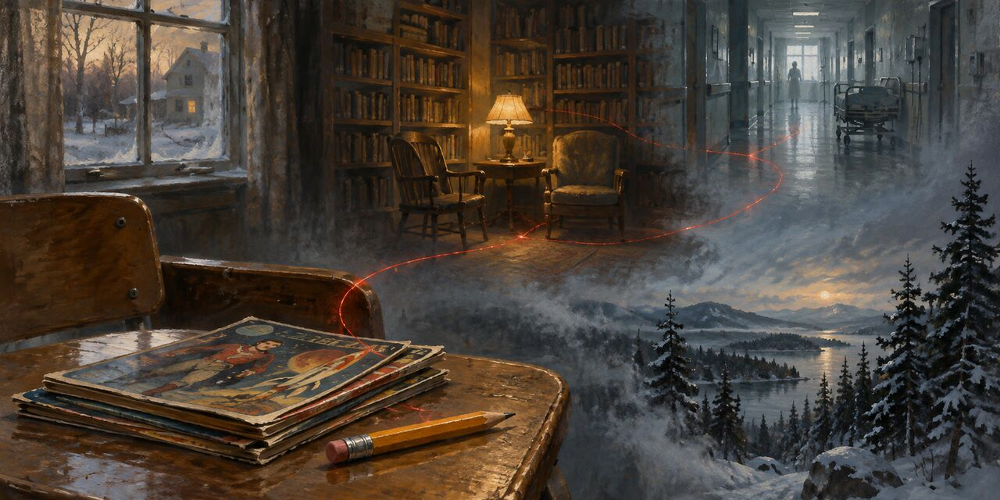

# Mientras escribo

Stephen King

## C.V.

King abre el capítulo frente a una memoria ajena: la de Mary Karr, nítida hasta el detalle. La suya, en cambio, no es una línea continua, sino un terreno cubierto de bruma. De ese terreno emergen escenas sueltas: un niño que se imagina en la pista de un circo, una niñera enorme que convierte la risa en un pequeño desastre, la casa del tejado y la aguja que promete no doler.

El niño crece entre enfermedades, mudanzas y libros. La madre aparece una y otra vez como quien cuenta, cuida, miente para tranquilizar o sigue adelante. El hermano comparte el paisaje; las tías, los médicos, las maestras y los desconocidos dejan marcas distintas. La infancia no explica al adulto con orden; deja imágenes que sobreviven por la huella que algo les imprimió.

Más tarde, el muchacho lee, imita y escribe. La vida se ensancha hacia los trabajos, los cuentos, el matrimonio y los hijos. Tabitha no queda al margen de la historia del escritor: comparte la biblioteca, la mesa, el dinero escaso y el lenguaje. Cuando llega una oportunidad, la reciben con cuentas que pagar y una familia que sostener.

Al mirar atrás, King imagina el escritor que habría sido si hubiera seguido aplazando el trabajo. Ese futuro alternativo lo devuelve a las chicas solitarias de su clase y a los recuerdos que no había entendido todavía. La memoria es material de escritura: no un archivo completo, sino pocas escenas que aún tienen voz. El capítulo termina cerca del oficio, donde una decisión económica y una decisión de vida quedan enlazadas.

> Un año más tarde, mi madre, mi hermano y yo estábamos en West De Pere, Wisconsin.

> Volvió a asegurarme que no dolería, y yo volví a creerle.

> No me la había encontrado en la biblioteca, y no creía que una universitaria pudiera soltar una risa tan maravillosa y desinhibida.

> Nos casamos un año y medio después.

> Seguimos casados, y nunca me ha dejado olvidar que la primera vez que la vi pensé que era la novia pueblerina de Eddie Marsh.

> Venimos de religiones distintas, pero Tabby, como feminista, nunca ha simpatizado mucho con los católicos, donde los hombres dictan las reglas (incluida la directriz divina de hacerlo siempre a pelo) y las mujeres lavan la ropa interior.

> Venimos de entornos obreros parecidos, ambos comíamos carne y éramos demócratas, con las típicas sospechas yanquis hacia todo lo que queda fuera de Nueva Inglaterra.

> Éramos compatibles sexualmente y monógamos por naturaleza.

> Pero lo que más nos une son las palabras, el lenguaje y el oficio de nuestras vidas.

> Nos conocimos trabajando en una biblioteca, y me enamoré de ella durante un taller de poesía en el otoño de 1969, cuando yo cursaba el último año y Tabby el penúltimo.

> Cuando llevábamos tres años casados, ya teníamos dos hijos.

> Ambos sabíamos que Naomi necesitaba LA COSA ROSA, como llamábamos a la amoxicilina líquida.

> De pronto pudimos pagar no solo la consulta médica y una botella de LA COSA ROSA, sino también una buena cena de domingo.

> Nos cuidábamos, cuidábamos a los niños y nos cuidábamos mutuamente lo mejor que podíamos.

> Simplemente no podíamos pagar la mensualidad del teléfono.

> Podía verme treinta años después, con los mismos abrigos de tweed raídos y remiendos en los codos, la barriga cayéndome sobre los caquis Gap por beber demasiada cerveza.

> Y claro que me mentiría, diciéndome que aún había tiempo, que no era demasiado tarde; había novelistas que no empezaban hasta los cincuenta, demonios, incluso a los sesenta.

> Y también me ayudó volver a mis recuerdos de secundaria (mi trabajo de profesor de inglés no ayudaba; ya tenía veintiséis y estaba al otro lado del escritorio), recordando lo que sabía de las dos chicas más solitarias y despreciadas de mi clase: cómo eran, cómo se comportaban, cómo las trataban.

> Recuerdo que los dos estábamos acostados en la cama aquella noche, comiendo tostadas y conversando hasta la madrugada.

> Gastamos el adelanto en un auto nuevo (de cambios manuales, que Tabby detestaba y maldecía con su lenguaje más colorido de obrera textil) y firmé un contrato para enseñar durante el año académico 1973-1974.

## Glosa

El conjunto de frases más pesadas se concentra en la voz autobiográfica: el narrador es sujeto y también objeto de su propia mirada. Eso no es un error de cálculo, sino un rasgo del capítulo: King se narra, se recuerda y se imagina desde dentro. En las frases con Tabitha, la primera persona plural hace visible otra forma de agencia: decisiones sobre dinero, trabajo y familia aparecen como experiencia compartida. La puntuación del ranking cuenta cada papel y permite que una mención compuesta se reparta entre sus miembros; por eso los sujetos colectivos no reciben un punto entero cada uno. La lista no mide importancia literaria ni calidad de las frases: muestra qué entidades quedan más conectadas a las cláusulas principales según el criterio fijado.

Osmancito, con la asistencia de Instinct

[volver](../destileria.html)
