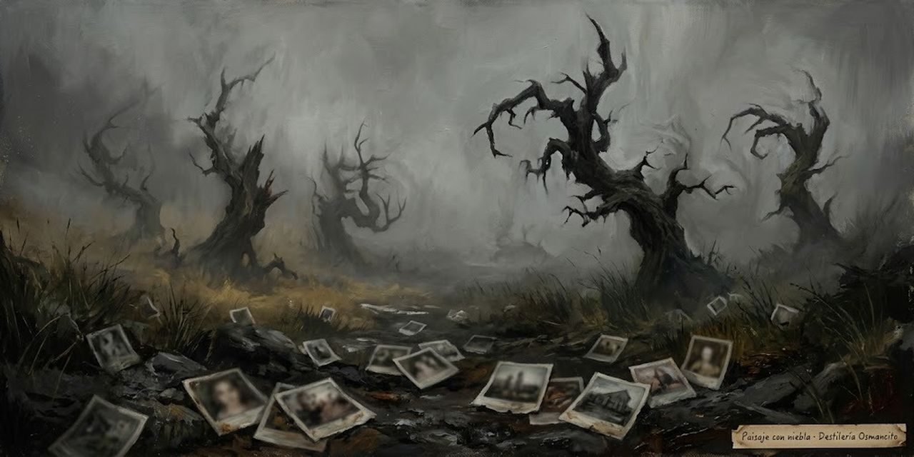

# Mientras escribo

## C.V.

### El paisaje con niebla

King se quedó pasmado con The Liars' Club, las memorias de la poeta americana Mary Karr: ella lo recuerda todo de su infancia. Él no. La suya fue a tirones, con una madre sola y quizá una temporada en casa de una tía:

> Perhaps she was only chasing our father, who piled up all sorts of bills and then did a runout when I was two and my brother David was four.

Quizá solo perseguía a nuestro padre, que amontonó deudas de todas clases y luego se esfumó cuando yo tenía dos años y mi hermano David cuatro.

Mary Karr es poeta y memorista: The Liars' Club, «el club de los mentirosos», salió en 1995, pasó más de un año entre los más vendidos del New York Times y le devolvió la moda al género. «Did a runout» es el americano para largarse sin aviso y no volver. El libro no da el nombre del padre; las biografías lo llaman Donald Edwin King.

Nunca lo encontró. La madre, Nellie Ruth Pillsbury King, fue de las primeras mujeres liberadas de América, y no por gusto. Donde Karr tiene un panorama sin cortes, King tiene un paisaje con niebla del que asoman árboles que parecen querer comerte. Avisa, eso sí: esto no es autobiografía, es curriculum vitae.

> This is how it was for me, that's all—a disjointed growth process in which ambition, desire, luck, and a little talent all played a part.

Así fue para mí, eso es todo: un proceso de crecimiento desordenado en el que la ambición, el deseo, la suerte y un poco de talento jugaron su papel.

El curriculum vitae es el papel donde uno cuenta sus estudios y sus oficios; King juega con eso: esto es el C.V. de un escritor, no la historia de su vida.

Pide no buscar una línea que una los puntos: no hay líneas, solo instantáneas, la mayoría desenfocadas.

Osmancito, con la asistencia de Instinct

[volver](../destileria.html)
