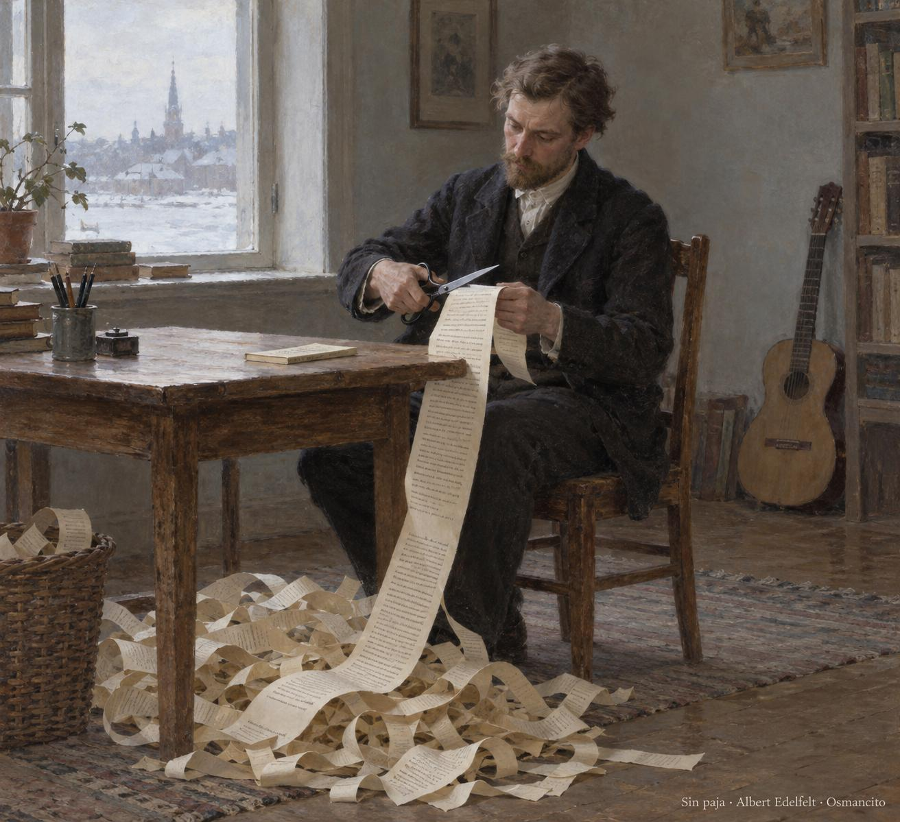
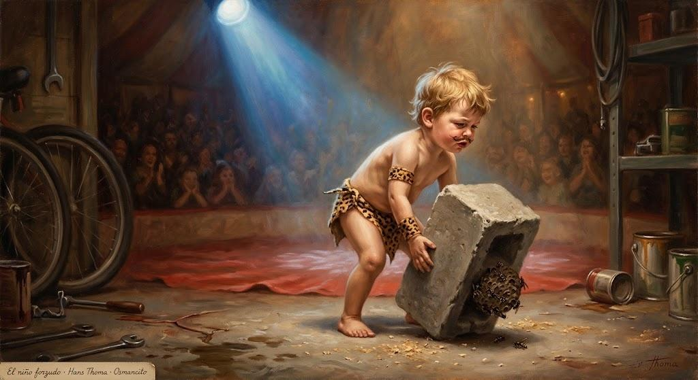

# Mientras escribo

*Mientras escribo* es el título castellano de *On Writing*, el libro en que Stephen King cuenta cómo llegó al oficio y cómo se hace. Salió en el año 2000. Antes de entrar en materia trae tres prólogos cortos; después viene el cuerpo del libro: una memoria, el C.V., y luego qué es escribir, la caja de herramientas y más. Aquí lo destilamos en ese orden, empezando por lo primero que King pone en manos del lector: los prólogos.

## Los prólogos

### Un libro sin paja

El primer prólogo empieza con una banda. A principios de los noventa King entró en los Rock Bottom Remainders, un grupo de rock formado casi todo por escritores, pensado para dos conciertos y que nunca llegó a disolverse. Una noche, cenando comida china antes de un concierto en Miami Beach, le preguntó a Amy Tan qué pregunta no le hacían nunca después de una charla. Ella dijo: «No one ever asks about the language», nadie pregunta nunca por el lenguaje. King le debe una deuda enorme de gratitud, y el libro está dedicado a ella. Esto era lo que lo frenaba:

> I had been playing with the idea of writing a little book about writing for a year or more at that time, but had held back because I didn’t trust my own motivations—why did I want to write about writing?
>
> <small>Frase 40</small>

Llevaba un año o más dándole vueltas a la idea de escribir un librito sobre escribir, pero me había contenido porque no confiaba en mis propios motivos: ¿por qué quería yo escribir sobre escribir?

> What made me think I had anything worth saying?
>
> <small>Frase 41</small>

¿Qué me hacía pensar que tenía algo que valiera la pena decir?

La respuesta fácil sería su fama: quien ha vendido tantos libros de ficción algo tendrá que decir sobre cómo se escriben. Pero la respuesta fácil, dice, no siempre es la verdad. Y da un ejemplo: el coronel Sanders vendió una barbaridad de pollo frito, pero no está seguro de que alguien quiera saber cómo lo hizo. (De fuera del libro: Harland Sanders fundó la cadena Kentucky Fried Chicken; fuente: [KFC, nuestra historia](https://global.kfc.com/our-history).)

Si iba a ser tan presuntuoso como para decirle a la gente cómo escribir, sentía que necesitaba una razón mejor que su éxito popular. Y la da por el lado contrario, diciendo lo que no quería hacer:

> Put another way, I didn’t want to write a book, even a short one like this, that would leave me feeling like either a literary gas-bag or a transcendental asshole.
>
> <small>Frase 45</small>

Dicho de otro modo, no quería escribir un libro, ni siquiera uno corto como este, que me dejara sintiéndome o un palabrero literario o un imbécil trascendental.

Un *gas-bag* es, literalmente, una bolsa de gas: el palabrero que se infla hablando. Ya hay bastantes libros así, y bastantes escritores así, en el mercado, añade King, y da las gracias con ironía.

El remedio es la brevedad. El segundo prólogo abre diciendo que este es un libro corto porque casi todos los libros sobre escribir están llenos de *bullshit*, la palabra que usa para la paja, y que los escritores de ficción, él incluido, entienden poco de lo que hacen. Hace una excepción: *The Elements of Style*, de William Strunk Jr. y E. B. White, que tiene ochenta y cinco páginas y casi nada de paja. Su regla 17 es «Omit needless words»: omite las palabras que sobran. King se compromete:

> I will try to do that here.
>
> <small>Frase 62</small>

Intentaré hacer eso aquí.

El tercer prólogo es una nota breve para su editor. Hay una regla del camino que el libro no dice en otro sitio: «el editor siempre tiene la razón». Ningún escritor sigue todos los consejos de su editor, pero escribir es humano y editar es divino. Chuck Verrill editó este libro, como tantas novelas de King, y el prólogo cierra con un agradecimiento: «Y como siempre, Chuck, estuviste divino». Lo firma «Steve». Después de los prólogos empieza el libro, con el C.V.

## C.V.

### El paisaje con niebla

King se quedó pasmado con The Liars' Club, las memorias de la poeta americana Mary Karr: ella lo recuerda todo de su infancia. Él no. La suya fue a tirones, con una madre sola y quizá una temporada en casa de una tía:

> Perhaps she was only chasing our father, who piled up all sorts of bills and then did a runout when I was two and my brother David was four.
>
> <small>Frase 75</small>

Quizá solo perseguía a nuestro padre, que amontonó deudas de todas clases y luego se esfumó cuando yo tenía dos años y mi hermano David cuatro.

Mary Karr es poeta y memorista: The Liars' Club, «el club de los mentirosos», salió en 1995, pasó más de un año entre los más vendidos del New York Times y le devolvió la moda al género. «Did a runout» es el americano para largarse sin aviso y no volver. El libro no da el nombre del padre; las biografías lo llaman Donald Edwin King.

Nunca lo encontró. La madre, Nellie Ruth Pillsbury King, fue de las primeras mujeres liberadas de América, y no por gusto. Donde Karr tiene un panorama sin cortes, King tiene un paisaje con niebla del que asoman árboles que parecen querer comerte. Avisa, eso sí: esto no es autobiografía, es curriculum vitae.

> This is how it was for me, that’s all—a disjointed growth process in which ambition, desire, luck, and a little talent all played a part.
>
> <small>Frase 87</small>

Así fue para mí, eso es todo: un proceso de crecimiento desordenado en el que la ambición, el deseo, la suerte y un poco de talento jugaron su papel.

El curriculum vitae es el papel donde uno cuenta sus estudios y sus oficios; King juega con eso: esto es el C.V. de un escritor, no la historia de su vida.

Pide no buscar una línea que una los puntos: no hay líneas, solo instantáneas, la mayoría desenfocadas.

### El niño forzudo

Su primer recuerdo es imaginarse otro: el Forzudo del circo Ringling Brothers, en casa de la tía Ethelyn y el tío Oren, en Durham, Maine. Tiene dos años y medio, quizá tres. Levantó un bloque de cemento del garaje y lo cargó despacio, pero en su mente vestía piel de leopardo y cruzaba la pista central: la multitud en silencio, un foco marcando su paso. «¡Y solo tiene dos años!». Lo que no sabía: unas avispas anidaban en el bloque, y una le picó la oreja. Fue el peor dolor de su corta vida, por unos segundos:

> When I dropped the cinderblock on one bare foot, mashing all five toes, I forgot all about the wasp.
>
> <small>Frase 103</small>

Cuando dejé caer el bloque de cemento sobre un pie descalzo, machacándome los cinco dedos, me olvidé por completo de la avispa.

«Cinderblock» es el bloque hueco de cemento de la construcción americana, pesado y con cavidades donde anidan insectos. El Ringling Brothers fue el circo más famoso de Estados Unidos, y su Strongboy, el forzudo, levantaba pesas en la pista central. Durham es un pueblo de Maine.

Al soltarlo, la avispa dejó de existir:

> I can’t remember if I was taken to the doctor, and neither can my Aunt Ethelyn (Uncle Oren, to whom the Evil Cinderblock surely belonged, is almost twenty years dead), but she remembers the sting, the mashed toes, and my reaction.
>
> <small>Frase 104</small>

No recuerdo si me llevaron al médico, y mi tía Ethelyn tampoco (el tío Oren, a quien sin duda pertenecía el Maligno Bloque de Cemento, lleva muerto casi veinte años), pero ella sí recuerda la picadura, los dedos machacados y mi reacción.

«The Evil Cinderblock», con mayúsculas de villano de cuento, es broma de familia: el bloque era del tío Oren, y en su haber quedaron la picadura y los dedos machacados.

La tía Ethelyn cierra la anécdota en broma, hablando con él: «¡Cómo aullaste, Stephen!». Y sentencia que aquel día estaba «ciertamente en plena voz» — «in fine voice», como se dice de un cantante en su mejor noche.

© 2026 Osmancito

[volver](../destileria.html)
